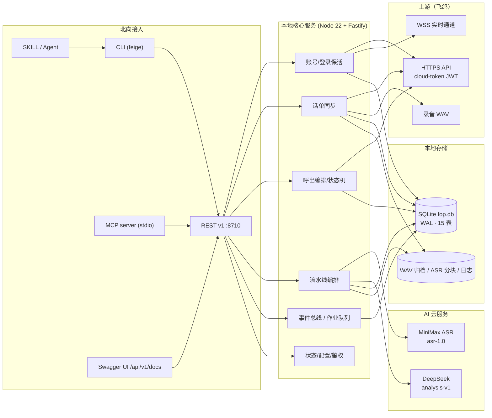
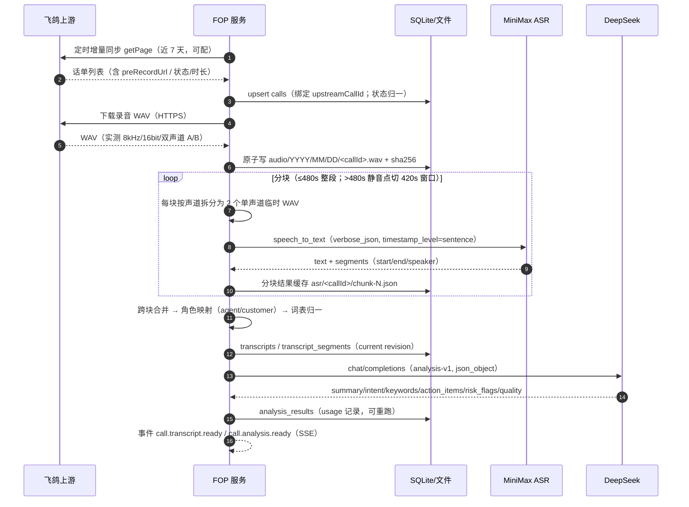
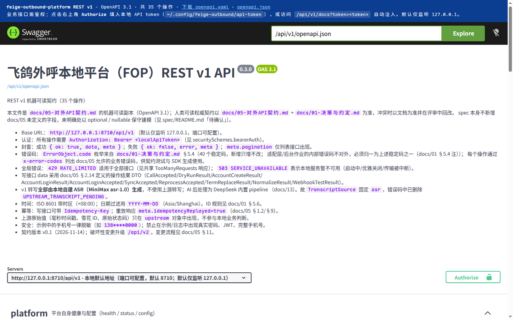

<p align="center">
  
</p>

<h1 align="center">feige-outbound-platform（FOP）</h1>

<p align="center">
  把飞鸽外呼（feige.duofangtongxin.com）封装成本地可编程平台的「最后一公里」<br/>
  REST v1 · CLI · MCP · SKILL · 100% 自建 ASR · DeepSeek AI 后处理 · 呼出编排 · 全量话单归档
</p>

<p align="center">
  
  
  
  
  
  
</p>

---

## 这是什么

**feige-outbound-platform（FOP）** 是一个本地常驻平台，把飞鸽外呼的上游能力（多账号登录、话单列表、回拨呼出、录音）封装为：

- **北向四入口**：REST v1（Fastify，默认 `127.0.0.1:8710`）、**CLI（`feige`）**、**MCP server（stdio）**、**SKILL 包**（给 agent 用的操作手册）；
- **南向自动化**：多账号自动登录（含阿里云滑块）与 7 天 JWT 保活、话单增量/全量同步、回拨呼出编排与状态机；
- **100% 本地转写**：录音下载归档后，用 MiniMax `asr-1.0` 自建 ASR（**双声道 A/B 拆分**获得说话人、静音切分、跨块合并、角色映射、词表归一），**不使用上游转写**；
- **内置 AI 后处理**：DeepSeek（`analysis-v1` prompt + JSON schema 校验 + 失败升级链），输出摘要/意图/关键词/行动项/风险/质检建议；
- **可靠存储**：SQLite（WAL，15 张表）+ 本地 WAV 归档 + ASR 分块缓存 + 事件流（SSE）+ 作业队列（可恢复/退避重试）。

> 本项目与飞鸽/多方言通官方无隶属关系；仅作为本地集成自动化工具。请在获得授权、遵守上游条款与当地法律法规（含个人信息保护）的前提下使用。

---

## 目录

- [它解决什么问题](#它解决什么问题)
- [功能特性](#功能特性)
- [架构](#架构)
- [数据流水线](#数据流水线)
- [快速开始（5 分钟）](#快速开始5-分钟)
- [REST API 与运行时文档](#rest-api-与运行时文档)
- [CLI（feige）](#clifeige)
- [MCP 与 SKILL](#mcp-与-skill)
- [配置](#配置)
- [部署为系统服务](#部署为系统服务)
- [数据与存储](#数据与存储)
- [验收与测试](#验收与测试)
- [安全与隐私](#安全与隐私)
- [排障速查](#排障速查)
- [目录结构](#目录结构)
- [文档索引](#文档索引)
- [已知限制与路线](#已知限制与路线)
- [License](#license)

---

## 它解决什么问题

飞鸽外呼网页端能做的事（看话单、听录音、拨号）很难被 agent 或本地系统直接调用；历史话单的录音与转写也不在本地、难以批量分析。FOP 把这些能力本地化、API 化：

| 痛点 | FOP 的解法 |
| --- | --- |
| 上游只有网页操作，无 API token 体系 | 本地 REST v1（Bearer token），35 个操作，OpenAPI 3.1 契约 + Swagger UI |
| 登录态 7 天过期、阿里云滑块难自动 | CloakBrowser headful 自动登录（humanized 滑块）+ 定时保活/health/WS |
| 话单散落网页、录音 7 天后可能消失 | 全量/增量同步 + 录音下载归档（sha256）到本地 |
| 上游转写覆盖不完整、不可控 | 100% 本地 ASR：MiniMax `asr-1.0` + 分块 + 声道拆分 + 角色映射 + 词表 |
| 录音没有结构化分析 | DeepSeek 内置后处理：摘要/意图/关键词/行动项/风险/质检 |
| agent 无法安全地"打电话/查记录" | CLI + MCP（只读/写工具双闸）+ SKILL 操作手册 |
| 夜间/无人值守运行 | systemd user service + 自动同步/回填 + 可观测状态/事件 |

---

## 功能特性

| 模块 | 能力 | 状态 |
| --- | --- | --- |
| 账号 | 多账号 CRUD、自动登录（滑块）、JWT 保活、健康检查、线路/坐席信息 | ✅ |
| 话单 | 增量/全量/区间同步、分页过滤、详情（含上游字段）、事件流、录音 Range 下载 | ✅ |
| 呼出 | 回拨呼出受理、时段校验/排队、幂等/冷却/串行、状态机、取消、真实拨测 | ✅ |
| 录音 | 直连下载 + sha256 + 原子写 + 按年/月/日归档、容量可观测 | ✅ |
| 转写 | MiniMax ASR、双声道拆分、>8min 静音切分、断点续跑、角色映射、词表归一、SRT/Markdown 导出 | ✅ |
| 分析 | DeepSeek 摘要/意图/关键词/行动项/风险/质检、JSON schema、升级链、usage 记录 | ✅ |
| 编排 | 作业队列（租约/重试/退避/恢复）、事件总线/SSE、内置流水线（audio→asr→analysis）、批量回填 | ✅ |
| 接口 | REST 35 操作、CLI（40+ 命令节点、`--help-all`）、MCP（18 只读/32 写）、SKILL | ✅ |
| 文档 | OpenAPI 3.1 + Swagger UI 运行时文档、自动生成 CLI 参考、安装部署手册、验收报告 | ✅ |
| 部署 | systemd user unit、Xvfb（无显示登录）、环境变量/密钥 0600、备份/升级/排障手册 | ✅ |

---

## 架构



- 所有入口（CLI/MCP/SKILL）都只经 **REST v1** 调用本地服务，不直接访问 DB/上游；
- 服务默认仅监听 `127.0.0.1`，通过 Bearer token 鉴权；OpenAPI/Swagger 文档端点公开（便于本地查看）。

---

## 数据流水线



> 说话人分离优先使用**双声道拆分**（实测录音为 8kHz/2ch A/B）；单声道文件回退到 ASR diarization + 规则/LLM 角色映射。

---

## 快速开始（5 分钟）

### 0. 前置条件

- **Node.js ≥ 22.5**（依赖内置 `node:sqlite`；建议 Node 22 LTS）
- 可访问：飞鸽上游（HTTPS/WSS）、MiniMax ASR、DeepSeek API
- 登录需要浏览器环境：Chromium/CloakBrowser + 显示（无显示可用 Xvfb，见部署手册）
- 操作系统：Linux（已在 NixOS 验证）、macOS/Windows 理论可用（systemd 部分替换为相应服务管理器）

### 1. 获取代码并安装

```bash
git clone https://github.com/CindyRIng/feige-outbound-platform.git
cd feige-outbound-platform
npm install
npm run build            # tsc + 复制迁移/登录 worker/OpenAPI 资产
npm run install:cli      # 安装 feige 到 ~/.local/bin（确保在 PATH 中）
feige --version
```

### 2. 配置密钥

```bash
mkdir -p ~/.config/feige-outbound && chmod 700 ~/.config/feige-outbound
cat > ~/.config/feige-outbound/secrets.json <<'JSON'
{
  "minimaxApiKey": "sk-api-你的MiniMaxKey",
  "deepseekApiKey": "sk-你的DeepSeekKey",
  "accounts": {}
}
JSON
chmod 600 ~/.config/feige-outbound/secrets.json
```

> MiniMax key 区域需与 endpoint 匹配：**CN key 用 `https://api.minimax.cn`（默认）**；global key 改配置 `pipeline.asr.baseUrl=https://api.minimax.io`，否则 401 invalid api key。

### 3. 启动服务

```bash
feige serve                 # 前台启动（Ctrl-C 退出），默认 127.0.0.1:8710
# 或后台/系统服务：
npm start                   # node dist/src/main.js serve
```

首次启动会自动：创建数据/日志目录、执行 SQLite 迁移、生成 API token（`~/.config/feige-outbound/api-token`）。

验证：

```bash
feige health
feige status
```

### 4. 接入账号并登录

```bash
feige account add main --name 主账号 --username 156****0075 --password-stdin
# 或 REST：
curl -X POST http://127.0.0.1:8710/api/v1/accounts \
  -H "Authorization: Bearer $(cat ~/.config/feige-outbound/api-token)" \
  -H 'content-type: application/json' \
  -d '{"accountId":"main","displayName":"主账号","username":"156****0075","password":"<密码>"}'

feige account login main        # 自动打开浏览器完成滑块登录（约 6–30s）
feige account health main       # state=online / upstream=true / line=电信回拨
```

### 5. 同步话单并查看结果

```bash
feige sync --wait               # 增量同步（近 7 天）
feige sync --full --wait        # 全量回补（历史话单 + 入队 ASR/分析）
feige calls list --size 5
feige calls detail <callId>
feige calls transcript <callId> --include-analysis
feige calls audio <callId> --out /tmp/call.wav
```

### 6. 打开 API 文档

浏览器访问 **http://127.0.0.1:8710/api/v1/docs**：



> 业务接口需要 token：点右上角 **Authorize** 粘贴 `~/.config/feige-outbound/api-token`，或访问 `/api/v1/docs?token=<token>` 自动注入；OpenAPI 契约也可直接下载：`/api/v1/openapi.json`、`/api/v1/openapi.yaml`。

### 7. 呼出（回拨模式）

```bash
feige dial 138****0000 --account main --dry-run   # 预检（不产生话单）
feige dial 138****0000 --account main --yes       # 真实呼出（坐席手机需接听；07:50–22:00 时段，线路级可能 08:00 起）
```

---

## REST API 与运行时文档

- **Base URL**：`http://127.0.0.1:8710/api/v1`（默认仅监听 127.0.0.1；端口 `--port`/`FOP_PORT` 可改）
- **认证**：业务接口需 `Authorization: Bearer <localApiToken>`；token 由服务首次启动生成，位于 `~/.config/feige-outbound/api-token`
- **封套**：成功 `{ok:true,data,meta}`；失败 `{ok:false,error,meta}`；列表带 `meta.pagination`
- **运行时文档**：
  - `GET /api/v1/docs` — Swagger UI（离线资源，支持 `?token=`）
  - `GET /api/v1/openapi.json` / `GET /api/v1/openapi.yaml` — OpenAPI 3.1 契约（35 操作 / 26 路径 / 40 稳定错误码）
  - `GET /api/v1` — API 发现页
- **人类可读契约**：`docs/05-对外API契约.md`；机器契约 `spec/openapi.yaml`（两者对拍，验收脚本检查路由一致性）
- **SSE 实时事件**：`GET /api/v1/events/stream?types=call.*`（`call.transcript.ready`、`call.analysis.ready` 等 24 类事件）

```bash
TOKEN=$(cat ~/.config/feige-outbound/api-token)
curl -s -H "Authorization: Bearer $TOKEN" http://127.0.0.1:8710/api/v1/status | jq
curl -sN -H "Authorization: Bearer $TOKEN" 'http://127.0.0.1:8710/api/v1/events/stream?types=call.*'
```

---

## CLI（feige）

`feige` 是 REST 的薄封装（40+ 命令节点），默认人类可读输出，`--json` 输出与 REST 同构 envelope，适合脚本/agent。

```bash
feige --help                       # 顶层命令 + 全局选项
feige --help-all                   # 完整命令树（全部命令/子命令/参数/选项）
feige help calls                   # 某命令（含子命令）帮助
feige account list                 # 账号
feige calls list --status ended --has-transcript
feige jobs list --size 5
feige events --follow --duration 30s
feige term list / term add / term import rules.json
feige doctor --probe-providers     # 自检：配置/token/DB/账号/时段/出站
feige completion bash              # shell 补全
```

- 退出码：`0` 成功、`2` 参数、`3` 未找到、`4` 业务拒绝、`5` 上游/服务端、`6` 鉴权、`8` 网络不可达、`9` 超时、`130` Ctrl-C。
- 危险操作（`dial`/`account remove`/`reprocess`）默认需交互确认；非交互必须 `--yes` 或先 `--dry-run`。
- 完整命令参考（自动生成，与 `feige --help-all` 一致）：[docs/16-CLI参考手册.md](docs/16-CLI参考手册.md)

---

## MCP 与 SKILL

- **MCP server（stdio）**：`feige mcp`（默认只读 18 工具；`feige mcp --allow-write` 开放 32 工具，写工具需 `confirm:true`）。
  ```json
  {
    "mcpServers": {
      "feige": { "command": "feige", "args": ["mcp"] }
    }
  }
  ```
- **工具契约**：`docs/07-MCP工具契约.md`；工具名如 `feige_status`、`feige_call_list`、`feige_call_detail`、`feige_call_transcript`、`feige_dial` 等。
- **SKILL 包**：`skills/feige/SKILL.md`（何时使用/前置检查/决策树/40 错误码动作表/安全合规/剧本）。

---

## 配置

### 配置文件

| 路径 | 内容 | 权限 |
| --- | --- | --- |
| `~/.config/feige-outbound/config.json` | 非敏感配置（服务/存储/浏览器/时段/流水线/日志） | 0600–0644 |
| `~/.config/feige-outbound/secrets.json` | AI 密钥 + 上游账号凭证 | **0600** |
| `~/.config/feige-outbound/api-token` | 本地 REST API token（首次启动生成） | 0600 |
| `~/.config/feige-outbound/env` | systemd EnvironmentFile（可选，放密钥） | **0600** |

配置可运行时修改：`feige config get`、`feige config set server.port=8710`，或 `PATCH /api/v1/config`（密钥字段不可经 API 修改）。

### 环境变量（服务端）

| 变量 | 默认 | 说明 |
| --- | --- | --- |
| `FOP_HOST` / `FOP_PORT` | `127.0.0.1` / `8710` | 监听地址/端口 |
| `FOP_DATA_DIR` | `~/.local/share/feige-outbound` | 数据目录（DB/录音/ASR/日志） |
| `FOP_CONFIG_DIR` | `~/.config/feige-outbound` | 配置目录 |
| `FOP_MINIMAX_API_KEY` | — | MiniMax ASR key（可覆盖 secrets.json） |
| `FOP_DEEPSEEK_API_KEY` | — | DeepSeek key |
| `FOP_ASR_MODEL` | `asr-1.0` | ASR 模型 |
| `FOP_ANALYSIS_MODEL` | `deepseek-chat` | 分析模型（升级模型 `deepseek-v4-pro`） |
| `FOP_LOG_LEVEL` | `info` | `debug|info|warn|error` |
| `security.maskPhones` | `false` | 配置项：`false`=API/CLI 显示完整号码（默认）；`true`=脱敏 |
| `FOP_OPENAPI_FILE` | 自动探测 | OpenAPI 契约文件路径 |
| `FOP_MASK_PHONES` | `false` | 展示层手机号脱敏（true=打码；默认完整号码） |

### 环境变量（CLI）

| 变量 | 默认 | 说明 |
| --- | --- | --- |
| `FOP_API_URL` | `http://127.0.0.1:8710/api/v1` | REST 基址 |
| `FOP_API_TOKEN` | — | 直接指定 token（优先级高于文件） |
| `FOP_API_TOKEN_FILE` | `~/.config/feige-outbound/api-token` | token 文件 |
| `FOP_CONFIG_DIR` | `~/.config/feige-outbound` | 配置目录（定位 token 文件） |

> 完整配置项（pipeline/limits/sync/events/backup/runtime 等）见 `docs/10-部署与运维.md` §12 与 `docs/15-安装与部署手册.md`。

---

## 部署为系统服务

```bash
# 1. 安装 systemd user unit（模板在 deploy/）
mkdir -p ~/.config/systemd/user
cp deploy/feige-outbound.service ~/.config/systemd/user/
systemctl --user daemon-reload
systemctl --user enable --now feige-outbound.service

# 2. 查看状态/日志
systemctl --user status feige-outbound.service
journalctl --user -u feige-outbound.service -f

# 3. 无显示环境（headless 登录）启用 Xvfb
cp deploy/feige-outbound-xvfb.service ~/.config/systemd/user/
systemctl --user enable --now feige-outbound-xvfb.service
# 并在 feige-outbound.service 中取消 DISPLAY=:99 注释
```

> 详细安装、升级、备份、排障见 **[docs/15-安装与部署手册.md](docs/15-安装与部署手册.md)**。

---

## 数据与存储

```
~/.local/share/feige-outbound/
├── fop.db                  # SQLite（WAL；15 张表：账号/话单/录音/转写/分析/作业/事件/词表/审计…）
├── audio/YYYY/MM/DD/*.wav  # 原始录音归档（8kHz/16bit/2ch，sha256 记录在 DB）
├── asr/<callId>/           # ASR 分块缓存（断点续跑/重跑复用）
├── profiles/<accountId>/   # 登录浏览器 profile（含登录态，务必保护）
├── diagnostics/            # 登录失败诊断截图等
├── logs/                   # 日志（同时输出 stdout）
└── tmp/                    # 临时切片/下载
```

- **备份**：停止写入后备份 `fop.db`（或 SQLite 在线备份）+ `audio/` + `~/.config/feige-outbound/`（config/secrets/token）。示例见部署手册。
- **容量**：录音约 32KB/s ≈ 115MB/小时；1,000 通 3 分钟通话约 5.8GB。可配置备份/清理策略（`backup.includeAsrChunks`）。

---

## 验收与测试

```bash
npm test                              # 93/93 单测（db / media / upstream / cli+mcp）
node scripts/acceptance.mjs           # 端到端验收 25 项（服务需运行）
node scripts/mcp-smoke.mjs            # MCP 工具冒烟
node scripts/reconcile.mjs            # 数据对账（--cancel-jobs 清理积压作业）
```

验收覆盖：服务/鉴权/API 发现/OpenAPI/Swagger、账号在线与 JWT、话单同步、录音归档与 Range、转写（source=asr/分段/角色/声道）、AI 分析、词表归一、呼出受理/时段/取消、错误语义、CLI/MCP、回填进度。报告见 **[docs/14-实现验收报告.md](docs/14-实现验收报告.md)**。

---

## 词表维护（同音词归一）

- 词表规则存于 SQLite `term_rules`，默认内置 `孚盟` 的 9 个同音变体（复萌/复盟/福萌/福盟/富盟/福梦/弗盟/孚蒙/福蒙），见 [docs/13 §5](docs/13-后处理规格（ASR与LLM）.md)。
- 修改规则后，新转写自动生效；**历史数据**用维护脚本低成本刷新（不重跑 ASR/LLM）：

```bash
npm run terms:renormalize              # dry-run 统计
npm run terms:renormalize -- --apply   # 应用（重算 normalizedText/full_text 与分析文本）
```

- 原文 `full_text_raw` 始终保留，可追溯 ASR 原始输出；抽查：`feige calls transcript <callId>`。

## 安全与隐私

- 默认仅监听 `127.0.0.1`，不暴露公网；若确实需要远程访问，请自行加反向代理 + TLS + 更强鉴权（v1 不支持多用户）。
- `secrets.json`、`api-token`、浏览器 profile 均含敏感信息，权限 0600/0700，禁止提交到仓库。
- **展示层 PII（v0.3.1 起）**：API/CLI 默认返回**完整手机号**（`security.maskPhones=false`，本机单用户运营）；设 `true` 可恢复打码。日志始终脱敏、发送给 DeepSeek 的分析输入默认脱敏、公开文档示例均为占位号码。
- 浏览器自动化仅用于账号登录（官方网页登录 + 滑块），请遵守上游使用条款；真实拨号会产生费用与真实电话，测试请使用可接听的号码。
- 已知 v1 简化：JWT 以明文存于 0600 的 SQLite（`jwt_key_id=plain-v1`），后续版本支持 `FOP_SECRET_KEY` AES-256-GCM 加密。

---

## 排障速查

| 现象 | 原因/处理 |
| --- | --- |
| `UNAUTHORIZED` | CLI 读不到 token：`cat ~/.config/feige-outbound/api-token`；或 `feige doctor --fix-token` |
| `ACCOUNT_LOGIN_REQUIRED` | `feige account login main`；检查浏览器/显示/Xvfb |
| 登录卡在滑块/`CAPTCHA_FAILED` | 提高显示稳定性、降低并发；worker 自动重试 2 次；查看 `diagnostics/` 截图 |
| ASR `401 invalid api key` | key 区域与 `pipeline.asr.baseUrl` 不匹配（CN key 用 `api.minimax.cn`） |
| ASR `429 conn limit` | MiniMax 账号并发上限低（实测=1）；保持 `pipeline.asr.concurrency=1`，等待退避重试 |
| 呼出 `CALL_OUTSIDE_DIAL_WINDOW` / `2516 当前时间段无法调用` | 全局 07:50–22:00；**线路级时段可能 08:00 才放行**；本平台会排队/10 分钟后重试 |
| `被叫号码30秒内只能拨打一次` / `5次/天` | 上游频率限制，请降低拨测频率 |
| 录音未生成/`AUDIO_NOT_READY` | 上游录音可能延迟约 2 分钟；同步会回补 `missing→pending` |
| 服务启动报 DB 版本/迁移错误 | 检查 `FOP_DATA_DIR` 是否被多进程同时使用；用 `scripts/reconcile.mjs` 对账 |
| CLI 命令不存在 | 未安装：`npm run build && npm run install:cli`；确认 `~/.local/bin` 在 PATH |

更多见 [docs/15-安装与部署手册.md](docs/15-安装与部署手册.md) 与 [docs/10-部署与运维.md](docs/10-部署与运维.md)。

---

## 目录结构

```
feige-outbound-platform/
├── src/
│   ├── api/          # Fastify REST v1 + Swagger/OpenAPI 运行时文档
│   ├── core/         # 账号/同步/呼出/流水线/作业/事件/词表/状态
│   ├── db/           # SQLite 迁移 + Repo（15 表）
│   ├── upstream/     # 飞鸽 HTTP/登录 worker/WS
│   ├── media/        # WAV 解析切分 / MiniMax ASR / DeepSeek 分析
│   ├── cli/          # CLI（feige）+ MCP server
│   └── util/         # 脱敏/ID/时间等
├── tests/            # node:test（93 例）
├── scripts/          # 验收/对账/CLI 安装/CLI 文档生成/冒烟
├── docs/             # 设计/契约/部署/验收/CLI 参考（15–16）
├── spec/             # OpenAPI 3.1 契约 + 契约说明
├── deploy/           # systemd / Xvfb / env 模板
├── skills/feige/     # SKILL 包
└── package.json
```

---

## 文档索引

| 文档 | 内容 |
| --- | --- |
| [docs/15-安装与部署手册.md](docs/15-安装与部署手册.md) | **安装、环境、配置、systemd、Xvfb、备份、升级、排障（重点）** |
| [docs/16-CLI参考手册.md](docs/16-CLI参考手册.md) | **CLI 全部命令/子命令/选项（自动生成）** |
| [docs/14-实现验收报告.md](docs/14-实现验收报告.md) | **M1–M5 实现验收证据（真实拨测/全量回补）** |
| [docs/01-决策与约定.md](docs/01-决策与约定.md) | 单一事实源：术语/枚举/40 错误码/状态机/决策 |
| [docs/04-数据模型与状态机.md](docs/04-数据模型与状态机.md) | SQLite 15 表 DDL/索引/状态机 |
| [docs/05-对外API契约.md](docs/05-对外API契约.md) | REST v1 人类可读权威契约（35 操作） |
| [docs/06-CLI契约.md](docs/06-CLI契约.md) / [docs/07-MCP工具契约.md](docs/07-MCP工具契约.md) / [docs/08-SKILL契约.md](docs/08-SKILL契约.md) | 北向接入契约 |
| [docs/13-后处理规格（ASR与LLM）.md](docs/13-后处理规格（ASR与LLM）.md) | ASR/LLM 契约、分块、说话人、词表、prompt/schema |
| [docs/00-上游可行性侦察.md](docs/00-上游可行性侦察.md) | 上游实测（登录/话单/录音/呼出/线路级时段） |
| [spec/openapi.yaml](spec/openapi.yaml) | OpenAPI 3.1 机器契约（运行时 `/api/v1/openapi.json` 同源） |

---

## 已知限制与路线

- **回拨模式**：上游无 SIP 线路，真实呼出会先呼叫坐席手机，需人工接听后再桥接被叫；v1 不做 AI 语音外呼。
- **上游频率**：同主被叫 30s/次、5 次/天；线路级时段比全局更严（实测 08:00 起放行）。
- **ASR 并发**：MiniMax 默认账号 `conn limit=1`（实测），全量回补耗时较长；可申请更高并发后调大 `pipeline.asr.concurrency`。
- **JWT 明文存储**：v1 简化，后续加密（见 docs/11）。
- **长通话**：>480s 分块已用 508s 真实音频验证；超长（>30min）建议先评估成本。
- 路线图：多账号并行调度、Webhook 幂等重投、向量检索/知识库、REST 多用户 RBAC、Prometheus 指标。

---

## License

[MIT](LICENSE) © 2026 CindyRIng

> 本项目不隶属于飞鸽/多方言通；"飞鸽"等商标归其权利人所有。使用时请遵守上游服务条款、隐私与数据保护法规。
