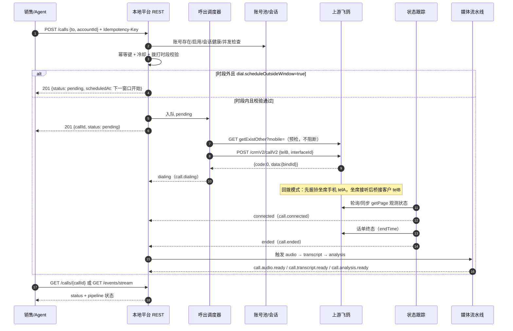
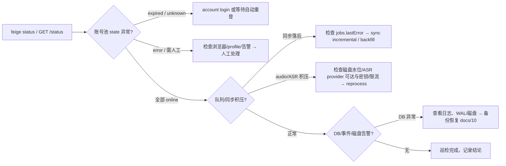
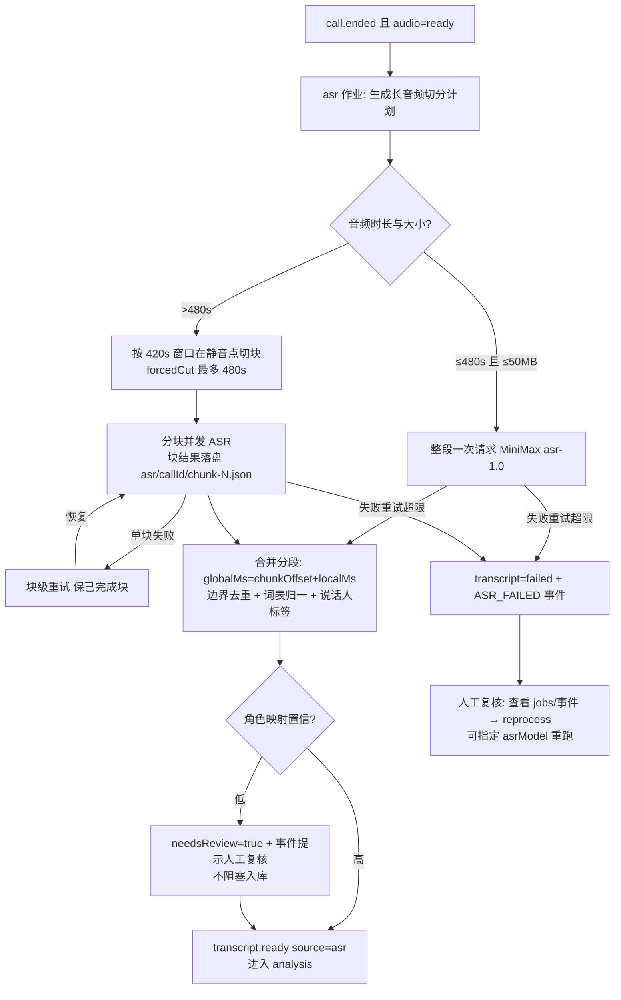

# 02 需求文档（PRD）

> 项目：`feige-outbound-platform`（FOP，本地飞鸽外呼平台）
> 状态：v0.2（2026-11-14 决策修订：转写 100% 本地自建 MiniMax ASR + DeepSeek 内置后处理）｜阶段：M0 文档评审
> 基准：术语/枚举/错误码/状态机/接口清单以 [01-决策与约定.md](./01-决策与约定.md) 为准；接口字段/示例以 [05-对外API契约.md](./05-对外API契约.md) 为准；**ASR（MiniMax）/LLM（DeepSeek）接入与后处理实现规格以 [13-后处理规格（ASR与LLM）.md](./13-后处理规格（ASR与LLM）.md) 为准**；上游事实以 [00-上游可行性侦察.md](./00-上游可行性侦察.md) 为准。冲突时按「01 → 05 → 13 → 00」优先级裁决，并在评审中回改本文。
> 读者：产品/架构/测试/运维/二次开发接入方。

## 文档信息

| 项 | 内容 |
| --- | --- |
| 文件 | `docs/02-需求文档.md` |
| 版本 | v0.2（与 docs/01 v0.2、docs/05 v0.2、docs/13 v0.1 同批；v0.1 → v0.2 按业务方确认的 D1–D8 决策修订转写/后处理需求） |
| 状态 | 待评审（M0 退出标准之一） |
| 上游事实依据 | [00-上游可行性侦察.md](./00-上游可行性侦察.md)（标注"实测"的条目来自真实抓包/调用；§5 已标注"不使用上游转写"决策） |
| 第三方云实测依据 | [13-后处理规格（ASR与LLM）.md](./13-后处理规格（ASR与LLM）.md) §2.4/§3.3（MiniMax ASR 与 DeepSeek 实测数据，2026-11-14 真实密钥） |
| 接口权威 | [05-对外API契约.md](./05-对外API契约.md)（35 个 REST 操作）；[01-决策与约定.md](./01-决策与约定.md) §4.1（方法与路径） |
| 安全与合规 | [11-安全与合规.md](./11-安全与合规.md)（本文只做摘要与引用；第三方云委托处理见 §7.6） |
| 覆盖里程碑 | M1–M5（见 [12-里程碑与验收.md](./12-里程碑与验收.md)）；M0 即本套文档评审 |
| 下游文档 | 03 架构 / 04 数据模型 / 05 API / 06 CLI / 07 MCP / 08 SKILL / 09 上游适配 / 10 部署运维 / 11 安全 / 12 验收 / 13 后处理规格 |

### 写作与编号约定

| # | 约定 |
| --- | --- |
| 1 | 功能需求编号 `FR-001` 起，三位数字连续编号；非功能需求编号 `NFR-<类别>-<序号>`；成功度量 `M-xx`；上游事实 `F-xx`；约束投影 `C-xx`；场景 `UJ-xx`；角色 `R-xx`。 |
| 2 | 优先级：`P0` = M1–M5 必须交付且阻塞里程碑退出；`P1` = v1 应有，可在评审后裁剪但需记录理由；`P2` = v1.x/增量，不阻塞 v1 验收。 |
| 3 | "关联接口"列使用 docs/05 的 REST 路径（省略基址 `http://127.0.0.1:8710` 与 `/api/v1` 前缀之外的完整写法均以 docs/05 为准）；`—` 表示不新增 REST 操作、由运维/内部手段承担。 |
| 4 | "验收要点"用 ①②③ 编号，必须**可判定**（可观察、可度量、可自动化）；同一 FR 的验收要点会在 12 文档中映射为 Given/When/Then 用例。 |
| 5 | "M" 列为主交付里程碑；跨里程碑补齐的 FR 在描述中注明。 |
| 6 | 本文不写实现代码；仅允许规格性 JSON 片段引用 docs/05 示例，不重复定义契约。 |

### 目录

1. 背景与目标（§1）
2. 范围与约束（§2）
3. 角色与画像（§3）
4. 端到端场景与用户旅程（§4）
5. 功能需求 FR（§5）
6. 非功能需求 NFR（§6）
7. 数据与隐私要求摘要（§7）
8. 依赖与假设（§8）
9. 风险与缓解（§9）
10. 开放问题（§10）
11. 需求追溯与变更管理（§11）
12. 与其他文档的引用关系（§12）

---

## 1. 背景与目标

### 1.1 背景

上游"飞鸽外呼"（`feige.duofangtongxin.com`，非公开 API）是当前业务在用的外呼 CRM：登录需阿里云滑块，话单/录音/转写/呼出/实时状态均可在网页端完成，但**没有对外开放 API**，也没有本地数据沉淀。业务侧同时存在以下现实：

- 多个坐席账号（多手机号、多 JWT、各自线路与话单），人工切换登录、查单、下载录音成本高且无法审计；
- 上游转写**不可依赖**：抽样 12 通已接通通话中 4 通无转写（`data:null`，且无转写样本时长均 ≤10s），生成时延不可控、质量不透明 → **v1 决策不使用上游转写（D1）**，转写 100% 由本地平台自建（MiniMax ASR `asr-1.0`，见 docs/13）；
- 本地自建转写需解决：长音频切分（MiniMax 单请求上限 500s/50MB）、说话人角色识别（双声道 A/B 优先，否则 ASR diarization + 规则/LLM 复核）、领域词表归一（ASR 同音错误：`孚盟→福盟/富盟/复萌`）、LLM 结构化产出（DeepSeek，默认 `deepseek-chat`，JSON 校验失败升级 `deepseek-v4-pro`）；
- 上游呼出为**回拨模式**（先呼坐席绑定手机、坐席接听后再桥接客户），且服务器端强制**拨打时段 07:50–22:00**（Asia/Shanghai），本地无法绕过；
- 上游 `callV2` **没有幂等键**，网络抖动/超时下重复提交可能造成重复外呼与重复计费；
- 录音与转写含个人信息，且录音/转写需发送至第三方云（MiniMax/DeepSeek）处理，缺少本地加密、访问控制、留存策略与委托处理合规评估。

上游可行性侦察（[00-上游可行性侦察.md](./00-上游可行性侦察.md)）结论为**可行**：除登录外，全部能力可用纯 HTTP/WS 调用；登录态 JWT 有效期 7 天；录音为 8kHz/16bit/双声道 A/B WAV（约 115MB/小时，实测确认）。因此本项目把上游封装为本地常驻平台，向北提供 REST/CLI/MCP/SKILL 四种入口。

### 1.1.1 v1 决策基线（业务方已确认，详见 docs/13 §1）

| # | 决策 | 结论 | 对本文的影响 |
| --- | --- | --- | --- |
| D1 | 是否使用上游转写 | **不使用**；100% 本地自建 | 删除"上游转写优先/兜底"叙事；转写域 FR 全面改写（FR-020~FR-026） |
| D2 | ASR 供应商 | **MiniMax ASR 云 API**（模型 `asr-1.0`） | 新增 ASR 接入/切分/失败语义需求；错误码 `ASR_FAILED` |
| D3 | LLM 供应商 | **DeepSeek 云 API**（OpenAI 兼容） | AI 后处理需求改为 DeepSeek 内置 pipeline |
| D4 | AI 后处理架构 | **平台内置 pipeline**（不经外部 agent） | 后处理为平台内 FR，外部 agent 仅通过 MCP/SKILL 读结果 |
| D5 | 批量策略 | **全量回跑**（历史+新话单），**不设预算上限** | 新增全量回补 FR-059；用量必须可观测（FR-060） |
| D6 | 说话人分离 | 双声道 A/B 拆分优先；否则 ASR 自带 diarization + 角色映射 | 改写 FR-023（角色映射/低置信复核/跨块一致性） |
| D7 | 词表归一 | **确定性词典（`TermRule`）**；ASR 后、LLM 前执行，LLM 输出再归一 | 改写 FR-028；变体残留率纳入度量（M-11） |
| D8 | 语义后处理模型 | 默认 `deepseek-chat`（=flash）；JSON 校验失败/低置信升级 `deepseek-v4-pro` | 改写 FR-030/FR-031；升级路径需验收（AC-075） |

### 1.2 上游实测事实基线（需求的事实来源）

> 下列事实直接决定需求边界，编号 `F-xx` 供 03/04/09/10/11/12/13 引用。来源均为 docs/00，标注"实测"。

| 编号 | 上游事实（实测） | 对需求的直接影响 |
| --- | --- | --- |
| F-01 | 密码登录需阿里云验证码 2.0 滑块；headful 浏览器 + 缓动轨迹可程序化通过（实测一次通过） | 登录必须浏览器自动化；需要账号级独立 profile、失败重试与人工兜底（FR-003/FR-009） |
| F-02 | JWT 为 HS256，`exp-iat=604800s`（7 天） | 需要 JWT 到期管理、提前预重登、失效检测（FR-004） |
| F-03 | 业务 API 鉴权头 `cloud-token`；无 token 返回 HTTP200 + `{code:401}`；token 失效返回 **HTTP200 空 body** | 错误归一必须识别"200 空响应"为 `UPSTREAM_AUTH_EXPIRED`（FR-004/FR-042） |
| F-04 | 话单列表 `getPage` 支持 `limit=100`，单页约 0.4s，**只返回当前登录坐席自己的话单** | 同步按账号分别拉取；本地按 `accountId + upstreamCallId` 去重（FR-010/FR-012） |
| F-05 | 录音字段 `preRecordUrl` 为绝对 URL，含 hash 不可构造；匿名可下载；WAV 16k/16bit/mono ≈ 115MB/小时 | 录音必须**按接口返回值**尽快归档（不可拼 URL），容量按 115MB/小时规划（FR-016/FR-018） |
| F-06 | 录音可通过 HTTPS 代理 `https://feige.duofangtongxin.com/<同路径>` 下载，直连 IP 亦可 | 下载策略"HTTPS 代理优先、直连兜底"（FR-016） |
| F-07 | 上游转写 `call-detail-content` 的 `content` 是 JSON 字符串需二次解析；句级字段含 `channel_id`（0=坐席、1=客户）与情绪/语速/停顿；抽样 8/12 有转写、4/12 为 `data:null`（无转写样本时长 ≤10s） | **v1 不使用上游转写（D1）**，该接口仅保留侦察/抽样对账；转写 100% 本地 ASR 自建（FR-020~FR-026），"是否使用上游转写"不再是设计分支 |
| F-08 | 呼出 `callV2 {telB, interfaceId}`；本账号仅"电信回拨"（lineId=9, mode=1），先振铃坐席手机；**无 SIP 专线** | v1 不做全自动 AI 语音外呼；呼出为"有人工接听"的编排（非目标 N-01；FR-034） |
| F-09 | 上游服务器端强制拨打时段 **07:50–22:00**；时段外 `callV2` 返回 `code=10056` | 本地时段预检 + 窗口内调度 + 错误透传（FR-035/FR-042） |
| F-10 | 呼出前前端会 `GET getExistOther?mobile=` 查重，`data=0` 表示号码可拨 | 呼出前预检；命中不阻断、只记录 warning（FR-036，与 docs/05 §6.1 一致） |
| F-11 | 实时通道 `wss://.../ws/websocket?token=JWT`，纯文本帧，`ping/pong` 保活；通话过程推送格式**待补测** | WS 作为保活/实时补充，不作为唯一状态来源；状态以轮询/同步为准（FR-005/FR-038） |
| F-12 | 每个账号独立 JWT/线路/telA；阿里云验证码依赖浏览器指纹，多账号需独立 profile 并限速错峰 | 账号池隔离、登录错峰、账号级健康与限速（FR-001/FR-006） |
| F-13 | 上游"质检/转写"能力与套餐绑定；本账号质检接口 403，企业被禁用质检时不可拨号 | 账号接入时探测能力；`CALL_REJECTED_BY_UPSTREAM` 透传（FR-008/FR-042） |
| F-14 | `callV2` 成功响应结构、通话状态流转时序、**上游录音生成时延**、WS 通话消息格式**尚未实测**（22:42 拨测被时段拦截）；录音真实声道布局（16kHz mono / 8kHz stereo A/B）待 `ffprobe` 确认 | M3 必须补齐真实拨测；录音生成时延与声道布局在 M2/M3 标定（§9 风险 R-03/R-17、docs/13 §11 V-10） |

### 1.2.1 第三方云实测事实基线（ASR/LLM，来源 docs/13，2026-11-14 真实密钥）

> 以下 `T-xx` 为第三方云服务（MiniMax/DeepSeek）实测事实，是 v1 转写/后处理需求的直接依据；与上游事实 `F-xx` 分开编号，避免混淆"上游能力"与"自建能力"。

| 编号 | 实测事实（docs/13） | 对需求的直接影响 |
| --- | --- | --- |
| T-01 | MiniMax ASR：`POST https://api.minimax.io/v1/speech_to_text`，multipart，`model=asr-1.0`，`response_format=verbose_json`；**单请求上限 500s / 50MB**；`start/end` 为秒（浮点） | ASR 接入与长音频切分需求（FR-020/FR-021）；音频上限约束 C-11 |
| T-02 | 响应含 `duration`、`n_speakers`、`segments[]`（`speaker=S1/S2`、`start/end`、`text`）；`speaker` 为**匿名聚类标签，无角色语义** | 双声道优先 + diarization + 角色映射（FR-023） |
| T-03 | 实测 RTF **0.075–0.16**：10.36s 音频 1.62s（RTF 0.16）；62.1s 音频 4.67s（RTF 0.075），2 说话人识别正确 | 性能目标与容量基线（NFR-PERF-07/13、B-06） |
| T-04 | 实测同音近音错误稳定出现：`孚盟 → 福盟 / 富盟 / 复萌` | 确定性词表归一是必选项（FR-028、R-05） |
| T-05 | DeepSeek LLM：OpenAI 兼容 `POST https://api.deepseek.com/chat/completions`，兼容 `response_format=json_object`（实测有效）；可用 `deepseek-chat`（=flash）与 `deepseek-v4-pro` | 内置 pipeline 与 JSON schema 校验（FR-030/FR-031） |
| T-06 | `deepseek-chat` 实测：208 prompt tokens → 265 completion tokens，**2.3s**，JSON 合法 | 默认 flash 满足吞吐（NFR-PERF-08） |
| T-07 | `deepseek-v4-pro` 默认 reasoning 会占满 `max_tokens`（实测 1200 tokens 全为 reasoning、正文为空，15.7s）→ 必须 `max_tokens ≥ 4096` 或降低 effort | 升级策略必须显式设置 max_tokens（FR-031、AC-075） |
| T-08 | MiniMax ASR 并发/限流上限官方未明示；DeepSeek 429 需退避重试；两者均为 HTTPS 443 出站（`api.minimax.io`/`api.minimax.cn`/`api.deepseek.com`） | 并发控制/限流/重试/故障降级（FR-059、FR-060、NFR-REL-09） |
| T-09 | ~~上游录音真实声道布局~~ **已确认 8kHz/2ch A/B**（真实录音 WAV 头），默认走双声道拆分路径 A；diarization 作为单声道兜底 | 已关闭（2026-11-14） |

### 1.3 问题陈述

| 编号 | 现状/痛点 | 影响 | 对应目标 |
| --- | --- | --- | --- |
| P-01 | 上游只有网页/App，Agent 与外部系统无法编程调用 | 无法把外呼能力嵌入自动化流程 | G-05 |
| P-02 | 多坐席账号需人工登录、7 天过期后重登、切换账号查单 | 运营成本高、易漏单、无审计 | G-01 |
| P-03 | 话单/录音分散在上游；上游转写**不可依赖**（覆盖不全、生成时延与质量不可控），本地无检索与二次分析能力 | 无法复盘、无法做意向识别与质检 | G-02/G-04 |
| P-04 | 呼出无 API、无幂等、无状态跟踪；时段外/账号忙等错误靠人工理解 | 重复呼叫/重复计费风险，失败不可追溯 | G-03 |
| P-05 | 录音/转写含 PII，缺少加密、脱敏、留存与删除手段 | 合规风险 | G-06 |

### 1.4 产品定位与核心价值

| 编号 | 价值点 | 说明 | 承载能力 |
| --- | --- | --- | --- |
| V-01 | 可编程外呼 | 一个 REST 调用发起回拨式呼出，状态机与事件可跟踪 | 呼出编排 FR-034~FR-044 |
| V-02 | 会话池托管 | 多账号自动登录、7 天 JWT 托管、失效自愈、健康可视 | 账号池 FR-001~FR-009 |
| V-03 | 数据资产化 | 话单/录音/本地 ASR 转写/分析本地归档，可检索、可重跑 | 同步/归档/转写/分析 FR-010~FR-033 |
| V-04 | 四种入口统一契约 | REST 为唯一业务契约，CLI/MCP/SKILL 语义同构 | 接入层 FR-053~FR-056 |
| V-05 | 可控可审计 | 幂等防重、限流、审计、脱敏、留存策略 | 可靠性/安全 NFR + FR-052/FR-057/FR-058 |
| V-06 | 转写与分析自主可控 | 不依赖上游转写；ASR/LLM provider 可配置、可重跑、可评测；词表与 prompt 版本化、用量可观测 | 本地 ASR + 内置后处理 FR-020~FR-033、FR-059~FR-061 |

### 1.5 v1 目标（与 docs/01 §1.1 对应）

| 编号 | 目标 | 可验证结果 | 对应 docs/01 §1.1 |
| --- | --- | --- | --- |
| G-01 | 多上游账号（多坐席）会话池 | ≥2 个账号可注册、自动登录、保活、失效重登、健康可视 | 1.1-1 |
| G-02 | 只读同步：话单/详情/录音本地落库 + 本地 ASR 转写 | 增量+全量同步可用；录音按 sha256 归档；本地 ASR 转写句级可查（`source=asr`） | 1.1-2 |
| G-03 | 呼出编排：受理→调度→状态机→流水线触发 | 时段内端到端呼出成功；重复请求不双呼；状态可跟踪 | 1.1-3 |
| G-04 | AI 后处理：说话人角色映射、词表归一、摘要/意向、可重跑 | 双声道/单声道角色映射可用且低置信可复核；词表变体 0 残留；分析 JSON 合法率 ≥99.5%；reprocess 幂等；历史话单可全量回补 | 1.1-4 |
| G-05 | 对外契约：REST v1 + CLI + MCP + SKILL + `getStatus` | 四入口语义一致；35 个 REST 操作按 docs/05 可调 | 1.1-5 |
| G-06 | 可靠性：断点续跑、幂等、可观测 | 重启不丢任务；事件/作业/审计可查；故障可定位 | 1.1-6 |

### 1.6 非目标（v1 明确不做，与 docs/01 §1.2 一致）

| 编号 | 非目标 | 原因/边界 |
| --- | --- | --- |
| N-01 | 全自动 AI 语音外呼（AI 直接与客户对话） | 当前账号仅有电信回拨线路，呼出必然先振铃坐席手机；无 SIP 专线 |
| N-02 | 多租户 SaaS、公网暴露、Web 管理前端 | 单机常驻、默认仅 `127.0.0.1`；WebUI 不在 v1 |
| N-03 | 改写/伪造上游 App、逆向加密、绕过上游风控与业务规则（含时段、质检） | 合规红线；只做"合法调用 + 本地编排" |
| N-04 | CRM 业务功能（客户管理、任务分配、话术库、工单） | 仍由上游 CRM 承担；本地只做话单与语音数据 |
| N-05 | SIP/WebRTC 软电话层 | 依赖 SIP 专线开通，列为 v2（见 §10 Q1） |
| N-06 | 多用户/RBAC/细粒度权限 | v1 为单操作者本地平台，单一 `localApiToken`；多用户为 v2 可选（见 §10 Q14） |

### 1.7 成功度量

> 目标值为 v1 验收基线；标注"标定"的项在 M2/M3/M4 用真实拨测样本、第三方实测数据与金标集标定后写回本文与 docs/12。度量口径与计算方式见 docs/10（监控）与 docs/12（验收）。

| 编号 | 指标 | 定义/公式 | 目标值 | 度量方式 | 里程碑 |
| --- | --- | --- | --- | --- | --- |
| M-01 | 话单同步完整率 | 本地某账号某日 `Call` 数 ÷ 上游 `getPage` 同条件 `total`（剔除本地已删除） | ≥ 99.5% | 每日对账作业（FR-015） | M2 |
| M-02 | 录音归档成功率 | 有 `preRecordUrl` 的已结束话单中 `audio=ready` 占比（24h 内） | ≥ 99% | 流水线统计 + 抽样 sha256 校验 | M2 |
| M-03 | 转写覆盖率 | 已接通且音频 ready 的话单中 `transcript=ready`（`source=asr`）占比 | ≥ 99%（100% 本地 ASR 产出，不依赖上游转写） | 流水线统计 | M2/M4 |
| M-04 | 转写端到端可查时延 | `call.ended` → `transcript.ready` p95 | 音频 ≤480s（整段）：≤180s；音频 >480s（分块）：≤600s（标定） | 事件时间差统计 | M2/M4 |
| M-05 | 自动登录可靠性 | 自动登录单次成功率；失效→恢复时长 | ≥ 95%；≤ 15 分钟 | 登录作业统计 + 事件 | M1 |
| M-06 | 呼出正确性 | 合法呼出受理成功率；重复外呼次数（对账） | ≥ 99.5%；0 次 | 作业/事件 + 上游话单对账 | M3 |
| M-07 | 事件送达率 | SSE 在线期间事件投递成功数 ÷ 提交事件数；断线补齐成功 | ≥ 99.9% | 事件 ID 连续性 + 抽取核对 | M2 |
| M-08 | 平台可用性 | 月度 daemon 可服务时长 ÷ 总时长（本机口径） | ≥ 99.5% | `GET /health` 探针 | M5 |
| M-09 | 数据完整性 | 音频 sha256 与下载时一致率；备份恢复演练 RPO | 100%；RPO ≤ 1 分钟 | 抽样校验 + 恢复演练 | M5 |
| M-10 | 契约一致率 | CLI/MCP 与 REST 的错误码/枚举/字段一致项 ÷ 总检查项 | 100% | 契约测试（docs/12 §5） | M5 |
| M-11 | 词表变体残留率 | 最终产物（`normalizedText`/`fullText`/分析摘要）中非标准同音变体出现次数 ÷ 抽样词次（金标集+人工抽检） | **0**（`孚盟` 标准词以外变体 0 残留） | 金标集/抽样扫描 | M4 |
| M-12 | LLM 结构化产出合规率 | JSON schema 严格校验通过数 ÷ 分析调用总数；金标集 `intent` 标签准确率 | JSON 合法率 ≥ **99.5%**；`intent` 准确率 ≥ **85%**（docs/13 §6.5） | 金标集回归 + 生产统计 | M4 |

---

## 2. 范围与约束

### 2.1 能力范围

| 范围内（v1） | 范围外（v1 不做，见 N-01~N-06） |
| --- | --- |
| 账号注册/登录/保活/健康/启停/移除 | 账号权限体系、多用户 RBAC |
| 话单增量与全量回补同步、查询、详情 | 上游 CRM 客户/商机数据同步 |
| 录音归档、Range 读取、容量管理 | 录音转码、语音质检规则引擎 |
| **本地 ASR 自建转写（MiniMax `asr-1.0`）+ 长音频切分 + 说话人分离/角色映射 + 词表归一** | 上游转写拉取（D1：不使用，仅侦察/对账）；自训练 ASR 模型；声纹识别 |
| AI 后处理（DeepSeek 内置 pipeline：摘要/意向/关键词/质量项）、重跑、全量回补、金标集评测 | 自动外呼话术生成、实时坐席辅助 |
| 呼出受理、调度、状态机、取消、防重 | AI 语音直呼（需 SIP，v2） |
| 事件流、作业队列、审计、配置、健康 | WebUI、多租户、公网 API 网关 |
| CLI / MCP / SKILL / REST 四入口 | 第三方插件市场/开放平台 |

### 2.2 硬约束投影（实现必须遵守，来源 docs/00/docs/01 §8.5/docs/13 §2/§3）

| 编号 | 约束 | 需求投影 | 对应 FR/NFR |
| --- | --- | --- | --- |
| C-01 | 拨打时段 07:50–22:00 服务器端强制 | 本地二次校验 + 窗口调度 + 时段外排队/拒绝可配 | FR-035、NFR-REL-05 |
| C-02 | 话单按坐席隔离（`getPage` 只返回本人话单） | 多账号分别同步、`accountId + upstreamCallId` 去重聚合 | FR-010、FR-012 |
| C-03 | 回拨模式串行（单账号同时仅一通） | 账号级并发=1，忙则 409 `ACCOUNT_BUSY` | FR-037、NFR-PERF-12 |
| C-04 | JWT 7 天且登录需滑块 | 提前 24h 预重登、失效检测、重登失败人工队列 | FR-004、FR-009 |
| C-05 | 录音 URL 匿名可下但含 hash 不可构造、保留期未知 | 结束即入队、优先 HTTPS 代理、尽快归档、定期校验 | FR-016、NFR-REL-03 |
| C-06 | 上游转写覆盖不全、生成时延与质量不可控（实测 4/12 缺失） | **不使用上游转写（D1）**；转写全部本地自建：ASR 接入、切分、说话人、词表归一均为平台需求 | FR-020~FR-026 |
| C-07 | `callV2` 无幂等键，重复调用可能重复外呼/计费 | 本地幂等键 + 冷却 + 禁止盲目重试 + 超时人工核对 | FR-039、FR-044 |
| C-08 | 无 SIP 专线，呼出需坐席手机接听 | v1 只做回拨编排，不做 AI 直呼 | FR-034、N-01 |
| C-09 | 阿里云滑块风控可能升级，多账号同 IP/指纹有风控 | 独立 profile、登录串行错峰、失败告警与人工兜底 | FR-003、FR-006、FR-009 |
| C-10 | 上游为非公开 API，存在改版风险 | 适配层隔离、契约测试、改版错误码告警 | NFR-COMPAT-01/02 |
| C-11 | MiniMax ASR 单请求上限 **500s / 50MB**（实测约 8 分 20 秒） | 长音频必须切分：≤480s 整段、>480s 按 420s 静音点切块、时间戳拼接、块结果落盘断点续跑 | FR-021、NFR-REL-01 |
| C-12 | MiniMax ASR 返回匿名说话人标签 `S1/S2` 与 `n_speakers`，**无角色语义**；录音声道布局未知 | 双声道 A/B 拆分优先；单声道用 diarization + 规则/LLM 复核；低置信标记 `needsReview` | FR-023、V-10 |
| C-13 | ASR 对领域专有名词存在稳定同音错误（`孚盟→福盟/富盟/复萌`） | 确定性词表（TermRule）在 ASR 后、LLM 前执行；LLM 输出再归一；金标集校验 0 残留 | FR-028、M-11 |
| C-14 | DeepSeek JSON 输出非 100% 稳定；`deepseek-v4-pro` 默认 reasoning 占满 `max_tokens` | 严格 JSON schema 校验 + 重试 + 升级 v4-pro（`max_tokens≥4096`）+ prompt 版本化 | FR-030/FR-031、NFR-PERF-08 |
| C-15 | 录音/转写需发送至第三方云（MiniMax/DeepSeek），属个人信息委托处理 | 最小化传输（手机号默认脱敏）、出站白名单、供应商条款/出境评估按 docs/11 §7.6；预算不设上限但用量可观测 | FR-057、NFR-SEC-06/07、FR-060 |

### 2.3 需求依据

1. 上游能力与限制：docs/00 全部实测结论（F-01~F-14）；其中 §5 上游转写仅作侦察/对账用途（D1 决策见 docs/13 §1）。
2. 全局约定：docs/01 §2（术语）、§4.1（操作清单）、§5（REST 通用）、§6（实体/枚举）、§7（状态机/事件）、§8（上游映射与硬约束）、§9（配置）、§11（里程碑）、§12（开放问题，Q2/Q3 已关闭）。
3. 接口行为：docs/05（35 操作、DTO、错误矩阵、幂等与并发语义；`TranscriptPayload.source=asr`、`speakerLabel/chunkIndex`、`speakerMapping`、`promptVersion/usage`）。
4. ASR/LLM 实现规格：docs/13（接口契约、长音频切分、说话人角色映射、词表归一、DeepSeek prompt/schema/升级、全量回补、实测性能、错误码）。
5. 安全与合规：docs/11（本文 §7 为摘要；第三方云委托处理见 §7.6）。
6. 业务输入：业务方确认的 D1–D8 决策（docs/13 §1）与用户提出的平台使用场景（Agent 调用、销售拨号、运维排障、二次开发接入）。

---

## 3. 角色与画像

### 3.1 角色

| 编号 | 角色 | 画像 | 核心目标 | 主要入口 | 关键操作 |
| --- | --- | --- | --- | --- | --- |
| R-01 | AI Agent（主用户） | 具备工具调用能力的助手/自动化流程；需要结构化、幂等、可重试的接口 | 查话单/详情/转写、发起呼出、重跑、查平台状态 | SKILL → MCP / CLI | 读为主；写操作需业务确认（拨号、重跑） |
| R-02 | 销售/运营人员 | 日常拨号与复盘；不关心技术细节 | 快速拨号、跟进结果、查看转写与归一结果 | CLI（人类可读输出） | `dial`、`calls list/get/detail/transcript`、`events --follow` |
| R-03 | 平台维护者 | 单机 Linux 环境负责人 | 账号接入、登录续期、同步巡检、故障排障、备份恢复 | CLI + systemd + 日志 | `account *`、`status`、`jobs`、`events`、`doctor`、配置 |
| R-04 | 二次开发者/外部系统 | 有自己的 CRM/BI/工作流系统 | 通过 REST 集成，稳定契约与明确错误语义 | REST（`/api/v1`） | 读接口为主；`POST /calls`、`POST /sync`、`reprocess` |

### 3.2 角色 × 入口 × 操作矩阵

| 能力域 | R-01 Agent | R-02 销售/运营 | R-03 维护者 | R-04 二次开发 |
| --- | --- | --- | --- | --- |
| 平台状态/健康 | MCP `feige_status` | CLI `feige status` | CLI `status` / `doctor` | `GET /status` |
| 账号管理 | 只读 `account_list` | 一般不使用 | 全部（add/login/update/remove） | 按需（add/login） |
| 话单查询 | MCP/CLI | CLI | CLI | REST |
| 发起呼出 | `feige_dial`（需确认） | `feige dial` | 排障时可 | `POST /calls` |
| 录音/转写读取 | MCP/CLI | CLI | CLI/REST | REST |
| 重跑 | `feige_call_reprocess` | 一般不使用 | 是 | `POST /calls/{id}/reprocess` |
| 词表维护 | 只读/建议 | 可审阅 | 是（导入） | `PUT/POST /terms` |
| 配置变更 | 不授予（v1 约定） | 否 | 是 | `PATCH /config` |
| 审计/留存 | 否 | 否 | 是（运维导出） | 否 |

### 3.3 v1 权限与安全边界说明

1. v1 **不实现 RBAC/多用户**（N-06）：所有调用方共享本地 `localApiToken`（文件 `~/.config/feige-outbound/api-token`，0600），角色差异通过"入口选择 + 使用约定"体现，而非技术强制。
2. 有真实副作用/计费的操作（`POST /calls`、`POST /accounts/{id}/login`、`DELETE /accounts/{id}`、`PUT /terms`、`PATCH /config`）必须在 SKILL/文档层给出**明确确认要求**（FR-055），并由审计记录留痕（FR-052）。
3. 默认仅监听 `127.0.0.1:8710`；远程访问必须显式开启 `server.allowRemote` 并按 docs/11 增加 TLS 反代与网络控制（FR-056）。
4. 敏感数据（完整号码、录音、转写）按 docs/11 的最小化与脱敏要求处理（FR-057）。

---

## 4. 端到端场景与用户旅程

### 4.1 场景总览

| 编号 | 场景 | 主角色 | 入口 | 涉及能力域 | 典型产出 |
| --- | --- | --- | --- | --- | --- |
| UJ-01 | Agent 查询话单并检索/分析通话 | R-01 | SKILL → MCP/CLI | 话单、转写、事件 | 结构化话单列表 + 转写文本 + 分析摘要 |
| UJ-02 | 销售发起回拨呼出并跟踪结果 | R-02 | CLI（或 MCP） | 呼出编排、状态机、流水线 | 通话记录 + 录音 + 转写 + 意向 |
| UJ-03 | 运维巡检、登录续期与排障 | R-03 | CLI + 日志 | 账号池、健康、作业、事件、配置 | 平台恢复 healthy、积压清零 |
| UJ-04 | 二次开发系统接入 REST | R-04 | REST | 契约、认证、幂等、分页 | 稳定集成、可重试的错误处理 |
| UJ-05 | 本地 ASR 转写失败恢复与人工复核 | R-02/R-03 | CLI/REST | ASR、流水线、reprocess | 分块重试生效、失败可恢复、低置信角色复核 |
| UJ-06 | 词表迭代与批量重跑 | R-02/R-03 | CLI/REST | 词表、reprocess、分析 | 新词表生效、分析版本更新 |
| UJ-07 | 历史话单全量回补与用量观测 | R-03 | CLI/REST | 同步、全量回补、用量指标 | 历史话单全量入队、可暂停恢复、token 用量可查 |

### 4.2 UJ-01：Agent 查询与分析

| 步骤 | 动作 | 系统行为 | 入口/接口 | 事件 |
| --- | --- | --- | --- | --- |
| 1 | Agent 判断需要查"今天的已接通通话" | SKILL 决策树选择只读工具 | SKILL → `feige_call_list` | — |
| 2 | 查询话单 | 校验参数；按 `status=ended`、日期过滤、分页；返回掩码号码 | `GET /calls?status=ended&dateFrom=2026-11-14&size=50` | — |
| 3 | 取详情 | 返回流水线三阶段与上游原样状态 | `GET /calls/{callId}/detail` | — |
| 4 | 取转写 | `transcript=ready` 时返回 `fullText`+`segments`（`source=asr`、`speakerLabel`/`chunkIndex`）；未就绪返回 409 `TRANSCRIPT_PENDING`（`details.stage=asr_queued/asr_running/role_mapping/analysis`） | `GET /calls/{callId}/transcript` | — |
| 5 | 需要时触发重跑 | 仅对失败/缺失阶段重跑，202 返回 jobId | `POST /calls/{callId}/reprocess` | `job.updated` |
| 6 | 汇总输出 | Agent 基于归一化文本生成业务摘要（不落库，除非调用分析） | — | — |

边界：步骤 4 若返回 422 `TRANSCRIPT_NOT_AVAILABLE`（未接通/无音频），Agent 应停止对该单的文本分析并如实说明，不得编造转写内容。

### 4.3 UJ-02：销售发起回拨呼出并跟踪



| 步骤 | 动作 | 系统行为 | 接口/命令 | 失败分支 |
| --- | --- | --- | --- | --- |
| 1 | 销售选择账号并拨号 | 校验号码格式、账号、时段、幂等、冷却、并发 | `feige dial 138****0000 --account main --json` / `POST /calls` | 400/409/422/503 按错误码提示（§5.8） |
| 2 | 受理成功 | 返回 `callId` 与 `pending`；写审计；`call.created` | `POST /calls` | — |
| 3 | 等待接通 | 状态跟踪（轮询/同步/WS 补充）→ `dialing`→`connected`→`ended`/`no_answer` | `GET /calls/{callId}` 轮询或 SSE | 120s 无话单 → `failed(CALL_TRACKING_TIMEOUT)`，转人工核对 |
| 4 | 通话结束 | 自动归档录音 → 本地 ASR 转写（切分/说话人标签）→ 角色映射 → 词表归一 → DeepSeek 语义后处理 | 流水线自动触发 | 各阶段失败可 `reprocess`（`options.asrModel/analysisModel`） |
| 5 | 复盘 | 查看录音/转写/分析 | `feige calls transcript` / `detail` | 无录音 → `AUDIO_NOT_AVAILABLE` |
| 6 | 异常处理 | 坐席手机未接、时段外、账号忙等 | 事件 + `statusReason` | 不得自动重拨；由人决定是否新建呼出 |

### 4.4 UJ-03：运维巡检与排障



| 步骤 | 动作 | 系统行为 | 接口/命令 | 观测点 |
| --- | --- | --- | --- | --- |
| 1 | 一屏巡检 | 返回版本、DB、账号池、上游可达、时段、队列、存储水位 | `feige status` / `GET /status` | `accounts`、`queues`、`db`、`dialWindow` |
| 2 | 账号健康 | 触发/读取上游探测（缓存 30s） | `feige account health main` / `GET /accounts/{id}/health` | `jwt.expiresInSec`、`ws.connected`、`busy` |
| 3 | 续期 | 手动/自动登录；失败给出 reason 与人工介入 | `feige account login main` / `POST /accounts/{id}/login` | `ACCOUNT_LOGIN_*` 错误码 |
| 4 | 作业排查 | 按类型/状态过滤，查看 attempts/lastError/progress | `feige jobs list --type sync --status failed` | `lastError.code`、`attempts` |
| 5 | 事件追踪 | 按 callId/accountId/type 查时间线或订阅 SSE | `feige events --call <id>` / `GET /events` | `occurredAt` 顺序 |
| 6 | 处置 | 重登/重跑/重同步/清理积压/备份恢复 | `reprocess`、`sync`、docs/10 | 处置动作写审计 |

### 4.5 UJ-04：二次开发系统接入

| 步骤 | 动作 | 系统行为 | 约定 |
| --- | --- | --- | --- |
| 1 | 读取 token 并发起首个请求 | 校验 `Authorization: Bearer`；失败 401 `UNAUTHORIZED` | token 从 0600 文件读取（docs/11） |
| 2 | 适配响应封套 | 读 `ok`/`data`/`error`/`meta`；列表读 `meta.pagination` | docs/01 §5.3、docs/05 §1.2 |
| 3 | 处理错误 | 按 `error.code`/`retryable`/`retryAfter` 决策；不按 5xx 无限重试 | docs/01 §5.4 |
| 4 | 写操作幂等 | `POST /calls` 等传 `Idempotency-Key`；重放判断 `meta.idempotencyReplayed` | docs/05 §9 |
| 5 | 批量/长任务 | `POST /sync`、`reprocess` 返回 202 + jobId，轮询 `GET /jobs/{id}` | docs/05 §7 |
| 6 | 实时集成 | SSE 订阅 + `Last-Event-ID` 续传；断线用 `GET /events?since=` 补齐 | docs/05 §7.7 |
| 7 | 时序与数据范围 | 时间 ISO8601 `+08:00`；分页 `page/size`；排序 `sort`；日期过滤按 Asia/Shanghai | docs/01 §5.5–5.6 |

### 4.6 UJ-05：本地 ASR 转写失败恢复与人工复核



| 步骤 | 动作 | 系统行为 | 接口/命令 |
| --- | --- | --- | --- |
| 1 | 感知处理中/失败 | 转写排队/处理中可观测；失败可定位到阶段与 provider 错误 | `GET /calls/{id}/transcript` → 409 `TRANSCRIPT_PENDING`（`details.stage=asr_queued/asr_running/role_mapping`）；失败看 `pipeline.lastError` |
| 2 | 自动恢复 | 分块级重试（已完成块不重复请求）；作业重启后从块结果文件续跑 | 事件 `call.transcript.ready`（`source=asr`、`segmentCount`；`chunkCount` 见 `pipelineDetail.transcript`）；`GET /jobs/{id}` |
| 3 | 人工复核 | 查看转写、说话人映射与词表归一结果；低置信角色标记 `needsReview`；必要时换 `asrModel` 重跑 | `POST /calls/{id}/reprocess {stages:["transcript"], options:{asrModel}}` |
| 4 | 结果确认 | 复核结论写审计/备注（v1 通过 CLI 输出与外部记录） | — |

### 4.7 UJ-06：词表迭代与批量重跑

| 步骤 | 动作 | 系统行为 | 接口/命令 |
| --- | --- | --- | --- |
| 1 | 预览归一效果 | 同步无副作用，返回 `original/normalized/applied/rulesVersion` | `feige text normalize "复萌那边说福梦..."` / `POST /text/normalize` |
| 2 | 导入新词表 | 校验全部规则，原子替换，返回 `count/version` | `feige term import terms.json` / `PUT /terms` |
| 3 | 评估影响面 | 选择受影响话单范围（如按时间/关键词） | `feige calls list --q 孚盟` |
| 4 | 批量重跑 | 逐单 `reprocess {stages:["transcript","analysis"], options:{asrModel?, analysisModel?, promptVersion?, termRulesVersion?}}`；受全局/账号并发限制、429 可重试；分析重跑默认使用当前 `promptVersion` | `POST /calls/{id}/reprocess` |
| 5 | 版本追溯 | 新分析版本 `isCurrent`，旧版本保留；审计记录触发人与范围；记录 `promptVersion/model/usage` | `GET /calls/{id}/detail` |

### 4.8 UJ-07：历史话单全量回补与用量观测

> 决策 D5：全量回跑、**不设预算上限**，但必须可并发/限流、可暂停恢复、用量可观测（docs/13 §3.4）。

| 步骤 | 动作 | 系统行为 | 接口/命令 |
| --- | --- | --- | --- |
| 1 | 触发全量回补 | `sync --full`/`POST /sync {mode:full}` 拉全历史话单；每条 `ended` 且 `audio=ready` 的话单自动入队 `asr`，转写 ready 后入队 `analysis` | `POST /sync`、`GET /jobs` |
| 2 | 进度观测 | 作业进度（总数/完成/失败/重试）、分块进度、失败原因分布可查 | `GET /sync/{jobId}`、`GET /jobs/{jobId}`、`GET /status.queues` |
| 3 | 用量观测 | 累计 ASR 音频秒数/调用次数、LLM prompt/completion/total tokens、耗时与失败分布可查（仅观测，不做预算拦截） | `GET /calls/{id}/detail`（`usage`）、`GET /status`、文档/CLI 汇总 |
| 4 | 暂停/恢复 | 回补作业可暂停（停止新入队、在途完成）与恢复；进程重启从断点继续；已 ready 且版本未变的话单默认跳过（`force=true` 才重跑） | `PATCH /config`（并发/开关）、`POST /calls/{id}/reprocess` |
| 5 | 收尾核对 | 对账回补覆盖数、失败清单、用量汇总，形成验收报告 | CLI/文档导出（docs/10） |

### 4.9 异常与边界场景

| 编号 | 场景 | 预期系统行为 | 关联需求 |
| --- | --- | --- | --- |
| EX-01 | 时段外发起呼出 | 默认 `pending` + `scheduledAt=下一窗口`；关闭排队则 422 `CALL_OUTSIDE_DIAL_WINDOW` + `retryAfter` | FR-035 |
| EX-02 | 坐席手机未接/客户未接 | `no_answer` 终态；audio/transcript/analysis 不产生无意义作业；事件 `call.no_answer` | FR-038、FR-043 |
| EX-03 | 同一号码 60s 内重复呼出 | 409 `ACCOUNT_BUSY`/`IDEMPOTENCY_CONFLICT`；不重复提交上游 | FR-039 |
| EX-04 | 账号 JWT 过期/空响应 | 归一 `UPSTREAM_AUTH_EXPIRED`，自动重登；重登期间呼出 503 `ACCOUNT_LOGIN_REQUIRED` | FR-004、FR-042 |
| EX-05 | 上游改版导致响应不可解析 | `UPSTREAM_RESPONSE_INVALID`（retryable），作业失败可查，告警；不产生脏数据 | FR-042、NFR-COMPAT-02 |
| EX-06 | 录音 URL 失效/下载中断 | 失败重试（≤5 次）；仍失败 `audio=failed` + `AUDIO_DOWNLOAD_FAILED`；可 reprocess | FR-016、FR-017 |
| EX-07 | ASR 失败（鉴权/超限/格式/5xx/分块解析失败） | 分块级重试保留已完成块；累计 5 次失败 → `transcript=failed` + `ASR_FAILED`（`details.providerCode`）；`GET transcript` 按契约返回可读错误；恢复后 `reprocess` | FR-021、FR-022 |
| EX-08 | LLM 输出非 JSON/超时/截断 | flash 原样重试 → 修复提示重试 → 升级 `deepseek-v4-pro`（`max_tokens≥4096`）；仍失败 `analysis=failed` + `ANALYSIS_FAILED`（`details.validationErrors`）；不影响已 ready 的转写 | FR-030、FR-031 |
| EX-09 | SSE 断线 | 客户端指数退避重连 + `Last-Event-ID`；不可得时 `stream.reset` 提示重新拉历史 | FR-046 |
| EX-10 | 磁盘水位超阈值 | 告警事件；达到上限时暂停 audio_fetch（不写爆盘），恢复后继续 | FR-018、NFR-PERF-11 |
| EX-11 | 服务重启 | 未完成作业恢复调度；游标不丢；不产生重复归档/重复分析 | FR-045、NFR-REL-01 |
| EX-12 | 单账号登录失败 | 其他账号不受影响；失败账号进入人工队列；其历史数据仍可读 | FR-009、NFR-REL-06 |
| EX-13 | 第三方 provider 不可达/限流（MiniMax 5xx、DeepSeek 429） | 指数退避与自适应并发；作业保持可重试；不影响其他话单；ASR 失败可 `reprocess`；分析失败不影响已 ready 转写 | FR-022、FR-031、NFR-REL-09 |
| EX-14 | 长通话跨块说话人角色不一致/低置信 | `speakerMapping.method=llm_reconciled` + `needsReview=true`；不阻塞入库，事件提示人工复核；双声道路径优先规避 | FR-023、NFR-REL-09 |

---

## 5. 功能需求（FR）

### 5.1 编号与优先级规则

| 规则 | 内容 |
| --- | --- |
| 编号 | `FR-001` ~ `FR-061`，连续不跳号；新增需求只能追加编号，不复用已废弃编号（本次修订新增 FR-059~FR-061，历史编号不重排）。 |
| 优先级 | `P0`（36 条）：阻塞 M1–M5 退出标准，必须实现并验收；`P1`（23 条）：v1 应实现，裁剪需 M0 评审记录与替代方案；`P2`（2 条）：v1.x 增量，不影响 v1 验收。 |
| 验收要点 | 每条 2–5 个可判定要点；对应 docs/12 的 AC 用例；无法自动化的要点必须给出人工抽检口径。 |
| 接口 | 只引用 docs/05 已有路径；需要新操作时必须先改 docs/01 §4.1 与 docs/05（本文不擅自新增）。 |
| 副作用 | 写操作必须写明失败语义与幂等性；`POST /calls` 必须标注"真实外呼/计费"。 |
| 跨里程碑 | FR-020/FR-021（本地 ASR 接入与切分）属 M2；FR-023（单声道/跨块角色增强）、FR-032/FR-059（重跑与全量回补）属 M4；FR-053 CLI/FR-045 作业队列自 M1 起分阶段交付（见 M 列）。 |

### 5.2 功能域总览

| 域 | 名称 | FR 范围 | 条数 | P0 | P1 | P2 | 主里程碑 |
| --- | --- | --- | --- | --- | --- | --- | --- |
| A | 账号与会话管理 | FR-001~FR-009 | 9 | 5 | 4 | 0 | M1 |
| B | 话单同步与查询 | FR-010~FR-015 | 6 | 4 | 2 | 0 | M2 |
| C | 录音归档与读取 | FR-016~FR-019 | 4 | 2 | 2 | 0 | M2 |
| D | 转写（本地 ASR + 长音频切分 + 说话人） | FR-020~FR-026 | 7 | 4 | 3 | 0 | M2/M4 |
| E | 词表归一与 AI 后处理（DeepSeek） | FR-027~FR-033 | 7 | 3 | 3 | 1 | M4 |
| F | 呼出编排与状态机 | FR-034~FR-044 | 11 | 8 | 3 | 0 | M3 |
| G | 作业队列与事件流 | FR-045~FR-048 | 4 | 2 | 2 | 0 | M1/M2 |
| H | 平台、配置、审计与接入 | FR-049~FR-058 | 10 | 7 | 2 | 1 | M1/M5 |
| I | 批量回补与评测（本次修订新增，编号置后避免重排） | FR-059~FR-061 | 3 | 1 | 2 | 0 | M4 |
| **合计** | — | — | **61** | **36** | **23** | **2** | — |

### 5.3 域 A：账号与会话管理（M1）

| ID | 标题 | 优先级 | M | 描述 | 验收要点 | 关联接口 |
| --- | --- | --- | --- | --- | --- | --- |
| FR-001 | 多账号注册与账号池 | P0 | M1 | 支持注册 N 个上游坐席账号形成账号池。`accountId` 为本地唯一 slug（`^[a-z0-9][a-z0-9_-]{1,31}$`），账号是话单归属、并发隔离、配置与凭证的边界；列表返回账号摘要与健康状态 `online/expired/logging_in/error/disabled/unknown`，不回传凭证。 | ① 注册成功返回 201 + `accountId`，重复 slug 返回 409（`details.reason=duplicate`）；② `GET /accounts` 返回全量摘要与分页，且不含 `password`/JWT/完整号码；③ 账号摘要字段与 docs/05 §2.2 一致；④ 账号数 ≥2 时 `POST /calls` 省略 `accountId` 返回 400 `VALIDATION_FAILED`（`details.reason=account_required`）。 | `GET /api/v1/accounts`<br>`POST /api/v1/accounts` |
| FR-002 | 凭证安全引用与校验 | P0 | M1 | 上游密码为 write-only：只写入加密存储/密钥引用（`secrets.json` 0600 或 `FOP_ACCOUNT_<ID>_PASSWORD` 环境变量），不落明文 DB、不写日志/事件、不在任何响应中出现；注册时校验手机号 11 位、密码 8–64 字符等规则。 | ① 任何响应/日志/事件中检索不到明文密码与 JWT；② `GET /accounts` 仅返回 `upstreamUsernameMasked`（如 `138****0000`）；③ 凭证缺失/非法时返回 `CONFIG_INVALID` 或 `VALIDATION_FAILED` 并给出字段路径；④ secrets 文件权限为 0600。 | `POST /api/v1/accounts`<br>`PATCH /api/v1/accounts/{accountId}`<br>`GET /api/v1/accounts/{accountId}` |
| FR-003 | 浏览器自动登录（含阿里云滑块） | P0 | M1 | 每账号独立浏览器 profile；登录走 headful 浏览器（可配 `browser.headless`），按缓动轨迹程序化通过阿里云滑块，取得 JWT 并建立会话。默认同步等待（`wait=true`，最长 `timeoutMs=120000`），也支持异步 202 + `loginJobId`；登录过程产生 `account.login.started/succeeded/failed` 事件。 | ① 真实测试账号自动登录成功并返回 `state=online`、`jwtExpiresAt`，事件链完整；② 密码错误 → 422 `ACCOUNT_LOGIN_FAILED`（`details.reason=bad_credentials`）；滑块失败 → `captcha_failed`；③ 登录进行中重复触发 → 409 `ACCOUNT_LOGIN_IN_PROGRESS`（带 `loginJobId`），不并发启动浏览器；④ 登录结束后浏览器进程释放，无残留。 | `POST /api/v1/accounts/{accountId}/login`<br>`GET /api/v1/jobs/{jobId}` |
| FR-004 | JWT 生命周期与自动重登 | P0 | M1 | JWT 有效期 7 天：持久化 `exp`；剩余有效期 < 24h 时后台预重登，避免到期中断；业务调用出现 HTTP 200 空 body 或 `{code:401}` 时归一为 `UPSTREAM_AUTH_EXPIRED` 并触发该账号重登；重登期间该账号状态 `expired/logging_in`，呼出返回 503 `ACCOUNT_LOGIN_REQUIRED`。 | ① 构造剩余 <24h 的会话，24h 内自动重登并记录事件；② 模拟上游空响应，≤5 分钟内进入失效并完成重登；③ 失效窗口内 `POST /calls` 返回 503 `ACCOUNT_LOGIN_REQUIRED`；④ 恢复后同步/流水线自动继续，无需人工。 | `GET /api/v1/accounts/{accountId}/health`<br>`POST /api/v1/accounts/{accountId}/login` |
| FR-005 | WS 保活与实时通道 | P1 | M1 | 账号在线时可建立上游 WS 连接（`?token=JWT`），周期 `ping`/`pong` 保活，断线按指数退避重连；WS 事件可作为实时补充，但**不是唯一状态来源**（状态以轮询/同步为准，见 F-11）。 | ① `health.ws.connected` 与 `lastPongAt/latencyMs` 可观测；② 断线后自动重连（退避上限 30s）并记录事件；③ 主动断开 WS 后，呼出状态跟踪与同步仍可正常工作（降级不失败）。 | `GET /api/v1/accounts/{accountId}/health` |
| FR-006 | 账号级限速与登录错峰 | P1 | M1 | 上游读请求按账号限速（`limits.upstreamReadQps` 默认 5 QPS、突发 ≤10，同步/详情/转写轮询共享；见 docs/03 §6.1）；多账号登录受控错峰（同账号串行，全局浏览器上下文 ≤2；独立 profile），避免同 IP/同指纹触发风控；本地 API 限流 `limits.apiQps` 默认 100 QPS，超限 429 `RATE_LIMITED`。 | ① 压测超过配置 QPS 时返回 429 `RATE_LIMITED` 且不真正打上游（上游请求计数验证）；② 同账号登录不并发、全局浏览器上下文不超过上限（≤2，作业时间序验证）；③ 监控指标可看到每账号上游请求速率且 ≤ 配置值。 | `GET /api/v1/status`<br>`PATCH /api/v1/config` |
| FR-007 | 账号更新、启停与移除 | P1 | M1 | 支持修改显示名、启用状态、密码轮换、浏览器参数；停用后停止调度与同步、保留数据，进行中的呼出不受影响；移除账号默认保留历史话单（标记 `deletedAt`），可选 `purgeData=true` 级联删除（需 `confirm=PURGE:<accountId>`），删数据写审计。 | ① 停用账号后 `POST /calls` 指定该账号返回 403 `ACCOUNT_DISABLED`，调度器跳过；② 默认 `DELETE` 后 `GET /accounts` 不含该账号，但历史 `GET /calls?accountId=` 仍可查；③ `purgeData=true` 且 `confirm` 正确时 204，数据与录音文件被删除并写审计，`confirm` 错误返回 `VALIDATION_FAILED`；④ 轮换密码后旧会话被清除，下次调用需登录。 | `PATCH /api/v1/accounts/{accountId}`<br>`DELETE /api/v1/accounts/{accountId}` |
| FR-008 | 单账号健康检查 | P0 | M1 | 提供账号级健康：`state`、JWT 是否有效与剩余时间、WS 连通与延迟、上游可达与延迟、当前线路（`lineId/lineName/mode`）、拨打时段 `dialWindow`、是否正在通话 `busy`、最近错误；上游探测结果缓存 30 秒，避免频繁打上游。 | ① 判定规则可测：JWT 有效 + 上游可达 + 线路存在 = `online`，JWT 失效 = `expired`，登录中 = `logging_in`；② 上游探测失败时仍返回 200，`upstream.reachable=false` 并带 `lastError`；③ 响应字段与 docs/05 §2.4 一致；④ 30 秒内重复请求复用缓存（上游探测次数验证）。 | `GET /api/v1/accounts/{accountId}/health` |
| FR-009 | 登录失败降级与人工介入 | P1 | M1 | 自动重登失败按 docs/09 §6.7 的策略重试（单次登录作业最多 3 个浏览器轮次，轮次间退避；滑块失败可重试），超限后账号进入"需人工"状态（对外 `state=error` + `lastError=ACCOUNT_LOGIN_FAILED`；内部 `failed_human`），停止自动重试并产生告警事件；**凭证错误（用户名/密码/二次验证）不重试，直接转人工**；操作员可手动重试登录，成功后自动恢复同步与调度。 | ① 连续失败达阈值后指标/事件可见 `needHuman`，不再无限重试；② 凭证错误立即转人工（无自动重试，上游登录调用计数=1）；③ 人工重试成功后账号恢复 `online` 且同步继续；④ `account.login.failed` 事件携带 `reason` 与 `needHuman`；⑤ 单账号失败不影响其他账号（FR-012/NFR-REL-06）。 | `POST /api/v1/accounts/{accountId}/login`<br>`GET /api/v1/events` |

### 5.4 域 B：话单同步与查询（M2）

| ID | 标题 | 优先级 | M | 描述 | 验收要点 | 关联接口 |
| --- | --- | --- | --- | --- | --- | --- |
| FR-010 | 增量话单同步 | P0 | M2 | 后台 worker 按 `sync.intervalMs`（默认 60s）周期，对每个启用账号以 `sync.pageSize=100`、`sync.lookbackDays=7` 的窗口调用 `getPage` 拉取话单；按 `accountId + upstreamCallId` upsert 落库；失败保留游标不前进；产出 `sync` 作业与 `sync.started/progress/completed/failed` 事件。同步与查询解耦，不阻塞 API。 | ① 上游新增话单在 ≤2 个周期（≤120s）内本地可查；② 单页失败重试 3 次后作业 `failed`，游标不前进，恢复后补拉无缺口；③ 重复执行同步不产生重复话单（upsert 幂等）；④ 吞吐达到 NFR-PERF-01；⑤ 作业 `result.fetched/upserted/skipped/failed` 可查。 | `POST /api/v1/sync`<br>`GET /api/v1/sync`<br>`GET /api/v1/sync/{jobId}`<br>`GET /api/v1/jobs/{jobId}` |
| FR-011 | 全量回补（full/backfill） | P1 | M2 | 支持 `mode=full`（按 lookback 窗口重拉全部）与 `mode=backfill`（指定 `from/to` 与账号）回补历史；分批按日期窗口推进并记录进度；断点续跑；不改变已存在话单的本地 `callId`。 | ① 7 天区间回补与上游 `total` 对账完整率 ≥99.5%；② 中断（杀进程）后重启从断点继续，不重头；③ 回补不改变本地 `callId`/不重复触发已完成流水线；④ 日期区间非法返回 `VALIDATION_FAILED`。 | `POST /api/v1/sync`<br>`GET /api/v1/sync/{jobId}` |
| FR-012 | 多账号聚合与去重 | P0 | M2 | 本地 `Call` 以 `callId`（本地 ULID）为对外主键、以 `(accountId, upstreamCallId)` 为唯一约束；列表默认跨账号聚合，支持按账号过滤；上游按坐席隔离（F-04），因此聚合是"合并+去重"而非"同一条多份"。 | ① 两账号各同步 100 条后本地共 200 条且 `accountId` 正确；② 同一上游记录重复同步仅保留 1 条；③ `GET /calls?accountId=main` 仅返回该账号；④ 同一 `upstreamCallId` 出现在不同账号时以独立话单保存并记录冲突事件（理论上不应发生）。 | `GET /api/v1/calls` |
| FR-013 | 话单列表查询 | P0 | M2 | 支持分页（`page/size`，`size≤100`）、过滤（`accountId/status/pipeline.*/hasAudio/hasTranscript/to/q/dateFrom/dateTo`）、排序（`createdAt/dialedAt/endedAt/durationSec`，默认 `-createdAt`）；响应 `CallSummary[]` + `meta.pagination`；时间统一 ISO 8601 `+08:00`。 | ① 分页 `total/totalPages` 正确，`size>100` 返回 `VALIDATION_FAILED`；② `dateFrom/dateTo` 按 Asia/Shanghai 自然日含端点；③ `status` 支持逗号分隔多值；④ `q` 可命中客户名/号码/转写（§FR-026）；⑤ 10 万话单库下 p95 ≤ NFR-PERF-03。 | `GET /api/v1/calls` |
| FR-014 | 话单详情与上游原样字段 | P0 | M2 | 详情返回 `CallSummary` 全字段 + 三阶段 `pipelineDetail`、录音/转写/分析摘要、`timeline`、上游原样字段 `upstream`（含 `callStatusName/finishStatus/sipCodeResult/...`），`?includeRaw=true` 时返回上游原始 JSON；本地状态与上游不一致时以事件标注 `reconciled`。 | ① 字段与 docs/05 §2.9 一致；② `upstream` 保留上游 `upstreamCallId`、`finishStatus`、`sipCodeResult` 等原值；③ `includeRaw=false` 不返回 `upstream.raw`；④ 不存在返回 404 `CALL_NOT_FOUND`；⑤ 号码按 FR-057 脱敏。 | `GET /api/v1/calls/{callId}`<br>`GET /api/v1/calls/{callId}/detail` |
| FR-015 | 同步游标与对账 | P1 | M2 | 每账号维护 `SyncCursor`（最近成功同步时间/窗口）；每日执行一次对账（T+1 重拉当日窗口），比较上游 `total` 与本地条数，差异 >0.5% 时告警并自动补拉缺失记录；对账结果写入事件与作业记录。 | ① 人为删除本地 1 条后对账发现并补拉；② 游标持久化，重启后不重复全量；③ 差异报告包含缺失 `upstreamCallId` 清单与账号；④ 对账作业失败可重试且不阻塞正常增量同步。 | `GET /api/v1/sync`<br>`POST /api/v1/sync`<br>`GET /api/v1/jobs` |

### 5.5 域 C：录音归档与读取（M2）

| ID | 标题 | 优先级 | M | 描述 | 验收要点 | 关联接口 |
| --- | --- | --- | --- | --- | --- | --- |
| FR-016 | 录音自动归档 | P0 | M2 | 话单进入 `ended`（或同步补录发现 `preRecordUrl`）后自动入队 `audio_fetch`：按接口返回的 `preRecordUrl` 下载（优先 HTTPS 代理 `https://feige.duofangtongxin.com/<同路径>`，失败回退直连 IP），校验长度完整后计算 `sha256`，按日期目录存原始 WAV（不可变，不改写/不转码），DB 记录 `storagePath/sizeBytes/sha256/durationMs`；产生 `call.audio.ready/missing/failed` 事件。 | ① 下载文件 `sha256` 与下载时计算值一致（抽样 ≥10 通）且与 `ETag` 一致；② 归档后 `GET /calls/{id}/audio` 返回 `audio/wav`、`Content-Length` 正确；③ HTTPS 代理失败时自动回退直连并成功；④ 同一话单重复归档幂等（不产生第二份/不覆盖不同 hash）；⑤ `ended→ready` p95 ≤ NFR-PERF-06。 | `GET /api/v1/calls/{callId}/audio`<br>`POST /api/v1/calls/{callId}/reprocess` |
| FR-017 | 无录音与下载失败语义 | P0 | M2 | 未接通/上游无 `preRecordUrl` 时 `audio=missing`，读取返回 422 `AUDIO_NOT_AVAILABLE`（不重试无意义）；下载中返回 409 `AUDIO_NOT_READY`（`Retry-After: 10`）；下载失败按 docs/09 重试策略（每路径 3 次、HTTPS 代理与直连两路径回退，作业级上限默认 5 次），超限 `audio=failed` + `AUDIO_DOWNLOAD_FAILED` 事件并支持 `reprocess`；DB 有记录但磁盘文件缺失时返回 404 `NOT_FOUND` 并自动触发重下。 | ① 未接通话单 `pipeline.audio=missing` 且 `GET audio` 返回 `AUDIO_NOT_AVAILABLE`；② 重试耗尽（双路径均失败）后 `failed` + 事件，手工 `reprocess` 可成功恢复；③ `missing` 不进入重试队列、不产生 `call.audio.failed`；④ 磁盘文件缺失触发自动重下并可观测。 | `GET /api/v1/calls/{callId}/audio`<br>`POST /api/v1/calls/{callId}/reprocess`<br>`GET /api/v1/calls/{callId}/detail` |
| FR-018 | 音频存储布局与容量管理 | P1 | M2 | 音频文件存放在 `storage.audioDir` 下按年/月/日分层（如 `audio/2026/11/14/`），DB 只存相对路径与 hash；容量按实测码率规划（16kHz/16bit/单声道 ≈ 115MB/小时）；磁盘水位 80% 告警、90% 暂停新的 `audio_fetch` 入队（已入队的继续），恢复后自动继续，状态可在 `/status` 观测。 | ① 目录布局与 DB 路径可对应定位到文件；② 容量估算表（§6.3）与实际统计一致（误差 ≤10%）；③ 故障注入模拟水位超限时产生告警且暂停新下载，不写爆磁盘，恢复后继续；④ `/status` 可读到存储水位/待处理音频数。 | `GET /api/v1/status`<br>`GET /api/v1/calls/{callId}/audio` |
| FR-019 | 录音读取与 Range 播放 | P1 | M2 | `GET /calls/{id}/audio` 支持 `Range`（206 + `Content-Range` + `Accept-Ranges: bytes`）、`ETag`（sha256）、`Cache-Control: private, max-age=86400`；`download=true` 时附加 `Content-Disposition`；v1 不转码，原样输出 WAV。 | ① `Range: bytes=0-1023` 返回 206 且长度/区间正确；② 非法 Range 返回 416；③ ETag 与归档 sha256 一致，命中缓存时行为正确；④ 连续读取大文件时服务 RSS 稳定（流式，不整文件入内存）。 | `GET /api/v1/calls/{callId}/audio` |

### 5.6 域 D：本地 ASR 转写（M2 接入与切分 / M4 角色映射增强）

> 决策 D1/D2/D6：**不再使用上游转写**；转写 100% 由 MiniMax ASR（`asr-1.0`）自建，实现规格权威见 docs/13 §2/§4。作业类型为 `audio_fetch → asr → analysis`（无 `transcript_fetch`/`transcript_pending_wait`）。`Transcript.source` 固定 `asr`。

| ID | 标题 | 优先级 | M | 描述 | 验收要点 | 关联接口 |
| --- | --- | --- | --- | --- | --- | --- |
| FR-020 | 本地 ASR 接入与转写产出 | P0 | M2 | 音频归档（`audio=ready`）后自动入队 `asr` 作业：调用 MiniMax ASR（`POST {pipeline.asr.baseUrl}/v1/speech_to_text`，multipart，`model=asr-1.0`，`response_format=verbose_json`，`language=zh`），产出 `Transcript`（`source=asr`、`provider=minimax:asr-1.0`）与 `TranscriptSegment[]`（`beginMs/endMs` 毫秒、`speakerLabel`、`chunkIndex`、`rawText`）；`segments=[]` 为合法空转写（接通即挂断等）。 | ① 音频 ready 的已接通话单 100% 入队 `asr` 并最终 `transcript=ready`（`source=asr`、`provider=minimax:asr-1.0`）；② `GET /calls/{id}/transcript` 返回 `fullText/segments`，字段与 docs/05 §2.9 一致（`speakerLabel`/`chunkIndex` 有值）；③ 未接通话单不调用 ASR（外部调用计数=0）；④ 上游 `call-detail-content` 调用计数=0（不使用上游转写）。 | `GET /api/v1/calls/{callId}/transcript`<br>`POST /api/v1/calls/{callId}/reprocess`<br>`GET /api/v1/config` |
| FR-021 | 长音频切分、时间戳拼接与分块断点续跑 | P0 | M2 | 时长 ≤480s（且 ≤50MB）整段一次请求；>480s 按 **420s 窗口**在静音点（≥300ms 静音、能量阈值）切块，窗口尾部无静音点最多延长至 480s 强制切分并标 `forcedCut=true`；时间戳 `globalMs = chunkOffsetMs + chunkLocalMs`；切分计划落库（`Transcript.meta.chunks[]`：`index/beginMs/endMs/providerTraceId/forcedCut`）；块原始结果落盘 `{dataDir}/asr/{callId}/chunk-{index}.json`（0600）用于审计/断点重跑；相邻块边界重复句按文本相似度 >0.85 且时间相接保留前块。 | ① 10s、62s、>8min 三档样本切分计划正确：≤480s 仅 1 块，>480s 块数符合 420s 窗口且切点落在静音区间（人工核对）；② 拼接后 `beginMs/endMs` 单调、不越界，与"整段直转"结果偏差 ≤1 个分段；③ 单块失败只重跑该块，已完成块复用（外部调用计数验证）；④ 作业/进程中断后从块结果文件续跑，不重复请求（不重复计费）；⑤ `forcedCut=true` 块在 `Transcript.meta` 可查。 | `POST /api/v1/calls/{callId}/reprocess`<br>`GET /api/v1/calls/{callId}/transcript`<br>`GET /api/v1/jobs/{jobId}` |
| FR-022 | ASR 失败语义与重试 | P0 | M2 | MiniMax 错误（401/403 鉴权、文件/格式/时长超限、5xx、JSON 解析失败）统一归一为 `ASR_FAILED`（`details.providerCode` 保留供应商原始码），按可重试性做**分块级重试**（默认最多 5 次、指数退避）；超限 `transcript=failed` + `call.transcript.failed` 事件；`GET transcript` 按 docs/05 §6.5 返回可读错误（处理中 409 `TRANSCRIPT_PENDING`；未接通/无音频 422 `TRANSCRIPT_NOT_AVAILABLE`；无有效语音则 `transcript.ready` 且 `segments=[]`、analysis `skipped(reason=no_speech)`，见 docs/13 §7）；`reprocess` 可恢复。 | ① 注入分块失败：仅失败块重试、成功块复用，重试间隔符合 NFR-REL-04；② 5 次仍失败 → `transcript=failed` + `ASR_FAILED` 事件，`pipeline.lastError` 含 `providerCode`；③ 未接通/无音频 → 422 `TRANSCRIPT_NOT_AVAILABLE`，不进入无意义重试；无有效语音 → `transcript=ready` 且 `segments=[]`、analysis skipped；④ 处理中 → 409 `TRANSCRIPT_PENDING` 且 `details.stage∈{asr_queued,asr_running,role_mapping,analysis}`；⑤ 修复后 `reprocess {stages:["transcript"]}` 可恢复且幂等。 | `GET /api/v1/calls/{callId}/transcript`<br>`POST /api/v1/calls/{callId}/reprocess`<br>`GET /api/v1/calls/{callId}/detail` |
| FR-023 | 说话人分离与角色映射 | P0 | M4 | **路径 A（双声道 A/B，优先）**：拆分左右声道分别 ASR（各为单说话人）→ 按时间合并 → 角色判定（坐席自报家门/公司名/开场白话术特征 + LLM 复核）。**路径 B（单声道）**：整段 ASR 使用 MiniMax diarization（`n_speakers`/`speaker S1/S2`）→ 规则打分（坐席话术特征/客户短应答等）+ DeepSeek LLM 复核（输出 `S1/S2→agent/customer`、`confidence`、`evidence`）；规则与 LLM 不一致 → `roleConfidence=low`、`needsReview=true` + 事件提示（不阻塞入库）。**长通话 >480s**：每块独立 diarization → 块间以首句连续性 + LLM 全局判定重映射（`method=llm_reconciled`）。落 `segment.role`/`segment.channel`/`segment.speakerLabel` 与 `analysis.speakerMapping{method,confidence,needsReview,evidence}`（枚举 `channel/asr_diarization/llm_reconciled/heuristic`）。 | ① 双声道样本 ≥5 通：role 准确率 100%，`speakerMapping.method=channel`；② 单声道样本人工抽检 50 段角色准确率 ≥95%，`method=asr_diarization` 或 `llm_reconciled`；③ 规则/LLM 不一致样本 100% 标 `needsReview=true` 且事件可查；④ 长通话跨块角色一致率 ≥95%（抽检），低置信块不阻塞入库；⑤ 无法判定标 `unknown` 不报错、不阻塞分析。 | `GET /api/v1/calls/{callId}/transcript`<br>`GET /api/v1/calls/{callId}/detail` |
| FR-024 | 转写元数据与句级时间戳 | P1 | M2 | 保留 ASR 元数据：`provider=minimax:asr-1.0`、`durationMs`、`language`、`chunkCount`、`needsReview`；句级 `beginMs/endMs`（相对录音起点毫秒）、`channel`（双声道路径 0/1，单声道为 null）、`speakerLabel`、`chunkIndex`、`confidence`；情绪/语速/停顿字段为预留（v1 ASR 不返回，恒 null）；`durationMs` 与音频时长一致性校验。 | ① 字段完整可查且类型正确（docs/05 §2.9）；② 句时间戳单调递增、不越界；③ `durationMs` 与音频时长偏差 ≤5%；④ 缺失可选字段为 null 而非 0/空串；⑤ `chunkIndex` 与切分计划一致。 | `GET /api/v1/calls/{callId}/transcript` |
| FR-025 | 转写版本与来源标记 | P1 | M4 | `source` **固定 `asr`**（不再有 `upstream`/`hybrid`）；`Transcript` 可多版本（更换 `asrModel`、分块策略或词表前置版本后重跑），同时仅一个 `isCurrent`，旧版本保留可查（`GET transcript?version=` 预留）；事件 `call.transcript.ready` 带 `source/segmentCount`（`chunkCount` 见 `pipelineDetail.transcript`）。 | ① `GET transcript` 的 `source` 恒为 `asr`（契约测试拒绝其它值）；② 重跑生成新版本且 `isCurrent` 唯一；③ 旧版本仍可按 `version` 查（未实现则按 M4 评审记录裁剪理由）；④ 全文检索跟随 current 版本；⑤ 事件字段正确。 | `GET /api/v1/calls/{callId}/transcript`<br>`GET /api/v1/calls/{callId}/detail` |
| FR-026 | 转写全文检索 | P1 | M2 | `GET /calls?q=` 支持对客户名、号码、转写全文（**归一化后文本**）匹配，`q` ≤64 字符；命中返回对应话单并在列表项给出 `transcriptPreview`；检索实现受 docs/04 的 FTS/索引方案约束。 | ① 关键词命中返回对应话单；② 归一化词（如"孚盟"）可检索到原文为"复萌/福梦"的话单；③ 无结果返回 200 + 空数组（非错误）；④ 列表接口 p95 ≤ NFR-PERF-03。 | `GET /api/v1/calls` |

### 5.7 域 E：词表归一与 AI 后处理（DeepSeek，M4）

> 决策 D3/D4/D7/D8：AI 后处理为**平台内置 pipeline**，LLM 使用 DeepSeek 云 API；词表归一为**确定性词典**，在 ASR 后、LLM 前执行，LLM 输出再做一次归一；规格权威详见 docs/13 §3/§5/§6。

| ID | 标题 | 优先级 | M | 描述 | 验收要点 | 关联接口 |
| --- | --- | --- | --- | --- | --- | --- |
| FR-027 | 词表规则管理 | P1 | M4 | 维护领域词归一规则：每条含 `from[]`（变体列表，非空去重，每项 1–32 字符，如 `["复萌","福盟","富盟","福梦"]`）、`to`（标准词 1–32 字符，如 `孚盟`）、`category`（company/product/person/custom）、`priority`（默认 100，越大越优先）、`enabled`、`caseSensitive`、`note`；提供列表（`q/category/enabled` 过滤、分页）、新增、修改、删除、全量替换导入（原子事务 + `version` 返回）；校验：`to` 不得出现在任何规则 `from` 中（防循环）、变体不得跨规则重复；冲突按 priority 高者生效、同 priority 按 `to` 长度降序。 | ① CRUD 全链路可用，列表过滤/分页正确；② `PUT /terms` 为原子替换：任一条非法则整体失败并指明第几条/哪项；③ 循环/跨规则重复变体被拒绝，冲突裁决符合 priority 规则且有测试；④ 删除不存在返回 404 `TERM_NOT_FOUND`，重复删除语义与 docs/05 一致；⑤ 词表变更有审计。 | `GET /api/v1/terms`<br>`PUT /api/v1/terms`<br>`POST /api/v1/terms`<br>`PATCH /api/v1/terms/{termId}`<br>`DELETE /api/v1/terms/{termId}` |
| FR-028 | 文本归一化引擎（确定性） | P0 | M4 | 对转写文本做**确定性**规则归一：繁简/全半角/大小写预处理 → 最长优先匹配 → 命中替换，覆盖领域同音/近音变体（`复萌/复盟/福萌/福盟/富盟/福梦/弗盟 → 孚盟`）；在 ASR 分段后、LLM 前执行；**LLM 输出摘要/关键词等再做一次同一归一**（保证展示一致）；保留 `rawText`（原文）与 `normalizedText`（归一后）；记录 `termsApplied[]{from,to,count}` 与规则版本；不跨句错误替换。 | ① 词表样例（含 9 个同音变体）100% 命中且原文保留；② 归一幂等（同一输入重复归一结果一致）；③ LLM 输出再归一后最终产物变体残留 **0**（金标集/抽样扫描，M-11）；④ `termsApplied[]` 记录 `from/to/count` 与规则版本；⑤ 禁用某条规则后下一次分析不再应用，生效时点明确。 | `GET /api/v1/calls/{callId}/transcript`<br>`POST /api/v1/text/normalize` |
| FR-029 | 归一化工具接口 | P1 | M4 | `POST /text/normalize` 同步、无副作用，供 Agent/二次开发预览词表效果：输入 `text`（1–20000 字符）与可选 `options`（`includeUnchanged/categoryFilter`），返回 `original/normalized/applied/rulesVersion`。 | ① 返回结构与 docs/05 §7.9 一致；② 不落库、不产生事件、无副作用；③ 空文本/超长返回 `VALIDATION_FAILED`；④ 与落库归一结果一致（同一规则版本下）。 | `POST /api/v1/text/normalize` |
| FR-030 | AI 后处理（DeepSeek 内置 pipeline） | P0 | M4 | `transcript.ready` 后由平台内置 pipeline 执行语义后处理：输入=已做说话人角色映射与词表归一的转写 + 脱敏元数据，调用 DeepSeek（`POST {pipeline.analysis.baseUrl}/chat/completions`，默认 `model=deepseek-chat`、`temperature=0.2`、`response_format=json_object`、`max_tokens=2000`），产出固定 JSON：`summary{short,bullets}`、`intent{label,score}`、`keywords[]`、`customer_profile`、`action_items[]`、`risk_flags[]`、`quality{compliance_issues,coaching_points}`；记录 `model/promptVersion/usage`；输出做词表归一 + PII 扫描（号码掩码）；阶段状态 `pending→in_progress→ready 或 failed`，事件 `call.analysis.ready/failed`。转写全文默认全量送入（DeepSeek 上下文 1M；超过 `maxInputChars` 时两阶段摘要保护）。 | ① ≥20 通样本产出 schema 合法、字段齐全的 JSON（含 `promptVersion`/`usage`）；② 摘要/意向人工评审可用率 ≥80%（M4 标定）；③ LLM 不可用 → `failed` + `ANALYSIS_FAILED`，`reprocess` 可恢复；④ 不改变原始转写与音频；⑤ 输入中手机号已脱敏，输出无完整号码；⑥ 分析耗时满足 NFR-PERF-08。 | `GET /api/v1/calls/{callId}/detail`<br>`GET /api/v1/calls/{callId}/transcript?includeAnalysis=true`<br>`POST /api/v1/calls/{callId}/reprocess` |
| FR-031 | 分析结构校验、失败升级与重试 | P1 | M4 | `AnalysisResult` 严格 JSON schema 校验（zod：字段/类型/枚举/长度上限/`intent.score` 0–1）；失败处理链：① 原样重试 → ② 附加"上次输出不合法，原因：<校验错误>"修复提示重试 → ③ 升级 `escalateModel=deepseek-v4-pro`（**`max_tokens≥4096`**，因默认 reasoning 会占满配额）+ 修复提示；仍失败 `analysis=failed` + `ANALYSIS_FAILED`（`details.validationErrors`）；`finish_reason=length` 时提高 `max_tokens` 重试一次；记录 `model/promptVersion/params/usage`（不含密钥）。 | ① 非法输出被拦截且不落 ready；② schema 契约测试覆盖全部必填字段/枚举；③ 重试与升级链顺序可观测（重试次数、升级模型、`max_tokens≥4096`）；④ 失败事件含可行动原因；⑤ 模型/prompt 版本与 usage 可追溯；⑥ 重试次数与退避符合 NFR-REL-04。 | `GET /api/v1/calls/{callId}/detail` |
| FR-032 | 流水线重跑（reprocess） | P0 | M4 | `POST /calls/{id}/reprocess` 支持重跑 `stages:["audio","transcript","analysis"]` 子集（`analysis` 隐含依赖 transcript）、`force`（默认只处理未完成阶段）、`options`（**`asrModel`/`analysisModel`/`promptVersion`/`termRulesVersion`**，见 docs/05 §6.7）；202 受理返回 jobId；**不改变 `Call.status`**；同一话单同时只允许一个 reprocess 作业；分析重跑默认使用当前 `promptVersion`；`transcript` 重跑可复用已落盘块结果（除非更换模型/切分策略）。 | ① audio 失败后 `reprocess` 成功且 `Call.status` 不变；② analysis 重跑生成新版本（`isCurrent` 切换）并记录 `promptVersion/model/usage`；③ 非法/空 stages → 400 `VALIDATION_FAILED`；④ 同幂等键重复 → 返回已有 job（`meta.idempotencyReplayed=true`）；无幂等键且已有同阶段作业 → 429 `RATE_LIMITED`（`details.reason=reprocess_in_progress`）；⑤ 已完成阶段默认跳过，`force=true` 才重跑；⑥ `options.asrModel` 生效时生成新转写版本。 | `POST /api/v1/calls/{callId}/reprocess`<br>`GET /api/v1/jobs/{jobId}` |
| FR-033 | 分析版本与可追溯 | P2 | M4 | 每次分析生成新版本，记录输入 `transcriptId`、`termsVersion`、`promptVersion`、`model/provider`、`params`（temperature/maxTokens/effort）、`usage`（prompt/completion/total tokens、latencyMs）、生成时间；当前版本 `isCurrent`，至少保留当前版与上一版；`needsReview` 标记低置信分析；保留策略详见 docs/04/docs/11。 | ① 版本链可查（含依赖输入版本与 usage）；② 相同输入的重复分析不产生无意义版本爆炸（去重策略明确）；③ 重跑触发人/时间写审计；④ 删除/切换当前版本规则明确；⑤ prompt 变更走"新版本号→金标集回归→灰度→全量"流程（docs/13 §6.4）。 | `GET /api/v1/calls/{callId}/detail` |

### 5.8 域 F：呼出编排与状态机（M3）

| ID | 标题 | 优先级 | M | 描述 | 验收要点 | 关联接口 |
| --- | --- | --- | --- | --- | --- | --- |
| FR-034 | 呼出受理 | P0 | M3 | `POST /calls` 异步受理呼出（**真实副作用与计费**）。请求 `{to, accountId?, customerName?, metadata?, scheduledAt?, dryRun?}`；校验顺序：参数/号码格式 → 幂等键 → 账号存在启用/会话健康 → 拨打时段 → 防重 → 账号并发 → 上游号码查重；通过后建 `Call(status=pending)`、写审计、发 `call.created`。v1 默认同步受理返回 201，保留 202 异步能力。 | ① 合法请求返回 201 + `callId`（ULID）+ `pending`，受理 p95 ≤ NFR-PERF-04；② `dryRun=true` 返回 200 计划（`willDial/dialWindow/warnings`）且**不产生 Call/不调用 callV2**；③ 号码非法/缺 accountId（多账号时）→ 400 `VALIDATION_FAILED`；④ 带 `Idempotency-Key` 的重复请求 24h 内返回首次结果（`meta.idempotencyReplayed=true`）且不二次外呼；⑤ 受理动作写审计（谁/何时/号码掩码/账号）。 | `POST /api/v1/calls`<br>`GET /api/v1/calls/{callId}` |
| FR-035 | 拨打时段校验与窗口调度 | P0 | M3 | 上游强制 `07:50–22:00`（Asia/Shanghai）。本地在受理/提交前二次校验 `dial.windowStart/windowEnd/timezone`；`dial.scheduleOutsideWindow=true`（默认）时时段外受理为 `pending` 并记录 `scheduledAt=下一窗口开始`，由调度器在窗口内提交；`false` 时返回 422 `CALL_OUTSIDE_DIAL_WINDOW` + `retryAfter`；上游 `code=10056` 时段拒绝同样归一为该错误码。 | ① 22:00 后受理默认 `pending` + `scheduledAt`=次日 07:50；② 关闭排队时 422 且 `retryAfter` 为下一个 07:50；③ 窗口内真实拨测成功（M3 Gate，见 docs/12）；④ `GET /status.dialWindow.open` 与本地/上游判断一致；⑤ 时区固定 Asia/Shanghai，无夏令时偏移（时钟注入测试）。 | `POST /api/v1/calls`<br>`GET /api/v1/status`<br>`PATCH /api/v1/config` |
| FR-036 | 呼出前号码预检 | P1 | M3 | 提交 `callV2` 前调用 `GET getExistOther?mobile=` 查重（F-10）：`data=0` 可拨；命中"已存在其它客户记录"时 v1 **不阻断**，仅在 `dryRun` 响应 `warnings` 与话单详情中记录 `number_exists_in_crm`；上游明确判定不可拨（空号/黑名单）→ 422 `CALL_NOT_DIALABLE`；预检网络失败按 `UPSTREAM_UNREACHABLE` 保守拒绝提交。 | ① 命中查重不阻断且 warning 可见，`callV2` 调用计数=1；② 不可拨判定返回 `CALL_NOT_DIALABLE` 且不调用 `callV2`；③ 预检网络失败不盲目提交（上游调用计数=0）；④ 预检结果记入话单 `details`，可追溯。 | `POST /api/v1/calls` |
| FR-037 | 账号选择与串行调度 | P0 | M3 | 显式 `accountId` 优先；仅 1 个启用账号时可省略；多账号省略返回 400（`details.reason=account_required`）；调度遵守 `limits.perAccountConcurrency=1`（回拨串行）与 `limits.globalConcurrency=8`；账号忙 → 409 `ACCOUNT_BUSY`（`details.busyCallId`）；无可用账号时拒绝受理（不进入 pending）。 | ① 同账号第二单在首单未终态时 409 `ACCOUNT_BUSY`；② 多账号可并行（≤全局并发）且不互相阻塞；③ 调度选择的账号在 `call.accountId`/事件中可追溯；④ 停用/失效账号被跳过并给出对应错误码。 | `POST /api/v1/calls`<br>`GET /api/v1/accounts` |
| FR-038 | 呼出状态机与跟踪 | P0 | M3 | 严格实现 docs/01 §7.1 状态机：`pending→dialing→connected→ended`、`dialing→no_answer`、`dialing→failed`（含 120s 无话单 `CALL_TRACKING_TIMEOUT`）、`connected→failed`（跟踪超时/异常）；禁止非法跳转；历史补录允许 `pending→connected` 且事件 `reconciled=true`；本地与上游冲突以上游为准并记录 `reconciledAt`；终态后 cancel 返回 `CALL_ALREADY_TERMINAL`。 | ① 接通样本时序/事件链完整（`call.dialing/connected/ended`）；② 未接通 → `no_answer` 且 `pipeline.audio=missing`；③ 120s 无可查话单 → `failed(CALL_TRACKING_TIMEOUT)` 且**不自动重拨**；④ 终态写入 `dialedAt/answeredAt/endedAt/durationSec`；⑤ 状态转移与 docs/01 §7.1 逐条契约测试通过。 | `GET /api/v1/calls/{callId}`<br>`GET /api/v1/calls/{callId}/events`<br>`GET /api/v1/calls/{callId}/detail` |
| FR-039 | 幂等与呼出防重 | P0 | M3 | 写接口支持 `Idempotency-Key`（UUID/ULID）：同键同体 24h 内返回首次结果；同键异体 409 `IDEMPOTENCY_CONFLICT`；呼出防重：同 `accountId+to` 在 `limits.dialCooldownMs`（默认 60s）内若首单未终态 → 409 `ACCOUNT_BUSY`；**禁止**无幂等键盲目重试 `callV2`；`callV2` 调用超时/结果未知时不自动重发，标记 `failed(CALL_TRACKING_TIMEOUT)` 并进入人工核对（防重复外呼/重复计费）。 | ① 同键同体 24h 内重放返回首次结果且上游 `callV2` 计数=1；② 同键异体 409；③ 冷却窗口内重复呼出被拒；④ 注入 `callV2` 超时：上游调用计数=1，话单进入人工核对清单；⑤ 客户端按 docs/05 §9 建议使用幂等键。 | `POST /api/v1/calls`<br>`GET /api/v1/calls?to=` |

| FR-040 | 呼出取消 | P1 | M3 | 仅允许取消尚未提交上游的 `pending` 呼出（时段外排队中是主要场景）：取消后 `status=canceled` 并发 `call.canceled`，调度器不再提交；`dialing` 及之后不可取消（上游无取消接口）→ 409 `CALL_NOT_CANCELABLE`；已终态重复操作 → 409 `CALL_ALREADY_TERMINAL`；取消写审计。 | ① `pending` 取消返回 200 + `status=canceled`，且窗口到达后不再提交上游（`callV2` 计数=0）；② `dialing` 取消 409 `CALL_NOT_CANCELABLE`；③ 已 `ended` 的呼出取消 409 `CALL_ALREADY_TERMINAL`；④ 取消动作写审计；⑤ 重复取消返回明确的终态错误而非静默成功。 | `POST /api/v1/calls/{callId}/cancel` |
| FR-041 | 单通话单摘要（Dial Status） | P0 | M3 | `GET /calls/{callId}` 返回轻量摘要（`status`、`accountId`、脱敏 `to/from`、`dialedAt/answeredAt/endedAt`、`durationSec`、`pipeline`（含 `pipeline.lastError`）、`statusReason`），供客户端轮询与"Dial Status"节点使用；读操作无副作用；不存在返回 404 `CALL_NOT_FOUND`。 | ① 字段与 docs/05 §2.5 一致；② 终态后重复读取结果稳定；③ p95 ≤ NFR-PERF-03；④ 号码默认脱敏；⑤ 与 SSE 事件推进一致（同一时刻允许 ≤1s 滞后）。 | `GET /api/v1/calls/{callId}` |
| FR-042 | 上游错误归一与透传 | P0 | M3 | 将上游错误统一归一为 docs/01 §5.4 错误码：HTTP200 空 body/`code:401`→`UPSTREAM_AUTH_EXPIRED`；`code=10056` 且 message 含时段→`CALL_OUTSIDE_DIAL_WINDOW`，其余 10056→`CALL_REJECTED_BY_UPSTREAM`；网络/5xx→`UPSTREAM_UNREACHABLE`；解析失败/字段缺失→`UPSTREAM_RESPONSE_INVALID`；其他 `code≠0`→`UPSTREAM_BUSINESS_ERROR`。保留 `details.upstreamCode/upstreamMessage`，`retryable` 语义正确，message 面向调用方给出可行动提示。 | ① 4 类典型错误（空响应/10056 时段/10056 其他/网络超时）映射用例全通过；② `details.upstreamCode` 原样保留，便于排障；③ 错误响应符合统一封套（`ok=false/error/meta`）；④ `retryable=true` 的错误不被客户端误判为永久失败；⑤ 上游改版（结构不可解析）不会写入脏话单。 | `POST /api/v1/calls`<br>`GET /api/v1/status` |
| FR-043 | 通话结束后流水线触发 | P0 | M3（触发）/M2（执行） | `call.ended`（或同步补录到终态）后自动按依赖顺序触发：`audio`（有 `preRecordUrl`）→ `asr`（依赖音频，本地 ASR）→ 角色映射/词表归一 → `analysis`（依赖转写，DeepSeek）；未接通 `no_answer` 时 `audio=missing`、`transcript=missing`（无音频不产生转写）、`analysis=skipped`，**不产生任何 ASR/LLM 外部调用**；未拨打/取消/提交失败话单三阶段置 `skipped`。阶段状态取值以 docs/01 §6.1 为准，分支落点与 [04-数据模型与状态机.md](./04-数据模型与状态机.md) §15.1 对齐，流水线顺序与 docs/13 §7 一致。 | ① 接通样本自动触发三阶段且顺序正确（audio→asr→analysis）；② 未接通样本不产生 ASR/LLM 外部调用（调用计数=0）；③ `transcript` 在 `audio=ready` 后才开始；④ 全阶段成功事件链完整（audio→transcript→analysis）；⑤ 阶段失败不阻塞后续无关阶段（如 analysis 失败不影响已 ready 的转写可读）。 | `GET /api/v1/calls/{callId}/detail`<br>`POST /api/v1/calls/{callId}/reprocess` |
| FR-044 | 状态对账与人工核对 | P1 | M3 | 跟踪超时或本地与上游状态冲突时：同步/跟踪作业发现上游已有终态 → 按上游修正本地状态并记录 `reconciled=true`、`reconciledAt`，不重复触发已完成流水线；`CALL_TRACKING_TIMEOUT` 话单进入人工核对清单（可按状态/时间查询），排障步骤见 docs/10。 | ① 构造本地 `dialing`、上游 `ended` 场景，下一次同步/跟踪修正为 `ended` 且事件带 `reconciled=true`；② 修正不重复下载/重复分析（幂等）；③ 人工核对清单可按 `status=failed` + 时间窗查询且含 `upstreamCallId`；④ 修正动作写审计。 | `GET /api/v1/calls`<br>`GET /api/v1/calls/{callId}/events`<br>`GET /api/v1/sync` |

### 5.9 域 G：作业队列与事件流（M1/M2）

| ID | 标题 | 优先级 | M | 描述 | 验收要点 | 关联接口 |
| --- | --- | --- | --- | --- | --- | --- |
| FR-045 | 作业队列、重试与断点续跑 | P0 | M1 | 所有后台动作作业化：类型 **`login/sync/audio_fetch/asr/analysis/reprocess/backfill`**（`transcript_fetch`/`transcript_pending_wait` 已删除，见 docs/01 §6.1）；状态 `queued/running/succeeded/failed/canceled`；失败指数退避（基 1s、×2、上限 60s、±20% 抖动，默认最多 5 次）；进程重启后未完成作业恢复调度（`running` 超时判定后重新入队）；**ASR 作业按分块粒度重试与恢复（已完成块复用落盘结果）**；同一对象同一阶段不重复入队；单账号任务受账号串行约束。 | ① `kill -9` 后重启，未完成作业 100% 恢复且不重复执行；② 重试次数/退避可观测且符合配置；③ 超限 `failed` + 事件；④ 同一 call 同阶段重复提交不产生双作业；⑤ ASR 分块级重试/断点续跑可验证（已完成块调用计数不增加）；⑥ 作业列表可按 `type/status/accountId/callId` 过滤。 | `GET /api/v1/jobs`<br>`GET /api/v1/jobs/{jobId}`<br>`POST /api/v1/calls/{callId}/reprocess` |
| FR-046 | 事件流（SSE + 历史） | P0 | M2 | 事件类型覆盖 docs/01 §7.3 全清单；事件持久化，支持历史查询（`types/callId/accountId/since/until` + 分页 + 时间排序）；SSE `GET /events/stream`：`id=eventId`、15s `: ping`、不自动回放（客户端先 `GET /events?since=` 补齐）、支持 `Last-Event-ID` 续传，不可得时发 `event: stream.reset`；事件提交后 ≤1s 可推送；事件保留默认 90 天（docs/04 §10.1，可配 7–365），SSE 续传窗口与保留期一致。 | ① 事件封套字段（`eventId/type/occurredAt/accountId/callId/data`）校验通过；② 断线 10s 后带 `Last-Event-ID` 重连，缺失事件补齐；③ docs/01 §7.3 每个事件类型至少 1 个可触发用例（契约测试）；④ 推送时延 ≤ NFR-PERF-09；⑤ SSE 心跳/`stream.reset` 行为符合 docs/05 §7.7；⑥ 保留期外事件不可续传时应触发 `stream.reset` 语义。 | `GET /api/v1/events`<br>`GET /api/v1/events/stream` |
| FR-047 | 单通话单事件时间线 | P1 | M3 | `GET /calls/{id}/events` 返回该话单全部事件（按 `occurredAt asc`，分页，`size≤200`，可按 `types` 过滤），用于排障与审计；话单不存在返回 404 `CALL_NOT_FOUND`。 | ① 时间线覆盖该话单生命周期（created→dialing→connected/ended→pipeline）；② 顺序稳定、分页正确；③ `types` 过滤生效；④ 与全局事件流同一事件 ID，内容一致。 | `GET /api/v1/calls/{callId}/events` |
| FR-048 | 作业可查询 | P1 | M2 | 作业列表/详情可查：`GET /jobs` 支持 `type/status/accountId/callId/page/size(≤100)/sort`；`GET /jobs/{jobId}` 返回 `attempts/maxAttempts/progress/lastError/result/logs`（日志脱敏，最近 50 行）；不存在返回 404 `JOB_NOT_FOUND`；作业记录保留 ≥7 天（docs/04 §10.1 默认 30 天，清理见 docs/10）。 | ① 过滤/分页正确；② 进度字段可用于排障（如 sync 的 `fetched/upserted`）；③ `lastError` 含错误码与时间；④ 日志中无凭证/完整号码；⑤ 过期作业清理策略可执行且不删除运行中作业。 | `GET /api/v1/jobs`<br>`GET /api/v1/jobs/{jobId}`<br>`GET /api/v1/sync` |

### 5.10 域 H：平台、配置、审计与接入（M1/M5）

| ID | 标题 | 优先级 | M | 描述 | 验收要点 | 关联接口 |
| --- | --- | --- | --- | --- | --- | --- |
| FR-049 | 健康检查与平台状态 | P0 | M1 | 分层健康：`GET /health` 仅存活探针（不查 DB/上游，快速返回）；`GET /status` 返回平台业务健康：版本/启动时间/uptime、DB 状态与 schema 版本、账号池状态汇总、上游可达（缓存探测）、拨打时段 `dialWindow`、队列积压、同步延迟、SSE 连接数、限流配置；`?detail=false` 时省略账号明细。 | ① `/health` 在 DB 故障时仍 200（存活语义）；② DB 故障时 `/status.db.ok=false` 且可读错误；③ 时段外 `/status.dialWindow.open=false` + `nextOpenAt`；④ 字段与 docs/05 §2.11 一致；⑤ p95 ≤ NFR-PERF-05。 | `GET /api/v1/health`<br>`GET /api/v1/status` |
| FR-050 | 配置读取与更新 | P0 | M1 | `GET /config` 返回生效配置（密钥字段脱敏）；`PATCH /config` 使用 JSON Merge Patch 语义，仅允许修改 docs/01 §9 中的非密钥字段（dial/limits/sync/pipeline/events/server 等），校验 `windowStart<windowEnd`、`pageSize∈[10,100]`、`intervalMs≥10000`、`perAccountConcurrency=1`（v1 回拨固定）；只读/密钥字段修改返回 400 `CONFIG_INVALID`（`details.readonlyFields`）；`server.host/port` 变更返回 `restartRequired=true`。 | ① `GET /config` 不含任何明文密钥/密码/token；② 合法 PATCH 热生效（下一次行为可观测，如改 `dial.scheduleOutsideWindow`）；③ 非法值返回 400 `CONFIG_INVALID`/`VALIDATION_FAILED` + 字段路径；④ 修改密钥字段被拒绝；⑤ 变更写审计并带 `requestId`。 | `GET /api/v1/config`<br>`PATCH /api/v1/config` |
| FR-051 | 配置生效与变更审计 | P1 | M1 | 每次配置变更记录脱敏 before/after、操作者、`requestId`、生效方式（热生效/需重启）；配置版本号单调递增；行为可对齐（改 `limits.upstreamReadQps` 后监控生效）；回滚通过重新 PATCH 实现（流程见 docs/10）。 | ① 审计条目可查且字段完整；② 版本号单调递增；③ 热生效排他性明确（需重启项必须在响应中标注）；④ 回滚流程可执行并有演练记录。 | `PATCH /api/v1/config` |
| FR-052 | 写操作审计 | P0 | M1 | 对账号增删改/登录/登出、呼出受理/取消、同步触发、reprocess、词表变更、配置变更、数据删除写审计：`auditId`（`audit_` ULID）、`occurredAt`、`actor`（`local-api`/`cli`/`mcp`/`scheduler`/`system`）、`action`、`targetType/targetId`、`accountId`、`requestId`、`sourceIp`、`result/errorCode`、脱敏 `detailsRedacted`；append-only，不可经 API 修改/删除；留存 ≥180 天（默认 3 年，见 docs/04 §10.1 与 docs/11 §6.4）。 | ① 每类写操作至少 1 条审计（用例矩阵覆盖）；② 敏感字段（密码/JWT/完整号码）不入审计；③ 审计与响应 `X-Request-Id` 可关联；④ 无 REST 接口可篡改/删除审计；⑤ 查询/导出方式见 docs/10（v1 不新增 REST 操作，审计不参与普通业务查询）。 | 写操作接口清单（`POST/PATCH/DELETE /accounts*`、`POST /calls*`、`POST /sync`、`POST /calls/{id}/reprocess`、`POST /calls/{id}/cancel`、`/terms*`、`PATCH /config`） |
| FR-053 | CLI 接入 | P0 | M1/M5 | `feige` 命令树覆盖 docs/01 §4.1 的 CLI 列（health/status/account/dial/calls/sync/jobs/events/terms/config/text/doctor 等）；`--json` 输出与 REST `data` 同构并保留 `ok/error/meta`；非交互友好（适合脚本/Agent）；退出码与错误码映射见 docs/06；`feige doctor` 作为巡检聚合命令（组合 `/health`、`/status`、`/accounts/{id}/health`，不新增 REST 操作）。 | ① 命令清单与 docs/01 §4.1 CLI 列 100% 对应；② `--json` 输出可被 `jq` 解析且字段/枚举与 REST 一致；③ 错误码→退出码映射完整并有契约测试；④ 危险命令（dial/remove/login）有确认或 `--yes` 语义；⑤ M1 至少提供 health/status/account login/doctor 基础命令。 | 全部 REST（薄封装，见 docs/06） |
| FR-054 | MCP 接入 | P0 | M5 | 提供 stdio MCP server（`feige mcp`），tools 命名 `feige_*` 覆盖 docs/01 §4.1 MCP 列；入参 JSON Schema、输出结构化摘要、错误以 `isError=true` + 结构化 `error.code` 返回；只读工具标注 `readOnlyHint`，写工具标注 `destructiveHint`/`idempotentHint`；大响应（转写）有分页/截断策略；可选 resources 暴露 `feige://calls/{id}/transcript`、`feige://status`。 | ① 工具清单与 docs/01 §4.1 MCP 列 100% 对应；② 错误语义与 REST 一致（同一错误码/`retryable`）；③ 写工具带安全注解与参数校验；④ 转写大响应不超限、可分段取；⑤ MCP 与 REST 契约测试通过。 | 全部 REST（详见 docs/07） |
| FR-055 | SKILL 接入 | P1 | M5 | 提供 Agent 侧 SKILL 包：说明何时调用（查单/拨号/取录音/重跑/查状态）、前置条件（平台运行、账号在线、时段内）、能做什么/不能做什么、写操作确认要求、错误码→下一步动作映射（如 `ACCOUNT_LOGIN_REQUIRED`→先登录或提示人工）、典型任务剧本；不包含任何真实凭证。 | ① 场景→工具映射表完整；② 写操作确认约束写明；③ 错误处理建议覆盖 docs/01 §5.4 常见错误码；④ 与 docs/06/07 一致；⑤ 无真实凭证与完整号码。 | CLI/MCP（见 docs/08） |
| FR-056 | REST 认证与访问控制 | P0 | M1 | 默认监听 `127.0.0.1:8710`；全部接口需 `Authorization: Bearer <localApiToken>`（token 首次启动生成，存 0600 文件）；缺失/错误 token → 401 `UNAUTHORIZED`；响应带 `X-Request-Id` 与 `X-Api-Version: 1`；远程访问必须显式 `server.allowRemote=true` 并按 docs/11 增加 TLS 反代与网络控制。 | ① 无/错 token → 401 `UNAUTHORIZED`，正确 token 通过；② 默认只监听回环地址（外部不可连）；③ `X-Request-Id` 透传/生成正确；④ token 不出现在日志、事件、响应；⑤ 远程访问配置缺失时拒绝启动或拒绝远程请求（行为明确）。 | 全部 REST |
| FR-057 | PII 脱敏与日志安全 | P0 | M1/M5 | 默认对外返回号码掩码（如 `138****0000`），完整号码仅在受控运维场景按 docs/11 获取；JWT/密码/完整号码不得出现在日志、事件、错误 `details`、审计；录音/转写为敏感数据，访问与导出按 docs/11 控制并留痕；日志脱敏规则覆盖请求/响应/异常。 | ① 自动化日志扫描检索不到完整手机号/JWT 模式；② 所有读接口默认号码掩码；③ 异常堆栈/上游原始响应摘要按规则脱敏；④ 敏感数据访问（audio/transcript）可按 docs/11 留痕；⑤ 导出/备份数据同样脱敏或加密。 | 全部 REST（横切） |
| FR-058 | 数据留存与删除 | P2 | M5/v1.x | 按 docs/04 §10.1 保留期矩阵执行清理与擦除（默认：`calls` 3 年、转写/分析/录音 365 天、事件 90 天、审计 3 年、作业 30 天；Q4 业务确认后可调整，安全要求见 docs/11）；账号级数据删除通过 `DELETE /accounts/{id}?purgeData=true&confirm=PURGE:<accountId>` 级联删除话单/录音/转写/分析/事件/作业；单通话级删除/导出 v1 不提供 REST 操作，由运维脚本按 docs/10/11 执行；所有删除写审计且不可恢复。 | ① 删除后话单/录音/转写/分析不可经 API 读取（404/422 语义明确）；② 磁盘无残留文件（存储扫描）；③ 审计保留且记录删除范围与操作者；④ 保留期清理按 docs/04 §10.1 默认值与 docs/10 维护任务执行，清理动作写审计；⑤ 留存/删除策略文档化并经合规评审。 | `DELETE /api/v1/accounts/{accountId}`（`purgeData`）<br>其余为运维手段（docs/10/11） |

### 5.11 需求覆盖矩阵（任务要求能力 → FR）

| 任务要求能力 | 覆盖 FR | 主验收用例（docs/12） | 里程碑 |
| --- | --- | --- | --- |
| 多账号池 | FR-001、FR-002、FR-007 | AC-009、AC-010、AC-015 | M1 |
| 自动登录与保活 | FR-003、FR-004、FR-005、FR-006、FR-009 | AC-011~AC-017 | M1 |
| 话单同步（增量/全量/去重） | FR-010、FR-011、FR-012、FR-015 | AC-018~AC-021 | M2 |
| 话单查询与详情 | FR-013、FR-014 | AC-022~AC-024 | M2 |
| 录音归档与读取 | FR-016、FR-017、FR-018、FR-019 | AC-027~AC-031 | M2 |
| 本地 ASR 接入与转写产出 | FR-020、FR-022、FR-024、FR-025 | AC-032~AC-037、AC-070 | M2 |
| 长音频切分与分块断点续跑 | FR-021 | AC-070、AC-071 | M2 |
| 说话人分离与角色映射 | FR-023 | AC-041、AC-042、AC-072 | M4 |
| 词表归一（确定性 + LLM 输出再归一） | FR-028、FR-029 | AC-039、AC-040、AC-073 | M4 |
| AI 后处理（DeepSeek 内置 pipeline） | FR-030、FR-031、FR-033 | AC-043、AC-044、AC-074、AC-075 | M4 |
| 全量回补与用量观测 | FR-059、FR-060 | AC-076 | M4 |
| 金标集评测与回归 | FR-061 | AC-079 | M4 |
| 呼出编排与状态机 | FR-034、FR-037、FR-038、FR-041、FR-042、FR-043、FR-044 | AC-045~AC-057 | M3 |
| 拨打时段 | FR-035 | AC-047、AC-048 | M3 |
| 幂等防重 | FR-034、FR-039 | AC-049、AC-050 | M3 |
| 事件流 | FR-046、FR-047 | AC-058、AC-059、AC-061 | M2/M3 |
| 词表管理 | FR-027 | AC-038 | M4 |
| 重跑 | FR-032 | AC-030、AC-037、AC-044 | M4 |
| 健康检查 | FR-008、FR-049 | AC-001、AC-002、AC-014 | M1 |
| 配置 | FR-050、FR-051 | AC-004、AC-005 | M1 |
| 审计 | FR-052 | AC-006 | M1 |
| CLI / MCP / SKILL 接入 | FR-053、FR-054、FR-055 | AC-062~AC-065 | M5 |
| REST 认证与隐私 | FR-056、FR-057、FR-058 | AC-003、AC-008、AC-068、AC-077 | M1/M5 |

### 5.12 REST 操作 → FR 映射（确保 35 个操作全部有需求归属）

| # | 操作 | 关联 FR | # | 操作 | 关联 FR |
| --- | --- | --- | --- | --- | --- |
| 1 | `GET /health` | FR-049 | 19 | `POST /calls/{callId}/reprocess` | FR-032、FR-045 |
| 2 | `GET /status` | FR-049、FR-006、FR-018 | 20 | `POST /calls/{callId}/cancel` | FR-040 |
| 3 | `GET /config` | FR-050 | 21 | `GET /calls/{callId}/events` | FR-047 |
| 4 | `PATCH /config` | FR-050、FR-051 | 22 | `POST /sync` | FR-010、FR-011、FR-015 |
| 5 | `GET /accounts` | FR-001、FR-012 | 23 | `GET /sync` | FR-010、FR-048 |
| 6 | `POST /accounts` | FR-001、FR-002 | 24 | `GET /sync/{jobId}` | FR-010、FR-011、FR-048 |
| 7 | `GET /accounts/{accountId}` | FR-001、FR-007 | 25 | `GET /jobs` | FR-045、FR-048 |
| 8 | `PATCH /accounts/{accountId}` | FR-002、FR-007 | 26 | `GET /jobs/{jobId}` | FR-045、FR-048 |
| 9 | `DELETE /accounts/{accountId}` | FR-007、FR-058 | 27 | `GET /events` | FR-046 |
| 10 | `POST /accounts/{accountId}/login` | FR-003、FR-004、FR-009 | 28 | `GET /events/stream` | FR-046 |
| 11 | `POST /accounts/{accountId}/logout` | FR-004（会话清理） | 29 | `POST /webhooks/test` | 可选（v1.1，归入 FR-046 扩展；v1 不列为需求） |
| 12 | `GET /accounts/{accountId}/health` | FR-008 | 30 | `GET /terms` | FR-027 |
| 13 | `POST /calls` | FR-034、FR-035、FR-036、FR-037、FR-039 | 31 | `PUT /terms` | FR-027 |
| 14 | `GET /calls` | FR-012、FR-013、FR-026、FR-039 | 32 | `POST /terms` | FR-027 |
| 15 | `GET /calls/{callId}` | FR-041 | 33 | `PATCH /terms/{termId}` | FR-027 |
| 16 | `GET /calls/{callId}/detail` | FR-014、FR-030、FR-033 | 34 | `DELETE /terms/{termId}` | FR-027 |
| 17 | `GET /calls/{callId}/transcript` | FR-020、FR-021、FR-024、FR-025 | 35 | `POST /text/normalize` | FR-028、FR-029 |
| 18 | `GET /calls/{callId}/audio` | FR-016、FR-017、FR-019 | — | — | — |

### 5.13 里程碑维度统计

| 里程碑 | 主交付 FR | 条数 | 说明 |
| --- | --- | --- | --- |
| M1 | FR-001~FR-009、FR-045、FR-049、FR-050、FR-051、FR-052、FR-053（基础）、FR-056 | 16 | 账号池/登录/保活/健康/作业/状态/配置/审计/认证 |
| M2 | FR-010~FR-022、FR-024~FR-026、FR-046、FR-048 | 18 | 同步/录音/本地 ASR 接入与切分/事件/作业查询 |
| M3 | FR-034~FR-044、FR-047 | 12 | 呼出编排/时段/防重/状态机/对账/事件时间线 |
| M4 | FR-023、FR-027~FR-033、FR-059~FR-061 | 11 | 说话人增强/词表/DeepSeek 后处理/重跑/全量回补/评测 |
| M5 | FR-054、FR-055、FR-057、FR-058（FR-053 完整同构在 M5 收口、不重复计数） | 4 | 四入口交付/安全收口/留存策略 |
| **合计** | FR-001~FR-061 | **61** | 其中 P0 36 / P1 23 / P2 2 |

### 5.14 域 I：批量回补与评测（本次修订新增，M4）

> 编号置后（FR-059~FR-061）以避免重排既有章节/编号引用。决策 D5：全量回跑、**不设预算上限**，但并发/限流/暂停恢复/用量可观测必须实现（docs/13 §3.4/§6.5）。

| ID | 标题 | 优先级 | M | 描述 | 验收要点 | 关联接口 |
| --- | --- | --- | --- | --- | --- | --- |
| FR-059 | 全量历史话单回补编排 | P0 | M4 | `sync --full`/`POST /sync {mode:full}` 后，对**全部历史已接通话单**按 `call.endedAt` 升序自动入队 `audio_fetch → asr → analysis`；不设预算上限；`asr`/`analysis` 各自队列与并发（默认 `pipeline.asr.concurrency=4`、`pipeline.analysis.concurrency=8`），限速自适应（429 退避）；支持**暂停/恢复**（停止新入队、在途完成、进度持久化）；进程重启从断点继续；幂等：同 `callId+transcriptId+promptVersion+model` 已 ready 默认跳过（`reprocess?force=true` 才重跑）；进度（总数/完成/失败/重试）可查。 | ① 全量回补后历史话单转写/分析覆盖率 ≥99%（失败可重试/可重跑）；② 进度与失败清单可查（`GET /jobs`、`GET /status.queues`）；③ 暂停后不再新入队、恢复后继续且不重复；④ `kill -9` 后重启从断点继续；⑤ 已 ready 且版本未变的话单默认跳过（外部调用计数不增加），`force=true` 才重跑。 | `POST /api/v1/sync`<br>`GET /api/v1/sync/{jobId}`<br>`GET /api/v1/jobs`<br>`GET /api/v1/status` |
| FR-060 | ASR/LLM 用量与成本可观测 | P1 | M4 | **预算不设上限（D5），但不做"黑盒"**：记录每次 ASR 调用的音频秒数/分块数/耗时/traceId 与每次 LLM 调用的 `promptTokens/completionTokens/totalTokens/latencyMs`（`AnalysisResult.usage`）；按话单/账号/日期可汇总量与失败分布；供应商调用不记录正文；供事后核对与容量规划。 | ① 每通分析的 `usage` 字段完整可查（docs/05 §2.9 `AnalysisPayload.usage`）；② 可按日/账号汇总 token 与音频秒数（报表/CLI）；③ 用量记录不含转写正文/密钥；④ 预算不设上限但可观测（无硬性拦截逻辑，文档明确）；⑤ 供应商限流/失败可按 provider 维度统计。 | `GET /api/v1/calls/{callId}/detail`<br>`GET /api/v1/status` |
| FR-061 | 金标集评测与回归 | P1 | M4 | 构建 20–50 通真实通话金标集（覆盖高/中/低/无意向、长短通话、单/双声道），人工标注 `intent` 与关键事实；指标：JSON 合法率 ≥99.5%、`intent` 标签准确率 ≥85%、摘要事实一致性 ≥90%（人工抽检）、词表变体残留 0、P50/P95 端到端时延；prompt/模型/词表变更必须跑金标集回归并记录 diff（`analysis-v2` 流程：新版本号→回归→灰度 10%→全量）。 | ① 金标集样本量 ≥20 通且标注口径文档化；② 上述指标达到目标值（M-11/M-12）；③ prompt/模型/词表变更前后回归报告可查（含 diff）；④ 回归失败不得切换 `isCurrent`；⑤ 评测数据脱敏且不进 git。 | 运维/评测手段（docs/12 §5；无新增 REST 操作） |

---

## 6. 非功能需求（NFR）

### 6.1 分类与度量原则

| 原则 | 说明 |
| --- | --- |
| 可度量 | 每条 NFR 必须有目标值或可判定的验收口径；性能指标注明测试环境（本机、无并发背景负载）与样本规模。 |
| 可验证 | 在 docs/12 §5 测试矩阵中映射到测试类型；无法自动化的项给出人工抽检口径与样本量。 |
| 可退化 | 达不到目标值时必须显式降级（如积压、告警、暂停入队），不允许静默劣化。 |
| 与 01 一致 | 引用 docs/01 的默认配置值时不得改写；NFR 只描述"应达到/不得超过"，不重复定义配置键。 |
| 优先级 | NFR 优先级沿用 P0/P1/P2，表示是否阻塞里程碑退出。 |

### 6.2 可靠性（REL）

| ID | 要求 | 目标值/口径 | 验证方式 | 里程碑 | 优先级 |
| --- | --- | --- | --- | --- | --- |
| NFR-REL-01 | 断点续跑与重启恢复 | 重启后 ≤60s 恢复队列调度；未完成作业 100% 恢复；**ASR 分块结果落盘、重启从已完成块续跑**；重复执行不产生重复归档/重复 ASR 请求/重复分析；同步游标不丢 | 故障注入：运行中 `kill -9`，重启后核对作业/话单/文件/块结果 | M1/M2/M4 | P0 |
| NFR-REL-02 | 幂等 | 写接口 24h 幂等重放；呼出重复外呼 0 次（对账）；同话单重复归档/ASR/分析不重复落库；全量回补已 ready 话单默认跳过 | 契约测试 + 幂等键重放 + 上游/供应商调用计数 | M3/M4 | P0 |
| NFR-REL-03 | 数据完整性 | 音频 sha256 与下载时一致率 100%；文件先落盘后写 DB；每日孤儿文件/缺失文件校验；DB 事务 + WAL；ASR 块结果文件与 DB 一致性巡检 | 抽样校验 + 一致性巡检 | M2 | P0 |
| NFR-REL-04 | 重试与退避 | 作业/上游/第三方云可重试错误：指数退避基 1s、×2、上限 60s、±20% 抖动、默认最多 5 次；**ASR 分块级重试（保留已完成块）**；**LLM 校验失败重试 + 升级链（见 FR-031）**；超限 `failed` + 事件 | 注入失败统计 attempts/间隔/重试链 | M1/M4 | P0 |
| NFR-REL-05 | 登录自愈 | JWT 剩余 <24h 预重登；失效发现 ≤5 分钟（或首次调用即发现）；重登成功率 ≥95%；连续失败 3 次转人工 | 事件时间差 + 登录作业统计 | M1 | P0 |
| NFR-REL-06 | 故障隔离 | 单账号登录/同步/呼出异常不影响其他账号；账号级退避与健康标记 | 多账号故障注入 | M1 | P0 |
| NFR-REL-07 | 依赖降级 | 上游不可达：读接口继续读本地、写接口返回 502/503 明确错误且不堆积；WS 不可用不影响状态跟踪（降级轮询） | 断网/断 WS 演练 | M2/M3 | P0 |
| NFR-REL-08 | 无静默丢数据 | 同步失败游标不前进；失败作业/话单可查；异常必须产生事件或告警；每日对账差异告警 | 失败注入 + 对账 | M2 | P0 |
| NFR-REL-09 | 第三方 provider 故障隔离与降级 | MiniMax ASR 不可用/限流：仅影响未完成话单，`ASR_FAILED` 可重试/可重跑，不影响已 ready 转写与录音读取；DeepSeek 不可用/限流：`ANALYSIS_FAILED` 可重试/可重跑，**不影响转写可读**；指数退避 + 自适应并发，不放大故障；恢复后积压自动继续 | 断网/注入 401/429/5xx；观察恢复与积压 | M4 | P0 |

### 6.3 性能与容量（PERF）

**性能基线依据（来自 docs/00 上游实测、docs/13 第三方实测与 docs/01 配置）**

| 编号 | 依据 | 实测/默认值 | 用途 |
| --- | --- | --- | --- |
| B-01 | 上游话单列表单页耗时 | `limit=100` 单次约 0.4s（实测） | 推导同步吞吐/回补时长 |
| B-02 | 上游读请求限速 | `limits.upstreamReadQps=5`（每账号） | 同步/详情/健康探测共享配额 |
| B-03 | 录音码率 | 8kHz/16bit/双声道 A/B ≈32KB/s ≈ **115MB/小时**（实测样本 + WAV 头确认） | 存储容量规划 |
| B-04 | 同步窗口 | `sync.intervalMs=60000`、`sync.pageSize=100`、`sync.lookbackDays=7` | 新鲜度与回补规模 |
| B-05 | MiniMax ASR 单请求上限 | **500s / 50MB**；`pipeline.asr.chunkSeconds=420`（留 80s 余量）、`timestampLevel=sentence`（docs/13 §2.1/§2.3） | 长音频切分与最坏单块时延 |
| B-06 | MiniMax ASR 实测性能 | **RTF 0.075–0.16**：10.36s→1.62s（0.16）；62.1s→4.67s（0.075）；2 说话人识别正确（docs/13 §2.4） | 转写时延/全量回补容量推算 |
| B-07 | 并发默认 | 账号并发 1、全局并发 8、API 100 QPS；`pipeline.asr.concurrency=4`、`pipeline.analysis.concurrency=8`（docs/01 §9） | 容量上限 |
| B-08 | DeepSeek 实测性能 | `deepseek-chat`（flash）：208 prompt tokens → 265 completion tokens、**2.3s**、JSON 合法；`deepseek-v4-pro` 默认 reasoning 需 `max_tokens≥4096`（实测 1200 tokens 全 reasoning、正文空、15.7s）（docs/13 §3.3） | 后处理时延与升级策略 |
| B-09 | 全量回补规模 | 历史话单约 **4,000 通**（按上游总量估算）；ASR 并发 4 时约 6–12 路/分钟（docs/13 §2.4/§11） | 全量回补时长测算（FR-059/NFR-PERF-13） |

| ID | 要求 | 目标值/口径 | 验证方式 | 里程碑 | 优先级 |
| --- | --- | --- | --- | --- | --- |
| NFR-PERF-01 | 话单同步吞吐 | 单账号增量同步 ≥ **5,000 条/分钟**（pageSize=100 即 ≥50 页/分钟；理论按 0.4s/页约 150 页/分钟，留 3 倍余量），且不超过账号 QPS 配额（默认 5 QPS、突发 ≤10） | 压测/录制 fixture 回放 | M2 | P0 |
| NFR-PERF-02 | 全量回补时长 | 单账号 7 天窗口（按日均 300 通 ≈2,100 通）≤ **3 分钟**完成 | backfill 作业计时 | M2 | P1 |
| NFR-PERF-03 | 读接口时延（10 万话单库、本机） | `GET /calls` p95 ≤150ms；`GET /calls/{id}` p95 ≤100ms；`/{id}/detail` p95 ≤150ms；`/{id}/transcript`（≤5,000 段）p95 ≤200ms；`/{id}/events` p95 ≤150ms | 基准测试（固定数据集） | M2 | P0 |
| NFR-PERF-04 | 写受理时延 | `POST /calls`（校验+落库，不含上游提交）p95 ≤300ms；`dryRun` p95 ≤300ms；`cancel` p95 ≤200ms | 基准测试 | M3 | P0 |
| NFR-PERF-05 | 状态/健康接口 | `/health` p95 ≤20ms；`/status` p95 ≤500ms；账号健康缓存命中 p95 ≤100ms、未命中 ≤2s | 基准测试 | M1 | P0 |
| NFR-PERF-06 | 录音可查时延 | `call.ended` → `audio.ready` p95 ≤ **90s**（2MB 单文件下载 ≤5s + 队列等待）；24h 归档成功率 ≥99% | 事件时间差统计 | M2 | P0 |
| NFR-PERF-07 | 转写可查时延 | `call.ended` → `transcript.ready` p95：单通 ≤480s（整段）≤ **180s**（ASR 实测 RTF ≤0.16 → ≤77s，加队列/合并/角色映射）；>480s（分块）按 `0.16×durationSec + 队列/合并`，30 分钟通话 ≤ **600s**；24h 转写成功率 ≥99%（标定） | 事件时间差统计 + 实测样本 | M2/M4 | P0 |
| NFR-PERF-08 | 后处理时延 | `transcript.ready` → `analysis.ready` p95 ≤ **30s**（flash 实测 2.3s/通 + 队列；含校验重试 ≤90s；升级 `deepseek-v4-pro` 路径 ≤180s） | 事件时间差 + `AnalysisResult.usage.latencyMs` | M4 | P1 |
| NFR-PERF-09 | 事件推送时延 | 事件提交 → SSE 客户端收到 p95 ≤ **1s**（本机、无积压）；断线补齐不丢事件 | 注入时间戳往返测量 | M2 | P0 |
| NFR-PERF-10 | 同步新鲜度 | 上游话单产生 → 本地可查 ≤ **2×sync.intervalMs = 120s**（正常网络） | 造数/真实拨测观测 | M2 | P0 |
| NFR-PERF-11 | 存储容量 | 录音按 **115MB/小时**估算；1000 通 × 平均 120s ≈ **3.8GB**；另需 ASR chunk 结果文件（按音频约 1% 体积，可用后清理）；容量告警阈值 80%、暂停阈值 90%（见 FR-018） | 容量估算表 + 磁盘水位注入 | M2 | P1 |
| NFR-PERF-12 | 并发与资源 | 全局并发呼出 ≤8；API ≤100 QPS；ASR 并发默认 4、分析并发默认 8；常驻内存（不含浏览器）≤1GB；登录期间浏览器峰值 ≤1.5GB；启动到 `/health` 可用 ≤5s；登录耗时（含滑块）p95 ≤90s | 压测 + 资源监控 | M1/M3/M4 | P1 |
| NFR-PERF-13 | 全量回补吞吐与时长 | ASR 并发 4 时 ≥ **6 通/分钟**；**4,000 通**全量回补（ASR+分析）≤ **12 小时**（不设预算上限；暂停/恢复时间不计入）；120s 音频单通端到端 ≤180s；失败率 ≤1%（可重跑补齐） | 全量回补压测 + 进度/用量统计 | M4 | P1 |

### 6.4 可观测性（OBS）

| ID | 要求 | 目标值/口径 | 验证方式 | 里程碑 | 优先级 |
| --- | --- | --- | --- | --- | --- |
| NFR-OBS-01 | 结构化日志 | JSON 行格式，字段至少含 `ts/level/requestId/accountId/callId/jobId/message/errorCode`；请求级日志含耗时与状态码；全部脱敏 | 日志 schema 校验 + 脱敏扫描 | M1 | P0 |
| NFR-OBS-02 | 指标 | 至少覆盖：同步条数与失败率、登录成功率、队列积压、下载速率、**ASR 分块数/RTF/失败率与 provider 错误分布、LLM token 用量/校验重试与升级次数/时延/失败分布**、上游时延 p50/p95、事件推送延迟、DB 大小/WAL、存储水位 | 指标清单核对 + 采样验证 | M2/M4 | P1 |
| NFR-OBS-03 | 事件与审计可追溯 | docs/01 §7.3 事件全量持久化；写操作审计 append-only；事件/审计均带 `requestId` 可关联日志 | 事件类型契约测试 + 审计矩阵 | M1 | P0 |
| NFR-OBS-04 | 请求追踪 | `X-Request-Id` 贯穿 REST → 作业 → 上游调用日志；`callId/jobId/eventId` 相互可跳转 | 端到端追踪演练 | M1 | P1 |
| NFR-OBS-05 | 告警规则 | 至少 6 类：登录失败/需人工、上游改版（`UPSTREAM_RESPONSE_INVALID`）、同步落后、磁盘水位、队列积压、DB 异常；**新增：ASR/LLM provider 连续失败/限流、JSON 合法率跌破 99.5%、全量回补停滞**；阈值与通道见 docs/10 | 告警演练（注入触发） | M5 | P1 |
| NFR-OBS-06 | 第三方云调用观测 | 每次 ASR/LLM 调用记录 `provider/model/耗时/usage/traceId/错误码`（**不记录音频/转写正文**）；可按话单/账号/日期/模型汇总；校验重试与升级（flash→v4-pro）占比可观测 | 抽样核对 + 汇总报表 | M4 | P0 |

### 6.5 安全与合规（SEC，详见 docs/11）

| ID | 要求 | 目标值/口径 | 验证方式 | 里程碑 | 优先级 |
| --- | --- | --- | --- | --- | --- |
| NFR-SEC-01 | 网络边界 | 默认仅 `127.0.0.1:8710`；远程访问必须显式开启 + 认证 + TLS 反代建议；webhook 出站校验 https | 端口扫描/外部访问测试 | M1 | P0 |
| NFR-SEC-02 | 密钥管理 | `api-token`/`secrets.json` 权限 0600；密码/JWT 加密存储或环境变量注入；不进 git、不进日志/事件/响应 | 权限检查 + 扫描 | M1 | P0 |
| NFR-SEC-03 | PII 最小化 | 号码默认掩码（`138****0000`）；转写/录音访问受控；导出脱敏或加密；日志禁记完整号码 | 脱敏用例 + 日志扫描 | M1/M5 | P0 |
| NFR-SEC-04 | 数据加密与备份 | 音频目录 0700、文件 0600；备份加密；备份介质访问受控 | 权限检查 + 恢复演练 | M5 | P0 |
| NFR-SEC-05 | 审计与不可抵赖 | 写操作审计覆盖 100%；审计留存 ≥180 天；删除/导出留痕 | 审计矩阵核对 | M1/M5 | P0 |
| NFR-SEC-06 | 合规（含第三方云） | 录音告知与授权、留存/删除（Q4）；**录音→MiniMax ASR、转写文本→DeepSeek 的委托处理/数据出境评估按 docs/11 §7.6 执行**；供应商 DPA/不用于训练/留存条款确认（Q16）；合规项在 M5 收口评审 | 合规清单评审 | M5 | P0 |
| NFR-SEC-07 | 发送第三方云前的最小化与脱敏 | 发送前默认脱敏手机号（`redactPhones=true`）、不发送任何凭证/JWT/上游 token；客户名按 `redactNames` 配置；出站仅白名单域名（HTTPS 443）；原始未脱敏转写仅存本地库；ASR/LLM 原始请求/响应默认不落盘 | 抓包/代码审查 + 脱敏扫描 | M4 | P0 |

### 6.6 可移植性（PORT）

| ID | 要求 | 目标值/口径 | 验证方式 | 里程碑 | 优先级 |
| --- | --- | --- | --- | --- | --- |
| NFR-PORT-01 | 运行时与依赖 | Node.js ≥22；SQLite 单文件；浏览器用 Playwright-core + CloakBrowser/Chromium（可配置路径）；**外部服务依赖仅 MiniMax ASR 与 DeepSeek LLM 两个 HTTPS 云 API（均为 v1 必需，provider/baseUrl/model 可配置）**；Linux 为主目标（Windows/mac 见 Q6，不承诺 v1） | 干净环境安装验证（docs/10） | M1 | P0 |
| NFR-PORT-02 | 路径与配置可移植 | `dataDir/dbFile/audioDir/profileRoot` 可配置；无硬编码绝对路径；迁移仅需拷贝数据目录 + 配置 + secrets | 迁移演练 | M5 | P1 |
| NFR-PORT-03 | 版本与升级 | API `/api/v1` 版本化；DB schema 迁移向前兼容；破坏性变更走 `/api/v2` 且 v1 至少保留一个里程碑周期 | 迁移/兼容测试 | M5 | P1 |

### 6.7 运维性（OPS）

| ID | 要求 | 目标值/口径 | 验证方式 | 里程碑 | 优先级 |
| --- | --- | --- | --- | --- | --- |
| NFR-OPS-01 | 安装与守护 | systemd user service 安装/启动/停止/自启；日志轮转；卸载默认不删数据（步骤见 docs/10） | 安装脚本演练 | M5 | P0 |
| NFR-OPS-02 | 备份与恢复 | DB + 音频备份；恢复演练 ≤30 分钟；RPO ≤1 分钟（WAL）；恢复后一致性校验通过 | 备份恢复演练 | M5 | P0 |
| NFR-OPS-03 | 升级与回滚 | 升级前备份、迁移可回滚或前滚；回滚步骤文档化并演练 | 升级演练 | M5 | P1 |
| NFR-OPS-04 | 排障入口 | 六入口：`status`、`doctor`、`jobs`、`events`、结构化日志、审计；常见症状→诊断命令见 docs/10 | 排障手册走查 | M1/M5 | P0 |
| NFR-OPS-05 | 配置校验 | 启动时校验配置与依赖，非法配置给出字段路径并拒绝启动或降级（`CONFIG_INVALID`）；热更新与启动校验同源 | 非法配置注入 | M1 | P0 |

### 6.8 兼容性与契约（COMPAT）

| ID | 要求 | 目标值/口径 | 验证方式 | 里程碑 | 优先级 |
| --- | --- | --- | --- | --- | --- |
| NFR-COMPAT-01 | 适配层隔离 | 全部上游调用集中在 docs/09 适配层；**第三方 ASR/LLM 调用集中在独立 client 层（docs/09/13）**；超时/重试/限速/错误归一统一；上游改版只改适配层 | 代码结构评审 + 契约测试 | M1 | P0 |
| NFR-COMPAT-02 | 上游改版监控 | 录制 fixture 契约测试（每次发布必跑）；`UPSTREAM_RESPONSE_INVALID` 触发告警；关键接口日检 | 契约测试报告 + 告警演练 | M2/M5 | P0 |
| NFR-COMPAT-03 | 北向同构 | CLI/MCP/SKILL 与 REST 的错误码/枚举/字段一致率 100%；REST 契约测试覆盖 35 操作 | 契约一致性测试（docs/12 §5） | M5 | P0 |
| NFR-COMPAT-04 | 第三方云 API 契约与版本监控 | MiniMax ASR（`asr-1.0`/`verbose_json` 结构）与 DeepSeek（`chat/completions`/`json_object`/模型别名）请求响应契约测试每次发布必跑；响应结构变化/模型下线 → 归一 `ASR_FAILED`/`ANALYSIS_FAILED` 并告警；模型/版本变更必须跑金标集回归（FR-061） | 契约测试报告 + 金标集回归记录 | M4/M5 | P0 |

### 6.9 成本与用量（COST）

> 决策 D5：**预算不设上限**（业务方确认全量回跑），但成本必须可核算、可观测，且不得因此降低并发/限流/暂停恢复能力。

| ID | 要求 | 目标值/口径 | 验证方式 | 里程碑 | 优先级 |
| --- | --- | --- | --- | --- | --- |
| NFR-COST-01 | 预算策略与用量可观测 | 不设硬性预算拦截；每通记录 ASR 音频秒数/分块数/耗时与 LLM `promptTokens/completionTokens/totalTokens/latencyMs`；可按日/账号/模型汇总核对；供应商涨价或异常用量可通过观测发现（→ R-14），不因成本静默暂停回补 | 汇总报表与抽样核对；`POST /sync` 全量回补期间观测不中断 | M4 | P0 |

---

## 7. 数据与隐私要求摘要

> 详细威胁模型、加密方案、留存删除流程见 [11-安全与合规.md](./11-安全与合规.md)；本节只给出需求级约束，供实现与验收引用。

### 7.1 数据分类与保护

| 编号 | 数据类别 | 示例/来源 | 敏感性 | 存储位置 | 保护要求 | 默认留存 |
| --- | --- | --- | --- | --- | --- | --- |
| D-01 | 账号凭证与会话 | 上游密码、JWT、cookie、浏览器 profile | 高 | `secrets.json`(0600)、加密 DB 字段、`profiles/`(0700) | 加密/环境变量注入；不落日志；账号删除时清理 profile | 账号存续期 |
| D-02 | 通话元数据 | 主被叫号码、起止时间、时长、话费、归属地、上游状态 | 中高（含 PII） | SQLite | 号码默认掩码；访问受控；审计写操作 | 默认 3 年（docs/04 §10.1） |
| D-03 | 录音 | 原始 WAV（16k/16bit/mono，约 115MB/小时）；需发送至 MiniMax ASR 做转写 | 高（含 PII/声纹） | 文件系统 `audioDir`；第三方云传输 | 目录 0700/文件 0600；备份加密；访问留痕；**发送前最小化（不夹带凭证/无关信息），出站白名单 HTTPS**（docs/11 §7.6） | 默认 365 天（docs/04 §10.1；Q4 确认后可调） |
| D-04 | 转写文本 | `rawText/normalizedText`、句级时间戳、`speakerLabel/role` | 高 | SQLite；**脱敏后发送 DeepSeek 做语义后处理** | 访问受控；导出脱敏；全文检索不暴露给未授权方；发送前默认脱敏手机号 | 默认 365 天（docs/04 §10.1） |
| D-05 | 分析结果 | 摘要、意向、关键词、说话人映射 | 高 | SQLite | 同上；模型/提示词版本可追溯 | 默认 365 天（docs/04 §10.1） |
| D-06 | 事件与作业 | 状态变化、错误、进度 | 中 | SQLite | 脱敏（无完整号码/凭证）；事件保留默认 90 天（docs/04 §10.1） | 事件 90 天 / 作业 30 天（默认，可配） |
| D-07 | 审计日志 | 写操作脱敏详情、操作者类别、requestId | 高 | SQLite（append-only） | 不可经 API 修改；保留 ≥180 天（默认 3 年，docs/04 §10.1 / docs/11 §6.4） | ≥180 天（默认 3 年） |
| D-08 | 备份数据 | DB + 音频 + 配置 | 高 | 备份介质 | 加密；访问受控；恢复演练 | 按备份策略（docs/10） |
| D-09 | 应用日志 | 请求日志、错误、上游/供应商调用摘要 | 中 | 日志文件 | 脱敏 + 轮转；禁止 JWT/密码/完整号码/ASR-LLM 正文 | 按轮转策略 |
| D-10 | 第三方云调用记录 | `provider/model/耗时/usage/traceId/错误码`（不含正文） | 中 | SQLite（分析结果/作业记录） | 仅用于可观测与成本核对；不得记录音频/转写正文；访问受控 | 随分析/作业记录（默认 365 天/30 天） |

### 7.2 隐私原则（需求级）

| # | 原则 | 落地要求 |
| --- | --- | --- |
| PR-01 | 最小化采集 | 只采集上游话单/录音/转写与必要元数据；不采集与业务无关的个人信息。 |
| PR-02 | 目的限定 | 数据仅用于外呼运营、复盘与质检分析；不得用于未授权二次分发。 |
| PR-03 | 访问控制 | 默认仅本机 + 本地 token；敏感数据访问（录音/转写）可审计。 |
| PR-04 | 脱敏优先 | 对外展示/日志/事件默认掩码（`138****0000`）；完整号码/音频仅在受控运维场景按 docs/11 获取。 |
| PR-05 | 留存与删除 | 留存周期按 docs/11 与 Q4 结论执行；删除需可执行、可验证（无残留文件）且留审计。 |
| PR-06 | 供应商合规 | ASR/LLM 供应商已定（MiniMax/DeepSeek，Q2/Q3 关闭）：按委托处理执行**最小化传输 + 出站白名单 + DPA/不用于训练/留存条款确认**（docs/11 §7.6）；供应商条款待确认项见 Q16，真实电话录音质量评估见 Q17。 |
| PR-07 | 上游合规 | 不绕过上游风控与业务规则；拨打时段、质检要求、账号权限均遵守（见 C-01/C-09/C-10）。 |
| PR-08 | 告知与授权 | 录音/转写的使用须符合业务侧对客户的告知与授权要求（由业务方确认，docs/11 记录）。 |

---

## 8. 依赖与假设

### 8.1 外部依赖

| 编号 | 依赖 | 说明 | 失效影响 | 应对 |
| --- | --- | --- | --- | --- |
| D-01 | 上游站点可用性 | `feige.duofangtongxin.com` 登录页/业务 API/WS 可达 | 登录/同步/呼出全部不可用 | 重试退避、`UPSTREAM_UNREACHABLE`、告警（NFR-REL-07） |
| D-02 | 上游测试账号 | ≥1 个可登录坐席账号（另需 1 个用于多账号验收）；凭证经 secrets/环境变量注入，**文档不记录** | M1 登录、M3 真实拨测无法验收 | 提前申请账号；M0 前确认来源（Q5） |
| D-03 | 真实拨测资源 | 测试被叫号码（脱敏示例 `138****0000`）+ 坐席手机可接听 + 07:50–22:00 窗口 | M3 呼出端到端不可验收 | M3 前置条件排期；非窗口时段做 mock/fixture 测试 |
| D-04 | 网络环境 | 本机可访问上游 HTTP/WS（含 HTTPS 代理域名），**以及第三方云 HTTPS 443：`api.minimax.io`/`api.minimax.cn`/`api.deepseek.com`** | 上游同步/呼出中断；ASR/LLM 不可用 | 代理/出口检查与出站白名单（docs/10/11） |
| D-05 | 运行时环境 | Linux（当前 NixOS）、Node.js ≥22、SQLite | 平台不可运行 | docs/10 环境准备与 `feige doctor` 自检 |
| D-06 | 浏览器环境 | Playwright-core + CloakBrowser/Chromium；headful 需显示（Xvfb 可选） | 登录不可用（`needDisplay`） | docs/10 安装与 Xvfb 方案 |
| D-07 | MiniMax ASR 服务（必需） | 云 API `asr-1.0`（`https://api.minimax.io/v1/speech_to_text`）；密钥 `MINIMAX_API_KEY`/`FOP_MINIMAX_API_KEY`（secrets 0600） | 转写不可用（`transcript=failed`/`ASR_FAILED`） | 重试/分块断点重跑/`ASR_FAILED` 事件/告警；已归档录音不丢，恢复后 `reprocess`（NFR-REL-09） |
| D-08 | DeepSeek LLM 服务（必需） | 云 API OpenAI 兼容（`https://api.deepseek.com/chat/completions`）；密钥 `DEEPSEEK_API_KEY`/`FOP_DEEPSEEK_API_KEY` | 分析不可用（`analysis=failed`/`ANALYSIS_FAILED`），转写仍可读 | 重试/升级/重跑；不影响已 ready 转写（NFR-REL-09） |
| D-09 | systemd user service | 常驻守护与自启 | 需手工启动，可用性下降 | docs/10 提供 unit 示例与操作手册 |
| D-10 | 磁盘容量 | 录音约 115MB/小时 + DB + 备份 | 写入失败/流水线阻塞 | 容量规划与水位告警（NFR-PERF-11/FR-018） |
| D-11 | 系统时钟 | 服务器时间准确（建议 NTP） | 拨打时段判断、时间戳、JWT 过期判断错误 | 启动自检 + 时钟漂移告警（docs/10） |

### 8.2 关键假设

| 编号 | 假设 | 依据 | 若不成立的应对 |
| --- | --- | --- | --- |
| A-01 | 上游非公开接口在 v1 周期内保持兼容（字段/路径/鉴权） | docs/00 实测；非公开 API 有改版风险 | 适配层隔离 + 契约测试 + `UPSTREAM_RESPONSE_INVALID` 告警（NFR-COMPAT-02） |
| A-02 | `getPage` 仅返回当前登录坐席的话单 | docs/00 §3.1 实测 100/100 同 `userId` | 若返回企业全量：按 `userId` 过滤并调整去重键，回归 FR-012 |
| A-03 | JWT 有效期固定 7 天 | docs/00 §2.2 实测 `exp-iat=604800` | 以响应 `exp` 为准动态管理（FR-004），不硬编码 |
| A-04 | 录音可匿名下载且 URL 不可构造 | docs/00 §4 实测 | 仅用接口返回值下载；若加鉴权则走适配层补充 header（docs/09） |
| A-05 | 上游转写**不使用**（仅侦察/对账）；本地 ASR 的输入质量取决于录音归档与真实电话音质 | docs/13 §1（D1）；docs/00 §5 实测上游转写覆盖不全 | 录音必须尽快归档；ASR 质量用金标集评估（Q17），不达预期时用词表/模型配置调优 |
| A-06 | `callV2` 成功返回 `{code:0,data:{bindId}}` | 前端源码分析，**未成功实测**（F-14） | M3 真实拨测补齐；契约以 docs/09 记录为准 |
| A-07 | WS 仅用于保活/实时补充 | docs/00 §2.4 实测 ping/pong | 状态以轮询/同步为准（FR-005/FR-038） |
| A-08 | 上游存在未公开的调用频率限制 | docs/00 §10 待验证 | 保守限速 5 QPS/账号 + 退避；预留 `UPSTREAM_RATE_LIMITED` 归一 |
| A-09 | 单机单操作者使用（v1 无多用户） | docs/01 §3 部署形态 | 若需多用户 → Q14，v2 RBAC |
| A-10 | 话单字段语义稳定（callStatus 0/1/2 等） | docs/00 §3.2、docs/01 §8.3 | 状态映射集中适配层；契约测试守护 |
| A-11 | 坐席手机会被人工接听（回拨模式前提） | docs/00 §6.2 | 未接听即 `no_answer`；不提供自动重拨 |
| A-12 | 上游"质检"能力与拨打权限绑定（本账号质检 403）；**不影响本地自建转写** | docs/00 §5.3 | 账号接入时探测质检/拨打能力；不可用时在 `CALL_REJECTED_BY_UPSTREAM` 透传 |
| A-13 | MiniMax ASR 对**真实电话录音**（8k/16k、口音、噪声）质量可接受；当前实测以 TTS 合成样本为主 | docs/13 §2.4/§11（合成 10.36s/62.1s 样本） | M4 用金标集评估（Q17）；不达预期时词表 + 模型参数调优、评估换 provider |
| A-14 | DeepSeek `response_format=json_object` 输出稳定，校验失败可通过重试/升级收敛 | docs/13 §3.1/§3.3 实测 | 严格 schema + 升级链（FR-031）；仍失败可 `reprocess`；金标集回归守护（FR-061） |

### 8.3 待验证项（M0 后由实现/验收补齐，与 docs/00 §10、docs/13 §11 对应）

| 编号 | 待验证项 | 验证阶段 | 影响 |
| --- | --- | --- | --- |
| V-01 | `callV2` 成功响应结构、真实拨测链路 | M3 | FR-034/FR-038 契约最终确认 |
| V-02 | 通话状态流转时序与 `getPage` 可见延迟 | M3 | FR-038 跟踪间隔与超时值（120s）标定 |
| V-03 | WS 通话过程推送消息格式 | M3 | FR-005 实时补充能力 |
| V-04 | 录音 URL 有效期/保留期/是否加鉴权 | M2 起持续观测 | FR-016 归档时效策略 |
| V-05 | MiniMax ASR 并发/限流上限；DeepSeek 429 阈值（官方未明示） | M2/M4 压测 | 并发参数与退避策略标定（FR-059、NFR-REL-09） |
| V-06 | 多账号登录与隔离（需第二账号） | M1 | FR-001/FR-006/FR-012 验收 |
| V-07 | 上游接口限速/风控阈值 | M1 起监控 | NFR-PERF-01/12、FR-006 参数标定 |
| V-08 | SIP 专线账号能力（如获得） | v2 | N-01/N-05 边界；Q1 |
| V-09 | **真实电话录音 ASR 质量评估**（8k/16k、口音、噪声；合成样本 ≠ 真实话质） | M2 起构建金标集，M4 标定 | FR-020/FR-061、A-13、Q17 |
| V-10 | 上游录音真实声道布局（16kHz mono / 8kHz stereo A/B） | M2 拨测后 `ffprobe` | FR-023 路径 A/B 选择（R-17） |
| V-11 | 供应商数据留存与训练使用条款（MiniMax/DeepSeek DPA/删除政策） | M0–M1 合规确认 | NFR-SEC-06、Q16 |

---

## 9. 风险与缓解

| 编号 | 风险 | 概率 | 影响 | 缓解措施 | 触发信号/观测 | 里程碑 |
| --- | --- | --- | --- | --- | --- | --- |
| R-01 | 阿里云滑块风控升级导致自动登录失效 | 中 | 高（账号池不可用） | 真人化轨迹 + 重试 + 失败转人工；`feige doctor` 提示；保留人工登录兜底 | `account.login.failed`（`captcha_failed`）频率上升 | M1/M5 |
| R-02 | 上游改版导致接口/字段变化 | 中 | 高（同步/呼出中断） | 适配层隔离、fixture 契约测试、`UPSTREAM_RESPONSE_INVALID` 告警、快速修复流程 | 契约测试失败、错误码突增 | M2/M5 |
| R-03 | `callV2`/状态流转未完成真实拨测（F-14） | 高（当前已知） | 中（M3 阻塞） | M3 前置安排窗口内真实拨测（≥10 次）；fixture 覆盖异常分支；测试号码提前准备 | M3 Gate 未通过 | M3 |
| R-04 | 录音保留期未知、URL 失效 | 中 | 中（录音缺失） | 结束即入队、HTTPS 代理优先、失败重试、定期校验；保留期确认后调整 | `AUDIO_DOWNLOAD_FAILED`、404 | M2 |
| R-05 | **ASR 质量不达预期**：同音/近音错误（`孚盟→福盟/富盟/复萌`）、真实电话音质/口音导致 WER 偏高 | 高（同音错误实测稳定出现） | 中（分析准确性下降） | 确定性词表归一（FR-028）+ 金标集评估（FR-061）+ `intent` 准确率门槛 ≥85%；必要时调整模型/词表并重跑 | 金标集指标不达标、词表变体残留 >0、`ASR_FAILED` | M4 |
| R-06 | 多账号同 IP/指纹触发风控或封号 | 中 | 高（账号损失） | 独立 profile、登录串行错峰、限速、账号级隔离；异常立即停止该账号自动操作 | 登录失败率/封禁提示 | M1/M5 |
| R-07 | 单账号串行（回拨占用手机）限制吞吐 | 高（结构约束） | 中（容量上限） | 多账号池并行（全局并发 8）；容量规划按账号数；业务侧排班配合 | 账号 `busy` 比例、排队时长 | M3 |
| R-08 | 无 SIP 专线，v1 无法全自动 AI 外呼 | 确定（当前账号） | 中（能力边界） | 明确非目标 N-01；v2 评估 SIP 专线（Q1） | Q1 决策 | v1/v2 |
| R-09 | JWT 7 天到期时重登失败致中断 | 中 | 中（同步/呼出暂停） | 提前 24h 预重登、失败退避 + 人工队列、健康告警 | `expired` 账号持续 >15 分钟 | M1 |
| R-10 | **第三方委托处理/数据出境合规**（录音→MiniMax、转写→DeepSeek；留存/训练条款未知） | 中 | 高（合规） | 按 docs/11 §7.6：最小化传输（手机号脱敏）、出站白名单、DPA/不用于训练/留存条款确认（Q16）、单独告知同意；保留"关闭云处理"降级能力 | 合规评审问题项、供应商条款变更 | M5 |
| R-11 | SQLite 单文件/磁盘故障导致数据损失 | 低 | 高 | WAL、每日备份、恢复演练、磁盘水位告警；DB 与文件一致性巡检 | `DB_UNAVAILABLE`、备份校验失败 | M5 |
| R-12 | 服务器时钟/时区漂移导致时段误判 | 低 | 中（呼出被拒/误判） | 启动自检、NTP 建议、时间来源统一 `+08:00` | 时段拒绝率异常、时钟漂移告警 | M1 |
| R-13 | 上游未公开限速触发风控 | 中 | 中（同步变慢/失败） | 5 QPS/账号保守限速、退避、`UPSTREAM_RATE_LIMITED` 归一 | 上游限流错误/延迟上升 | M2 |
| R-14 | **第三方云服务可用性/限流/涨价**（MiniMax/DeepSeek） | 中 | 中（M4 覆盖率/时延/成本） | provider/model/baseUrl 可配置；分块断点重跑；指数退避 + 自适应并发；用量可观测（FR-060）；全量回补可暂停恢复；涨价通过用量报表发现 | `ASR_FAILED`/`ANALYSIS_FAILED` 集中出现、429 率上升、token 单位用量异常 | M4 |
| R-15 | 需求蔓延（WebUI/多租户/AI 直呼）挤压 v1 | 中 | 中（延期） | 非目标 N-01~N-06 明确；变更走 §11 流程；P2 需求延后 | 评审新增项 | M0/M5 |
| R-16 | **长通话跨块说话人角色一致性**：单声道每块独立 diarization，S1/S2 跨块含义可能漂移 | 中 | 中（角色标注错误 → 分析质量下降） | 双声道路径优先（A/B 拆分后块内角色稳定）；单声道用首句连续性 + LLM 全局判定重映射（`llm_reconciled`）；低置信 `needsReview` 不阻塞入库并提示人工复核 | `speakerMapping.needsReview=true` 比例、抽检一致率 <95% | M4 |
| R-17 | **录音声道布局未知**（16kHz mono vs 8kHz stereo A/B），路径选错导致角色映射方法不当 | 中 | 中（角色准确率下降） | `ffprobe` 探测后自适应选择路径 A/B（docs/13 §4）；两条路径均实现并验收；拨测后确认默认路径（V-10） | 声道探测结果与预期不符、角色抽检不达标 | M2/M4 |
| R-18 | 全量历史回补规模/时长超预期（约 4,000 通，数小时至一天） | 中 | 中（资源占用与验收延期） | 不设预算上限但可暂停/恢复；并发/限流参数可配；进度与用量观测；分批按 `endedAt` 推进；失败率 ≤1% 可重跑补齐 | 回补进度停滞、失败率上升、磁盘/内存水位 | M4 |

---

## 10. 开放问题

> Q1、Q4–Q7 引用 [01-决策与约定.md](./01-决策与约定.md) §12，本文补充 Q8–Q17。未决前采用"默认假设"推进，确认后回写 01/02/05/12。
> **已关闭**（不再列入未决清单）：**Q2**（ASR provider）与 **Q3**（LLM 供应商）已由业务方确认 → 决策 D2/D3：MiniMax ASR `asr-1.0` + DeepSeek 云 API，规格见 docs/13 §1；Q3 遗留的数据出境/委托处理细则已由 Q16 跟踪。

### 10.1 已关闭问题（保留编号，供追溯）

| # | 问题 | 结论 | 依据 |
| --- | --- | --- | --- |
| Q2 | 上游转写缺失时本地 ASR 用哪个 provider | **已定**：不使用上游转写；ASR=MiniMax 云 API `asr-1.0`（100% 本地自建转写） | docs/13 §1 D1/D2；[01 §12 Q2](./01-决策与约定.md) |
| Q3 | AI 后处理 LLM 供应商与数据出境要求 | **已定**：LLM=DeepSeek 云 API（默认 `deepseek-chat`，升级 `deepseek-v4-pro`）；数据出境/委托处理按 docs/11 §7.6，供应商条款由 Q16 跟踪 | docs/13 §1 D3；[01 §12 Q3](./01-决策与约定.md) |

### 10.2 未决问题

| # | 问题 | 影响 | 待谁确认 | 默认假设（未决前） | 关联 |
| --- | --- | --- | --- | --- | --- |
| Q1 | 是否采购 SIP 专线账号（决定 v2 能否 AI 语音直呼） | 外呼自动化上限 | 业务方 | 不采购；v1 只做回拨编排 | N-01/N-05、FR-034 |
| Q4 | 录音/转写留存周期与删除策略（客户要求删除时如何溯源；第三方云侧副本如何处置） | 合规 | 业务方 | 按 docs/04 §10.1 默认保留期执行（calls 3 年、转写/分析/录音 365 天）；Q4 确认后调整；删除走 `purgeData`/擦除流程；第三方云副本按 Q16 条款处置 | FR-058、§7 |
| Q5 | 多账号的账号来源与数量级（决定并发上限与 profile 管理） | 架构容量 | 业务方 | 先支持 2~8 个账号；`globalConcurrency=8` | FR-001/FR-006 |
| Q6 | 是否需要在 Windows/mac 运行 | 部署 | 业务方 | v1 仅 Linux（当前 NixOS） | NFR-PORT-01 |
| Q7 | 上游改版监控策略（契约测试频率、告警通道） | 运维 | 技术 | 每次发布跑 fixture 契约测试 + 关键接口日检 | NFR-COMPAT-02 |
| Q8 | 上游 WS 在通话过程中是否推送事件（格式未知） | 实时性方案 | 技术（M3 实测） | 以轮询/同步为主，WS 仅保活 | FR-005、FR-038 |
| Q9 | 多账号是否跨租户（`tenantCode` 不同），跨租户聚合是否合规 | 账号池与数据隔离 | 业务方/合规 | 账号池允许不同租户，但列表默认不跨租户展示（可按 `accountId` 过滤） | FR-001/FR-012 |
| Q10 | 分析结果的业务字段（意向分级/标签体系）由谁定义 | FR-030 schema 定稿 | 业务方 | 先用 docs/13 §6.3 的通用 schema（`intent.label/score` + `keywords` + `customer_profile`），M4 前确认业务标签映射 | FR-030/FR-031 |
| Q11 | 录音/转写是否需要异地备份及备份加密要求 | 运维/合规 | 业务方 | 本地备份 + 加密；异地由 docs/10 按需扩展 | NFR-OPS-02、NFR-SEC-04 |
| Q12 | 是否需要 webhook 出站推送（v1.1） | 集成方式 | 业务方 | v1 不启用（`events.webhooks=[]`），保留扩展 | FR-046 |
| Q13 | 上游限速/风控阈值未知，账号数上限待实测；MiniMax/DeepSeek 限流阈值待压测 | 容量与稳定性 | 技术 | 按 5 QPS/账号保守限速；第三方按实测 RTF/并发 4/8 起步并自适应退避 | NFR-PERF-12、NFR-REL-09、R-13 |
| Q14 | 是否需要多用户/RBAC 与远程访问 | 安全与权限模型 | 业务方 | v1 单 token / 仅本机；多用户为 v2 | N-06、FR-056 |
| Q15 | 是否必须支持单通话级删除/导出 | 合规能力边界 | 业务方/合规 | v1 仅账号级 `purgeData`；单通话级由运维脚本实现 | FR-058 |
| Q16 | 供应商（MiniMax/DeepSeek）数据留存与训练使用条款 | 合规与采购 | 业务方/合规 | 按 docs/11 §7.6 要求：DPA、不用于训练声明、数据保留/删除政策、子处理者清单、安全认证；确认前按"最小化传输、不落正文"执行 | NFR-SEC-06、R-10、V-11 |
| Q17 | 真实电话录音 ASR 质量评估（8k/16k、口音、噪声；当前实测为合成/TTS 样本） | 转写质量目标与金标集阈值 | 技术/业务（M4 标定） | M2 起用真实拨测录音构建金标集（≥20–50 通），M4 标定 WER/intent 准确率；不达预期时调词表/模型参数或评估换 provider | FR-020/FR-061、A-13、V-09、R-05 |

---

## 11. 需求追溯与变更管理

### 11.1 追溯链

```
业务场景(UJ) ──▶ 功能需求(FR) ──▶ 验收用例(AC, docs/12 §4) ──▶ 测试矩阵(TM, docs/12 §5)
                                   └──▶ 里程碑 Gate(G-Mx, docs/12 §3) ──▶ 发布 DoD(docs/12 §6)
上游事实(F) / 硬约束(C) ──▶ 需求边界 ──▶ FR/NFR ──▶ 验收
```

### 11.2 追溯规则

| # | 规则 |
| --- | --- |
| T-01 | 每条 P0 FR 至少 1 条 AC；每条 AC 必须关联至少 1 个 FR/NFR 或文档契约条款。 |
| T-02 | 每个 NFR 至少 1 种测试类型覆盖（性能/故障注入/安全扫描/人工评审）。 |
| T-03 | 每个 REST 操作（35 个）必须有归属 FR（§5.12），无归属的操作不得进入 v1 契约。 |
| T-04 | 每个上游实测事实（F-xx）、第三方云实测事实（T-xx）与硬约束（C-xx）必须投影到至少 1 条 FR/NFR（§1.2/§1.2.1/§2.2/§9）。 |
| T-05 | AC 失败必须能定位到 FR 或契约条款；无法定位说明需求缺失，需补 FR 并更新 docs/12。 |
| T-06 | 里程碑 Gate 只统计对应里程碑的 FR/AC 通过情况，跨里程碑依赖必须显式声明。 |

### 11.3 需求状态与变更流程

| 状态 | 含义 | 进入条件 | 退出条件 |
| --- | --- | --- | --- |
| Draft | 起草中 | 本文创建 | M0 评审发起 |
| In Review | 评审中 | 提交 M0 评审 | 评审结论记录 |
| Approved | 已批准 | 无 blocker 意见 | 进入实现 |
| Deferred | 延后 | 评审决定 / P2 | 排期变更 |
| Dropped | 废弃 | 明确不做 | 记录原因与替代 |

变更流程：① 提出变更（影响 FR/NFR/AC/里程碑）→ ② 判断是否涉及 docs/01 全局约定（涉及则先改 01 并评审）→ ③ 改本文（新编号追加，不修改已批准编号语义）→ ④ 同步 docs/05（接口）与 docs/12（AC/Gate）→ ⑤ 记录变更单（编号、日期、影响面、批准人）→ ⑥ 回归受影响验收项。

### 11.4 M0 需求自检清单（评审用）

| # | 检查项 | 方法 | 结论 |
| --- | --- | --- | --- |
| C-01 | FR 编号连续、无重复、字段齐全（ID/标题/描述/优先级/验收要点/接口） | 脚本/人工抽查 | 待评审 |
| C-02 | FR 覆盖 §5.11 全部任务要求能力，无遗漏 | 覆盖矩阵对照 | 待评审 |
| C-03 | 每条 P0 FR 至少有 1 条 AC（docs/12） | 追溯表核对 | 待评审 |
| C-04 | 35 个 REST 操作全部有 FR 归属（§5.12） | 与 docs/05 §3 对照 | 待评审 |
| C-05 | 术语/枚举/错误码/状态机与 docs/01 一致（错误码 40 个、`Transcript.source=asr`、Job type 无 `transcript_fetch/transcript_pending_wait`） | 术语表逐项核对 | 待评审 |
| C-06 | 接口路径/字段/行为与 docs/05 一致（`speakerLabel/chunkIndex`、`speakerMapping`、`promptVersion/usage`） | 路径与关键字段对照 | 待评审 |
| C-07 | 上游事实 F-01~F-14、第三方云事实 T-01~T-09、约束 C-01~C-15 全部有投影 | 映射核对 | 待评审 |
| C-08 | NFR 目标可度量、有验证方式（ASR RTF 0.075–0.16、DeepSeek 2.3s/265 tokens、JSON 合法率 ≥99.5% 等实测口径） | 逐条检查 | 待评审 |
| C-09 | 无真实密码/JWT/完整手机号/真实账号凭证/真实密钥 | 敏感信息扫描 | 待评审 |
| C-10 | Mermaid 可渲染、表格编号连续、引用链接有效 | 渲染 + 链接检查 | 待评审 |
| C-11 | 非目标与 v1 边界清晰，无与 docs/01 冲突 | 对照 docs/01 §1.2 | 待评审 |
| C-12 | 开放问题 Q1、Q4–Q17 有默认假设与责任人；Q2/Q3 已关闭但保留编号追溯 | 逐条核对 | 待评审 |
| C-13 | 与 docs/13（ASR/LLM 规格）零冲突：切分参数（480/420/500s）、`deepseek-chat`→`deepseek-v4-pro` 升级、`max_tokens≥4096`、prompt 版本 `analysis-v1`、错误码 `ASR_FAILED`/`ANALYSIS_FAILED` | 与 docs/13 §2/§3/§6/§8 对照 | 待评审 |

---

## 12. 与其他文档的引用关系

| 文档 | 本文引用它的内容 | 它引用本文的内容 | 一致性约束 | 冲突处理 |
| --- | --- | --- | --- | --- |
| [00-上游可行性侦察.md](./00-上游可行性侦察.md) | F-01~F-14 实测事实、C-01~C-10 约束、性能基线 B-01~B-04；§5 含"不使用上游转写"决策注 | —（00 为事实记录，不回引） | 事实与数字不得改写（0.4s/100、115MB/h、7d、8/12 转写覆盖、07:50–22:00）；上游转写仅侦察/对账 | 以 00 实测为准；新实测先更新 00 再改本文 |
| [01-决策与约定.md](./01-决策与约定.md) | §2 术语、§3 部署形态、§4.1 操作清单、§5 REST 通用（40 错误码）、§6 实体/枚举（`source=asr`、Job type）、§7 状态机/事件、§8 上游映射与硬约束、§9 配置（pipeline.asr/analysis/roleMapping）、§11 里程碑、§12 开放问题（Q2/Q3 已关闭） | 01 §10.1 将本文列为 PRD 产出；01 §11.1 第 3 条要求实测结论全部映射到设计 | 术语/枚举/错误码/状态机/里程碑 M0–M5 完全一致；本文不新增 REST 操作 | 一律以 01 为准，回改本文并在 §11.3 记录 |
| [03-架构设计.md](./03-架构设计.md) | — | 本文 UJ-01~UJ-07、FR-034~FR-044 的状态与流水线时序作为架构设计的需求输入（媒体流水线见 docs/13 §7） | 呼出/同步/流水线时序与 FR-038/FR-043 一致；ASR/LLM 流水线以实现规格 docs/13 为准 | 以 01/05/13 为准；架构取舍若影响 FR 需回改本文 |
| [04-数据模型与状态机.md](./04-数据模型与状态机.md) | — | 本文实体引用（Call/Transcript/Job/...）与 FR-038/FR-045 状态要求 | 状态机细节以 04 落地，但转移表必须与 01 §7.1 一致；FR-043 的 `skipped` 分支需 04 确认；`source=asr`/分块元数据/`usage` 字段需 04 落地 | 状态取值以 01 §6.1 为准 |
| [05-对外API契约.md](./05-对外API契约.md) | §5.12 全部 35 操作、关键 DTO（CallSummary/AccountHealth/TranscriptPayload/AnalysisPayload/StatusPayload/TermRule）、错误矩阵、幂等与并发语义；`TranscriptPayload.source=asr`、`TranscriptSegment.speakerLabel/chunkIndex`、`AnalysisPayload.speakerMapping/promptVersion/usage`、`pipeline` 配置结构 | 本文 §5.3~§5.10 的 FR 验收要点作为 05 的行为来源 | 路径/方法/字段/错误码/幂等语义以 05 为准；reprocess `options` 以 docs/13 §6.4（`asrModel/analysisModel`）为准 | 以 05 + 01 为准；发现差异在评审记录中登记（见 §11.3） |
| [06-CLI契约.md](./06-CLI契约.md) | — | FR-053 要求与 docs/01 §4.1 CLI 列一一对应、`--json` 与 REST 同构、退出码映射 | 命令/字段/错误码与 05 一致（错误码 40 个） | 以 05 + 01 为准 |
| [07-MCP工具契约.md](./07-MCP工具契约.md) | — | FR-054 要求 tools 命名 `feige_*`、错误语义与 REST 一致、只读/破坏性注解 | 工具清单与 01 §4.1 MCP 列一致 | 以 05 + 01 为准 |
| [08-SKILL契约.md](./08-SKILL契约.md) | — | FR-055 要求场景映射、写操作确认、错误→下一步动作 | 与 06/07 一致 | 以 05 + 01 为准 |
| [09-上游适配层契约.md](./09-上游适配层契约.md) | — | F-01~F-14、C-01~C-10、FR-042 错误归一、FR-004 登录/重登、FR-010 同步算法、FR-016 下载策略（上游转写拉取按 D1 删除） | 上游接口/超时/限速/错误归一以 09 为实现权威，但错误码必须映射到 01 §5.4；ASR/LLM client 契约见 docs/13/09 | 以 01 + 05 + 13 为准 |
| [10-部署与运维.md](./10-部署与运维.md) | — | NFR-OPS-01~05、告警规则、备份恢复、排障入口、`feige doctor` 巡检项（含第三方 provider 可达/密钥检查） | 部署行为支撑 NFR/FR-049/FR-052；pipeline 配置与 secrets（`minimaxApiKey`/`deepseekApiKey`）以 01 §9 为准 | 以 01 + 05 + 13 为准 |
| [11-安全与合规.md](./11-安全与合规.md) | §7 数据分类与保护、隐私原则、**§7.6 数据出境与第三方供应商（ASR/LLM）**的详细落地方案 | 本文 §7 与 NFR-SEC-01~07、FR-057/FR-058 作为安全需求输入 | 安全细节以 11 为准；本文不改写加密/留存/供应商条款细则 | 以 11 为准；合规硬约束回写 01 后本文跟随 |
| [12-里程碑与验收.md](./12-里程碑与验收.md) | — | 本文全部 P0 FR/NFR（61 FR/48 NFR）、M0–M5、§5.11 覆盖矩阵作为 AC/Gate/测试矩阵输入（AC-001~AC-079） | 里程碑 M0–M5 与 01 §11 完全一致；每条 P0 FR 至少 1 条 AC | 以 01 + 本文为准；AC 发现需求缺失回改本文 |
| [13-后处理规格（ASR与LLM）.md](./13-后处理规格（ASR与LLM）.md) | §1 决策 D1–D8、§2 ASR 接入/切分/实测、§3 DeepSeek 接入/实测/全量批量、§4 说话人、§5 词表、§6 prompt/schema/升级/评测、§7 流水线、§8 错误码、§9 配置 | 本文 FR-020~FR-026/FR-028/FR-030~FR-033/FR-059~FR-061、NFR-PERF-07/08/13、NFR-SEC-06/07 作为需求来源 | **零冲突**：切分参数（≤480s 整段/>480s 420s 静音点/强制切分 480s）、升级模型与 `max_tokens≥4096`、prompt 版本 `analysis-v1`、错误码 `ASR_FAILED`/`ANALYSIS_FAILED`、`source=asr` | 以 13 为 ASR/LLM 实现权威（其基准为 01/05）；冲突回改本文 |
| [README.md](./README.md) | 文档阅读顺序与索引 | — | 文件路径/名称一致 | 以 README 索引为准 |
| [../spec/openapi.yaml](../spec/openapi.yaml) | — | 本文 §5.12 的 35 操作是机器契约的覆盖要求 | 与 docs/05 完全一致（机器副本） | 以 05 人类契约 + 01 为准 |

### 文档变更记录

| 版本 | 日期 | 变更内容 | 作者 |
| --- | --- | --- | --- |
| v0.1 | 2026-11-14 | 初稿：目标/范围/角色/场景/58 条 FR/42 条 NFR/度量/风险/开放问题/追溯 | prd-writer |
| v0.2 | 2026-11-14 | 按业务方确认的 D1–D8 修订：转写 100% 本地自建（MiniMax ASR `asr-1.0`）、长音频切分/断点续跑、说话人角色映射（双声道优先/否则 diarization+LLM 复核）、确定性词表归一、DeepSeek 内置后处理（JSON schema/重试/升级 v4-pro/prompt 版本化/PII 脱敏）、全量回补（不设预算上限但用量可观测）；FR 58→61（新增 FR-059~FR-061）、NFR 42→48、成功度量新增 M-11/M-12；删除上游转写/checkStatus/`transcript_pending_wait`/`UPSTREAM_TRANSCRIPT_PENDING`/`hybrid`/`upstreamTaskId` 叙事；开放问题 Q2/Q3 关闭、新增 Q16/Q17；风险新增 R-16~R-18 | prd-writer2 |

