# 03 架构设计

> 项目：`feige-outbound-platform`（FOP，本地飞鸽外呼平台）
> 版本：v0.2（2026-11-14；按 v1 决策变更修订：**转写全部自建 MiniMax ASR、语义后处理用 DeepSeek 内置 pipeline**，不再使用上游转写）
> 基准：[docs/01-决策与约定.md](./01-决策与约定.md)（**单一事实源**；术语、枚举、错误码、接口清单、状态机、配置以它为准，冲突时以 docs/01 为准）
> 后处理权威规格：[docs/13-后处理规格（ASR与LLM）.md](./13-后处理规格（ASR与LLM）.md)（ASR 接入/切分/角色映射/prompt/schema/回补细节以它为准；本文只做架构视图）
> 上游依据：[docs/00-上游可行性侦察.md](./00-上游可行性侦察.md)（真实抓包/调用实测结论）
> 读者：实现者、评审者、平台维护者（部署与排障细节见 [docs/10-部署与运维.md](./10-部署与运维.md)）
> 说明：本文只描述架构与运行时视图；伪代码、TypeScript 签名、配置片段均为**规格性说明**，不是业务实现代码。

**目录**

1. [文档定位与设计输入](#1-文档定位与设计输入)
2. [系统上下文](#2-系统上下文)
3. [逻辑架构：分层与模块](#3-逻辑架构分层与模块)
4. [关键流程与运行时视图](#4-关键流程与运行时视图)（含 4 张关键时序图 + 1 张全量回补流程图）
5. [数据流、存储边界、事件与作业](#5-数据流存储边界事件与作业)
6. [并发模型](#6-并发模型)
7. [技术选型](#7-技术选型)
8. [故障模式与恢复](#8-故障模式与恢复)
9. [可观测性](#9-可观测性)
10. [容量与扩展上限](#10-容量与扩展上限)
11. [安全边界](#11-安全边界)
12. [架构决策记录（ADR）](#12-架构决策记录adr)
13. [与其它文档的引用关系](#13-与其它文档的引用关系)
14. [一致性检查与未决项](#14-一致性检查与未决项)

---

## 1. 文档定位与设计输入

### 1.1 定位

本文回答 **"系统由哪些部分组成、它们如何协作、关键路径怎么跑、错了怎么恢复"**。不重复三份相邻文档的细节：

| 需要了解 | 去哪看 |
| --- | --- |
| 术语、错误码、状态机、接口清单、配置项 | [docs/01](./01-决策与约定.md) |
| 上游实测事实（滑块、JWT 7 天、呼出链路、录音/转写、时段） | [docs/00](./00-上游可行性侦察.md) |
| 需求、场景、验收 | [docs/02](./02-需求文档.md)、[docs/12](./12-里程碑与验收.md) |
| 表结构、索引、字段落点 | [docs/04](./04-数据模型与状态机.md) |
| REST 逐接口契约 | [docs/05](./05-对外API契约.md) |
| CLI / MCP / SKILL | [docs/06](./06-CLI契约.md)、[docs/07](./07-MCP工具契约.md)、[docs/08](./08-SKILL契约.md) |
| 上游适配层内部契约（超时/重试/解析/错误映射） | [docs/09](./09-上游适配层契约.md) |
| 部署、运维、备份、排障 | [docs/10](./10-部署与运维.md) |
| 安全与合规 | [docs/11](./11-安全与合规.md) |
| 后处理实现规格（ASR 接入/切分/角色映射/prompt/schema/回补） | [docs/13](./13-后处理规格（ASR与LLM）.md) |

### 1.2 设计输入（硬约束）

以下约束直接塑造架构，任何设计不得违反：

| # | 约束 | 来源 | 架构含义 |
| --- | --- | --- | --- |
| C1 | 登录必须经过浏览器 + 阿里云滑块；拿到 JWT 后业务 API 全部纯 HTTP/WS 可用 | docs/00 §2 | 浏览器是**登录专用资源**，按账号懒启动、登录后关闭；业务路径不依赖浏览器 |
| C2 | JWT 有效期 7 天（`exp-iat=604800s`）；失效表现为 HTTP 200 空 body 或 `code=401` | docs/00 §2.2–2.3 | 必须有会话管理 + 主动续期 + 失效检测 + 重登作业 |
| C3 | 上游强制拨打时段 **07:50–22:00**（Asia/Shanghai，服务端规则） | docs/00 §6.3 | 调度器必须做时段预检与窗口排队，禁止绕过 |
| C4 | 当前账号仅「电信回拨」线路，呼出先呼坐席手机，**单账号同一时刻只能一通** | docs/00 §6.2 | 账号级串行（per-account lane）；多账号并行才有吞吐 |
| C5 | 上游无幂等键，重复 `callV2` 可能重复外呼 | docs/00 §6.3、docs/01 §5.6 | 本地自建幂等 + 防重 + **提交结果未知不得盲目重试** |
| C6 | 话单按坐席隔离，`getPage` 只返回本账号数据；录音 URL 含哈希不可构造；**上游转写不使用**（决策 D1） | docs/00 §3–§5、docs/01 §8.5、docs/13 §1 | 多账号分别同步后按 `accountId + upstreamCallId` 聚合去重；录音尽快归档（它是本地 ASR 的唯一输入）；转写不依赖上游产物 |
| C7 | 单机常驻服务，默认只监听 `127.0.0.1:8710`；SQLite + 本地文件系统 | docs/01 §3、§9 | 单进程架构、进程内事件总线、持久化作业队列，不引入外部中间件 |
| C8 | 写操作有真实副作用（呼出有计费、login 有风控计数） | docs/01 §4、§5.6 | 写路径必须可审计、可幂等重放、失败语义明确；不做自动重试的写操作 |
| C9 | 转写与语义后处理是**第三方云 API**：MiniMax ASR（单请求 ≤500s/50MB）与 DeepSeek LLM；存在并发/限流/计费与数据出境约束 | docs/13 §1–§3、docs/01 §12 Q2/Q3、docs/11 | 长音频必须静音点切分；ASR/LLM 各自独立队列与并发；密钥只走 secrets/env；出站域名白名单；用量（token/音频时长）可观测 |

### 1.3 架构目标与质量属性

| 质量属性 | 目标（v1） | 主要设计手段 |
| --- | --- | --- |
| 可用性 | 单机常驻；进程崩溃后 ≤ 1 分钟自恢复，任务不丢 | 持久化作业队列 + 重启恢复扫描 + systemd `Restart=on-failure` |
| 数据完整性 | 话单/录音/转写不丢、不重、可追溯；录音文件不可变 | `(accountId, upstreamCallId)` 唯一键 + 先文件后 DB + sha256 + 事件时间线 |
| 一致性 | 本地状态以上游为准，冲突可对账 | 状态机 + 周期对账 + `reconciled` 事件标记 |
| 安全 | 凭证/JWT/录音不出本机、不进日志 | 适配层单一边界 + 加密存储 + 日志脱敏（见 docs/11） |
| 可运维性 | 单命令查看健康、可定位失败原因、可重跑 | `/status` + `feige doctor` + 结构化日志 + 事件流 + reprocess |
| 可演进 | 上游改版时只改适配层；AI 供应商可替换；北向契约稳定 | 南向适配层隔离 + zod 响应解析 + 契约测试 + AI provider 接口化（AsrProvider/LlmProvider） |
| 成本可观测 | 全量回补不设预算上限，但 token/音频时长可复盘 | 每次 ASR/LLM 调用记录 usage/audioSec；升级率与用量指标（§9.2） |
| 合规 | 不绕过风控与业务规则（时段、质检、单账号串行） | 硬编码约束校验 + 限速 + 人工介入兜底（见 §11、docs/11） |

---

## 2. 系统上下文

### 2.1 上下文图

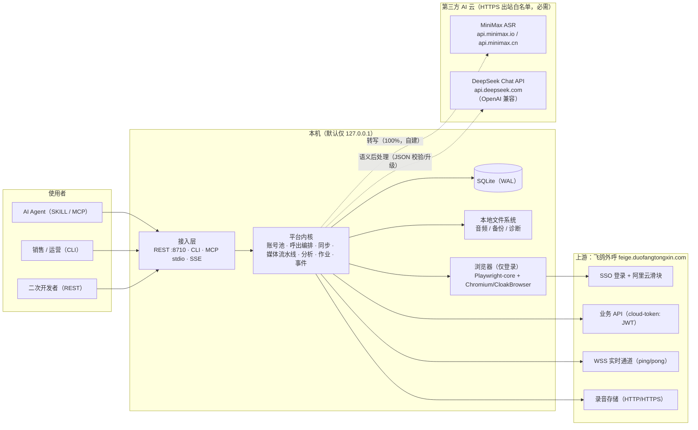

要点：

- **北向**（REST/CLI/MCP/SKILL）共享同一套业务语义，REST 是唯一业务契约（docs/01 §4）；CLI/MCP 是薄封装，不重复实现。
- **南向出口**：**浏览器**（仅登录）、**上游纯 HTTP/WS**、**录音存储 HTTP(S)**、以及**显式白名单的第三方 AI 云**（MiniMax ASR / DeepSeek）。这样浏览器崩溃/升级不会影响同步、呼出与媒体主链路。
- 所有对外部网络的访问都经过适配层/Provider 客户端（`upstream` / `AsrClient` / `LlmAnalysisClient`），便于集中限速、重试、错误归一、改版探测与密钥注入（契约见 docs/09、docs/13）。

### 2.2 外部依赖与边界

| 外部依赖 | 用途 | 不可用时的降级 | 备注 |
| --- | --- | --- | --- |
| 上游 SSO + 阿里云滑块 | 登录 / 续期 | 已有 JWT 时继续只读与呼出；到期后账号置 `expired`，触发人工 | 滑块失败 → 重试上限后人工介入，不做反风控对抗 |
| 上游业务 API | 同步 / 详情 / 查重 / 呼出 | 中断写操作；读接口返回本地已落库数据 + `UPSTREAM_UNREACHABLE` 标记 | 统一超时/重试/错误映射；**不使用上游转写**（call-detail-content 仅侦察） |
| 上游 WSS | 实时事件与保活（增强） | 退回轮询；不影响正确性 | v1 状态跟踪以轮询为准，WS 为增强 |
| 录音存储 HTTP(S) | 录音归档 | 作业重试；`AUDIO_DOWNLOAD_FAILED`；周期补跑 | 双路径（HTTPS 代理 / 直连 IP），见 docs/09 |
| MiniMax ASR 云 API（`api.minimax.io` / `api.minimax.cn`） | 转写（唯一来源，100% 自建） | 转写阶段 `failed(ASR_FAILED)`；音频归档不受影响，可 reprocess | 单请求 ≤500s/50MB → 静音点切块；并发/限流上限待压测（docs/13 §11）；数据出境见 docs/11 |
| DeepSeek 云 API（`api.deepseek.com`，OpenAI 兼容） | 语义后处理（摘要/意向/关键词/质量项）+ 说话人角色复核 | 分析阶段 `failed(ANALYSIS_FAILED)`；不影响录音与转写，可重跑 | 默认 `deepseek-chat`（flash）；JSON 校验失败升级 `deepseek-v4-pro`（max_tokens≥4096）；数据出境见 docs/11 |

### 2.3 运行形态

- **单进程常驻**：`feige serve` 内含 HTTP API、事件总线、调度器、worker 池；不做多进程/多实例（SQLite 单写者 + 单机部署形态决定）。
- **浏览器上下文**：按账号懒启动的持久化 profile；登录完成即关闭（默认），释放内存；profile 目录保留以维持设备指纹一致性。
- **数据**：SQLite 单文件（WAL）+ 音频文件目录；DB 只存路径与 hash，音频内容不进 DB。
- **系统服务**：systemd user service，开机/登录后自启；`loginctl enable-linger` 保证登出后继续运行；细节见 docs/10。

---

## 3. 逻辑架构：分层与模块

### 3.1 分层与依赖规则

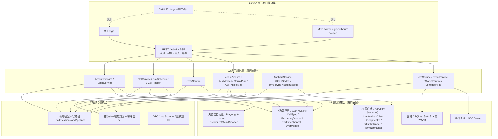

依赖规则（评审红线）：

1. **单向**：L1 → L2 → L3；L2 → L4。L4 不得反向依赖 L2；L1 不得直接访问 L4（接入层只能调用应用服务）。
2. **只有适配层知道上游路径与字段名**。L2/L3 使用规范化 DTO；上游字段拼写变化时只改 docs/09 定义的适配层。
3. **浏览器只在 `LoginDriver` 内出现**；其他模块不得持有 `Page`/`BrowserContext` 引用。
4. **状态变更只经状态机**：`Call.status`、阶段状态、`Job.status` 的写入必须走对应服务，禁止任意模块直接 UPDATE。
5. **北向不新增语义**：CLI/MCP 的字段、错误码、枚举与 REST 一一对应（docs/01 §4）；架构不引入第四个业务契约。
6. **第三方 AI 调用只经 `asr`/`llm` 客户端**：业务层不得直接拼接 provider URL、持有 API key 或自行解析供应商响应；一切出站经白名单与统一超时/重试/错误归一（docs/09 §10）。

### 3.2 进程内模块划分

| 模块 | 职责 | 明确不负责 | 主要依赖 | 主要写对象 |
| --- | --- | --- | --- | --- |
| `http`（接入层） | 路由、认证、封套、分页、幂等键、SSE | 业务规则 | 应用服务 | 无（只读/转发） |
| `cli` | 命令树、人类可读输出、`--json`、退出码 | 业务逻辑 | `http` 客户端 / 内核（MCP） | 无 |
| `mcp` | MCP tools/resources、JSON Schema、错误语义 | 业务逻辑 | 应用服务 | 无 |
| `accounts` | 账号注册/更新/停用、健康聚合、**登录作业编排** | 上游协议细节（交给适配层） | `upstream`、`browser`、`jobs` | Account、AccountSession、Job |
| `sessions` | JWT 生命周期、加密存取、失效检测、续期策略、WS 保活 | 登录页面自动化 | `upstream`、`accounts`、`events` | AccountSession |
| `dialer` | `POST /calls` 校验、pending 队列、时段调度、账号级串行、`callV2` 提交、跟踪、状态机推进、防重 | 录音/转写 | `upstream`、`sessions`、`jobs`、`events` | Call、CallEvent、Job、幂等记录 |
| `sync` | 增量/全量同步、游标、去重合并、补录、对账扫描 | 媒体处理 | `upstream`、`jobs`、`events` | Call、SyncCursor、CallEvent |
| `media` | 录音下载归档、分块计划、分块 ASR 调用与块结果缓存、时间戳合并、边界去重、阶段重试 | 词表归一/LLM 语义 | `upstream`(RecordingFetcher)、`asr`、`storage`、`jobs`、`events` | AudioAsset、Transcript、TranscriptSegment、Job |
| `roles`（DiarizationRoleMapper） | 双声道拆分与声道角色、ASR diarization 标签映射、规则打分、LLM 复核、置信度与 `needsReview` | 语义/摘要生成 | `asr` 结果、`llm`（复核）、DB | TranscriptSegment.role、`AnalysisResult.speakerMapping` |
| `analysis` | LLM 后处理编排：输入构造与 PII 脱敏、prompt/模型选择、JSON schema 校验、升级链、usage 观测、reprocess | 录音下载/转写 | `llm`、`terms`、`jobs` | AnalysisResult |
| `terms` | 词表规则 CRUD、**TermNormalizer** 确定性归一引擎（与 `/text/normalize` 共用；ASR 后与 LLM 后各执行一次） | LLM 语义分析 | DB | TermRule |
| `asr`（AsrClient） | MiniMax ASR 客户端：multipart 请求构造、超时/重试/限速、`verbose_json` 解析、错误归一 `ASR_FAILED`、traceId/用量记录 | 音频切分/角色映射 | 网络、`core`、配置/密钥 | `{dataDir}/asr/{callId}/chunk-{i}.json`（块原始结果） |
| `llm`（LlmAnalysisClient） | DeepSeek 客户端：OpenAI 兼容 `chat/completions`、`response_format=json_object`、模型升级、zod 严格校验、usage/latency、错误归一 `ANALYSIS_FAILED` | prompt 业务规则/词表 | 网络、`core`、配置/密钥 | 无（结果返回 `analysis` 落库） |
| `backfill`（BatchBackfill） | 全量回补编排：按 `call.endedAt` 升序为历史话单入队 asr/analysis、幂等跳过已完成、进度/token 观测、暂停与恢复语义 | 实际 ASR/LLM 调用 | `jobs`、`media`、`analysis`、`sync` | Job（backfill 编排）、进度事件 |
| `jobs` | 持久化作业队列、租约、重试/退避、恢复扫描、优先级 | 具体业务动作 | DB、`events` | Job |
| `events` | 事件写入、内部发布/订阅、SSE 分发与重放 | 状态变更决策 | DB | Event、CallEvent |
| `status` | `/status` 聚合、账号健康判定、`doctor` 自检 | 修改业务状态 | 各服务只读接口、DB、FS | 无 |
| `storage` | SQLite 连接/迁移/事务封装、音频文件原子写入、磁盘守卫 | 领域规则 | FS | 全部表（经仓储） |
| `upstream` | 见 docs/09：HTTP 客户端、各 API、WS、错误映射、限速 | 业务编排 | 网络、browser（仅 Auth） | 无 |
| `browser` | Playwright-core 启动/关闭、持久化 profile、登录页交互 | 业务状态 | OS/Chromium | 浏览器 profile 目录 |
| `core` | 配置加载（含 env 覆盖/校验）、日志、错误类型、ULID、时钟、Result | 业务逻辑 | 无 | 无 |

模块间通信约定：

- **同步调用**用于"立即需要结果"的编排（如登录要拿 JWT）；
- **作业队列**用于"可重试、可延迟、可恢复"的动作（同步、下载、ASR、分析、reprocess、backfill）；`asr` 与 `analysis` 是**两个独立队列**，分别受 `pipeline.asr.concurrency` / `pipeline.analysis.concurrency` 约束，避免互相拖死；
- **事件**用于"已发生的状态变化"通知（SSE/审计/触发下游作业），不承载"命令"语义。

### 3.3 建议代码组织（非契约）

以下目录仅帮助实现者建立模块边界，**目录名不是契约**；跨模块依赖方向以 §3.1 为准。

```text
src/
├── main.ts                 # 入口：serve / cli 分流
├── http/                   # L1：REST 路由、认证、SSE、封套、幂等中间件
├── cli/                    # L1：feige 命令树（薄封装 REST）
├── mcp/                    # L1：MCP server（stdio）
├── app/                    # L2：accounts / dialer / sync / media / roles / analysis / backfill / jobs / status
├── core/                   # 配置、日志、错误、Result、ULID、时钟、脱敏
├── domain/                 # L3：实体类型、状态机、错误码枚举、DTO 与 zod schema（含 analysis 输出 schema）
├── upstream/               # L4：HTTP 客户端、Auth、CallApi、CallSync、RecordingFetcher、WS、ErrorMapper
├── browser/                # L4：Playwright-core + profile 管理
├── storage/                # L4：SQLite 连接/迁移/仓储、音频文件、ASR 块结果文件、磁盘守卫
├── events/                 # L4：事件总线 + SSE Broker
└── providers/              # L4：AsrClient（MiniMax）、LlmAnalysisClient（DeepSeek）、ChunkPlanner、TermNormalizer、prompt/schema 版本
tests/
├── unit/                   # 状态机、归一化、错误映射、退避算法、分块计划/静音检测、JSON schema/升级链
├── contract/               # 上游契约测试（脱敏 fixture，见 docs/09 §13）
└── e2e/                    # 使用本地 stub 上游的端到端（不访问真实上游）
```

---

## 4. 关键流程与运行时视图

本章给出 4 条**关键路径**的时序图 + 1 张**全量回补编排**流程图与设计要点。图是**规范性的**：实现必须覆盖图中的分支与失败语义；上游接口细节（超时/重试/解析/错误码）见 [docs/09](./09-上游适配层契约.md)。

### 4.1 账号自动登录（浏览器 + 阿里云滑块 + JWT 落库/加密）

**目标**：把「手机号 + 密码 + 阿里云滑块」的登录过程自动化，拿到 7 天有效的 JWT 并以加密形式落库，供后续纯 HTTP 请求使用；失败时给出可诊断的原因与人工介入信号。

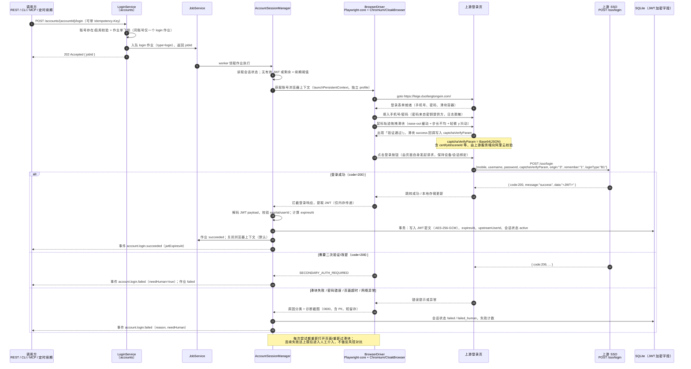

**设计要点**

| 要点 | 规定 | 理由 |
| --- | --- | --- |
| 登录请求由谁发出 | **由登录页自身发出**（脚本点击登录按钮），adapter 通过 Playwright response 事件捕获结果 | `captchaVerifyParam` 与阿里云设备指纹/场景强绑定，页面内发起最接近真实链路，避免二次校验失败 |
| captchaVerifyParam | 视为**不透明字符串**；只在必要时读取长度/是否捕获成功，禁止落盘/落日志 | 等价于验证码票据，泄露可被重放 |
| 滑块轨迹 | 24–48 步、总时长 600–1200ms、ease-out、步长不均、y 抖动 ±1–3px、末端小回正、按下后短暂停顿再释放 | 实测该轨迹可通过；纯 `dragTo` 两段式不可靠（docs/00 §2.1） |
| JWT 存储 | 加密入库（AES-256-GCM，密钥来自 `FOP_SECRET_KEY`/密钥环），DB 字段与权限见 docs/04、docs/11 | JWT 等价于 7 天账号控制权；日志/事件/API 响应禁止输出 |
| JWT 校验 | 只做格式 + payload 解码（exp/iat/userId），不做签名验证（无密钥） | 用于计算过期时间与主动续期，不用于信任判断 |
| 失败分类 | `CAPTCHA_FAILED` / `BAD_CREDENTIALS` / `SECONDARY_AUTH_REQUIRED` / `PAGE_LOAD_TIMEOUT` / `UPSTREAM_UNREACHABLE` / `UPSTREAM_RESPONSE_INVALID` / `PROFILE_LOCKED` / `BROWSER_LAUNCH_FAILED` / `UNKNOWN` | 供 status/doctor/事件与运维手册使用（docs/10） |
| 重试 | 每次登录作业最多 3 个浏览器轮次（轮次间退避 30s/2m/5m）；同一轮内滑块最多 2 次 | 平衡成功率与风控压力；超过后须人工 |
| 资源释放 | 登录结束（无论成败）必须关闭浏览器上下文；异常路径用 finally 保证 | 浏览器内存 ~200–400MB，不能泄漏 |
| PII | 手机号/密码/截图不入日志；截图落 `diagnostics/` 0600 且短留存 | 见 docs/11 |

> 完整登录规格（选择器、等待条件、轨迹参数、JWT 提取、失效检测、重登策略）以 docs/09 §6 为准。

### 4.2 呼出编排（`POST /calls` → 时段/幂等/账号串行校验 → `callV2` → 跟踪 → 状态机）

**目标**：把一次本地呼出请求安全地变成上游 `callV2` 调用，并在"上游无幂等键、回拨串行、时段强制、需要人工接听"的条件下不重复外呼、不丢跟踪。

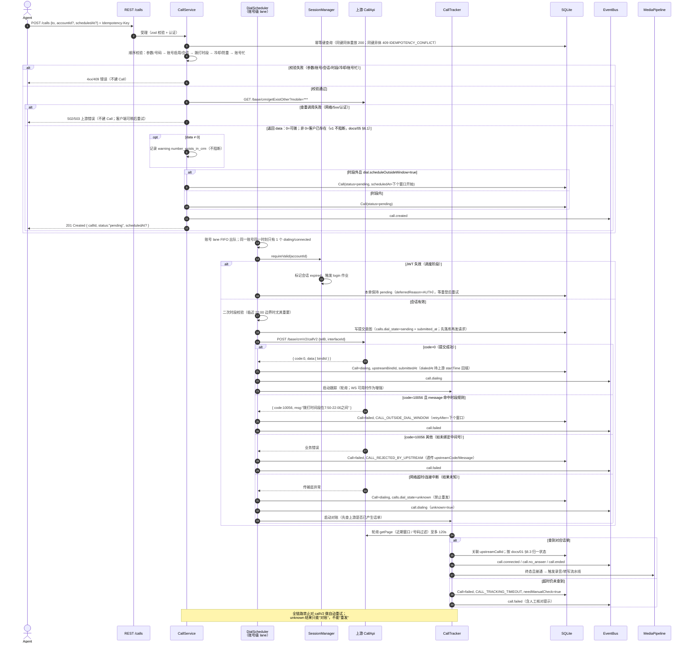

**校验顺序（固定，不可调换）**

| 序 | 校验 | 失败返回 | 说明 |
| --- | --- | --- | --- |
| 1 | 本地认证 / 请求结构（zod）/ 被叫号码格式 | 401 `UNAUTHORIZED` / 400 `INVALID_REQUEST`、`VALIDATION_FAILED` | 号码规范化规则见 docs/05 |
| 2 | 幂等键查询 | 200 重放 / 409 `IDEMPOTENCY_CONFLICT` | 相同键不同请求体视为客户端错误；24h 回放窗口 |
| 3 | `accountId` 存在且启用 | 404 `ACCOUNT_NOT_FOUND` / 403 `ACCOUNT_DISABLED` | |
| 4 | 会话健康（JWT） | 403/503 `ACCOUNT_LOGIN_REQUIRED` | POST 时拒绝、不建 Call；已受理的 pending 单在调度阶段失效则保持 pending 延迟重试（docs/05 §6.1 校验顺序） |
| 5 | 拨打时段（本地预检 + 上游兜底） | 422 `CALL_OUTSIDE_DIAL_WINDOW`（或按配置排队） | 本地用 Asia/Shanghai，允许 ±2min 时钟偏差，最终以上游为准 |
| 6 | 重复呼出/冷却（`accountId + to`） | 409 `ACCOUNT_BUSY`（`details.busyCallId`）/ 429 `RATE_LIMITED` | 见 docs/01 §5.6、§5.7 |
| 7 | 账号忙（回拨串行：已有 `dialing/connected`） | 409 `ACCOUNT_BUSY`（`details.busyCallId`） | docs/05 §6.1；pending 由调度器按账号 lane 串行提交，不在 API 层堆积 |
| 8 | `getExistOther` 查重（POST 受理阶段同步调用） | 调用失败 → 502/503 上游错误、不建 Call；`data≠0` → warning `number_exists_in_crm`（v1 **不阻断**） | 查重为辅助检查（docs/05 §6.1 校验顺序第 7 步）；真正"不可拨"语义待补测 |
| 9 | 线路参数解析（`interfaceId`） | 422 `CALL_REJECTED_BY_UPSTREAM` | 参数来源见 docs/09 §9.3；可在提交阶段解析 |
| 10 | 提交 `callV2`（调度阶段） | 见 §4.2 分支；结果未知进入对账 | **不自动重试**；提交前重校验时段/会话 |

**关键设计决策**

1. **先写意图，再发请求**：`callV2` 前先落库提交意图——docs/04 以 `calls.dial_state='sending'` + `calls.submitted_at` 落地（概念名 `dialAttempt`，不单独建表；docs/04 §15.1/§17.2 R3）。进程在请求前后崩溃时，重启后能区分"未发"/"可能已发"，避免盲目重发（docs/01 §8.5 硬约束 7）。
2. **unknown outcome 不重发**：传输层超时/连接中断后，call 进入 `dialing` + `calls.dial_state='unknown'`（docs/04），由 tracker 对账；120s 内上游无话单 → `failed(CALL_TRACKING_TIMEOUT)` 并 `needManualCheck=true`。这是"宁可少呼，不可重复呼"的取舍。
3. **跟踪不是独立 Job 类型**：docs/01 §6.1 的 `Job type` 清单是封闭集合，且跟踪是短生命周期高频轮询；因此跟踪状态落在 `Call` 的跟踪字段 + 内存定时器，重启由"恢复扫描"接管（见 §8.2）。`transport` 层仍对每次 `getPage` 计入读 QPS。
4. **WS 是增强而非依赖**：v1 状态推进以 `getPage` 轮询为准；WS 用于保活与（待补测的）实时事件。WS 断开不影响正确性，只影响时延。
5. **异步受理 + 快速失败**：`POST /calls` 在受理阶段完成"参数/账号/会话/时段/冷却/账号忙/查重"校验（查重同步调用上游，docs/05 §6.1），通过后返回 201 `pending`（可带 `scheduledAt` 排队到窗口内）；校验失败 → 4xx（账号忙/重复 → 409）。agent 通过 `GET /calls/{callId}` 或事件跟踪，不在 HTTP 上长等待回拨接听。调度器按账号 lane 串行提交上游，提交前只做必要重校验（时段/会话）。

### 4.3 话单增量同步（游标 + 分页 + 去重 + 补录）

**目标**：多账号各自拉取自己的话单（上游按坐席隔离），本地聚合去重；增量轮询 + 重叠回看保证"新增/更新/迟到"都不丢；支持全量补录且可断点续跑。

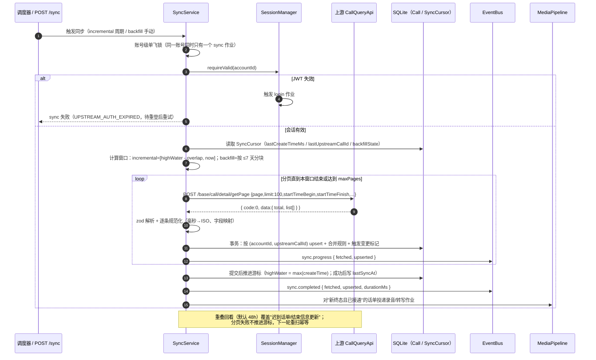

**算法要点**

| 要点 | 规定 | 理由 |
| --- | --- | --- |
| 游标 | `SyncCursor`：`lastCreateTimeMs`（高水位）+ `lastUpstreamCallId`（同毫秒 tie-breaker）+ `overlapLookbackMs`（默认 48h） | 上游 `getPage` 按创建时间倒序；仅靠高水位会漏"创建早、结束晚"的更新 |
| 窗口 | 增量：`[max(now - sync.lookbackDays, highWater - overlap), now]`，按 Asia/Shanghai 自然日转日期字符串；全量：显式 `[from,to]` 且按 ≤7 天分块 | 上游日期过滤参数为 `YYYY-MM-DD`（docs/00 §3.1） |
| 分页 | `page` 从 1、`limit=100`（上游实测上限 100）；每轮 `maxPages` 上限保护（默认 100，即 1 万条）；每页间受 5 QPS 令牌桶约束并加 50–150ms 抖动 | 避免一次同步打满上游触发风控 |
| 去重 | 唯一键 `(accountId, upstreamCallId)`；跨账号聚合后同 id 只可能属于一个坐席，出现冲突按"保留先到 + 记日志 + 事件时间线"处理 | docs/01 §8.5 硬约束 2 |
| 合并规则 | 状态**只前进不回退**（终态不回退为非终态）；上游字段更新（如 `preRecordUrl` 后补、`endTime` 后补、`duration` 修正）按"以上游为准 + `reconciled` 标记"合并 | docs/01 §7.1 补充约束 |
| 补录路径 | 同步发现历史话单（本地无对应 pending）：允许 `reconciled=true` 的补录路径，直接落终态并触发媒体流水线 | docs/01 §7.1 |
| 迟到/更新 | 二级扫描：优先用 `endTimeBegin/endTimeFinish`（**待补测**）扫"最近结束"的话单；未验证前由重叠回看兜底 | docs/00 §10 待验证项 3；诚实标注待验证 |
| 失败处理 | 单页重试 3 次（指数退避）；仍失败 → job failed，游标不推进；下一轮从重叠窗口重扫（幂等） | 幂等 + 游标安全 |
| 全量 backfill | 可恢复状态 `backfillState{from,to,nextPage,phase}`；进度事件 `sync.progress`；与增量互斥（账号级锁），默认低峰执行 | 大历史数据分块、可中断 |
| 触发 | 周期 `sync.intervalMs=60000`（账号间错峰抖动）；`POST /sync` 支持 `mode=incremental\|backfill`（docs/01 §4.1 #22） | 常态轻量、重活手动 |

### 4.4 媒体流水线（录音归档 → 分块计划 → 分块 ASR → 时间戳合并 → 角色映射 → 词表归一 → LLM 分析 → 入库）

**目标**：一通已结束且接通的话单，最终产出「不可变 WAV + 句级转写（含说话人角色）+ 归一化文本 + AI 结构化分析」，且**每步可重跑、块级可断点、第三方失败可降级**。转写 100% 由本地平台调用 MiniMax ASR 生成（不使用上游转写，决策 D1）；切分/角色/prompt/schema 细节以 [docs/13](./13-后处理规格（ASR与LLM）.md) 为准。

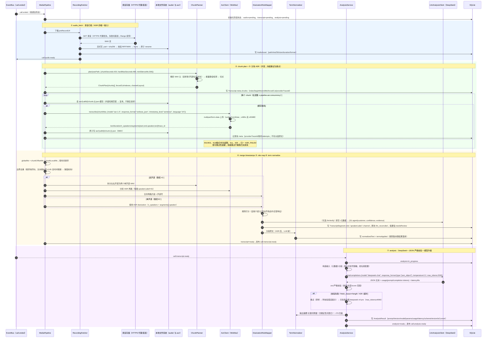

**阶段门槛与产物**

| 阶段 | 触发条件 | 正常产物 | 无产物/失败处理 | 产物落点 |
| --- | --- | --- | --- | --- |
| `audio` | 话单终态且 `preRecordUrl` 存在 | WAV 归档 + `AudioAsset(sha256)` | 未接通 → `missing`；URL 迟到/下载失败 → 重试，超限 → `failed(AUDIO_DOWNLOAD_FAILED)` | 文件系统 + AudioAsset |
| `transcript` | **`audio=ready`**（本地 ASR 必须有录音） | `Transcript(source=asr, provider=minimax:asr-1.0)` + 分段 + 分块 meta + `speakerMapping` + `needsReview` | 单块重试超限 → 阶段 `failed(ASR_FAILED)`（已完成块保留，可断点重跑）；无有效语音 → `ready` 且 `segments=[]` | DB + `asr/{callId}/chunk-*.json` |
| `analysis` | `transcript=ready` 且 `segments` 非空 | `AnalysisResult`（摘要/意向/关键词/质量/角色映射/usage） | 无语音 → `skipped(reason=no_speech)`；LLM 失败 → `failed(ANALYSIS_FAILED)`，可重跑 | DB |

**设计要点**

1. **先文件后 DB**：音频流写完、sha256 计算完、`fsync` 后再写 `AudioAsset`；避免"DB 有记录但文件损坏"。文件先写 `audio/.tmp/{callId}-*.part` → 原子 `rename` 到最终路径；残留 `.part` 由 GC 清理（docs/04）。
2. **不可变归档**：`AudioAsset` 不可重写；同一 `callId` 重复下载需 sha256 一致（或人工确认后另存版本），保障可重跑与审计（docs/04、docs/11）。
3. **切分计划是契约**：≤480s 整段一次请求；>480s 按 420s 窗口在静音点切分（窗口尾部无静音点可延至 480s 并标 `forcedCut=true`）；时间戳按 `globalMs = chunkOffsetMs + chunkLocalMs` 合并；计划写入 `Transcript.meta.chunks[]`（docs/04 落库字段 `asr_meta_json.chunks[]`；`{index, beginMs, endMs, forcedCut, providerTraceId, segments}`，与 docs/13 §2.3-4 一致），支持断点续跑与单块重跑。
4. **块结果落盘 = 幂等 + 不重复计费**：每块**规范化后的**供应商结果（segments/traceId/耗时，非原始 HTTP 响应体）存 `{dataDir}/asr/{callId}/chunk-{i}.json`（0600、原子写）；重跑优先命中缓存，只有缺失/损坏/计划变更的块才重新请求 provider。缓存键包含块音频内容哈希与计划指纹，防止计划变更后误用旧结果。
5. **ASR 与 LLM 是两个独立队列**：`asr` 并发受 `pipeline.asr.concurrency`（默认 4）约束，`analysis` 受 `pipeline.analysis.concurrency`（默认 8）约束；两者互不阻塞（长通话 ASR 不会饿死短通话分析），并各自对 429/超时做自适应退避。
6. **说话人两条路径 + 低置信不阻塞**：双声道拆分优先（每路单说话人，天然无混叠）；单声道用 MiniMax diarization（`n_speakers`/`segments[].speaker`）+ 规则打分 + LLM 复核；规则与 LLM 不一致 → `roleConfidence=low` + `needsReview=true` 并写事件，入库不阻塞（docs/13 §4）。跨块用 `llm_reconciled` 重映射。
7. **词表归一是确定性的，且执行两次**：ASR 后（LLM 前）与 LLM 输出后各执行一次 `TermNormalizer`（最长优先 + 冲突按 priority），保证展示与摘要都不残留同音变体；LLM 不负责改写词表（决策 D7）。**执行顺序说明**：docs/13 §7 允许把词表归一内联在 ASR 阶段；本图把"角色映射 → 词表归一"画为相邻步骤（角色判定主要依赖话术特征/元数据，二者先后不影响最终 `role` 与 `normalizedText`），实现顺序以 docs/13 §7 为准。
8. **AI 输出强校验 + 升级链**：LLM 输出必须经 zod schema 严格校验后才落库；失败按"原样重试 → 带校验错误提示重试 → 升级 `deepseek-v4-pro`（max_tokens≥4096）"处理，仍失败置 `failed(ANALYSIS_FAILED)`（docs/13 §6.3）。
9. **阶段解耦、可重跑**：三个阶段的 Job 相互独立（用依赖标记而非串行等待）；任何阶段失败都可 `POST /calls/{id}/reprocess` 重跑指定阶段，不改变 `Call.status`；`options.asrModel`/`analysisModel` 可指定模型（docs/01 §7.2、docs/05 §6.7）。
10. **第三方边界**：ASR/LLM 原始请求与响应默认不落盘（仅存 traceId/usage）；密钥只经 `SecretRef` 注入；发送前按配置脱敏手机号/姓名；出站仅白名单域名（§11、docs/11）。

### 4.5 状态机总览

Call 状态机以 docs/01 §7.1 为准；下图仅为架构视图，**转移细节与字段落点以 docs/04 为准**。

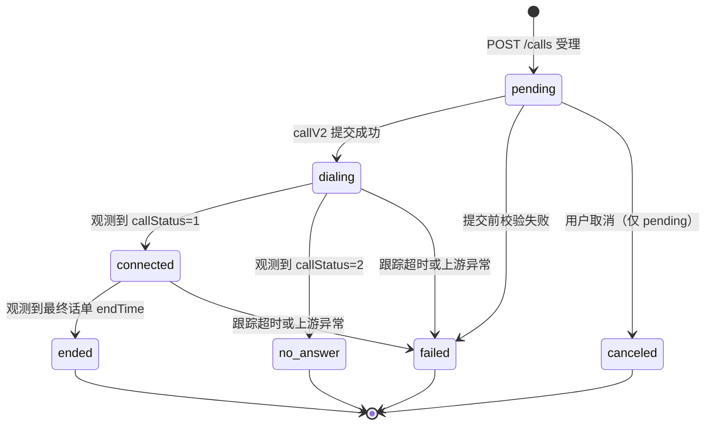

补充：

- `pending → connected` 的补录路径（同步发现历史话单）允许，事件标注 `reconciled=true`（docs/01 §7.1）。
- 跟踪超时（默认 120s）落 `failed(CALL_TRACKING_TIMEOUT)`，`retryable=true` 但**不自动重拨**，需人工核对（防止上游已呼出但本地未观测到）。
- 阶段状态（audio/transcript/analysis）独立于 Call 状态，见 docs/01 §7.2、docs/04；`transcript` 阶段代表**本地 ASR 完成**（含切分/角色映射/词表归一），与上游转写无关。

### 4.6 关键路径时延预算（设计目标）

| 路径 | 目标 | 说明 |
| --- | --- | --- |
| `POST /calls` 受理 | P95 < 1.5s（含 `getExistOther` 同步上游校验，上游 RT ~0.4s）；仅校验 + 落库 + 入队，不等待回拨 | docs/05 §6.1 校验顺序 |
| 受理 → `callV2` 提交 | 时段内 P95 < 2s | 受账号 lane、`getExistOther`、上游 RT 影响 |
| 提交成功 → `dialing` 可见 | < 200ms | 本地落库 + 事件先于上游话单出现 |
| 跟踪发现接通 | 首次轮询 2s，之后 2–20s 阶梯；最迟 120s 超时 | 上游话单可见时延未知（docs/00 §6.4 待补测），轮询参数可调 |
| 话单结束 → 录音可下载 | 上游生成时延未知（待补测）；本地下载 P95 < 30s（1 小时录音按带宽估算） | 记录实际时延指标用于容量与 SLA |
| 录音就绪 → ASR 完成 | 8 分钟通话约 20–40s（实测 RTF 0.075–0.16；并发 4 时约 6–12 路/分钟）；长通话按 420s 分块并发，墙钟 ≈ 分块数与并发度的函数 | 实测数据见 docs/13 §2.4；双声道路径请求数 ×2（见 §10.1） |
| 转写就绪 → 分析完成 | 默认 flash P95 < 10s（实测 10s 转写 + 元数据 208 prompt tokens → 265 tokens，2.3s）；升级 v4-pro 时约 15s+（max_tokens≥4096） | 失败可重跑，不阻塞主流程（docs/13 §3.3） |

### 4.7 全量回补编排（BatchBackfill）

**目标**：把历史话单（`ended` 且已归档/可归档录音）**全量**跑一遍"转写 + 分析"（决策 D5：不设预算上限），同时满足并发控制、断点续跑、可暂停/恢复、token/音频时长可观测，且不重复计费。

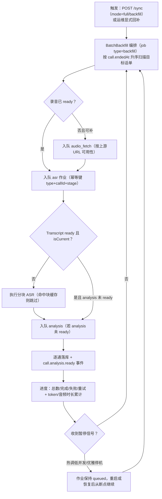

**编排规则**

| 项 | 规定 |
| --- | --- |
| 幂等 | 作业键 `(type=asr\|analysis, callId, stage)`；已 `ready` 且 `isCurrent` 默认跳过（`reprocess?force=true` 或指定 `options` 才重跑）；ASR 块缓存见 §4.4-4 |
| 顺序 | 按 `call.endedAt`（缺失用 `createdAt`）升序消费，保证"老话单先完成"；`audio_fetch` 与已归档话单的 `asr` 可并行入队 |
| 并发 | 复用 `asr`/`analysis` 独立队列与并发参数（默认 4/8）；backfill 自身不额外占用 provider 并发，只负责入队、优先级与进度 |
| 暂停/恢复 | ① 热调低 `pipeline.asr.concurrency` / `pipeline.analysis.concurrency`（降速）；② 优雅停机：`queued` 保留、`running` 租约回收，重启后从断点继续；③ 块缓存保证已完成块不重复计费（**不新增北向"暂停"接口**，避免扩展 docs/01 §4.1 清单） |
| 观测 | `/status.queues` + `GET /jobs` 进度 + 结构化日志 `promptTokens/completionTokens/audioSec/asrDurationMs`；**不设预算上限但用量必须可复盘**（docs/13 §3.4） |
| 失败 | 单通失败不阻塞整体；失败清单可 `reprocess` 单条重跑；第三方持续失败 → 熔断暂停对应 provider 队列（§8.3） |

---

## 5. 数据流、存储边界、事件与作业

### 5.1 数据流总图

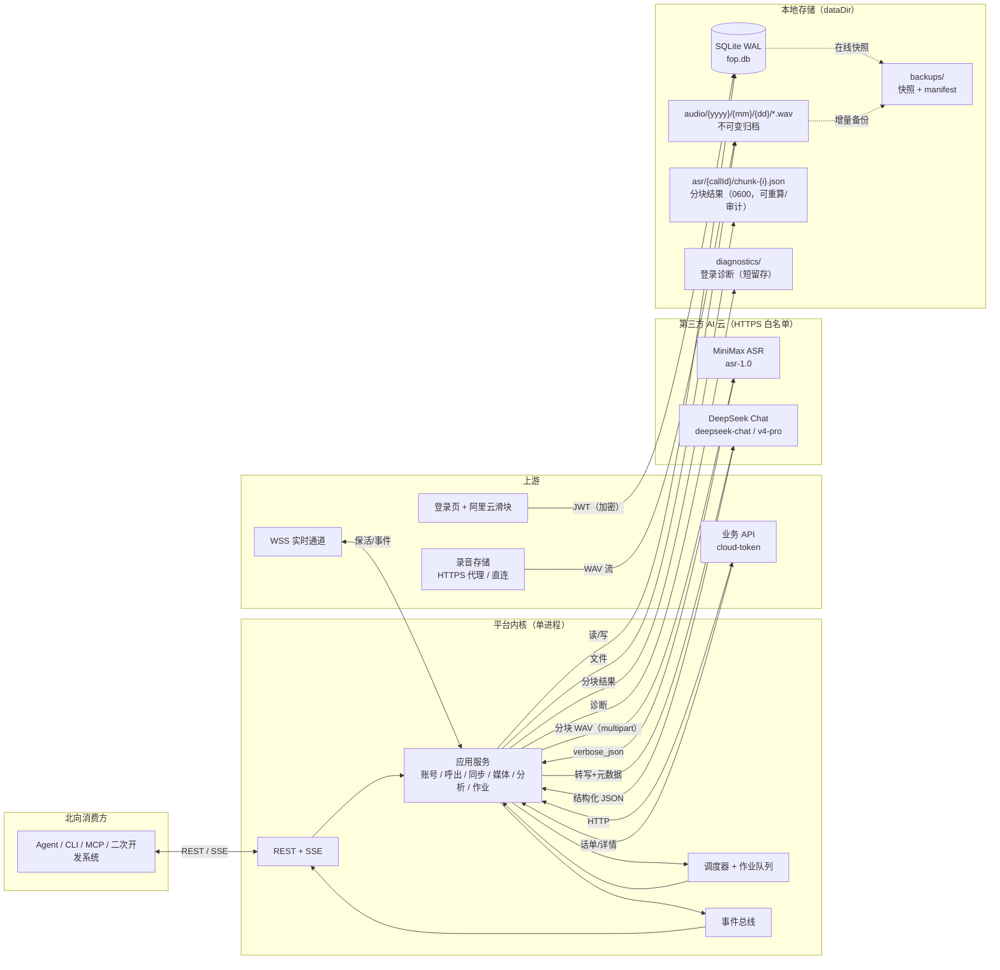

### 5.2 存储边界

| 存储 | 放什么 | 不放什么 | 一致性/事务 | 详细定义 |
| --- | --- | --- | --- | --- |
| SQLite（WAL，单文件） | Account、AccountSession、Call、CallEvent、AudioAsset（路径+hash）、Transcript（含分块 meta）、TranscriptSegment、AnalysisResult、Job、TermRule、SyncCursor、AuditLog、事件、幂等键 | 音频二进制、ASR/LLM 原始响应（只保留 traceId/usage 与受控摘要）、大段上游 JSON、JWT 明文 | 单连接单写者；写事务短小；状态变更 + 事件 + 幂等记录同事务 | [docs/04](./04-数据模型与状态机.md) |
| 音频目录 | 原始 WAV（不可变） | 转写文本、ASR 块 JSON、临时文件 | 先写 `audio/.tmp/` 临时文件 + sha256 + fsync，再原子 rename，最后写 DB | docs/04 §11（目录/`.tmp`/`.quarantine`/相对路径） |
| `{dataDir}/asr/{callId}/chunk-{i}.json` | 分块 ASR 结果（规范化后的 segments/traceId/耗时，非原始 HTTP 响应体；用于断点续跑、审计、避免重复计费） | 完整音频、密钥、上游凭证 | 0600；`*.tmp` → fsync → 原子 rename；内容哈希 + 计划指纹命中即复用 | docs/13 §2.3；目录/清理规范以 docs/04 为准 |
| 浏览器 profile 目录 | 每账号独立持久化上下文（Cookie/localStorage/设备指纹） | 业务数据 | 登录结束即释放句柄；单账号单实例 | docs/10 §3、docs/11 |
| `diagnostics/` | 登录失败截图/页面摘要（含 PII，短留存 7 天） | JWT/密码/captchaVerifyParam | 0600 + 定期清理 | docs/11 |
| 日志（journald 或文件） | 结构化运行日志（脱敏） | token、密码、完整号码、JWT | 只追加；轮转见 docs/10 | docs/11 §日志 |
| 备份目录 | DB 一致性快照 + 音频增量 + manifest（哈希/计数） | 明文密钥 | 备份前 WAL checkpoint；快照后 `integrity_check` | docs/10 §8 |

**边界规则**

1. **DB 只存音频路径与 sha256**（docs/01 §3.1）；音频内容永远不进 DB。
2. **先文件后 DB**：任何"文件 + DB 行"的组合，先落文件并 `fsync`，再写 DB；DB 写失败由 GC 清理孤儿文件。
3. **状态变更与事件同事务**：`Call` 状态、阶段状态、Job 状态与对应事件记录在同一 SQLite 事务内提交；提交后再向 SSE 订阅者分发（outbox 语义），避免"事件先于状态"或"状态变更无事件"。
4. **ASR 块文件先落盘后入库**：块结果文件先于 `Transcript` 状态推进写入；DB 只存块计划/统计，文件是"可重算的派生资产"（清理时不影响主数据；重跑命中缓存则不重复计费）。
5. **DB 是唯一事实源**；文件系统是资产库（音频不可再生、ASR 块结果可重算）。两者恢复路径见 docs/10 §8。

### 5.3 事件总线与 SSE

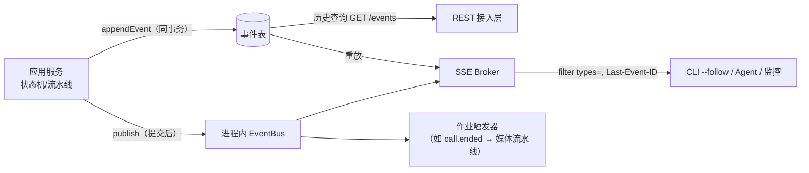

| 设计项 | 规定 | 说明 |
| --- | --- | --- |
| 事件类型 | 严格使用 docs/01 §7.3 清单，**不新增**未登记类型 | 北向契约封闭；新增需先改 docs/01 |
| 事件封套 | `eventId`(ULID)、`type`、`occurredAt`、`accountId?`、`callId?`、`data` | docs/01 §7.3 |
| 生产 | 状态变更事务内写事件表；提交后发布到内存总线 | 无丢失：崩溃后可按事件表补发/续传 |
| 分发 | SSE：按 `types` 过滤、`Last-Event-ID` 续传、每 15s `: ping`（`events.sseHeartbeatMs`） | docs/01 §7.3 |
| 重放 | 客户端带 `Last-Event-ID` 时从事件表重放；超过保留期/大缺口时从可用最旧事件续传并记录告警日志 | 单机无 MQ，事件表即队列 |
| 背压 | 每连接有界缓冲（默认 256 条）；慢消费者溢出时断开连接，客户端凭 `Last-Event-ID` 重连补齐 | 不阻塞业务线程 |
| 顺序 | 单账号内按事件表自增序；跨账号不保证全序（`occurredAt` + ULID 近似有序） | 使用方不应依赖跨账号严格顺序 |
| 保留 | 事件保留 **90 天**（docs/04 §D6）；SSE 重放上限 1000 条/次、每连接缓冲 256 条 | 供排障与审计，非永久 |
| Webhook | v1 仅保留配置与 `/webhooks/test`；投递为 v1.1（docs/01 §4.1 #29） | 不实现 v1 正常路径 |

> 事件不是命令：例如"`call.ended` 到达"由媒体流水线的**协调器**消费并创建作业，而不是让事件消费者直接修改状态。

### 5.4 作业与调度

**作业模型**：`Job` 表即持久化队列（docs/04 定义字段），类型/状态枚举以 docs/01 §6.1 为准：

`login` | `sync` | `audio_fetch` | `asr` | `analysis` | `reprocess` | `backfill`

> `transcript_fetch` / `transcript_pending_wait` **已删除**：转写不再依赖上游轮询（决策 D1、docs/01 §6.1、docs/13 §7）。`asr` 负责本地转写（含分块编排），`analysis` 负责 DeepSeek 后处理；两者是独立队列。

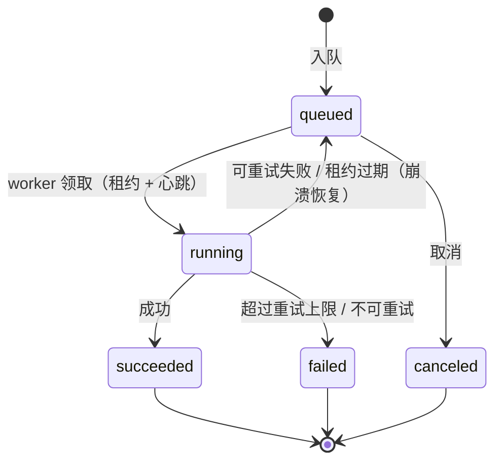

| 机制 | 规定 |
| --- | --- |
| 租约 | worker 领取时写 `leaseOwner` + `leaseExpiresAt`（默认 60s）；长任务每 20s 心跳续租 |
| 崩溃恢复 | 启动扫描 `running` 且租约过期 → 重新入队（保留 attempt 计数，不退避首轮）；同步类作业可安全重跑，呼出类作业不在 Job 中 |
| 重试 | `attempts/maxAttempts`；`nextRunAt = now + backoff(attempts)`；不可重试错误直接 `failed`（错误码 `retryable=false`） |
| 幂等 | 作业键 `(type, accountId, callId?, stage?)` 去重：同键 running/queued 存在时不重复入队（除显式 reprocess/force） |
| 依赖 | 阶段依赖以"作业存在性 + 阶段状态"表达（如 `asr` 依赖 `audio=ready`），worker 领取时检查依赖，未满足则延迟重入队 |
| 优先级 | P0 login > P1 sync / audio_fetch > P2 asr > P3 analysis > P4 backfill / reprocess（reprocess 可显式提优先级；asr/analysis 各为独立 worker 池，池内 FIFO） |
| 公平性 | 账号间轮转领取，避免单账号大量作业饿死其他账号 |
| 取消 | cancel 只对 `queued`/`running` 中可安全中断的类型生效；不可中断的作业置取消标记，完成后清理 |
| 队列上限 | 每类作业队列上限（默认 10k）+ 全局上限（默认 50k）；超限拒绝新作业并告警，避免磁盘/内存失控 |

**重试与退避参数（默认值，详见 docs/09 §3.5）**

| 层 | 场景 | 最大尝试 | 退避 | 说明 |
| --- | --- | --- | --- | --- |
| 传输层（单请求内） | 幂等读接口 5xx/网络错误 | 3 | 500ms × 2ⁿ，±20% 抖动，上限 8s | 快速自愈，不持久化 |
| 作业层 | sync/audio_fetch/asr/analysis | 5 | 5s × 2ⁿ，±20% 抖动，上限 5min | 持久化，跨重启；ASR 按块恢复，已完成块不重跑 |
| 登录层 | login | 3 个浏览器轮次 | 30s / 2min / 5min | 失败后需人工 |
| 呼出提交 | `callV2` | **1** | 无 | 结果未知只对账，不重试 |
| 跟踪轮询 | 呼出后话单可见性 | 至多 120s | 2s 起阶梯（2,3,5,10,20s） | 单账号低频，计读 QPS |
| ASR 单块（MiniMax） | 分块请求失败 | 3（`pipeline.asr.maxRetries`） | 2s/4s/8s，±20% | 仅对 5xx/超时/网络/429 重试；401/413/格式/时长超限不重试（`ASR_FAILED`） |
| LLM 单次（DeepSeek） | 429/超时/5xx | 3（`pipeline.analysis.maxRetries`） | 1s/2s/4s，尊重 `Retry-After` | 401/400 不重试；JSON 非法走升级链（docs/13 §6.3），不无限重试 |

**调度策略**

- **周期任务**：同步（每账号错峰，`sync.intervalMs`）、会话健康检查（60s/账号）、对账扫描（每 10min 检查非终态 Call）、维护任务（WAL checkpoint/GC/备份校验，按小时/天）。
- **事件驱动**：`call.ended` → 媒体流水线；`call.transcript.ready` → analysis；`account.session.expired` → login 作业。
- **延迟任务**：ASR/LLM 的 429 退避重排、时段外 pending 调度、重试 `nextRunAt`。
- **时钟**：统一使用注入的 `Clock`（可测试）；存储 UTC ISO/epoch ms，展示转 Asia/Shanghai；对系统时钟漂移做告警（影响时段与 JWT 到期判断）。

---

## 6. 并发模型

### 6.1 并发单元与串行化点

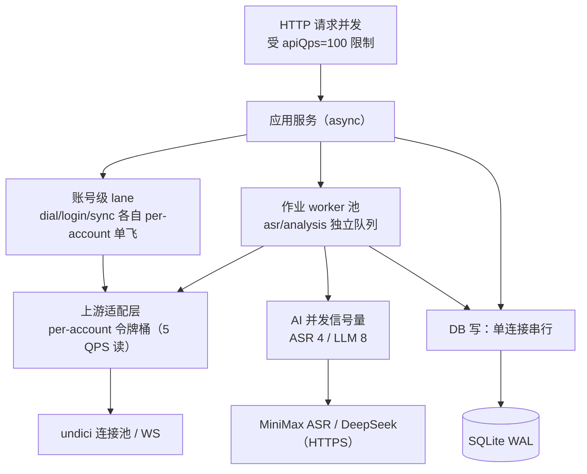

| 并发单元 | 上限（默认） | 串行化/隔离手段 | 不变量 |
| --- | --- | --- | --- |
| HTTP API | 100 QPS（`limits.apiQps`） | 令牌桶；超出 429 `RATE_LIMITED` | 读接口无副作用；写接口幂等 |
| 对话单的提交（dial） | 每账号 1（`limits.perAccountConcurrency`） | 账号 lane 异步互斥（in-process mutex + DB 状态检查） | 同一账号最多 1 个 `dialing/connected` |
| 全局呼出 | 8（`limits.globalConcurrency`） | 全局信号量 | 与账号 lane 共同限流 |
| 登录 | 每账号 1；全局浏览器上下文 ≤2 | 登录单飞锁；浏览器上下文池（按账号） | 同账号不得并发登录；同一 profile 不双开 |
| 同步 | 每账号 1；全局 ≤3 | 账号级 sync 锁（作业键 + in-process mutex） | 同账号 sync/backfill 互斥 |
| 上游读请求 | 每账号 5 QPS（`limits.upstreamReadQps`），突发 10 | per-account 令牌桶（同步/详情/转写轮询/健康检查共享） | 不因内部并发突破上游速率 |
| ASR 分块请求（MiniMax） | 全局 4（`pipeline.asr.concurrency`）；单通话分块可并行但共享该信号量 | 信号量 + 429/超时自适应退避 | 不突破供应商限流；失败按块重试 |
| ASR 双声道请求 | 同上（双声道时同一通话的音频拆成两路，请求数 ×2） | 与分块共享信号量 | 待拨测声道布局后决定路径（docs/13 §11） |
| 录音下载 | 全局 ≤3 | 信号量 + 磁盘守卫 | 大文件不占满带宽影响 API |
| LLM 调用（DeepSeek） | 全局 8（`pipeline.analysis.concurrency`） | 信号量 + 超时 + 429 退避 | 成本与故障隔离；升级 v4-pro 时单请求更慢，信号量保证不雪崩 |
| ASR 块结果写盘 | 每作业串行；跨作业受磁盘守卫 | 原子写 + fsync | 避免部分文件；缓存校验保证与 DB 一致 |
| DB 写 | 1（隐式串行） | 单连接；写事务 ≤5ms；批量 upsert | 无长事务、无跨请求事务 |
| WS | 每账号 1 条 | 连接管理器 | 断线不影响轮询主路径 |

**线程与进程**

- Node 单线程事件循环承载 I/O 与编排；**禁止**在事件循环做 CPU 密集计算（哈希用流式计算；词表归一/文本处理按批处理并让出；长音频静音检测按块流式读取）。
- **不自建本地 ASR 模型**：ASR 由 MiniMax 云 API 完成，Node 只做上传/解析/编排；LLM 同理（DeepSeek 云 API）。
- 浏览器是独立子进程；若分块计划/静音检测在真实长音频上阻塞事件循环，可在该作业内用 `worker_threads` 执行纯 CPU 部分，不改进程模型（v1 默认不开）。

### 6.2 锁与租约

| 场景 | 机制 | 失效保护 |
| --- | --- | --- |
| 同账号 dial 串行 | 进程内 `KeyedMutex(accountId)` + DB 中非终态 Call 检查 | DB 为准：重启后以 DB 状态恢复 lane |
| 同账号 login 单飞 | 进程内锁 + `login` 作业唯一键 | 浏览器上下文注册表（同 profile 不可双开） |
| 同账号 sync 单飞 | 进程内锁 + 作业键 | 租约过期自动重新入队 |
| 作业互斥 | DB 租约（`leaseOwner/leaseExpiresAt`） | 心跳续租；崩溃后租约过期回收 |
| 幂等写 | `idempotency_keys` 唯一索引（key + 请求指纹） | 并发插入冲突 → 读首次结果 |
| 音频文件 | 目录内 `.part` 命名含 jobId；rename 原子 | 启动 GC 清理超时 `.part` |
| 单实例 | 进程级单例锁（`dataDir/serve.lock` 含 PID + 启动时间） | 防止 systemd 抖动导致双实例（SQLite 冲突） |

> 单机单进程下**不使用**分布式锁/Redis/数据库行锁（SQLite 行锁能力有限）；需要跨进程协作时（未来 v2）再引入队列服务。

### 6.3 背压与资源保护

| 资源 | 保护策略 | 触发行为 |
| --- | --- | --- |
| 上游读 QPS | 令牌桶排队（有界等待队列，默认 500） | 队列满 → 作业延迟重排（`RATE_LIMITED`），API 侧 429 |
| 作业队列 | 每类/全局上限 + 队列年龄告警 | 超限拒绝入队并推事件/日志告警 |
| 磁盘 | 水位阈值：85% 告警、92% 暂停下载/ASR 产物、97% 停止新增写作业（DB 仍可读） | 水位由运维监控（`df -h`）/日志告警体现；docs/05 `/status` 未定义磁盘字段（如需暴露需先改 docs/05）；媒体阶段失败可重试 |
| 内存 | 浏览器上下文上限、下载流式、响应体大小上限（默认 8MB） | 超限拒绝/中断作业 |
| SSE 慢消费者 | 每连接有界缓冲 256 条 | 断开 + 客户端 `Last-Event-ID` 重连 |
| API | `limits.apiQps` | 429 `RATE_LIMITED` |

### 6.4 优雅停机与启动顺序

- **启动顺序**：加载并校验配置 → 打开 SQLite（WAL/`busy_timeout`）→ 迁移 → 启动事件总线 → 恢复作业队列（租约回收）→ 启动调度器/worker → 启动 HTTP（最后，确保依赖就绪）→ 启动会话保活/健康检查 → 恢复跟踪扫描。
- **停机顺序**（SIGTERM，超时 30s）：HTTP 停止接收新请求（等待在途 ≤10s）→ 调度器停止领新任务 → 等待临界写事务提交 → 释放 running 作业租约（置回 queued）→ WAL checkpoint（`PASSIVE`，尽量 `TRUNCATE`）→ 关闭 WS/浏览器/HTTP 连接 → 关闭 DB。
- **禁止**：停机时强杀子进程导致音频 `.part` 残留（由启动 GC 处理）；禁止在停机期间执行长事务。

---

## 7. 技术选型

### 7.1 结论速览

| 领域 | 结论（v1） | 版本策略 | 关键理由（一句话） |
| --- | --- | --- | --- |
| 运行时 | **Node.js ≥22（部署建议 24 LTS）+ TypeScript 5.x（strict, ESM）** | 锁定 Node 大版本 + lockfile | 契约要求 ≥22；内置 fetch/undici/sqlite/测试能力，减少原生依赖 |
| 浏览器自动化 | **Playwright-core** + **CloakBrowser/Chromium**（`executablePath` 指定） | 锁定浏览器版本 | 只需登录；Playwright-core 不自带浏览器下载，适配 NixOS 系统 Chromium/自定义构建 |
| HTTP 客户端 | **undici**（底层），简单 GET 可用全局 `fetch` | 随 Node 内置 | 需要 per-account 连接池、精细超时/abort、网络错误分类；原生零依赖 |
| WebSocket | **`ws`** | 锁 minor | 上游为纯文本帧 + 需 ping/pong、close code、重连控制；原生 WebSocket 控制粒度不足 |
| 数据库 | **SQLite WAL + `node:sqlite`（内置）**，通过 `Db` 端口隔离 | 锁 Node 版本；DB 迁移脚本版本化 | 内置驱动**零原生编译**，规避 NixOS ABI/patchelf 坑；WAL 满足单写多读 |
| ASR 云服务 | **MiniMax ASR 云 API（`asr-1.0`，multipart + `verbose_json`）** | 模型名/接口写入配置；契约测试冻结脱敏响应样本 | 中文电话语音实测可用；RTF 0.075–0.16；不引入本地模型/GPU 运维（见 7.2-⑩） |
| LLM 云服务 | **DeepSeek 云 API（OpenAI 兼容 Chat Completions，`json_object`）** | 模型名写入配置；prompt/schema 版本化 | 默认 flash 快（实测 2.3s），校验失败升级 v4-pro；内置 pipeline 不经外部 agent（见 7.2-⑪） |
| 长音频处理 | **自研 WAV 头解析 + 能量静音检测切分**（`ChunkPlanner`） | 纯函数 + 单测 | 只需 PCM/WAV；避免引入 ffmpeg 运行时依赖，可精确做字节偏移与声道拆分（见 7.2-⑫） |
| 第三方 HTTP | **undici（含 `FormData`/`Agent` 连接池）** | 随 Node 内置 | multipart 上传、分级超时、并发信号量、错误分类同一套栈 |
| 校验 | **zod**（输入/上游响应/配置/MCP schema/analysis 输出 schema 统一） | 锁 major | TS 类型推导 + 运行时解析一体；LLM 输出严格校验后落库 |
| CLI | **commander** | 锁 major | 命令树/帮助/参数解析成熟，轻量；与 REST `--json` 对齐成本低 |
| MCP | **@modelcontextprotocol/sdk**（stdio） | 锁 major | 官方 SDK，协议演进跟随；避免手写 JSON-RPC 协议 |
| HTTP 框架 | **Fastify**（核心插件自写） | 锁 major | 路由/钩子/SSE/优雅关闭完善，TS 友好；避免 Express 旧式中间件与类型负担 |
| 日志 | **pino**（JSON + 脱敏钩子） | 锁 major | 低开销结构化日志，便于 journald 采集与关键字排障 |
| 测试 | **node:test** + Playwright（仅登录 E2E）+ 脱敏 fixture 契约测试 | 随 Node | 内置测试器减少依赖；上游契约用 fixture 固化防改版 |
| 进程管理 | **systemd user service** | 随系统 | 见 docs/10；不引入 pm2/Docker（单机单进程） |

### 7.2 逐项说明与"不选什么"

**① Node.js 22+ + TypeScript**

- 选：Node 22 是 docs/01 的契约下限；部署建议 24 LTS（当前环境 2026-11，24 为活跃 LTS）。TypeScript strict + ESM，`tsc` 产出 `dist/` 运行，开发期可用 `tsx`。
- 理由：内置 `fetch`/`undici`/`node:sqlite`/`node:test`/`AbortSignal`；与 Playwright/undici 生态一致；单进程 I/O 模型适配本项目的"大量等待、少量计算"负载。
- 不选：
  - **Bun/Deno**：与 Playwright-core、undici 行为差异、NixOS 打包与线上稳定性风险，收益（启动速度）对本项目无意义。
  - **Python/Go 主进程**：浏览器自动化（Playwright Python 可行）但 TS 生态（MCP SDK、zod、北向类型共享）会分裂；单一语言降低维护成本。
  - **多进程/集群**：SQLite 单写者 + 单机部署 + 账号级串行，多进程只会放大锁竞争；浏览器子进程已提供隔离。

**② Playwright-core + CloakBrowser/Chromium**

- 选：Playwright-core（不下载浏览器）通过 `browser.executablePath` 使用 NixOS 系统 Chromium 或指定浏览器构建（CloakBrowser）；headful + Xvfb 运行。
- 理由：只用登录场景，Playwright 的持久化上下文（`launchPersistentContext`）、多账号 profile、事件捕获（request/response）、稳定的等待 API 最合适；实测 Playwright 驱动 Chrome 152 可完成阿里云滑块（docs/00 §2.1）。
- 不选：
  - **Puppeteer**：持久化 profile/多上下文/事件 API 相对弱，CDP 版本绑定更紧。
  - **Selenium/WebDriver**：驱动层更重、启动慢、对验证码页面交互与下载控制不灵活。
  - **长期常驻浏览器**：资源占用大、崩溃面广；docs/00 已证明业务 API 纯 HTTP 可用。
  - **任何"指纹伪造/自动化特征抹除"增强**：违反 docs/01 非目标（不绕过风控）；CloakBrowser 仅作为浏览器构建兼容性选项，不用于伪造身份。

**③ undici / fetch**

- 选：以 `undici.request`/`Agent`/`Pool` 为主，简单场景可用全局 `fetch`（其底层也是 undici）。
- 理由：需要 **per-account 连接池与限速、connect/headers/body 分级超时、网络错误类型区分（决定"能否重试/结果是否未知"）、`RetryAgent` 之上的自定义退避**；这些正是 `callV2` 防重与错误归一的依据。
- 不选：
  - **axios**：自带 HTTP 栈，超时/取消语义与原生不一致，错误分类要二次映射；多一层抽象无收益。
  - **node-fetch**：Node 内置 fetch 已覆盖；额外依赖无收益。
  - **got**：功能强但依赖树大；本项目不需要 HTTP/2、代理链等能力。

**④ ws**

- 选：`ws` 作为上游 WSS 客户端（保活 + 待补测的实时事件）。
- 理由：需要显式 `ping/pong` 帧、close code 解析、握手超时、重连退避、背压；`ws` 是最成熟的 Node 实现。
- 不选：
  - **socket.io-client**：上游是纯文本帧协议，不是 Socket.IO（docs/00 §2.4）。
  - **原生 WebSocket（undici）**：无 ping API、close code/背压控制弱，排障困难。
  - **常驻 WS 作为状态唯一来源**：消息格式未验证（docs/00 §6.4），不可作为正确性依赖。

**⑤ SQLite WAL：结论选 `node:sqlite`**

- 选：Node 内置 `node:sqlite`（`DatabaseSync`）+ WAL；封装 `Db` 端口（`exec/query/tx/backup`），若 Node 版本 API 不满足（如无 `backup()`）用 `VACUUM INTO` 做一致性快照。
- 配置：`journal_mode=WAL`、`synchronous=NORMAL`、`busy_timeout=5000`、`foreign_keys=ON`、`wal_autocheckpoint=1000`；写事务短小；读多写少。
- 理由：
  1. **NixOS 友好**：零原生编译、零 node-gyp/patchelf 风险（better-sqlite3 的预编译二进制在 NixOS 上常因动态链接器路径失败，需 nix-ld 或自编译）。
  2. 同步 API 与"单进程单写者"模型一致，代码简单、无异步事务陷阱。
  3. SQLite 本身成熟；本项目数据量小（见 §10），无需客户端/服务器架构。
- 风险与兜底：`node:sqlite` 在 Node 22 期为实验特性（需 `--experimental-sqlite`；建议部署 24 LTS），因此 **`Db` 端口隔离驱动**；若遇到能力缺口，替换为 `better-sqlite3`（同一 SQL/迁移语义，仅驱动层替换）。
- 不选：
  - **better-sqlite3（首选否定）**：性能与 API 很好，但原生模块在 NixOS/systemd 环境下构建与 ABI 维护成本高；不是能力问题，是**部署可靠性**取舍。
  - **sql.js（WASM）**：无真正的并发/崩溃恢复语义，文件需整库读写，不适合常驻服务。
  - **Prisma/Drizzle 等 ORM**：本项目表少、SQL 可控，ORM 带来的生成器/迁移工具链与 NixOS 构建复杂度不划算；DDL 与迁移直接管理（docs/04）。
  - **PostgreSQL/MySQL/Redis**：单机单用户场景引入外部服务与运维负担，违反"最小依赖"。
  - **DuckDB**：分析型引擎，事务/点更新/常驻写入不是其强项。

**⑥ zod**

- 选：zod 统一四类 schema：REST 输入、配置、上游响应（`passthrough` 容忍新增字段、必填字段严格）、MCP tool schema。
- 理由：运行时校验 + TS 类型同源；错误详情可直接映射 `VALIDATION_FAILED.details.fields[]`；与 MCP SDK 一致。
- 不选：
  - **ajv/JSON Schema**：MCP 侧仍需 JSON Schema（由 zod 生成），双轨维护；纯 JSON Schema 的 TS 推导弱。
  - **io-ts/yup/valibot**：生态/团队熟悉度与 MCP SDK 适配不如 zod；valibot 体积优势在本项目无意义。

**⑦ commander**

- 选：`feige` CLI 的命令树、子命令、参数/选项、帮助、自动补全。
- 理由：成熟、轻量、错误处理与退出码可控；CLI 只是 REST 薄封装（docs/01 §4），无需重型框架。
- 不选：**yargs**（API 较松、TS 体验一般）、**oclif**（插件/生成器过重）、**手写 parseArgs**（帮助/校验/补全成本高）。

**⑧ @modelcontextprotocol/sdk**

- 选：官方 TypeScript SDK，stdio transport，tools/resources 与 JSON Schema/zod 定义。
- 理由：协议握手、能力协商、错误格式由 SDK 处理；后续协议升级可跟随。
- 不选：**手写 JSON-RPC**（协议细节多、易错）；**MCP 走 SSE/HTTP**（v1 明确 stdio，docs/01 §4；远程 MCP 不在范围）。

**⑨ 其他工程选择**

| 项 | 结论 | 不选/理由 |
| --- | --- | --- |
| HTTP 框架 | Fastify | 不选 Express（旧中间件/性能/TS 一般）、NestJS（过重）、裸 `node:http`（auth/限流/SSE/优雅关闭都要自写，评审成本高） |
| 日志 | pino + redact 钩子 | 不选 winston（更重）、console（不可结构化） |
| 配置 | 自研 loader：JSON 文件 + `FOP_` 环境变量覆盖 + zod 校验 | 不选 dotenv（systemd EnvironmentFile 已覆盖）、不选 convict（额外依赖且迁移成本） |
| ID | ULID（`ulid` 包或等价实现） | 不选 UUIDv4（不可排序）、不选自增（分布式/可读性差）；要求与 docs/01 §5.6 一致 |
| 迁移 | 自研版本化 SQL 迁移（`schema_version` 表） | 不选 ORM 迁移器（见 ⑤） |
| 进程管理 | systemd user service | 不选 pm2（额外守护层）、Docker（单机本地数据 + 浏览器/Xvfb 复杂度不划算） |
| 测试 | node:test + fixture 契约测试 | 不选 Jest（ESM/TS 配置成本）、不选纯手工回归（上游改版风险） |
| AI 客户端 | undici + 全局信号量 + `AsrClient`/`LlmAnalysisClient` | 不选 axios/got（见 ③）；不选官方 SDK（接口简单、OpenAI 兼容，手写更可控） |

**⑩ MiniMax ASR 云 API（不自建本地 ASR 模型）**

- 选：MiniMax ASR 云 API（`POST https://api.minimax.io/v1/speech_to_text`，模型 `asr-1.0`，`multipart/form-data`，`response_format=verbose_json`，`timestamp_level=sentence`；国内区域可切 `https://api.minimax.cn`）。响应含 `text/duration/n_speakers/segments[{start,end,speaker,text}]/trace_id`，`start/end` 为秒（本地转毫秒）。
- 理由：
  1. **准确率与中文电话场景**：实测合成双人对话 2 说话人识别正确；真实电话音质待金标集评估（docs/13 §11），但"云 API + 领域词表兜底"比自建模型更快到达可用状态。
  2. **运维成本**：不引入 GPU/模型文件/推理服务；单机形态（docs/01 §3）保持不变；扩容只需调并发与预算（D5 不设预算上限）。
  3. **能力自带 diarization**：`n_speakers` + `segments[].speaker` 直接支撑单声道路径，无需自建声纹聚类。
- 硬约束：单请求 **≤500s / ≤50MB** → 长音频必须切分（`ChunkPlanner`）；并发/限流官方未明示 → 客户端按 `pipeline.asr.concurrency` + 429 自适应退避，压测后调参（docs/13 §11-4）。
- 不选：
  - **上游转写**：覆盖不全且不可控（实测 4/12 短通话缺失），决策 D1 明确不使用。
  - **本地 whisper.cpp / faster-whisper**：需 CPU/GPU 与模型分发，NixOS 打包与并发控制成本高；中文电话口音/双人重叠语音质量未验证；与"单机最小依赖"目标冲突。
  - **自建声纹聚类/说话人模型**：v1 用 ASR 自带 diarization + 规则/LLM 复核即可；跨块一致性作为已知限制（docs/13 §11-3）。
- 可插拔：`AsrProvider` 接口（`transcribe(chunk) → segments`）与配置 `pipeline.asr.provider/baseUrl/model` 解耦；未来可替换供应商而不改流水线（契约见 docs/09 §10）。

**⑪ DeepSeek 云 API（内置 LLM 后处理）**

- 选：DeepSeek 云 API（`POST https://api.deepseek.com/chat/completions`，OpenAI 兼容；`response_format={type:"json_object"}`；默认 `deepseek-chat`（= flash），`max_tokens=2000`、`temperature=0.2`；升级模型 `deepseek-v4-pro`）。
- 理由：实测 flash 10s 转写 + 元数据（208 prompt tokens）→ 265 tokens、**2.3s**、JSON 合法；v4-pro 默认 reasoning 会占用大量 `max_tokens`，因此升级时 `max_tokens≥4096`（docs/13 §3.1）。
- 不选：
  - **本地 LLM**（Ollama/vLLM）：显存/量化/模型更新与运维成本高；质量与吞吐不占优。
  - **其他云 LLM**：当前已用真实密钥验证 DeepSeek 接口与 JSON 模式，切换供应商无收益（`LlmProvider` 接口保留可替换性）。
  - **外部 agent 做后处理**（D4 否决）：引入跨进程/时延/数据外发面，且难以做严格 schema 校验与版本化。
- 约束：429 退避、`finish_reason=length` 提高 max_tokens 重试、JSON 非法升级链；usage/latency 落 `AnalysisResult` 只观测不限额（docs/13 §3.4）。

**⑫ 长音频切分（WAV 头解析 + 静音检测）**

- 选：纯 TypeScript 解析 RIFF/WAVE（`fmt` 与 `data` chunk）得到采样率/声道/位深/时长；对 PCM 做能量窗口检测（阈值 + ≥300ms 静音）确定切点；>480s 按 420s 窗口切分，窗口尾部无静音点可延至 480s 并标 `forcedCut=true`。
- 理由：上游录音实测为 WAV PCM（16kHz/16bit/mono，约 115MB/小时；声道布局待拨测确认）→ 无需通用解码器；自研可精确控制字节偏移、双声道拆分与时间戳偏移，避免 ffmpeg 运行时依赖与 NixOS 打包负担。
- 不选：
  - **ffmpeg/ffprobe 作为运行时依赖**：引入外部二进制与版本/许可证/路径问题；仅作为运维排障可选工具（docs/10 §1.2）。
  - **简单按固定时长硬切**：会切在句中导致丢字/重复；静音点切分是准确率关键（docs/13 §2.3）。
  - **重叠切分**：v1 `chunkOverlapSeconds=0`（静音点切分 + 边界去重），减少重复计费与去重复杂度。

**⑬ 第三方 AI 客户端工程约束**

| 约束 | 规定 |
| --- | --- |
| 连接与超时 | 独立 undici `Agent`（连接池）；ASR：connect 5s / headers 10s / body idle 60s / 总 600s；LLM：connect 5s / headers 15s / body idle 60s / 总 120s（v4-pro 可放宽） |
| 并发 | 全局信号量（ASR 4 / LLM 8），与作业队列解耦；429 时自适应降速 |
| 重试 | ASR 单块 ≤3（`pipeline.asr.maxRetries`）；LLM 单次 ≤3（`pipeline.analysis.maxRetries`）；均只对可重试错误 |
| 安全 | API key 只经 `SecretRef` 注入；日志/事件/错误禁止出现 `Authorization`/密钥；请求不携带上游 `cloud-token`；出站仅白名单域名、不跟随重定向 |
| 观测 | 每次调用记录 `provider/model/durationMs/attempts/outcome`；ASR 记 `audioSec/traceId`，LLM 记 `promptTokens/completionTokens` |

### 7.3 依赖与版本治理

1. **锁定**：`pnpm-lock.yaml` + 精确版本；Node 大版本写入部署文档与 systemd 环境；浏览器版本记录在 `docs/10` 的兼容矩阵。
2. **上游无版本**：上游非公开 API，无法 pin；以**适配层 + 契约测试 + fixture** 作为"上游版本探针"（docs/09 §13）。
3. **依赖预算**：运行时直接依赖控制在 ~10 个以内（fastify、undici、ws、zod、commander、@modelcontextprotocol/sdk、pino、ulid 等）；新增依赖需说明替代方案与维护状态。
4. **升级流程**：小版本随发布；大版本升迁移与回滚方案写入 docs/10 §12；升级前跑契约测试与 E2E stub。
5. **第三方 AI 契约**：MiniMax/DeepSeek 接口无版本 pin → 以**脱敏 fixture 契约测试**（ASR 成功/空/错误、LLM JSON 合法/非法/截断）+ 模型名/`max_tokens` 配置化兜底；prompt/schema 变更走版本号（`analysis-v1`→`analysis-v2`）与金标集回归（docs/13 §6.4–6.5）。

---

## 8. 故障模式与恢复

### 8.1 故障矩阵

| # | 故障 | 检测方式 | 影响 | 自动恢复 | 降级/人工 | 可见性 |
| --- | --- | --- | --- | --- | --- | --- |
| F1 | 进程崩溃/重启（含 kill -9） | systemd 重启；启动日志 | 在途作业中断、跟踪暂停 | 启动恢复流程（§8.2） | 重启期间 API 不可用 | `job.updated`/日志/`/status.uptimeSec` |
| F2 | 进程崩溃在 `callV2` 请求前后 | 启动扫描 `calls.dial_state IN ('sending','unknown')` | 可能"已呼出但本地不知" | 进入对账，**不重发** | 120s 未查到 → `failed(CALL_TRACKING_TIMEOUT)` + 人工 | `call.failed`、`/status` 计数 |
| F3 | SQLite 锁/写冲突 | `SQLITE_BUSY`、busy_timeout 统计 | 写延迟 | 单写者 + 重试 + 短事务 | 持续 → `DB_UNAVAILABLE`(503) | 日志关键字、`/status.db.ok` |
| F4 | SQLite 损坏 | 启动 `quick_check`/`integrity_check` | 读写失败 | 从备份恢复（docs/10 §8） | 只读降级 → 维护模式 | `/health` 失败、日志 |
| F5 | 磁盘满 | 水位守卫（85/92/97%） | 录音/日志/DB 写失败 | 暂停媒体下载/ASR 产物；清理 `.part`/诊断/日志 | 97% 停止新增写作业，读仍可用 | `df -h`、日志告警（docs/05 `/status` 无磁盘字段） |
| F6 | JWT 到期/失效 | 主动到期检查；HTTP 200 空 body；`code=401`；WS 断开 | 该账号同步/呼出停止 | 自动 login 作业（单飞、限次） | 连续失败 → 人工；该账号 `unhealthy` | `account.session.expired`、`account.login.failed` |
| F7 | 登录滑块失败/风控升级 | 登录作业失败原因 | 无法续期 | 3 轮重试后停止 | 人工介入；**不做反风控对抗** | `account.login.failed(needHuman)`、诊断截图 |
| F8 | 上游不可达/5xx | 传输层错误、连续失败计数 | 读/写均失败 | 传输层 3 次退避；作业层重排；账号/全局熔断（30–60s） | 读接口返回本地数据；写接口 502/503 | `UPSTREAM_UNREACHABLE`、`/status.upstream.reachable` |
| F9 | 上游响应结构变化（改版） | zod 解析失败、契约 canary | 该接口全部失败 | 记录原始响应摘要；暂停相关作业 | 适配层热修复；旧数据仍可查 | `UPSTREAM_RESPONSE_INVALID`、告警关键字 |
| F10 | `callV2` 结果未知 | 传输错误分类（已发送/未发送） | 可能重复外呼风险 | 对账；禁止自动重试 | 人工核对上游 | `call.dialing(unknown=true)` |
| F11 | 跟踪超时（120s） | tracker deadline | 状态不确定 | 置 `failed` + `needManualCheck` | 人工核对，禁止自动重拨 | `call.failed(CALL_TRACKING_TIMEOUT)` |
| F12 | 录音下载失败/URL 失效 | HTTP 错误、校验失败 | 无本地录音 | 双路径 + Range 重试 + 作业退避 | 标记 `audio.failed`，可 reprocess；上游保留期风险告警 | `call.audio.failed`、`AUDIO_DOWNLOAD_FAILED` |
| F13 | ASR 分块失败/超时/限流（MiniMax） | 客户端错误分类（5xx/429/超时/401/413） | 该块失败；整通可能失败 | 块级重试 ≤3（保留已完成块）；作业层再退避 ≤5；仍失败 → `transcript.failed` | `ASR_FAILED`；provider 持续不可用 → 熔断暂停 asr 队列（§8.3），恢复后 reprocess | `call.transcript.failed`、`/status.queues.transcriptPending` |
| F14 | LLM 失败/JSON 非法（DeepSeek） | 客户端错误分类 + zod 校验 | 分析失败；转写与录音不受影响 | 单次重试 ≤3；JSON 升级链 flash→v4-pro→失败；作业层再重试 ≤5 | `ANALYSIS_FAILED`；人工 reprocess（可指定 `analysisModel`） | `call.analysis.failed` |
| F15 | WS 断开 | 心跳超时/close | 实时性下降 | 指数退避重连；轮询继续 | WS `degraded`，不影响正确性 | `account.health.changed` |
| F16 | 系统时钟漂移 | 与 NTP 偏差检测 | 时段判断/JWT 到期偏差 | 告警；本地校验留 ±2min 容差 | 人工校时 | `/status`、doctor |
| F17 | 浏览器启动失败 | 启动超时/崩溃 | 登录不可用 | 重试；换 headless 配置（可配） | 人工；其余功能正常 | `ACCOUNT_LOGIN_FAILED` |
| F18 | 双实例启动 | `dataDir/serve.lock` | 数据竞争 | 第二个实例启动失败退出 | 人工检查 systemd | 启动日志 |
| F19 | SSE 客户端过慢 | 连接缓冲溢出 | 该连接断开 | 断开 + `Last-Event-ID` 重连补齐 | — | 日志 |
| F20 | 备份失败 | 备份作业/定时任务退出码 | RPO 风险 | 重试 + 告警 | 人工检查磁盘/权限 | 运维告警 |
| F21 | 第三方 AI 密钥无效/欠费/无权限（401/403） | ASR/LLM 客户端错误分类；连续 401 计数 | 对应 provider 队列全部失败 | 不重试；熔断该 provider 队列 + 告警 | 更新 secrets/env 后恢复；失败作业 reprocess；期间录音继续归档 | `ASR_FAILED`/`ANALYSIS_FAILED`（details.providerCode）、日志告警关键字 |
| F22 | 全量回补积压/第三方限流 | 队列深度、429 计数、最老 queued 年龄 | 回补变慢（不影响新话单，优先级较低） | 自适应降速；热调低 `pipeline.*.concurrency`；必要时优雅停机暂停（重启续跑） | 恢复后从断点继续；已完成块/结果不重跑 | `/status.queues`、`GET /jobs`、`job.updated` |

### 8.2 启动恢复流程

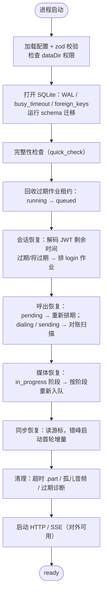

恢复规则：

1. **HTTP 最后启动**：对外可服务时，作业队列与恢复扫描已就位，避免客户端看到"进程在但状态错"。
2. **恢复扫描是幂等的**：重复执行不会产生重复话单/重复录音；一切以 `(accountId, upstreamCallId)`、`AudioAsset.sha256`、作业键去重。
3. **恢复不自动重发 `callV2`**：只对账。对账顺序：先按 `calls.dial_state IN ('sending','unknown')` + `calls.submitted_at` 时间窗（docs/04 §15.1/§17.2）→ 用 `getPage` 查该账号近期话单 → 匹配 `telB + 时间窗`；命中则接管跟踪，未命中且超过 120s → `failed(CALL_TRACKING_TIMEOUT)` + `needManualCheck=true`。
4. **`pending` 重新排期**：重启后 `scheduledAt` 已过期的 pending 立即进入调度；仍在时段外的继续等待。
5. **阶段恢复**：`audio/transcript/analysis` 的 `in_progress` 一律视为未完成，按阶段重新入队；已完成（`ready`/`missing`）不重复执行，除非显式 reprocess。
6. **游标不提前推进**：同步只在本轮窗口完整处理成功后推进；崩溃后重扫重叠窗口，幂等。

### 8.3 降级模式

| 模式 | 触发 | 北向行为 | 恢复条件 |
| --- | --- | --- | --- |
| `normal` | 一切正常 | 全功能 | — |
| `upstream-degraded` | 上游连续失败/熔断 | 读：返回本地已落库数据（不新增响应字段；降级状态通过 `/status.upstream.reachable` 与错误语义体现，docs/05 未定义 `meta.degraded`）；写：502/503 | 上游探测成功 3 次 |
| `auth-blocked`（单账号） | JWT 失效且重登失败 | 该账号 `unhealthy`；呼出 403/503 `ACCOUNT_LOGIN_REQUIRED`；其他账号不受影响 | 登录成功 |
| `media-paused` | 磁盘 ≥92% 或 ASR/LLM 持续失败 | 停止下载/ASR/分析入队；已就绪数据可查；阶段保持 pending/failed | 水位下降 + 人工恢复 |
| `ai-provider-down` | MiniMax 或 DeepSeek 连续失败/401/429 熔断 | 对应 asr/analysis 阶段 `failed`（可重跑）；audio 归档与查询不受影响 | provider 探测成功 + 密钥有效 → 恢复入队 |
| `db-readonly` | SQLite 写失败/损坏风险 | 读接口可用；写接口 `DB_UNAVAILABLE` | DB 修复/恢复 |
| `maintenance` | 人工置维护（升级/恢复） | 全部写接口 503；读接口可选 | 人工解除 |
| `draining` | 停机流程中 | 不再接收新请求；在途完成 | 进程退出 |

### 8.4 上游改版的应对策略

上游是非公开 API，**改版是时间问题**（docs/00 §9、docs/01 Q7）。策略：

1. **集中隔离**：只有 `src/upstream` 知道路径/字段；其余模块只认规范化 DTO。改版时改动面 = 适配层 + fixture。
2. **宽容解析**：上游响应用 zod `passthrough` 保留未知字段（需要原样落库的字段单独白名单），必填字段缺失才判 `UPSTREAM_RESPONSE_INVALID`；新增字段不导致失败。
3. **契约测试与 canary**：每日/每次发布前后跑 fixture 契约测试；运行期每日一次只读 canary（`userDetail` + `getPage{limit:1}` + `callLineList`），解析失败即告警（docs/09 §13）。
4. **快速止血**：发现改版 → 暂停相关账号同步/写操作（保留数据）→ 抓取脱敏响应样本 → 热修适配层 → 跑契约测试 → 灰度恢复。
5. **数据不丢**：已落库数据不受影响；未同步窗口在恢复后由重叠回看重扫补齐；录音 URL 可能失效，优先保归档。

---

## 9. 可观测性

### 9.1 结构化日志

统一 JSON（pino），字段规范：

| 字段 | 类型 | 说明 |
| --- | --- | --- |
| `ts` | ISO 8601 +08:00 | 事件时间 |
| `level` | `trace/debug/info/warn/error/fatal` | 日志级别（默认 info，排障可调） |
| `service` / `version` / `pid` | string/number | 固定字段 |
| `module` | string | 模块名（dialer/sync/media/upstream/...） |
| `msg` | string | 短消息（稳定、可 grep，不含动态 PII） |
| `requestId` / `traceId` | string | 请求链路；跨队列/作业尽量传递 |
| `accountId` / `callId` / `jobId` / `eventId` | string | 关联标识 |
| `op` | string | 外部操作名（上游 `callV2`/`getPage`/`ssoLogin`…；AI `asrTranscribe`/`llmChatCompletion`） |
| `upstreamPath` | string | 上游路径（不含 query 中的敏感参数；号码打码） |
| `provider` / `model` | string | AI 供应商与模型（`minimax`/`asr-1.0`、`deepseek`/`deepseek-chat`） |
| `chunkIndex` / `audioSec` | number | ASR 分块序号与音频时长（容量/成本核算） |
| `providerTraceId` | string | ASR 供应商 `trace_id`（对账/排障；不含敏感信息） |
| `promptTokens` / `completionTokens` | number | LLM token 用量（仅观测，不限额） |
| `httpStatus` / `upstreamCode` | number | HTTP 与上游业务码 |
| `durationMs` / `attempt` / `outcome` | number/number/string | 时延、第几次、结果（ok/retryable/failed） |
| `errorCode` | string | docs/01 §5.4 错误码 |
| `bytes` / `sha256` | number/string | 媒体相关（sha256 可记录） |

**脱敏规则（强制）**：`cloud-token` / `authorization` / `cookie` / `password` / `captchaVerifyParam` / JWT / `apiToken` / `minimaxApiKey` / `deepseekApiKey` 一律不出现；手机号统一 `138****0000`；录音 URL 中的号码段打码；上游原始响应只记录**截断摘要**（≤500 字符，先打码再记录）；**ASR/LLM 原始响应默认不记录**（仅 traceId/usage/耗时；排障需开 `rawResponsePath` 时 0600 短留存并脱敏，docs/13 §10）。

示例（脱敏后）：

```jsonc
{
  "ts": "2026-11-14T10:03:12.345+08:00",
  "level": "info",
  "service": "fop",
  "version": "0.1.0",
  "module": "dialer",
  "msg": "call_v2 accepted",
  "requestId": "req_01J8Z3K5T9QW2M4R7X1C6V0B8N",
  "accountId": "main",
  "callId": "call_01J8Z3K5T9QW2M4R7X1C6V0B8N",
  "jobId": "job_01J8Z3K6A0QW2M4R7X1C6V0B8N",
  "op": "callV2",
  "httpStatus": 200,
  "upstreamCode": 0,
  "durationMs": 312,
  "attempt": 1,
  "outcome": "ok"
}
```

### 9.2 指标清单

> v1 **不新增** `/metrics` 北向接口（docs/01 §4.1 清单封闭）。指标由 `/status` 聚合字段 + 结构化日志/事件聚合得出；未来需要 Prometheus 时按 docs/01 变更流程新增。

| 域 | 指标 | 说明/用途 |
| --- | --- | --- |
| API | 请求量、P50/P95 时延、按 `error.code` 的错误率 | 容量与回归 |
| 上游 | 每接口成功率、P95 时延、`UPSTREAM_*` 计数、熔断状态 | 改版/网络诊断 |
| 会话 | JWT 剩余时长、登录成功/失败数、`needHuman` 数、WS 连接状态 | 账号健康 |
| 同步 | 每账号 lag（`now - lastSyncAt`）、fetched/upserted、失败数、backfill 进度 | 数据完整性 |
| 呼出 | pending/dialing/connected 数量、提交成功率、跟踪超时数、时段拒绝数、重复拦截数 | 业务健康 |
| 媒体 | 录音下载成功率/字节/时延、`audio.missing` 数、ASR 分块成功率、ASR 音频时长与 P95 耗时（RTF）、块缓存命中率、双声道占比 | 流水线质量/成本 |
| 分析 | 分析成功/失败、JSON 合法率、升级 v4-pro 比例、P50/P95 耗时、prompt/completion token 累计（仅观测不限额） | 成本与质量 |
| 第三方 | MiniMax/DeepSeek 成功率、429/401 次数、P95 时延、熔断状态、重试次数 | 供应商健康/容量 |
| 队列 | 各类型队列深度、最老 queued 年龄、租约回收数 | 积压/卡死 |
| DB | WAL 大小、busy 重试数、page 数、checkpoint 时延、integrity 结果 | 存储健康 |
| 存储 | 磁盘剩余/水位、音频总字节、每日增量、`.part` 残留数 | 容量规划 |
| 事件 | SSE 连接数、慢消费者断开数、事件写入速率 | 北向体验 |

### 9.3 健康与状态判定

- `GET /health`：进程存活探针，不查 DB/上游（docs/01 §4.1 #1）。
- `GET /status`：聚合快照，**字段契约以 docs/05 §2.11 为准**；本文只列运维消费方式：

| 区块（docs/05 §2.11） | 关键内容 | 运维用途 |
| --- | --- | --- |
| `version` / `startedAt` / `uptimeSec` / `now` | 进程与时间 | 存活/重启/时钟检查 |
| `db` | `{ok, schemaVersion, sizeBytes, walSizeBytes, latencyMs}` | DB 健康与 WAL 膨胀 |
| `accounts` | `{total, online, expired, loggingIn, error, disabled}` | 账号池汇总 |
| `accountsDetail[]` | `AccountSummary`（`state`、`jwtExpiresAt`、`lastError`、`line` 等） | 账号明细/健康巡检 |
| `upstream` | `{reachable, lastCheckedAt, latencyMs}` | 上游可达性 |
| `dialWindow` | `{open, windowStart, windowEnd, timezone, nextOpenAt}` | 时段判断 |
| `queues` | `{jobsQueued, jobsRunning, jobsFailed24h, audioPending, transcriptPending, analysisPending}` | 积压监控 |
| `sync` | `{lastSyncAt, laggingAccounts, lastError}` | 同步延迟 |
| `events` | `{sseClients}` | SSE 连接 |
| `limits` | 生效限流参数 | 排障/容量 |

- `GET /accounts/{accountId}/health`：返回 `AccountHealth`（docs/05 §2.4）：`state`、`jwt{valid,expiresAt,expiresInSec}`、`ws{connected,...}`、`upstream{reachable,...}`、`line`、`dialWindow`、`busy{inCall,busyCallId}`、`lastError`。**JWT 剩余时间以该接口的 `jwt.expiresInSec` 为准**（`/status` 只给 `jwtExpiresAt`）。
- 磁盘剩余、队列最老年龄等不在 docs/05 `/status` 的字段，v1 由运维命令（`df -h`、`feige jobs list`、`feige account health`）获取；如需北向暴露，按 docs/05 变更流程新增（**不自行扩展响应字段**）。

**账号健康判定**（`health_status` 枚举见 docs/04；北向 `state` 见 docs/05 §2.2）

| 状态 | 条件（全部满足为 healthy；任一触发即降级/不健康） |
| --- | --- |
| `healthy` | 会话 `authenticated` 且 JWT 剩余 > 24h；最近一轮同步成功且 lag ≤ 3×`sync.intervalMs`；最近 5 次上游请求失败 < 3 |
| `degraded` | JWT 剩余 ≤ 24h（续期中）；WS 断开；同步 lag 超阈值；近期有可重试错误；登录失败 < 上限 |
| `unhealthy` | 会话 `expired`/`failed` 或需人工；连续上游失败 ≥ 5；账号被停用；跟踪/登录需人工 |
| `unknown` | 尚未完成首次检查（启动初期） |

### 9.4 事件与作业可观测

- 单通话单时间线：`GET /calls/{callId}/events`（docs/01 §4.1 #21）；用于复盘"何时受理/提交/接通/结束/录音/转写"。
- 全局事件：`GET /events` 历史 + `GET /events/stream` 实时；排障时按 `accountId`/`callId`/`types` 过滤。
- 作业：`GET /jobs` / `GET /jobs/{jobId}`；重点看 `attempts`、`nextRunAt`、`lastError.code`、`leaseExpiresAt`。
- `feige doctor`：一次性自检（配置/目录/权限/DB/浏览器/Xvfb/上游可达/登录态/时钟），输出可执行的修复建议（docs/10 §12）。

---

## 10. 容量与扩展上限

### 10.1 容量模型与存储估算

假设：平均通话 2 分钟；录音按 docs/00 实测 **~115 MB/小时**（16kHz/16bit/mono WAV，≈1.92 MB/分钟）；每年按 250 个工作日。

| 场景 | 账号数 | 每账号每日话单 | 日通话总时长 | 日音频量 | 年音频量 |
| --- | --- | --- | --- | --- | --- |
| S1 小规模 | 1 | 20 | 40 分钟 | ~77 MB | ~19 GB |
| S2 中规模 | 10 | 15 | 300 分钟（5h） | ~575 MB | ~144 GB |
| S3 较大规模 | 20 | 20 | 800 分钟（13.3h） | ~1.5 GB | ~384 GB |

DB 估算（含话单、事件、作业、转写分段、分析，按 ~21 KB/话单；含索引与 SQLite 开销）。

| 场景 | 年话单量 | DB 年增量 |
| --- | --- | --- |
| S1 | 5,000 | ~105 MB |
| S2 | 37,500 | ~0.8 GB |
| S3 | 100,000 | ~2.1 GB |

容量规划公式：

```text
所需磁盘 ≈ 年音频量 × 留存年数
         + DB 年增量 × 留存年数 × 3（在线 + WAL/临时 + 备份）
         + 日志/诊断（1–2 GB）
         + 备份音频增量（按策略，通常为当月音频量 × 2）
         + 20% 水位余量
```

建议：S2 及以上使用 ≥ 1 TB 独立数据盘；备份放独立磁盘/远端加密存储（docs/10 §8）。**留存周期最终以业务/合规确认（docs/01 Q4）为准**；docs/04 §10 已给出建议默认值（如录音 365 天，作为内部常量），本表按"1 年在线"估算。

**AI 处理量估算（关键容量输入；实测见 docs/13 §2.4/§3.3）**

- ASR 实测 **RTF 0.075–0.16**（10.36s→1.62s=0.16；62.1s→4.67s=0.075）。RTF = ASR 耗时 / 音频时长；单请求上限 500s/50MB → 长音频切块（每块 ≤480s）。
- 4,000 通回补估算（按平均 2 分钟/通；双声道路径请求数 ×2）：

| 假设 | 音频总时长 | ASR 处理耗时（RTF 0.075–0.16） | 并发 4 时墙钟（理想） | DeepSeek 调用量（flash，≈750 tokens/通） |
| --- | --- | --- | --- | --- |
| 2 分钟/通 × 4,000 通 | ≈133 音频小时 | ≈10.0–21.3 小时 | ≈2.5–5.3 小时 | ≈300 万 tokens（输入≈190 万 + 输出≈110 万） |
| 8 分钟/通 × 4,000 通 | ≈533 音频小时 | ≈40–85 小时 | ≈10–21 小时 | 输入随转写增长，约 4–6 倍 |

> 上表为数量级估算，用于磁盘/网络/预算规划；实际受 provider 限流、重试、双声道与升级 v4-pro 影响。**D5 不设预算上限，但必须记录每次调用 token/音频时长（`AnalysisResult.usage`、ASR 日志 `audioSec`）供事后核对。**
- DeepSeek token：10s 双人转写 + 元数据 = 208 prompt tokens → 265 completion tokens（`deepseek-chat`）；按 1.5–2 汉字/token 估算，2 分钟通话输入约 450–600 tokens、输出 ≈265，单通合计 ≈750 tokens；8 分钟通话输入约 1.5–2k tokens。v4-pro 升级时 completion 侧会因 reasoning 显著增加（`max_tokens≥4096`），需单独统计升级率。
- 存储：ASR 块原始 JSON 约 1–3 KB/分钟音频（实测响应含分段与 traceId，以压测为准），4,000 通 × 2 分钟 ≈ 8–25 MB；建议与音频同盘并纳入备份。
- 出站白名单（必须可达，HTTPS 443）：`api.minimax.io` / `api.minimax.cn`（二选一）与 `api.deepseek.com`；禁止其他 AI 域名与重定向。

### 10.2 吞吐与性能预算

| 项 | 预算 | 依据 |
| --- | --- | --- |
| 本地 API | 100 QPS（`limits.apiQps`），P95 < 50ms（读本地 DB） | 单机；索引支撑列表/详情 |
| 同步 | 每账号 5 QPS、每页 100 条（~0.4s/页）→ 理论上限 ~500 条/s，实际受令牌桶与抖动约束 | docs/00 §3.1 |
| 增量同步时延 | 单账号一轮（≤2 页）< 2s；20 账号错峰一轮 < 60s | 每账号独立拉取 |
| 全量 backfill | 10 万条 ≈ 1000 页 ≈ 7–10 分钟（按 5 QPS，含分块与低峰限速） | 可断点续跑 |
| 呼出受理 | P95 < 50ms（不含上游）；提交 `callV2` P95 < 2s | 账号 lane 串行 |
| 同时进行的通话 | = 账号数（每账号 1 通）；默认全局并发 8 | 回拨模式物理约束 |
| 媒体并发 | 下载 3、ASR 请求 4、LLM 请求 8（默认，见 `pipeline.asr/analysis.concurrency`） | 带宽/供应商限流/成本保护 |
| ASR 吞吐 | 并发 4 × RTF 0.1 量级 → 约 6–12 路/分钟（8 分钟通话）；4,000 通（2 分钟/通）理想墙钟 2.5–5.3 小时 | docs/13 §2.4/§7 |
| LLM 吞吐 | 并发 8、单次 ≈2.3s → 理论 ~200 通/分钟；实际受 429/token 速率与升级重试约束 | docs/13 §3.3/§3.4 |
| 全量回补（4,000 通） | ASR 墙钟 2.5–5.3h + 分析墙钟 ≈0.3–1h（阶段串行、跨通话并行；不含重试与双声道 ×2） | 可暂停/恢复（§4.7、docs/10 §7.9） |
| 登录吞吐 | 每次 30–90s；全局 2 并发 → 20 账号批量续期 10–20 分钟 | 分散在到期前 24h 窗口，错峰 |

### 10.3 扩展路径与上限

| 维度 | v1 上限（建议） | 瓶颈 | 扩展路径（v2+） |
| --- | --- | --- | --- |
| 账号数 | ≤ 50/单机 | 浏览器 profile 磁盘、登录串行、SQLite 单写 | 按账号分片多实例（共享 nothing，各自 DB/文件）；账号路由层 |
| 音频存储 | 受磁盘限制（S3 场景 ~400 GB/年） | 磁盘 IO/容量 | 对象存储 + 本地缓存；冷热分层 |
| DB | < 10 GB（远低于 SQLite 舒适区） | 单写者 | 分片/独立读写实例；或迁移到服务端 DB（需先改 docs/01） |
| 同步数据量 | 单账号日增 ≤ 数百条 | 上游 5 QPS | 增量窗口调优；低峰 backfill |
| 本地 API | 单进程 100 QPS | Node 单线程 | 反代 + 多实例（需先解决 DB 单写） |
| 媒体并行 | 3 下载 / 4 ASR / 8 LLM 请求 | 供应商限流/带宽/成本 | 调高并发（需先压测供应商限流）；v2 独立媒体 worker 进程 |
| 第三方 AI 配额 | MiniMax/DeepSeek 速率与并发上限（官方未明示，待实测） | 供应商限流 | 自适应退避、熔断、按 provider 分队列；未来可多 key/多 provider 分流 |

**不做的扩展**（v1 明确）：多租户、水平集群、跨机共享 SQLite、公网暴露。理由是当前上游形态（回拨 + 单机数据 + 7 天 JWT）下，单机已足够且运维复杂度最低。

---

## 11. 安全边界

本节只列架构级边界，完整威胁模型与合规要求见 [docs/11-安全与合规.md](./11-安全与合规.md)。

| 边界 | 架构规定 |
| --- | --- |
| 网络暴露面 | 默认仅 `127.0.0.1:8710`；`server.allowRemote=true` 时必须启用本地 API token + 建议 TLS 反代（docs/01 §5.2） |
| 北向认证 | `Authorization: Bearer <localApiToken>`；token 存 0600 文件，首次启动生成 |
| 凭证 | 上游账号密码来自密钥提供方（env/密钥环/0600 文件），不落明文 DB、不进日志、不进 git |
| JWT | 加密存 DB（AES-256-GCM）；只在内存中解密使用；禁止出现在日志/事件/API 响应 |
| 浏览器 profile | 每账号独立目录 0700；包含登录态，视为高敏数据；备份/迁移需加密 |
| PII | 号码/姓名/转写/录音均属个人信息；日志脱敏、API 按需返回、录音文件 0600/目录 0700、诊断截图短留存；**发送第三方 AI 前默认号码脱敏**（`pipeline.analysis.redactPhones=true`） |
| 出站 | 仅访问上游域名/IP、录音双路径、以及**白名单 AI 域名**（`api.minimax.io`/`api.minimax.cn`/`api.deepseek.com`，HTTPS 443，不跟随重定向）；无用户可控的任意出站（防 SSRF：录音 URL 仅接受上游返回值且校验域名/IP 白名单，见 docs/09 §8.1） |
| 第三方 AI 凭证 | `minimaxApiKey` / `deepseekApiKey` 只存 secrets/环境变量；只经 `SecretRef` 注入请求头；禁止落日志/事件/错误；轮换见 docs/10 §5.3 |
| 第三方数据 | 录音/转写发送 MiniMax（ASR）与 DeepSeek（LLM）属委托处理、可能构成数据出境；原始请求响应默认不落盘，仅存 traceId/usage；合规要求见 docs/11 |
| 合规 | 不绕过上游风控/业务规则（时段、质检、串行）；不做假身份/代理轮换；风控升级转人工 |
| 审计 | 写操作（login/logout/dial/cancel/sync/reprocess/terms 变更）写 AuditLog（docs/04、docs/11） |

---

## 12. 架构决策记录（ADR）

| ADR | 决策 | 状态 | 备选与否决理由 | 后果 |
| --- | --- | --- | --- | --- |
| ADR-01 | 单进程常驻 + DB 持久化队列，不引入外部 MQ | 采纳 | Redis/BullMQ 增加服务与运维；单机单写者下 DB 队列足够 | 单点故障由 systemd 重启兜底；队列吞吐受 DB 写限制（远高于需求） |
| ADR-02 | SQLite WAL + `node:sqlite` | 采纳 | better-sqlite3 原生编译/NixOS ABI 风险；sql.js 无持久并发 | 依赖 Node 版本能力；`Db` 端口可替换驱动 |
| ADR-03 | 浏览器仅用于登录，业务 API 全纯 HTTP/WS | 采纳 | 常驻浏览器资源大/崩溃面广（docs/00 已验证） | 登录是唯一浏览器依赖；需专门登录作业与诊断 |
| ADR-04 | 上游适配层单一边界 + zod 契约解析 + fixture 契约测试 | 采纳 | 分散调用无法防改版 | 改版修复面收敛；需要维护 fixture |
| ADR-05 | `callV2` 永不自动重试；unknown outcome 只对账 | 采纳 | 上游无幂等键，重试可能重复外呼/计费 | 存在"已呼出但本地失败"的极小概率，靠对账 + 人工兜底 |
| ADR-06 | 媒体先文件后 DB + sha256 不可变归档 | 采纳 | 先 DB 后文件会产生"有记录无文件" | 需 GC 清理孤儿文件；重跑按 hash 幂等 |
| ADR-07 | 轮询优先、WS 增强 | 采纳 | WS 消息格式未验证（docs/00 §6.4） | 实时性靠轮询阶梯；WS 可用后逐步增强 |
| ADR-08 | 事件 outbox（状态+事件同事务）+ SSE | 采纳 | 先发事件后落库会不一致；外部 MQ 过重 | 事件表增长需保留策略；SSE 重放有上限 |
| ADR-09 | 单账号串行、多账号并行 | 采纳 | 回拨模式物理占用坐席手机（docs/00 §6.2） | 单账号吞吐上限 1 通；靠账号池扩容 |
| ADR-10 | 转写 100% 自建（MiniMax ASR），不使用上游转写 | 采纳（D1） | 上游转写覆盖不全/不可控（实测 4/12 缺失）；本地 ASR 可控、可审计、可重跑 | 引入第三方云依赖与费用；需要切分/角色映射/词表兜底（ADR-11/13） |
| ADR-11 | 长音频静音点切块 + 块级结果落盘缓存 | 采纳 | 单请求 500s/50MB 硬上限；硬切会丢句，重叠切分重复计费 | `asr/{callId}/chunk-*.json` 缓存保证断点/不重复计费；切分计划落 `Transcript.meta` |
| ADR-12 | LLM 后处理 = DeepSeek 云 API + zod 严格校验 + 模型升级链 | 采纳（D3/D4/D8） | 外部 agent 难以强校验/版本化；本地 LLM 运维成本高 | 默认 flash 快；JSON 非法升级 v4-pro（max_tokens≥4096）；prompt/schema 版本化 + 金标集 |
| ADR-13 | 说话人：双声道拆分优先，否则 ASR diarization + 规则/LLM 复核 | 采纳（D6） | 上游声道布局未确认（待 ffprobe 拨测） | 单声道跨块可能需 `llm_reconciled`；低置信 `needsReview` 不阻塞入库 |
| ADR-14 | 全量回补不设预算上限，但必须并发/限流/可暂停/用量可观测 | 采纳（D5） | 不控并发会触发供应商限流、拖垮新话单处理 | 独立 asr/analysis 队列 + 优先级；暂停=降并发/优雅停机；token 与时长仅观测 |

---

## 13. 与其它文档的引用关系

| 本文引用 | 内容 | 方向 |
| --- | --- | --- |
| docs/00 | 上游实测事实、待补测清单 | 输入 |
| docs/01 | 术语/枚举/错误码/接口/状态机/配置（最高优先级） | 基准 |
| docs/02 | FR/NFR 到架构组件的映射 | 需求→架构 |
| docs/04 | 表结构、字段落点、索引、事件保留、状态机细节 | 下游 |
| docs/05 | `/status`、`/calls`、`/events/stream` 等字段级契约 | 下游 |
| docs/06 / 07 / 08 | CLI/MCP/SKILL 作为接入层薄封装 | 下游 |
| docs/09 | 本文所有上游调用的超时/重试/解析/错误映射细节 | 下游（南向契约） |
| docs/10 | 部署拓扑、systemd、备份、排障 | 下游（运行） |
| docs/11 | 威胁模型、密钥、PII、加密、审计 | 下游（安全） |
| docs/12 | 里程碑/验收与本文组件的对应 | 下游（验收） |
| docs/13 | ASR 切分/角色映射/prompt/schema/错误码/配置/回补的实现规格（本文 §4.4/§4.7 的权威细节） | 输入（后处理规格） |

---

## 14. 一致性检查与未决项

### 14.1 与 docs/01 的一致性自查

| 检查项 | docs/01 依据 | 本文使用情况 | 结论 |
| --- | --- | --- | --- |
| 术语（账号/会话/话单/呼出/录音/转写/作业/事件） | §2 | 全文统一 | 一致 |
| Call 状态枚举 | §6.1 | 仅使用 `pending/dialing/connected/ended/no_answer/failed/canceled` | 一致 |
| 阶段状态枚举 | §6.1 | `pending/in_progress/ready/missing/failed/skipped` | 一致（见 14.2-①说明） |
| 流水线触发规则 | §7.2 | 本地 ASR（不使用上游转写）、切分/角色/词表/分析、失败重试、reprocess 不改 Call 状态 | 一致 |
| 事件类型 | §7.3 | 仅引用清单内事件，不新增 | 一致 |
| 错误码 | §5.4 | 40 个稳定码；使用 `UPSTREAM_*`/`CALL_*`/`ACCOUNT_*`/`AUDIO_*`/`TRANSCRIPT_*`/`ASR_FAILED`/`ANALYSIS_FAILED`/`DB_UNAVAILABLE`/`RATE_LIMITED` 等；**不引用已删除的 `UPSTREAM_TRANSCRIPT_PENDING`** | 一致 |
| 北向操作 | §4.1 | 仅引用已登记路径（`/calls`、`/calls/{id}`、`/sync`、`/calls/{id}/reprocess`、`/accounts/{id}/login`、`/status`、`/health`、`/events/stream`、`/text/normalize` 等） | 一致 |
| 上游映射 | §8.1–8.5 | 登录/呼出/查重/线路/话单/录音/WS 全覆盖；**上游转写不使用**（仅侦察/对账）；硬约束 C1–C9 落地（C9=第三方 AI 边界） | 一致 |
| 配置项 | §9 | 使用 `pipeline.asr.*` / `pipeline.analysis.*` / `pipeline.roleMapping.*`；规格补充键见 14.2-② | 一致（补充键待回写 docs/01 §9） |
| 幂等与防重 | §5.6、§5.7 | `Idempotency-Key` + 冷却 + unknown-outcome 对账 | 一致 |
| 时间/ID | §5.6 | 上游毫秒转 ISO；本地 ID 用 ULID；`upstreamCallId` 不作主键 | 一致 |
| 安全边界 | §5.2、§9、docs/11 | 默认 127.0.0.1、token、JWT 加密、日志脱敏 | 一致 |

### 14.2 需评审确认的解释/新增项

| # | 项 | 说明 | 建议处理 |
| --- | --- | --- | --- |
| ① | 未接通话单的 `transcript` 阶段取值 | docs/04 §15.1 已明确 `no_answer → transcript_status='missing'`（本文一致）；docs/01 §7.2 简化图只列 `ready\|failed`，未列 `missing` | 建议回改 docs/01 §7.2 措辞（或注明阶段枚举以 §6.1 为准，docs/04 已落地） |
| ② | 建议补充配置项 | `session.renewBeforeMs`（24h）、`sync.overlapLookbackMs`（48h）、`logging.level/file`、备份目录/保留、磁盘水位阈值、`limits.upstreamGlobalReadQps`、`storage.recordingUrlOrder` 等；`pipeline.asr` 的 `responseFormat/timestampLevel/chunkOverlapSeconds/timeoutMs/maxRetries`、`pipeline.analysis` 的 `maxRetries/redactPhones/redactNames/maxInputChars`、`pipeline.roleMapping.lowConfidenceReview`（docs/13 §9 已给出实现规格） | 实现前由 Lead 决定回写 docs/01 §9（或确认以内部基线实现）；`dial.queueWhenBusy` 已按 docs/05 §6.1 删除（账号忙直接 409）；`pipeline.transcriptPollIntervalMs` 随上游转写路径删除 |
| ⑧ | 上游录音声道布局 | docs/00 实测为 16kHz/16bit/mono WAV；是否 8kHz stereo A/B 需真实拨测 `ffprobe` 确认（docs/13 §11-1） | v1 默认按单声道 + diarization 实现，双声道路径（路径 A）代码就绪可切换；拨测后回写本节与 docs/13 |
| ⑨ | MiniMax ASR 真实并发/限流上限 | 官方未明示；默认 `pipeline.asr.concurrency=4` + 429 自适应退避 | 实现/拨测后用压测结果调参；若频繁 429，降并发并延长退避 |
| ⑩ | DeepSeek v4-pro reasoning 参数 | 默认 reasoning effort 会占满 `max_tokens`；`reasoning_effort` 等控制未验证 | v1 默认 flash；升级时 `max_tokens≥4096`；参数验证后回写 docs/13 §3.1/§11-5 |
| ⑪ | 长通话跨块说话人一致性 | 单声道跨块可能需 `llm_reconciled` 重映射 | v1 低置信 `needsReview`，不阻塞入库；v1.1 评估本地声纹嵌入（docs/13 §11-3） |
| ③ | 上游 `endTimeBegin/endTimeFinish` 过滤语义 | docs/00 只实测了 `startTimeBegin/Finish`；本文将其作为"二级更新扫描"的**待验证**能力，未验证前由重叠回看兜底 | 真实拨测窗口内补测（docs/09 §14） |
| ④ | WS 消息格式 | v1 只用于保活；未知帧记录脱敏摘要待补测，不作为业务依赖 | 真实拨测后补充到 docs/09 |
| ⑤ | `interfaceId` 解析来源 | 实测 `callV2` 用 `interfaceId=1`（前端线路选择），话单记录 `interfaceId=9`（实际线路）；本文按"账号配置 + 当前线路选择"解析，待补测确认 | 见 docs/09 §9.3、docs/00 §6.4 |
| ⑥ | `/status` 字段结构 | 已按 docs/05 §2.11 对齐（§9.3），不再自拟结构；JWT 剩余时间改用 `GET /accounts/{id}/health` 的 `jwt.expiresInSec` | 已对齐 |
| ⑦ | `getExistOther` 非 0 值语义 | docs/01 §5.4 `CALL_NOT_DIALABLE` 说明含"查重命中"，docs/05 §6.1 明确"已存在其它客户记录"v1 不阻断（warning `number_exists_in_crm`）；本文按 docs/05 行为设计 | 建议统一 docs/01 措辞；"占用/不可拨"具体语义待补测（docs/09 §9.2） |

### 14.3 未决事项（引用 docs/01 §12）

| # | 未决 | 对架构的影响 |
| --- | --- | --- |
| Q1 | 是否采购 SIP 专线 | 若采购，需新增 WebRTC/软电话能力（v2），改变"必须人工接听"的限制 |
| Q2 | ~~ASR 供应商~~ **已定**：MiniMax 云 API（`asr-1.0`），转写 100% 自建（docs/01 §12 Q2、docs/13） | 已落地为 `AsrClient`/`ChunkPlanner`；无本地模型/GPU 需求，改为第三方出站与配额约束 |
| Q3 | ~~LLM 供应商~~ **已定**：DeepSeek 云 API（默认 `deepseek-chat`，升级 `deepseek-v4-pro`）；数据出境/委托处理合规细则待 docs/11 补充 | `LlmAnalysisClient` + zod 校验/升级链；发送前 PII 脱敏与出站白名单 |
| Q4 | 录音/转写留存周期 | 容量规划与备份策略（§10、docs/10 §8） |
| Q5 | 账号数量级 | 单机上限与分片策略（§10.3） |
| Q6 | Windows/macOS 支持 | 浏览器路径、Xvfb、systemd 均需平台适配（v1 仅 Linux） |
| Q7 | 上游改版监控策略 | 契约 canary 频率、告警通道（§8.4、docs/10 §11） |

---

*本文档结束。上游适配层逐接口契约见 [docs/09](./09-上游适配层契约.md)；部署与运维见 [docs/10](./10-部署与运维.md)。*

