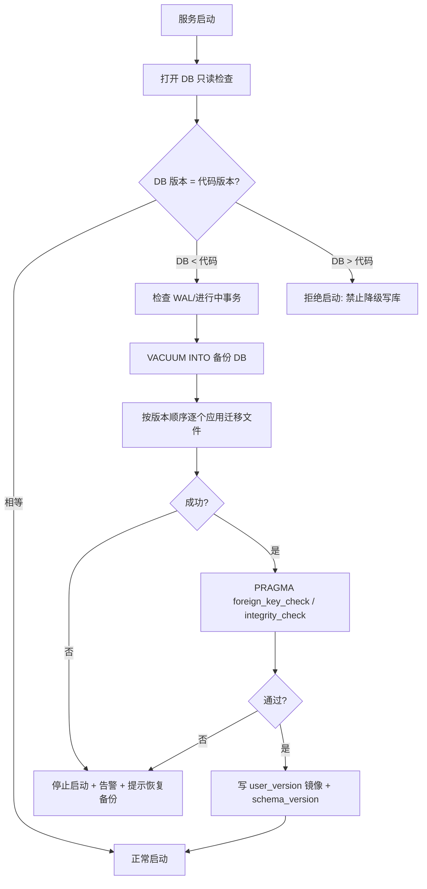
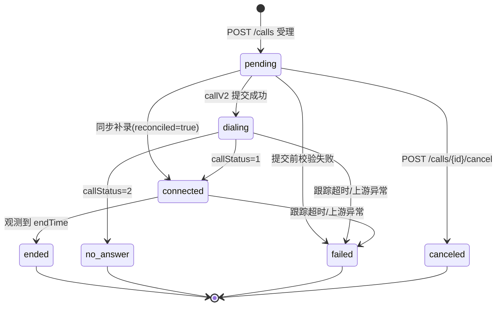
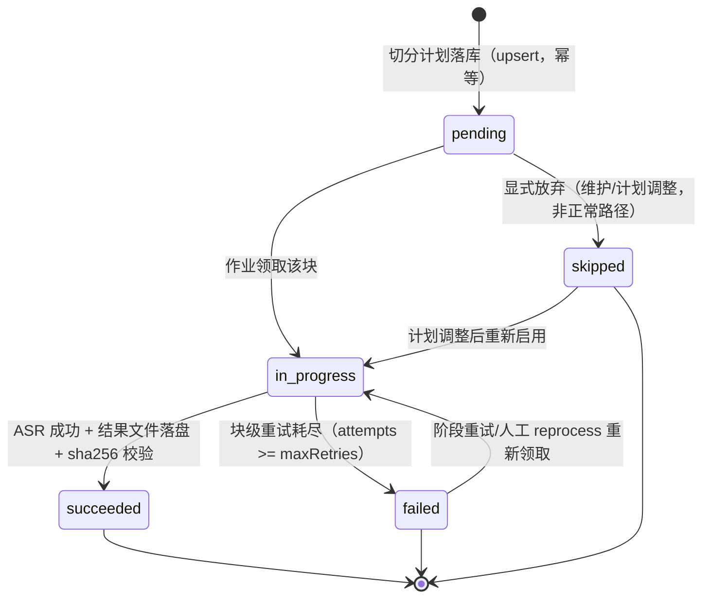
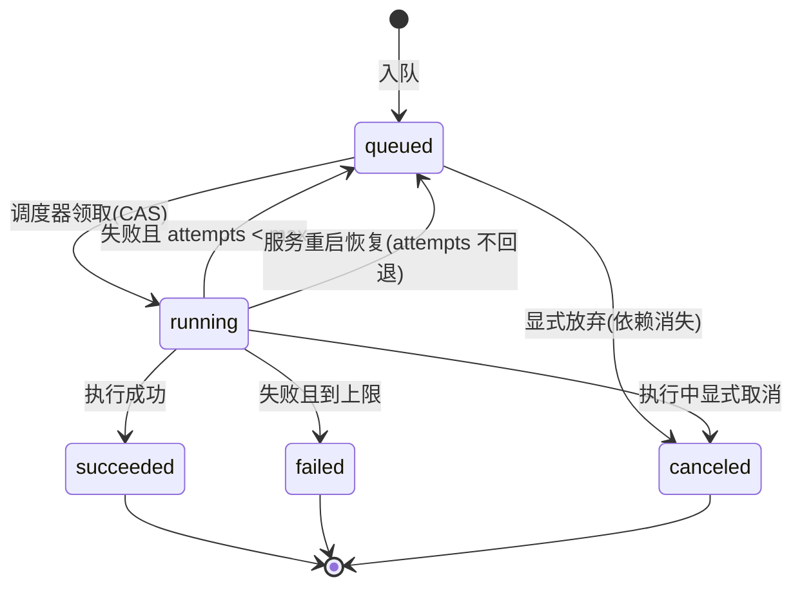

# 04 数据模型与状态机

> 状态：v0.1（Step 2 设计稿，2026-11-14）
> 基准：[01-决策与约定.md](./01-决策与约定.md)（**冲突以 01 为准**）；上游事实依据：[00-上游可行性侦察.md](./00-上游可行性侦察.md)。
> 本文定义**字段级模型**（docs/01 §6 明确"字段级定义见 04"）：SQLite 逻辑/物理模型、DDL、索引与约束、ID/时间规范、状态机、数据生命周期、迁移与备份要求、北向 API 字段映射。
> 关联文档：03 架构（模块边界与并发模型）、05 API（响应字段，本文 §16 为映射基线）、09 上游适配（同步游标算法、错误归一）、10 部署运维（备份/恢复操作）、11 安全（加密、留存、擦除、第三方云处理）、12 验收（数据与状态机验收用例）、**13 后处理规格（ASR 与 LLM）——本文 §5.5/§5.6/§5.7/§5.15/§11/§15.3 与 13 的 ASR 分块、说话人映射、LLM 版本化规则一致**。

## 0. 文档定位与阅读指引

| 读者 | 重点章节 |
| --- | --- |
| 后端实现者 | §4 通用约定、§5 字段定义（含 §5.15 ASR 分块）、§7 DDL、§14 并发控制、§15 状态机 |
| API/CLI/MCP 实现者 | §4.3 枚举、§15 状态语义、§16 字段映射 |
| 运维/合规 | §10 保留与删除、§11 文件（录音/ASR 分块）一致性、§13 备份恢复、11 安全文档 |
| 评审者 | §2 关键决策、§17 与 docs/01 一致性核对 |

---

## 1. 范围与设计原则

### 1.1 范围

- 覆盖实体（15 张表）：`Account`、`AccountSession`、`Call`、`AudioAsset`、`Transcript`、`TranscriptSegment`、`AnalysisResult`、`CallEvent`、`Job`、`TermRule`、`SyncCursor`、`AuditLog`、`IdempotencyKey`、`SchemaVersion`、`TranscriptChunk`。
- 其中 docs/01 §6 锁定的 12 个领域实体全部覆盖；`IdempotencyKey`（docs/01 §5.6 幂等要求）、`SchemaVersion`（迁移要求）与 **`TranscriptChunk`（v1 长通话 ASR 分块计划/块结果的断点续跑与块级重试状态，见 §2 D16、§5.15）** 为本文新增的**支撑表**，不改变 docs/01 §6 的实体命名与关系。
- 转写来源固定 `asr`（本地自建 MiniMax ASR `asr-1.0`，docs/01 §6.1、docs/13 §1），本模型**不含**任何上游转写任务字段（`upstream_task_id`/`checkStatus`/轮询等待状态）。
- 不覆盖：上游接口细节（见 09）、API 请求/响应完整示例（见 05）、ASR/LLM 调用规格（见 13）、备份命令（见 10）。

### 1.2 设计原则

| # | 原则 | 落地 |
| --- | --- | --- |
| P1 | **本地 SQLite 是唯一事实源** | 单文件 DB（WAL），录音等大文件放文件系统，DB 只存相对路径 + sha256（docs/01 §3.1） |
| P2 | **上游 ID 不当本地主键** | 本地主键一律 ULID（带前缀）；`upstreamCallId` 只作业务唯一键（docs/01 §5.6） |
| P3 | **行级乐观锁 + 单写者** | 可写实体带 `version`；单进程单写连接 + `BEGIN IMMEDIATE`（§14） |
| P4 | **状态变化必须留痕** | 每次状态迁移与业务写操作在同一事务内落 `AuditLog` 或事件（事件即状态机日志） |
| P5 | **PII 最小化落库** | 只落业务必需字段 + 脱敏后的原因文本；上游原始响应快照受保留期约束（§10、11 安全） |
| P6 | **可重跑与幂等** | 流水线产物按版本组织（`is_current`），重跑不覆盖历史版本；写接口幂等键（§15.5） |
| P7 | **可迁移** | 前向兼容迁移 + `schema_version` + 迁移前自动备份（§12） |
| P8 | **时间唯一表示** | 落库统一 UTC ISO 8601 毫秒文本，另存上游毫秒原值（§4.2、§2） |
| P9 | **第三方处理最小化** | 发送给第三方云（MiniMax ASR / DeepSeek LLM）的内容为"必要音频分块/已脱敏转写文本 + 元数据"，不发送上游凭证；**原始请求/响应默认不落盘**，业务库里只保留必要的结构化快照、用量与 traceId（§5.7、§11、docs/13 §6.4、11 安全 §7.6） |

---

## 2. 关键设计决策（结论）

> 本章给出任务要求必须"下结论"的决策项；理由详细展开见对应章节。

| # | 决策点 | 结论 | 核心理由 | 详见 |
| --- | --- | --- | --- | --- |
| D1 | 存储引擎 | SQLite 3（WAL、`foreign_keys=ON`、`synchronous=NORMAL`、`busy_timeout=5000`），单文件 `fop.db` | 单机单进程、零运维；WAL 支持读写并发与崩溃恢复（docs/01 §3.1） | §7.1、§14 |
| D2 | 时间存储格式 | **UTC ISO 8601 文本**（`YYYY-MM-DDTHH:MM:SS.sssZ`，毫秒 3 位、固定宽度、UTC） | 字典序=时间序（索引/排序行为与 epoch 等价）、运维可读、与 API ISO 输出零歧义、毫秒精度足够 | §4.2 |
| D3 | 上游毫秒时间戳 | **不参与业务排序**：仅保留在 `upstream_*_time_ms` INTEGER 列与 `raw_upstream_json` 中，用于对账与回溯 | 避免"两套时间"混用；API 层按需在 `details.upstream` 回吐原始 ms（docs/01 §5.6） | §4.2 |
| D4 | 转写全文检索 | **v1 用 LIKE 子串匹配**（归一化后 `text LIKE '%q%'`），**不建 FTS5** | 中文分词缺陷（unicode61 整段成 token、trigram 不支持 2 字词）；v1 数据量下 LIKE 可接受；FTS5 重建/触发器/重跑一致性成本高 | §9 |
| D5 | 软删除策略 | `Account`、`TermRule` **软删除**（`deleted_at`）；`Call`/`Transcript`/`AudioAsset`/`AnalysisResult`/`CallEvent` **不做软删除**（业务终态即历史，物理清理由保留期/合规擦除负责）；`Job`/`IdempotencyKey` 直接物理删除；`AuditLog` 只追加、不可改删（保留期清理除外） | 账号删除后历史话单必须可查（docs/01 §4.1 #9）；软删除只用于"需要恢复/引用完整性"的小表 | §10.2 |
| D6 | 事件保留期 | `call_events` 默认保留 **90 天**（可配 7–365）；SSE 续传窗口 = 事件保留窗口；`AuditLog` 默认 **3 年**；`Job` 默认 **30 天**；`idempotency_keys` 保留 **48 小时**（回放窗口 24 小时，docs/01 §5.6） | SSE 断点续传只需小时级；单通话单时间线查询 90 天足够；审计遵循"长期可追溯" | §10.1 |
| D7 | 录音目录规范 | `{audioDir}/{yyyy}/{mm}/{dd}/{callId}.wav`，日期取 `startedAt` 的 Asia/Shanghai 自然日；**文件名不含手机号/sha256**，sha256 存 DB | 路径可推导、幂等、无 PII 泄漏；sha256 用于完整性校验而非寻址（内容变化=损坏，重下到同一路径） | §11.1 |
| D8 | DB ↔ 文件一致性 | **归档：先文件后 DB**（原子落盘 + sha256 校验后插 `audio_assets`）；**擦除：先文件后 DB**（先删 PII 文件，再删 DB 行）；孤儿文件按"启动扫描 + 每日维护任务"清理 | 任何崩溃点都不会出现"DB 声称有录音但文件不存在"的假成功；PII 擦除优先保证磁盘上先消失 | §11.2 |
| D9 | 迁移策略 | `schema_version` 表（每迁移一行）+ 文件 `migrations/NNNN_snake_name.sql`（4 位序号）；前向、只增；迁移前自动 `VACUUM INTO` 备份；DB 版本 > 代码版本时**拒绝启动** | 可审计、可回滚（恢复备份）、防降级写坏数据 | §12 |
| D10 | 乐观锁 | 可写实体统一 `version INTEGER NOT NULL DEFAULT 1`；更新一律 `SET version=version+1 WHERE pk=? AND version=?`；状态迁移额外加 `AND status=<期望状态>` | 单进程内仍有 API/worker 并发；CAS 比悲观锁简单且可审计 | §14.3 |
| D11 | 枚举存储 | 枚举一律 `TEXT` + `CHECK(IN (...))`，值即 docs/01 §6.1 字符串；新增枚举值需迁移（只增不改） | 可读、可迁移、与 API 零转换；禁止整数魔术值 | §4.3 |
| D12 | 表类型 | 全部使用 `STRICT` 表（SQLite ≥ 3.37，Node 22 内置 SQLite/better-sqlite3 均满足）；布尔用 `INTEGER 0/1 + CHECK` | 强类型防脏数据；SQLite 单机场景下约束成本可忽略 | §4.5 |
| D13 | 复杂字段（标签/摘要/原始响应） | 用 `*_json TEXT` 存 JSON 文本（SQLite JSON1 可选），列名带 `_json` 后缀；**禁止**把需要索引的字段塞进 JSON | 兼顾扩展性与查询可维护性 | §4.4 |
| D14 | 分页 | API 层 `page/size`（page 1 起、size ≤100，docs/01 §5.5），DB 用 `LIMIT/OFFSET`；排序字段白名单 + 稳定次序 `(sortKey, callId)` 兜底 | v1 数据量 ≤ 1e5 行，offset 足够；keyset 分页留 v1.1 | §8.2 |
| D15 | **转写来源与引擎字段** | `transcripts.source` **固定 `asr`**（CHECK 仅允许 `asr`）；`provider` 存 `minimax:asr-1.0`（vendor:model），`language`/`duration_ms` 保留；**删除** `engine`/`engine_version`/`upstream_task_id`/`upstream_check_status` 与全部上游转写轮询语义 | 业务决策 D1/D2（docs/13 §1）：不使用上游转写，不存在 `upstream`/`hybrid` 来源，也不存在上游任务 ID/checkStatus 可存 | §5.5、§4.3 |
| D16 | **长通话 ASR 分块的落库形态** | **新增支撑表 `transcript_chunks`（§5.15）+ `transcripts.asr_meta_json` 最终快照**：分块计划与块级状态（`pending/in_progress/succeeded/failed/skipped`、attempts、traceId、结果文件路径/sha256、forcedCut、错误码）在**转写 ready 之前**就需持久化（崩溃续跑、块级重试）；`asr_meta_json` 在 ready 时固化最终分块计划与 traceId 索引（对齐 docs/13 §2.3 "分块计划落库 `Transcript.meta.chunks[]`" 的数据契约） | 若只把分块状态塞进 `transcripts.asr_meta_json`，则转写行必须提前创建（与 `is_current=1` ⇔ ready 的不变量冲突），且崩溃时丢失块进度；独立支撑表同时满足 docs/13 断点续跑与块级重试，避免重复计费 | §5.15、§5.5、§11.2、§15.3.5 |
| D17 | **ASR 分块结果文件目录** | `{dataDir}/asr/{callId}/chunk-{index}.json`（文件 `0600`、目录 `0700`、原子写）；内容 = **归一化后的块级 ASR 结果**（segments/text/duration/n_speakers/speaker/trace_id/耗时），**不是原始 HTTP 响应体**；与 DB 一致性：**先文件后 DB**（块状态 `succeeded` 只在文件落地并校验 sha256 后写入）；孤儿按"启动扫描 + 每日维护"清理；与录音目录规则一致 | 不重复计费（已完成块直接读文件合并）、崩溃续跑（半途作业恢复）、可审计；原始响应体默认不落盘（P9） | §11.1/§11.2、§10.1 |
| D18 | **AnalysisResult 版本化扩展** | 新增 `params_json`（temperature/maxTokens/effort 等，不含密钥）、`schema_version`、`usage_json`（prompt/completion/total tokens + latencyMs）、`needs_review`、`raw_request_hash`（请求 sha256，非内容）、`raw_response_path`（**默认 NULL**，排障开关才写 0600 短留存）；`model`/`prompt_version`/`terms_version`/`speaker_mapping_json` 保留并明确取值；`is_current` 版本化机制**不变** | docs/13 §6.4 要求可复现与可审计；`raw_*` 仅存哈希/受控路径满足"原始响应默认不落盘"（11 安全 §7.6） | §5.7、§16.2 |

---

## 3. ER 图

```mermaid
erDiagram
    ACCOUNT ||--o| ACCOUNT_SESSION : "1—1 登录态"
    ACCOUNT ||--o| SYNC_CURSOR : "1—1 同步游标"
    ACCOUNT ||--o{ CALL : "1—N 归属"
    ACCOUNT ||--o{ JOB : "1—N 运行"
    CALL ||--o| AUDIO_ASSET : "1—1 录音归档"
    CALL ||--o{ TRANSCRIPT : "1—N 版本(is_current=1)"
    TRANSCRIPT ||--o{ TRANSCRIPT_SEGMENT : "1—N 句级分段"
    CALL ||--o{ TRANSCRIPT_CHUNK : "1—N ASR 分块计划/块结果(按 revision)"
    TRANSCRIPT ||--o{ TRANSCRIPT_CHUNK : "1—N 合并后回填 transcript_id(可空)"
    CALL ||--o{ ANALYSIS_RESULT : "1—N 版本(is_current=1)"
    CALL ||--o{ CALL_EVENT : "1—N 事件时间线"
    CALL ||--o{ JOB : "1—N 流水线作业"
    CALL ||--o{ IDEMPOTENCY_KEY : "弱关联(resource_id)"
    CALL }o--o| AUDIT_LOG : "弱关联(target_id)"
    TRANSCRIPT }o--o{ TERM_RULE : "归一命中(记录于terms_applied_json)"
    SCHEMA_VERSION ||--|| SCHEMA_VERSION : "迁移记录(单表)"

    ACCOUNT {
        TEXT account_id PK
        TEXT upstream_username
        TEXT status "enabled|disabled"
        TEXT deleted_at "软删除标记"
        INTEGER version
    }
    ACCOUNT_SESSION {
        TEXT account_id PK,FK
        BLOB jwt_ciphertext "加密存储"
        TEXT jwt_expires_at
        TEXT login_state
        TEXT health_status
    }
    CALL {
        TEXT call_id PK "call_<ULID>"
        TEXT account_id FK
        TEXT upstream_call_id "业务唯一键"
        TEXT status "pending|dialing|connected|ended|no_answer|failed|canceled"
        TEXT started_at "排序/过滤基准"
        TEXT audio_status
        TEXT transcript_status
        TEXT analysis_status
        INTEGER version
    }
    AUDIO_ASSET {
        TEXT audio_id PK
        TEXT call_id PK,FK "唯一"
        TEXT storage_path "相对 dataDir"
        TEXT sha256
        INTEGER size_bytes
    }
    TRANSCRIPT {
        TEXT transcript_id PK
        TEXT call_id FK
        TEXT source "固定 asr（本地自建 ASR）"
        TEXT provider "minimax:asr-1.0"
        INTEGER chunk_count "分块数，整段=1"
        INTEGER needs_review "角色/质量低置信→1"
        INTEGER is_current
        TEXT full_text "LIKE 检索"
    }
    TRANSCRIPT_SEGMENT {
        TEXT segment_id PK
        TEXT transcript_id FK
        INTEGER seq
        INTEGER start_ms
        INTEGER end_ms
        INTEGER channel_id "双声道 0=坐席 1=客户；单声道 NULL"
        TEXT speaker_label "ASR 原始标签 S1/S2（块内有效）"
        INTEGER chunk_index "ASR 分块序号，整段=0"
        TEXT speaker_role
        TEXT text_normalized
    }
    TRANSCRIPT_CHUNK {
        TEXT chunk_id PK "支撑表（D16）"
        TEXT call_id FK
        INTEGER revision "对应 transcripts.revision"
        INTEGER chunk_index "唯一(call_id,revision,chunk_index)"
        INTEGER begin_ms
        INTEGER end_ms
        TEXT status "pending|in_progress|succeeded|failed|skipped"
        TEXT result_path "分块结果文件（相对 dataDir）"
        TEXT provider_trace_id
    }
    ANALYSIS_RESULT {
        TEXT analysis_id PK
        TEXT call_id FK
        INTEGER is_current
        TEXT model "deepseek-chat / deepseek-v4-pro"
        TEXT prompt_version "analysis-v1"
        TEXT intent_label
        TEXT summary
    }
    CALL_EVENT {
        INTEGER seq PK "自增，SSE 续传排序"
        TEXT event_id "evt_<ULID>"
        TEXT type
        TEXT occurred_at
        TEXT call_id FK
        TEXT data_json
    }
    JOB {
        TEXT job_id PK
        TEXT type
        TEXT status
        TEXT stage
        INTEGER attempts
        TEXT next_run_at
    }
    TERM_RULE {
        TEXT term_id PK
        TEXT to_term "标准词"
        TEXT from_aliases_json
        INTEGER priority "越大越优先"
        INTEGER enabled
        TEXT deleted_at
    }
    SYNC_CURSOR {
        TEXT account_id PK,FK
        TEXT mode
        INTEGER last_create_time_ms
        TEXT last_success_at
    }
    AUDIT_LOG {
        TEXT audit_id PK
        TEXT occurred_at
        TEXT actor
        TEXT action
        TEXT target_id
        TEXT result
    }
    IDEMPOTENCY_KEY {
        TEXT scope PK
        TEXT idem_key PK
        TEXT request_hash
        TEXT status
        TEXT expires_at
    }
    SCHEMA_VERSION {
        INTEGER version PK
        TEXT name "文件名"
        TEXT checksum
        TEXT applied_at
    }
```



> 说明：`IdempotencyKey`/`AuditLog`/`SchemaVersion`/`TranscriptChunk` 与业务表为**弱/支撑关联**（`TranscriptChunk` 对 `calls` 为强外键级联、对 `transcripts` 为 `SET NULL` 弱关联，见 §6.1）；强外键仅用于"子记录必须随父记录消失"的 1—N 结构（§6）。`TranscriptChunk` 是 docs/13 §2.3 分块计划/块结果落库的持久化载体，**不改变 docs/01 §6 的 12 个领域实体**（属支撑表）。

---

## 4. 通用约定

### 4.1 ID 规范（对齐 docs/01 §5.6）

| 对象 | 格式 | 生成方 | 示例 | 说明 |
| --- | --- | --- | --- | --- |
| `accountId` | 用户可读 slug：`[a-z0-9][a-z0-9_-]{1,31}`（2–32 字符） | 用户 | `main`、`shouji-1` | 主键；创建后不可改 |
| `callId` | `call_` + ULID(26) | 服务端 | `call_01J8Z3K5T9QW2M4R7X1C6V0B8N` | 受理时生成，全局唯一 |
| `jobId` | `job_` + ULID | 服务端 | `job_01J8Z...` | |
| `eventId` | `evt_` + ULID | 服务端 | `evt_01J8Z...` | 事件封套字段（docs/01 §7.3） |
| `audioId` | `aud_` + ULID | 服务端 | `aud_01J8Z...` | |
| `transcriptId` | `tr_` + ULID | 服务端 | `tr_01J8Z...` | |
| `segmentId` | `seg_` + ULID | 服务端 | `seg_01J8Z...` | |
| `analysisId` | `ana_` + ULID | 服务端 | `ana_01J8Z...` | |
| `chunkId` | `chk_` + ULID | 服务端 | `chk_01J8Z...` | ASR 分块行内部 ID（支撑表，不对外） |
| `termId` | `term_` + ULID | 服务端 | `term_01J8Z...` | |
| `auditId` | `audit_` + ULID | 服务端 | `audit_01J8Z...` | |
| `upstreamCallId` | 上游雪花 ID **字符串**（19 位） | 上游 | `2121158093386702849` | 禁止转 number（超出 JS 安全整数）；只作业务唯一键（§7 唯一索引） |
| `Idempotency-Key` | 客户端 UUID v4 或 ULID | 客户端 | `01J8Z...` | 服务端不解析格式，仅字符串（≤128 字符） |
| `requestId` | `req_` + ULID | 服务端/客户端 | `req_01J8Z...` | 响应头 `X-Request-Id`（docs/01 §5.1） |

约束：
- ULID 使用 **Crockford Base32 大写**（26 字符），时间有序；服务端生成保证单调递增近似（同毫秒可乱序，靠 DB `seq` 兜底排序）。
- 所有 ID 长度为可控常量：字符串前缀 + ULID ≤ 40 字符；DB 不额外限制长度（由应用层校验）。
- 上游 `userId`、`bindId` 等一律 TEXT 存储，不转数字；转写/分析相关的第三方标识（MiniMax `trace_id`）也按 TEXT 存储（`transcript_chunks.provider_trace_id`），不转数字。

### 4.2 时间规范

#### 4.2.1 结论与格式

- **落库格式（唯一）**：UTC ISO 8601 文本，固定宽度到毫秒：`YYYY-MM-DDTHH:MM:SS.sssZ`。
  - 生成：`strftime('%Y-%m-%dT%H:%M:%fZ','now')`（SQLite `%f` = `SS.SSS`，UTC）。
  - 示例：`2026-11-14T02:03:12.345Z`。
  - 比较：UTC 固定宽度文本的**字典序 = 时间序**，`ORDER BY`/范围查询/索引与 epoch ms 等价。
- **API 输出格式**：ISO 8601 带时区，统一 `+08:00`（docs/01 §5.6），由 API 层从 UTC 文本转换；`meta.ts` 同规则。
- **时长/偏移**：以 `INTEGER` 毫秒存储（字段后缀 `_ms`）或秒（`_sec`），不用浮点。
- **上游原始毫秒**：另存 `upstream_*_time_ms INTEGER`（§5.3），只用于对账/回溯，**不参与排序过滤**；API 详情按 docs/01 §5.6 在 `details.upstream` 回吐。
- **日期过滤**：API `dateFrom`/`dateTo`（`YYYY-MM-DD`，docs/01 §5.5）按 **Asia/Shanghai 自然日**解释（含端点）；实现为：把本地自然日边界换算成 UTC `[startAt, endAt)` 再对 `started_at` 做范围过滤（见 §8.2）。

#### 4.2.2 为什么不用 epoch ms

| 维度 | UTC ISO 文本（采用） | epoch ms（不采用） |
| --- | --- | --- |
| 运维/排障 | 人可读，`sqlite3` 直接看懂 | 需心算/函数转换 |
| 排序/范围 | 固定宽度 UTC 字典序=时间序，行为等价 | 等价 |
| 与 API 契约 | ISO 8601（docs/01 §5.6）→ 仅时区格式化 | 每次输出都要转换 |
| 精度 | 毫秒（3 位小数）无损 | 毫秒 |
| 空间 | ~24 B/值（可接受） | 8 B/值 |
| 误用风险 | 写入必须统一格式化（§4.2.3） | 时区语义天然无歧义但可读性差 |

结论：空间差异在本项目量级（≤ 数十万行 × 每行 ~10 个时间列）不构成问题，可读性/契约一致性收益更大，**选 UTC ISO 文本**。

#### 4.2.3 写入/读取纪律

1. 所有 `*_at` 列写入前必须经统一的 `toIsoUtc()` 规范化（补毫秒、转 UTC）；禁止直接写上游字符串。
2. DDL 对关键列加示例性格式守护（§7 `calls.started_at`、`call_events.occurred_at` 的 `GLOB` CHECK）；其余时间列由写入层保证同一格式（避免每列重复 CHECK 的噪音）。
3. 上游 ms → ISO：`new Date(ms).toISOString()`；ISO → API `+08:00`：统一序列化函数，禁止逐处手拼。
4. 数据库 `updated_at` 由应用显式写入（**不用触发器自动改写**，保证乐观锁与审计语义显式可追踪，§14.3）。
5. 时间比较只用文本比较/范围查询，禁止 `datetime()` 函数参与索引条件（防隐式转换）。

### 4.3 枚举规范

#### 4.3.1 核心枚举（严格引用 docs/01 §6.1，禁止改名/改值）

| 枚举 | 取值 |
| --- | --- |
| Call status | `pending`、`dialing`、`connected`、`ended`、`no_answer`、`failed`、`canceled` |
| Pipeline stage status | `pending`、`in_progress`、`ready`、`missing`、`failed`、`skipped` |
| Transcript source | **固定 `asr`**（本地自建 ASR；docs/01 §6.1、docs/13 §1）；**不存在** `upstream`/`local_asr`/`hybrid` |
| Speaker role | `agent`、`customer`、`unknown` |
| Job type | `login`、`sync`、`audio_fetch`、`asr`、`analysis`、`reprocess`、`backfill`（**已删除** `transcript_fetch`/`transcript_pending_wait`：不使用上游转写，无轮询作业，docs/01 §6.1） |
| Job status | `queued`、`running`、`succeeded`、`failed`、`canceled` |
| Event type | 见 docs/01 §7.3 的 24 个值（§5.8 表内逐条列出） |

Call 终态集合（不可变）：`ended`、`no_answer`、`failed`、`canceled`（docs/01 §6.1）。

#### 4.3.2 字段级枚举（docs/01 §6.1 未列，由本文定义）

> 这些枚举是**字段取值范围**，不改变 docs/01 §6.1 的核心枚举契约；如需调整，先改本文并同步 05/06/07。

| 枚举 | 使用字段 | 取值 | 说明 |
| --- | --- | --- | --- |
| Account status（DB） | `accounts.status` | `enabled`、`disabled` | 本地启停；删除=软删除（`deleted_at`），对外映射 `enabled` 布尔（docs/05 §2.2） |
| **ASR chunk status** | `transcript_chunks.status` | `pending`、`in_progress`、`succeeded`、`failed`、`skipped` | 长通话分块结果状态（§5.15、§15.3.5）；整段路径同样落 1 个分块行（统一代码路径）；`skipped` = 显式放弃该块（维护/计划调整，非正常合并路径） |
| **Speaker mapping method** | `transcripts.speaker_mapping_json.method`、`analysis_results.speaker_mapping_json.method` | `channel`、`asr_diarization`、`llm_reconciled`、`heuristic` | 说话人角色映射方法（docs/05 §2.9、docs/13 §4.2）：双声道拆分=channel；单声道 diarization=asr_diarization；跨块/不一致重映射=llm_reconciled；纯规则=heuristic |
| **ASR provider 标识** | `transcripts.provider` | `minimax:asr-1.0`（vendor:model） | v1 固定值；`docs/05 provider` 同源（§16.2） |
| Account API state（派生） | API `AccountSummary.state`（不落库） | `online`、`expired`、`logging_in`、`error`、`disabled`、`unknown` | 由 `accounts.status` + `account_sessions.login_state` + `health_status` 派生（映射见 §16.1）；docs/05 §2.2 |
| Account origin | `accounts.origin` | `user`、`restored` | 用户新建 / 软删除后恢复 |
| Login state | `account_sessions.login_state` | `unauthenticated`、`logging_in`、`authenticated`、`expired`、`failed` | 登录态（JWT 有效性与登录作业合并状态） |
| Health status | `account_sessions.health_status` | `healthy`、`degraded`、`unhealthy`、`unknown` | 账号健康摘要（`account.health.changed` 事件 from/to，docs/01 §7.3） |
| Call origin | `calls.origin` | `local_dial`、`sync` | 本地发起 / 同步补录（补录路径标注 `reconciled`） |
| **Dial state** | `calls.dial_state` | `none`、`sending`、`sent`、`failed`、`unknown` | 呼出提交意图状态（落地 docs/03 §4.2 的 `dialAttempt.state`：先落库意图再发 `callV2`；`sending`/`unknown` 只能对账、禁止重发） |
| Job trigger | `jobs.trigger` | `api`、`scheduler`、`pipeline`、`manual` | 作业来源 |
| Sync mode | `sync_cursors.mode` | `incremental`、`full`、`backfill` | 增量 / 全量 / 历史回补 |
| Term category | `term_rules.category` | `company`、`product`、`person`、`custom` | 词表分类（docs/05 §2.10，可空） |
| Audit result | `audit_logs.result` | `success`、`failed` | 操作结果 |
| Idempotency status | `idempotency_keys.status` | `in_progress`、`succeeded`、`failed` | `failed` 也回放首次失败结果（docs/01 §5.6） |
| Event source | 不落库（由 `type` 前缀表达） | — | — |

存储规则：
- 枚举列一律 `TEXT NOT NULL` + `CHECK (col IN (...))`；**禁止**存 `null` 表示未开始（流水线状态用 `pending`）。
- 读取到未知枚举值（例如回滚/旧版本兼容）：按 **未知值降级** 处理（API 原样返回字符串、业务分支按 `unknown` 处理）并写 WARN 日志，不抛 500。
- 新增枚举值 = 非破坏性变更（docs/01 §5.8），但仍需迁移更新 `CHECK`；迁移必须在同一里程碑内完成。

### 4.4 公共字段与命名约定

| 约定 | 内容 |
| --- | --- |
| 命名风格 | DB 列 `snake_case`；API 字段 `camelCase`（§16 映射）；表名复数小写 |
| 时间字段 | `*_at`（时间点，TEXT UTC ISO）、`*_ms`（毫秒时长/偏移，INTEGER）、`*_sec`（秒） |
| 金额 | 整数分：`cost_cents INTEGER`（上游 `postage` 元 ×100，四舍五入）；API 输出 `cost`（元，number） |
| 布尔 | `INTEGER NOT NULL DEFAULT 0 CHECK (col IN (0,1))`；API 输出 `true/false` |
| 电话 | `to_phone`/`from_phone` 存规范化号码：去空格/连字符/括号，保留前导 `+`；CN 11 位手机在应用层按 `^1[3-9]\d{9}$` 校验（可配置放开国际号）；日志/事件/审计一律掩码 `138****0000` |
| JSON 列 | 列名后缀 `_json`，`TEXT NOT NULL DEFAULT '{}'/'[]'`；写入前 `JSON.stringify` 且校验 `JSON.parse` 往返；读取容错（解析失败按空对象并告警） |
| 错误信息 | `*_error_code`（docs/01 §5.4 归一错误码）+ 人类可读原因（`failed_reason`/`last_error_message`）；上游原文摘要截断 ≤ 512 字符 |
| 软删除 | `deleted_at TEXT NULL`（NULL=活跃）；查询默认过滤 `deleted_at IS NULL`（账号/词表） |
| 版本 | `version INTEGER NOT NULL DEFAULT 1 CHECK (version >= 1)`，每次 UPDATE +1 |
| 注释 | 每个表/复杂列必须带 `--` 注释；迁移文件头部必须写版本号与变更说明 |

### 4.5 表类型与 PRAGMA

| 项 | 值 | 说明 |
| --- | --- | --- |
| 表类型 | `STRICT`（全部业务表） | 类型强校验；SQLite ≥ 3.37（Node 22 运行时满足，见 03/10 环境检查） |
| 连接 PRAGMA | `journal_mode=WAL`、`synchronous=NORMAL`、`foreign_keys=ON`、`busy_timeout=5000`、`cache_size=-16000`（约 16MB）、`temp_store=MEMORY` | 启动时统一设置；WAL 由主进程独占（docs/01 §3.1） |
| 写事务 | `BEGIN IMMEDIATE` | 避免读事务升级写锁导致 `SQLITE_BUSY` 死锁 |
| 应用标识 | `PRAGMA application_id = 0x464F5001`（"FOP"+版本1）；`PRAGMA user_version = <schema_version.max>` 镜像 | 快速健康检查（docs/10 doctor） |
| 页大小 | 4096（默认） | 不显式改，保持备份/恢复可移植 |
| 自动清理 | `auto_vacuum` 不开启（NONE） | 避免频繁重建开销；空间回收由保留期清理 + 定期 `VACUUM`（维护窗口）完成 |
| 外键 | 建 FK 的列必须有索引（SQLite 不自动建） | §6.2 列出全部 FK 索引 |

---

## 5. 实体字段定义

> 字段表列含义：**类型**（SQLite 存储类型）、**必填**（是否 `NOT NULL`）、**默认**、**取值/约束**、**索引**（该列参与的索引，索引全名见 §7.3）、**说明**。
> 所有表均含 §4.4 公共约定；`created_at`/`updated_at` 除特别说明外默认 `strftime('%Y-%m-%dT%H:%M:%fZ','now')`。

### 5.1 Account（`accounts`）—— 上游坐席账号

> docs/01 §6：主键 `accountId`（slug）；1—N `Call`、1—1 `AccountSession`、1—1 `SyncCursor`。
> 安全：**密码不落库**，只存引用（`credential_ref`）；登录手机号属 PII，API 一律脱敏（11 安全）。

| 字段 | 类型 | 必填 | 默认 | 取值/约束 | 索引 | 说明 |
| --- | --- | --- | --- | --- | --- | --- |
| `account_id` | TEXT | 是 | — | 主键；`GLOB '[a-z0-9][a-z0-9_-]*'` 且长度 2–32 | PK | 用户可读 slug（`main`、`shouji-1`） |
| `display_name` | TEXT | 是 | — | 1–64 字符 | — | 展示名 |
| `upstream_username` | TEXT | 是 | — | 上游登录手机号（PII，API 脱敏） | 唯一（活跃） | 登录账号 |
| `upstream_user_id` | TEXT | 否 | NULL | 上游 `userId` 字符串 | 唯一（活跃且非空） | 上游账号映射，用于话单归属对账 |
| `tenant_code` | TEXT | 否 | NULL | 上游 `tenantCode` | — | 租户编码 |
| `enterprise_name` | TEXT | 否 | NULL | ≤128 字符 | — | 企业名（诊断展示） |
| `agent_code` | TEXT | 否 | NULL | 上游 `agentCode` | — | 坐席编号 |
| `real_name` | TEXT | 否 | NULL | ≤64 字符（PII） | — | 上游坐席姓名（`userDetail`/话单 `realName`，docs/05 §2.2 `realName`） |
| `tel_a` | TEXT | 否 | NULL | 规范化手机号（PII） | — | 坐席绑定手机号（上游话单 `telA` 主数据） |
| `profile_name` | TEXT | 是 | = account_id | `[a-z0-9_-]{1,64}` | — | 浏览器 profile 目录名（相对 `browser.profileRoot`） |
| `browser_headless` | INTEGER | 否 | NULL | 0/1；NULL=用全局 `browser.headless` | — | 账号级浏览器 headless 覆盖（docs/05 §5.2 `browser.headless`） |
| `credential_ref` | TEXT | 是 | — | 形如 `env:FOP_ACCOUNT_MAIN_PASSWORD` / `keyring:feige/main` / `secrets:accounts.main.password` | — | **密码引用**，绝不存明文（docs/01 §9、11 安全）；密码轮换时更新引用或密钥存储，不新增明文列 |
| `line_id` | TEXT | 否 | NULL | 上游线路 ID 字符串 | — | 最近一次探测的线路 |
| `line_name` | TEXT | 否 | NULL | 如 `电信回拨` | — | 线路名 |
| `line_mode` | INTEGER | 否 | NULL | 上游线路 `mode`（本账号实测 1） | — | 线路模式（docs/05 §2.2 `line.mode`） |
| `status` | TEXT | 是 | `enabled` | `enabled`、`disabled` | idx | 本地启停；停用后不接受新呼出（API `enabled` 布尔） |
| `concurrency_limit` | INTEGER | 是 | 1 | ≥1 | — | 账号并发呼出上限（回拨模式默认 1，docs/01 §5.7） |
| `dial_cooldown_ms` | INTEGER | 否 | NULL | ≥0；NULL=用全局 `limits.dialCooldownMs` | — | 账号级防重冷却覆盖 |
| `origin` | TEXT | 是 | `user` | `user`、`restored` | — | 新建 / 软删除后恢复 |
| `upstream_line_list_json` | TEXT | 否 | NULL | JSON 数组（`callLineList` 原样，含 `lineId/lineName/mode`） | — | 线路能力缓存（分钟级刷新） |
| `last_health_json` | TEXT | 否 | NULL | JSON（余额、线路、上游错误摘要） | — | 健康摘要缓存（`GET /accounts` 使用） |
| `metadata_json` | TEXT | 是 | `'{}'` | JSON 对象；≤10 键、值 ≤256 字符（≤4KB） | — | 账号自定义元数据（docs/05 §5.2 `metadata`） |
| `deleted_at` | TEXT | 否 | NULL | UTC ISO；NULL=活跃 | idx | **软删除**标记（docs/01 §4.1 #9：默认保留历史数据；对外 `deletedAt`，docs/05 §5.5） |
| `created_at` | TEXT | 是 | now | UTC ISO | — | |
| `updated_at` | TEXT | 是 | now | UTC ISO | — | |
| `version` | INTEGER | 是 | 1 | ≥1 | — | 乐观锁（§14.3） |

**约束与索引**
- `ux_accounts_username`：`UNIQUE(upstream_username) WHERE deleted_at IS NULL`（同一上游账号不可重复接入）。
- `ux_accounts_upstream_user`：`UNIQUE(upstream_user_id) WHERE upstream_user_id IS NOT NULL AND deleted_at IS NULL`。
- `ix_accounts_status`：`(status) WHERE deleted_at IS NULL`。
- 软删除后**立即**：清空 `account_sessions` 凭证行（删除）、禁用账号；历史 `calls` 保留（业务与合规要求）。

### 5.2 AccountSession（`account_sessions`）—— 登录态

> docs/01 §6：主键 `accountId`，1—1 `Account`；保存 JWT、WS 连接、健康状态。
> 安全：JWT **加密落库**（AES-256-GCM），密钥来自系统 keyring / 0600 主密钥文件（11 安全 §4）。

| 字段 | 类型 | 必填 | 默认 | 取值/约束 | 索引 | 说明 |
| --- | --- | --- | --- | --- | --- | --- |
| `account_id` | TEXT | 是 | — | 主键；FK → `accounts.account_id` ON DELETE CASCADE | PK | 账号 |
| `jwt_ciphertext` | BLOB | 否 | NULL | AES-256-GCM 密文（长度 ≤ 4KB） | — | 上游 JWT（**禁止明文落库/落日志**） |
| `jwt_iv` | BLOB | 否 | NULL | 12 字节随机 IV | — | 加密参数 |
| `jwt_tag` | BLOB | 否 | NULL | 16 字节 GCM tag | — | 加密参数 |
| `jwt_key_id` | TEXT | 否 | NULL | 主密钥版本（用于轮换） | — | 密钥轮换标识 |
| `jwt_issued_at` | TEXT | 否 | NULL | UTC ISO | — | 签发时间（≈ 登录成功时间） |
| `jwt_expires_at` | TEXT | 否 | NULL | UTC ISO | idx | 过期时间（≤7 天，docs/01 §8.5） |
| `login_state` | TEXT | 是 | `unauthenticated` | `unauthenticated`、`logging_in`、`authenticated`、`expired`、`failed` | idx | 登录态 |
| `login_fail_count` | INTEGER | 是 | 0 | ≥0 | — | 连续失败次数（用于退避与人工介入） |
| `last_login_job_id` | TEXT | 否 | NULL | `job_<ULID>` | — | 最近登录作业 |
| `last_login_at` | TEXT | 否 | NULL | UTC ISO | — | 最近成功登录 |
| `last_auth_error` | TEXT | 否 | NULL | docs/01 §5.4 错误码 | — | 最近一次认证类错误 |
| `ws_connected` | INTEGER | 是 | 0 | 0/1 | — | WS 实时通道（保活/事件）连接状态 |
| `ws_connected_at` | TEXT | 否 | NULL | UTC ISO | — | 最近一次 WS 连上 |
| `ws_last_pong_at` | TEXT | 否 | NULL | UTC ISO | — | 最近 pong（心跳健康） |
| `health_status` | TEXT | 是 | `unknown` | `healthy`、`degraded`、`unhealthy`、`unknown` | idx | 健康摘要（`account.health.changed`） |
| `health_detail_json` | TEXT | 否 | NULL | JSON（jwtRemainingMs、ws、line、时段等） | — | 健康详情 |
| `last_check_at` | TEXT | 否 | NULL | UTC ISO | — | 最近健康检查 |
| `created_at` | TEXT | 是 | now | UTC ISO | — | |
| `updated_at` | TEXT | 是 | now | UTC ISO | — | |
| `version` | INTEGER | 是 | 1 | ≥1 | — | 乐观锁 |

**约束与索引**
- `ix_sessions_health`：`(health_status)`；`ix_sessions_jwt_expiry`：`(jwt_expires_at)`（保活扫描用）。
- JWT 明文字节只允许存在于内存；任何序列化/日志路径禁止输出（11 安全 §5.3）。
- 账号 `logout` / 软删除时：`jwt_*` 置 NULL、`login_state=unauthenticated`、`ws_connected=0`，并写审计。
- **派生字段（不落库）**：API `AccountSummary.state`（`online/expired/logging_in/error/disabled/unknown`）与 `session.cookieState`（`valid/expired/unknown`）由本表 + `accounts.status/deleted_at` 派生，映射见 §16.1；`cookieState` 仅按 `login_state` 推导（`authenticated→valid`、`expired→expired`、其它→`unknown`），平台不单独保存上游 cookie。

### 5.3 Call（`calls`）—— 话单（核心表）

> docs/01 §6：主键 `callId`（ULID）；N—1 `Account`；1—1 `AudioAsset`；1—N `Transcript`/`CallEvent`/`Job`。
> 状态机与迁移规则见 §15；字段来源对照上游见 docs/01 §8.2。

| 字段 | 类型 | 必填 | 默认 | 取值/约束 | 索引 | 说明 |
| --- | --- | --- | --- | --- | --- | --- |
| `call_id` | TEXT | 是 | — | 主键；`call_<ULID>` | PK | 本地话单 ID |
| `account_id` | TEXT | 是 | — | FK → `accounts.account_id` ON DELETE RESTRICT | idx | 归属账号（多账号话单按 `accountId+upstreamCallId` 聚合，docs/01 §8.5） |
| `upstream_call_id` | TEXT | 否 | NULL | 上游雪花 ID 字符串；**唯一键** `(account_id, upstream_call_id)` | 唯一（非空） | 上游通话 ID（`id`） |
| `upstream_user_id` | TEXT | 否 | NULL | 上游 `userId` | — | 上游账号快照（对账用） |
| `origin` | TEXT | 是 | `local_dial` | `local_dial`、`sync` | — | 本地发起 / 同步补录 |
| `status` | TEXT | 是 | `pending` | `pending`、`dialing`、`connected`、`ended`、`no_answer`、`failed`、`canceled` | idx | 话单状态（§15.1） |
| `from_phone` | TEXT | 否 | NULL | 规范化号码（PII） | — | 坐席号（上游 `telA`） |
| `to_phone` | TEXT | 是 | — | 规范化号码（PII）；CN 手机 11 位 | idx | 客户号（上游 `telB`/`phone`） |
| `customer_name` | TEXT | 否 | NULL | ≤64 字符（PII）；**v1 上游话单实测未返回客户姓名**（docs/00 §3.2），字段预留：若上游详情/人工标注提供则写入，`q` 搜索覆盖（docs/01 §5.5） | — | 客户姓名（可选，来源见左） |
| `line_number` | TEXT | 否 | NULL | 规范化号码 | — | 线路中间号（上游 `telX`） |
| `line_id` | TEXT | 否 | NULL | 上游 `interfaceId` 字符串 | — | 线路标识 |
| `line_name` | TEXT | 否 | NULL | 如 `回拨专线` | — | 线路名 |
| `call_type` | INTEGER | 否 | NULL | 上游 `callType` 原值 | — | 上游类型 |
| `call_status` | INTEGER | 否 | NULL | 上游 `callStatus`：0/1/2 | — | 上游状态原值（映射见 §15.1） |
| `call_status_name` | TEXT | 否 | NULL | 如 `已接通` | — | 上游状态名原值 |
| `finish_status` | INTEGER | 否 | NULL | 上游 `finishStatus` | — | 结束状态码 |
| `finish_status_name` | TEXT | 否 | NULL | 如 `其他` | — | 结束状态名 |
| `handle_status` | INTEGER | 否 | NULL | 0 待处理 / 1 上游处理 / 2 本地处理 | — | 上游 `handle` |
| `started_at` | TEXT | 是 | now | UTC ISO；`GLOB` 格式守护；**内部排序/过滤锚点**（承接 docs/01 §5.5 `startedAt` 语义） | idx | 通话开始锚：= `dialed_at`（已知时）/ `submitted_at` / `created_at`；`dialed_at` 回填时同步更新 |
| `dialed_at` | TEXT | 否 | NULL | UTC ISO | — | 上游 `startTime`（接入/同步时回填，docs/01 §8.2）；未回填时 API `dialedAt` 回退 `submitted_at` |
| `submitted_at` | TEXT | 否 | NULL | UTC ISO | — | 本地 `callV2` 提交时刻（docs/03 §4.2 `dialAttempt.submittedAt`；API `timeline.dialingAt`） |
| `dial_state` | TEXT | 是 | `none` | `none`、`sending`、`sent`、`failed`、`unknown` | idx | 提交意图状态：先落库意图再发请求；`sending`/`unknown` 只对账、**禁止重发**（docs/03 §4.2 关键决策 1/2） |
| `upstream_bind_id` | TEXT | 否 | NULL | 上游 `callV2` 返回 `bindId` 字符串 | — | 提交结果关联键（成功后回填 `upstream_call_id`） |
| `answered_at` | TEXT | 否 | NULL | UTC ISO | — | 接通时刻（`callStatus=1`） |
| `ended_at` | TEXT | 否 | NULL | UTC ISO；`CHECK (ended_at IS NULL OR ended_at >= started_at)` | — | 结束时刻（`endTime`；no_answer 也写） |
| `canceled_at` | TEXT | 否 | NULL | UTC ISO | — | 本地取消时刻 |
| `scheduled_at` | TEXT | 否 | NULL | UTC ISO | — | 时段外排队计划拨号时刻（docs/01 §7.1） |
| `duration_sec` | INTEGER | 否 | NULL | ≥0 | — | 通话时长（上游 `duration`，秒） |
| `cost_cents` | INTEGER | 否 | NULL | ≥0 | — | 话费（上游 `postage` 元 ×100） |
| `from_location` | TEXT | 否 | NULL | ≤64 字符 | — | 主叫归属地（`callerAttr`） |
| `to_location` | TEXT | 否 | NULL | ≤64 字符 | — | 被叫归属地（`calleeAttr`） |
| `upstream_error` | TEXT | 否 | NULL | ≤512 字符（`sipCodeResult`/`finishStatusName` 摘要） | — | 上游失败原因 |
| `error_code` | TEXT | 否 | NULL | docs/01 §5.4 错误码 | idx | 归一错误码（失败原因机器可读） |
| `failed_reason` | TEXT | 否 | NULL | ≤512 字符；**强制脱敏** | — | 人类可读失败原因（API `failedReason`） |
| `reconciled_at` | TEXT | 否 | NULL | UTC ISO | — | 本地状态被上游校正的最近时刻（docs/01 §7.1 补充约束） |
| `audio_status` | TEXT | 是 | `pending` | `pending`、`in_progress`、`ready`、`missing`、`failed`、`skipped` | — | 录音归档阶段（§15.3） |
| `audio_retry_count` | INTEGER | 是 | 0 | ≥0 | — | 录音阶段自动重试计数（上限见 §15.3） |
| `audio_last_error_code` | TEXT | 否 | NULL | docs/01 §5.4（如 `AUDIO_DOWNLOAD_FAILED`） | — | 录音阶段最近错误 |
| `audio_ready_at` | TEXT | 否 | NULL | UTC ISO | — | 录音就绪时刻 |
| `transcript_status` | TEXT | 是 | `pending` | 同流水线枚举 | — | 转写阶段（§15.3） |
| `transcript_source` | TEXT | 否 | NULL | `asr`（**固定值**，本地自建 ASR；docs/01 §6.1） | — | 当前转写来源（冗余自 `transcripts.source`，便于列表筛选；ready 前为 NULL） |
| `transcript_retry_count` | INTEGER | 是 | 0 | ≥0 | — | 转写阶段自动重试计数（块级重试见 `transcript_chunks.attempts`） |
| `transcript_last_error_code` | TEXT | 否 | NULL | 如 `ASR_FAILED`、`TRANSCRIPT_NOT_AVAILABLE` | — | 转写阶段最近错误（**不再有** `UPSTREAM_TRANSCRIPT_PENDING`） |
| `transcript_ready_at` | TEXT | 否 | NULL | UTC ISO | — | 转写就绪时刻 |
| `analysis_status` | TEXT | 是 | `pending` | 同流水线枚举 | — | AI 后处理阶段（§15.3） |
| `analysis_retry_count` | INTEGER | 是 | 0 | ≥0 | — | 后处理阶段自动重试计数 |
| `analysis_last_error_code` | TEXT | 否 | NULL | 如 `ANALYSIS_FAILED` | — | 后处理阶段最近错误 |
| `analysis_ready_at` | TEXT | 否 | NULL | UTC ISO | — | 后处理就绪时刻 |
| `pipeline_updated_at` | TEXT | 否 | NULL | UTC ISO | — | 任一流水线阶段最近变化时间 |
| `reprocess_count` | INTEGER | 是 | 0 | ≥0 | — | 人工重跑次数（reprocess 累加） |
| `upstream_create_time_ms` | INTEGER | 否 | NULL | 上游 `createTime` 原始毫秒 | — | 原始值保留（对账/回溯） |
| `upstream_start_time_ms` | INTEGER | 否 | NULL | 上游 `startTime` 原始毫秒 | — | |
| `upstream_end_time_ms` | INTEGER | 否 | NULL | 上游 `endTime` 原始毫秒 | — | |
| `upstream_update_time_ms` | INTEGER | 否 | NULL | 上游 `updateTime` 原始毫秒 | idx | 增量同步水位对账 |
| `last_synced_at` | TEXT | 否 | NULL | UTC ISO | — | 最近一次从上游同步到本行的时刻 |
| `raw_upstream_json` | TEXT | 否 | NULL | JSON；单行 ≤64KB（超限截断并记 WARN） | — | 上游话单最新快照（受控摘要，符合 docs/03 §5.2"不放大段原始 JSON"；本地留存，受 §10 保留期约束） |
| `metadata_json` | TEXT | 是 | `'{}'` | JSON 对象；≤10 键、值 ≤256 字符（≤4KB） | — | 呼出受理时自定义元数据（docs/05 §6.1/§2.9 `metadata`，详情回显） |
| `version` | INTEGER | 是 | 1 | ≥1 | — | 乐观锁 |
| `created_at` | TEXT | 是 | now | UTC ISO | — | 本地记录创建（`call.created` 事件时间） |
| `updated_at` | TEXT | 是 | now | UTC ISO | — | 本地最近更新 |

**约束与索引**
- `ux_calls_upstream`：`UNIQUE(account_id, upstream_call_id) WHERE upstream_call_id IS NOT NULL` —— **核心唯一键**（docs/01 §6/§8.5；同步幂等 upsert 依据）。
- 列表索引：`ix_calls_started`（`started_at DESC`，默认"最近通话在前"）、`ix_calls_account_started`、`ix_calls_status_started`、`ix_calls_to_phone_started`。
- `ix_calls_to_phone_started`：`(to_phone, started_at DESC)`（精确/后缀号码查询，见 §9.2）。
- `ix_calls_dial_state`：`(dial_state) WHERE dial_state IN ('sending','unknown')`（重启对账扫描，§14.4）。
- 阶段恢复/队列补齐扫描在 v1 数据量下走全表扫描（≤1e5 行，启动时一次），**DDL 基线不建**阶段状态索引；如数据量增长再通过迁移增加部分索引（`audio_status`/`transcript_status`/`analysis_status`）。
- 增量对账：`ix_calls_upstream_update`（`account_id, upstream_update_time_ms`）。
- **不做软删除**：话单是业务事实；终态 = 保留至保留期；PII 擦除走合规流程（§10.4、11 安全）。
- `status` 与时间列一致性由状态机事务保证（§15.2），DDL 仅保留 `ended_at >= started_at` 这类无副作用校验。

### 5.4 AudioAsset（`audio_assets`）—— 原始录音归档（不可变）

> docs/01 §6：主键 `audioId`；1—1 `Call`；原始 WAV 归档，含 sha256。
> 文件系统规范见 §11；安全（权限/加密/SSRF）见 11 安全 §6。
> 声道语义（决定 ASR 说话人路径，docs/13 §4.1）：`channels=2` → **路径 A**（拆分左右声道分别 ASR，天然角色确定）；`channels=1` → **路径 B**（整段 ASR + diarization + 角色映射）。v1 实测上游 WAV 为 16kHz/mono（docs/00 §4），路径 A/B 由 `ffprobe` 结果与配置决定，**不在本表新增字段**。

| 字段 | 类型 | 必填 | 默认 | 取值/约束 | 索引 | 说明 |
| --- | --- | --- | --- | --- | --- | --- |
| `audio_id` | TEXT | 是 | — | 主键；`aud_<ULID>` | PK | 录音资产 ID |
| `call_id` | TEXT | 是 | — | FK → `calls.call_id` ON DELETE CASCADE；**UNIQUE** | 唯一 | 1—1 话单 |
| `source_url` | TEXT | 否 | NULL | 上游 `preRecordUrl`（敏感：含号码/哈希，**不对外暴露**） | — | 下载来源（归档完成后可置 NULL，见 §10.3） |
| `storage_path` | TEXT | 是 | — | 相对 `storage.dataDir` 的路径，如 `audio/2026/11/13/call_01J8Z....wav` | — | 文件位置（随 dataDir 迁移） |
| `sha256` | TEXT | 是 | — | 64 位小写 hex；`CHECK(length(sha256)=64)` | idx | 内容校验/完整性证明 |
| `size_bytes` | INTEGER | 是 | — | >0 | — | 文件大小 |
| `duration_ms` | INTEGER | 否 | NULL | ≥0；优先取上游 `rec_duration`，否则本地 WAV 头解析 | — | 录音时长 |
| `format` | TEXT | 是 | `wav` | `wav`（v1 仅 WAV） | — | 容器格式 |
| `sample_rate_hz` | INTEGER | 是 | 16000 | >0 | — | 采样率（实测 16k） |
| `channels` | INTEGER | 是 | 1 | 1/2 | — | 声道数（实测 mono；2 声道 → ASR 路径 A，语义见上注） |
| `bits_per_sample` | INTEGER | 是 | 16 | 8/16/24/32 | — | 位深 |
| `download_attempts` | INTEGER | 是 | 0 | ≥0 | — | 下载尝试次数 |
| `last_error_code` | TEXT | 否 | NULL | docs/01 §5.4（`AUDIO_DOWNLOAD_FAILED` 等） | — | 最近失败码 |
| `fetched_at` | TEXT | 是 | now | UTC ISO（文件落盘 + 校验完成时刻） | — | 归档时间 |
| `verified_at` | TEXT | 否 | NULL | UTC ISO | — | 最近一次完整性复核（每日/每周校验任务） |
| `created_at` | TEXT | 是 | now | UTC ISO | — | |

**约束与索引**
- `ux_audio_call`：`UNIQUE(call_id)`（1—1）；`ix_audio_sha`：`(sha256)`（去重/完整性审计）。
- **不可变**：归档完成后不允许 UPDATE 内容相关列（sha256/size/path）；仅允许更新 `verified_at`/`last_error_code` 等审计列。
- 与 `Call.audio_status` 的一致性由 §11.2 的"先文件后 DB"流程保证。

### 5.5 Transcript（`transcripts`）—— 转写结果（多版本，`is_current` 标记当前）

> docs/01 §6：主键 `transcriptId`；1—1 `Call`（当前版本）；1—N `TranscriptSegment`；可多版本，`is_current` 标记。
> **来源固定 `asr`**：v1 全部转写由本地自建 ASR（MiniMax `asr-1.0`）生成，不使用上游转写；**不存在** `upstream`/`local_asr`/`hybrid` 枚举，也不保存上游 `task_id`/`checkStatus`（docs/01 §6.1/§8.1、docs/13 §1）。上游 `call-detail-content` 仅侦察/抽样对账，不进入本表。
> 分块：≤480s 整段一次请求（`chunk_count=1`）；>480s 按 420s 静音点切块（`chunk_count=N`），块级运行态在 `transcript_chunks`（§5.15），ready 时把最终分块计划/块 traceId 固化到本表 `asr_meta_json`。

| 字段 | 类型 | 必填 | 默认 | 取值/约束 | 索引 | 说明 |
| --- | --- | --- | --- | --- | --- | --- |
| `transcript_id` | TEXT | 是 | — | 主键；`tr_<ULID>` | PK | |
| `call_id` | TEXT | 是 | — | FK → `calls.call_id` ON DELETE CASCADE | idx | 归属话单 |
| `source` | TEXT | 是 | `asr` | **`asr`**（CHECK 仅此值） | — | 来源（docs/01 §6.1：固定 `asr`，不新增枚举） |
| `provider` | TEXT | 是 | `minimax:asr-1.0` | `vendor:model` 形式，≤64 字符 | — | ASR 引擎标识（v1 固定 `minimax:asr-1.0`；docs/05 `provider` 同源） |
| `revision` | INTEGER | 是 | 1 | ≥1 | — | 同话单内版本号（从 1 递增，与 `transcript_chunks.revision` 对应） |
| `is_current` | INTEGER | 是 | 1 | 0/1；同 `call_id` 至多一个 1 | 唯一（部分） | 当前版本标记（**仅 ready 版本才置 1**，见不变量 I9'） |
| `language` | TEXT | 是 | `zh-CN` | BCP-47（ASR 请求提示 `zh`） | — | 语言 |
| `duration_ms` | INTEGER | 否 | NULL | ≥0（取自 `audio_assets.duration_ms`） | — | 录音总时长 |
| `segment_count` | INTEGER | 是 | 0 | ≥0 | — | 分段数（冗余，供列表/事件） |
| `chunk_count` | INTEGER | 是 | 1 | ≥1；≤480s 整段=1，否则=分块数 | — | ASR 分块数（docs/13 §2.3；docs/05 `chunkCount`） |
| `needs_review` | INTEGER | 是 | 0 | 0/1 | idx | 需人工复核（低置信说话人映射/跨块重映射/空语音异常；不阻塞入库，docs/13 §4） |
| `speaker_mapping_json` | TEXT | 否 | NULL | JSON `{method: "channel"\|"asr_diarization"\|"llm_reconciled"\|"heuristic", agentChannels?: int[], confidence?: number, needsReview?: boolean, evidence?: string(≤200), chunks?: [{chunkIndex, method, mapping: {"S1":"agent"\|...}, confidence}]}` | — | 最终说话人映射（docs/13 §4.2；`speaker_label` 原值在分段表，`role` 在分段表） |
| `asr_meta_json` | TEXT | 否 | NULL | JSON；≤64KB；**不含原始 HTTP 请求/响应体**（见约束）。结构：`{chunkSeconds, chunkOverlapSeconds, timestampLevel, responseFormat, audio:{durationMs,channels,sampleRateHz}, chunks:[{index, beginMs, endMs, forcedCut, providerTraceId, segmentCount, latencyMs, attempts, resultFile, resultSha256}], merge:{dedupDropped, totalLatencyMs}}` | — | **最终 ASR 元数据快照**（docs/13 §2.3 的 `Transcript.meta.chunks[]` 数据契约落地）；断点续跑以 `transcript_chunks` 为准，本字段为 ready 后只读审计快照 |
| `full_text` | TEXT | 否 | NULL | 归一化全文（NFKC、去冗余空白、词表归一后），≤1MB | — | **LIKE 检索字段**（§9） |
| `full_text_raw` | TEXT | 否 | NULL | 原始全文（词表归一前，ASR 原文拼接），≤1MB | — | 供"按变体词搜索"（如 `复萌`）与审计溯源（§9.2） |
| `created_at` | TEXT | 是 | now | UTC ISO | — | 创建（= `call.transcript.ready` 时刻） |
| `updated_at` | TEXT | 是 | now | UTC ISO | — | 最近更新（如手工修正分段；修正后 `needs_review` 由修正流程维护） |
| `version` | INTEGER | 是 | 1 | ≥1 | — | 乐观锁 |

**约束与索引**
- `ux_transcripts_current`：`UNIQUE(call_id) WHERE is_current = 1` —— 每话单只有一个当前版本。
- `ix_transcripts_call`：`(call_id, created_at DESC)`（版本列表）。
- **重跑策略**：新版本插入时，事务内先把同 `call_id` 的旧版本 `is_current=0`，再插入新行；旧分段保留可追溯（保留期同转写）。重跑前先为 `revision = MAX(revision)+1` 建 `transcript_chunks` 计划行（§5.15）。
- `full_text` 与分段 `text_normalized` 的归一化规则必须一致（同一 `normalizeText()`），否则搜索命中与展示不一致。
- **不保存**：上游 `task_id`、上游 `checkStatus`、上游原始 payload（仅侦察对账产物，不落业务库）；**不保存** ASR/LLM 原始 HTTP 请求/响应体（`asr_meta_json` 只含结构化摘要；排障需要时按 11 安全 §7.6 的 0600 短留存开关处理）。
- 分块结果文件路径不落本表（避免路径随 dataDir 迁移失效）：以 `transcript_chunks.result_path` 相对路径 + `asr_meta_json.chunks[].resultFile`（相对 dataDir）记录，见 §11.1。

### 5.6 TranscriptSegment（`transcript_segments`）—— 句级分段

> docs/01 §6：主键 `segmentId`；N—1 `Transcript`。来源：本地自建 ASR（MiniMax `verbose_json` 的 `segments[]`，docs/13 §2.1），字段映射：`start/end`（秒）→ `beginMs/endMs`；`speaker`（S1/S2 匿名聚类）→ `speaker_label`；`text` → `text_raw`；`n_speakers` 不逐段落库（人数记录于 `transcripts.asr_meta_json`/映射）。
> **不再来自上游** `call-detail-content`（`channel_id`/`emotion_value`/`speech_rate`/`silence_duration` 是上游侦察字段，v1 不作为数据来源；相关列仅作**预留**）。

| 字段 | 类型 | 必填 | 默认 | 取值/约束 | 索引 | 说明 |
| --- | --- | --- | --- | --- | --- | --- |
| `segment_id` | TEXT | 是 | — | 主键；`seg_<ULID>` | PK | |
| `transcript_id` | TEXT | 是 | — | FK → `transcripts.transcript_id` ON DELETE CASCADE | 唯一组合 | 归属转写 |
| `seq` | INTEGER | 是 | — | ≥0；同 transcript 内唯一递增（从 0 开始，按合并后时间序） | 唯一组合 | 分段序号（转写内稳定排序） |
| `start_ms` | INTEGER | 是 | — | ≥0（相对录音起点） | — | 起始毫秒（ASR `start` 秒 ×1000 四舍五入；跨块已加 `chunkOffsetMs`） |
| `end_ms` | INTEGER | 是 | — | ≥`start_ms` | — | 结束毫秒（ASR `end` 秒 ×1000） |
| `chunk_index` | INTEGER | 是 | 0 | ≥0；≤480s 整段=0，否则=所属 ASR 分块序号（与 `transcript_chunks.chunk_index` 一致） | 唯一组合 | 分块来源（docs/05 `chunkIndex`；跨块合并排序依据） |
| `channel_id` | INTEGER | 否 | NULL | **双声道路径 A**：0=坐席、1=客户（拆分声道后各声道独立 ASR）；**单声道路径 B**：NULL（角色由 diarization + 映射得出） | — | 声道号（不是"上游 channel"） |
| `speaker_label` | TEXT | 否 | NULL | `S1`/`S2`/…（ASR 原始匿名标签，**块内有效**；跨块一致性由 `speaker_mapping_json` 的 `llm_reconciled` 重映射处理） | idx | ASR 说话人标签（docs/05 `speakerLabel`；docs/13 §4） |
| `speaker_role` | TEXT | 是 | `unknown` | `agent`、`customer`、`unknown` | idx | 说话人角色映射结果（channel→role / diarization→role；§15.3.2） |
| `text_raw` | TEXT | 是 | — | 1–4096 字符 | — | ASR 原文（词表归一前） |
| `text_normalized` | TEXT | 是 | — | 1–4096 字符；NFKC + 词表归一 | — | 归一化文本（展示与检索） |
| `confidence` | REAL | 否 | NULL | 0–1 | — | 置信度：v1 MiniMax `verbose_json` 不返回句话置信度 → **恒 NULL（预留）**；有则按 0–1 落库（docs/05 `confidence`） |
| `emotion_value` | REAL | 否 | NULL | — | — | **预留（v1 恒 NULL）**：v1 ASR 不返回情绪值；保留列便于 v1.1 供应商/模型扩展，DDL 注释标明 |
| `speech_rate` | INTEGER | 否 | NULL | — | — | **预留（v1 恒 NULL）**：v1 ASR 不返回语速 |
| `silence_before_ms` | INTEGER | 否 | NULL | — | — | **预留（v1 恒 NULL）**：v1 ASR 不返回停顿（分块切点静音检测信息记录于 `transcript_chunks`/`asr_meta_json`，不回填到句级） |
| `created_at` | TEXT | 是 | now | UTC ISO | — | |

**约束与索引**
- `ux_segments_transcript_seq`：`UNIQUE(transcript_id, seq)`；`ix_segments_transcript_chunk`：`(transcript_id, chunk_index)`（分块来源/trace 排查）。
- `ix_segments_transcript_time`：`(transcript_id, start_ms)`；`ix_segments_role`：`(speaker_role)`；`ix_segments_label`：`(speaker_label) WHERE speaker_label IS NOT NULL`（说话人分布统计）。
- 分段随 `Transcript` 级联删除；大表清理按 `transcript_id` 批量删（避免长事务）。
- 边界句去重（相邻块文本相似度 >0.85 且时间相接）在合并阶段处理，**不产生重复分段行**（docs/13 §2.3）。

### 5.7 AnalysisResult（`analysis_results`）—— AI 后处理产出（多版本，`is_current` 标记当前）

> docs/01 §6：主键 `analysisId`；1—1 `Call`（当前版本）；AI 后处理（角色映射复核/词表归一/摘要/意向），可多版本。
> 输入：当前 `Transcript`；输出为结构化 JSON（字段对齐 docs/05 §2.9 `AnalysisPayload` 与 docs/13 §6.3 的 LLM 输出 schema）；词表命中明细落 `terms_applied_json`，TermRule 本身见 §5.10。
> 版本化：`is_current` 机制**不变**（同 `call_id` 至多一个 current，重跑保留旧版本可追溯，docs/13 §6.4）。`params_json`/`usage_json`/`schema_version` 支撑 prompt/模型版本审计与 token 观测（全量回补不设预算上限，但用量必须可观测，docs/13 §3.4）；**原始请求/响应默认不落库**，仅存 `raw_request_hash` 与可选 `raw_response_path`（默认 NULL）。

| 字段 | 类型 | 必填 | 默认 | 取值/约束 | 索引 | 说明 |
| --- | --- | --- | --- | --- | --- | --- |
| `analysis_id` | TEXT | 是 | — | 主键；`ana_<ULID>` | PK | |
| `call_id` | TEXT | 是 | — | FK → `calls.call_id` ON DELETE CASCADE | idx | 归属话单 |
| `transcript_id` | TEXT | 否 | NULL | FK → `transcripts.transcript_id` ON DELETE SET NULL | — | 输入转写版本（快照引用） |
| `revision` | INTEGER | 是 | 1 | ≥1 | — | 同话单内版本号 |
| `is_current` | INTEGER | 是 | 1 | 0/1；同 `call_id` 至多一个 1 | 唯一（部分） | 当前版本（旧版本保留可追溯） |
| `provider` | TEXT | 是 | `deepseek` | ≤32 字符 | — | LLM 供应商（配置而来，不含密钥；v1=`deepseek`） |
| `model` | TEXT | 是 | — | ≤128 字符；`deepseek-chat`（默认）/`deepseek-v4-pro`（升级） | idx | 实际使用的模型（docs/05 `model`；docs/13 §1 D8） |
| `prompt_version` | TEXT | 是 | — | ≤32 字符；如 `analysis-v1` | — | 提示词版本（docs/13 §6.4；重跑可追溯） |
| `params_json` | TEXT | 否 | `'{}'` | JSON `{temperature, maxTokens, reasoningEffort?, responseFormat, redact:{phones:boolean, names:boolean}}`；**不含密钥/token** | — | 调用参数快照（可复现 + 发送前脱敏生效值，docs/13 §6.4、11 安全 §7.4.1） |
| `schema_version` | TEXT | 是 | `analysis-output-v1` | ≤32 字符 | — | 输出 JSON schema 版本（prompt 与 schema 解耦，docs/13 §6.3） |
| `terms_version` | TEXT | 否 | NULL | UTC ISO（词表版本 = 本次使用词表的最近变更时间） | — | 词表版本（可复现要求，§5.10） |
| `summary` | TEXT | 否 | NULL | ≤2000 字符；**已脱敏** | — | 摘要（docs/05 `summary.short`） |
| `summary_bullets_json` | TEXT | 否 | `'[]'` | JSON 字符串数组（≤20 条，每条 ≤200 字符） | — | 要点列表（docs/05 `summary.bullets`） |
| `keywords_json` | TEXT | 否 | `'[]'` | JSON 字符串数组（≤30 个，每个 ≤32 字符） | — | 关键词（docs/05 `keywords`） |
| `intent_label` | TEXT | 否 | NULL | ≤32 字符（按 docs/13 §6.3 白名单归一：`高意向/中意向/低意向/无意向/需跟进/无效` 或英文枚举，按 05 输出） | idx | 意向标签（docs/05 `intent.label`） |
| `intent_score` | REAL | 否 | NULL | 0–1 | — | 意向置信度（docs/05 `intent.score`） |
| `terms_applied_json` | TEXT | 否 | `'[]'` | JSON `[{from, to, count}]`（≤50 项） | — | 词表命中明细（docs/05 `termsApplied`） |
| `speaker_mapping_json` | TEXT | 否 | NULL | JSON `{method: "channel"\|"asr_diarization"\|"llm_reconciled"\|"heuristic", agentChannels?: int[], confidence?: number, needsReview?: boolean, evidence?: string(≤200)}` | — | 说话人映射方法与置信度（docs/05 `speakerMapping`；逐段 `role` 见分段表） |
| `needs_review` | INTEGER | 是 | 0 | 0/1 | idx | 需人工复核（低置信/规则与 LLM 不一致/JSON 修复后通过等；不阻塞入库，docs/13 §4/§6.4） |
| `result_json` | TEXT | 否 | NULL | JSON；≤256KB；**已解析的结构化产出**（`summary/intent/keywords/customer_profile/action_items/risk_flags/quality/meta`，docs/13 §6.3），写入前经 schema 校验 + `redact()` | — | 结构化产出快照（内部；供审计/重建/未来字段扩展；**不是**原始 LLM 响应体） |
| `quality_flags_json` | TEXT | 否 | `'[]'` | JSON 数组（如 `low_confidence`、`empty_transcript`、`json_repaired`） | — | 质量标记（内部；不对外） |
| `usage_json` | TEXT | 否 | NULL | JSON `{promptTokens, completionTokens, totalTokens, latencyMs}` | — | token/时延观测（docs/05 `usage`、docs/13 §3.4/§6.4；内部不对外条数统计之外不暴露） |
| `raw_request_hash` | TEXT | 否 | NULL | 64 位小写 hex（规范化请求体 sha256） | — | 请求指纹（审计/去重核对；**不存请求内容**） |
| `raw_response_path` | TEXT | 否 | NULL | 相对 dataDir 路径，如 `diagnostics/provider-raw/ana_xxx.json`；**默认 NULL** | — | 排障开关（内部运维开关 `pipeline.rawDump.enabled`，**不进 `/config` 契约**，11 安全 §4.7）开启时按 0600 短留存的脱敏原始响应；默认关闭（11 安全 §7.6） |
| `created_at` | TEXT | 是 | now | UTC ISO | — | 创建（= `call.analysis.ready` 时刻；docs/05 `generatedAt`） |
| `updated_at` | TEXT | 是 | now | UTC ISO | — | |
| `version` | INTEGER | 是 | 1 | ≥1 | — | 乐观锁 |

**约束与索引**
- `ux_analysis_current`：`UNIQUE(call_id) WHERE is_current = 1`；`ix_analysis_call`：`(call_id, created_at DESC)`。
- `ix_analysis_intent`：`(intent_label) WHERE intent_label IS NOT NULL`（列表/复盘筛选）；`ix_analysis_review`：`(needs_review) WHERE needs_review = 1`（人工复核队列）。
- 版本切换规则同 `Transcript`（事务内旧 current 置 0 → 插新版本）；`analysis.current` 只读取当前版本，历史版本保留可查（v1 预留）。
- **不保存**：LLM 原始请求/响应正文（默认）；密钥/`Authorization`；未脱敏正文以外的额外 PII。`raw_response_path` 指向的文件由清理任务按 7 天保留期删除，删除后置 NULL。
- `result_json` 与展示列（`summary`/`summary_bullets_json`/`keywords_json`/`intent_*`/`terms_applied_json`/`speaker_mapping_json`）**同源同事务写入**，展示列由 `result_json` 派生并经 `redact()`，不得手写不一致值。

### 5.8 CallEvent（`call_events`）—— 事件时间线（SSE 与历史查询的持久化载体）

> docs/01 §6：主键 `eventId`（ULID）；N—1 `Call`。事件类型与封套见 docs/01 §7.3。
> 本表同时服务：`GET /calls/{callId}/events`、`GET /events`、SSE `Last-Event-ID` 续传。
> 注：事件中包含 `account.*`/`sync.*`/`job.updated` 等非单通话单事件，`call_id` 可空。

| 字段 | 类型 | 必填 | 默认 | 取值/约束 | 索引 | 说明 |
| --- | --- | --- | --- | --- | --- | --- |
| `seq` | INTEGER | 是 | 自增 | 主键 `INTEGER PRIMARY KEY AUTOINCREMENT` | PK | **物理排序/续传游标**（同毫秒事件稳定次序） |
| `event_id` | TEXT | 是 | — | `evt_<ULID>`；UNIQUE | 唯一 | 事件 ID（SSE `id:` 字段，docs/01 §7.3） |
| `type` | TEXT | 是 | — | docs/01 §7.3 的 24 个事件类型（CHECK） | idx | 事件类型 |
| `occurred_at` | TEXT | 是 | now | UTC ISO；`GLOB` 格式守护 | idx | 事件发生时间 |
| `account_id` | TEXT | 否 | NULL | 账号 slug | idx | 关联账号（账号级事件必有） |
| `call_id` | TEXT | 否 | NULL | FK → `calls.call_id` ON DELETE CASCADE | idx | 关联话单（话单已擦除则事件一并消失） |
| `job_id` | TEXT | 否 | NULL | `job_<ULID>`（**不建外键**，Job 保留期短于事件） | — | 关联作业 |
| `request_id` | TEXT | 否 | NULL | `req_<ULID>` | — | 触发该事件的 API 请求（幂等回放/追踪） |
| `data_json` | TEXT | 是 | `'{}'` | JSON；≤16KB；**写入前脱敏**（手机号掩码、无 token/JWT） | — | 事件 `data`（字段见 docs/01 §7.3） |
| `created_at` | TEXT | 是 | now | UTC ISO | — | 落库时间（与 occurred_at 通常相同） |

**约束与索引**
- `ix_events_call_seq`：`(call_id, seq)`；`ix_events_account_seq`：`(account_id, seq)`；`ix_events_type_seq`：`(type, seq)`；`ix_events_occurred`：`(occurred_at)`。
- **事件写入与状态变更同事务**（事务性 outbox，§15.6）；事务提交后再推 SSE，避免"先推后挂"。
- `data_json` 禁止包含：JWT、密码、完整手机号、录音 URL、转写正文；手机号统一掩码（11 安全 §5.3）。
- 事件保留期默认 90 天，过期删除（§10.1）；SSE 续传窗口与保留期一致。

### 5.9 Job（`jobs`）—— 后台异步作业

> docs/01 §6：主键 `jobId`；N—1 `Account`/`Call`；后台作业与重试。
> Job type/status 枚举见 docs/01 §6.1（禁止新增类型，除非先改 docs/01）。

| 字段 | 类型 | 必填 | 默认 | 取值/约束 | 索引 | 说明 |
| --- | --- | --- | --- | --- | --- | --- |
| `job_id` | TEXT | 是 | — | 主键；`job_<ULID>` | PK | |
| `type` | TEXT | 是 | — | `login`、`sync`、`audio_fetch`、`asr`、`analysis`、`reprocess`、`backfill`（**已删除** `transcript_fetch`/`transcript_pending_wait`，docs/01 §6.1） | idx | 作业类型（docs/01 §6.1） |
| `status` | TEXT | 是 | `queued` | `queued`、`running`、`succeeded`、`failed`、`canceled` | idx | 作业状态（§15.4） |
| `stage` | TEXT | 否 | NULL | `audio`、`transcript`、`analysis`；仅流水线相关作业有值（`asr` 作业 `stage='transcript'`，`audio_fetch`=`audio`，`analysis`=`analysis`，`reprocess` 作业本身不带 stage） | idx | 对应流水线阶段 |
| `priority` | INTEGER | 是 | 100 | 0–999，越小越优先 | — | 调度优先级（login/交互类更小） |
| `account_id` | TEXT | 否 | NULL | FK → `accounts.account_id` ON DELETE SET NULL | idx | 归属账号 |
| `call_id` | TEXT | 否 | NULL | FK → `calls.call_id` ON DELETE SET NULL | idx | 归属话单 |
| `trigger` | TEXT | 是 | `pipeline` | `api`、`scheduler`、`pipeline`、`manual` | — | 作业来源 |
| `payload_json` | TEXT | 是 | `'{}'` | JSON；≤64KB；**禁止写入密码/JWT** | — | 作业参数（如 sync 的范围、reprocess 的阶段） |
| `idempotency_key` | TEXT | 否 | NULL | ≤128 字符 | — | 来源幂等键（如 `POST /sync` 的 `Idempotency-Key`） |
| `attempts` | INTEGER | 是 | 0 | ≥0 | — | 已尝试次数（执行前 +1） |
| `max_attempts` | INTEGER | 是 | 5 | 1–20；默认 5（docs/01 §7.2） | — | 自动重试上限 |
| `next_run_at` | TEXT | 否 | NULL | UTC ISO；NULL=立即可跑 | idx | 指数退避后的下次执行时间 |
| `started_at` | TEXT | 否 | NULL | UTC ISO | — | 开始执行 |
| `finished_at` | TEXT | 否 | NULL | UTC ISO | — | 结束（成功/失败终态） |
| `duration_ms` | INTEGER | 否 | NULL | ≥0 | — | 执行耗时 |
| `last_error_code` | TEXT | 否 | NULL | docs/01 §5.4 | — | 最近错误码 |
| `last_error_message` | TEXT | 否 | NULL | ≤512 字符；**脱敏** | — | 最近错误详情 |
| `progress_json` | TEXT | 否 | NULL | JSON `{current, total?, unit?, message?}`（docs/05 §2.7） | — | 进度（`sync.progress` 事件来源） |
| `result_json` | TEXT | 否 | NULL | JSON（如 sync `{fetched, upserted, skipped, failed}`，docs/05 §7.1） | — | 终态结果摘要（`JobDetail.result`；≤16KB） |
| `created_at` | TEXT | 是 | now | UTC ISO | — | |
| `updated_at` | TEXT | 是 | now | UTC ISO | — | |
| `version` | INTEGER | 是 | 1 | ≥1 | — | 乐观锁（领取/完成 CAS，§15.4） |

**约束与索引**
- `ix_jobs_queue`：`(status, next_run_at, priority) WHERE status IN ('queued','running')`（调度扫描）。
- `ix_jobs_type_status`：`(type, status, created_at)`；`ix_jobs_call_stage`：`(call_id, stage, created_at)`；`ix_jobs_account`：`(account_id, created_at DESC)`。
- `ux_jobs_active_call_stage`：`UNIQUE(call_id, type, stage) WHERE call_id IS NOT NULL AND status IN ('queued','running')`（同一话单同一阶段同时只允许一个活跃作业，防重跑风暴）。
- `ux_jobs_active_login`：`UNIQUE(account_id) WHERE type='login' AND status IN ('queued','running')`（对应 `ACCOUNT_LOGIN_IN_PROGRESS`，docs/01 §5.4）。
- 保留期默认 30 天；作业删除不级联事件（`call_events.job_id` 无外键）。
- `ux_jobs_active_call_stage` 对 `asr` 作业用于"同一话单同时只允许一个转写作业"（防重跑风暴）；`reprocess` 作业在 `payload_json.stages` 中表达阶段，不占 `stage` 列。

**作业 payload / result 契约（v1，写入 `payload_json` / `result_json`）**

| type | payload_json（输入） | result_json（终态摘要） | progress_json（进度） |
| --- | --- | --- | --- |
| `login` | `{accountId, mode?: "auto"}` | `{loggedIn, jwtExpiresAt?}` | — |
| `sync` | `{mode, accountId?, dateFrom?, dateTo?}`（docs/05 §7.1） | `{fetched, upserted, skipped, failed}` | `{current, total?, unit:"page"}` |
| `audio_fetch` | `{callId, audioId?}` | `{audioId, sizeBytes, sha256, durationMs}` | — |
| `asr` | `{callId, revision, audioId, audioSha256, chunkPlan: [{index, beginMs, endMs, forcedCut}], chunkIndexes?: int[]（缺省=全部；用于块级修复重入）, asrModel?}` | `{revision, transcriptId, chunkCount, succeededChunks, failedChunks?, needsReview}` | `{current, total, unit:"chunk", message?}`（块完成数） |
| `analysis` | `{callId, transcriptId, promptVersion, model, termRulesVersion?}` | `{analysisId, needsReview, usage:{promptTokens,completionTokens}}` | `{current:1,total:1}` |
| `reprocess` | `{callId, stages:["audio"\|"transcript"\|"analysis"], force, options?: {asrModel?, analysisModel?, termRulesVersion?}}`（docs/05 §6.7） | `{stages, affectedJobs:[jobId], reprocessCount}` | — |
| `backfill` | `{accountId?, dateFrom, dateTo, autoAnalysis?: boolean}` | `{callsScanned, callsUpserted, enqueued}` | `{current, total?, unit:"page"}` |

> 作业 payload/result **禁止**写入密码/JWT/密钥/完整手机号/转写正文（`payload_json` ≤64KB；脱敏规则见 11 安全 §4.7）。块级结果文件相对路径不写入 result（避免 dataDir 迁移失效），以 `transcript_chunks.result_path` 为准；`asr_meta_json` 仅在 ready 事务内由块结果汇总写入。

### 5.10 TermRule（`term_rules`）—— 领域词归一规则

> docs/01 §6：主键 `termId`；词表归一规则，如 `复萌/福梦/复盟 → 孚盟`。
> API：`GET/PUT/POST/PATCH/DELETE /terms`（docs/01 §4.1 #30–#34）。

| 字段 | 类型 | 必填 | 默认 | 取值/约束 | 索引 | 说明 |
| --- | --- | --- | --- | --- | --- | --- |
| `term_id` | TEXT | 是 | — | 主键；`term_<ULID>` | PK | |
| `to_term` | TEXT | 是 | — | 1–32 字符；**标准词**（归一目标） | 唯一（活跃） | API `to`（如 `孚盟`，docs/05 §2.10） |
| `from_aliases_json` | TEXT | 是 | `'[]'` | JSON 字符串数组：非空、去重、每项 1–32 字符、≤50 项 | — | API `from[]`（如 `复萌`、`福梦`、`复盟`） |
| `category` | TEXT | 否 | NULL | `company`、`product`、`person`、`custom` | idx | 分类（docs/05 `category`，可空） |
| `priority` | INTEGER | 是 | 100 | 0–999；**越大越优先**（冲突消解，docs/05 §2.10） | idx | 优先级 |
| `enabled` | INTEGER | 是 | 1 | 0/1 | idx | 是否生效 |
| `case_sensitive` | INTEGER | 是 | 0 | 0/1 | — | 大小写敏感（中文无意义，供英文术语；docs/05 `caseSensitive`） |
| `source` | TEXT | 否 | NULL | `builtin`、`import`、`manual` | — | 来源（内部字段，对外不暴露） |
| `note` | TEXT | 否 | NULL | ≤256 字符 | — | 备注 |
| `deleted_at` | TEXT | 否 | NULL | UTC ISO；NULL=活跃 | idx | **软删除**（`DELETE /terms/{termId}`；保留历史便于回滚/审计） |
| `created_at` | TEXT | 是 | now | UTC ISO | — | |
| `updated_at` | TEXT | 是 | now | UTC ISO | — | 变更时间（含软删除时更新；用于计算词表版本 `termsVersion`） |
| `version` | INTEGER | 是 | 1 | ≥1 | — | 乐观锁 |

**约束与索引**
- `ux_terms_to_active`：`UNIQUE(to_term) WHERE deleted_at IS NULL`（标准词唯一）。
- `ix_terms_category`：`(category, enabled)`；`ix_terms_enabled`：`(enabled, priority DESC, to_term)`（词表加载/列表过滤）。
- 应用层不变量：① 同一 alias 不得同时出现在两条活跃规则中；② `to` 不得出现在自身 `from` 中；③ `PUT /terms` 全量替换在**单事务**内完成（旧集软删 + 新集插入，任一条非法整体失败并指明第几条/哪项）；④ 删除不存在 → 404 `TERM_NOT_FOUND`（docs/05 §7.9；重复删除同样 404）。
- **词表版本 `termsVersion`**：`MAX(updated_at)`（含软删除行）；`PUT/POST/PATCH/DELETE /terms` 返回或影响该值，并写入分析结果 `analysis_results.terms_version`（docs/02 FR-028/FR-033 可复现要求）。
- 归一算法（规格）：按 `priority` **降序**、alias 长度降序做全局替换（长词优先、重叠消解、不跨句边界错误替换）；`case_sensitive=0` 时按 NFKC + 小写匹配；替换结果写 `text_normalized` 与 `AnalysisResult.terms_applied_json`。

### 5.11 SyncCursor（`sync_cursors`）—— 增量同步游标

> docs/01 §6：主键 `accountId`；1—1 `Account`。同步算法细节见 09（Adapter 契约），本表只定义持久化状态。

| 字段 | 类型 | 必填 | 默认 | 取值/约束 | 索引 | 说明 |
| --- | --- | --- | --- | --- | --- | --- |
| `account_id` | TEXT | 是 | — | 主键；FK → `accounts.account_id` ON DELETE CASCADE | PK | 账号 |
| `mode` | TEXT | 是 | `incremental` | `incremental`、`full`、`backfill` | — | 当前同步模式 |
| `last_create_time_ms` | INTEGER | 否 | NULL | ≥0；已同步的最大上游 `createTime`（毫秒原值，docs/03 §4.3 高水位） | — | 增量高水位 |
| `last_upstream_call_id` | TEXT | 否 | NULL | 上游雪花 ID 字符串 | — | 同毫秒 tie-breaker（docs/03 §4.3） |
| `overlap_lookback_ms` | INTEGER | 是 | 172800000 | ≥0；默认 48h（docs/03 §4.3 重叠回看） | — | 回看重叠窗口（防迟到/结束更新漏单） |
| `window_begin_date` | TEXT | 否 | NULL | `YYYY-MM-DD`（Asia/Shanghai） | — | 最近成功扫描窗口起 |
| `window_end_date` | TEXT | 否 | NULL | `YYYY-MM-DD`（Asia/Shanghai） | — | 最近成功扫描窗口止 |
| `last_job_id` | TEXT | 否 | NULL | `job_<ULID>` | — | 最近同步作业 |
| `last_started_at` | TEXT | 否 | NULL | UTC ISO | — | 最近开始时间 |
| `last_success_at` | TEXT | 否 | NULL | UTC ISO | idx | 最近成功时间（健康检查/告警；docs/05 `sync.lastSyncAt`） |
| `last_error_code` | TEXT | 否 | NULL | docs/01 §5.4 | — | 最近错误码 |
| `consecutive_failures` | INTEGER | 是 | 0 | ≥0 | — | 连续失败次数（退避/告警） |
| `fetched_total` | INTEGER | 是 | 0 | ≥0 | — | 累计拉取条数 |
| `upserted_total` | INTEGER | 是 | 0 | ≥0 | — | 累计变更条数 |
| `backfill_state_json` | TEXT | 否 | NULL | JSON `{dateFrom, dateTo, page, done}` | — | 历史回补断点（docs/03 §4.3 `backfillState`） |
| `created_at` | TEXT | 是 | now | UTC ISO | — | |
| `updated_at` | TEXT | 是 | now | UTC ISO | — | |
| `version` | INTEGER | 是 | 1 | ≥1 | — | 乐观锁 |

**约束与索引**
- 游标更新必须与同步 Job 的进度更新同事务，保证"重启后从上次成功点继续"（docs/01 §1.1 可靠性）。
- 同一账号同时只允许一个 sync 作业（应用层账号级单飞锁，docs/03 §4.3）；`POST /sync` 对同 `mode+accountId` 在 10s 内的重复触发合并为同一作业（docs/05 §7.1）。
- 同步合并规则：状态只前进不回退；上游字段更新按"以上游为准 + `reconciled` 标记"合并（docs/03 §4.3、docs/01 §7.1）。
- 失败不推进游标（docs/02 FR-010）：`last_error_code`/`consecutive_failures` 记录，下一轮重扫幂等。

### 5.12 AuditLog（`audit_logs`）—— 写操作审计（只追加）

> docs/01 §6：主键 `auditId`；写操作审计（谁在何时做了什么）。
> 安全要求见 11 安全 §6.4；本表**不可 UPDATE/DELETE**（保留期清理除外，见 §10.1）。

| 字段 | 类型 | 必填 | 默认 | 取值/约束 | 索引 | 说明 |
| --- | --- | --- | --- | --- | --- | --- |
| `audit_id` | TEXT | 是 | — | 主键；`audit_<ULID>` | PK | |
| `occurred_at` | TEXT | 是 | now | UTC ISO | idx | 操作时间 |
| `actor` | TEXT | 是 | — | `local-api`、`cli`、`mcp`、`scheduler`、`system` | idx | 操作者类别（本地单用户，见 11 安全边界） |
| `action` | TEXT | 是 | — | 命名空间动作（见下表） | idx | 动作 |
| `target_type` | TEXT | 否 | NULL | `account`、`call`、`job`、`term`、`config`、`audio`、`transcript`、`data` | — | 目标类型 |
| `target_id` | TEXT | 否 | NULL | 目标 ID（逻辑关联，不建外键） | idx | 目标 |
| `account_id` | TEXT | 否 | NULL | 账号 slug | — | 关联账号 |
| `request_id` | TEXT | 否 | NULL | `req_<ULID>` | — | 关联请求 |
| `source_ip` | TEXT | 否 | NULL | 默认 `127.0.0.1` | — | 来源 IP（远程访问时记录） |
| `result` | TEXT | 是 | — | `success`、`failed` | — | 结果 |
| `error_code` | TEXT | 否 | NULL | docs/01 §5.4 | — | 失败码 |
| `details_redacted_json` | TEXT | 否 | `'{}'` | JSON；≤4KB；**写入前脱敏**（无完整号码/JWT/密码） | — | 脱敏后的操作详情 |

**审计动作（v1 最小集合）**

| action | 触发 | 说明 |
| --- | --- | --- |
| `account.create` / `account.update` / `account.remove` / `account.restore` / `account.purge` | 账号管理 | remove=软删除 + 凭证清除；purge=级联删除（§10.4 路径 1） |
| `account.login.start` / `account.login.success` / `account.logout` | 登录/退出 | 不含 JWT |
| `call.dial` / `call.cancel` / `call.reprocess` | 呼出全链路 | 呼出有副作用/计费，必审计 |
| `term.replace` / `term.create` / `term.update` / `term.remove` | 词表 | 全量替换必审计 |
| `config.update` | 配置更新 | 记录变更键名（值脱敏） |
| `data.audio.read` / `data.transcript.read` | 敏感读取（可配置开关，数据保留期/合规要求下建议开启） | 记录 callId/audioId，不记录内容 |
| `provider.raw_dump.toggle` | 第三方 ASR/LLM 原始响应落盘排障开关（开启/关闭） | **必须审计**（谁在何时开启、作用域、自动失效时间）；文件 0600/7 天（11 安全 §7.6） |
| `data.erase` / `data.export` | 合规擦除/导出 | 见 §10.4、11 安全 §7.5 |
| `data.retention_purge` | 保留期清理任务 | 记录清理范围与行数 |
| `data.integrity_check` | 音频/DB 完整性巡检（可选） | 记录抽检数量与异常 |

**约束与索引**
- `ix_audit_occurred`：`(occurred_at DESC)`；`ix_audit_target`：`(target_type, target_id, occurred_at DESC)`；`ix_audit_action`：`(action, occurred_at DESC)`。
- 追加保护：`BEFORE UPDATE ON audit_logs` 触发器 `RAISE(ABORT)`（§7.2）；DELETE 仅允许保留期清理（维护任务临时开关，见 §10.1）。
- 保留期默认 3 年（11 安全 §6.4）；不参与普通业务查询（仅管理/合规接口）。

### 5.13 IdempotencyKey（`idempotency_keys`）—— 写接口幂等表

> docs/01 §5.6：`POST /calls`、`POST /sync`、`POST /calls/{id}/reprocess`、`POST /accounts/{id}/login` 支持 `Idempotency-Key`；同键同体 24h 回放首次结果（`meta.idempotencyReplayed=true`），同键异体 409 `IDEMPOTENCY_CONFLICT`。
> 设计约束：`(scope, key)` 唯一；结果 JSON 大小上限 64KB（超限只存引用 `resource_id`，回放时重新组装）。

| 字段 | 类型 | 必填 | 默认 | 取值/约束 | 索引 | 说明 |
| --- | --- | --- | --- | --- | --- | --- |
| `scope` | TEXT | 是 | — | `calls.create`、`sync.start`、`calls.reprocess`、`accounts.login` | PK（组合） | 接口命名空间（同键不同接口互不干扰） |
| `idem_key` | TEXT | 是 | — | 1–128 字符（客户端 UUID/ULID） | PK（组合） | 幂等键 |
| `request_hash` | TEXT | 是 | — | 64 位 hex（规范化 JSON 的 sha256） | — | 同键异体检测 |
| `status` | TEXT | 是 | `in_progress` | `in_progress`、`succeeded`、`failed` | idx | 首次请求执行状态 |
| `http_status` | INTEGER | 否 | NULL | 首次响应 HTTP 状态码 | — | 回放用 |
| `resource_type` | TEXT | 否 | NULL | `call`、`job`、`account` | — | 首次结果资源 |
| `resource_id` | TEXT | 否 | NULL | 资源 ID | — | 回放时用于重新组装响应 |
| `response_json` | TEXT | 否 | NULL | ≤64KB；完整首响应（含错误封套） | — | 回放响应体 |
| `account_id` | TEXT | 否 | NULL | 账号 slug | — | 便于清理/审计 |
| `created_at` | TEXT | 是 | now | UTC ISO | — | 首次请求受理 |
| `completed_at` | TEXT | 否 | NULL | UTC ISO | — | 首次请求完成 |
| `expires_at` | TEXT | 是 | — | UTC ISO = created_at + 24h | idx | 回放窗口截止（docs/01 §5.6） |

**约束与索引**
- 主键 `PRIMARY KEY (scope, idem_key)` + `WITHOUT ROWID`（点查性能）；`ix_idem_expiry`：`(expires_at)`（清理任务）。
- 生命周期：`in_progress → succeeded/failed`，终态不可变；到期后物理删除（保留 48h = 24h 回放窗口 + 24h 缓冲）。
- 并发同键：首个请求置 `in_progress` 后，第二个同键请求返回 409 `IDEMPOTENCY_CONFLICT`（`details.reason=IN_PROGRESS`，客户端稍后重试同请求）；不同请求体直接 409（`details.reason=REQUEST_MISMATCH`）。
- 与业务写入同事务：先在事务内 `INSERT` 幂等行（唯一约束即并发闸门），再创建资源；失败回滚同时回滚幂等行（保证"失败不占键"）。

### 5.14 SchemaVersion（`schema_version`）—— 迁移记录

> 迁移策略见 §12。每应用一个迁移文件插入一行；当前版本 = `MAX(version)`。

| 字段 | 类型 | 必填 | 默认 | 取值/约束 | 索引 | 说明 |
| --- | --- | --- | --- | --- | --- | --- |
| `version` | INTEGER | 是 | — | 主键；≥1，从 1 连续递增 | PK | 迁移序号（与文件名 4 位序号一致） |
| `name` | TEXT | 是 | — | 迁移文件名（如 `0001_init`），UNIQUE | 唯一 | 迁移标识 |
| `checksum` | TEXT | 是 | — | 64 位 hex（迁移文件 sha256） | — | 防篡改/防重复应用 |
| `applied_at` | TEXT | 是 | now | UTC ISO | — | 应用时间 |
| `app_version` | TEXT | 是 | — | 应用版本号（如 `0.1.0`） | — | 执行该迁移的应用版本 |
| `execution_ms` | INTEGER | 否 | NULL | ≥0 | — | 执行耗时（迁移性能观测） |

**约束与索引**
- 仅迁移器可写；应用运行期只读 `MAX(version)`。
- `PRAGMA user_version` 同步写入 `MAX(version)` 作为快速镜像；漂移时以 `schema_version` 为准并告警（docs/10 doctor）。

### 5.15 TranscriptChunk（`transcript_chunks`）—— 长通话 ASR 分块计划/块结果状态（支撑表，D16）

> 定位：**支撑表**（不改变 docs/01 §6 的 12 个领域实体），承载 docs/13 §2.3 的"切分计划落库、断点续跑、重跑单块"运行态；转写 ready 后最终快照固化到 `transcripts.asr_meta_json.chunks[]`。
> 生命周期：ASR 作业启动时按切分计划**先插计划行**（`pending`，含 `begin/end/forcedCut`）→ 逐块执行（`in_progress` → 文件落盘 + sha256 → `succeeded`，块级失败重试 ≤`pipeline.asr.maxRetries`）→ 全部成功后在转写落库事务内合并分段、回填 `transcript_id` 并写 `transcripts`/`asr_meta_json`。
> 与文件：`result_path` 指向 `{dataDir}/asr/{callId}/chunk-{index}.json`（相对 dataDir，§11.1）；**先文件后 DB**（§11.2）。
> 断点续跑：进程重启后 `in_progress` 块置回 `pending`（已 `succeeded` 的块保留，直接复用文件不重复计费）；新 revision 从 `revision+1` 开始，旧 revision 行按 §10.1 清理。

| 字段 | 类型 | 必填 | 默认 | 取值/约束 | 索引 | 说明 |
| --- | --- | --- | --- | --- | --- | --- |
| `chunk_id` | TEXT | 是 | — | 主键；`chk_<ULID>` | PK | 分块行 ID |
| `call_id` | TEXT | 是 | — | FK → `calls.call_id` ON DELETE CASCADE | idx | 归属话单 |
| `revision` | INTEGER | 是 | — | ≥1；对应 `transcripts.revision`（本次 ASR 版本） | 唯一组合 | 转写版本（重跑 +1，互不覆盖） |
| `chunk_index` | INTEGER | 是 | — | ≥0；同 revision 内从 0 递增 | 唯一组合 | 分块序号（`chunk-{index}.json` 对应） |
| `transcript_id` | TEXT | 否 | NULL | FK → `transcripts.transcript_id` ON DELETE SET NULL | idx | ready 后回填的转写版本（合并失败/未合并为 NULL） |
| `begin_ms` | INTEGER | 是 | — | ≥0（相对录音起点） | — | 块起始（静音点或强制切点） |
| `end_ms` | INTEGER | 是 | — | >`begin_ms` | — | 块结束 |
| `forced_cut` | INTEGER | 是 | 0 | 0/1 | — | 尾部找不到静音点而强制切分（docs/13 §2.3 `forcedCut`） |
| `status` | TEXT | 是 | `pending` | `pending`、`in_progress`、`succeeded`、`failed`、`skipped` | idx | 块状态（§4.3.2、§15.3.5） |
| `result_path` | TEXT | 否 | NULL | 相对 dataDir 路径，`asr/{callId}/chunk-{index}.json`；成功后必填 | — | 块结果文件（0600；内容=结构化块级 ASR 结果，非原始 HTTP 响应） |
| `result_sha256` | TEXT | 否 | NULL | 64 位小写 hex；成功后必填 | — | 块结果文件完整性校验 |
| `provider_trace_id` | TEXT | 否 | NULL | ≤128 字符（MiniMax `trace_id`；非 PII，可记录/可排障） | — | 供应商请求追踪 ID（对账/发票/排障） |
| `segment_count` | INTEGER | 是 | 0 | ≥0 | — | 块内分块数（合并校验用） |
| `attempts` | INTEGER | 是 | 0 | ≥0 | — | 块级尝试次数（块级重试上限 `pipeline.asr.maxRetries`，默认 3；不等于阶段重试） |
| `last_error_code` | TEXT | 否 | NULL | docs/01 §5.4（`ASR_FAILED`；details.providerCode 分类见 docs/13 §2.1） | — | 块级最近错误 |
| `last_error_message` | TEXT | 否 | NULL | ≤512 字符；**脱敏** | — | 块级错误摘要（不含音频/转写正文） |
| `started_at` | TEXT | 否 | NULL | UTC ISO | — | 块开始执行 |
| `finished_at` | TEXT | 否 | NULL | UTC ISO | — | 块终态（成功/最终失败）时间 |
| `created_at` | TEXT | 是 | now | UTC ISO | — | 计划行创建 |
| `updated_at` | TEXT | 是 | now | UTC ISO | — | |
| `version` | INTEGER | 是 | 1 | ≥1 | — | 乐观锁 |

**约束与索引**
- `UNIQUE(call_id, revision, chunk_index)`（DDL 内联约束）—— 同一转写版本内分块唯一（计划幂等：重复入队用 upsert 冲突忽略）。
- `ix_chunks_call_rev`：`(call_id, revision, chunk_index)`（作业扫描/续跑）；`ix_chunks_transcript`：`(transcript_id) WHERE transcript_id IS NOT NULL`；`ix_chunks_pending`：`(status) WHERE status IN ('pending','in_progress','failed')`（失败块修复扫描）。
- **块结果文件与行一致性**：`succeeded` 必须有 `result_path`+`result_sha256` 且文件存在；`failed` 允许 `result_path` 为空（或保留最后一次失败尝试的部分文件，由清理删除）。巡检任务按 §11.3 抽检 sha256。
- 块数上限：单通录音 >480s 时按 420s 切块，v1 预计 ≤18 块/通（≤2 小时通话）；`chunk_count` ≤ 64（保护性上限，超限视为 `ASR_FAILED` 并标记 `needs_review`）。
- 保留期：跟随 `transcripts`（365 天）；旧 revision 在新 revision ready 后保留 **7 天**（排障/审计缓冲）再清理行与文件（§10.1）。

---

## 6. 关系、外键与级联策略

### 6.1 关系汇总

| 关系 | 基数 | 外键 | 删除策略 | 说明 |
| --- | --- | --- | --- | --- |
| Account → AccountSession | 1—1 | `account_sessions.account_id` | CASCADE | 账号硬删除时登录态消失；软删除时由应用主动清凭证 |
| Account → SyncCursor | 1—1 | `sync_cursors.account_id` | CASCADE | 硬删除级联；软删除保留游标（便于恢复） |
| Account → Call | 1—N | `calls.account_id` | **RESTRICT** | 账号默认软删除、历史话单必须保留（docs/01 §4.1 #9）；硬删除前必须先处理话单 |
| Call → AudioAsset | 1—1 | `audio_assets.call_id` | CASCADE | 话单擦除时录音记录一并删除（文件先删，§11.2） |
| Call → Transcript | 1—N | `transcripts.call_id` | CASCADE | 多版本；当前版本由部分唯一索引保证 |
| Transcript → TranscriptSegment | 1—N | `transcript_segments.transcript_id` | CASCADE | 句级分段 |
| Call → TranscriptChunk | 1—N | `transcript_chunks.call_id` | CASCADE | ASR 分块计划/块结果（支撑表，§5.15）；话单擦除时一并删除 |
| Transcript → TranscriptChunk | 1—N | `transcript_chunks.transcript_id` | SET NULL | 合并后回填；转写版本清理不阻塞块行清理（块行以 call 级联为主） |
| Call → AnalysisResult | 1—N | `analysis_results.call_id` | CASCADE | 多版本；输入 transcript 删除时 `transcript_id` SET NULL |
| Transcript → AnalysisResult | 1—N | `analysis_results.transcript_id` | SET NULL | 保留分析快照，不阻塞转写版本清理 |
| Call → CallEvent | 1—N | `call_events.call_id` | CASCADE | 话单擦除时事件（含 PII 掩码数据）一并清除 |
| Account/Call → Job | 1—N | `jobs.account_id` / `jobs.call_id` | SET NULL | 作业历史短于数据保留期；父记录删除不阻塞 |
| TermRule →（逻辑） | — | 无 | — | 词表通过 `terms_applied_json` 逻辑关联，不建外键（规则可随时增删） |
| AuditLog / IdempotencyKey / SchemaVersion | — | 无强外键 | — | 支撑表，逻辑关联（审计/幂等/迁移不得被级联删除） |

### 6.2 外键索引（SQLite 不自动创建）

| 外键列 | 索引 |
| --- | --- |
| `calls.account_id` | `ix_calls_account_started`（前缀 `account_id` 可用） |
| `transcripts.call_id` | `ix_transcripts_call`（前缀） |
| `transcript_segments.transcript_id` | `ux_segments_transcript_seq`（前缀） |
| `transcript_chunks.call_id` | `ix_chunks_call_rev`（前缀） |
| `transcript_chunks.transcript_id` | `ix_chunks_transcript` |
| `analysis_results.call_id` | `ix_analysis_call`（前缀） |
| `analysis_results.transcript_id` | `ix_analysis_transcript` |
| `audio_assets.call_id` | `ux_audio_call` |
| `call_events.call_id` | `ix_events_call_seq`（前缀） |
| `jobs.account_id` / `jobs.call_id` | `ix_jobs_account_started` / `ix_jobs_call_stage` |
| `account_sessions.account_id` / `sync_cursors.account_id` | 主键即索引 |

### 6.3 约束优先级

1. **数据库强约束**：主键、唯一键、外键、枚举 CHECK、时间格式示例 CHECK、表 STRICT。
2. **业务不变量（应用层 + 事务）**：状态机合法性（§15.2）、流水线阶段依赖、词表 alias 唯一、账号互斥呼出、幂等语义。
3. **周期校验（维护任务）**：`PRAGMA foreign_key_check`、`PRAGMA integrity_check`、音频 sha256 抽检、孤儿文件/孤儿 DB 行扫描。

---

## 7. SQLite DDL（完整 schema v1）

> 本节是**规格性 DDL**（允许出现在设计文档中，docs/01 §10.2 第 5 条）：可直接作为 `migrations/0001_init.sql` 的基线，实现时随迁移器执行。
> 约定：全部表 `STRICT`；FK 依赖 `PRAGMA foreign_keys=ON`（每个连接设置）；时间默认值为 UTC ISO 毫秒。
> 验证：本节 DDL 已在 SQLite 3.53.3 上实测执行通过（15 张业务表 + `sqlite_sequence`，`integrity_check=ok`、`foreign_key_check` 无输出）；`sqlite_sequence` 为 `AUTOINCREMENT` 内部表，不属于业务实体。

### 7.0 初始化 PRAGMA（连接级，非迁移内容）

```sql
-- 每个连接建立后执行（主进程单一写连接 + 只读连接个数可配）
PRAGMA journal_mode = WAL;
PRAGMA synchronous = NORMAL;
PRAGMA foreign_keys = ON;
PRAGMA busy_timeout = 5000;
PRAGMA cache_size = -16000;          -- ≈16MB
PRAGMA temp_store = MEMORY;
PRAGMA wal_autocheckpoint = 1000;    -- 每 ~4MB WAL 自动 checkpoint
```

### 7.1 `migrations/0001_init.sql`（基线）

```sql
-- ============================================================================
-- 0001_init.sql  |  schema v1  |  FOP 0.1.0
-- 说明：初始基线（全部 STRICT 表）。后续迁移见 §12 命名规范。
-- ============================================================================

BEGIN IMMEDIATE;

-- ---------- 迁移记录 ----------
CREATE TABLE schema_version (
  version      INTEGER PRIMARY KEY CHECK (version >= 1),
  name         TEXT    NOT NULL UNIQUE,
  checksum     TEXT    NOT NULL CHECK (length(checksum) = 64),
  applied_at   TEXT    NOT NULL DEFAULT (strftime('%Y-%m-%dT%H:%M:%fZ','now')),
  app_version  TEXT    NOT NULL,
  execution_ms INTEGER CHECK (execution_ms IS NULL OR execution_ms >= 0)
) STRICT;

INSERT INTO schema_version (version, name, checksum, app_version)
VALUES (1, '0001_init', '0000000000000000000000000000000000000000000000000000000000000000', '0.1.0');

-- ---------- 账号 ----------
CREATE TABLE accounts (
  account_id        TEXT    PRIMARY KEY
                    CHECK (account_id GLOB '[a-z0-9][a-z0-9_-]*' AND length(account_id) BETWEEN 2 AND 32),
  display_name      TEXT    NOT NULL CHECK (length(display_name) BETWEEN 1 AND 64),
  upstream_username TEXT    NOT NULL,
  upstream_user_id  TEXT,
  tenant_code       TEXT,
  enterprise_name   TEXT,
  agent_code        TEXT,
  real_name         TEXT,
  tel_a             TEXT,
  profile_name      TEXT    NOT NULL,
  browser_headless  INTEGER CHECK (browser_headless IS NULL OR browser_headless IN (0,1)),
  credential_ref    TEXT    NOT NULL,
  line_id           TEXT,
  line_name         TEXT,
  line_mode         INTEGER,
  status            TEXT    NOT NULL DEFAULT 'enabled'
                    CHECK (status IN ('enabled','disabled')),
  concurrency_limit INTEGER NOT NULL DEFAULT 1 CHECK (concurrency_limit >= 1),
  dial_cooldown_ms  INTEGER CHECK (dial_cooldown_ms IS NULL OR dial_cooldown_ms >= 0),
  origin            TEXT    NOT NULL DEFAULT 'user' CHECK (origin IN ('user','restored')),
  upstream_line_list_json TEXT,
  last_health_json  TEXT,
  metadata_json     TEXT    NOT NULL DEFAULT '{}' CHECK (length(metadata_json) <= 4096),
  deleted_at        TEXT,
  created_at        TEXT    NOT NULL DEFAULT (strftime('%Y-%m-%dT%H:%M:%fZ','now')),
  updated_at        TEXT    NOT NULL DEFAULT (strftime('%Y-%m-%dT%H:%M:%fZ','now')),
  version           INTEGER NOT NULL DEFAULT 1 CHECK (version >= 1)
) STRICT;

CREATE UNIQUE INDEX ux_accounts_username
  ON accounts(upstream_username) WHERE deleted_at IS NULL;
CREATE UNIQUE INDEX ux_accounts_upstream_user
  ON accounts(upstream_user_id) WHERE upstream_user_id IS NOT NULL AND deleted_at IS NULL;
CREATE INDEX ix_accounts_status ON accounts(status) WHERE deleted_at IS NULL;

-- ---------- 登录态 ----------
CREATE TABLE account_sessions (
  account_id        TEXT    PRIMARY KEY REFERENCES accounts(account_id) ON DELETE CASCADE,
  jwt_ciphertext    BLOB,
  jwt_iv            BLOB,
  jwt_tag           BLOB,
  jwt_key_id        TEXT,
  jwt_issued_at     TEXT,
  jwt_expires_at    TEXT,
  login_state       TEXT    NOT NULL DEFAULT 'unauthenticated'
                    CHECK (login_state IN ('unauthenticated','logging_in','authenticated','expired','failed')),
  login_fail_count  INTEGER NOT NULL DEFAULT 0 CHECK (login_fail_count >= 0),
  last_login_job_id TEXT,
  last_login_at     TEXT,
  last_auth_error   TEXT,
  ws_connected      INTEGER NOT NULL DEFAULT 0 CHECK (ws_connected IN (0,1)),
  ws_connected_at   TEXT,
  ws_last_pong_at   TEXT,
  health_status     TEXT    NOT NULL DEFAULT 'unknown'
                    CHECK (health_status IN ('healthy','degraded','unhealthy','unknown')),
  health_detail_json TEXT,
  last_check_at     TEXT,
  created_at        TEXT    NOT NULL DEFAULT (strftime('%Y-%m-%dT%H:%M:%fZ','now')),
  updated_at        TEXT    NOT NULL DEFAULT (strftime('%Y-%m-%dT%H:%M:%fZ','now')),
  version           INTEGER NOT NULL DEFAULT 1 CHECK (version >= 1)
) STRICT;

CREATE INDEX ix_sessions_health ON account_sessions(health_status);
CREATE INDEX ix_sessions_jwt_expiry ON account_sessions(jwt_expires_at);

-- ---------- 话单 ----------
CREATE TABLE calls (
  call_id        TEXT    PRIMARY KEY,
  account_id     TEXT    NOT NULL REFERENCES accounts(account_id) ON DELETE RESTRICT,
  upstream_call_id TEXT,
  upstream_user_id TEXT,
  origin         TEXT    NOT NULL DEFAULT 'local_dial' CHECK (origin IN ('local_dial','sync')),
  status         TEXT    NOT NULL DEFAULT 'pending'
                 CHECK (status IN ('pending','dialing','connected','ended','no_answer','failed','canceled')),
  from_phone     TEXT,
  to_phone       TEXT    NOT NULL,
  customer_name  TEXT,
  line_number    TEXT,
  line_id        TEXT,
  line_name      TEXT,
  call_type      INTEGER,
  call_status    INTEGER,
  call_status_name TEXT,
  finish_status  INTEGER,
  finish_status_name TEXT,
  handle_status  INTEGER CHECK (handle_status IS NULL OR handle_status IN (0,1,2)),
  started_at     TEXT    NOT NULL DEFAULT (strftime('%Y-%m-%dT%H:%M:%fZ','now'))
                 CHECK (started_at GLOB
                   '[0-9][0-9][0-9][0-9]-[0-9][0-9]-[0-9][0-9]T[0-9][0-9]:[0-9][0-9]:[0-9][0-9].[0-9][0-9][0-9]Z'),
  dialed_at      TEXT,
  submitted_at   TEXT,
  dial_state     TEXT    NOT NULL DEFAULT 'none'
                 CHECK (dial_state IN ('none','sending','sent','failed','unknown')),
  upstream_bind_id TEXT,
  answered_at    TEXT,
  ended_at       TEXT,
  canceled_at    TEXT,
  scheduled_at   TEXT,
  duration_sec   INTEGER CHECK (duration_sec IS NULL OR duration_sec >= 0),
  cost_cents     INTEGER CHECK (cost_cents IS NULL OR cost_cents >= 0),
  from_location  TEXT,
  to_location    TEXT,
  upstream_error TEXT,
  error_code     TEXT,
  failed_reason  TEXT,
  reconciled_at  TEXT,
  audio_status   TEXT    NOT NULL DEFAULT 'pending'
                 CHECK (audio_status IN ('pending','in_progress','ready','missing','failed','skipped')),
  audio_retry_count INTEGER NOT NULL DEFAULT 0 CHECK (audio_retry_count >= 0),
  audio_last_error_code TEXT,
  audio_ready_at TEXT,
  transcript_status TEXT NOT NULL DEFAULT 'pending'
                 CHECK (transcript_status IN ('pending','in_progress','ready','missing','failed','skipped')),
  transcript_source TEXT CHECK (transcript_source IS NULL OR transcript_source IN ('asr')),
  transcript_retry_count INTEGER NOT NULL DEFAULT 0 CHECK (transcript_retry_count >= 0),
  transcript_last_error_code TEXT,
  transcript_ready_at TEXT,
  analysis_status TEXT NOT NULL DEFAULT 'pending'
                 CHECK (analysis_status IN ('pending','in_progress','ready','missing','failed','skipped')),
  analysis_retry_count INTEGER NOT NULL DEFAULT 0 CHECK (analysis_retry_count >= 0),
  analysis_last_error_code TEXT,
  analysis_ready_at TEXT,
  pipeline_updated_at TEXT,
  reprocess_count INTEGER NOT NULL DEFAULT 0 CHECK (reprocess_count >= 0),
  upstream_create_time_ms INTEGER,
  upstream_start_time_ms  INTEGER,
  upstream_end_time_ms    INTEGER,
  upstream_update_time_ms INTEGER,
  last_synced_at TEXT,
  raw_upstream_json TEXT,
  metadata_json  TEXT    NOT NULL DEFAULT '{}' CHECK (length(metadata_json) <= 4096),
  version        INTEGER NOT NULL DEFAULT 1 CHECK (version >= 1),
  created_at     TEXT    NOT NULL DEFAULT (strftime('%Y-%m-%dT%H:%M:%fZ','now')),
  updated_at     TEXT    NOT NULL DEFAULT (strftime('%Y-%m-%dT%H:%M:%fZ','now')),
  CHECK (ended_at IS NULL OR ended_at >= started_at)
) STRICT;

CREATE UNIQUE INDEX ux_calls_upstream
  ON calls(account_id, upstream_call_id) WHERE upstream_call_id IS NOT NULL;
CREATE INDEX ix_calls_started ON calls(started_at DESC);
CREATE INDEX ix_calls_account_started ON calls(account_id, started_at DESC);
CREATE INDEX ix_calls_status_started ON calls(status, started_at DESC);
CREATE INDEX ix_calls_to_phone_started ON calls(to_phone, started_at DESC);
CREATE INDEX ix_calls_dial_state ON calls(dial_state) WHERE dial_state IN ('sending','unknown');
CREATE INDEX ix_calls_upstream_update ON calls(account_id, upstream_update_time_ms)
  WHERE upstream_update_time_ms IS NOT NULL;
CREATE INDEX ix_calls_error_code ON calls(error_code) WHERE error_code IS NOT NULL;

-- ---------- 录音资产 ----------
CREATE TABLE audio_assets (
  audio_id       TEXT    PRIMARY KEY,
  call_id        TEXT    NOT NULL UNIQUE REFERENCES calls(call_id) ON DELETE CASCADE,
  source_url     TEXT,
  storage_path   TEXT    NOT NULL,
  sha256         TEXT    NOT NULL CHECK (length(sha256) = 64),
  size_bytes     INTEGER NOT NULL CHECK (size_bytes > 0),
  duration_ms    INTEGER CHECK (duration_ms IS NULL OR duration_ms >= 0),
  format         TEXT    NOT NULL DEFAULT 'wav' CHECK (format IN ('wav')),
  sample_rate_hz INTEGER NOT NULL DEFAULT 16000 CHECK (sample_rate_hz > 0),
  channels       INTEGER NOT NULL DEFAULT 1 CHECK (channels IN (1,2)),
  bits_per_sample INTEGER NOT NULL DEFAULT 16 CHECK (bits_per_sample IN (8,16,24,32)),
  download_attempts INTEGER NOT NULL DEFAULT 0 CHECK (download_attempts >= 0),
  last_error_code TEXT,
  fetched_at     TEXT    NOT NULL DEFAULT (strftime('%Y-%m-%dT%H:%M:%fZ','now')),
  verified_at    TEXT,
  created_at     TEXT    NOT NULL DEFAULT (strftime('%Y-%m-%dT%H:%M:%fZ','now'))
) STRICT;

CREATE INDEX ix_audio_sha ON audio_assets(sha256);

-- ---------- 转写（本地自建 ASR；source 固定 asr） ----------
CREATE TABLE transcripts (
  transcript_id  TEXT    PRIMARY KEY,
  call_id        TEXT    NOT NULL REFERENCES calls(call_id) ON DELETE CASCADE,
  source         TEXT    NOT NULL DEFAULT 'asr' CHECK (source IN ('asr')),
  provider       TEXT    NOT NULL DEFAULT 'minimax:asr-1.0'
                 CHECK (length(provider) BETWEEN 1 AND 64),
  revision       INTEGER NOT NULL DEFAULT 1 CHECK (revision >= 1),
  is_current     INTEGER NOT NULL DEFAULT 1 CHECK (is_current IN (0,1)),
  language       TEXT    NOT NULL DEFAULT 'zh-CN',
  duration_ms    INTEGER CHECK (duration_ms IS NULL OR duration_ms >= 0),
  segment_count  INTEGER NOT NULL DEFAULT 0 CHECK (segment_count >= 0),
  chunk_count    INTEGER NOT NULL DEFAULT 1 CHECK (chunk_count BETWEEN 1 AND 64),
  needs_review   INTEGER NOT NULL DEFAULT 0 CHECK (needs_review IN (0,1)),
  speaker_mapping_json TEXT CHECK (speaker_mapping_json IS NULL OR json_valid(speaker_mapping_json)),
  asr_meta_json  TEXT    CHECK (asr_meta_json IS NULL OR (json_valid(asr_meta_json) AND length(asr_meta_json) <= 65536)),
  full_text      TEXT,
  full_text_raw  TEXT,
  created_at     TEXT    NOT NULL DEFAULT (strftime('%Y-%m-%dT%H:%M:%fZ','now')),
  updated_at     TEXT    NOT NULL DEFAULT (strftime('%Y-%m-%dT%H:%M:%fZ','now')),
  version        INTEGER NOT NULL DEFAULT 1 CHECK (version >= 1)
) STRICT;

CREATE UNIQUE INDEX ux_transcripts_current ON transcripts(call_id) WHERE is_current = 1;
CREATE INDEX ix_transcripts_call ON transcripts(call_id, created_at DESC);
CREATE INDEX ix_transcripts_review ON transcripts(needs_review) WHERE needs_review = 1;

CREATE TABLE transcript_segments (
  segment_id      TEXT    PRIMARY KEY,
  transcript_id   TEXT    NOT NULL REFERENCES transcripts(transcript_id) ON DELETE CASCADE,
  seq             INTEGER NOT NULL CHECK (seq >= 0),
  start_ms        INTEGER NOT NULL CHECK (start_ms >= 0),
  end_ms          INTEGER NOT NULL CHECK (end_ms >= start_ms),
  chunk_index     INTEGER NOT NULL DEFAULT 0 CHECK (chunk_index >= 0),
  channel_id      INTEGER CHECK (channel_id IS NULL OR channel_id IN (0,1)),
  speaker_label   TEXT    CHECK (speaker_label IS NULL OR length(speaker_label) BETWEEN 1 AND 16),
  speaker_role    TEXT    NOT NULL DEFAULT 'unknown' CHECK (speaker_role IN ('agent','customer','unknown')),
  text_raw        TEXT    NOT NULL CHECK (length(text_raw) BETWEEN 1 AND 4096),
  text_normalized TEXT    NOT NULL CHECK (length(text_normalized) BETWEEN 1 AND 4096),
  confidence      REAL    CHECK (confidence IS NULL OR (confidence >= 0 AND confidence <= 1)),
  emotion_value   REAL,      -- 预留：v1 ASR 不返回，恒 NULL
  speech_rate     INTEGER,   -- 预留：v1 ASR 不返回，恒 NULL
  silence_before_ms INTEGER, -- 预留：v1 ASR 不返回，恒 NULL
  created_at      TEXT    NOT NULL DEFAULT (strftime('%Y-%m-%dT%H:%M:%fZ','now'))
) STRICT;

CREATE UNIQUE INDEX ux_segments_transcript_seq ON transcript_segments(transcript_id, seq);
CREATE INDEX ix_segments_transcript_time ON transcript_segments(transcript_id, start_ms);
CREATE INDEX ix_segments_transcript_chunk ON transcript_segments(transcript_id, chunk_index);
CREATE INDEX ix_segments_role ON transcript_segments(speaker_role);
CREATE INDEX ix_segments_label ON transcript_segments(speaker_label) WHERE speaker_label IS NOT NULL;

-- ---------- ASR 分块（支撑表；长通话切分计划/块结果状态，D16） ----------
CREATE TABLE transcript_chunks (
  chunk_id       TEXT    PRIMARY KEY,
  call_id        TEXT    NOT NULL REFERENCES calls(call_id) ON DELETE CASCADE,
  revision       INTEGER NOT NULL CHECK (revision >= 1),
  chunk_index    INTEGER NOT NULL CHECK (chunk_index >= 0),
  transcript_id  TEXT    REFERENCES transcripts(transcript_id) ON DELETE SET NULL,
  begin_ms       INTEGER NOT NULL CHECK (begin_ms >= 0),
  end_ms         INTEGER NOT NULL CHECK (end_ms > begin_ms),
  forced_cut     INTEGER NOT NULL DEFAULT 0 CHECK (forced_cut IN (0,1)),
  status         TEXT    NOT NULL DEFAULT 'pending'
                 CHECK (status IN ('pending','in_progress','succeeded','failed','skipped')),
  result_path    TEXT,
  result_sha256  TEXT    CHECK (result_sha256 IS NULL OR length(result_sha256) = 64),
  provider_trace_id TEXT,
  segment_count  INTEGER NOT NULL DEFAULT 0 CHECK (segment_count >= 0),
  attempts       INTEGER NOT NULL DEFAULT 0 CHECK (attempts >= 0),
  last_error_code TEXT,
  last_error_message TEXT,
  started_at     TEXT,
  finished_at    TEXT,
  created_at     TEXT    NOT NULL DEFAULT (strftime('%Y-%m-%dT%H:%M:%fZ','now')),
  updated_at     TEXT    NOT NULL DEFAULT (strftime('%Y-%m-%dT%H:%M:%fZ','now')),
  version        INTEGER NOT NULL DEFAULT 1 CHECK (version >= 1),
  UNIQUE (call_id, revision, chunk_index)
) STRICT;

CREATE INDEX ix_chunks_call_rev ON transcript_chunks(call_id, revision, chunk_index);
CREATE INDEX ix_chunks_transcript ON transcript_chunks(transcript_id) WHERE transcript_id IS NOT NULL;
CREATE INDEX ix_chunks_pending ON transcript_chunks(status) WHERE status IN ('pending','in_progress','failed');

-- ---------- AI 后处理 ----------
CREATE TABLE analysis_results (
  analysis_id     TEXT    PRIMARY KEY,
  call_id         TEXT    NOT NULL REFERENCES calls(call_id) ON DELETE CASCADE,
  transcript_id   TEXT    REFERENCES transcripts(transcript_id) ON DELETE SET NULL,
  revision        INTEGER NOT NULL DEFAULT 1 CHECK (revision >= 1),
  is_current      INTEGER NOT NULL DEFAULT 1 CHECK (is_current IN (0,1)),
  provider        TEXT    NOT NULL DEFAULT 'deepseek' CHECK (length(provider) BETWEEN 1 AND 32),
  model           TEXT    NOT NULL CHECK (length(model) BETWEEN 1 AND 128),
  prompt_version  TEXT    NOT NULL CHECK (length(prompt_version) BETWEEN 1 AND 32),
  params_json     TEXT    NOT NULL DEFAULT '{}' CHECK (json_valid(params_json)),
  schema_version  TEXT    NOT NULL DEFAULT 'analysis-output-v1'
                  CHECK (length(schema_version) BETWEEN 1 AND 32),
  terms_version   TEXT,
  summary         TEXT,
  summary_bullets_json TEXT NOT NULL DEFAULT '[]',
  keywords_json   TEXT    NOT NULL DEFAULT '[]',
  intent_label    TEXT,
  intent_score    REAL    CHECK (intent_score IS NULL OR (intent_score >= 0 AND intent_score <= 1)),
  terms_applied_json TEXT NOT NULL DEFAULT '[]',
  speaker_mapping_json TEXT CHECK (speaker_mapping_json IS NULL OR json_valid(speaker_mapping_json)),
  needs_review    INTEGER NOT NULL DEFAULT 0 CHECK (needs_review IN (0,1)),
  result_json     TEXT    CHECK (result_json IS NULL OR (json_valid(result_json) AND length(result_json) <= 262144)),
  quality_flags_json TEXT NOT NULL DEFAULT '[]',
  usage_json      TEXT    CHECK (usage_json IS NULL OR json_valid(usage_json)),
  raw_request_hash TEXT   CHECK (raw_request_hash IS NULL OR length(raw_request_hash) = 64),
  raw_response_path TEXT,  -- 排障开关写入（默认 NULL）；0600 短留存，见 11 安全 §7.6
  created_at      TEXT    NOT NULL DEFAULT (strftime('%Y-%m-%dT%H:%M:%fZ','now')),
  updated_at      TEXT    NOT NULL DEFAULT (strftime('%Y-%m-%dT%H:%M:%fZ','now')),
  version         INTEGER NOT NULL DEFAULT 1 CHECK (version >= 1)
) STRICT;

CREATE UNIQUE INDEX ux_analysis_current ON analysis_results(call_id) WHERE is_current = 1;
CREATE INDEX ix_analysis_call ON analysis_results(call_id, created_at DESC);
CREATE INDEX ix_analysis_transcript ON analysis_results(transcript_id) WHERE transcript_id IS NOT NULL;
CREATE INDEX ix_analysis_intent ON analysis_results(intent_label) WHERE intent_label IS NOT NULL;
CREATE INDEX ix_analysis_model ON analysis_results(model, created_at DESC);
CREATE INDEX ix_analysis_review ON analysis_results(needs_review) WHERE needs_review = 1;

-- ---------- 事件 ----------
CREATE TABLE call_events (
  seq         INTEGER PRIMARY KEY AUTOINCREMENT,
  event_id    TEXT    NOT NULL UNIQUE,
  type        TEXT    NOT NULL CHECK (type IN (
                'account.login.started','account.login.succeeded','account.login.failed',
                'account.session.expired','account.health.changed',
                'call.created','call.dialing','call.connected','call.ended','call.no_answer',
                'call.failed','call.canceled',
                'call.audio.ready','call.audio.missing','call.audio.failed',
                'call.transcript.ready','call.transcript.failed',
                'call.analysis.ready','call.analysis.failed',
                'sync.started','sync.progress','sync.completed','sync.failed',
                'job.updated')),
  occurred_at TEXT    NOT NULL DEFAULT (strftime('%Y-%m-%dT%H:%M:%fZ','now'))
              CHECK (occurred_at GLOB
                '[0-9][0-9][0-9][0-9]-[0-9][0-9]-[0-9][0-9]T[0-9][0-9]:[0-9][0-9]:[0-9][0-9].[0-9][0-9][0-9]Z'),
  account_id  TEXT,
  call_id     TEXT    REFERENCES calls(call_id) ON DELETE CASCADE,
  job_id      TEXT,
  request_id  TEXT,
  data_json   TEXT    NOT NULL DEFAULT '{}',
  created_at  TEXT    NOT NULL DEFAULT (strftime('%Y-%m-%dT%H:%M:%fZ','now')),
  CHECK (length(data_json) <= 16384)
) STRICT;

CREATE INDEX ix_events_call_seq ON call_events(call_id, seq) WHERE call_id IS NOT NULL;
CREATE INDEX ix_events_account_seq ON call_events(account_id, seq) WHERE account_id IS NOT NULL;
CREATE INDEX ix_events_type_seq ON call_events(type, seq);
CREATE INDEX ix_events_occurred ON call_events(occurred_at);
CREATE INDEX ix_events_job ON call_events(job_id) WHERE job_id IS NOT NULL;

-- ---------- 作业 ----------
CREATE TABLE jobs (
  job_id         TEXT    PRIMARY KEY,
  type           TEXT    NOT NULL CHECK (type IN (
                   'login','sync','audio_fetch','asr','analysis','reprocess','backfill')),
  status         TEXT    NOT NULL DEFAULT 'queued'
                 CHECK (status IN ('queued','running','succeeded','failed','canceled')),
  stage          TEXT    CHECK (stage IS NULL OR stage IN ('audio','transcript','analysis')),
  priority       INTEGER NOT NULL DEFAULT 100 CHECK (priority BETWEEN 0 AND 999),
  account_id     TEXT    REFERENCES accounts(account_id) ON DELETE SET NULL,
  call_id        TEXT    REFERENCES calls(call_id) ON DELETE SET NULL,
  trigger        TEXT    NOT NULL DEFAULT 'pipeline'
                 CHECK (trigger IN ('api','scheduler','pipeline','manual')),
  payload_json   TEXT    NOT NULL DEFAULT '{}',
  idempotency_key TEXT,
  attempts       INTEGER NOT NULL DEFAULT 0 CHECK (attempts >= 0),
  max_attempts   INTEGER NOT NULL DEFAULT 5 CHECK (max_attempts BETWEEN 1 AND 20),
  next_run_at    TEXT,
  started_at     TEXT,
  finished_at    TEXT,
  duration_ms    INTEGER CHECK (duration_ms IS NULL OR duration_ms >= 0),
  last_error_code TEXT,
  last_error_message TEXT,
  progress_json  TEXT,
  result_json    TEXT,
  created_at     TEXT    NOT NULL DEFAULT (strftime('%Y-%m-%dT%H:%M:%fZ','now')),
  updated_at     TEXT    NOT NULL DEFAULT (strftime('%Y-%m-%dT%H:%M:%fZ','now')),
  version        INTEGER NOT NULL DEFAULT 1 CHECK (version >= 1)
) STRICT;

CREATE INDEX ix_jobs_queue ON jobs(status, next_run_at, priority)
  WHERE status IN ('queued','running');
CREATE INDEX ix_jobs_type_status ON jobs(type, status, created_at DESC);
CREATE INDEX ix_jobs_call_stage ON jobs(call_id, stage, created_at DESC) WHERE call_id IS NOT NULL;
CREATE INDEX ix_jobs_account_started ON jobs(account_id, created_at DESC) WHERE account_id IS NOT NULL;
CREATE UNIQUE INDEX ux_jobs_active_call_stage
  ON jobs(call_id, type, stage) WHERE call_id IS NOT NULL AND status IN ('queued','running');
CREATE UNIQUE INDEX ux_jobs_active_login
  ON jobs(account_id) WHERE type = 'login' AND status IN ('queued','running');

-- ---------- 词表 ----------
CREATE TABLE term_rules (
  term_id      TEXT    PRIMARY KEY,
  to_term      TEXT    NOT NULL CHECK (length(to_term) BETWEEN 1 AND 32),
  from_aliases_json TEXT NOT NULL DEFAULT '[]',
  category     TEXT    CHECK (category IS NULL OR category IN ('company','product','person','custom')),
  priority     INTEGER NOT NULL DEFAULT 100 CHECK (priority BETWEEN 0 AND 999),
  enabled      INTEGER NOT NULL DEFAULT 1 CHECK (enabled IN (0,1)),
  case_sensitive INTEGER NOT NULL DEFAULT 0 CHECK (case_sensitive IN (0,1)),
  source       TEXT    CHECK (source IS NULL OR source IN ('builtin','import','manual')),
  note         TEXT,
  deleted_at   TEXT,
  created_at   TEXT    NOT NULL DEFAULT (strftime('%Y-%m-%dT%H:%M:%fZ','now')),
  updated_at   TEXT    NOT NULL DEFAULT (strftime('%Y-%m-%dT%H:%M:%fZ','now')),
  version      INTEGER NOT NULL DEFAULT 1 CHECK (version >= 1)
) STRICT;

CREATE UNIQUE INDEX ux_terms_to_active ON term_rules(to_term) WHERE deleted_at IS NULL;
CREATE INDEX ix_terms_category ON term_rules(category, enabled) WHERE deleted_at IS NULL;
CREATE INDEX ix_terms_enabled ON term_rules(enabled, priority DESC, to_term) WHERE deleted_at IS NULL;

-- ---------- 同步游标 ----------
CREATE TABLE sync_cursors (
  account_id     TEXT    PRIMARY KEY REFERENCES accounts(account_id) ON DELETE CASCADE,
  mode           TEXT    NOT NULL DEFAULT 'incremental'
                 CHECK (mode IN ('incremental','full','backfill')),
  last_create_time_ms INTEGER CHECK (last_create_time_ms IS NULL OR last_create_time_ms >= 0),
  last_upstream_call_id TEXT,
  overlap_lookback_ms INTEGER NOT NULL DEFAULT 172800000 CHECK (overlap_lookback_ms >= 0),
  window_begin_date TEXT,
  window_end_date   TEXT,
  last_job_id    TEXT,
  last_started_at TEXT,
  last_success_at TEXT,
  last_error_code TEXT,
  consecutive_failures INTEGER NOT NULL DEFAULT 0 CHECK (consecutive_failures >= 0),
  fetched_total  INTEGER NOT NULL DEFAULT 0 CHECK (fetched_total >= 0),
  upserted_total INTEGER NOT NULL DEFAULT 0 CHECK (upserted_total >= 0),
  backfill_state_json TEXT,
  created_at     TEXT    NOT NULL DEFAULT (strftime('%Y-%m-%dT%H:%M:%fZ','now')),
  updated_at     TEXT    NOT NULL DEFAULT (strftime('%Y-%m-%dT%H:%M:%fZ','now')),
  version        INTEGER NOT NULL DEFAULT 1 CHECK (version >= 1)
) STRICT;

CREATE INDEX ix_sync_last_success ON sync_cursors(last_success_at);

-- ---------- 审计（只追加） ----------
CREATE TABLE audit_logs (
  audit_id    TEXT    PRIMARY KEY,
  occurred_at TEXT    NOT NULL DEFAULT (strftime('%Y-%m-%dT%H:%M:%fZ','now')),
  actor       TEXT    NOT NULL CHECK (actor IN ('local-api','cli','mcp','scheduler','system')),
  action      TEXT    NOT NULL,
  target_type TEXT    CHECK (target_type IS NULL OR target_type IN (
                'account','call','job','term','config','audio','transcript','data')),
  target_id   TEXT,
  account_id  TEXT,
  request_id  TEXT,
  source_ip   TEXT,
  result      TEXT    NOT NULL CHECK (result IN ('success','failed')),
  error_code  TEXT,
  details_redacted_json TEXT NOT NULL DEFAULT '{}',
  CHECK (length(details_redacted_json) <= 4096)
) STRICT;

CREATE INDEX ix_audit_occurred ON audit_logs(occurred_at DESC);
CREATE INDEX ix_audit_target ON audit_logs(target_type, target_id, occurred_at DESC);
CREATE INDEX ix_audit_action ON audit_logs(action, occurred_at DESC);
CREATE INDEX ix_audit_actor ON audit_logs(actor, occurred_at DESC);

CREATE TRIGGER trg_audit_logs_no_update
BEFORE UPDATE ON audit_logs
BEGIN
  SELECT RAISE(ABORT, 'audit_logs is append-only');
END;

-- ---------- 幂等键 ----------
CREATE TABLE idempotency_keys (
  scope          TEXT    NOT NULL CHECK (scope IN (
                   'calls.create','sync.start','calls.reprocess','accounts.login')),
  idem_key       TEXT    NOT NULL CHECK (length(idem_key) BETWEEN 1 AND 128),
  request_hash   TEXT    NOT NULL CHECK (length(request_hash) = 64),
  status         TEXT    NOT NULL DEFAULT 'in_progress'
                 CHECK (status IN ('in_progress','succeeded','failed')),
  http_status    INTEGER,
  resource_type  TEXT    CHECK (resource_type IS NULL OR resource_type IN ('call','job','account')),
  resource_id    TEXT,
  response_json  TEXT,
  account_id     TEXT,
  created_at     TEXT    NOT NULL DEFAULT (strftime('%Y-%m-%dT%H:%M:%fZ','now')),
  completed_at   TEXT,
  expires_at     TEXT    NOT NULL,
  PRIMARY KEY (scope, idem_key)
) STRICT, WITHOUT ROWID;

CREATE INDEX ix_idem_expiry ON idempotency_keys(expires_at);
CREATE INDEX ix_idem_status ON idempotency_keys(status, created_at);

-- ---------- 基础种子数据 ----------
-- 内置词表（source=builtin；可被 PUT /terms 全量替换，替换后 source 变化）
INSERT INTO term_rules (term_id, to_term, from_aliases_json, category, priority, enabled, case_sensitive, source)
VALUES
 ('term_01J8Z00000000000000000000', '孚盟', '["复萌","福梦","复盟"]', 'company', 100, 1, 0, 'builtin');

COMMIT;
```

### 7.2 触发器与运行期约束

| 对象 | 说明 |
| --- | --- |
| `trg_audit_logs_no_update` | 审计不可改（§7.1 已定义）；DELETE 仅保留期清理任务使用（维护流程临时移除/重建触发器，见 §10.1；或清理任务以 `PRAGMA recursive_triggers` 无关方式分批删除——具体由 10 运维手册确定，不在本文件强绑） |
| 更新 `updated_at`/`version` | **不用触发器**；由应用统一写 `updated_at=now, version=version+1`（§14.3），保证乐观锁语义显式 |
| ASR 块文件 ↔ DB 行 | 应用层保证"先文件后 DB"（§11.2）：块结果文件落盘 + sha256 校验通过后，才在事务内把 `transcript_chunks.status='succeeded'` 并写 `result_path/result_sha256`；**不建触发器**（文件系统不可由 DB 约束） |
| 第三方原始响应 | **不建表/不落库**；排障开关（内部运维开关，不进 `/config`）写入的 `raw_response_path` 文件由清理任务按 7 天删除（11 安全 §7.6） |
| 词表 alias 唯一 | 应用层校验（alias 数量 ≤50；跨规则重复即 400 `VALIDATION_FAILED`） |
| 事件脱敏 | 应用层在写 `data_json` 前调用 `redact()`（11 安全 §5.3） |

### 7.3 索引清单（按用途）

| 用途 | 索引 | 查询形态 |
| --- | --- | --- |
| 话单默认列表（最近通话在前） | `ix_calls_started` | `ORDER BY started_at DESC, call_id LIMIT ? OFFSET ?`（对外默认参数 `-createdAt`，见 §8.2） |
| 按账号列表 | `ix_calls_account_started` | `WHERE account_id=? ORDER BY started_at DESC` |
| 按状态筛选 | `ix_calls_status_started` | `WHERE status IN (...) ORDER BY started_at DESC` |
| 按号码查单 | `ix_calls_to_phone_started` | `WHERE to_phone=? ORDER BY started_at DESC`（后缀模糊见 §9.2） |
| 同步 upsert 定位 | `ux_calls_upstream` | `WHERE account_id=? AND upstream_call_id=?` |
| 同步对账 | `ix_calls_upstream_update` | `WHERE account_id=? AND upstream_update_time_ms>=?` |
| 按错误码复盘 | `ix_calls_error_code` | `WHERE error_code=?` |
| 重启对账（呼出结果不明） | `ix_calls_dial_state` | `WHERE dial_state IN ('sending','unknown')` |
| 录音完整性审计 | `ix_audio_sha` | `WHERE sha256=?` |
| 转写当前版本 | `ux_transcripts_current` | `WHERE call_id=? AND is_current=1` |
| 转写复核队列 | `ix_transcripts_review` | `WHERE needs_review=1` |
| 分段回放 | `ux_segments_transcript_seq` | `WHERE transcript_id=? ORDER BY seq` |
| 分块来源/合并核对 | `ix_segments_transcript_chunk` | `WHERE transcript_id=? AND chunk_index=?` |
| ASR 分块续跑/修复 | `ix_chunks_call_rev` / `ix_chunks_pending` | `WHERE call_id=? AND revision=? ORDER BY chunk_index`；`WHERE status IN ('pending','in_progress','failed')` |
| 块 → 转写回填 | `ix_chunks_transcript` | `WHERE transcript_id=?` |
| 分析当前版本 | `ux_analysis_current` | `WHERE call_id=? AND is_current=1` |
| 按意向筛选 | `ix_analysis_intent` | `WHERE intent_label IN (...)` |
| 按模型/复核筛选 | `ix_analysis_model` / `ix_analysis_review` | `WHERE model=?` / `WHERE needs_review=1` |
| 事件时间线 | `ix_events_call_seq` | `WHERE call_id=? ORDER BY seq` |
| SSE 续传 | PK `seq` | `WHERE seq > (SELECT seq FROM call_events WHERE event_id=?) ORDER BY seq` |
| 事件按类型/时间 | `ix_events_type_seq` / `ix_events_occurred` | 过滤 + 分页 |
| 作业调度 | `ix_jobs_queue` | `WHERE status='queued' AND next_run_at<=now ORDER BY priority, next_run_at` |
| 作业排重 | `ux_jobs_active_call_stage` / `ux_jobs_active_login` | 防同阶段重跑风暴/登录并发 |
| 词表加载 | `ix_terms_enabled` | `WHERE enabled=1 AND deleted_at IS NULL ORDER BY priority DESC` |
| 词表按分类列表 | `ix_terms_category` | `WHERE category=? AND enabled=?` |
| 审计检索 | `ix_audit_occurred` / `ix_audit_target` / `ix_audit_action` | 时间/目标/动作 |
| 幂等回放 | PK `(scope, idem_key)` | 点查 |
| 幂等清理 | `ix_idem_expiry` | `WHERE expires_at<=now` |

---

## 8. 列表查询、排序与分页

### 8.1 查询形态与索引命中（`GET /calls`，参数以 docs/05 §6.2 为准）

| 过滤/排序 | 参数（docs/05 §6.2） | 命中索引 |
| --- | --- | --- |
| 默认列表 | 无过滤，默认 `sort=-createdAt` | `ix_calls_started`（内部按 `started_at DESC, call_id`，语义=最近通话在前） |
| 按账号 | `accountId=main`（逗号分隔多账号） | `ix_calls_account_started` |
| 按状态 | `status=ended` 或 `status=failed,no_answer`（逗号分隔） | `ix_calls_status_started` |
| 按流水线阶段 | `pipeline.audio=pending`、`pipeline.transcript=failed` 等 | 阶段状态列过滤（无专用索引，见 §5.3 可选部分索引） |
| 有无录音/转写 | `hasAudio=true`、`hasTranscript=true` | `audio_status`/`transcript_source` 后置过滤（候选集先按账号/时间收窄） |
| 号码 | `to=138****0000` 或后缀 `to=*1234` | `ix_calls_to_phone_started`（精确命中索引；后缀模糊为前缀扫描，见 §9.2） |
| 时间范围 | `dateFrom`/`dateTo`（`YYYY-MM-DD`，含端点，Asia/Shanghai，作用于"通话开始时间"） | `ix_calls_started` |
| 组合 | 账号+状态+时间 | `ix_calls_account_started` 主驱动，状态/时间后置过滤 |
| 转写搜索 | `q=<关键词>`（≤64 字符） | 走 `transcripts.full_text[_raw] LIKE`（§9），`call_id IN (子查询)` |
| 错误码复盘 | 详情/事件中按 `error_code` 排查（05 无列表筛选参数） | `ix_calls_error_code` |

### 8.2 排序与分页规格

| 项 | 规格 |
| --- | --- |
| 默认排序 | 对外默认 `-createdAt`（docs/05 §6.2）；内部实现按 `started_at DESC, call_id`（`started_at` = `dialed_at` / `submitted_at` / `created_at` 锚点，业务语义"最近通话在前"，与 docs/01 §5.5 `-startedAt` 等价） |
| 允许排序字段（白名单） | `createdAt`、`dialedAt`、`endedAt`、`durationSec`（docs/05 §6.2）；非法字段 → 400 `VALIDATION_FAILED` |
| 稳定次序 | 所有排序追加 `callId` 作为最后 tiebreaker（避免翻页重复/丢失） |
| 分页 | `page`（1 起）、`size`（默认 20，最大 100）；`LIMIT size OFFSET (page-1)*size` |
| 总数 | 列表响应 `meta.pagination.total` 用 `COUNT(*)`（同过滤条件）；≤1e5 行量级可接受 |
| 日期过滤 | `dateFrom`/`dateTo`（`YYYY-MM-DD`，含端点）→ Asia/Shanghai 自然日 `[T00:00:00+08:00, +1d)` 转 UTC 区间 → `started_at >= ? AND started_at < ?`（参数命名以 docs/01 §5.5 / docs/05 §6.2 为准：`/calls` 不使用 `from/to`，避免与被叫号码 `to` 重名） |
| 深分页 | v1 不优化（≤1e5 行 offset 成本可接受）；v1.1 可加 keyset（`started_at < cursor`） |

> 其它列表：`GET /accounts` 走 `ix_accounts_status` + `account_sessions` 主键；`GET /jobs` 走 `ix_jobs_type_status`/`ix_jobs_account_started`；`GET /events`/`GET /calls/{id}/events` 走事件索引（§7.3）；`GET /terms` 走 `ix_terms_enabled`/`ix_terms_category`。`GET /events` 的 `since/until` 作用于 `occurred_at`（docs/05 §7.6）。

---

## 9. 转写全文检索方案（结论：LIKE）

### 9.1 结论

**v1 采用 LIKE 子串匹配，不启用 FTS5。** 检索对象：`transcripts.full_text`（归一化后）与 `transcripts.full_text_raw`（归一化前），按 `is_current=1` 限定当前版本；配合 `calls` 的时间/账号/状态过滤收窄范围。

| 维度 | LIKE（采用） | FTS5（不采用，v1） |
| --- | --- | --- |
| 中文分词 | 无分词，天然支持任意中文子串（`孚盟`、`复萌`） | `unicode61` 把连续中文当成一个 token，`孚盟` 无法命中 `我们是孚盟公司`；`trigram` 要求查询 ≥3 字符，2 字中文词失效 |
| 检索语义 | 子串匹配，符合"全文搜索"直觉 | 需查询改写（前缀/短语）+ 分词方案，易出现漏检 |
| 一致性成本 | 无额外结构；重跑/版本切换天然正确（查 `is_current`） | 需要 external content 表 + 同步触发器 + 版本切换重建 + 校验，故障面大 |
| 性能 | 数据量 ≤ 数十万话单时，单次 LIKE 扫描约 10²–10³ ms 量级（SSD），配合时间过滤可接受 | 索引快，但分词缺陷使中文场景收益不确定 |
| 升级 | 阈值触发（§9.4） | 作为 v1.1 优化路径 |

**性能门槛与升级触发条件**（二者任一满足即启动 FTS5 评估）：
1. `transcript_segments` 行数 > 500,000，或
2. 生产环境 `q` 查询 P95 > 500ms（连续 7 天观测）。

### 9.2 LIKE 检索规格

| 项 | 规格 |
| --- | --- |
| q 归一化 | `trim` → `NFKC` → 转小写；长度 1–64；拒绝仅含空白/控制字符 → 400 `VALIDATION_FAILED` |
| q 分类 | ① 匹配 `^1[3-9]\d{9}$` → 视为**完整号码**，走 `to_phone` 精确匹配；② 纯数字且长度 3–10 → 号码**后缀**匹配 `to_phone LIKE '%q'`（可命中末四位）；③ 其它 → 转写/客户名关键词 |
| 关键词匹配 | `WHERE t.is_current=1 AND (t.full_text LIKE :like OR t.full_text_raw LIKE :like)`（`:like` = `%q%`）；`customer_name LIKE :like` 同理（字段可能为空） |
| 转义 | `%`/`_`/`\` 用 `ESCAPE '\'` 转义，防通配注入 |
| 范围收窄 | 先按 `calls` 的 `accountId/status/dateFrom/dateTo` 过滤出候选 `call_id`，再 JOIN 转写；**不强制**默认时间窗（保持 docs/05 语义），由 `size`/扫描上限与客户端时间过滤控制成本；P95 超阈按 §9.4 升级 |
| 结果 | 每通最多返回 1 条当前转写摘要 + 命中片段（片段由服务层截取，≤120 字符），`size` 上限沿用分页 |
| 版本 | 仅搜 `is_current=1` 的转写；历史版本不参与搜索（重跑后自然切换） |
| 大小写/全半角 | NFKC + lower 后匹配；DB 存 `full_text` 已归一，`full_text_raw` 搜索时查询侧同样归一 |

### 9.3 搜索质量保障

1. **双文本**：`full_text`（词表归一后）+ `full_text_raw`（原始），保证按标准词与变体词都能命中；两字段由同一次 `normalizeText()`/`buildRawText()` 生成，与分段 `text_normalized`/`text_raw` 保持一致。
2. **显示**：命中片段展示 `text_normalized`，可高亮；API 返回 `match` 结构（`field`、`snippet`、`hl` 偏移）。
3. **空结果**：返回空列表（`total=0`），不返回错误；q 非法才 400。

### 9.4 FTS5 升级路径（v1.1 规格预留，v1 不建表）

```sql
-- v1.1 可选：外部内容 FTS5 + trigram 分词（SQLite ≥ 3.34）
CREATE VIRTUAL TABLE transcripts_fts USING fts5(
  full_text, full_text_raw,
  content='transcripts', content_rowid='rowid',
  tokenize='trigram'
);
-- 维护：AFTER INSERT/UPDATE/DELETE ON transcripts 触发器同步；
-- 迁移时执行 INSERT INTO transcripts_fts(transcripts_fts) VALUES('rebuild');
```

升级要点：① 保留 LIKE 作为 <3 字符与降级路径；② 版本切换（`is_current` 翻转）必须同步 FTS 行；③ 重建/校验纳入维护任务；④ 通过配置开关灰度（`search.engine = like|fts5`；该配置项为 v1.1 预留，**需先回改 docs/01 §9 与 docs/05 Config DTO 后生效**）。

> 与 docs/05 的衔接：docs/05 §6.2 对 `q` 注明"转写搜索受 FTS 限制，见 04"。本文结论是 v1 **不建 FTS5**（无最短词长限制），因此该表述对应的限制在 v1 不存在；若 v1.1 启用 FTS5 `trigram`，则 <3 字符查询回退 LIKE。docs/05 无需修改，建议措辞改为"检索方案见 04"（见 §17 一致性核对 R6）。

---

## 10. 数据生命周期：保留、软删除与擦除

### 10.1 保留期矩阵（默认值 = 建议值，最终以业务确认为准，docs/01 §12 Q4）

| 数据 | 默认保留期 | 清理方式 | 依据/备注 |
| --- | --- | --- | --- |
| `call_events` | **90 天**（7–365 可配） | 维护任务按 `occurred_at` 分批删除 | SSE 续传窗口 = 保留窗口；历史事件时间线查询足够 |
| `jobs` | **30 天** | 按 `created_at` 删除终态作业（`succeeded/failed/canceled`） | 运行中作业不删；日志/排查够用 |
| `idempotency_keys` | **48 小时**（回放窗口 24h + 缓冲） | 按 `expires_at` 删除 | docs/01 §5.6 |
| `transcripts`/`transcript_segments` | **365 天**（可配） | 按 `call_id`/`transcript_id` 分批删除；与 calls 保留期对齐 | 客户要求更短时按擦除流程处理 |
| `transcript_chunks`（ASR 分块行） | 当前 revision：**365 天**（随转写）；旧 revision：新版本 ready 后 **7 天** | 按 `call_id`/`revision` 删除；旧 revision 先删块结果文件再删行（§11.2） | 分块是中间产物，合并结果已在 `transcripts`/分段表；7 天缓冲用于排障/单块重跑 |
| `{dataDir}/asr/**`（分块结果文件） | 与 `transcript_chunks` 一致（当前 revision 365 天；旧 revision 7 天） | 先删文件、再删 DB 行；孤儿按 §11.2 清理 | 文件含对话文本（L3），0600/0700；不对外、不进导出 |
| `analysis_results` | **365 天**（可配） | 同上 | 与转写同步 |
| `{dataDir}/diagnostics/provider-raw/**`（排障原始响应） | **7 天** | 维护任务删除 + 行内 `raw_response_path` 置 NULL | 默认不生成；仅排障开关开启时短留存（11 安全 §7.6） |
| `audio_assets` + 音频文件 | **365 天**（30–1095 可配，默认值需业务确认） | 先删文件、再删 DB 行（§11.2） | 录音含 PII，个保法要求最小必要期限；与 docs/03 §11 容量估算的"1 年在线"口径一致；上游录音本身保留期未知（docs/00 §9） |
| `calls`（元数据） | **1095 天**（3 年） | 到期后按 `started_at` 分批删除 + 级联子表 | 业务追溯/合规审计需要；与其子表按同一 call 粒度清理 |
| `raw_upstream_json`、`source_url` | 跟随所属记录 | 随 calls/audio 记录删除；`source_url` 不额外延长 | 敏感原文，缩短暴露面 |
| `audit_logs` | **1095 天**（3 年） | 维护任务按 `occurred_at` 删除（临时移除 append-only 触发器，事务内重建） | 安全审计最低要求；合规要求更长时调整 |
| `schema_version` | 永久 | 不删除 | 迁移历史 |
| `account_sessions` | 跟随账号 | 登出/删除即清空 JWT | 凭证最小保留 |

> **配置项说明**：docs/01 §9 与 docs/05 §2.13 的 Config DTO 是**封闭字段集合**，当前不包含保留期配置（docs/01 §12 Q4 未决）。因此 v1 将上表默认值作为**内置常量**实现（不通过 `/config` 暴露，避免与 05 契约冲突）；如需可配置，必须先回改 docs/01 §9 与 docs/05 Config DTO，并在 docs/10 增补配置说明。

**清理任务实施规则**
1. 由内置维护调度器执行（**不新增 Job 类型**，避免改 docs/01 §6.1 枚举；清理结果写 `AuditLog(action='data.retention_purge')`）。
2. 分批删除（每批 ≤1000 行），单批短事务；避免长事务阻塞 WAL checkpoint。
3. 删除顺序：`transcript_segments → transcript_chunks（先删块结果文件） → transcripts/analysis_results → audio_assets（先文件） → call_events → calls`；账号/词表软删除数据不参与自动清理。
4. 每批删除后 `PRAGMA wal_checkpoint(PASSIVE)`；月度维护窗口执行 `VACUUM`（可选）。
5. 磁盘水位触发**紧急清理**时，优先清理过期音频文件（保留 DB 行并置 `audio_status='missing'`、`audio_last_error_code='AUDIO_NOT_AVAILABLE'`），保留元数据。

### 10.2 软删除策略（结论）

| 实体 | 策略 | 恢复 | 默认查询 | 说明 |
| --- | --- | --- | --- | --- |
| `Account` | **软删除**（`deleted_at`） | 维护流程恢复（清 `deleted_at`、`origin='restored'`）；同 id 重新 `POST /accounts` 按 docs/05 §5.2 返回冲突（409），不自动恢复 | 默认排除；历史话单仍可查 | `DELETE /accounts/{id}` 204：删除配置/凭证/profile，保留历史话单并对外标记 `deletedAt`（docs/05 §5.5）；**立即清空凭证**（session 删除、profile 由运维删除，见 11）；`purgeData=true` 见 §10.4 |
| `TermRule` | **软删除**（`deleted_at`） | 重新 PUT/POST 同标准词 | 默认排除 | 词表小、需审计/回滚；`PUT /terms` 全量替换=旧集软删 + 新集插入 |
| `Call` | **不软删除** | — | 全部可见 | 终态即历史；物理清理由保留期/擦除负责；取消/失败是状态不是删除 |
| `AudioAsset`/`Transcript`/`AnalysisResult`/`CallEvent` | 不软删除 | — | 全部可见 | 随父记录级联；重跑保留旧版本（`is_current=0`） |
| `TranscriptChunk`（支撑表） | **不软删除** | — | 内部 | 随 `call` 级联；旧 revision 按 §10.1 短保留后物理清理（含块结果文件） |
| `Job`/`IdempotencyKey` | 物理删除 | — | 按状态查询 | 短生命周期 |
| `AuditLog` | 只追加，不删改 | — | 管理向查询 | 保留期清理例外（§10.1） |
| `schema_version` | 不删除 | — | 内部 | — |

**为什么 Call 不做软删除**：① 话单没有"删除"业务语义，取消/失败已有状态；② 软删除会给所有查询/索引增加 `deleted_at IS NULL` 条件与出错面；③ 合规擦除要求的是**真实物理删除 + 可审计**（§10.4），软删除反而不满足删除要求；④ 保留期到期物理删除即可。

### 10.3 字段级最小化与脱敏

| 规则 | 内容 |
| --- | --- |
| 上游响应快照 | `raw_upstream_json` 只保留最新一份（不累积历史），≤64KB；不含 token/cookie；保留期随 calls |
| 录音 URL | `audio_assets.source_url` 含手机号与哈希：**不对外暴露**、不写日志/事件；归档成功后可配置置 NULL（`storage.keepAudioSourceUrl=false`，建议保留以便重下，安全文档标注为敏感字段） |
| 手机号（存储） | 存规范化完整值（业务需要拨号/查重）；DB 文件 0600 + 磁盘加密基线（11 安全 §6） |
| 手机号（对外） | **北向响应默认掩码**（`138****0000`，docs/02 FR-057、docs/05 §2.5）；完整号码仅在呼出请求入参（`to`）等写路径接收，**不通过读接口回吐**；事件 `data`、审计 `details`、日志、错误 `details` 一律掩码 |
| 受控获取 | 完整号码的受控运维获取方式见 11 安全 §7.4（本机 0600 数据文件的受控访问 + 审计留痕；平台不提供解掩码 API/CLI） |
| 客户姓名 | 可选字段；若上游未提供保持 NULL，不强行推断（避免引入额外 PII） |
| 转写/摘要 | 全文落库（业务需要）；对外 API 需鉴权；日志中禁止输出正文 |
| ASR 分块结果文件 | `{dataDir}/asr/**` 含块级对话原文（L3）：文件 0600/目录 0700；不对外、不写日志、不进导出；仅用于合并/续跑/审计；块结果 JSON **不含**原始 HTTP 请求/响应（P9） |
| LLM 调用元数据 | `prompt_version`/`model`/`params_json`/`usage_json`/`raw_request_hash` 不含 PII/密钥，可长期保留（随分析结果）；`raw_response_path` 默认 NULL，排障短留存（7 天） |
| 第三方发送内容 | **不落第三方标识**：不保存上游 JWT/密码/`source_url`；不把完整号码/姓名发给供应商（默认脱敏，见 11 安全 §7.4/§7.6） |
| 错误信息 | `failed_reason`/`last_error_message` 写入前过滤手机号、JWT 形态字符串、`sk-` 密钥形态字符串、`Authorization` 头 |

### 10.4 数据删除与合规擦除流程

**两条删除路径**：
1. **账号级删除（北向已定义）**：`DELETE /accounts/{accountId}`（docs/05 §5.5）。默认软删除账号并保留历史话单；`purgeData=true` + `confirm=PURGE:<accountId>` 时级联删除该账号全部数据（不可恢复），完成后写审计。
2. **个人信息主体删除请求（号码级，维护流程）**：v1 **不新增北向接口**（docs/01 §4.1 操作清单之外不得增补）。由平台维护者按本规格执行并留痕（11 安全 §7.5 从合规视角描述）。

**路径 1：账号 purgeData 级联（API）**

| 步骤 | 操作 |
| --- | --- |
| 1 | 事务外校验 `confirm === 'PURGE:' + accountId`、账号存在（不存在 → 404 `ACCOUNT_NOT_FOUND`；confirm 不符 → 400 `VALIDATION_FAILED`，docs/05 §5.5） |
| 2 | 停止该账号的调度/同步/作业（运行中作业置 `canceled`） |
| 3 | 删除顺序：先删音频文件与 ASR 分块文件（§11.2）→ `transcript_segments → transcript_chunks → transcripts/analysis_results → audio_assets → call_events → jobs → calls`（全部按 `account_id`/`call_id` 定位）；`{dataDir}/asr/{callId}/` 目录随 call 删除 |
| 4 | 软删除或删除账号行：`accounts.deleted_at=now`（保留行便于审计关联）→ 删除 `account_sessions`（凭证清零）→ 删除/禁用浏览器 profile（运维动作，11 安全） |
| 5 | 写 `AuditLog(action='account.purge', account_id, details_redacted_json={counts})`；不记录号码 |
| 6 | 验证：`SELECT COUNT(*)` 相关表为 0（含 `transcript_chunks`）；音频目录与 `asr/` 目录无该账号/话单残留文件；`foreign_key_check` 通过 |

**路径 2：号码级擦除（维护流程）**

| 步骤 | 操作 | 产出/校验 |
| --- | --- | --- |
| 1 受理 | 登记请求：请求方、号码、时间范围、法律依据 | 工单/记录（离线） |
| 2 定位 | 按 `to_phone`（规范化）+ `started_at` 范围查 `calls.call_id`；支持按上游 `upstream_call_id` 精确定位 | 候选清单；同时检索 `customer_name`、`transcript_segments.text` 命中的关联通话 |
| 3 范围确认 | 与请求方确认是否删除"该号码全部通话/指定通话"；说明备份中的副本将在备份轮转后消失（§10.5） | 书面确认 |
| 4 导出前快照（如需） | 合规允许时先导出必要记录；`AuditLog(action='data.export')` | 导出物加密、限制访问 |
| 5 擦除执行 | 按 call 粒度：先删音频文件 + ASR 分块文件（`{dataDir}/asr/{callId}/` 整目录） → 单事务内 `transcript_segments`→`transcript_chunks`→`transcripts`/`analysis_results`→`audio_assets`→`call_events`→`calls`；关联 `idempotency_keys.response_json` 中相关引用置空；`audit_logs` 中若含完整号码（不应存在——写入即掩码）需按主键修订（一次性维护） | 行数统计；文件删除清单 |
| 6 验证 | 重跑步骤 2 查询应为空；扫描音频目录与 `asr/` 目录确认无残留文件；`PRAGMA integrity_check`/`foreign_key_check` 通过 | 验证记录 |
| 7 留痕 | `AuditLog(action='data.erase', target_type='data', details_redacted_json={hash(toPhone)前12, count, scope})` | 删除证明（不含完整号码） |

**硬性要求**：① 擦除前必须备份（防误删）；② 文件先删、DB 后删，崩溃可重试（幂等）；③ 全流程不得在日志/审计中留下完整号码；④ 擦除后 `calls` 行物理消失，不保留"墓碑"（避免可恢复 PII）；⑤ 涉及上游数据（录音源文件）与第三方云副本（MiniMax/DeepSeek 侧）时，平台无法删除——上游副本按上游协议/客服流程另行申请；第三方侧副本按 DPA 删除条款/留存期处理，平台在交付说明中告知该边界（11 安全 §7.5/§7.6）；⑥ `{dataDir}/asr/**` 与 `{dataDir}/diagnostics/provider-raw/**` 纳入同一擦除流程。

### 10.5 留存与备份的关系

- 加密备份（§13）中的历史副本**无法按单条记录即时擦除**；采用"短周期滚动备份 + 加密密钥轮换"实现 crypto-shredding：备份保留 30 天（可配），轮换密钥后旧备份不可解。
- 擦除操作必须在审计中记录，并在备份轮转周期结束后由维护者确认旧备份已过期。

---

## 11. 文件存储与 DB 一致性（录音 / ASR 分块）

### 11.1 目录与命名规范（结论）

| 项 | 规范 |
| --- | --- |
| 根目录 | `{storage.dataDir}/{storage.audioDir}`（默认 `~/.local/share/feige-outbound/audio`）；目录 `0700` |
| 目录分层 | `audio/{yyyy}/{mm}/{dd}/` —— 日期取 `call.ended_at` 的 **Asia/Shanghai 自然日**（通话结束日，与 docs/09 §13 一致）；`ended_at` 缺失时依次用 `started_at`、`created_at` |
| 文件名 | `{callId}.wav`（如 `call_01J8Z3K5T9QW2M4R7X1C6V0B8N.wav`） |
| 为什么文件名不含手机号/sha256 | ① 手机号是 PII，不得出现在路径（备份/日志/错误信息易泄漏）；② `callId` 本身稳定幂等，重下覆盖同一路径；③ sha256 由 DB 校验，不用于寻址；④ 内容损坏时覆盖重下即可（路径不变），无需"重命名新文件名" |
| 临时目录 | `{dataDir}/tmp/`（0700，与 `audio/` 同一文件系统，docs/10 §3）；下载写 `{callId}-{rand8}.part`，校验后 `rename` 到最终路径；启动/每日 GC 过期 `.part` |
| 文件权限 | 文件 `0600`、目录 `0700`（与 11 安全 §6.1 一致） |
| DB 记录 | `audio_assets.storage_path` 存**相对 dataDir** 的路径（如 `audio/2026/11/13/call_xxx.wav`），dataDir 迁移/备份恢复时无需改库 |
| 大小/格式 | 原样归档上游 WAV（16kHz/16bit/mono，docs/00 §4）；不做转码、不切分；`sha256`=文件内容哈希 |

**ASR 分块结果目录（D17，docs/13 §2.3）**

| 项 | 规范 |
| --- | --- |
| 根目录 | `{dataDir}/asr/`（目录 `0700`）；与 `audio/`、`tmp/` 同一文件系统 |
| 目录层级 | `asr/{callId}/`（以 `callId` 直接分层，不按日期；单通话独立目录便于擦除/续跑）；目录 `0700` |
| 文件名 | `asr/{callId}/chunk-{index}.json`（`index` 为 0 起分块序号，与 `transcript_chunks.chunk_index`、`asr_meta_json.chunks[].index` 一致）；临时文件 `{dataDir}/tmp/asr-{callId}-{index}-{rand8}.json.part`，校验后 `rename` |
| 文件内容 | **归一化后的块级 ASR 结果**（非原始 HTTP 响应体）：`{schemaVersion, callId, revision, chunkIndex, beginMs, endMs, forcedCut, provider:"minimax:asr-1.0", traceId, durationMs, nSpeakers, segments:[{id,startMs,endMs,speaker,text}], latencyMs, createdAt}`；用于合并、断点续跑、单块重跑与审计 |
| 权限 | 文件 `0600`、目录 `0700`；含对话文本（L3），不对外、不写日志、不进导出、不进 `raw` 字段 |
| 与录音目录规则一致 | 文件名不含手机号/sha256；sha256 存 DB（`transcript_chunks.result_sha256`）；dataDir 迁移/备份恢复无需改库；擦除/保留期流程一致（§10.1/§10.4） |
| 不保存 | 原始 HTTP 请求头/请求体/响应体（含 `Authorization`）；排障需要时按 11 安全 §7.6 用独立目录 `{dataDir}/diagnostics/provider-raw/`（0600、7 天、脱敏）短留存，**默认关闭** |
| 目录规模 | 单通 ≤420s×N 块，每块 JSON 约 2–20KB（10s 样本 12 段 ≈ 1.5KB）；4,000 通全量回补预计 < 1GB |

### 11.2 写入与删除的一致性机制

**归档（先文件后 DB）**

```
1. 上游返回 preRecordUrl
2. 下载到 {dataDir}/tmp/{callId}-{rand}.part      （HTTP(S) 校验见 11 安全 §5.4 SSRF）
3. 校验：HTTP 状态、Content-Type、size>0、WAV 头合法（RIFF/WAVE）
4. 计算 sha256、ffprobe/本地解析 duration
5. fsync 文件 → mkdir -p 目标目录 → rename 到最终路径 → fsync 目录
6. 单事务：INSERT audio_assets + UPDATE calls.audio_status='ready', audio_ready_at + INSERT call_events(call.audio.ready)
7. 提交后推 SSE（§15.6）
```

- 崩溃语义：若在 6 之前崩溃 → 文件存在但无 DB 行 = **孤儿文件**，由清理任务删除后重下（代价低）；若 6 之后、SSE 之前崩溃 → 事件已持久化，重启从 DB 重放（§15.6）。
- **绝不允许**先写 DB 再写文件（会出现"DB 有记录、文件缺失"的假成功）。

**ASR 分块结果归档（先文件后 DB，D17）**

```
1. asr 作业启动：按切分计划在单事务内 upsert transcript_chunks（pending，含 begin/end/forcedCut）
2. 逐块：status→in_progress；从录音切出该块音频到 {dataDir}/tmp/（临时，成功后删除，不保留）
3. 调 MiniMax ASR（分块并发受 pipeline.asr.concurrency 限制；失败按块级重试 ≤maxRetries）
4. 收到响应 → 归一化为块级结果 JSON（不落原始响应体）
5. 写 {dataDir}/tmp/asr-{callId}-{i}-{rand}.json.part → fsync → rename 到 asr/{callId}/chunk-{i}.json → fsync 目录
6. 计算 result_sha256 → 单事务：UPDATE transcript_chunks SET status='succeeded', result_path/result_sha256/traceId/segments/attempts 等，写 job progress
7. 全部块 succeeded → 合并（跨块时间戳偏移、边界句去重、角色映射、词表归一）→ 单事务：旧 current 置 0 → INSERT transcripts+segments（回填 chunk.transcript_id）→ UPDATE calls.transcript_* → INSERT 事件
```

- 崩溃语义：5 之前崩溃 → 该块 `in_progress`，重启置回 `pending` 重跑（不影响已完成块）；5 之后、6 之前崩溃 → 文件存在但块行未置 `succeeded` = **孤儿块文件**：重启时按 `result_path` 若存在且 sha256 可校验则直接复用（**不重复计费**），否则重跑覆盖；6 之后崩溃 → 行已就绪，重跑作业跳过进入合并/续跑。
- 合并阶段崩溃：重跑从已就绪块续跑，不重复调用 ASR；转写插入与事件同事务（§15.6），不会出现"分段写了一半"。
- **绝不允许**先置块 `succeeded` 再写文件；也绝不允许把块 `failed` 当作"无转写"直接产生空转写（空语音是 `transcript.ready` + `segments=[]`，由 ASR 成功且无文本判定，docs/13 §7）。

**擦除（先文件后 DB）**：删除文件成功后再删 `audio_assets` 行；若文件删除失败则中止事务（保留行以便重试），确保不留 PII 残留。

**孤儿/缺失扫描（启动 + 每日维护任务）**

| 场景 | 判定 | 处理 |
| --- | --- | --- |
| 孤儿文件 | 磁盘有文件、`audio_assets` 无行 | 启动时仅**记录并告警**（可能是正在下载的 `.part` 之外的文件）；每日任务删除超过 24h 的孤儿文件 |
| 缺失文件 | `audio_assets` 有行、磁盘无文件 | `audio_status='failed'`、`audio_last_error_code='AUDIO_DOWNLOAD_FAILED'`（详情记录 `local_missing`）→ 推 `call.audio.failed` → 入队 `reprocess audio` 重新下载；若上游 URL 已失效 → `audio_status='missing'` 并事件 `call.audio.missing`（与未接通同语义）。`GET /calls/{id}/audio` 遇此情况返回 404 `NOT_FOUND` 并触发同一修复流程（docs/05 §6.6） |
| 哈希不匹配 | 文件 sha256 ≠ DB | 文件移入 `audio/.quarantine/`（保留取证）→ 重新下载；连续失败置 `failed` |
| `.part` 残留 | 启动/每日扫描 `{dataDir}/tmp/` | 删除 >24h 的 `.part` |
| ASR 块文件缺失 | `transcript_chunks.status='succeeded'` 但 `result_path` 文件不存在/哈希不符 | 块状态置回 `pending`（保留 attempts）、文件移入违规隔离或删除残留 → 重新执行该块；若已存在 `transcripts` 已 ready 版本则不影响展示（历史版本），事件/审计记录修复 |
| ASR 孤儿块文件 | `asr/{callId}/chunk-*.json` 存在但 `transcript_chunks` 无对应行 | 每日任务删除 >24h 的孤儿文件（可能是崩溃遗留）；启动时仅记录告警 |
| ASR 孤儿目录 | `asr/{callId}/` 存在但 `calls` 无该 call | 每日任务删除整目录（先确认无活跃 asr 作业） |
| 大小/时长异常 | size=0 / WAV 头非法 | 视为下载失败，重试 |
| 磁盘水位 | free < 阈值（建议 5GB 或 2× 单文件预估） | 停止新下载队列（`AUDIO_DOWNLOAD_FAILED` 记录磁盘原因）、告警、触发紧急清理（§10.1）；**已入队任务不丢** |

### 11.3 完整性巡检

- 每日抽检 N 条（默认 100）随机音频：重算 sha256 比对；每周全量（低峰期，限速 I/O）。
- ASR 块文件：每日对 `transcript_chunks.status='succeeded'` 抽检 N 条（默认 50）重算 `result_sha256`；发现缺失/损坏按 §11.2 修复（置 `pending` 重跑该块）。
- 巡检结果写维护日志与 `AuditLog(action='data.integrity_check')`（若启用）；发现缺失/损坏走 §11.2 处理。
- 因上游录音 URL 可能过期（docs/00 §9），录音一旦归档即视为"唯一副本"，备份优先级最高（§13）；ASR 块文件可由录音重跑重建（**不作为唯一副本**，备份优先级低）。
- 第三方云侧副本（MiniMax/DeepSeek）**不在平台巡检范围**：平台只记录每次调用的 `traceId`/用量（`transcript_chunks.provider_trace_id`、`analysis_results.usage_json`），供应商侧留存/删除以 DPA 为准（11 安全 §7.6）。

### 11.4 dataDir 迁移

1. 停服 → 对新位置 `rsync -a --checksum`（含 `audio/`、`asr/`）→ 复算抽检 sha256 → 更新 `storage.dataDir` 配置 → 起服 → 执行 `feige doctor`（文件/DB 一致性检查，见 10 文档）→ 旧位置保留 7 天再删。
2. `asr/` 与 `audio/` 必须与 DB 在同一 dataDir 下一起迁移；分块文件路径为相对路径（`transcript_chunks.result_path`、`asr_meta_json.resultFile`），迁移后无需改库；迁移后 `transcript_chunks` 行不重建（块结果可直接复用）。
3. 迁移完成后巡检：抽查 `result_path` 存在且 sha256 匹配；缺失块按 §11.2 置 `pending` 重跑（可从录音重建）。

---

## 12. 迁移策略（`schema_version` + 迁移文件）

### 12.1 版本与文件命名

| 项 | 规范 |
| --- | --- |
| 迁移目录 | 仓库 `migrations/`（随应用分发；只读，运行时不可修改） |
| 文件命名 | `NNNN_snake_name.sql`，4 位零填充序号，从 `0001` 连续递增；例：`0001_init.sql`、`0002_add_calls_customer_name.sql` |
| 迁移记录 | 每应用一个文件插入 `schema_version` 一行（version/name/checksum/applied_at/app_version/execution_ms） |
| 当前版本 | `MAX(schema_version.version)`；`PRAGMA user_version` 同步镜像，漂移告警 |
| 校验 | 启动时校验已应用文件 sha256 与 `schema_version.checksum` 一致；不一致 → 拒绝启动（文件被篡改/手工修改库） |
| 事务 | 每个迁移文件单独 `BEGIN IMMEDIATE ... COMMIT`；文件内不得包含 `BEGIN/COMMIT`（由迁移器包裹，`0001_init` 除外——作为基线由迁移器同样包裹，本文 §7.1 中的 `BEGIN IMMEDIATE` 在实际执行时由迁移器统一处理，文件内可省略） |

### 12.2 启动迁移流程



规则：
1. **迁移前自动备份**：`VACUUM INTO '{dataDir}/backup/pre-migrate-{version}-{ts}.db'`（加密由 §13 负责）；备份失败 → 不迁移、不启动。
2. 迁移期间独占写锁（`BEGIN IMMEDIATE`），禁止并发写；迁移完成后 `PRAGMA optimize`。
3. 迁移失败：该文件事务回滚；已成功的前序文件保留；应用拒绝启动并输出修复指引（恢复备份 + 上一版本应用）。
4. `PRAGMA user_version` 在全部迁移成功后写入镜像值；不参与迁移判定（以 `schema_version` 为准）。
5. 迁移耗时应记录（`execution_ms`），>30s 的迁移需在 10 文档标注维护窗口。

### 12.3 向前兼容规则（v1 内必须遵守）

| # | 规则 | 说明 |
| --- | --- | --- |
| C1 | **只增不删**：新增表/列/索引；不删列、不改列类型、不改列名 | 破坏性变更必须升版本 + 数据迁移脚本 + 一个里程碑的兼容期 |
| C2 | 新 `NOT NULL` 列必须带 `DEFAULT` 或先可空 | 避免存量行插入失败 |
| C3 | 新列/表对旧代码不影响（旧代码忽略未知列） | SQLite 读取按列名，天然兼容 |
| C4 | 枚举只增不改；`CHECK` 约束变更必须与新值同迁移 | docs/01 §5.8：客户端需容错未知枚举 |
| C5 | 大表迁移分两步：先加列（可空）→ 后台分批回填 → 再加约束/索引 | 避免长事务锁表 |
| C6 | 索引创建用 `CREATE INDEX IF NOT EXISTS`（新库基线除外） | 迁移可重入友好（在事务内仍推荐显式唯一命名） |
| C7 | 迁移文件一经发布不可修改（只新增后续迁移）；checksum 守护 | 已部署环境依赖 |
| C8 | 迁移不得依赖应用代码（纯 SQL），需要数据转换时用 SQL 聚合/临时表 | 可复现、可在备份上重放 |
| C9 | 涉及 PII 的新列必须同步 11 安全文档的保留期/脱敏要求 | 合规联动 |

### 12.4 降级与回滚

- **禁止降级**：DB 版本 > 应用支持版本 → 拒绝启动（防旧代码写坏新结构）；错误提示需人工升级应用或恢复备份。
- **回滚 = 恢复**：不提供逆向迁移；回滚步骤 = 停服 → 恢复迁移前备份（§13.5）→ 部署上一版本 → 启动校验。
- 每次发布前必须验证：`0001..N` 全量迁移在空库上可重放成功；在"上一版本生产库样本"上可增量成功。

### 12.5 迁移验收要求（供 12 引用）

| 用例 | 预期 |
| --- | --- |
| 空库执行全部迁移 | 成功；`schema_version` 行数 = 文件数；`foreign_key_check`/`integrity_check` 通过 |
| 从上一版本库升级 | 成功；存量数据行数/校验和不变（抽样） |
| 篡改已应用迁移文件 | 启动拒绝（checksum 不匹配） |
| DB 版本高于代码 | 启动拒绝（禁止降级） |
| 迁移中途失败（注入） | 事务回滚、服务不启动、备份保留 |
| 迁移前备份 | 存在且可打开、`integrity_check=ok` |

---

## 13. 备份与恢复对数据模型的要求

### 13.1 目标与约束

| 项 | 要求 |
| --- | --- |
| 一致性 | DB 快照与音频文件集必须能还原出"可查询且文件齐全"的状态 |
| 加密 | 备份**必须加密**（age/X25519 或 AES-256-GCM；密钥独立保管，见 11 安全 §4/§6.6） |
| 频率 | DB 每日 + 变更前（迁移/批量重跑）；音频每日增量 |
| 保留 | 滚动 30 天（可配），周期性离线副本；保留策略与 §10.5 crypto-shredding 对应 |
| 可验证 | 每次备份生成 manifest（行数、schema 版本、sha256 列表）并可恢复演练 |

### 13.2 DB 在线备份规格

1. 触发 `PRAGMA wal_checkpoint(TRUNCATE)`（等待完成，≤5s 超时重试 3 次）。
2. 使用 **SQLite Backup API**（推荐）或 `VACUUM INTO` 生成一致性快照；**禁止**直接复制 `.db` 文件（WAL 未合并时副本可能不一致）。
3. 快照命名：`fop-{yyyyMMddTHHmmssZ}-v{schemaVersion}.db`；大小上限与磁盘水位检查。
4. 打开快照执行 `PRAGMA integrity_check`，通过后才纳入备份集。
5. 备份记录（时间、耗时、大小、sha256、schema 版本）写维护日志；`AuditLog(action='data.backup')`（可选）。

### 13.3 音频与 ASR 分块文件备份

- 音频文件不可变：增量备份按 `audio_assets.storage_path` 清单复制/同步（rsync 或 tar）；文件权限 0600。
- 备份顺序：**先 DB 快照，再按快照清单复制音频** → 备份集中不会出现"DB 引用文件缺失"（最多出现冗余文件，恢复时按孤儿规则忽略）。
- 复制后抽检 sha256（≥5%）与 `audio_assets.sha256` 比对。
- **ASR 分块文件（`asr/**`）**：属可重建的中间产物（可由录音重跑 ASR 重建），**默认不进备份集**（减小备份体积与 PII 暴露面）；恢复后 `transcript_chunks` 按 §14.4 重置，按需重跑（已完成转录不受影响——`transcripts`/分段表随 DB 快照恢复）。由于块结果可避免重复计费（docs/10 建议可选备份），如需纳入可按内部运维配置 `backup.includeAsrChunks` 开启（不进 `/config`，docs/10），仍随备份加密；是否纳入由运维按成本/合规权衡（默认关闭）。
- `{dataDir}/diagnostics/provider-raw/**`（排障原始响应）**不进备份**，且备份前强制清理（默认本就默认关闭、7 天过期）。

### 13.4 备份集结构

```
backup/fop-20261114T020000Z/
├── manifest.json          # schemaVersion、appVersion、行数统计、文件数与总字节、各文件 sha256
├── fop-20261114T020000Z-v1.db
├── audio/...              # 与 dataDir/audio 同构的音频文件（按清单）
├── asr/...                # 可选（内部运维配置 backup.includeAsrChunks 开启时）；默认不含
└── backup.tar.age         # 以上内容打包后加密（最终交付物，manifest 单独保存一份明文摘要）
```

- `manifest.json` 不含 PII（仅计数/路径/hash）。
- 加密后删除明文临时目录；密钥轮换后旧备份不可解（§10.5）。

### 13.5 恢复流程

| 步骤 | 操作 | 校验点 |
| --- | --- | --- |
| 1 | 停服（systemd stop）；确认无进程持有 DB | 端口/进程检查 |
| 2 | 解密备份到临时目录；`manifest` 与当前应用版本比对 | schemaVersion 兼容（≤ 代码版本，否则需先升级应用） |
| 3 | 恢复 DB 文件到 `storage.dataDir/dbFile`；删除旧 `-wal/-shm` | 文件权限 0600 |
| 4 | 恢复 `audio/` 目录（保持相对路径）；`asr/` 默认不恢复（若备份含则一并恢复） | 抽检 sha256 |
| 5 | 启动前检查：`integrity_check`、`foreign_key_check` | 通过才启动 |
| 6 | 启动服务 → 运行 `feige doctor`（10 文档） | 文件/DB 一致性、孤儿/缺失扫描 |
| 7 | 抽样验证：最近话单列表、单通话详情、转写、音频 Range 下载 | 与备份前业务一致 |
| 8 | 若存在缺失文件 → 触发对应 `reprocess`；若上游 URL 已失效 → 标记 `missing` 并告知 | 数据可解释 |
| 9 | ASR 块：恢复后 `transcript_chunks` 中 `status IN ('in_progress','succeeded')` 且 `result_path` 文件缺失的行 → 置回 `pending`（保留 attempts），由 `asr` 作业重跑缺失块；已 ready 的 `transcripts` 不受影响（不重复分析） | 块状态一致 |

### 13.6 恢复演练

- 每季度至少一次：在隔离环境用最近备份完整恢复并跑验收抽样；记录 RTO/RPO 实际值（建议目标：RPO ≤24h，RTO ≤1h，最终以 12 验收为准）。
- 演练发现的数据模型问题（如孤儿文件、索引缺失）反馈至本文与 03/10 文档修订。

---

## 14. 并发控制与事务

### 14.1 进程与连接模型

| 项 | 规格 |
| --- | --- |
| 进程 | 单进程常驻（docs/01 §3.1），进程内 worker 池并发；**禁止多进程写同一 DB** |
| 连接 | 1 个写连接（唯一写者，`BEGIN IMMEDIATE`）+ 2–4 个只读连接（列表/详情查询，WAL 下读写不互斥） |
| 写调度 | 所有写操作经进程内写队列串行执行；同步（better-sqlite3 同步 API）+ 短事务（单事务 ≤50ms 目标） |
| 外部访问 | 禁止其它工具/进程写 DB；`sqlite3` CLI/`feige doctor` 只允许**只读**连接（`?mode=ro`），见 11 安全 |
| 长事务 | 禁止：转写/AI/下载等耗时操作在事务外完成，事务内只做"结果落库 + 状态切换 + 事件" |

### 14.2 写操作事务边界

| 写路径 | 单事务内容 | 事务外（禁止持锁） |
| --- | --- | --- |
| `POST /calls`（受理） | 幂等行 INSERT（如有）→ 校验（时段/账号/冷却/忙）→ `calls` INSERT（pending）→ 事件 INSERT → 审计 | 无 |
| 调度提交上游成功 | `calls` CAS（pending→dialing）→ 事件 INSERT → 启动跟踪作业（Job INSERT） | **`callV2` HTTP 调用本身在事务外**；成功后短事务落状态 |
| 状态观测（同步/轮询） | upsert call（CAS/版本）→ 流水线状态变更 → 事件 INSERT | 上游请求在事务外 |
| 录音归档完成 | `audio_assets` INSERT → `calls.audio_status` UPDATE → 事件 INSERT | 下载/校验/落盘在事务外（§11.2） |
| ASR 分块就绪 | `transcript_chunks` UPDATE（status/result_path/sha256/traceId/segments/attempts）→ Job `progress_json` 更新 | ASR 调用与块文件落盘在事务外；每块一个短事务，不持锁跨块 |
| 转写落库 | 旧 current 置 0 → 新 `transcripts` + 批量 segments INSERT → `transcript_chunks.transcript_id` 回填 → `calls.transcript_*` UPDATE → 事件 INSERT | ASR 与合并计算在事务外；segments 批量 ≤1000/事务；`asr_meta_json` 在本事务内由块结果汇总写入（不得含原始响应） |
| 分析落库 | 旧 current 置 0 → `analysis_results` INSERT → `calls.analysis_*` UPDATE → 事件 INSERT | LLM 调用在事务外；`result_json` 与本表展示列同事务写入 |
| Job 领取/完成/重试 | CAS 更新 `jobs` → 事件（可选 job.updated） | 作业实际执行在事务外 |
| 事件清理/保留期清理 | 分批 DELETE（≤1000/批）+ 审计 | 文件清理由批处理后执行 |

### 14.3 乐观锁模式（`version`）

```sql
-- 通用模式（规格，非实现代码）：
UPDATE calls
   SET status = :next, ..., updated_at = :now, version = version + 1
 WHERE call_id = :id AND status = :expected AND version = :version;
-- affected_rows = 0 → 冲突：重新读取 → 语义判定（见 §15.2 错误映射）
```

| 规则 | 内容 |
| --- | --- |
| 自增 | 每次 UPDATE 必须 `version = version + 1`；禁止跳过 |
| CAS 字段 | API/worker 更新使用 `WHERE pk=? AND version=?`；状态迁移同时携带 `AND status=<期望>` |
| 冲突处理 | 未命中 → 重新读取（事务外重试 ≤3 次，含小随机退避 10–50ms）；仍冲突 → HTTP 500 `INTERNAL_ERROR`（`details.reason='version_conflict'`）并告警日志；**不新增错误码**（docs/01 §5.4 为稳定契约） |
| 状态冲突映射 | 重读后发现 `status` 已变化：终态 → 409 `CALL_ALREADY_TERMINAL`；非 pending 取消 → 409 `CALL_NOT_CANCELABLE`；其它按业务语义（见 §15.5） |
| 读路径 | 列表/详情可返回 `version` 供诊断（05 定稿若需要 `ETag/If-Match` 再扩展，v1 不强制） |

### 14.4 崩溃恢复（重启后的一致性）

| 恢复对象 | 规则 |
| --- | --- |
| SQLite | WAL 自动恢复；启动执行 `PRAGMA foreign_key_check` / `integrity_check`（快速检查） |
| `jobs.status='running'` | 单进程崩溃意味着作业未完成 → 置回 `queued`，`next_run_at=now`（`attempts` 不回退，防死循环；处理器必须幂等） |
| `calls.*_status='in_progress'` | 对应阶段置回 `pending`（保留 `*_retry_count`），重新入队；已完成但未落库的中间结果丢弃（可重算） |
| `transcript_chunks.status='in_progress'` | 置回 `pending`（`attempts` 不回退）；块结果文件若已存在且 sha256 可校验 → 直接复用并置 `succeeded`（**不重复计费**），否则重跑该块；已 `succeeded` 的块跳过 |
| `analysis_results.raw_response_path` 指向的排障文件 | 启动扫描 `diagnostics/provider-raw/`：超过 7 天或对应分析记录已删除 → 删除文件并把 `raw_response_path` 置 NULL |
| `idempotency_keys.status='in_progress'` 且 `created_at` 早于 10 分钟 | 置为 `failed`（`http_status=500`, `error_code=INTERNAL_ERROR`），允许后续同键重试；启动时扫描清理 |
| 呼出结果不明（`calls.dial_state IN ('sending','unknown')`） | **禁止重发 `callV2`**：进入对账（按 `account_id + to_phone + 时间窗` 查 `getPage`/`getExistOther`）；查到 → 关联 `upstream_call_id` 并按 §15.1.3 归一状态；超时未查到 → `failed(CALL_TRACKING_TIMEOUT)` + 人工核对（docs/03 §4.2 关键决策 1/2、§8.2 F2） |
| 音频 | 启动扫描 `.tmp/.part` 与孤儿文件（§11.2） |
| SSE 客户端 | 重连带 `Last-Event-ID`，服务端从事件表重放（§15.6） |

---

## 15. 状态机

### 15.1 Call 状态转移表（与 docs/01 §7.1 逐条一致）

> 表 15-1 的 **当前/事件/目标/副作用** 四列与 docs/01 §7.1 **逐条一致**（顺序一致、语义一致）；本文追加"DB 字段落点/事件/并发控制/补充说明"实现细节列。
> 图示：



| # | 当前 | 事件/触发 | 目标 | 副作用（docs/01 原文） | DB 字段落点 | 事件 | 并发/幂等控制 |
| --- | --- | --- | --- | --- | --- | --- | --- |
| 1 | — | `POST /calls` 受理 | `pending` | 建 call + `call.created` 事件；若在时段外则记录 `scheduledAt` 并等待 | INSERT `calls`：`call_id/account_id/to_phone/status='pending'/started_at=now/origin='local_dial'`；时段外写 `scheduled_at` | `call.created` | 幂等行 `(calls.create, Idempotency-Key)`；唯一键 `(account_id, upstream_call_id)` 此时为空不冲突；`calls` 插入与事件同事务 |
| 2 | `pending` | 调度器提交上游 `callV2` 成功 | `dialing` | `dialedAt`；启动跟踪作业；`call.dialing` | 提交前先落 `dial_state='sending'`+`submitted_at`（意图先落库，docs/03 §4.2）；成功后 `status='dialing'`、`dial_state='sent'`、`upstream_bind_id`、`started_at=submitted_at`；`dialed_at` 待同步到上游 `startTime` 回填 | `call.dialing` | CAS `WHERE status='pending'`；账号互斥（§15.5）；`callV2` 结果未知（超时/连接中断）→ `dial_state='unknown'`、转 `dialing` 并启动对账，**禁止重试 `callV2`**（docs/01 §5.6、docs/03 §4.2）；120s 未查到 → `failed(CALL_TRACKING_TIMEOUT)` |
| 3 | `pending` | 提交前校验失败（时段外/账号不可用/线路异常） | `failed` | `failedReason`；`call.failed` | `status='failed'`、`error_code`（`CALL_OUTSIDE_DIAL_WINDOW`/`CALL_NOT_DIALABLE`/`CALL_REJECTED_BY_UPSTREAM` 等）、`failed_reason`、`audio_status='skipped'`、`transcript_status='skipped'`、`analysis_status='skipped'` | `call.failed` | CAS `WHERE status='pending'`；时段外且 `dial.scheduleOutsideWindow=true` 时**不进入失败**，保持 pending 并写 `scheduled_at`（docs/01 §7.1 补充约束） |
| 4 | `pending` | `POST /calls/{id}/cancel` | `canceled` | 停止调度；`call.canceled` | `status='canceled'`、`canceled_at=now`、三段流水线置 `skipped` | `call.canceled` | CAS `WHERE status='pending'`；非 pending：终态→409 `CALL_ALREADY_TERMINAL`，非终态→409 `CALL_NOT_CANCELABLE`；重复取消（已 canceled）→ 409 `CALL_ALREADY_TERMINAL` |
| 5 | `dialing` | 观测到 `callStatus=1`（已接通） | `connected` | `answeredAt`；`call.connected` | `status='connected'`、`answered_at`；`transcript_status='pending'`（等待 audio ready 后入队本地 ASR，不启动任何上游转写轮询）；若同步数据带 `startTime` 且本地 `dialed_at` 为空则回填 | `call.connected` | 同步/轮询器 CAS `WHERE status='dialing'`；若同批次直接观测到终态（`endTime` 存在）→ 允许**合并迁移到 `ended`**（同一事务写 `answered_at`，仍发 `call.connected` + `call.ended` 两条事件） |
| 6 | `dialing` | 观测到 `callStatus=2`（未接通） | `no_answer` | `endedAt`；`call.no_answer`；audio→`missing` | `status='no_answer'`、`ended_at`、`duration_sec=0/上游值`；`audio_status='missing'`；`transcript_status='missing'`；`analysis_status='skipped'` | `call.no_answer`（+ `call.audio.missing`：音频缺失语义） | CAS `WHERE status='dialing'`；无录音是正常结果而非错误（不重试下载） |
| 7 | `dialing` | 超时未查到话单（默认 120s） | `failed` | `CALL_TRACKING_TIMEOUT`；需人工核对防重复呼叫 | `status='failed'`、`error_code='CALL_TRACKING_TIMEOUT'`、`failed_reason`、三段流水线 `skipped` | `call.failed` | 由跟踪器判定（`submitted_at + trackingTimeout`，默认 120s）；CAS；**需人工核对**：若后续同步发现该 call 实际存在 → 按 §15.1.2 补录规则修正并事件标注（`reconciled`）；`dial_state='unknown'` 的行保持标识便于排查 |
| 8 | `dialing` | 上游拒绝/异常（提交后异常） | `failed` | `call.failed` | `status='failed'`、`error_code`（`CALL_REJECTED_BY_UPSTREAM`/`UPSTREAM_*`）、`failed_reason`；三段流水线 `skipped` | `call.failed` | CAS `WHERE status='dialing'`；网络超时等**结果不明**情况优先走"跟踪超时"路径（#7），不直接置 `failed` |
| 9 | `connected` | 观测到最终话单（`endTime` 存在） | `ended` | `durationSec`；触发 audio/transcript 流水线；`call.ended` | `status='ended'`、`ended_at`、`duration_sec`；触发 `audio_status: pending→in_progress`（有 `preRecordUrl`）或 `missing`（无）；`transcript_status` 保持 `pending`（依赖 `audio_status='ready'` 后才入队 `asr`，docs/13 §7）；写 `pipeline_updated_at` | `call.ended` | CAS `WHERE status='connected'`；同一事务内更新流水线状态并 INSERT 事件；随后由 worker 执行下载/ASR（事务外） |
| 10 | `connected` | 跟踪超时/上游异常 | `failed` | 保留已知信息；`call.failed` | `status='failed'`、`error_code='CALL_TRACKING_TIMEOUT'` 或上游错误码；保留 `answered_at`；流水线保持已发生状态（不强制回退） | `call.failed` | 极端情况（上游数据缺失）；若后续同步看到 `endTime` → 可修正为 `ended` 并 `reconciled_at=now` |
| 11 | 终态 | 任意写操作（除 reprocess 流水线） | 拒绝 | `CALL_ALREADY_TERMINAL` | 不写字段；返回 409 | — | 无 CAS 需要（只读校验）；**例外**：`POST /calls/{id}/reprocess` 允许（仅流水线，不改变 `calls.status`，见 §15.3.4）；`GET` 类接口不限制 |

**15.1.1 与 docs/01 §7.1 的原文对照检查**：上表 1–11 行的"当前/事件/目标/副作用"与 docs/01 §7.1 完全一致；本文仅追加实现列。补充约束（docs/01 §7.1 文末三条）在 §15.2 落地。

**15.1.2 补充路径：同步补录（`reconciled`）**

docs/01 §7.1 补充约束允许"同步补数据发现历史话单时 `pending → connected` 的补录路径"，事件标注 `reconciled=true`：

| 场景 | 迁移 | 事件与字段 |
| --- | --- | --- |
| 同步发现本地 `pending` 且上游 `callStatus=0`（未拨打/无话单） | 保持 `pending`（不迁移） | 不产生事件 |
| 同步发现本地 `pending` 且上游 `callStatus=1`（已接通，如时段外受理后调度失败但上游已有） | `pending → connected`（补录） | `call.connected`，`data.reconciled=true`；`reconciled_at=now` |
| 同步发现本地 `pending`/`dialing` 且上游已终态 | `pending → ended/no_answer` 或 `dialing → ended/no_answer`（补录） | 对应事件，`data.reconciled=true`；`reconciled_at=now` |
| 同步发现本地 `failed(CALL_TRACKING_TIMEOUT)` 且上游实际存在 | `failed → ended/no_answer/connected`（校正） | 对应事件，`data.reconciled=true`；`reconciled_at=now`；保留 `error_code` 历史于 `raw_upstream_json`/审计 |
| 本地状态与上游冲突 | **以上游为准**（docs/01 §7.1） | 事件 `data.reconciled=true`；如有必要写审计 `call.reconcile`（维护动作） |

补录规则：① 仅同步 worker 可发起；② 同一话单的补录在一事务内完成；③ 已终态之间不迁移（`ended ↔ no_answer` 不回改，除非上游数据修订且人工确认，走审计）；④ 补录不得覆盖 `call_id` 与 `account_id`。

**15.1.3 上游状态 → 本地状态映射（docs/01 §8.3 落地）**

| 上游观测 | 本地目标 | 实现规则 |
| --- | --- | --- |
| 话单不存在（呼出后短时间内） | 保持 `dialing` | 跟踪器轮询；超时 → `failed(CALL_TRACKING_TIMEOUT)` |
| `callStatus=1` | `connected`（若已有 `endTime`/终态 → `ended`） | 先写 `answered_at`；有 `endTime` 则同事务合并为 `ended` |
| `callStatus=2` | `no_answer` | 写 `ended_at`；audio→`missing` |
| `callStatus=0` 且 `callType≠0` | 保持 `dialing`（"已拨打暂无话单"） | 超时 → `failed` |
| `callStatus=0` 且 `callType=0` | `no_answer` | 若与本地预期不符，事件 `data.unexpected=true` 暴露 |
| 上游 `code=10056` 拨打时段 | 拒绝提交 → `failed(CALL_OUTSIDE_DIAL_WINDOW)` | 提交前本地预检也应拦（时段 07:50–22:00，docs/01 §8.5） |

### 15.2 状态不变量与终态约束

| # | 不变量 | 校验/保障 |
| --- | --- | --- |
| I1 | `status` 只能取 docs/01 §6.1 的 7 个值之一 | DB CHECK |
| I2 | `dialing` 必须有 `submitted_at`（本地呼出）或 `upstream_call_id`（同步话单）；`connected/ended` 必须有 `answered_at`（补录合并时同事务写入） | 状态机事务写入；启动/巡检校验 |
| I3 | `ended/no_answer` 必须有 `ended_at`；`canceled` 必须有 `canceled_at`；`failed` 必须有 `error_code`；`dial_state` 终值与 `status` 不矛盾（`sending/unknown` 只允许出现在 `dialing/failed`） | 同上 |
| I4 | 终态集合 = `ended/no_answer/failed/canceled`；**终态不可回退**（唯一例外：§15.1.2 补录校正，需 `reconciled_at` + 事件） | 状态机 + 审计 |
| I5 | `pending` 是唯一可取消状态；`dialing` 之后不可取消（docs/01 §5.4 `CALL_NOT_CANCELABLE`） | CAS + 映射 |
| I6 | 终态话单不允许再次 dial / cancel；允许 `reprocess`（流水线） | 接口校验 |
| I7 | 未终态话单不允许 `reprocess` 流水线阶段（除 audio 提前归档等 docs/01 §7.2 规则）；`reprocess` 不改变 `status`（docs/01 §7.2 规则 5） | 接口校验 |
| I8 | 账单单账号同时最多 1 通 `dialing/connected`（回拨串行，docs/01 §8.5） | 账号互斥锁 + 事务校验（**不加 DB 唯一约束**：同步补录可能带来历史状态，强约束会导致同步失败；由单进程互斥保证） |
| I9 | `transcript_source` 非空当且仅当存在 `is_current=1` 的 `transcripts` 行；其值恒为 `asr`（docs/01 §6.1） | 转写事务更新；巡检 |
| I9' | `transcripts.is_current=1` ⇔ 该版本 `ready`（已合并）；处理中/失败版本不置 current；`asr_meta_json` 与 `chunk_count` 在置 current 的同一事务内写入 | 转写落库事务（§14.2）+ 巡检 |
| I9'' | `transcript_chunks`：`status='succeeded'` ⇒ `result_path`/`result_sha256` 非空且文件存在；`transcripts.chunk_count` = 该 revision `succeeded` 块数；合并后 `transcript_id` 回填 | 块事务 + 每日巡检（§11.3）；`failed` 块不影响已 ready 的旧版本 |
| I10 | `audio_status='ready'` ⇔ 存在 `audio_assets` 行且文件存在（§11.2） | 归档事务 + 巡检 |
| I11 | 终态时间顺序：`started_at <= ended_at`；`answered_at <= ended_at` | DB CHECK（前者）+ 事务 |
| I12 | 终态话单的所有流水线阶段不处于 `in_progress` | 状态机事务 |

**终态约束细则**

1. **终态写操作拒绝**：`cancel`、重复 `dial`、状态回写 → 409 `CALL_ALREADY_TERMINAL`（docs/01 §5.4）。
2. **终态流水线**：允许 `reprocess audio|transcript|analysis`；重跑不改变 `Call.status`，只更新对应阶段列与事件（docs/01 §7.1 终态行括号例外、§7.2 规则 5）。`reprocess` 期间若阶段进入 `in_progress`，不视为违反 I12（终态指 `Call.status`）。
3. **终态终局**：`ended` 与 `no_answer` 是业务终局；`failed` 可能被补录校正（§15.1.2）；`canceled` 不可再呼出（需新建 call）。
4. **口误订正**：docs/01 §5.4 中 `CALL_ALREADY_TERMINAL` 的说明含"cancel/reprocess 该阶段"，本文按 §7.1 的明确例外执行：**允许 reprocess 流水线**，不允许 cancel；评审时以本口径为准并建议回改 §5.4 措辞（见 §17 一致性核对 R5）。

### 15.3 流水线阶段状态机（audio / transcript / analysis）

#### 15.3.1 字段落点

| 阶段 | 状态列 | 重试列 | 错误列 | 就绪列 | 来源列 | 关联 Job type | 事件 |
| --- | --- | --- | --- | --- | --- | --- | --- |
| `audio` | `calls.audio_status` | `audio_retry_count` | `audio_last_error_code` | `audio_ready_at` | — | `audio_fetch` | `call.audio.ready` / `call.audio.missing` / `call.audio.failed` |
| `transcript` | `calls.transcript_status` | `transcript_retry_count`（阶段级；块级见 `transcript_chunks.attempts`） | `transcript_last_error_code` | `transcript_ready_at` | `calls.transcript_source`（`asr`） | **`asr`**（不再有 `transcript_fetch`/`transcript_pending_wait`） | `call.transcript.ready` / `call.transcript.failed` |
| `analysis` | `calls.analysis_status` | `analysis_retry_count` | `analysis_last_error_code` | `analysis_ready_at` | — | `analysis` | `call.analysis.ready` / `call.analysis.failed` |

补充：`calls.pipeline_updated_at` 在任一阶段状态变化时更新；`calls.reprocess_count` 记录人工重跑次数。

#### 15.3.2 阶段状态转移

**audio（录音归档）**

| 当前 | 触发 | 目标 | 副作用 | 失败码（示例） |
| --- | --- | --- | --- | --- |
| `pending` | `call.ended` 且上游有 `preRecordUrl`（或同步发现录音 URL） | `in_progress` | 入队 `audio_fetch`；`audio_retry_count` 不变 | — |
| `pending` | `no_answer` / `canceled` / `failed(未拨打)` | `missing`（未接通）或 `skipped`（未拨打/取消） | 发 `call.audio.missing`（仅 missing）；不再入队 | — |
| `pending` | 策略关闭归档（配置） | `skipped` | 不重试 | — |
| `in_progress` | 下载+WAV 校验+sha256+落盘+DB 成功 | `ready` | INSERT `audio_assets`；`audio_ready_at=now`；事件 `call.audio.ready`（含 `audioId/sizeBytes/durationMs`） | — |
| `in_progress` | 下载失败/校验失败/磁盘满/URL 失效 | `failed` | `audio_retry_count` 由 Job 重试逻辑管理；事件仅在**最终失败**时发 `call.audio.failed`；中间重试只发 `job.updated` | `AUDIO_DOWNLOAD_FAILED`、`AUDIO_NOT_AVAILABLE` |
| `failed` | 自动重试（`retry_count < 5`） | `in_progress` | 指数退避后重试；`audio_retry_count += 1` | — |
| `failed` | 达到上限 5 次 | `failed`（终态等待人工） | 事件 `call.audio.failed`；需 `reprocess audio` | 最后一次错误码 |
| `ready`/`missing`/`skipped` | 人工 `reprocess audio` | `pending → in_progress` | `audio_retry_count=0`、`reprocess_count += 1`；重新下载（若已有文件则复核 sha256，可直接恢复 `ready`） | — |

**transcript（转写：本地自建 ASR，docs/13 §7）**

| 当前 | 触发 | 目标 | 副作用 | 失败码（示例） |
| --- | --- | --- | --- | --- |
| `pending` | `audio_status='ready'`（本地 ASR 唯一输入是本地归档 WAV；docs/13 §7） | `in_progress` | 入队 `Job(type='asr', stage='transcript', payload={callId, revision, audioId, audioSha256, chunkPlan})`；同事务内为 `revision` upsert `transcript_chunks` 计划行（`pending`）；记录 `pipeline_updated_at` | — |
| `pending` | `no_answer` / 未拨打失败/取消 / `audio_status='missing'` | `missing` / `skipped` | 事件 `call.transcript.failed` **不发**（无转写是正常产物缺失）；`transcript_last_error_code='TRANSCRIPT_NOT_AVAILABLE'`（missing）或保持 NULL（skipped） | — |
| `in_progress` | `audio_status='failed'`（到上限） | `failed` | 无输入可用；事件 `call.transcript.failed`；等待 `reprocess`（可先重跑 audio） | `TRANSCRIPT_NOT_AVAILABLE`（`details.reason='audio_unavailable'`） |
| `in_progress` | 全部分块 `succeeded`（含整段单块）→ 合并成功 | `ready` | 单事务：旧 current 置 0 → INSERT `transcripts`（`source='asr'`, `provider='minimax:asr-1.0'`, `chunk_count`, `needs_review`, `speaker_mapping_json`, `asr_meta_json`, `full_text`）+ 批量 segments → `transcript_chunks.transcript_id` 回填 → `calls.transcript_source='asr'`；事件 `call.transcript.ready`（docs/01 §7.3 关键字段 `source='asr'`/`segmentCount`，另附非破坏性增补字段 `chunkCount`/`needsReview`） | — |
| `in_progress` | 部分块最终失败（块级重试耗尽，整体到阶段上限） | `failed` | 事件 `call.transcript.failed`（到上限后）；`transcript_last_error_code='ASR_FAILED'`；已成功块文件保留，供 `reprocess` 续跑（不重复计费） | `ASR_FAILED` |
| `in_progress` | ASR 成功但无有效语音（如接通即挂断） | `ready` | INSERT `transcripts` + `segments=[]`；`needs_review=0`；事件 `call.transcript.ready`（`segmentCount=0`）；随后 `analysis` 置 `skipped`（`reason=no_speech`，docs/13 §7） | — |
| `failed` | 自动重试（`retry_count < 5`） | `in_progress` | 指数退避；`transcript_retry_count += 1`；重入时复用同 revision 已成功块，仅跑未完成/失败块 | — |
| `ready`/`missing`/`skipped` | 人工 `reprocess transcript` | `pending` | 旧版本保留（`is_current=0`）；新建 `revision=MAX+1` 的分块计划；`transcript_retry_count=0`、`reprocess_count += 1`；`force=false` 时仅未完成阶段 | — |

**analysis（AI 后处理）**

| 当前 | 触发 | 目标 | 副作用 | 失败码（示例） |
| --- | --- | --- | --- | --- |
| `pending` | `transcript_status='ready'` | `in_progress` | 入队 `analysis`；输入 = 当前转写 + 词表版本 + 说话人映射（`transcript.speaker_mapping_json`）+ 元数据（发送前脱敏，docs/13 §3.5） | — |
| `pending` | 转写不可用（`transcript_status∈{missing,failed,skipped}`）或**空转写**（`segment_count=0`，无有效语音） | `skipped` | `analysis_last_error_code='TRANSCRIPT_NOT_AVAILABLE'`；空转写时 `payload.reason='no_speech'`；不发失败事件（无输入属正常，docs/13 §7） | — |
| `in_progress` | LLM 成功且 JSON 校验通过（含修复重试/升级 `deepseek-v4-pro` 后通过） | `ready` | INSERT `analysis_results`（`is_current=1`，含 `prompt_version/model/params_json/schema_version/result_json/usage_json/speaker_mapping_json/needs_review`）；事件 `call.analysis.ready`（docs/01 §7.3 关键字段 `analysisId`，另附非破坏性增补字段 `needsReview`） | — |
| `in_progress` | LLM 错误/超时/限流/JSON 三次校验仍失败/截断 | `failed` | 到上限后事件 `call.analysis.failed`；`analysis_last_error_code='ANALYSIS_FAILED'`（`details` 记录失败分类，不含正文） | `ANALYSIS_FAILED` |
| `failed` | 自动重试（`retry_count < 5`） | `in_progress` | 指数退避；`analysis_retry_count += 1` | — |
| `ready`/`skipped` | 人工 `reprocess analysis` | `pending` | 旧版本 `is_current=0`；`analysis_retry_count=0`、`reprocess_count += 1` | — |

> 说明：§7.2 的流程图只画了各阶段主路径（`ready|failed`）；本文对"未接通/无输入"补充 `missing`/`skipped` 落点，使用的是 docs/01 §6.1 已定义的枚举值，不新增枚举。`missing` 与 `skipped` 的区别：`missing` = 上游/通话客观无此产物；`skipped` = 策略/前置条件明确跳过。

#### 15.3.3 触发条件与依赖矩阵

| 阶段 | 启动条件 | 依赖 | 前置产物缺失时 |
| --- | --- | --- | --- |
| audio | `call.ended` 且 `preRecordUrl` 非空；或同步发现录音 URL | 上游话单数据 | 无 URL → `missing`（未接通）/`skipped`（未拨打） |
| transcript | `audio_status='ready'`（本地 ASR 必须依赖本地归档 WAV；**不依赖任何上游转写**，docs/13 §7） | `audio_assets` 文件 + 录音声道信息 | audio `missing` → `missing`（未接通）；audio `failed`（到上限）→ `failed(TRANSCRIPT_NOT_AVAILABLE)`；ASR 成功但无语音 → `ready(segments=[])` |
| analysis | `transcript_status='ready'` 且 `segment_count>0` | 当前转写 + 词表 + 说话人映射 | 转写不可用/空转写 → `skipped`（`reason=no_speech`） |
| 手动 reprocess | `POST /calls/{id}/reprocess`（指定阶段，默认全部） | 字段/数据已存在 | 未终态话单的阶段重跑按 §15.2 I7 校验 |

优先级与并发：同一通话的阶段按 `audio → transcript → analysis` 语义顺序；不同通话的阶段并发执行（受 worker 池与账号级限速约束）；单阶段并发由 `ux_jobs_active_call_stage` 保证唯一。

#### 15.3.4 重试、退避与 reprocess

| 项 | 规格 |
| --- | --- |
| 自动重试上限 | 每阶段 5 次（docs/01 §7.2）；**ASR 额外一层块级重试**：单块请求失败 `pipeline.asr.maxRetries`（默认 3，docs/13 §2.2），块失败不影响已完成块 |
| 退避 | 指数退避：第 n 次失败后 `delay = min(30s × 2^(n-1), 30min) × (1 ± 20% 抖动)`；由 `jobs.next_run_at` 实现；块级退避更短（≤30s，内部常量，docs/10） |
| 计数 | `calls.<stage>_retry_count` + `jobs.attempts` 双记录（阶段级）；块级计数在 `transcript_chunks.attempts` |
| 中间错误 | 仅 Job `last_error_code`/`job.updated`；**阶段最终失败**才发 `call.<stage>.failed`；块级错误不对外发事件（内部日志/作业进度） |
| reprocess | `POST /calls/{id}/reprocess` 请求体 `{stages[], force?, options?}`（docs/05 §6.7）→ 创建 `Job(type='reprocess', payload_json={stages,force,options})`；执行器按阶段重置 `calls.*_status='pending'`、`*_retry_count=0`、`reprocess_count += 1`，再入队对应阶段作业；`force=false` 时只处理未完成阶段（docs/05 §6.7）；返回 202 `{jobId, stages, status, pollUrl}` |
| reprocess options | `options.asrModel`（ASR 模型覆盖，v1 仅 `asr-1.0`）、`options.analysisModel`（LLM 模型覆盖，默认按配置升级链）、`options.termRulesVersion`（词表版本，默认当前）；重跑 `transcript` 时默认复用同 revision 已成功块（省费），`force=true` 才重建分块计划（`revision+1`） |
| reprocess 并发 | 同一 Call 同时只允许一个 reprocess 作业（docs/05 §6.7）：若已有运行中 reprocess → **429 `RATE_LIMITED`**（`details.reason='reprocess_in_progress'`），不新建；DB 侧 `ux_jobs_active_call_stage` 兜底 |
| reprocess 与终态 | 允许 `ended`/`no_answer`/`failed` 的话单重跑流水线；**`canceled` 话单不允许**（无产物，docs/05 §6.7 → 409 `CALL_ALREADY_TERMINAL`）；不改变 `Call.status`（docs/01 §7.2 规则 5） |
| reprocess 幂等 | 支持 `Idempotency-Key`；阶段作业处理器必须幂等（重复执行结果相同，例如已有 `ready` 时直接返回） |

#### 15.3.5 ASR 分块状态机（`transcript_chunks`，支撑 docs/13 §2.3）



| 规则 | 内容 |
| --- | --- |
| 计划先行 | asr 作业启动时在单个短事务内按切分计划 upsert 全部 `pending` 行（`UNIQUE(call_id, revision, chunk_index)` 冲突即忽略，天然幂等） |
| 并发 | 块级并发受 `pipeline.asr.concurrency`（默认 4）控制；同块不并发（领取时 CAS `status='pending'`） |
| 块级重试 | 失败 `attempts += 1`，指数退避；`attempts < pipeline.asr.maxRetries`（默认 3）→ `pending` 重试；耗尽 → `failed`；**块级重试不调用阶段级重试** |
| 成功落库 | 顺序固定：ASR 响应 → 归一化 JSON → 写 `.part` → fsync → rename 到 `asr/{callId}/chunk-{i}.json` → fsync 目录 → 计算 sha256 → 短期事务置 `succeeded` + `result_path/result_sha256/provider_trace_id/segment_count/finished_at` |
| 续跑 | 重启后 `in_progress → pending`；`succeeded` 块直接复用文件（不重复调用/计费）；`failed` 块在阶段重试时重新领取 |
| 合并 | 全部块 `succeeded`（`skipped` 块不参与；正常流程不产生 `skipped`）后进入合并；只要有一块 `failed` 则本次 ASR 作业失败（`ASR_FAILED`），已成功块保留 |
| 与阶段关系 | 块状态是**阶段内部**状态：`calls.transcript_status` 只反映 `pending/in_progress/ready/failed`；块详细进度经 `jobs.progress_json`（`unit='chunk'`）与（可选）内部日志观测，**不对外开 API**（docs/01 §4.1 操作清单之外不新增接口） |
| 上限保护 | `chunk_count > 64` 或单块时长 > `480s`（配置异常/静音检测失效）→ 视为 `ASR_FAILED` 并 `needs_review=1`，不静默产出错误转写 |

### 15.4 Job 状态机与调度



| 规则 | 内容 |
| --- | --- |
| 领取 | `UPDATE jobs SET status='running', started_at=now, attempts=attempts+1, version=version+1 WHERE job_id=? AND status='queued'`；未命中=被其它 worker 领取 |
| 成功 | CAS 置 `succeeded`、`finished_at`、`duration_ms`；同一事务完成业务落库（阶段状态/事件） |
| 失败 | `attempts<max_attempts` → 置 `queued`、`next_run_at=backoff`、记录错误；否则置 `failed` 并触发对应阶段最终失败事件 |
| 取消 | 仅依赖消失（账号删除/话单擦除）或显式维护；`running` 作业由执行器在安全点检查取消标记 |
| 恢复 | 重启后 `running → queued`（§14.4） |
| 事件 | `job.updated` 为可选精简事件（docs/01 §7.3），可限流（每作业每秒 ≤1 次） |
| 跟踪作业 | 呼出后的状态跟踪由**跟踪器（轮询/WS 订阅）**承担，不新建 Job 类型（避免改 docs/01 §6.1）；其内部重试/超时规则见 09 |

### 15.5 幂等与并发控制矩阵

| 操作 | `Idempotency-Key` | 事务内幂等/唯一约束 | 竞态/重复请求结果 | 回放语义 |
| --- | --- | --- | --- | --- |
| `POST /calls` | 支持（建议客户端必带） | `idempotency_keys(calls.create,key)` 唯一；`(account_id,to_phone)` 冷却检查；账号互斥锁 | ① 同键同体且已完成 → 回放首次响应（`meta.idempotencyReplayed=true`）；② 同键同体 `in_progress` → 409 `IDEMPOTENCY_CONFLICT`（`reason=IN_PROGRESS`）；③ 同键异体 → 409（`reason=REQUEST_MISMATCH`）；④ 无幂等键但在 `dialCooldownMs` 内重复 → 409 `ACCOUNT_BUSY`/`IDEMPOTENCY_CONFLICT`（docs/01 §5.6） | 24h |
| `POST /sync` | 支持 | 应用层账号级单飞锁 + 运行中 sync 作业检查 | 同 `mode+accountId` 在 10s 内重复触发 → 合并/返回同一作业（docs/05 §7.1）；同幂等键 → 回放 | 24h |
| `POST /calls/{id}/reprocess` | 支持 | `ux_jobs_active_call_stage`（type+stage 唯一活跃） | 已有运行中 reprocess → **429 `RATE_LIMITED`**（`details.reason='reprocess_in_progress'`）；`ended/no_answer/failed` 允许；`canceled` → 409 `CALL_ALREADY_TERMINAL`；不存在 call → 404 `CALL_NOT_FOUND`（docs/05 §6.7） | 24h |
| `POST /accounts/{id}/login` | 支持 | `ux_jobs_active_login`（每账号唯一活跃登录作业） | 已有登录作业 → 409 `ACCOUNT_LOGIN_IN_PROGRESS`（`details.loginJobId`，docs/01 §5.4）；失败 → 422 `ACCOUNT_LOGIN_FAILED`（docs/05 §5.6） | 24h |
| `POST /accounts` | 可选 | `account_id` 主键 + 活跃唯一索引 | 同 id 已存在 → 400 `VALIDATION_FAILED`（`details.fields[]` 指明重复字段，docs/05 §5.2）；配置层拒绝 → `CONFIG_INVALID` | — |
| `PATCH /accounts/{id}` | 否 | `version` CAS；改密码 → 清会话（DB 步骤）+ 更新密钥存储（非 DB，11 安全） | 并发更新冲突 → 重读重试；仍冲突 500（§14.3） | — |
| `DELETE /accounts/{id}` | 否 | 软删除幂等；`purgeData=true` 需 `confirm=PURGE:<accountId>`（docs/05 §5.5） | 默认删除：204（重复删除幂等）；不存在 → 404 `ACCOUNT_NOT_FOUND`；confirm 不符 → 400 `VALIDATION_FAILED`；purge 流程见 §10.4 | — |
| `POST /accounts/{id}/logout` | 否 | 清会话幂等 | 204；已登出/未登录也 204（docs/05 §5.7） | — |
| `POST /calls/{id}/cancel` | 否 | `WHERE status='pending'` CAS | 终态 → 409 `CALL_ALREADY_TERMINAL`；`dialing/connected` → 409 `CALL_NOT_CANCELABLE`；已 canceled → 409 `CALL_ALREADY_TERMINAL` | — |
| `PUT/POST/PATCH/DELETE /terms/*` | 否 | `ux_terms_to_active` + 单事务全量替换 | 同标准词重复/alias 冲突 → 400 `VALIDATION_FAILED`（`details.fields[]` 指到规则序号）；`DELETE` 不存在 → 404 `TERM_NOT_FOUND`（docs/05 §7.9）；`PUT` 返回 `{count, version}`（词表版本，§5.10） | — |
| `PATCH /config` | 否 | 配置文件原子写 + 审计（无 DB 版本） | 并发写以最后成功者为准（单进程串行），审计记录旧值摘要 | — |
| 内部：转写/分析落库 | — | 版本切换 `is_current` 部分唯一索引 | 重复落库 → 幂等（同 revision 已存在则跳过/覆盖失败重试） | — |
| 内部：录音归档 | — | `ux_audio_call` 唯一 | 重复归档 → 已存在则比对 sha256，一致则直接 `ready`（幂等） | — |

**呼出防重实现规则（docs/01 §5.6/§8.5 落地）**
1. 受理时在同一写事务内依次校验：账号存在且启用 → `login_state='authenticated'` → 时段（07:50–22:00，时段外按 `dial.scheduleOutsideWindow` 决定 pending 排队或 422 `CALL_OUTSIDE_DIAL_WINDOW`）→ 账号互斥（无 `dialing/connected`）→ 冷却（同 `account_id+to_phone` 在窗口内是否有活跃/近期 call）。
2. 提交 `callV2` 前再次校验（事务外读最近状态），避免长链路期间状态变化；提交结果**未知**时进入 `dialing` + 跟踪，不重试提交（防重复外呼）。
3. 上游无幂等键（docs/00 §6.3），本地幂等键只保证"本地不重复提交"；跨进程/跨实例不适用（本平台单机单进程）。

### 15.6 事件流持久化与 SSE 续传

| 项 | 规格 |
| --- | --- |
| 事务性 outbox | 业务事务内 INSERT `call_events`；提交后投递到进程内事件总线 → SSE 广播（**先落库后推送**） |
| 排序 | `call_events.seq`（AUTOINCREMENT）为唯一排序键；`eventId`（ULID）为对外 ID（docs/01 §7.3 SSE `id:`） |
| 建连行为 | SSE 建连后**不回放历史**（docs/05 §7.7）；客户端先用 `GET /events?since=`/`until=` 补齐，再带 `Last-Event-ID` 续传 |
| SSE 续传 | 客户端带 `Last-Event-ID: evt_...` → 服务端映射 `seq` → `SELECT ... WHERE seq > :seq ORDER BY seq` 重放后再接实时流；单次重放上限 1000 条（docs/03 §5.3） |
| 游标失效 | `Last-Event-ID` 对应事件已被保留期清理/不可得 → 发送 `event: stream.reset`（docs/05 §7.7 传输控制帧；**不写入 `call_events`、不新增 docs/01 §7.3 业务事件类型**），客户端应重新拉 REST 校准 |
| 过滤 | `types=call.*,account.*`（docs/01 §7.3）按前缀匹配 `call_events.type`；`accountId`/`callId` 过滤（docs/05 §7.7） |
| 心跳 | 每 15s 发送 `: ping` 注释（docs/01 §7.3 `events.sseHeartbeatMs`） |
| 背压 | 每连接有界缓冲 **256 条**（docs/03 §5.3），溢出断开连接、客户端凭 `Last-Event-ID` 重连补齐；不阻塞写路径 |
| 事件查询 | `GET /events` 支持 `types`（前缀通配）/`callId`/`accountId`/`since`/`until`，默认 `sort=-occurredAt`，size 默认 50 ≤200（docs/05 §7.6） |
| 保留期联动 | 事件清理（§10.1）与 SSE 续传窗口一致；清理任务不得删除"未推送但有存活 SSE 客户端需要"的事件——以保留期为准（90 天远大于断线时长） |
| Webhook（v1.1 可选） | 按 docs/01 §7.3：POST JSON 封套 + `X-Feige-Signature: sha256=<hmac>`；失败重试 3 次；签名密钥 0600 保存（11 安全 §5.6） |
| 事件脱敏 | `data_json` 写入前统一 `redact()`；手机号 `138****0000`、无 JWT/token/录音 URL/转写正文（11 安全 §5.3） |
| 事件与审计边界 | 事件 = 业务状态变化（对外可查）；审计 = 写操作/敏感读取（管理向，长期保留）；两者独立表、独立保留期 |

---

## 16. 北向 API 字段映射（实体字段 → docs/05 DTO）

> **原则**：① 字段名以 [05-对外API契约.md](./05-对外API契约.md) 为准（本文只做 DB→API 映射）；② DB 时间（UTC ISO）在 API 层统一格式化为 `+08:00`（docs/01 §5.6）；③ 枚举值原样输出；④ 号码/敏感字段按掩码规则（§16.9）；⑤ 05 未定义的字段不对外暴露（即使 DB 有）。

### 16.1 Account 映射

**AccountSummary**（`GET /accounts`、`GET /accounts/{id}`、`POST /accounts` 响应；docs/05 §2.2）

| API 字段 | DB 来源 | 规则 |
| --- | --- | --- |
| `accountId` | `accounts.account_id` | 原样 |
| `displayName` | `accounts.display_name` | 原样 |
| `upstreamUsernameMasked` | `accounts.upstream_username` | **掩码** `138****0000`（FR-057） |
| `upstreamUserId` | `accounts.upstream_user_id` | |
| `tenantCode` / `enterpriseName` | `tenant_code` / `enterprise_name` | |
| `realName` | `accounts.real_name` | |
| `dialMode` | 常量 | `"callback"`（回拨模式，docs/00 §6.2） |
| `line` | `line_id`/`line_name`/`line_mode`；优先取 `upstream_line_list_json` 中当前线路 | `{lineId, lineName, mode}`；无线路信息时 null |
| `enabled` | `accounts.status` + `deleted_at` | `status='enabled' AND deleted_at IS NULL` |
| `state` | **派生**（见下表） | 不落库 |
| `jwtExpiresAt` / `lastLoginAt` / `lastCheckedAt` | `account_sessions.jwt_expires_at` / `last_login_at` / `last_check_at` | |
| `lastError` | `account_sessions.last_auth_error` + `health_detail_json` | `ErrorBrief{code,message,at}`，无错误时 null |
| `stats` | `calls` 聚合 | `{totalCalls, calls24h, lastCallAt}`（按 `account_id` 统计；`ix_calls_account_started` 支撑） |
| `createdAt` / `updatedAt` | `accounts.created_at` / `updated_at` | |

**API `state` 派生规则**（docs/05 §2.2；不落库）

| 条件（优先级从上到下） | state |
| --- | --- |
| `accounts.deleted_at IS NOT NULL` 或 `status='disabled'` | `disabled` |
| `account_sessions.login_state='logging_in'` | `logging_in` |
| `account_sessions.login_state='expired'` 或 `jwt_expires_at <= now` | `expired` |
| `login_state='failed'` 或 `health_status='unhealthy'` | `error` |
| `login_state='authenticated'` 且 `health_status IN ('healthy','degraded')` | `online` |
| 其它 | `unknown` |

**AccountDetail 增量**（docs/05 §2.3）：`config{concurrency←concurrency_limit, browser{headless←COALESCE(browser_headless, 全局配置), profileDirMasked←mask(profile_name)}}`；`session{state(派生), jwtExpiresAt, wsConnected←ws_connected, cookieState(派生，§5.2), lastPongAt←ws_last_pong_at}`；`sync{lastSyncAt←sync_cursors.last_success_at, cursorStartTime←last_create_time_ms→ISO, lagSeconds←now-last_success_at, lastError←last_error_code}`；`recentJobs←jobs ORDER BY created_at DESC LIMIT 5`。

**AccountHealth**（docs/05 §2.4）：`jwt.valid←login_state='authenticated' AND jwt_expires_at>now`；`jwt.expiresInSec←jwt_expires_at-now`；`ws←ws_connected/ws_last_pong_at/health_detail_json.latencyMs`；`upstream←health_detail_json`；`line←同 AccountSummary.line`；`dialWindow←配置+服务端时钟（07:50–22:00 Asia/Shanghai）`；`busy{inCall,busyCallId}←SELECT call_id FROM calls WHERE account_id=? AND status IN ('dialing','connected')`；`lastError←last_auth_error`。

**账号写接口**（docs/05 §5.2/§5.4/§5.5）

| API 入参 | 落库/处理 |
| --- | --- |
| `accountId`/`displayName` | `accounts.account_id`/`display_name` |
| `username` | `accounts.upstream_username`（PII，只入不出明文） |
| `password` | **不落 DB**：写入密钥存储（`secrets.json` 0600 / 系统 keyring / env），DB 只存 `credential_ref`；响应/日志/事件/审计永不含明文（11 安全 §4） |
| `concurrency` | `accounts.concurrency_limit`（v1 回拨固定 1，docs/02 FR-050） |
| `browser.headless` / `profileDirName` | `browser_headless` / `profile_name` |
| `metadata` | `metadata_json` |
| `PATCH enabled` | `accounts.status`（`enabled/disabled`）；停用停止调度/同步，保留数据（docs/05 §5.4） |
| `PATCH password` | 更新密钥存储 + 清空 `account_sessions`（下次需重登，docs/05 §5.4） |
| `DELETE`（默认） | `deleted_at=now` + 删除 session 凭证 + 删除/禁用 profile；`calls` 保留（对外 `deletedAt`） |
| `DELETE ?purgeData=true&confirm=PURGE:<id>` | 级联删除（§10.4 路径 1） |

### 16.2 Call 映射

**CallSummary**（docs/05 §2.5）

| API 字段 | DB 来源 | 规则 |
| --- | --- | --- |
| `callId` / `accountId` / `upstreamCallId` | `calls.call_id` / `account_id` / `upstream_call_id` | |
| `direction` | 常量 `"outbound"` | v1 仅外呼 |
| `to` | `to_phone` / `to_location` | `{phone: mask(to_phone), location}` |
| `from` | `from_phone` / `from_location` | `{phone: mask(from_phone), location}`；本地呼出未同步上游时可能 null |
| `lineNumber` | `line_number` | 掩码（`180****0053`） |
| `customerName` | `customer_name` | 可空 |
| `lineId` / `lineName` | `line_id` / `line_name` | |
| `status` | `calls.status` | 枚举原样 |
| `statusReason` | `failed_reason`；无失败时按状态派生可读原因（如 pending `"等待调度"`、dialing `"已提交上游"`） | 人类可读、已脱敏 |
| `dialedAt` | `dialed_at`，为空时回退 `submitted_at` | 上游 `startTime` 语义（docs/01 §8.2） |
| `answeredAt` / `endedAt` / `durationSec` | `answered_at` / `ended_at` / `duration_sec` | |
| `cost` | `cost_cents / 100` | 元，number |
| `upstreamStatus` | `call_status`/`call_status_name`/`finish_status`/`finish_status_name` | |
| `pipeline` | `audio_status`/`transcript_status`/`analysis_status` + 最近错误列 | `PipelineSummary{audio,transcript,analysis,lastError}` |
| `transcriptPreview` | 当前 `transcripts.full_text` 前 80 字符 | 无转写为 null |
| `audioAvailable` | `audio_status='ready'` | boolean |
| `createdAt` / `updatedAt` | `created_at` / `updated_at` | |
| `metadata`（详情） | `metadata_json` | 仅 `GET /calls/{id}/detail` 返回 |

**CallDetail 增量**（docs/05 §2.9）

| API 字段 | DB 来源 |
| --- | --- |
| `upstream` | 列快照 + `raw_upstream_json`：`{callStatusName, finishStatus, finishStatusName, callType, handle, interfaceId←line_id, interfaceName←line_name, telA←mask(from_phone), telB←mask(to_phone), telX←mask(line_number), postage←cost, agentCode, sipCodeResult←upstream_error, callerAttr, calleeAttr, tenantCode, enterpriseName, raw←raw_upstream_json（仅 includeRaw=true）}` |
| `timeline` | `{createdAt←created_at, dialingAt←submitted_at, connectedAt←answered_at, endedAt←ended_at}` |
| `pipelineDetail.audio` | `{status←audio_status, audioId←audio_assets.audio_id, downloadedAt←audio_assets.fetched_at, lastError←audio_last_error_code}` |
| `pipelineDetail.transcript` | `{status←transcript_status, transcriptId←当前 transcripts.transcript_id, source←source（恒 asr）, provider←provider（minimax:asr-1.0）, chunkCount←chunk_count, needsReview←needs_review, generatedAt←created_at, lastError←transcript_last_error_code}`（docs/05 §2.9：**无 `upstreamTaskId`**） |
| `pipelineDetail.analysis` | `{status←analysis_status, analysisId←当前 analysis_id, generatedAt←analysis_results.created_at, lastError←analysis_last_error_code}` |
| `recording` | `{available←audio_status='ready', downloadUrl←'/api/v1/calls/{callId}/audio', format/sizeBytes/sha256/sampleRate/channels/durationMs←audio_assets}` |
| `transcript` | `{available←transcript_status='ready', source, segmentCount, url←'/api/v1/calls/{callId}/transcript'}` |
| `analysis` | `{available←analysis_status='ready', analysisId, summary←summary, intent←intent_label, url}` |
| `eventsCount` | `COUNT(call_events WHERE call_id=?)`（`ix_events_call_seq`） |

**TranscriptPayload**（docs/05 §2.9）

| API 字段 | DB 来源 |
| --- | --- |
| `callId` / `transcriptId` / `source` / `language` / `durationMs` / `fullText` / `createdAt` / `updatedAt` | `transcripts.call_id/transcript_id/source/language/duration_ms/full_text/created_at/updated_at` |
| `provider` | `transcripts.provider`（v1 恒 `minimax:asr-1.0`；docs/05 §2.9） |
| `status` | `calls.transcript_status`（**以 pipeline 状态为准**） |
| `isCurrent` | `transcripts.is_current=1` |
| `segments[]` | `segmentId←segment_id, index←seq, beginMs←start_ms, endMs←end_ms, channel←channel_id, speakerLabel←speaker_label, chunkIndex←chunk_index, role←speaker_role, rawText←text_raw, normalizedText←text_normalized, confidence, emotionValue←emotion_value（预留恒 null）, speechRate（预留恒 null）, silenceBeforeMs（预留恒 null）` |
| `analysis` | `includeAnalysis=true` 时附 `AnalysisPayload` |

**Audio 端点**（`GET /calls/{callId}/audio`，docs/05 §6.6）：文件=`audio_assets.storage_path`；响应头 `ETag="<sha256>"`、`Content-Length=size_bytes`、`Content-Type: audio/wav`、`Accept-Ranges: bytes`；状态映射：`audio_status='ready'` 且文件存在 → 200/206；`pending/in_progress` → 409 `AUDIO_NOT_READY`（`Retry-After: 10`）；`missing/skipped` 或文件缺失（同时推 `call.audio.failed` 并触发重下）→ 422 `AUDIO_NOT_AVAILABLE`/404 `NOT_FOUND`（docs/05 §6.6）。**下载 URL 不使用上游 `source_url`**（SSRF 与 PII 隔离）。

**AnalysisPayload**（docs/05 §2.9）

| API 字段 | DB 来源 |
| --- | --- |
| `analysisId` / `callId` / `model` / `generatedAt` | `analysis_results.analysis_id/call_id/model/created_at` |
| `status` | `calls.analysis_status` |
| `summary` | `{short←summary, bullets←summary_bullets_json}` |
| `intent` | `{label←intent_label, score←intent_score}`（为空时 null） |
| `keywords` | `keywords_json` |
| `termsApplied` | `terms_applied_json`（`[{from,to,count}]`，与 `/text/normalize` 的 `applied` 结构一致） |
| `speakerMapping` | `speaker_mapping_json`（`{method, agentChannels?, confidence?, needsReview?, evidence?}`；method 枚举 `channel/asr_diarization/llm_reconciled/heuristic`，docs/05 §2.9） |
| `promptVersion` | `prompt_version`（docs/05 §2.9 `promptVersion`） |
| `usage` | `usage_json` → `{promptTokens, completionTokens, totalTokens, latencyMs}`（docs/05 `usage`） |
| `needsReview` | `needs_review`（→0/1；docs/05 在 `pipelineDetail.transcript` 与 `call.transcript.needsReview` 暴露，`AnalysisPayload` 本身未列该字段，若 05 后续新增则同源） |

### 16.3 Job / Sync 映射

**JobSummary**（docs/05 §2.7）

| API 字段 | DB 来源 |
| --- | --- |
| `jobId` / `type` / `status` / `accountId` / `callId` | `jobs.job_id/type/status/account_id/call_id` |
| `attempts` / `maxAttempts` | `jobs.attempts` / `max_attempts` |
| `progress` | `progress_json`（`{current,total?,unit?,message?}`） |
| `scheduledAt` / `startedAt` / `finishedAt` | `next_run_at` / `started_at` / `finished_at` |
| `lastError` | `{code←last_error_code, message←last_error_message, at←updated_at}` |
| `createdAt` / `updatedAt` | `created_at` / `updated_at` |
| `payload`（JobDetail） | `payload_json`（脱敏后） |
| `result`（JobDetail） | `result_json`（如 sync `{fetched,upserted,skipped,failed}`） |
| `logs`（JobDetail） | **不落 DB**：由日志组件（内存环形缓冲/日志文件）提供最近 50 行，已脱敏；DB 只存 `last_error_*`/`progress_json` |

**SyncCursor → sync 接口**：`GET /sync` 返回 `type='sync'` 的 `JobSummary[]`（`ix_jobs_type_status`）；`POST /sync` 创建 `Job(type='sync', payload={mode,accountId?,from?,to?})`；进度经 `jobs.progress_json` + `sync.progress` 事件；完成后 `result_json={fetched,upserted,skipped,failed}`；`sync_cursors.last_success_at/last_create_time_ms` 供 `GET /accounts/{id}` 的 `sync` 字段与 `GET /status` 的 `sync` 字段使用。

### 16.4 Event 映射

| API 字段（EventRecord，docs/05 §2.12） | DB 来源 |
| --- | --- |
| `eventId` | `call_events.event_id` |
| `type` | `call_events.type` |
| `occurredAt` | `call_events.occurred_at` |
| `accountId` / `callId` | `account_id` / `call_id` |
| `data` | `data_json`（已脱敏；字段见 docs/01 §7.3） |

`job_id`/`request_id`/`seq` 仅内部使用，不对外暴露。

### 16.5 TermRule 映射

| API 字段（docs/05 §2.10） | DB 来源 |
| --- | --- |
| `termId` | `term_rules.term_id` |
| `from[]` | `from_aliases_json`（数组） |
| `to` | `to_term` |
| `category` | `category` |
| `priority` | `priority`（越大越优先） |
| `enabled` | `enabled=1` |
| `caseSensitive` | `case_sensitive=1` |
| `note` | `note` |
| `createdAt` / `updatedAt` | `created_at` / `updated_at` |

`PUT /terms` 全量替换：单事务内旧活跃集软删（`deleted_at=now`、`updated_at=now`）+ 新集插入；响应 `{count, version}`，其中 `version` = `MAX(updated_at)`（词表版本，§5.10）。`POST /text/normalize` 的 `applied[{from,to,count}]`/`rulesVersion` 与 `terms_applied_json`/`terms_version` 同源。

### 16.6 StatusPayload 映射（docs/05 §2.11）

| API 字段 | 数据来源 |
| --- | --- |
| `version` / `startedAt` / `uptimeSec` / `now` | 应用运行时 |
| `db.schemaVersion` | `MAX(schema_version.version)`（§5.14）；`db.ok`=快速 `PRAGMA quick_check`；`sizeBytes`/`walSizeBytes`=文件系统 stat；`latencyMs`=探针 SQL 耗时 |
| `accounts` | `account_sessions.login_state` + `accounts.status` 聚合（总数/online/expired/loggingIn/error/disabled，规则同 §16.1 state） |
| `accountsDetail` | `AccountSummary[]`（≤200 条） |
| `upstream` | 在线账号探测结果聚合（`last_health_json`/健康检查缓存） |
| `dialWindow` | 配置 `dial.*` + 服务端时钟（Asia/Shanghai） |
| `queues` | `jobs` 计数（`jobsQueued/jobsRunning/jobsFailed24h`）+ `calls` 阶段状态计数（`audioPending/transcriptPending/analysisPending`） |
| `sync` | `sync_cursors.last_success_at` + 逾期账号列表（`consecutive_failures>0` 或 `last_success_at` 超阈值）+ `last_error_code` |
| `events.sseClients` | SSE 连接计数（内存） |
| `limits` | 配置 `limits.*` |

### 16.7 字段暴露边界（安全）

| 类别 | 字段 | 处理 |
| --- | --- | --- |
| 掩码返回 | `upstreamUsernameMasked`、`to.phone`、`from.phone`、`lineNumber`、`upstream.telA/telB/telX`、`profileDirMasked` | 掩码 `138****0000`（docs/02 FR-057） |
| 永不返回 | `jwt_ciphertext/iv/tag`、`credential_ref`、`password`、`apiToken`、`minimaxApiKey`/`deepseekApiKey`（secrets，不落库）、`source_url`、`storage_path`、`transcript_chunks.result_path/result_sha256/provider_trace_id`、`transcripts.asr_meta_json`、`analysis_results.params_json/usage_json/result_json/raw_request_hash/raw_response_path/quality_flags_json`、`raw_upstream_json`（除 `includeRaw=true`）、`audit_logs.details_redacted_json` | 内部字段（05 未定义即不暴露） |
| 受控返回 | 音频二进制（`GET /audio`，鉴权 + Range）、转写全文（`GET /transcript`，鉴权）、分析摘要、`usage`（仅 docs/05 定义的 `AnalysisPayload.usage` 字段） | 访问鉴权 + 日志留痕（11 安全 §6.4） |
| 日志/事件/审计 | 全字段脱敏 | 手机号掩码、无 JWT/token/完整 URL/转写正文/ASR 原始请求响应（11 安全 §4.7） |

---

## 17. 与 docs/01 及相关文档的一致性核对

### 17.1 与 docs/01（单一事实源）核对

| 项 | docs/01 基准 | 本文落地 | 结论 |
| --- | --- | --- | --- |
| 实体名/主键/关系 | §6（12 实体） | §5 覆盖 12 实体 + `IdempotencyKey`/`SchemaVersion`/`TranscriptChunk` 支撑表；主键/关系逐项一致 | ✅ 一致（支撑表为幂等/迁移/ASR 分块所需，不改变 §6 命名） |
| 核心枚举 | §6.1（Call status/Pipeline/Transcript source/Speaker role/Job type/Job status） | §4.3.1 原文引用；`Transcript source` 固定 `asr`、`Job type` 7 值（无 `transcript_fetch`/`transcript_pending_wait`）；DB CHECK 逐值一致；未新增/改名 | ✅ 一致 |
| Call 状态转移 | §7.1（11 行） | §15.1 表格 1–11 行四列逐条一致，追加实现列 | ✅ 一致 |
| 流水线状态机 | §7.2（本地 ASR：≤480s 整段 / >480s 420s 静音切块；重试 5 次） | §15.3 主路径一致，另用已定义枚举补 `missing/skipped` 落点；新增 §15.3.5 块级状态机（docs/13 §2.3/§7） | ✅ 一致（补充口径） |
| 事件类型 | §7.3（24 个） | §5.8/§7.1 `CHECK` 逐条罗列，无新增 | ✅ 一致 |
| 错误码 | §5.4 | 仅作为 `*_error_code` 列取值引用；未新增错误码 | ✅ 一致（见 R4/R5 措辞建议） |
| 时间/ID | §5.6 | UTC ISO 存储 + API `+08:00`；ULID 前缀；上游 ID 字符串；上游毫秒原值保留 | ✅ 一致 |
| 幂等 | §5.6 | §15.5；`idempotency_keys` 24h 回放、同键异体 409 | ✅ 一致 |
| 配置/密钥 | §9 | 不新增 `/config` 字段；密码只存引用；JWT 加密列 | ✅ 一致（保留期配置为内部常量，见 R8） |
| 上游字段映射 | §8.1（`call-detail-content` **不使用**，仅侦察对账）/§8.2 | §5.3 列名逐项对应（`createTime/startTime/endTime/updateTime`、`telA/telB/telX`、`preRecordUrl`、`postage`、`handle` 等）；**转写/分段字段不来自上游**，来自 MiniMax `verbose_json`（docs/13 §2.1，见 §18.4） | ✅ 一致 |
| 第三方处理与原始响应 | §7.2（内置 DeepSeek pipeline）/docs/13 §6.4（`promptVersion/model/params/schemaVersion/usage/rawRequestHash/rawResponsePath` 默认关） | §5.7 落地 `prompt_version/model/params_json/schema_version/usage_json/raw_request_hash/raw_response_path`；原始请求/响应默认不落库（P9、§11.3） | ✅ 一致（原始响应策略见 11 安全 §7.6） |
| 硬约束 | §8.5 | 唯一键 `(accountId,upstreamCallId)`；拨打时段校验；回拨串行；JWT 7 天；录音尽快归档；无上游幂等键 → 本地防重 | ✅ 一致 |
| Step 2 完成标准 | §11.1 | 无真实凭证；字段/枚举/状态机零冲突；DDL 属规格允许 | ✅ 满足 |

### 17.2 与 docs/02（PRD）、docs/03（架构）、docs/05（API）、docs/09/11/13 核对与差异处置

| # | 相关文档约定 | 本文处理 | 状态 |
| --- | --- | --- | --- |
| R1 | docs/01 §5.5 默认排序 `-startedAt`；docs/05 §6.2 默认 `-createdAt`、排序白名单无 `startedAt` | 内部保留 `started_at` 锚点（= `dialed_at`/`submitted_at`/`created_at`），对外排序参数按 docs/05；两者业务语义一致（最近通话在前） | ⚠️ 表述差异，建议 docs/01 §5.5 与 docs/05 §6.2 统一措辞（本文不修改 01/05） |
| R2 | docs/01 §8.2 `startTime → dialedAt`；docs/03 §4.2 有 `submittedAt`、timeline `dialingAt` | 分为 `dialed_at`（上游 startTime，同步回填）与 `submitted_at`（本地提交时刻）；API `dialedAt` 未回填时回退 `submitted_at` | ✅ 已兼容（建议 docs/01 增补 `submittedAt` 说明） |
| R3 | docs/03 §4.2/§8.2 使用 `dialAttempt{state,submittedAt}` 概念 | 不单独建表：以 `calls.dial_state` + `calls.submitted_at` 落地（单进程 + 一话单一次提交，避免额外实体）；语义完全覆盖（先落库意图 → 发请求 → unknown 只对账不重发） | ⚠️ 概念名未建表，建议 docs/03 标注落地方式（§17.2 说明） |
| R4 | 重复 accountId 的错误码 | docs/05 已统一为 400 `VALIDATION_FAILED`（`details.fields[]`）；本文 §15.5 同步 | ✅ 已解决（无冲突） |
| R5 | docs/01 §5.4 `CALL_ALREADY_TERMINAL` 说明含"cancel/reprocess 该阶段"；docs/01 §7.1 终态行明确"除 reprocess 流水线"；docs/05 §6.7 允许终态（除 canceled）reprocess | 按 §7.1：允许 reprocess 流水线、禁止 cancel；`canceled` 话单不允许 reprocess（docs/05 §6.7） | ⚠️ 建议回改 docs/01 §5.4 措辞 |
| R6 | docs/05 §6.2 `q` 注"转写搜索受 FTS 限制，见 04" | 本文结论 v1 用 LIKE（无 FTS 表）；v1.1 FTS5 trigram 时 <3 字符回退 LIKE | ⚠️ 建议 docs/05 措辞改为"检索方案见 04" |
| R7 | docs/02 FR-052 审计留存 ≥180 天；docs/11 可加严 | 本文默认 1095 天（≥180），保留 11 安全文档最终裁决 | ✅ 兼容 |
| R8 | docs/01 §12 Q4 留存周期未决；docs/03 §11 容量按"1 年在线"估算 | §10.1 默认值为建议值（录音 365 天、calls 1095 天等），v1 以内部常量实现 | ⚠️ 待业务确认（Q4） |
| R9 | docs/05 §2.2 `AccountSummary.state` 枚举；docs/01 §6.1 未列 | §4.3.2 定义为**派生枚举**（不落库），§16.1 给出派生规则 | ✅ 兼容（建议 docs/01 §6.1 增补说明或 05 标注"派生"） |
| R10 | docs/05 §2.5 `customerName`（本地录入或上游 CRM） | `calls.customer_name` 可空预留；上游话单实测不含客户姓名（docs/00 §3.2） | ✅ 兼容 |
| R11 | docs/03 §5.2 存储边界：DB 不放大段上游 JSON、JWT 明文 | `raw_upstream_json` 为单份受控快照（≤64KB）；JWT 加密列 | ✅ 一致 |
| R12 | docs/03 §5.3：SSE 回放上限 1000 条/连接缓冲 256 条；事件保留期默认 ≥30 天 | §15.6 采用 1000/256；事件保留 90 天 | ✅ 一致 |
| R13 | docs/03 §5.1 备份：DB 在线快照 + 音频增量 + manifest | §13 同构；加密要求见 11 安全 | ✅ 一致 |
| R14 | docs/05 §5.5 `DELETE /accounts` 默认保留历史、`purgeData` 级联 | §10.4 两条删除路径均定义；`deletedAt` 映射 `deleted_at` | ✅ 一致 |
| R15 | docs/05 §6.7 reprocess 并发 → 429 `RATE_LIMITED` | §15.3.4/§15.5 采用 429 + `reprocess_in_progress` | ✅ 一致 |
| R16 | docs/09 §13 录音目录按"通话结束日期"分区 | §11.1 目录日期取 `ended_at`（缺失回退 `started_at`/`created_at`） | ✅ 一致 |
| R17 | docs/02 FR-058 默认留存（calls 3 年、转写/分析/录音 365 天、事件 90 天、审计 3 年、作业 30 天） | §10.1 默认值逐项一致 | ✅ 一致 |
| R18 | docs/10 §3/§8：目录与权限、临时目录 `tmp/`、备份策略 | §11.1/§13 与 10 对齐（`tmp/` 同文件系统原子 rename）；新增 `asr/` 目录纳入同规则（§11.1） | ✅ 一致 |
| R19 | docs/13 §2.3：切分计划落库 `Transcript.meta.chunks[]`（`{index,beginMs,endMs,providerTraceId,segments,forcedCut}`）、块结果文件 `{dataDir}/asr/{callId}/chunk-{i}.json` | **落地为支撑表 `transcript_chunks`（运行态/续跑）+ `transcripts.asr_meta_json.chunks[]`（ready 后固化快照）**，字段逐项对应（`beginMs/endMs/forcedCut/providerTraceId/segmentCount/resultPath`）；文件路径与 0600 规则一致 | ✅ 已收口（文档层面等价，见 D16/§5.15/§11.1） |
| R20 | docs/05 §2.7 `JobSummary.type` 枚举、§6.7 reprocess `options`；docs/01 §6.1 已删两作业类型、口径为 `asrModel` | **已收口**：docs/05 §2.7 已为 7 值（无 `transcript_fetch`/`transcript_pending_wait`）、§6.7 `options{asrModel,analysisModel,promptVersion,termRulesVersion}`；spec 已同步。本文按 docs/01/docs/05/docs/13 落地 | ✅ 一致（2026-11-14 Lead 已回改，无残留） |
| R21 | docs/09 上游转写拉取章节（TranscriptFetcher/checkStatus/UPSTREAM_TRANSCRIPT_PENDING） | **已收口**：docs/09 明确删除 `TranscriptFetcher`/`pollPlan()`/上游转写轮询作业，转写链路改为本地 ASR（docs/13）；本文不再引用上游转写 | ✅ 一致（docs/09 内仍有一处旧备注称 docs/05 §2.7 未修，属其文档内部滞后说明，建议 arch 收口） |
| R22 | docs/02 FR-025 `source`、FR-045 作业类型 | **已收口**：docs/02 已改为 `source` 固定 `asr`、Job type 7 值，并明确 ASR 分块级重试/断点续跑；本文口径一致 | ✅ 一致 |
| R23 | docs/11 §7.6（第三方委托处理/出站白名单/原始响应不落盘）与 §7.4.1（发送前脱敏） | 本文提供存储与元数据支撑：`transcripts.provider/needs_review/asr_meta_json`、`transcript_chunks.provider_trace_id/result_path`、`analysis_results.params_json/usage_json/raw_request_hash/raw_response_path`、`{dataDir}/asr/**` 目录、删除/保留流程 | ✅ 一致（安全要求由 11 定义，数据落点由 04 定义） |

### 17.3 评审建议（供 Lead 决断）

1. 统一 R1/R2 的时间字段口径（建议 docs/01 §5.5 改为 `dialedAt` 或 05 增加 `startedAt` 别名；二者选一）。
2. 统一 R4 的重复账号错误码（建议 409 + `VALIDATION_FAILED`，保持"HTTP 表达类别 + error.code 表达原因"的一致性）。
3. 回改 R5（docs/01 §5.4 措辞）与 R6（docs/05 `q` 说明）。
4. R8 留存默认值需业务确认后回写 docs/01 §9 / docs/05 Config DTO（如需可配置）。
5. R3 在 docs/03 中补一句"dialAttempt 以 `calls.dial_state`+`submitted_at` 落地"。
6. R20/R21/R22 已收口：docs/05 §2.7/§6.7、docs/09 上游转写删除、docs/02 FR 更新均已到位；仅 docs/09 文档内一处旧备注（称 docs/05 §2.7 未修）建议 arch 顺手清理（不影响契约）。
7. docs/01 §6.1 `Speaker role` 的括号说明"（坐席，上游 channel 0）/（客户，channel 1）"建议改为"双声道录音 ch0/ch1（路径 A）；单声道由 diarization 映射"，避免"上游"语义残留（本文 §5.6/§15.3 已按双声道语义落地）。
8. R19 已在本文收口；docs/13 §2.3 可补一句"分块运行态支撑表见 docs/04 §5.15"以实现双向引用（可选）。

---

## 18. 附录

### 18.1 枚举/列速查

| 列 | 枚举 |
| --- | --- |
| `calls.status` | `pending` / `dialing` / `connected` / `ended` / `no_answer` / `failed` / `canceled` |
| `calls.dial_state` | `none` / `sending` / `sent` / `failed` / `unknown` |
| `calls.*_status`（三阶段） | `pending` / `in_progress` / `ready` / `missing` / `failed` / `skipped` |
| `calls.transcript_source` / `transcripts.source` | **`asr`**（固定；docs/01 §6.1） |
| `transcripts.provider` | `minimax:asr-1.0`（v1 固定） |
| `transcripts.needs_review` / `analysis_results.needs_review` | `0` / `1` |
| `transcript_chunks.status` | `pending` / `in_progress` / `succeeded` / `failed` / `skipped` |
| `transcript_segments.speaker_role` | `agent` / `customer` / `unknown` |
| `transcript_segments.channel_id` | 双声道：`0`=坐席、`1`=客户；单声道：`NULL`（docs/13 §4.1） |
| `transcript_segments.speaker_label` | ASR 匿名标签 `S1`/`S2`/…（块内有效，可空） |
| `transcript_segments.chunk_index` | ≥0（整段=0；长通话=所属分块序号） |
| `analysis_results.speaker_mapping_json.method` | `channel` / `asr_diarization` / `llm_reconciled` / `heuristic` |
| `jobs.type` | `login` / `sync` / `audio_fetch` / `asr` / `analysis` / `reprocess` / `backfill` |
| `jobs.status` | `queued` / `running` / `succeeded` / `failed` / `canceled` |
| `account_sessions.login_state` | `unauthenticated` / `logging_in` / `authenticated` / `expired` / `failed` |
| `account_sessions.health_status` | `healthy` / `degraded` / `unhealthy` / `unknown` |
| `accounts.status` | `enabled` / `disabled` |
| `term_rules.category` | `company` / `product` / `person` / `custom`（可空） |
| `idempotency_keys.status` | `in_progress` / `succeeded` / `failed` |
| `audit_logs.result` | `success` / `failed` |

### 18.2 错误码 → DB 字段落点

| 错误码（docs/01 §5.4） | DB 落点 | 说明 |
| --- | --- | --- |
| `CALL_OUTSIDE_DIAL_WINDOW` / `CALL_NOT_DIALABLE` / `CALL_REJECTED_BY_UPSTREAM` / `CALL_TRACKING_TIMEOUT` / `UPSTREAM_*` | `calls.error_code` + `calls.failed_reason` | 话单失败原因 |
| `ACCOUNT_LOGIN_REQUIRED` / `ACCOUNT_LOGIN_FAILED` | `account_sessions.last_auth_error`；`account_sessions.login_state='expired'/'failed'` | 账号级 |
| `ACCOUNT_BUSY` | 无落库（由 `calls` 中 `dialing/connected` 实时判定） | 冲突类 |
| `TRANSCRIPT_PENDING` / `ASR_FAILED` / `TRANSCRIPT_NOT_AVAILABLE` | 无落库（待处理从 `calls.transcript_status` 派生）；`ASR_FAILED`/`TRANSCRIPT_NOT_AVAILABLE` → `calls.transcript_last_error_code`、块级 → `transcript_chunks.last_error_code` | 转写阶段（最终失败才发事件；不再有 `UPSTREAM_TRANSCRIPT_PENDING`） |
| `AUDIO_DOWNLOAD_FAILED` / `AUDIO_NOT_AVAILABLE` / `AUDIO_NOT_READY` | `calls.audio_last_error_code` / `audio_assets.last_error_code` | 录音阶段 |
| `ANALYSIS_FAILED` | `calls.analysis_last_error_code` | 后处理阶段 |
| `IDEMPOTENCY_CONFLICT` | `idempotency_keys`（`request_hash` 不一致/in_progress） | 幂等 |
| `RATE_LIMITED` | 无落库（内存限流器） | 限流 |
| `DB_UNAVAILABLE` / `INTERNAL_ERROR` | 无业务落库（运行日志 + `/status`） | 系统类 |

### 18.3 容量与存储估算（与 docs/03 §11 口径对齐）

| 项 | 估算 |
| --- | --- |
| 单条话单 DB 行 | ~1–2 KB（含 `raw_upstream_json` 快照；转写分段另计） |
| 单通转写文本 | ~0.5–5 KB（ASR sentences + 归一/原始两级全文；10s 双人样本 12 段 ≈ 250 字）；10 万通 ≈ 0.5–5 GB 文本量级 |
| ASR 分块行/文件 | 每块行 <1 KB；块结果 JSON 约 2–20KB/块（整段=1 块；30 分钟通话≈5 块）；4,000 通全量回补 `asr/` 目录预计 <1GB（旧 revision 7 天清理后稳定） |
| LLM 分析结果 | 每条 `analysis_results` 行 ≈ 5–20KB（含 `result_json` 快照；`raw_response_path` 默认 NULL）；token 用量仅几十字节 |
| 音频 | 16kHz/16bit/mono ≈ **115 MB/小时**（docs/00 §4）；按单通 3 分钟 ≈ 5.8 MB |
| 100 通/日 × 3 分钟 | 音频 ≈ 576 MB/日 ≈ **17 GB/月 ≈ 210 GB/年**（与 docs/03 §11"1 年在线"口径一致） |
| 600 通/日（多账号） | 音频 ≈ 3.5 GB/日 ≈ 105 GB/月；需按保留期与磁盘容量规划（docs/03 建议 ≥1 TB 数据盘） |
| DB 年增量（100 通/日） | calls ≈ 3.7 万行/年；segments ≈ 20/通 ≈ 73 万行/年；analysis ≈ 3.7 万行/年；`transcript_chunks` 按 1 块/通 ≤ 3.7 万行/年；DB 预计 < 2 GB/年（WAL/临时另计） |
| 备份 | 音频增量备份 ≈ 当月音频量 × 2（docs/03 §11） |

### 18.4 字段依据（上游 / MiniMax ASR / DeepSeek）

**上游（docs/00 实测；仅话单/录音/线路，不含转写产品流水线）**

| 本地字段 | 上游来源（docs/00） | 备注 |
| --- | --- | --- |
| `calls.upstream_call_id` | `id`（雪花 ID 字符串） | §3.2 |
| `calls.from_phone`/`to_phone`/`line_number` | `telA`/`telB`/`telX`（列表另含 `phone`） | §3.2 |
| `calls.line_id`/`line_name` | `interfaceId`/`interfaceName`、`lineName` | §3.2 |
| `calls.call_status`/`finish_status`/`handle_status`/`call_type` | `callStatus`/`finishStatus`/`handle`/`callType` | §3.2 |
| `calls.upstream_*_time_ms` | `createTime`/`startTime`/`endTime`/`updateTime`（毫秒） | §3.2 |
| `audio_assets.source_url` | `preRecordUrl`（匿名可下，不可构造） | §4 |
| 转写相关上游字段 | **不使用**：`call-detail-content` 的 `checkStatus`/`task_id`/`sentences[]` 等仅侦察/抽样对账（docs/00 §5、docs/01 §8.1、docs/13 §1） | 上游转写不进入产品流水线 |
| 说话人 | **不使用上游 `channel_id` 语义**；双声道拆分时本地定义 ch0=坐席/ch1=客户（路径 A），单声道由 ASR diarization 映射（路径 B） | docs/13 §4.1 |

**MiniMax ASR（docs/13 §2.1 实测 `verbose_json`；转写/分段字段来源）**

| 本地字段 | ASR 响应来源 | 映射 |
| --- | --- | --- |
| `transcripts.provider` | 固定 `minimax:asr-1.0`（配置） | — |
| `transcripts.duration_ms` | `duration`（秒） | ×1000 四舍五入；以 `audio_assets.duration_ms` 为准 |
| `transcripts.chunk_count` | 本地切分计划（docs/13 §2.3） | ≤480s 整段=1 |
| `transcript_segments.start_ms`/`end_ms` | `segments[].start`/`end`（秒） | ×1000 + 块偏移 `chunkOffsetMs` |
| `transcript_segments.speaker_label` | `segments[].speaker`（`S1/S2/...` 匿名聚类） | 块内有效；跨块由 `speaker_mapping_json` 重映射 |
| `transcript_segments.text_raw` | `segments[].text` | 词表归一前 |
| `transcripts.asr_meta_json.chunks[].providerTraceId` | `trace_id` | 审计/排障 |
| `transcripts.asr_meta_json.nSpeakers`（chunk 内） | `n_speakers` | 不逐段落库 |
| 置信度/情绪/语速/停顿 | **ASR 不返回** | `confidence`/`emotion_value`/`speech_rate`/`silence_before_ms` 恒 NULL（预留） |

**DeepSeek LLM（docs/13 §6.3/§6.4；分析字段来源）**

| 本地字段 | LLM 输出/调用元数据 | 说明 |
| --- | --- | --- |
| `analysis_results.summary/summary_bullets_json/keywords_json/intent_*` | 输出 JSON 的 `summary/intent/keywords` | 校验后落库 |
| `analysis_results.result_json` | 完整输出 JSON（`customer_profile/action_items/risk_flags/quality/meta` 等） | 已校验 + `redact()`；非原始响应 |
| `analysis_results.model/prompt_version/params_json/schema_version` | 调用参数（配置 + 实际） | 可复现 |
| `analysis_results.usage_json` | 响应 `usage`（prompt/completion tokens）+ 本地 latencyMs | 观测，不设预算上限（docs/13 §3.4） |
| `analysis_results.raw_request_hash`/`raw_response_path` | 请求 sha256（不存内容）/ 可选排障文件 | 默认 NULL |

### 18.5 与其它文档的引用关系

| 文档 | 引用点 |
| --- | --- |
| [00-上游可行性侦察.md](./00-上游可行性侦察.md) | 上游字段、录音格式、拨打时段、回拨模式（转写接口仅侦察，不入流水线） |
| [01-决策与约定.md](./01-决策与约定.md) | 实体/枚举/状态机/时间/ID/幂等/配置/错误码（唯一基准） |
| [02-需求文档.md](./02-需求文档.md) | FR-010/012/013/014/024/025/026/027/028/033/034/041/048/052/057、NFR 数据要求 |
| [03-架构设计.md](./03-架构设计.md) | 单写者/事务边界、dialAttempt、同步游标、事件总线、存储边界、备份、ASR/LLM 流水线 |
| [05-对外API契约.md](./05-对外API契约.md) | 字段映射目标（§16）、接口错误语义 |
| [09-上游适配层契约.md](./09-上游适配层契约.md) | 同步算法、错误归一、录音下载细节（**转写拉取已删除**，见 docs/13） |
| [10-部署与运维.md](./10-部署与运维.md) | 迁移/备份/恢复操作、`feige doctor`、`asr/` 与 `tmp/` 目录 |
| [11-安全与合规.md](./11-安全与合规.md) | JWT/密码加密、第三方 API key、文件权限、日志脱敏、PII、擦除流程、第三方委托处理 |
| [12-里程碑与验收.md](./12-里程碑与验收.md) | 数据模型与状态机验收用例（§12.5、§17） |
| [13-后处理规格（ASR与LLM）.md](./13-后处理规格（ASR与LLM）.md) | ASR 分块/说话人映射/词表/LLM prompt 与 schema/版本化/原始响应策略（本文 §5.5/§5.7/§5.15/§11/§15 的规格来源） |
