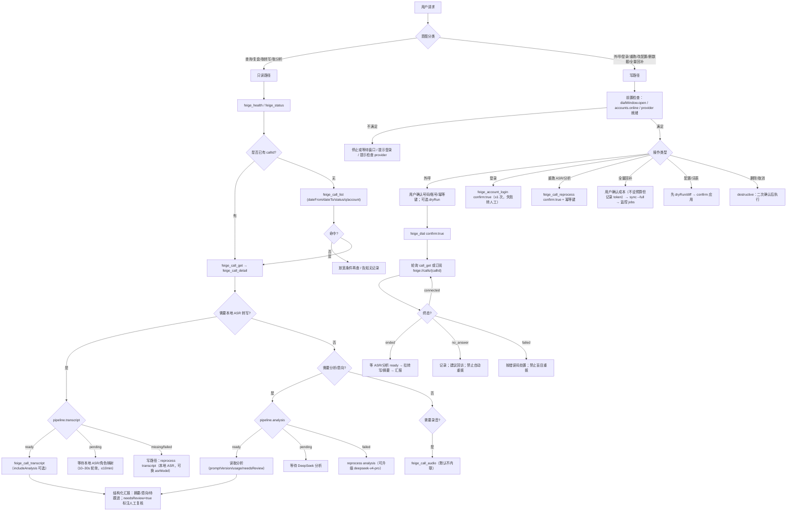

# 08 SKILL 契约（`skills/feige`）

> 状态：v0.2（Step 2 设计稿，2026-11-14；按 v1 决策修订：转写=本地自建 ASR（MiniMax `asr-1.0`）、LLM 后处理=DeepSeek、稳定错误码 40 个）
> 全局基准：[01-决策与约定.md](./01-决策与约定.md)（冲突以 01 为准）；字段级定义：[05-对外API契约.md](./05-对外API契约.md)；后处理规格：[13-后处理规格（ASR与LLM）.md](./13-后处理规格（ASR与LLM）.md)。
> 上游事实：[00-上游可行性侦察.md](./00-上游可行性侦察.md)；CLI：[06-CLI契约.md](./06-CLI契约.md)；MCP：[07-MCP工具契约.md](./07-MCP工具契约.md)。
> 本文描述 **agent 侧技能包（SKILL）的结构、内容规格与使用规则**；不含实现代码。

---

## 1. 定位

SKILL 是 agent 的「操作手册 + 安全闸门」：告诉 agent **何时**使用飞鸽外呼平台、**用什么**入口（MCP/CLI）、**怎么判断**前置条件、失败后**下一步做什么**、以及**绝对不能做什么**。

```text
Agent
 └── SKILL（本文：何时调用 + 决策树 + 安全规则 + 错误处置）
      ├── MCP tools `feige_*`（首选；结构化 schema + 注解）
      └── CLI `feige ...`（兜底；MCP 不可用/需精确脚本化时）
           └── 本地平台 REST → 上游（呼出/话单/录音）
                └── 平台内置后处理：本地 ASR（MiniMax asr-1.0）→ 词表归一/角色映射 → DeepSeek 分析
```

> v1 关键事实：**转写全部由本平台自建 ASR 生成，不使用上游转写**；AI 后处理是**平台内置 DeepSeek pipeline**（默认 `deepseek-chat`，校验失败升级 `deepseek-v4-pro`），外部 agent 只读取结果做二次分析，不直接调用 MiniMax/DeepSeek。

| 原则 | 说明 |
| --- | --- |
| 契约不重复 | 字段/枚举/错误码以 01/05 为准；SKILL 只引用，不改写 |
| 渐进披露 | `SKILL.md` 保持精简（≤ 500 行）；长清单/速查放 `references/`，按需加载 |
| 安全前置 | 每次写操作前必须完成前置检查与用户确认，不因"自动化"跳过 |
| 人类在环 | 呼出、登录、删除、全量替换、全量回补等操作必须有明确用户意图 |
| 可恢复 | 失败按「错误码 → 动作」表处理；禁止盲目重试写操作 |

---

## 2. SKILL 包结构

```text
skills/feige/
├── SKILL.md                      # 主文件（frontmatter + 正文），agent 必读
├── references/
│   ├── cli-quickref.md           # CLI 命令速查（由 docs/06 提炼）
│   ├── mcp-tools-quickref.md     # MCP 工具/资源速查（由 docs/07 提炼）
│   ├── error-actions.md          # 错误码 → agent 动作（本文 §8 的完整版）
│   └── safety.md                 # 安全与合规细则（本文 §9 + docs/11 + docs/13 §10 摘要）
└── assets/
    ├── report-template.md        # 汇报模板（通话摘要/外呼结果/复盘）
    └── playbooks.md              # 4 个典型剧本（本文 §10 的完整版）
```

| 文件 | 内容 | 加载时机 |
| --- | --- | --- |
| `SKILL.md` | 触发条件、前置条件、决策树、入口选择、红线 | agent 命中技能时**必读** |
| `references/cli-quickref.md` | 命令/参数/示例速查 | agent 选择 CLI 入口时读取 |
| `references/mcp-tools-quickref.md` | 32 个工具名/用途/必填参数/注解（18 读 / 14 写） | agent 选择 MCP 入口时读取 |
| `references/error-actions.md` | **40 个**错误码的完整处置表 | 调用失败时读取 |
| `references/safety.md` | 副作用/计费/时段/脱敏/第三方云数据/审计细则 | 任何写操作前读取 |
| `assets/report-template.md` | 输出模板（脱敏） | 需要向用户结构化汇报时读取 |
| `assets/playbooks.md` | 剧本步骤与检查点（含全量回补） | 执行 §10 剧本时读取 |

约束：

1. 目录名 `feige` 必须与 `SKILL.md` frontmatter 的 `name` 一致。
2. `references/` 与 `assets/` 为**可选**；最小可用包只有 `SKILL.md`。
3. 所有文件均为中文；字段/命令/错误码用英文标识符。
4. 禁止在包内出现真实凭证、JWT、完整手机号、真实客户姓名、第三方 API Key。

---

## 3. `SKILL.md` 规格

### 3.1 frontmatter（必需）

```yaml
---
name: feige
description: >
  通过本地飞鸽外呼平台（FOP）查询话单/本地 ASR 转写/录音、发起呼出并跟踪结果。
  当用户提出「查通话记录」「拉某通电话的转写」「给某客户打电话」「今天外呼情况」
  「平台/账号现在能不能拨」「全量回补分析历史通话」等请求时使用。
  前置：本机 feige 平台服务已运行（feige health 通过）、目标账号已登录；
  转写/分析依赖平台已配置 MiniMax ASR 与 DeepSeek 密钥（feige doctor --probe-providers 检查）。
version: 0.1.0
---
```

| 字段 | 必需 | 规格 |
| --- | --- | --- |
| `name` | 是 | 固定 `feige`；小写、与目录同名 |
| `description` | 是 | ≤ 1024 字符；**必须写清触发场景 + 前置条件**（这是 agent 决定是否加载技能的主要依据）；注明转写/分析来自平台内置 ASR/LLM |
| `version` | 建议 | 与平台版本保持一致（如 `0.1.0`）；参考文件同步更新 |
| 其它字段 | 可选 | 遵循 agent runtime 的技能规范（如 `license`/`allowed-tools`）；本项目不强制 |

### 3.2 正文骨架（章节顺序固定）

| # | 章节 | 必须包含 |
| --- | --- | --- |
| 1 | `# 飞鸽外呼（feige）` | 一句话说明：本地平台，读多写少，呼出有副作用；转写/分析由平台自建 |
| 2 | `## 何时使用` | 触发语句示例（正例/反例）；与"仅查看上游网页"区分 |
| 3 | `## 前置条件` | 检查顺序与通过标准（§5）；含第三方 provider（MiniMax/DeepSeek）检查 |
| 4 | `## 能力与边界` | 能做/不能做（§6）；明确"无人值守 AI 外呼不可用""不直连第三方供应商" |
| 5 | `## 决策流程` | §7 决策树（精简版） |
| 6 | `## 工具选择` | MCP 优先 / CLI 兜底；入口对照（§4） |
| 7 | `## 安全与合规` | 副作用/计费/时段/批量禁止/第三方云数据/脱敏/人工介入（§9 摘要 + 指向 references/safety.md） |
| 8 | `## 错误处理` | 高频错误码表（完整 **40 条**放 references/error-actions.md；含 ASR_FAILED/ANALYSIS_FAILED） |
| 9 | `## 输出规范` | 脱敏、结构化、附 callId/requestId、标注 needsReview 与不确定项 |
| 10 | `## 参考文件` | 列出 references/assets 及加载时机 |

### 3.3 写作规范

| 项 | 规范 |
| --- | --- |
| 语言 | 中文正文；命令/字段/错误码用英文标识符 |
| 篇幅 | `SKILL.md` ≤ 500 行；超出的明细移入 `references/` |
| 示例 | 所有命令/参数示例可复制执行（脱敏号码用 `138****0000`；第三方密钥用 `sk-...` 占位） |
| 禁止 | 真实凭证（含 MiniMax/DeepSeek Key）、完整手机号、客户姓名；实现代码/长 JSON Schema（放 docs/07） |
| 一致性 | 命令名、工具名、错误码、转写/分析字段与 docs/06/07/01/05/13 **零差异**；发现冲突先改 01/05 再回改 |

---

## 4. 两种入口：MCP 优先，CLI 兜底

### 4.1 选择规则

| 条件 | 选择 |
| --- | --- |
| agent 支持 MCP 且 `feige-outbound` 已注册 | **MCP**（首选）：结构化入参、标准注解、错误结构化 |
| MCP 不可用 / 需要 shell 管道 / 需要 `--wait` 阻塞语义 | **CLI** `feige ...` |
| 需要大批量只读导出/与本地文件交互 | **CLI**（`--json` + `jq`） |
| 需要 provider 自检（MiniMax/DeepSeek） | **CLI** `feige doctor --probe-providers`（MCP 无此工具） |
| 只读场景 | 两者等价；**写操作优先 CLI**（CLI 有交互确认与 `--dry-run`，更利于人类在环） |

### 4.2 同一任务的两种姿势（对照）

**任务 A：查今天已接通通话（转写/分析状态见 `pipeline`）**

```text
[MCP] feige_call_list { "dateFrom": "2026-11-14", "dateTo": "2026-11-14", "status": "ended", "size": 20 }
[CLI] feige calls list --date 2026-11-14 --status ended --size 20 --json
```

**任务 B：拉某通话本地 ASR 转写（可选附带 DeepSeek 分析摘要）**

```text
[MCP] feige_call_transcript { "callId": "call_01J8Z3K5T9QW2M4R7X1C6V0B8N", "includeAnalysis": true }
[CLI] feige calls transcript call_01J8Z3K5T9QW2M4R7X1C6V0B8N --include-analysis --json
# → source=asr, provider=minimax:asr-1.0, segments[].speakerLabel/chunkIndex
```

**任务 C：发起呼出（有副作用，需用户确认）**

```text
[MCP] feige_dial { "to": "138****0000", "accountId": "main",
                   "idempotencyKey": "dial-20261114-001", "confirm": true }
[CLI] feige dial '138****0000' --account main \
        --idempotency-key dial-20261114-001 --yes
```

> 注意：MCP 需服务端以 `--allow-write` 启动；CLI 非交互需 `--yes`。两者都必须先完成 §5 前置检查。

**任务 D：跟踪呼出结果**

```text
[MCP] feige_call_get { "callId": "call_..." }            // 轮询；或订阅 feige://calls/{callId}
[CLI] feige calls get call_... --json
      或 feige events --types 'call.*' --follow --duration 120s
```

**任务 E：平台/账号/provider 健康**

```text
[MCP] feige_status {} / feige_account_health { "accountId": "main" }
[CLI] feige status --json / feige account health main --json
[CLI] feige doctor --probe-providers --json     # MiniMax/DeepSeek 配置、密钥引用、出站白名单
```

**任务 F：全量回补 ASR + 分析（不设预算上限，需观测 token/耗时）**

```text
[CLI] feige sync --full --wait --json
[CLI] feige jobs list --type asr,analysis --status queued,running --json
[MCP] feige_job_list { "type": ["asr","analysis"], "status": "failed" }
```

---

## 5. 前置条件与自检

### 5.1 检查顺序（每次任务开始）

| 步骤 | 检查 | 通过标准 | 不通过时的动作 |
| --- | --- | --- | --- |
| 1 | 平台进程 | `feige_health` 返回 `ok:true`（或 `feige health` 退出码 0） | 告知用户"平台未运行"，给 `feige serve` 提示；不得自行启动 |
| 2 | 平台健康 | `feige_status` 的 `db.ok == true` 且 `accounts.online > 0` | 读取失败项（DB/上游/队列），报告并建议 `feige doctor` |
| 3 | 后处理依赖（provider） | `feige doctor --probe-providers` 中 `provider:minimax` / `provider:deepseek` 不为 `fail`（配置/密钥引用/出站白名单/HTTPS 可达） | **读操作照常、ASR/分析相关写操作暂停**；提示人工检查密钥/白名单/网络；禁止绕过平台直连供应商 |
| 4 | 拨打时段 | `dialWindow.open == true`（07:50–22:00 Asia/Shanghai） | 写操作暂停；读操作照常；告知下个窗口 `nextOpenAt` |
| 5 | 目标账号（写操作） | `feige_account_health` 的 `state == online`（建议同时 `upstream.reachable == true`） | `state=expired`/`ACCOUNT_LOGIN_REQUIRED` → 按 §8 触发登录（最多 1 次）或提示人工 |
| 6 | 账号空闲（呼出） | `busy.inCall == false` | 提示"账号正在通话"，等待或换账号 |
| 7 | 幂等键 | 写操作已生成并记录 `idempotencyKey` | 生成 UUID/ULID，重试复用 |
| 8 | 用户确认（写操作） | 用户已明确要求并提供号码/对象 | 未确认不执行 |

### 5.2 快速自检命令

```bash
feige health --json                    # 1
feige status --json                    # 2 + 拨打时段
feige doctor --probe-providers --json  # 3 + 全量排障（失败项附修复命令）
feige account health main              # 5
```

> agent 应在**每次会话首次操作**时做 1–2 步；写操作前必须做 4–6 步；涉及转写/分析时加做第 3 步。

---

## 6. 能力与非能力

### 6.1 能做

| 能力 | 入口 |
| --- | --- |
| 查询话单列表/单通详情（状态、时长、话费、流水线） | `feige_call_list/get/detail`、`feige calls ...` |
| 获取**本地 ASR（MiniMax asr-1.0）**转写全文与句级分段（说话人角色、`speakerLabel`、`chunkIndex`、时间戳、词表归一） | `feige_call_transcript` |
| 获取 **DeepSeek 分析**结果（摘要/意向/关键词/质量项/promptVersion/usage/说话人映射） | `feige_call_detail`、`feige_call_transcript --include-analysis`、资源 |
| 获取录音元数据与下载 URL（WAV；本地归档路径用 CLI 输出） | `feige_call_audio` / `feige calls audio` |
| 发起呼出（回拨模式：先振铃坐席手机，需人工接听） | `feige_dial` / `feige dial` |
| 跟踪呼出状态（轮询或事件） | `feige_call_get`、`feige_events_list`、资源订阅 |
| 重跑 ASR 转写（可指定 `asrModel`）或 DeepSeek 分析（可指定 `analysisModel`） | `feige_call_reprocess` / `feige calls reprocess` |
| 全量回补历史话单的 ASR/分析（不设预算上限，可观测 token/耗时） | `feige sync --full`、`feige_job_list`、`feige_job_get` |
| 取消尚未提交上游的呼出 | `feige_call_cancel` |
| 平台/账号健康、同步、作业、事件、词表、配置、文本归一、provider 自检 | 对应工具/命令（provider 自检用 CLI `feige doctor --probe-providers`） |
| 触发登录（浏览器 + 阿里云滑块）并等待结果 | `feige_account_login` |
| 文本领域词归一（如 复萌/福梦/复盟 → 孚盟；ASR 同音变体） | `feige_text_normalize` |

### 6.2 不能做（明确边界）

| 非能力 | 原因 | agent 应如何回应 |
| --- | --- | --- |
| 无人值守 AI 语音外呼（AI 直接对客户讲话） | 当前仅「电信回拨」线路：先振铃坐席手机、人工接听后桥接（[00 §6](./00-上游可行性侦察.md)） | 说明需人工接听；不要承诺"AI 自动打" |
| 绕过拨打时段（07:50–22:00） | 上游服务端强制（[00 §6.3](./00-上游可行性侦察.md)） | 告知下个窗口；时段外不重试 |
| 批量呼出/批量删除/批量登录 | 无批量工具；防骚扰与防封号（[01 §5.7](./01-决策与约定.md)） | 拒绝批量；逐个确认 |
| 实时音频流/实时听音 | v1 为通话后归档 + 事后 ASR（录音下载） | 说明只能取已归档录音的转写 |
| 修改上游数据（CRM/客户/话单） | 平台只读上游 + 本地写 | 说明边界 |
| 使用上游转写（"上游转写优先/兜底"） | v1 决策：**不用上游转写**，全部本地 ASR（[13 §1 D1](./13-后处理规格（ASR与LLM）.md)） | 说明转写来自平台本地 ASR；上游历史转写不进入产品流水线 |
| 直接调用 MiniMax/DeepSeek 或切换其它供应商 | 后处理是平台内置 pipeline；密钥只在平台（[13 §1 D2–D4](./13-后处理规格（ASR与LLM）.md)） | 说明只能通过平台触发/读取结果；不得索取密钥 |
| 保证转写/分析一定正确 | ASR 受录音质量/口音/静音影响；LLM 可能校验失败或低置信（`needsReview=true`） | 有词表归一+角色映射；低置信标注人工复核；无有效语音如实说明 |
| 保证呼出必接通 | 客户未接/拒接/线路问题 | 如实报告终态 `no_answer`/`failed` |
| 真实短信/外呼风控规避 | 合规红线（[01 §1.2](./01-决策与约定.md)） | 拒绝并说明 |

---

## 7. 面向 agent 的决策树

### 7.1 总流程



### 7.2 安全闸门（写操作必经）

| 闸门 | 问题 | 不通过 |
| --- | --- | --- |
| G1 用户意图 | 用户是否**明确**要求该操作（号码/对象/时间/回补范围）？ | 询问确认，不猜测 |
| G2 前置条件 | 平台/账号/时段/空闲/provider 是否通过（§5）？ | 停止并说明 |
| G3 幂等 | 是否已有幂等键/已提交过？ | 生成并复用；已提交则查结果而非重提 |
| G4 副作用告知 | 是否已说明"真实外呼/计费/需人接听/ASR·LLM token 成本/可能失败"？ | 先告知再执行 |
| G5 频率 | 是否同号/同账号短时间重复？ | 停止（冷却 60s；`ACCOUNT_BUSY`） |
| G6 数据合规 | 是否涉及把录音/转写发往第三方云（平台已内置）或其他外发？ | 平台内置 pipeline 按其脱敏策略执行；额外外发需用户明确授权 |

---

## 8. 错误码 → agent 下一步动作

> 错误码全集、`retryable` 与含义以 [01 §5.4](./01-决策与约定.md) 为准（v1 共 **40 个**，已删除原上游转写等待码）；本表只定义 **agent 行为**，不新增/改写错误码。
> "重试"均指**有上限的自动重试**；超过上限必须转人工或如实报告。写操作重试必须复用幂等键。

| # | error.code | retryable | agent 下一步动作 |
| --- | --- | --- | --- |
| 1 | `INVALID_REQUEST` | 否 | 修正参数结构（字段名/层级/JSON）后重试；不自动重试 |
| 2 | `VALIDATION_FAILED` | 否 | 按 `details.fields[]` 修正取值；不自动重试 |
| 3 | `CONFIG_INVALID` | 否 | 停止；提示人工检查配置（`feige config get` / `feige doctor`），含 `pipeline.*` 只读/非法项 |
| 4 | `UNAUTHORIZED` | 否 | 停止；检查本地 API token（`--token-file`/`FOP_API_TOKEN`）；提示人工 |
| 5 | `FORBIDDEN` | 否 | 停止；说明策略限制（如远程访问未开启/账号限权） |
| 6 | `NOT_FOUND` | 否 | 重新列举资源确认标识（list 后再试）；不反复重试 |
| 7 | `CALL_NOT_FOUND` | 否 | `feige_call_list` 重新定位 callId；确认是否传错 |
| 8 | `ACCOUNT_NOT_FOUND` | 否 | `feige_account_list` 确认；提示用户添加账号 |
| 9 | `JOB_NOT_FOUND` | 否 | `feige_job_list` 确认 jobId；任务可能已清理 |
| 10 | `TERM_NOT_FOUND` | 否 | `feige_terms_list` 确认 termId |
| 11 | `ACCOUNT_DISABLED` | 否 | 停止；提示人工启用（`feige_account_update`），不得擅自启用 |
| 12 | `ACCOUNT_LOGIN_REQUIRED` | 是 | 触发 `feige_account_login`（最多 1 次）→ 成功后重试原操作；失败转人工 |
| 13 | `ACCOUNT_LOGIN_IN_PROGRESS` | 是 | 用 `details.loginJobId` 查作业，等待完成（≤120s）；**不重复提交登录** |
| 14 | `ACCOUNT_LOGIN_FAILED` | 是 | 再试登录至多 1 次（可能是滑块/风控）；仍失败转人工处理 |
| 15 | `ACCOUNT_BUSY` | 是 | 等待当前通话结束（`details.busyCallId` 的 `feige_call_get`/资源订阅）；或换账号 |
| 16 | `ACCOUNT_UPSTREAM_MISMATCH` | 否 | 停止；提示人工核对账号配置（换号/串号） |
| 17 | `CALL_OUTSIDE_DIAL_WINDOW` | 是 | **不重试**；告知用户窗口与 `retryAfter`；若用户同意可预约窗口（平台排队），不得循环试探 |
| 18 | `CALL_REJECTED_BY_UPSTREAM` | 否 | 透传 `details.upstreamCode/Message`；不自动重试（余额/线路/质检问题需人工） |
| 19 | `CALL_NOT_DIALABLE` | 否 | 告知号码不可拨（空号/格式/黑名单/上游业务判定）；不重试 |
| 20 | `CALL_ALREADY_TERMINAL` | 否 | 改为查询/结束；不重试（`cancel` 一律拒绝；`reprocess` 仅 `canceled` 拒绝） |
| 21 | `CALL_NOT_CANCELABLE` | 否 | 告知"已提交上游不可取消"；转人工（必要时人工挂机） |
| 22 | `CALL_TRACKING_TIMEOUT` | 是 | **停止自动重试**；提示人工核对话单，防止重复呼叫（[01 §5.6](./01-决策与约定.md)） |
| 23 | `IDEMPOTENCY_CONFLICT` | 否 | 换新幂等键，或先查首次结果；确认是否参数被改 |
| 24 | `RATE_LIMITED` | 是 | 按 `retryAfterMs` 退避（指数退避，≤3 次）；写操作复用幂等键 |
| 25 | `UPSTREAM_UNREACHABLE` | 是 | 退避重试（1s/2s/4s，≤3 次）；仍失败报告"上游不可达" |
| 26 | `UPSTREAM_AUTH_EXPIRED` | 是 | 触发该账号登录（`feige_account_login`）后重试 1 次；失败转人工 |
| 27 | `UPSTREAM_BUSINESS_ERROR` | 否 | 透传上游原因；不自动重试（可能需改业务操作） |
| 28 | `UPSTREAM_RATE_LIMITED` | 是 | 保守退避（≥5s，≤3 次）；避免并发请求 |
| 29 | `UPSTREAM_RESPONSE_INVALID` | 是 | 记录 `requestId`；重试 1 次；仍失败报告"可能上游改版"（转运维） |
| 30 | `AUDIO_NOT_AVAILABLE` | 否 | 告知无录音（未接通/上游缺失）；**不能**据此重跑转写 |
| 31 | `AUDIO_NOT_READY` | 是 | 等待后重试（10s/30s/60s，≤3 次）；仍无则提示稍后 |
| 32 | `AUDIO_DOWNLOAD_FAILED` | 是 | 重试 1 次；可 `feige_call_reprocess --stage audio` |
| 33 | `TRANSCRIPT_NOT_AVAILABLE` | 否 | 无有效语音或本地 ASR 无法产出：可 `reprocess --stage transcript` 1 次；仍无则如实说明（接通即挂断/静音/格式异常） |
| 34 | `TRANSCRIPT_PENDING` | 是 | **等待本地 ASR**：按 `details.stage=asr_queued\|asr_running\|role_mapping\|analysis` 等待；10–30s 轮询，≤10min（长音频切块/全量回补时更久） |
| 35 | `ASR_FAILED` | 是 | `reprocess --stage transcript`（可指定 `asrModel`）1 次；仍失败报告 `details.providerCode`（鉴权/限流/格式/超限/解析），提示人工检查 MiniMax 密钥与配额 |
| 36 | `ANALYSIS_FAILED` | 是 | `reprocess --stage analysis`（可升级 `deepseek-v4-pro`）1 次；仍失败报告 `promptVersion`/`model`/`usage`，提示人工检查 DeepSeek 密钥/限流/JSON 校验 |
| 37 | `DB_UNAVAILABLE` | 是 | 退避 5s 重试 ≤3 次；持续失败报告"服务异常"（附 requestId） |
| 38 | `SERVICE_UNAVAILABLE` | 是 | 平台启动中/优雅关闭/传输中断：退避 5s 重试 ≤3 次；持续则提示检查 `feige serve` 并报告 requestId |
| 39 | `INTERNAL_ERROR` | 是 | 重试 1 次；仍失败报告"内部错误"+`requestId`，建议 `feige doctor` |
| 40 | `NOT_IMPLEMENTED` | 否 | 停止；说明该能力 v1 未上线（如 webhook） |

### 8.1 CLI 退出码 → agent 处理（脚本场景）

| 退出码 | agent 动作 |
| --- | --- |
| `0` | 继续 |
| `2` | 检查自身参数/是否漏 `--yes`；修正后重试 |
| `3` | 确认 ID/资源存在性；不重试 |
| `4` | 业务拒绝：按错误码表处理，一般不再自动重试（`TRANSCRIPT_PENDING` 等可等后重试） |
| `5` | 上游问题：有限退避重试；持续则报告 |
| `6` | 认证：触发登录或提示人工 |
| `7` | 本地服务/后处理错误（含 `ASR_FAILED`/`ANALYSIS_FAILED`）：报告 + `feige doctor --probe-providers` |
| `8` | 平台不可达：提示 `feige serve`；不重试 |
| `9` | 超时：查作业状态（`jobs get`），不要重复提交 |
| `10` | 能力未实现：停止并说明 |
| `130` | 被中断：读/幂等写可重试 |

---

## 9. 安全与合规提示（agent 必读）

### 9.1 副作用与成本

| 操作 | 副作用 | agent 必须 |
| --- | --- | --- |
| `feige_dial` | **真实外呼**：先振铃坐席手机、坐席接听后桥接客户；产生话费（`call.cost`，上游 `postage`） | 先告知用户"将真实拨打、可能产生费用、需坐席手机接听"；获得明确确认；单次单号 |
| `feige_account_login` | 使用凭证登录上游，可能触发滑块/风控；失败需人工 | 说明"将尝试浏览器登录，可能失败"；不循环重试 |
| `feige_call_reprocess` | **ASR/LLM token 成本**：ASR 按音频时长（MiniMax）、analysis 按 token（DeepSeek）；不设预算上限但记录 `usage` | 说明重跑阶段与预计范围；同一 call+stage 5 分钟内不重复提交 |
| `feige_sync_start{mode:"full"}` | 全量同步 + 历史话单 ASR/analysis **全量回补**（不设预算上限，token/耗时记录，可暂停/恢复） | 说明成本可观且会长时间占用队列；先 `doctor --probe-providers`；经用户明确同意后执行 |
| `feige_account_remove` | 删本地账号；`purgeData` 不可恢复 | 默认不删数据；删除需用户明确要求 |
| `feige_terms_replace` | 全量替换词表，旧规则被删 | 先 `dryRun` 展示 diff，再确认 |
| `feige_config_set` | 改调度/限流/后处理参数（`pipeline.*`） | 先 diff；说明变更对新作业生效 |

### 9.2 禁止批量骚扰（硬红线）

1. **禁止**对号码列表循环调用 `feige_dial`；不存在批量呼出工具。
2. 同一号码 60s 内不得重复呼出（平台会返回 `ACCOUNT_BUSY`/`IDEMPOTENCY_CONFLICT`）；失败/未接不得立即重拨。
3. 单账号回拨模式**串行**（坐席手机同时只能一通）；不得用多账号并发轰炸同一批客户。
4. 必须遵守上游拨打时段 **07:50–22:00（Asia/Shanghai）**；时段外不呼叫、不试探。
5. 尊重客户意愿：明确拒绝/投诉的号码停止外呼；不得使用上游查重外的规避手段。
6. 呼出频率、批量行为受平台限流（[01 §5.7](./01-决策与约定.md)）约束，agent 不得尝试绕过。

### 9.3 数据脱敏、第三方云与隐私

| 数据 | 规则 |
| --- | --- |
| 手机号 | 日志/汇报/表格中掩码（`138****0000`）；仅 `feige.dial` 参数可用完整号码 |
| JWT/密码/本地 API token | **禁止**出现在对话、日志、汇报、代码示例中；凭证只在本地配置文件/环境变量 |
| MiniMax / DeepSeek API Key | **禁止**出现在对话/汇报；仅平台 secrets 文件或 `FOP_MINIMAX_API_KEY`/`FOP_DEEPSEEK_API_KEY`；agent 不得索取或输出（示例用 `sk-...` 占位） |
| 录音/转写 → 第三方云 | v1 平台会把录音发送至 MiniMax ASR、转写发送至 DeepSeek：属于个人信息委托处理，需业务方在隐私政策/告知中覆盖；发送前默认手机号脱敏（`pipeline.analysis.redactPhones=true`）；客户名按配置脱敏；**不发送**登录凭证/上游 token（[13 §10](./13-后处理规格（ASR与LLM）.md) / [11-安全与合规.md](./11-安全与合规.md)） |
| 录音/转写原文 | 只存本地库；对外汇报只摘录必要片段；**不得**在平台 pipeline 之外二次外发（额外外发需用户明确授权） |
| 客户姓名/备注 | 汇报时按需脱敏（如"李*"） |
| `requestId` | 可安全记录/汇报（用于排障） |
| 出站白名单 | 仅 `api.minimax.io` / `api.minimax.cn` / `api.deepseek.com`（HTTPS 443）；agent 不得诱导平台访问其它地址 |

### 9.4 人工介入触发条件

以下情况 agent **必须停止自动化并转人工**：

- `ACCOUNT_LOGIN_FAILED`（滑块/风控/二次验证）
- `CALL_TRACKING_TIMEOUT`（需核对是否已呼出，防重复）
- `ACCOUNT_UPSTREAM_MISMATCH`（账号配置异常）
- `ASR_FAILED` / `ANALYSIS_FAILED` 重试后仍失败（检查第三方密钥/配额/限流；或上游疑似改版）
- `needsReview=true`（说话人角色映射低置信）→ 人工复核后再对外使用
- `UPSTREAM_RESPONSE_INVALID` 重试后仍失败（疑似上游改版）
- 全量回补 token/耗时异常、持续排队或失败率异常
- 用户要求批量呼出/批量删除/绕过时段/直接调用第三方供应商
- `purgeData` 删除历史数据

### 9.5 全量回补成本可观测（不设预算上限，但必须可见）

- 每次 ASR/LLM 调用记录 token/耗时（`AnalysisPayload.usage`：`promptTokens`/`completionTokens`/`totalTokens`/`latencyMs`，[13 §6.4](./13-后处理规格（ASR与LLM）.md)）。
- 回补进度与失败分布：`feige jobs list --type asr,analysis`、`feige jobs get <jobId>`；失败原因在 `job.lastError.code`（`ASR_FAILED`/`ANALYSIS_FAILED` 等）。
- 作业持久化、可断点续跑；重跑幂等（同一 `callId+transcriptId+promptVersion+model` 已 ready 默认跳过）。
- 发现用量异常时**暂停/停止**回补并报告，不得为"跑完"而忽略失败。

### 9.6 审计

- 所有写操作产生 `AuditLog` 与事件；agent 应在汇报中附 `requestId` 与关键 `callId`/`jobId`，便于追溯。
- 不隐藏失败：失败结果必须如实汇报（含错误码），不得把 `no_answer` 说成"已接通"、不得把低置信分析当确定结论。

---

## 10. 典型任务剧本

### 剧本 1：复盘今天已接通通话，列出意向客户（含 ASR/分析质量标注）

| 项 | 内容 |
| --- | --- |
| 触发语 | "今天外呼情况怎么样？"、"把今天接通的客户意向整理一下" |
| 权限 | 只读 |
| 前置 | 步骤 1–2（health/status）；转写/分析相关加做步骤 3（provider） |

**步骤**

| # | 动作 | MCP | CLI | 预期/失败分支 |
| --- | --- | --- | --- | --- |
| 1 | 探活+状态 | `feige_health`、`feige_status` | `feige health --json`、`feige status --json` | 失败 → 告知平台不可用，停止 |
| 2 | 拉当日话单（分页） | `feige_call_list {dateFrom:"D", dateTo:"D", size:100, page}` | `feige calls list --date D --size 100 --json` | 0 条 → 告知无记录；`VALIDATION_FAILED` → 修参数 |
| 3 | 统计状态分布 | 客户端聚合 | `jq` 聚合 | — |
| 4 | 对 `ended` 且 `pipeline.transcript=ready` 的话单取本地 ASR 转写 | `feige_call_transcript {callId, includeAnalysis:true}` | `feige calls transcript ID --include-analysis --json` | `TRANSCRIPT_PENDING`（stage 见 §8）→ 等待重试；`TRANSCRIPT_NOT_AVAILABLE` → 跳过并标注 |
| 5 | 读取 DeepSeek 分析（摘要/意向/usage）与低置信标记 | `feige_call_detail {callId}` 的 `pipelineDetail` / `transcript.needsReview` | `feige calls detail ID --json` | `ANALYSIS_FAILED` → 可重跑（需用户同意） |
| 6 | 汇总输出 | — | — | 按模板输出脱敏表格，标注 `needsReview` |

**输出模板**

```markdown
## 2026-11-14 外呼复盘（account=main）
- 总数 42：接通 18 / 未接 21 / 失败 3
- 接通时长合计 26m12s，平均 87s
- 转写：本地 ASR（minimax asr-1.0）；分析：DeepSeek deepseek-chat（prompt=analysis-v1）

| callId | 号码 | 时长 | 意向 | 摘要（截断） | 复核 |
| --- | --- | --- | --- | --- | --- |
| call_01J8Z…B8N | 186****3330 | 15s | 高意向 | 关注出海获客，约下周再谈 | - |
| call_01J8Z…C1D | 139****7788 | 62s | 需跟进 | 需先内部确认预算 | needsReview |
...
> 数据截至 10:05；意向标签来自 DeepSeek 后处理，needsReview=true 需人工复核。requestId: req_...
```

**安全注意**：只读；不发起任何呼出；号码掩码；不把转写全文贴给用户（超长），必要时给摘要+引用 callId；未标注 `needsReview` 的低置信结论不得当确定事实。

---

### 剧本 2：给指定客户外呼并跟踪结果

| 项 | 内容 |
| --- | --- |
| 触发语 | "给 138****0000 打个电话"、"联系一下李总" |
| 权限 | 写（有副作用/计费） |
| 前置 | 步骤 1–8（含用户确认与 provider 检查） |

**步骤**

| # | 动作 | 工具/命令 | 通过标准 / 失败分支 |
| --- | --- | --- | --- |
| 1 | 确认对象与意图 | 与用户交互 | 用户明确给出号码（完整值）与账号（或缺省）；否则不执行 |
| 2 | 平台/时段/账号/provider 检查 | `feige_status`、`feige_account_health`、`feige doctor --probe-providers` | `dialWindow.open==true`、账号 `state==online` 且 `busy.inCall==false`；provider 不为 fail；否则按 §8 处置 |
| 3 | 告知副作用 | 文本 | 说明真实外呼/计费/需坐席手机接听/可能未接 |
| 4 | 预检（可选） | `feige_dial {dryRun:true}` / `feige dial --dry-run` | 冷却/重复/时段预检通过 |
| 5 | 生成幂等键 | — | 如 `dial-20261114-1030-001`；记录 |
| 6 | 发起呼出 | `feige_dial {to, accountId, customerName, idempotencyKey, confirm:true}` / `feige dial ... --yes` | 201 受理 → callId；`CALL_OUTSIDE_DIAL_WINDOW` → 停止并告知；`ACCOUNT_BUSY` → 等待 |
| 7 | 跟踪 | 轮询 `feige_call_get`（15–30s 间隔，≤5 分钟）或订阅 `feige://calls/{callId}` | `ended`/`no_answer`/`failed` 为止 |
| 8 | 取结果（ended 后等 ASR/分析） | `feige_call_detail` 的 `pipeline`；ready 后 `feige_call_transcript` | `pipeline.transcript`/`analysis` 状态；`TRANSCRIPT_PENDING` 等待；`AUDIO_NOT_AVAILABLE` 等按表处理 |
| 9 | 汇报 | — | 终态、时长、是否接通、分析摘要（含 needsReview）、下一步建议 |

**输出模板**

```markdown
## 外呼结果
- 号码：138****0000（客户：李*）
- 账号：main    callId：call_01J8Z…B8N
- 结果：已接通 · 时长 62s · 话费 ¥0.42
- 转写/分析：本地 ASR（minimax asr-1.0）→ DeepSeek（deepseek-chat, analysis-v1）
- 摘要：客户关注获客成本，要求下周提供报价方案（needsReview: false）
- 下一步：下周一 10:00 前跟进（需人工确认）
```

**安全注意**：不回拨多次；`no_answer` 不自动重拨；`CALL_TRACKING_TIMEOUT` 必须人工核对；不承诺"一定能打通"。

---

### 剧本 3：ASR/分析失败或低置信的重跑与复核

| 项 | 内容 |
| --- | --- |
| 触发语 | "这通电话的转写呢？"、"转写怎么是空的/失败了"、"分析结果不对/说话人标错了" |
| 权限 | 读 → 写（reprocess，有 ASR/LLM 成本） |
| 前置 | 步骤 1–3；用户同意重跑成本 |

**步骤**

| # | 动作 | 工具/命令 | 分支 |
| --- | --- | --- | --- |
| 1 | 查话单详情 | `feige_call_detail {callId}` / `feige calls detail ID --json` | `CALL_NOT_FOUND` → 定位 ID |
| 2 | 诊断流水线 | 读取 `pipeline.audio/transcript/analysis`、`transcript.needsReview`、`pipelineDetail.transcript.chunkCount` | 见下表 |
| 3 | 决策 | 按诊断分支处理 | — |
| 4 | 重跑 ASR | `feige_call_reprocess {callId, stages:["transcript"], options:{asrModel:"asr-1.0"}, idempotencyKey, confirm:true}` / `feige calls reprocess ID --stage transcript --asr-model asr-1.0 --yes` | 202 → jobId；`TRANSCRIPT_NOT_AVAILABLE` 且 audio missing → 停止（无录音不可转写） |
| 5 | 重跑分析 | `feige_call_reprocess {callId, stages:["analysis"], options:{analysisModel:"deepseek-v4-pro", promptVersion:"analysis-v1"}, confirm:true}` | 202 → jobId；适用于 `ANALYSIS_FAILED` 或需要升级模型/prompt 版本 |
| 6 | 轮询作业 | `feige_job_get {jobId}` / `feige jobs get` | `failed` → 读 `lastError.code`（`ASR_FAILED`/`ANALYSIS_FAILED`/`UPSTREAM_*`） |
| 7 | 验收 | `feige_call_transcript` / `feige_call_detail` | 转写 `segments.length > 0`；分析 `pipeline.analysis=ready`；`needsReview` 判定 |
| 8 | 人工复核 | — | `needsReview=true`：人工听录音/核对 speakerMapping；必要时重复重跑（换模型/词表版本） |
| 9 | 汇报 | — | 成功：摘要（标注模型/promptVersion/usage）；失败：错误码 + 下一步（人工/供应商） |

**诊断分支表**

| audio | transcript | 判定 | 动作 |
| --- | --- | --- | --- |
| `ready` | `ready` 且 `needsReview=false` | 正常 | 直接返回转写/分析 |
| `ready` | `pending`（`asr_queued`/`asr_running`/`role_mapping`） | 本地 ASR/角色映射中 | 等待（10–30s 轮询，≤10min；长音频/回补期间更久） |
| `ready` | `ready` 但 `needsReview=true` | 说话人映射低置信 | **人工复核**；可 `reprocess --stage transcript` 换 `asrModel` 或调整词表后重跑 |
| `ready` | `failed` | ASR 失败 | `reprocess --stage transcript`（换模型/词表）1 次；仍失败报告 `ASR_FAILED` |
| `ready` | `ready` 但 analysis `failed` | DeepSeek 失败 | `reprocess --stage analysis`（可升级 `deepseek-v4-pro`）1 次；仍失败报告 `ANALYSIS_FAILED` |
| `missing` | 任意 | 未接通/上游无录音 | **停止**：无音频不能转写，如实告知 |
| `failed` | 任意 | 录音失败 | `reprocess --stage audio` 1 次；仍失败报告 |

**安全注意**：重跑有 ASR/LLM 成本（不设预算上限但记录 usage），同一 call+stage 5 分钟内不重复提交；跨账号/跨通话不得批量重跑；低置信结论必须标注人工复核。

---

### 剧本 4：全量回补历史话单的 ASR 与分析

| 项 | 内容 |
| --- | --- |
| 触发语 | "把历史通话都转写/分析一遍"、"全量跑分析" |
| 权限 | 写（**成本可观**：ASR 按音频时长、LLM 按 token；**不设预算上限**） |
| 前置 | 步骤 1–3；用户明确同意成本与时长 |

**步骤**

| # | 动作 | 工具/命令 | 分支 |
| --- | --- | --- | --- |
| 1 | 环境与 provider 自检 | `feige status`、`feige doctor --probe-providers` | provider fail → 停止并提示人工检查密钥/白名单 |
| 2 | 成本与范围告知 | 文本 | 说明：全量回补不设预算上限、可能数小时；记录 token/耗时；可暂停/恢复；需用户明确同意 |
| 3 | 触发全量同步/回补 | `feige sync --full --wait --json` | 202/200 → jobId；`ACCOUNT_LOGIN_REQUIRED` 先登录；`UPSTREAM_UNREACHABLE` 退避 |
| 4 | 监控队列 | `feige jobs list --type asr,analysis --status queued,running --json` | 观察积压与吞吐；异常时暂停并报告 |
| 5 | 失败分布 | `feige jobs list --type asr,analysis --status failed --json` | `ASR_FAILED`/`ANALYSIS_FAILED` → 按 §8 有限重试/转人工 |
| 6 | 用量观测 | `feige calls detail <callId>` 的 `pipelineDetail` / `AnalysisPayload.usage`；`feige status` 队列 | 记录 token/耗时；异常（用量激增/失败率>5%）→ 暂停并报告 |
| 7 | 质量抽检 | `feige calls detail` 的 `transcript.needsReview`、分析 `speakerMapping.confidence` | `needsReview=true` 入人工复核清单 |
| 8 | 汇总报告 | — | 完成数/失败数/失败原因分布/token 用量/耗时/需复核清单 |

**安全注意**：不设预算上限 ≠ 不监控；必须先获得用户明确同意；发现异常立即暂停并报告，不得为"跑完"忽略失败；回补期间呼出主链路优先（队列/并发由平台控制）。

---

## 11. 安装与验证（概念）

### 11.1 安装形态

| 形态 | 步骤 | 适用 |
| --- | --- | --- |
| 仅 MCP（推荐） | ① 部署 `feige` 并运行 `feige serve`（配置 MiniMax/DeepSeek 密钥）；② 注册 MCP（`feige mcp --print-config` 输出）；③ 安装本 SKILL 包（`skills/feige/` 放入 agent 的技能目录，目录名=name） | agent 支持 MCP |
| 仅 CLI | ① 同上 ①；② SKILL 包中说明 CLI 用法（无需 MCP 注册） | 轻量 agent / 脚本 |
| MCP + CLI | 同时具备，SKILL 决策树按 §4 选择 | 完整形态 |

说明：不同 agent runtime 的技能目录不同（如项目级 `.claude/skills/feige/` 或用户级 `~/.config/<agent>/skills/feige/`），遵循其 Skills 规范；本契约只约束**包内容与目录结构**。

### 11.2 更新策略

1. 平台版本升级 → 同步更新 `SKILL.md` 的 `version` 与 `references/`。
2. 命令/工具/错误码/转写与分析字段变更 → 先改 [01](./01-决策与约定.md)/[05](./05-对外API契约.md)/[13](./13-后处理规格（ASR与LLM）.md)，再同步 `docs/06/07`，最后更新 `references/`（保持零冲突）。
3. `references/error-actions.md` 必须与 01 §5.4 的错误码集合**逐条对齐**（40 个）。
4. 后处理 provider/promptVersion/模型变更 → 同步更新 SKILL 的 provider 说明与剧本（`analysis-v1`、`deepseek-chat`→`deepseek-v4-pro`、`asr-1.0`）。

### 11.3 验证清单

| # | 验证 | 通过标准 |
| --- | --- | --- |
| 1 | 平台可用 | `feige health` 退出码 0 |
| 2 | SKILL 可加载 | agent 命中"查通话/打电话/转写/分析"时加载 `feige` 技能 |
| 3 | 只读工具 | `tools/list` 含 18 个只读工具；`feige_status` 返回 `ok:true` |
| 4 | 写工具闸门 | 未加 `--allow-write` 时写工具不可见/被拒；加后缺 `confirm` 报 `-32602` |
| 5 | 资源 | `resources/read feige://status` 返回 JSON；`feige://calls/{callId}/transcript` 的 `source=asr` |
| 6 | provider 自检 | `feige doctor --probe-providers` 中 `provider:minimax`/`provider:deepseek` 不为 fail（配置/密钥引用/白名单/连通） |
| 7 | 错误处理 | 构造 `CALL_NOT_FOUND`/`ACCOUNT_LOGIN_REQUIRED`/`TRANSCRIPT_PENDING`/`ASR_FAILED` 场景，agent 按 §8 处置 |
| 8 | 全量回补 | 小批量演练 `sync --full` → `jobs list --type asr,analysis` 有作业/进度、失败可定位 |
| 9 | 脱敏 | 汇报中号码掩码、无 JWT/密码/MiniMax·DeepSeek Key |
| 10 | 红线 | 要求"批量呼出/直连第三方/绕过时段"时 agent 拒绝并说明 |

---

## 12. 一致性声明与对齐清单

**基准优先级**：[01-决策与约定.md](./01-决策与约定.md) > [05-对外API契约.md](./05-对外API契约.md) > 本文；后处理细节以 [13-后处理规格（ASR与LLM）.md](./13-后处理规格（ASR与LLM）.md) 为准。

| 核对项 | 结论（对齐依据：docs/01 v1 ASR/LLM 决策、docs/05、docs/13，2026-11-14） |
| --- | --- |
| 触发与能力 | 与 [01 §1.3](./01-决策与约定.md) 角色/场景一致；明确非目标（无 AI 语音直呼、无批量、不直连第三方供应商） |
| 命令/工具名 | 与 [06-CLI契约.md](./06-CLI契约.md)、[07-MCP工具契约.md](./07-MCP工具契约.md) 一致，未另起命名 |
| 错误码 | **40 个**错误码与 [01 §5.4](./01-决策与约定.md) 逐一对应（已删除原上游转写等待码；含 `ASR_FAILED`/`ANALYSIS_FAILED`）；`retryable` 语义一致；未新增 |
| 枚举 | Call status、Pipeline stage、Job type（`login,sync,audio_fetch,asr,analysis,reprocess,backfill`）、Transcript source（固定 `asr`）、SpeakerMapping method（`channel,asr_diarization,llm_reconciled,heuristic`）、Event type 与 01 §6.1/§7.3 一致；账号状态用 05 §2.2 |
| 字段引用 | `dialWindow.open`、`accounts.online`、`db.ok`、`busy.inCall`、账号 `state`、`pipeline.{audio,transcript,analysis}`、`transcript{source:"asr",provider:"minimax:asr-1.0",chunkCount,needsReview}`、segments `{speakerLabel,chunkIndex,confidence,rawText,normalizedText}`、`AnalysisPayload{promptVersion,usage,speakerMapping{method,confidence,needsReview,evidence}}`、`call.cost`、`termId=term_...`、`from: string[]` 与 [05 §2](./05-对外API契约.md) 一致 |
| 后处理链路 | v1 不使用上游转写；转写=本地 MiniMax ASR（`asr-1.0`）；分析=DeepSeek（`deepseek-chat`→`deepseek-v4-pro`，`analysis-v1`）；`config pipeline` 为嵌套 `asr`/`analysis`/`roleMapping`；全量回补不设预算上限但记录 token/耗时；provider 自检走 CLI `doctor --probe-providers` |
| 关键行为 | `feige_dial` dryRun/confirm、`account_login` 默认 wait=true、`reprocess` stages 必填 + `options{asrModel,analysisModel,promptVersion,termRulesVersion}`、`sync` mode 含 `full`（回补）/`backfill`、`terms_replace` 全量替换——与 05/06/07 一致 |
| 业务硬约束 | 拨打时段 07:50–22:00、回拨需人工接听、JWT 7 天、录音归档；转写按 v1 决策改为本地 ASR（[00 §9](./00-上游可行性侦察.md) 风险表更新） |
| 副作用/合规 | 呼出/登录/重跑/全量回补副作用与成本说明与 01 §5.6/§8.5、05 §10、13 §3.4/§10 一致；第三方云数据发送与脱敏要求写入 §9 |
| 脱敏 | 全文无真实凭证/完整手机号/第三方密钥；示例统一 `138****0000`、`sk-...` |
| 实现代码 | 无 |

> 已知 docs/05 待澄清项（不影响本文契约，将在本轮汇报中提交 Lead 确认）：§2.9 定义 `AnalysisPayload`（含 `promptVersion`/`usage`）但未明确完整 payload 的响应承载位置；本文按 05 已定义的响应字段引用，token 观测建议 05 明确返回位置。
> （docs/05 已于 2026-11-14 00:05 修复 `JobSummary.type` 枚举与 reprocess `options{asrModel,...}`，本文已同步；此前记录的两项已关闭。）
