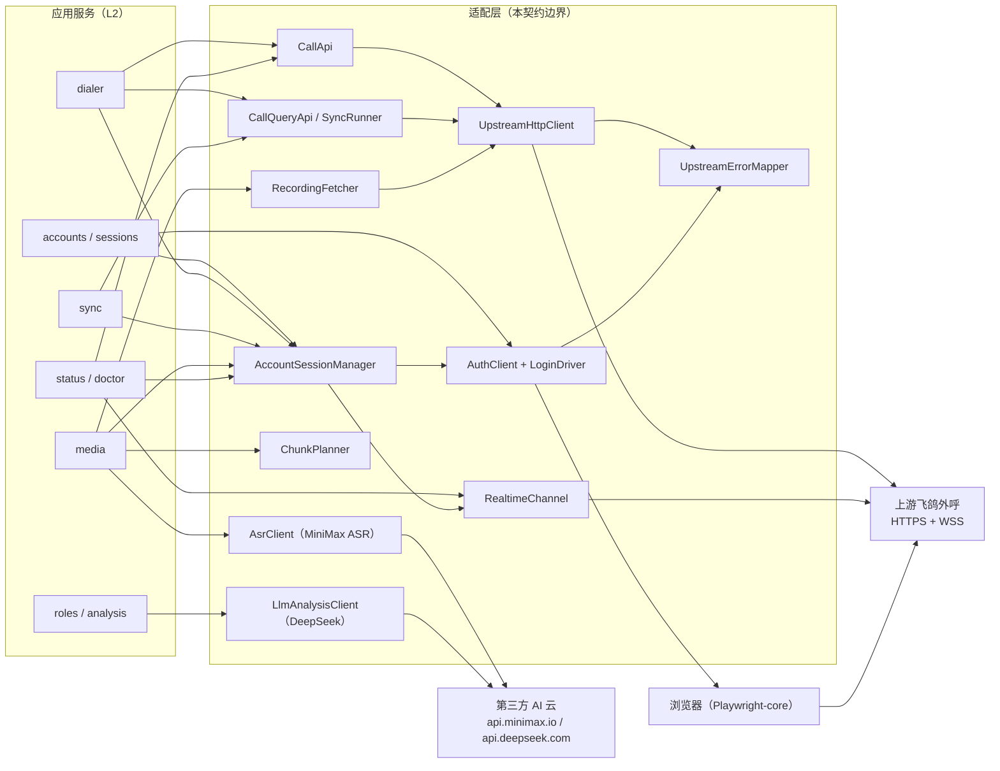
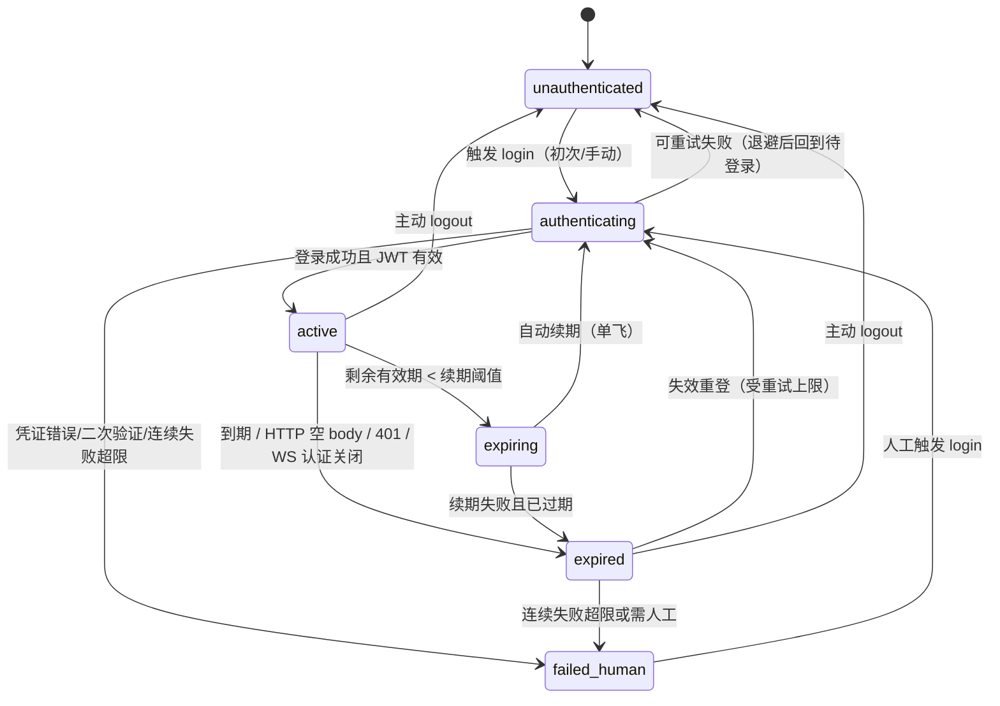
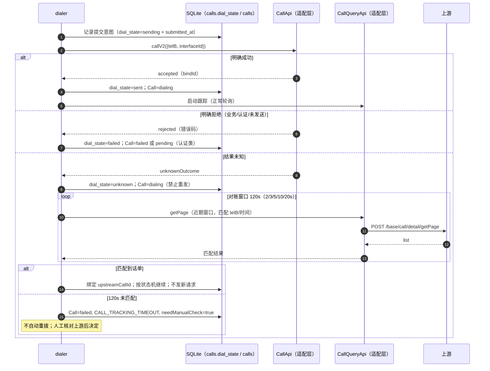

# 09 上游适配层契约

> 项目：`feige-outbound-platform`（FOP）
> 版本：v0.1（Step 2 设计稿，2026-11-14）
> 文档性质：**内部模块契约**（南向适配层 + 第三方 AI 客户端），不是北向 API；北向 REST 契约见 [docs/05](./05-对外API契约.md)
> 版本：v0.2（2026-11-14；按 v1 决策变更修订：删除上游转写拉取，改为"上游录音下载 → 本地 ASR（MiniMax）"；新增 AI 客户端契约（MiniMax ASR / DeepSeek LLM））
> 基准：[docs/01-决策与约定.md](./01-决策与约定.md)（冲突时以 docs/01 为准；本文错误码/枚举/字段名全部引用它）
> 后处理权威规格：[docs/13-后处理规格（ASR与LLM）.md](./13-后处理规格（ASR与LLM）.md)（接口/切分/角色/prompt/schema/错误码/配置以它为准；本文给适配层视角的契约与解析规则）
> 上游事实：[docs/00-上游可行性侦察.md](./00-上游可行性侦察.md)（实测结论；本文标注「实测」的内容均来自真实抓包/调用）
> 读者：实现适配层的工程师、评审者、维护上游改版的运维/开发
> 说明：本文包含 TypeScript 签名与伪代码作为**规格**，不包含业务实现；超时/重试/限速数值为默认基线，可配置项以 docs/01 §9 为准。

**目录**

1. [定位与边界](#1-定位与边界)
2. [模块清单与接口](#2-模块清单与接口)
3. [通用通信约定](#3-通用通信约定)
4. [上游接口总表](#4-上游接口总表)
5. [接口详细契约](#5-接口详细契约)
6. [登录与会话保活规格](#6-登录与会话保活规格)
7. [话单同步算法](#7-话单同步算法)
8. [录音下载契约](#8-录音下载契约)
9. [呼出适配契约](#9-呼出适配契约)
10. [媒体 AI 接入契约（AsrClient / LlmAnalysisClient）](#10-媒体-ai-接入契约asrclient--llmanalysisclient)
11. [错误归一 UpstreamErrorMapper](#11-错误归一-upstreamerrormapper)
12. [反风控与合规约束](#12-反风控与合规约束)
13. [契约测试与改版检测](#13-契约测试与改版检测)
14. [待验证清单与开放问题](#14-待验证清单与开放问题)
15. [与 docs/01 一致性检查](#15-与-docs01-一致性检查)

---

## 1. 定位与边界

### 1.1 本文是什么

- 定义**平台内核**与外部服务之间的唯一允许交互面：
  1. **上游飞鸽外呼**：模块、接口签名、请求/响应解析规则、超时、重试、限速、错误归一、登录与保活、同步/下载/呼出算法、反风控边界、契约测试；
  2. **第三方 AI 云**：MiniMax ASR（转写）与 DeepSeek LLM（语义后处理）的内部客户端契约（请求构造、响应映射、分块计划、结果落盘、重试/限速、错误归一、token 观测）。
- 定义**上游改版/供应商变更时的改动边界**：只有本契约覆盖的模块可以感知外部路径与字段；其余模块只使用规范化 DTO。
- **明确不使用上游转写**：`call-detail-content` 不进入产品流水线（仅侦察/抽样对账，见 §5.4）。

### 1.2 本文不是什么

- 不是北向 REST/CLI/MCP/SKILL 契约（见 docs/05–08）。
- 不定义数据库表结构（见 docs/04）；本文只定义适配层运行时类型与持久化**语义**。
- 不定义部署/排障步骤（见 docs/10）；但本文的失败分类会映射到 docs/10 的排障手册。
- 不包含真实凭证、JWT、完整手机号；示例号码统一 `138****0000`，JWT 统一 `<JWT>`。

### 1.3 职责与不负责

| 职责（适配层负责） | 不负责（调用方负责） |
| --- | --- |
| 上游 URL/路径/方法/请求体/响应解析 | 业务状态机（Call 状态推进由 `dialer` 负责） |
| 鉴权头注入（`cloud-token`）、JWT 失效检测信号（返回 `UPSTREAM_AUTH_EXPIRED`） | 会话续期策略的决策（由 `sessions` 决定何时重登；适配层只执行登录） |
| 超时、重试、限速、并发控制、网络错误分类 | 作业队列重试/优先级（`jobs`） |
| 响应结构校验（zod）与 `UPSTREAM_RESPONSE_INVALID` 判定 | 同步游标推进/去重合并策略（`sync` 服务，算法基线见 §7） |
| 原始响应脱敏、日志字段、错误归一 | 媒体流水线阶段编排（`media`） |
| 登录浏览器流程（页面交互、滑块、JWT 提取） | 密码/密钥的存储与注入（`secrets`；见 docs/11） |
| 录音 URL 双路径下载与校验（文件内容） | 音频文件目录/DB 一致性（`storage`/docs/04） |
| WebSocket 连接、ping/pong、重连 | WS 消息业务语义（v1 不依赖） |
| AI 客户端（`AsrClient`/`LlmAnalysisClient`）：请求构造、超时/重试/限速、响应解析、错误归一、usage/traceId 记录 | 切分策略/角色映射/词表/prompt 业务语义（`media`/`roles`/`analysis`，规格见 docs/13） |
| ASR 块结果落盘与命中校验（写入 `{dataDir}/asr/...`） | 音频文件归档与 GC（`storage`） |

### 1.4 调用关系



依赖规则：

1. 应用服务**只**通过本契约的模块访问外部服务（飞鸽上游 / 第三方 AI）；禁止在业务代码里直接 `fetch` 外部 URL。
2. 所有模块返回 `Result<T, UpstreamError>`（或抛 `UpstreamError` 的同步封装），不得返回裸 `Response`/原始 JSON。
3. `UpstreamErrorMapper` 是**唯一**把飞鸽上游现象翻译成 docs/01 §5.4 错误码的地方；AI 客户端使用各自的 `AsrErrorMapper`/`LlmErrorMapper`（§11.8）；其他模块不得自行猜测错误码。
4. 浏览器相关类型（`Page`/`BrowserContext`）不得跨出 `LoginDriver`。

---

## 2. 模块清单与接口

### 2.1 模块总览

| 模块 | 职责（一句话） | 主要方法 | 调用方 |
| --- | --- | --- | --- |
| `UpstreamHttpClient` | 统一 HTTP 请求：鉴权头、超时、重试、限速、错误归一、响应大小限制 | `request<T>()` | 其余所有适配模块 |
| `UpstreamErrorMapper` | 传输/HTTP/业务封套 → 本地错误码 | `fromTransport` / `fromHttp` / `fromEnvelope` / `isAuthExpired` | `UpstreamHttpClient`、`LoginDriver`、`RecordingFetcher` |
| `AuthClient` | 登录/退出/JWT 解析（不含页面细节） | `login` / `logout` / `decodeJwt` | `sessions`、`accounts` |
| `LoginDriver` | 浏览器登录流程（滑块、表单、捕获响应） | `login` | `AuthClient` |
| `AccountSessionManager` | 会话状态机、JWT 加解密存取、失效标记、续期执行 | `requireValid` / `invalidate` / `renew` / `health` | `accounts`、`dialer`、`sync`、`caller` |
| `CallApi` | 写操作与账号信息类接口 | `getExistOther` / `callV2` / `listLines` / `getSelectedLine` / `querySipPassword` / `userDetail` / `logout` | `dialer`、`status` |
| `CallQueryApi` | 话单查询（读） | `getPage` / `getCallDetailList?` / `callDetailContent`（仅侦察/对账，产品流水线不调用） | `sync`、`dialer`（跟踪）、诊断脚本 |
| `SyncRunner`（契约中的 `CallSync`） | 同步算法编排（游标、分页、合并回调） | `run` / `plan` | `sync` 服务 |
| `RecordingFetcher` | 录音双路径下载、校验、哈希、落盘 | `download` | `media` |
| `AsrClient` | MiniMax ASR：multipart 上传、响应解析、错误归一、traceId/用量 | `transcribe` | `media` |
| `ChunkPlanner` | WAV 头解析 + 静音点切分计划 + 双声道拆分（纯函数） | `plan` / `splitStereo` | `media` |
| `LlmAnalysisClient` | DeepSeek LLM：OpenAI 兼容 chat/completions、JSON 模式、usage/latency、错误归一 | `complete` | `analysis`、`roles`（复核） |
| `RealtimeChannel` | WS 连接、保活、重连、消息回调 | `connect` / `status` / `onFrame` / `close` | `sessions`、`status` |

### 2.2 公共类型

```ts
/** 适配层统一返回。错误必须能被 docs/01 §5.4 的错误码覆盖。 */
type Result<T> = { ok: true; value: T } | { ok: false; error: UpstreamError };

/** 上游操作名（日志/指标/错误映射的稳定键）。 */
type UpstreamOperation =
  | 'ssoLogin' | 'ssoLogout'
  | 'getPage' | 'getCallDetailList'
  | 'getExistOther' | 'callV2'
  | 'callLineList' | 'userLineGetOne' | 'querySipPassword'
  | 'userDetail' | 'selectBoughtLine'
  | 'recordingDownload' | 'wsConnect';

/** 第三方 AI 操作名（日志/指标/错误映射）。 */
type ProviderOperation = 'asrTranscribe' | 'llmChatCompletion';

/** 侦察/对账专用（不进入产品流水线；见 §5.4/§5.13）。 */
type ReconOperation = 'callDetailContent';

/** docs/01 §5.4 的错误码（此处列出适配层会产出的集合）。 */
type LocalErrorCode =
  | 'UPSTREAM_UNREACHABLE' | 'UPSTREAM_AUTH_EXPIRED' | 'UPSTREAM_RATE_LIMITED'
  | 'UPSTREAM_BUSINESS_ERROR' | 'UPSTREAM_RESPONSE_INVALID'
  | 'CALL_OUTSIDE_DIAL_WINDOW' | 'CALL_REJECTED_BY_UPSTREAM' | 'CALL_NOT_DIALABLE'
  | 'AUDIO_NOT_READY' | 'AUDIO_DOWNLOAD_FAILED' | 'AUDIO_NOT_AVAILABLE'
  | 'TRANSCRIPT_PENDING' | 'TRANSCRIPT_NOT_AVAILABLE'
  | 'ASR_FAILED' | 'ANALYSIS_FAILED'
  | 'ACCOUNT_LOGIN_FAILED' | 'ACCOUNT_LOGIN_REQUIRED'
  | 'SERVICE_UNAVAILABLE' | 'RATE_LIMITED' | 'INTERNAL_ERROR';

/** 适配层错误：所有字段可安全落日志（不含 token/PII）。 */
interface UpstreamError {
  code: LocalErrorCode;
  /** 面向调用方的短描述（已脱敏，不含上游原文中的号码/token）。 */
  message: string;
  /** 是否值得重试（与 docs/01 §5.4 的 retryable 保持一致）。 */
  retryable: boolean;
  /** 建议重试等待（来自 Retry-After / 本地退避计算）。 */
  retryAfterMs?: number;
  httpStatus?: number;
  /** 上游业务码（如 401 / 10056 / 206）。 */
  upstreamCode?: number;
  /** 上游消息（截断 + 脱敏；仅用于诊断）。 */
  upstreamMessage?: string;
  /** 第三方 AI 供应商（未设置表示飞鸽上游）。 */
  provider?: 'minimax' | 'deepseek';
  /** 供应商业务码/状态码（MiniMax `base_resp.status_code`、DeepSeek 错误 type/HTTP 状态）。 */
  providerCode?: string | number;
  /** 供应商 trace id（如 MiniMax `trace_id`），用于对账/排障。 */
  providerTraceId?: string;
  op: UpstreamOperation | ProviderOperation | ReconOperation;
  attempt: number;
  cause:
    | 'timeout' | 'network' | 'tls' | 'abort'
    | 'auth' | 'http' | 'business' | 'parse' | 'validation'
    | 'rateLimit' | 'unknownOutcome';
}

/** 秘密引用：禁止被 JSON.stringify/日志序列化；只在调用点 reveal()。 */
interface SecretRef { readonly __secret: true; reveal(): string }

/** 超时档位（ms）。 */
interface TimeoutProfile {
  connectMs: number;
  /** 从请求发出到响应头返回。 */
  headersMs: number;
  /** 两次 body chunk 之间的最大空闲。 */
  bodyIdleMs: number;
  /** 单请求总时限（下载为进度型空闲 + 总上限）。 */
  totalMs: number;
}

/** 重试档位。 */
interface RetryProfile {
  maxAttempts: number;       // 含首次
  baseDelayMs: number;
  maxDelayMs: number;
  jitterRatio: number;       // 0.2 = ±20%
  /** 仅对可安全重试的错误生效；写操作显式设为 1。 */
  retryOn: Array<'timeout' | 'network' | 'http5xx' | 'http429' | 'emptyBody' | 'parse'>;
}

type RateLimitClass = 'read' | 'writeDial' | 'auth' | 'download' | 'aiAsr' | 'aiLlm';
```

### 2.3 接口签名

```ts
// ───────────────────────── HTTP 客户端 ─────────────────────────
interface UpstreamHttpClient {
  request<T>(req: {
    accountId: string;
    op: UpstreamOperation;
    method: 'GET' | 'POST';
    /** 相对 admin API base 的完整路径（含 /base 前缀时按上游实际）。 */
    path: string;
    query?: Record<string, string | number | boolean | undefined>;
    body?: unknown;
    auth: 'cloudToken' | 'none';
    token?: SecretRef;
    timeout: TimeoutProfile;
    retry: RetryProfile;
    rateLimit: RateLimitClass;
    /** 响应体上限（字节）；超出判 UPSTREAM_RESPONSE_INVALID。 */
    maxBodyBytes?: number;
    /** 响应 schema；失败判 UPSTREAM_RESPONSE_INVALID。 */
    schema: ZodType<T>;
    signal?: AbortSignal;
  }): Promise<Result<T>>;
}

// ───────────────────────── 认证 ─────────────────────────
interface AuthClient {
  /** 执行一次完整登录（浏览器）；内部单飞由 AccountSessionManager 保证。 */
  login(accountId: string, opts: { reason: 'initial' | 'proactive' | 'reactive' | 'manual' }): Promise<Result<LoginSuccess>>;
  /** 尽力退出；失败只记日志，不阻塞本地登出。 */
  logout(accountId: string): Promise<Result<void>>;
  /** 只解码不校验签名；用于计算过期时间。 */
  decodeJwt(jwt: string): Result<JwtClaims>;
}

interface LoginDriver {
  /** 浏览器流程；返回内存中的 JWT 与诊断信息。实现不得持久化 JWT。 */
  login(accountId: string, creds: AccountCredentials, signal: AbortSignal): Promise<Result<LoginSuccess>>;
}

interface LoginSuccess {
  /** 明文 JWT：只允许在内存中流转，由 AccountSessionManager 立即加密落库。 */
  jwt: string;
  jwtIssuedAt: string;   // ISO 8601
  jwtExpiresAt: string;  // ISO 8601
  upstreamUserId?: string;
  upstreamUserName?: string; // 仅内存/脱敏日志，不落库明文
  captcha: { sliderPassed: boolean; paramCaptured: boolean; attempts: number };
}

interface JwtClaims {
  userId?: string;
  username?: string;
  loginId?: string;
  origin?: string;
  iat: number;   // 秒
  exp: number;   // 秒
  [k: string]: unknown;
}

interface AccountCredentials {
  /** 上游登录手机号（内部使用，日志脱敏）。 */
  username: SecretRef;
  password: SecretRef;
}

// ───────────────────────── 会话 ─────────────────────────
/**
 * 适配层内部会话视图（不是北向枚举）。
 * 持久化落点见 docs/04：`account_sessions.login_state`（unauthenticated/logging_in/authenticated/expired/failed）
 * + `account_sessions.health_status`（healthy/degraded/unhealthy/unknown）；
 * 北向 `AccountSummary.state`（docs/05 §2.2：online/expired/logging_in/error/disabled/unknown）由它们派生。
 * 映射见 §6.1。
 */
type SessionState =
  | 'unauthenticated' | 'authenticating' | 'active'
  | 'expiring'        // 剩余 < 续期阈值
  | 'expired' | 'failed_human' | 'disabled';

interface AccountSessionManager {
  state(accountId: string): SessionState;
  /** 取一个可用 token；失效时返回 UPSTREAM_AUTH_EXPIRED 并触发失效处理。 */
  requireValid(accountId: string): Promise<Result<SecretRef>>;
  /** 失效标记（来自 HTTP 空 body/401、WS 关闭、主动到期）。 */
  invalidate(accountId: string, reason: InvalidReason): Promise<void>;
  /** 执行续期（单飞）；成功后返回新会话状态。 */
  renew(accountId: string, trigger: 'proactive' | 'reactive' | 'manual'): Promise<Result<LoginSuccess>>;
  health(accountId: string): Promise<AccountSessionHealth>;
}

type InvalidReason = 'http-empty' | 'http-401' | 'ws-close' | 'jwt-expiry' | 'logout';

interface AccountSessionHealth {
  state: SessionState;
  jwtExpiresAt?: string;
  jwtRemainingSec?: number;
  wsConnected: boolean;
  lastLoginAt?: string;
  lastErrorCode?: LocalErrorCode;
  consecutiveFailures: number;
}

// ───────────────────────── 写操作 / 账号信息 ─────────────────────────
interface CallApi {
  /** 号码查重。data=0 可拨；非 0 = 客户已存在，v1 不阻断（docs/05 §6.1；语义待补测，见 §9.2）。 */
  getExistOther(accountId: string, mobile: string): Promise<Result<ExistOtherResult>>;
  /** 提交呼出。禁止任何自动重试（见 §9.5）。 */
  callV2(accountId: string, req: { telB: string; interfaceId: string | number; attemptId: string }): Promise<Result<CallV2Accepted>>;
  listLines(accountId: string): Promise<Result<LineInfo[]>>;
  getSelectedLine(accountId: string): Promise<Result<LineSelection>>;
  querySipPassword(accountId: string, lineId: string | number): Promise<Result<SipCredential>>;
  userDetail(accountId: string): Promise<Result<UpstreamUserDetail>>;
}

interface ExistOtherResult { dialable: boolean; upstreamData: number | string | null }
interface CallV2Accepted { bindId: string | null; bindIdFrom: 'data.bindId' | 'data' | 'none'; rawHint?: string }
interface LineInfo { lineId: string | number; lineName: string; mode: number | null }
interface LineSelection { interfaceId?: string | number; lineId?: string | number; raw: unknown }
interface SipCredential { username?: string; password?: SecretRef; raw: unknown }
interface UpstreamUserDetail {
  upstreamUserId?: string;
  tenantCode?: string;
  userName?: string;
  balance?: number | null;
  raw: unknown; // 仅内存/脱敏诊断，不整段落库
}

// ───────────────────────── 读操作 ─────────────────────────
interface CallQueryApi {
  getPage(accountId: string, q: GetPageQuery): Promise<Result<UpstreamPage>>;
  /** 上游转写；data:null → 暂无转写（不是错误）。 */
  callDetailContent(accountId: string, upstreamCallId: string): Promise<Result<UpstreamTranscript | null>>;
  /** 未验证接口；v1 不依赖，保留签名。 */
  getCallDetailList?(accountId: string, q: GetPageQuery): Promise<Result<unknown>>;
}

interface UpstreamPage { total: number; list: UpstreamCall[]; rawTotalType: 'number' | 'string' | 'other' }
interface SyncCursor {
  accountId: string;
  lastCreateTimeMs: number | null;
  lastUpstreamCallId: string | null; // 同毫秒 tie-breaker
  overlapLookbackMs: number;         // 默认 48h
  lastSyncStartedAt: string | null;
  lastSyncCompletedAt: string | null;
  lastSuccessPage: number;
  backfillState: { from: string; to: string; nextPage: number; phase: 'idle' | 'running' | 'done' } | null;
}

/** 契约中的 CallSync：同步算法编排（游标/分页/窗口/合并回调），算法见 §7。 */
interface SyncRunner {
  plan(accountId: string, cursor: SyncCursor, opts: SyncPlanOptions): SyncPlan;
  run(accountId: string, cursor: SyncCursor, opts: SyncRunOptions): Promise<Result<SyncRunStats>>;
}
interface SyncPlanOptions { mode: 'incremental' | 'backfill'; from?: string; to?: string; nowMs: number }
interface SyncPlan { mode: 'incremental' | 'backfill'; beginDate: string; endDate: string; maxPages: number; overlapLookbackMs: number }
interface SyncRunOptions extends SyncPlanOptions { jobId: string; maxPages?: number; signal?: AbortSignal }
interface SyncRunStats {
  pages: number; fetched: number; upserted: number; created: number; updated: number;
  window: { begin: string; end: string };
  durationMs: number;
}

// ───────────────────────── 媒体 ─────────────────────────
interface RecordingFetcher {
  download(req: {
    accountId: string;
    callId: string;
    sourceUrl: string;
    /** 目标目录（由 storage 决定；见 docs/04 目录规范）。 */
    targetDir: string;
    expect?: { sha256?: string; sizeBytes?: number };
  }, signal?: AbortSignal): Promise<Result<RecordingArtifact>>;
}

interface RecordingArtifact {
  path: string;
  sizeBytes: number;
  sha256: string;
  durationMs: number | null; // WAV 头可解析时给出
  sourceUrl: string;
  via: 'https-proxy' | 'direct';
  fetchedAt: string;
  attempts: number;
}

// ───────────────────────── 本地 ASR（MiniMax）─────────────────────────
/** 分块计划（纯函数；算法与阈值见 docs/13 §2.3）。 */
interface ChunkPlanner {
  plan(input: ChunkPlanInput): Result<ChunkPlan>;
  /** 双声道拆分（路径 A）；单声道时返回 null（走 diarization，路径 B）。 */
  splitStereo(wavPath: string, outDir: string): Promise<Result<StereoLayout | null>>;
}

interface ChunkPlanInput {
  wavPath: string;
  chunkSeconds: number;     // 默认 420（≤ 供应商 500s 上限，留余量）
  hardMaxSeconds: number;   // 480（窗口尾部无静音点时的硬上限）
  maxBytes: number;         // 50 MB
  minSilenceMs: number;     // 默认 300
  overlapSeconds: number;   // 默认 0（静音点切分 + 边界去重）
}

interface ChunkPlan {
  format: { sampleRate: number; channels: 1 | 2; bitsPerSample: number; durationMs: number };
  chunks: ChunkSpec[];
  forcedCutIndexes: number[];  // 找不到静音点而被迫在窗口尾部硬切的块
}

interface ChunkSpec {
  index: number;               // 从 0 开始
  beginMs: number;             // 相对整段录音
  endMs: number;
  beginByte: number;           // 相对 PCM data chunk 的字节偏移（便于切片上传）
  endByte: number;
  silenceAtEnd: boolean;
}

interface StereoLayout { leftWav: string; rightWav: string; durationMs: number }

/** ASR 客户端：MiniMax speech_to_text。幂等由调用方按块内容哈希保证。 */
interface AsrClient {
  transcribe(req: {
    accountId?: string;
    callId: string;
    chunkIndex: number;
    /** 单块 WAV（≤480s 且 ≤50MB）；调用方负责按 ChunkPlan 切出。 */
    wavPath: string;
    /** 块内容 sha256（缓存键；同内容不重复请求/计费）。 */
    contentSha256: string;
    options?: { model?: string; language?: string; timestampLevel?: 'sentence' | 'word' };
    signal?: AbortSignal;
  }): Promise<Result<AsrChunkResult>>;
}

interface AsrChunkResult {
  /** 规范化分段（毫秒、块内相对时间；speaker 为块内匿名标签）。 */
  segments: AsrSegment[];
  durationMs: number;
  language?: string;
  providerMeta: {
    traceId?: string;
    nSpeakers?: number;
    latencyMs: number;
    attempts: number;
    statusCode?: number;
  };
}

interface AsrSegment {
  beginMs: number;
  endMs: number;
  text: string;
  /** S1/S2/…；块内有效，无语义（角色映射见 docs/13 §4）。 */
  speakerLabel?: string;
}

// ───────────────────────── LLM 后处理（DeepSeek）─────────────────────────
interface LlmAnalysisClient {
  /**
   * 一次 chat/completions（不做业务重试/模型升级；由 AnalysisService 编排升级链，
   * 便于把"校验失败 → 升级"保持在业务层可测）。
   */
  complete(req: {
    model: string;              // deepseek-chat（默认）/ deepseek-v4-pro（升级）
    systemPrompt: string;       // docs/13 §6.1
    userMessage: string;        // docs/13 §6.2
    jsonMode: boolean;          // response_format={type:"json_object"}；v1 true
    temperature: number;
    maxTokens: number;          // 默认 2000；升级模型时 ≥4096
    signal?: AbortSignal;
  }): Promise<Result<LlmCompletion>>;
}

interface LlmCompletion {
  /** 不可信文本；是否合法 JSON/schema 由调用方（analysis）校验。 */
  text: string;
  finishReason: 'stop' | 'length' | 'content_filter' | 'unknown';
  usage: { promptTokens: number; completionTokens: number; totalTokens: number };
  latencyMs: number;
  attempts: number;
  providerMeta: { model: string; requestId?: string };
}

/** analysis 输出结构以 docs/13 §6.3 的 zod schema 为准（此处不重复展开）。 */
type AnalysisOutput = unknown;

// ───────────────────────── WS ─────────────────────────
interface RealtimeChannel {
  connect(accountId: string, token: SecretRef): Promise<Result<void>>;
  status(accountId: string): ChannelStatus;
  onFrame(accountId: string, cb: (frame: RealtimeFrame) => void): () => void;
  close(accountId: string, reason?: string): Promise<void>;
}

interface ChannelStatus {
  connected: boolean;
  lastPingAt?: string;
  lastPongAt?: string;
  consecutiveMisses: number;
  reconnects: number;
  lastCloseCode?: number;
}

interface RealtimeFrame {
  kind: 'pong' | 'unknown';
  /** 仅调试：截断 + 脱敏后的文本；业务不解析。 */
  textPreview?: string;
  receivedAt: string;
}

// ───────────────────────── 错误映射 ─────────────────────────
interface UpstreamErrorMapper {
  fromTransport(op: UpstreamOperation, err: unknown, ctx: MapCtx): UpstreamError;
  fromHttp(op: UpstreamOperation, status: number, bodyText: string, ctx: MapCtx): UpstreamError;
  fromEnvelope(op: UpstreamOperation, envelope: unknown, ctx: MapCtx): UpstreamError;
  isAuthExpired(candidate: { httpStatus?: number; bodyText?: string; envelope?: unknown }): boolean;
}

interface MapCtx { accountId?: string; attempt: number; path: string; requestId?: string }
```

### 2.4 适配层不变式（评审必须逐条确认）

| # | 不变式 | 违反后果 |
| --- | --- | --- |
| I1 | 上游 JWT / 密码 / `captchaVerifyParam` / `cloud-token` 永不出现在日志、事件、DB 明文、API 响应 | 账号被接管 |
| I2 | `callV2` **永不自动重试**；只有显式人工/新请求才能再次提交 | 重复外呼/重复计费 |
| I3 | 每个读接口的请求都经过 per-account 令牌桶；账号间不共享额度 | 触发上游风控/限流 |
| I4 | 同账号同一时刻最多 1 个浏览器上下文、1 个登录作业；dial/同步有各自单飞 | profile 损坏/并发登录失败 |
| I5 | 所有响应先经 zod 解析为内部 DTO，再交给上层；禁止把原始 JSON 直接透传业务层 | 上游改版导致隐性数据错误 |
| I6 | 空 body（HTTP 200 + Content-Length 0）一律按 `UPSTREAM_AUTH_EXPIRED` 处理，不得当成功 | 误判登录态 |
| I7 | 超时分层：连接/响应头/body 空闲/总时限分别配置；`AbortController` 贯穿取消 | 挂死/资源泄漏 |
| I8 | 下载 URL 只接受上游返回值并通过白名单校验（host/path/port），不跟随任意外部 URL | SSRF/内网探测 |
| I9 | 手机号、姓名、录音 URL 在日志中脱敏；`upstreamCallId` 保持字符串（19 位雪花 ID，禁止转 number） | PII 泄露/精度丢失 |
| I10 | 所有时间字段：上游毫秒 → 内部保留 `*Ms`，对外转 ISO 8601（+08:00）由上层完成 | 时区错误 |
| I11 | ASR 单请求音频时长 ≤480s 且 ≤50MB（`ChunkPlanner` 必须保证）；超限是计划缺陷，不得把长音频直接上传 | 供应商拒绝/截断/重复计费 |
| I12 | 同内容块（sha256 + 计划指纹）命中 `{dataDir}/asr/.../chunk-{i}.json` 时**不得重复请求** provider | 重复计费/审计不一致 |
| I13 | ASR/LLM 原始请求/响应默认不落盘、不进日志；仅保留 `traceId`/`usage`/耗时；排障开关开启时 0600 短留存并脱敏 | 数据泄露/合规风险 |
| I14 | AI API key 只经 `SecretRef` 注入；不得出现在日志/事件/DB 明文/错误消息；不得把上游 `cloud-token`/Cookie 发送给 AI 供应商 | 密钥泄露/串号 |
| I15 | LLM 输出必须经 zod 严格校验后才可落库；未通过校验的 JSON 不得进入 `AnalysisResult` | 脏数据污染下游 |
| I16 | ASR/LLM 出站只允许 `api.minimax.io` / `api.minimax.cn` / `api.deepseek.com`（HTTPS 443），不跟随重定向 | SSRF/数据外发 |
| I17 | ASR/LLM 客户端不自行"跳过失败块/吞掉校验错误"：失败必须归一为 `ASR_FAILED`/`ANALYSIS_FAILED` 交由作业层重试/降级 | 静默丢转写/静默空分析 |

---

## 3. 通用通信约定

### 3.1 Base URL 与路径前缀

```text
管理端 API base：https://feige.duofangtongxin.com/duofang-feige-admin
登录页：       https://feige.duofangtongxin.com/#/login
业务 API 前缀：{base}/base/...
登录/退出：    {base}/sso/...
实时通道：     wss://feige.duofangtongxin.com/duofang-feige-admin/ws/websocket?token=<JWT>
录音直连：     http://112.192.20.62:9876/cloud-api/record/...
录音 HTTPS：   https://feige.duofangtongxin.com/cloud-api/record/...   （同上路径，替换 host）
MiniMax ASR：  https://api.minimax.io/v1/speech_to_text   （国内区域 https://api.minimax.cn/v1/speech_to_text）
DeepSeek：     https://api.deepseek.com/chat/completions   （模型列表 GET /models，供 doctor 只读探测）
```

> docs/01 §8.1 的路径为行文简写（如 `POST /call/detail/getPage`、`GET /crm/getExistOther`）。本文按 docs/00 实测记录**完整路径与方法**（`POST /base/call/detail/getPage`、`GET /base/crm/getExistOther`）。二者语义一致；若评审发现文档差异，建议回写 docs/01 §8.1 的完整路径，不影响契约。

### 3.2 鉴权与请求头

| 头 | 值 | 适用 |
| --- | --- | --- |
| `cloud-token` | `<JWT>`（通过 `SecretRef` 注入，禁止落日志） | 除登录外的全部管理端 API |
| `content-type` | `application/json` | 全部 JSON 请求 |
| `accept` | `application/json` | 全部 |
| `user-agent` | 默认 undici UA；可配置为 `FOP/<version>` | 实测无 UA 要求；不做浏览器 UA 伪装 |
| `x-request-id` | 本地 traceId（可选） | 上游可能忽略；仅本地关联 |

- **不带 Cookie**：实测业务 API 只依赖 `cloud-token`（docs/00 §2.3）；不依赖浏览器 Cookie，登录后浏览器上下文可关闭。
- **不使用代理轮换**：不引入代理池/出口 IP 轮换（违反 docs/01 非目标）；网络出口保持稳定、可解释。
- **TLS**：使用系统 CA；证书错误按 `UPSTREAM_UNREACHABLE`（cause=`tls`）处理，不降级跳过校验。
- **第三方 AI 鉴权**：`AsrClient`/`LlmAnalysisClient` 使用各自 `Authorization: Bearer <providerKey>`（`SecretRef` 注入），**不复用** `cloud-token`/Cookie；请求只发往白名单 AI 域名，不经过上游 base URL。

### 3.3 响应封套

上游统一封套（管理端业务 API）：

```jsonc
{
  "code": 0,          // 0 = 业务成功；401 = 登录失效；10056 = 通用业务错误（按 message 细分）
  "msg": "success",   // 部分接口字段名为 message
  "data": { }         // 结构因接口而异；可能为 null
}
```

解析规则：

1. **HTTP 层**：先按状态码分类（见 §11.3），再解析 body。
2. **空 body**：`HTTP 200` 且 body 长度 0 → 直接判 `UPSTREAM_AUTH_EXPIRED`（docs/00 §2.3 实测），**不尝试 JSON 解析**。
3. **JSON 解析失败**：判 `UPSTREAM_RESPONSE_INVALID`（保留 ≤500 字符的脱敏摘要）。
4. **业务码**：`code===0` 成功；`code===401` → `UPSTREAM_AUTH_EXPIRED`；其他 → `fromEnvelope` 细分（§11.4）。
5. **登录接口例外**：`POST /sso/login` 成功码为 `200`（不是 0），`dufo` 返回 `data` 为 JWT 字符串；`206` 表示需要二次验证/改密（见 §6.5）。
6. **字段名宽容**：`msg`/`message` 二选一；`total` 可能为 number/string（解析为 number，失败置 0 并记 warning）；未知字段保留但不向上层暴露。
7. **第三方 AI 响应例外**：MiniMax/DeepSeek **不使用**本封套（MiniMax 为 `verbose_json` 结构 + `base_resp.status_code`；DeepSeek 为 OpenAI 兼容 `choices[].message.content`），解析与错误分类见 §10。

### 3.4 超时矩阵

| 档位 | connect | headers | body 空闲 | 总时限 | 用于 |
| --- | --- | --- | --- | --- | --- |
| `fast` | 3000 | 8000 | 8000 | 15000 | 健康检查、线路查询、查重（≤） |
| `read` | 3000 | 10000 | 15000 | 30000 | `getPage`、`userDetail`、`getExistOther` |
| `dial` | 5000 | 15000 | 15000 | 30000 | `callV2`（结果未知语义见 §9.5） |
| `recon` | 3000 | 10000 | 15000 | 30000 | 侦察/对账专用 `call-detail-content`（**非流水线**） |
| `asr` | 5000 | 10000 | 60000 | **600000**（`pipeline.asr.timeoutMs`） | MiniMax `speech_to_text`（单块 ≤480s，含上传+识别） |
| `llm` | 5000 | 15000 | 60000 | **120000**（内部基线；升级 v4-pro 可放宽） | DeepSeek `chat/completions`（含 reasoning 时更长） |
| `loginPage` | — | — | — | 页面导航 30000 / 元素等待 20000 / SSO 响应 15000 | 登录浏览器流程 |
| `download` | 5000 | 15000 | 30000 | 1800000（30min 硬上限） | 录音下载（进度型空闲超时） |
| `ws` | 10000（握手） | — | — | ping 间隔 25000 / pong 超时 10000 | WS |

> 超时是"适配层默认值"，可在内部常量中集中管理；若需运维可调，按 docs/10 的配置候选流程处理（不擅自新增 docs/01 §9 键）。

### 3.5 重试矩阵

| 类 | 典型接口 | maxAttempts | 退避 | 可重试条件 | 备注 |
| --- | --- | --- | --- | --- | --- |
| 幂等读 | `getPage`、`getExistOther`、线路/用户信息（含侦察用 `call-detail-content`） | 3 | 500ms × 2ⁿ ±20%，上限 8s | timeout / network / 5xx / 429（若有 Retry-After 从其值） | `retryOn` 不含 `emptyBody`（空 body 是登录失效，重试无意义，先重登） |
| ASR 单块 | `asrTranscribe` | 3（`pipeline.asr.maxRetries`） | 2s/4s/8s ±20%，上限 30s | timeout / network / 5xx / 429（尊重 Retry-After） | 不含 401/403/413/415/422/时长超限/格式不支持；同内容块命中缓存则不发请求 |
| LLM 单次 | `llmChatCompletion` | 3（`pipeline.analysis.maxRetries`） | 1s/2s/4s ±20%，尊重 `Retry-After` | timeout / network / 5xx / 429 | 401/403/400 不重试；`finish_reason=length` 由业务层提高 max_tokens 重试一次；JSON 非法走升级链（§10.7） |
| 登录 | `ssoLogin`（浏览器整体） | 3 个浏览器轮次 | 30s / 2min / 5min | 页面超时/网络/滑块失败（新页面重试） | 每轮内滑块最多 2 次；凭证错误不重试（直接人工） |
| 退出 | `ssoLogout` | 1（尽力） | — | 不重试 | 失败只记日志，本地照常登出 |
| 写操作 | `callV2` | **1** | — | **禁止自动重试** | 结果未知进入对账（§9.5） |
| 下载 | `recordingDownload` | 每路径 3，共 2 路径 | 1s/3s/10s ±20% | network / timeout / 5xx / 截断/校验失败 | Range 续传；失败切另一路径 |
| WS | `wsConnect` | 重连不限次（背退避） | 1s,2s,5s,10s,30s,60s（上限 60s） | 网络/服务端关闭（非认证类） | 认证类关闭 → 会话失效，停止重连等重登 |
| 业务错误 | 全部 | 0 | — | — | `code≠0` 且非限流 → 不重试，交上层 decision |

退避公式：

```text
delay(attempt) = min(maxDelayMs, baseDelayMs × 2^(attempt-1)) × (1 ± jitterRatio)
```

### 3.6 限速与并发

| 资源 | 默认 | 实现点 | 说明 |
| --- | --- | --- | --- |
| 每账号上游读 QPS | 5（`limits.upstreamReadQps`，突发 10） | `UpstreamHttpClient` per-account 令牌桶（`read` 类） | 同步/详情/转写轮询/健康检查**共享**同一桶 |
| 全局上游读 QPS 安全上限 | 50（内部保护） | 全局令牌桶 | 账号多时防总量失控（待上游限速实测后调整） |
| 呼出并发 | 账号 1 / 全局 8（docs/01 §5.7） | `dialer` + 适配层 `writeDial` 类 | 适配层不并发提交 `callV2` 同账号 |
| 登录并发 | 每账号 1 / 全局浏览器上下文 2 | `AccountSessionManager` 单飞 + 浏览器上下文注册表 | 登录远离业务高峰、账号间错峰 |
| 下载并发 | 全局 3 | `RecordingFetcher` 信号量 | 大文件不挤占 API/同步带宽 |
| 分页请求间隔 | 每页 50–150ms 抖动 | `SyncRunner` | 避免固定节奏触发风控 |
| 健康检查 | 每账号 60s（WS ping）/ 5min（`userDetail`） | `sessions`/`status` | 账号间错峰（按 hash 偏移） |
| `callV2` 冷却 | 同账号同号码 60s（docs/01 `dialCooldownMs`） | `dialer`（非适配层） | 适配层只执行单次提交 |
| ASR 并发（MiniMax） | 全局 4（`pipeline.asr.concurrency`） | `AsrClient` 全局信号量 | 供应商限流未明示；429 自适应退避；单通话分块共享额度 |
| LLM 并发（DeepSeek） | 全局 8（`pipeline.analysis.concurrency`） | `LlmAnalysisClient` 全局信号量 | 升级 v4-pro 更慢，信号量避免雪崩 |
| 第三方域名 | 仅 `api.minimax.io` / `api.minimax.cn` / `api.deepseek.com` | 客户端 URL 白名单 | HTTPS 443、不跟随重定向、不携带上游凭证 |

### 3.7 网络错误分类（决定"能否重试/结果是否未知"）

| 现象（undici 错误码/错误类） | 分类 | 读接口动作 | `callV2` 动作 |
| --- | --- | --- | --- |
| `ECONNREFUSED` / `ENOTFOUND` / `EAI_AGAIN` / DNS 失败 | 未建立连接（**未发送**） | 可重试 | 可判"未发送"→ 安全失败（上层可重排，**但仍不自动重发**，由人工/新请求决定） |
| `UND_ERR_CONNECT_TIMEOUT` / TLS 握手失败 | 未建立连接（**未发送**） | 可重试 | 同上 |
| `UND_ERR_HEADERS_TIMEOUT` | 已连接、可能已发送，响应未知 | 可重试 | **结果未知**（`unknownOutcome`）→ 对账，不重发 |
| `UND_ERR_BODY_TIMEOUT` / `ECONNRESET` / `EPIPE`（请求已发出后） | 结果未知 | 可重试 | **结果未知** → 对账 |
| 本地 `AbortController`（停机/超时上层取消） | 主动取消 | 不重试，返回 `SERVICE_UNAVAILABLE` | 若已发送 → 结果未知；未发送 → 取消 |
| HTTP 429 | 限流 | 重试（尊重 `Retry-After`） | 不重试；按上游限流报错，交人工/延迟 |
| HTTP 5xx | 服务端错误 | 重试 | **结果未知**（5xx 也可能已执行）→ 对账 |
| 空 body / `code=401` | 认证失效 | 不重试，返回 `UPSTREAM_AUTH_EXPIRED` | 若响应明确 401 → 请求未执行，安全失败；空 body 同时按认证失效处理 |

> 判定"是否已发送"是近似：undici 无法 100% 确认服务端是否收到。对 `callV2` 一律按**更保守**分支处理（连接错误才视为未发送，其余视为未知）；这是 docs/01 §8.5 硬约束 7 的落地方式。

**第三方 AI 的"结果未知"**：ASR/LLM 均为无幂等键的 POST。ASR 超时/连接中断可能已在供应商侧完成并计费 → 允许按块重发（受 §10.2 上限约束），并通过 429/用量对账观察重复计费风险；LLM 超时同理（重试可能产生重复 token，但只取最终成功结果落库）。两者**不产生外部业务副作用**（不触发外呼/计费业务链路），因此允许块级/单次重试（与 `callV2` 的"绝不自动重试"原则不同）。

### 3.8 日志与脱敏

- 适配层日志统一带：`op`、`accountId`、`attempt`、`path`、`httpStatus`、`upstreamCode`、`durationMs`、`outcome`、`errorCode`；AI 调用额外带 `provider`、`model`、`chunkIndex`、`audioSec`、`promptTokens`/`completionTokens`、`providerTraceId`。
- 禁止：`cloud-token`、JWT、`password`、`captchaVerifyParam`、Cookie、完整手机号、含号码的 URL、`minimaxApiKey`/`deepseekApiKey`、`Authorization`。
- URL 记录规则：仅记录 path；query 中 `mobile`/`token` 打码；录音 URL 记录时把文件名中的号码段替换为 `138****0000`。
- 原始响应只允许 `debug` 级、截断 ≤500 字符、脱敏后记录；生产默认不记录原始响应。

### 3.9 时间与字段规范

| 项 | 规则 |
| --- | --- |
| 上游时间 | 全部毫秒 epoch；缺失/非法 → `null`；内部 DTO 字段名带 `Ms` 后缀 |
| 对外时间 | 由上层转 ISO 8601（`+08:00`），适配层不格式化 |
| `upstreamCallId` | **字符串**（19 位雪花 ID，禁止 `Number()`，会丢精度） |
| 手机号 | 上层按 docs/05 §6.1 规范化（大陆手机 `^1[3-9]\d{9}$` 或固话）；适配层不再改写，仅校验非空 |
| `interfaceId` | 上游可能为 number/string；适配层原样保存并在请求时按配置类型提交（见 §9.3） |
| 空值 | `null` 与缺失字段按同一语义处理（zod `.nullish()`），但"成功响应缺必填字段"判 `UPSTREAM_RESPONSE_INVALID` |

### 3.10 响应体大小与取消

- `getPage`：≤ 8 MB；侦察用 `call-detail-content`：≤ 20 MB（**非流水线**）；超限 → `UPSTREAM_RESPONSE_INVALID`，不截断解析。
- ASR 响应：≤ 8 MB（480s/verbose_json 远小于此）；LLM 响应：≤ 2 MB；超限 → 对应 `ASR_FAILED`/`ANALYSIS_FAILED`（`details.reason=response_too_large`）。
- ASR 上传：按计划单块 ≤50MB / ≤480s，不整段读入内存（流式/分块读取后 multipart 上传）。
- 所有请求接受 `AbortSignal`；上层停机/超时/客户端断开时取消在途请求，取消不产生业务副作用（`callV2` 已发送的未知语义见 §3.7）。

---

## 4. 上游接口总表

> 「实测」= docs/00 已验证可调用；「待补测」= 需真实拨测/新账号样本补充（docs/00 §10）。
> 所有路径均相对 `https://feige.duofangtongxin.com/duofang-feige-admin`（录音除外，见 §8）。

| # | 接口 | 方法 | 完整路径 | 用途 | 调用方 | 幂等/副作用 | 超时档 | 重试 | 限速类 | 错误映射（主） | 状态 |
| --- | --- | --- | --- | --- | --- | --- | --- | --- | --- | --- | --- |
| 1 | SSO 登录 | POST | `/sso/login`（页面内发起） | 获取 7 天 JWT | `AuthClient`/`LoginDriver` | 有副作用（风控计数） | `loginPage` | 3 轮 | `auth` | `ACCOUNT_LOGIN_FAILED` / `UPSTREAM_*` | 实测 |
| 2 | 退出 | POST | `/sso/logout` 或 `/base/logout` | 尽力退出 | `AuthClient` | 有（清会话） | `fast` | 1 | `auth` | 忽略失败 | 路径实测，行为待确认 |
| 3 | 话单列表 | POST | `/base/call/detail/getPage` | 同步/跟踪 | `CallQueryApi`/`SyncRunner` | 只读 | `read` | 3 | `read` | `UPSTREAM_*` | 实测 |
| 4 | 上游转写（**不使用**） | POST | `/base/call/detail/call-detail-content` | 仅侦察/抽样对账（不进入产品流水线） | 诊断脚本 | 只读 | `recon` | — | — | — | 实测（docs/00 §5） |
| 5 | 号码查重 | GET | `/base/crm/getExistOther?mobile=` | 呼出前查重 | `CallApi` | 只读 | `fast` | 3 | `read` | `CALL_NOT_DIALABLE` / `UPSTREAM_*` | 实测 |
| 6 | 呼出 | POST | `/base/crmV2/callV2` | 提交外呼 | `CallApi` | **有（真实外呼/计费）** | `dial` | **1（禁止重试）** | `writeDial` | `CALL_*` / `UPSTREAM_*` | 请求实测；成功响应待补测 |
| 7 | 可用线路 | GET | `/base/api/agent/callLineList` | 线路/健康 | `CallApi` | 只读 | `fast` | 3 | `read` | `UPSTREAM_*` | 实测 |
| 8 | 当前线路 | GET | `/base/sys/userLine/getOne` | 呼出线路参数 | `CallApi` | 只读 | `fast` | 2 | `read` | `UPSTREAM_*` | 待补测（结构未记录） |
| 9 | SIP 凭证 | GET | `/base/crm/querySipPassword?lineId=` | 健康/能力探测 | `CallApi` | 只读 | `fast` | 1 | `read` | `CALL_REJECTED_BY_UPSTREAM`（健康场景不致命） | 实测（10056 未绑定） |
| 10 | 账号信息 | GET | `/base/sys/user/userDetail` | 账号健康/余额 | `CallApi` | 只读 | `fast` | 3 | `read` | `UPSTREAM_*` | 实测可用；字段待补测 |
| 11 | 线路选择数据 | GET | `/base/call/detail/selectBoughtLine` | 仅健康参考 | `CallApi` | 只读 | `fast` | 1 | `read` | 不致命 | 待补测 |
| 12 | 实时通道 | GET(upgrade) | `wss://feige.duofangtongxin.com/duofang-feige-admin/ws/websocket?token=<JWT>` | 保活/实时事件 | `RealtimeChannel` | 只读 | `ws` | 重连策略 | `auth` | 断线不致命 | 连接与 ping/pong 实测；消息格式待补测 |
| 13 | AI 质检/分析 | POST | `/base/ai-record-analysis/page`、`/one` | — | — | — | — | — | — | 本账号 403 无权限 | **不使用** |
| 14 | App 自动拨号开关 | POST | `/base/crm/automatic/call`、`/un-automatic/call` | — | — | 有 | — | — | — | — | **不使用**（属 App 自动拨号，非本平台范围） |

**使用原则**

- 产品流水线使用 #1–#3、#5–#12；#4（上游转写）**不使用**，仅供侦察/抽样对账；#13/#14 明确排除（403/不属于本平台能力），避免误用导致上游状态异常。
- 所有写操作只有 #1（登录）与 #6（呼出）；#2 为退出。其余全部只读。
- 每个接口的实现必须记录**实测状态**；「待补测」项需在真实拨测窗口补样本后更新本文与 fixture。

### 4.2 第三方 AI 服务接口总表（MiniMax / DeepSeek）

> 规格来源：[docs/13](./13-后处理规格（ASR与LLM）.md)；本表只列适配层调用视角。两个服务都**没有**对外副作用（不触达外呼/计费业务链路），但会产生供应商费用。

| # | 服务 | 方法/路径 | 用途 | 调用方 | 计费/副作用 | 超时档 | 重试 | 错误归一 | 状态 |
| --- | --- | --- | --- | --- | --- | --- | --- | --- | --- |
| A1 | MiniMax ASR | POST `https://api.minimax.io/v1/speech_to_text`（国内 `https://api.minimax.cn/v1/speech_to_text`） | 单块音频 → 文本 + 时间戳 + speaker | `AsrClient`（`media`） | **计费**（按时长/请求） | `asr`（总 600s） | 单块 ≤3 | `ASR_FAILED` + `providerCode`/`providerTraceId` | 实测（docs/13 §2.4） |
| A2 | DeepSeek Chat | POST `https://api.deepseek.com/chat/completions` | 转写 + 元数据 → 结构化 JSON（摘要/意向等） | `LlmAnalysisClient`（`analysis`/`roles`） | **计费**（按 token） | `llm`（总 120s） | 单次 ≤3 | `ANALYSIS_FAILED` + `providerCode` | 实测（docs/13 §3.3） |
| A3 | DeepSeek 模型列表 | GET `https://api.deepseek.com/models` | 运维/doctor 只读校验密钥与模型可用性 | `status`/`doctor`（可选） | 只读、无计费 | `fast` | 1 | 不致命（健康检查） | 实测（docs/13 §3.1） |

- 密钥分别来自 `secrets.minimaxApiKey` / `secrets.deepseekApiKey`（或 `FOP_MINIMAX_API_KEY` / `FOP_DEEPSEEK_API_KEY`），只经 `SecretRef` 注入。
- 请求/响应示例、切分规则、prompt、JSON schema、错误分类与配置见 docs/13；AI 客户端不允许被业务层直接调用（只经 `AsrClient`/`LlmAnalysisClient`）。

---

## 5. 接口详细契约

> 通用规则见 §3；本章只写接口特有内容。所有示例均脱敏。

### 5.1 POST `/sso/login`（浏览器内发起）

| 项 | 内容 |
| --- | --- |
| 用途 | 手机号+密码+阿里云滑块登录，返回 JWT |
| 调用方式 | **由登录页自身发起**（`LoginDriver` 点击登录按钮），适配层通过 Playwright response 事件捕获结果；**不**在 Node 侧直接拼接请求（除页面内 fetch 兜底，见 §6.5） |
| 请求头 | 页面默认（含 `content-type: application/json`、Cookie、UA、Origin/Referer 由浏览器生成） |
| 超时 | 页面导航 30s；表单就绪 20s；滑块等待 20s；SSO 响应 15s |
| 重试 | 每次登录作业最多 3 个浏览器轮次（新页面）；凭证错误（用户名/密码/206）不重试 |
| 限速 | 账号级单飞；全局浏览器上下文 ≤2；轮次间退避 30s/2m/5m |

请求体（实测，前端原样；`<...>` 为占位）：

```jsonc
{
  "mobile": "138****0000",
  "username": "138****0000",
  "password": "<明文密码，仅 HTTPS 传输，禁止记录>",
  "captchaVerifyParam": "<阿里云验证码返回的 Base64(JSON)，一次性>",
  "origin": "3",
  "remember": "1",
  "invite": "",
  "loginType": "B1"
}
```

响应与解析：

```jsonc
{ "code": 200, "message": "success", "data": "<JWT>" }
```

| 上游 | 解析动作 | 本地结果 |
| --- | --- | --- |
| `code=200` 且 `data` 为 JWT 字符串 | 校验 JWT 三段格式；解码 payload；要求 `exp/iat` 存在 | `LoginSuccess`（JWT 仅内存） |
| `code=206` | 需要二次验证/改密（前端进入改密流程） | `ACCOUNT_LOGIN_FAILED`（`needHuman`，reason=`SECONDARY_AUTH_REQUIRED`） |
| `code≠200/206` | 按 message 分类（密码错误/验证码错误/风控） | `ACCOUNT_LOGIN_FAILED`（reason 细分） |
| 空 body / 网络错误 / 页面异常 | 分类为传输或页面失败 | `ACCOUNT_LOGIN_FAILED` 或 `UPSTREAM_UNREACHABLE` |

> 完整浏览器流程（选择器、滑块轨迹、captchaVerifyParam 捕获、JWT 提取）见 §6。

### 5.2 POST `/sso/logout`（或 `/base/logout`）

| 项 | 内容 |
| --- | --- |
| 用途 | 通知上游退出（清服务端会话/Cookie） |
| 请求 | 无参数；带 `cloud-token` |
| 响应 | 通常 `{code:0}`；具体结构未记录（**不依赖**） |
| 超时/重试 | `fast`（15s 总）；1 次，不重试 |
| 本地语义 | **无论上游是否成功**：关闭该账号 WS、删除/标记本地 JWT 为无效、置会话 `unauthenticated`、写审计。失败仅记日志 |

### 5.3 POST `/base/call/detail/getPage`（话单列表/同步）

| 项 | 内容 |
| --- | --- |
| 用途 | 拉取当前登录坐席的话单（同步、呼出跟踪、对账） |
| 调用方 | `SyncRunner`（主）、`CallTracker`（近期窗口查询） |
| 幂等 | 是（只读） |
| 超时 | `read`（3/10/15/30s） |
| 重试 | 3 次（500ms×2ⁿ，±20%，上限 8s）；空 body 不重试（先重登） |
| 限速 | `read` 类，与所有读请求共享每账号 5 QPS 令牌桶 |
| 响应体上限 | 8 MB |

**请求体**（实测字段；`null` 表示不筛选）：

| 字段 | 类型 | 必填 | 取值/说明 |
| --- | --- | --- | --- |
| `page` | number | 是 | 从 1 开始 |
| `limit` | number | 是 | 1–100；本平台固定 100（实测上限 100 有效，默认 20，单页约 0.4s） |
| `tenantCode` | string \| null | 否 | **固定 null**（账号隔离由登录态保证，不跨租户查询） |
| `realName` | string \| null | 否 | null |
| `userMobile` | string \| null | 否 | null（不按坐席过滤） |
| `customerMobile` | string \| null | 否 | 呼出跟踪时可选传被叫号码；**是否精确过滤待补测** |
| `lineName` / `lineId` | string \| null | 否 | null |
| `callStatus` | number \| null | 否 | 0/1/2；跟踪时可传 |
| `beginTime` / `finishTime` | null | 否 | 未验证，固定 null |
| `startTimeBegin` / `startTimeFinish` | string \| null | 否 | `YYYY-MM-DD`（Asia/Shanghai 自然日，实测有效） |
| `endTimeBegin` / `endTimeFinish` | string \| null | 否 | 同格式；**待补测**（用于"最近结束"更新扫描） |
| `callType` | string | 否 | 固定 `""`（实测原样） |
| `userIds` | string[] | 否 | 固定 `[]`（实测按登录账号隔离，不需要也不应传他人 userId） |
| `callerAttr` / `calleeAttr` | string | 否 | 固定 `""` |

**响应**：

```jsonc
{
  "code": 0,
  "msg": "success",
  "data": {
    "total": 1073,
    "list": [
      {
        "id": "<upstreamCallId>",              // 字符串雪花 ID，禁止转 number
        "userId": "<upstreamUserId>",
        "realName": "<坐席姓名，脱敏>",
        "phone": "138****0000",                // = telB
        "telA": "138****0000",                 // 坐席主叫
        "telB": "138****0000",                 // 客户被叫
        "telX": "138****0000",                 // 线路中间号
        "interfaceId": "9", "interfaceName": "电信回拨",
        "lineName": "回拨专线", "mode": 1,
        "callType": 1,
        "callStatus": 1, "callStatusName": "已接通",
        "finishStatus": 4, "finishStatusName": "其他",
        "handle": 1, "status": 0,
        "duration": 15,
        "createTime": 1794558473000,
        "updateTime": 1794558503000,
        "startTime": 1794558478000,
        "endTime": 1794558493000,
        "ringingTime": null,
        "preRecordUrl": "http://112.192.20.62:9876/cloud-api/record/20261113/138****0000_<upstreamCallId>_<hash>.wav",
        "postage": 0.14,
        "agentCode": 1058,
        "callerAttr": "北京 北京", "calleeAttr": "河北 衡水",
        "deptName": "<部门>", "enterpriseName": "<企业>", "tenantCode": "<租户>",
        "sipCodeResult": null,
        "octCustomerId": null,
        "remark1": null, "remark2": null,
        "moveBatchCode": null, "workNum": null,
        "mobile": "138****0000"
      }
    ]
  }
}
```

**解析规则**

1. 先判 `code===0`；`data.list` 必须为数组（空数组合法）；`data.total` 容忍 number/string。
2. 每条必须含 `id`（字符串化后非空）；缺失 → 整页判 `UPSTREAM_RESPONSE_INVALID`（避免脏数据入库），记录脱敏摘要。
3. 时间字段：number → 内部 `*Ms`；`0`/`null`/缺失 → `null`（注意 `0` 不是 1970 年，是"无值"）。
4. `callStatus` 仅接受 0/1/2；其他值保留到 `raw` 并记 warning（按 docs/01 §8.3 的"0/非 0 callType"规则兜底）。
5. `preRecordUrl`：字符串或 null；非空时必须是 `http/https` URL，且 host/path 通过 §8.1 白名单（不通过则保留原值但标记不可下载，媒体阶段判 `AUDIO_NOT_AVAILABLE`/`AUDIO_DOWNLOAD_FAILED`，不直接请求）。
6. 列表排序：上游按创建时间倒序（实测）；**不要依赖顺序做去重**，去重键是 `(accountId, upstreamCallId)`。
7. 不向上层透传 `raw`；仅在 `debug` 日志中记录脱敏摘要。

**错误映射**：空 body/`code=401` → `UPSTREAM_AUTH_EXPIRED`；HTTP 5xx/网络 → `UPSTREAM_UNREACHABLE`；`code≠0` → `UPSTREAM_BUSINESS_ERROR`；JSON/zod 失败 → `UPSTREAM_RESPONSE_INVALID`。

**备注（实测）**：`getPage` **只返回当前登录账号自己的话单**（docs/00 §3.1，100/100 同 userId）；因此多账号同步后必须按 `(accountId, upstreamCallId)` 聚合去重（docs/01 §8.5 硬约束 2）。

### 5.4 POST `/base/call/detail/call-detail-content`（上游转写；**不使用**，仅侦察/对账）

> **v1 决策 D1**：不使用上游转写。产品流水线的转写 100% 由本地 ASR（MiniMax）生成；本接口**不实现 Fetcher、不轮询、不进入 `media` 流水线**。保留本节仅用于侦察/抽样对账（可选、只读、人工触发）。

| 项 | 内容 |
| --- | --- |
| 用途 | 仅侦察/抽样对账：人工比对"本地 ASR 结果 vs 上游转写"（金标集质量评估，docs/13 §6.5） |
| 调用方 | 运维脚本/诊断命令（**非契约模块**）；禁止业务代码调用 |
| 请求 | `{ "id": "<upstreamCallId>" }` |
| 响应 | `data:null` = 暂无/无转写（**常态，不是错误**）；有转写时 `data.content` 为 JSON 字符串，需二次解析（结构见 docs/00 §5.1） |
| 已知限制 | 覆盖不全（抽样 12 通有 4 通 `data:null`）；有生成时延；`checkStatus` 其他取值语义未验证 |
| 处理 | 解析成功仅用于对账统计；**不落库、不写 Transcript、不触发 analysis** |

**明确删除的行为**：`TranscriptFetcher`、`pollPlan()`、`UPSTREAM_TRANSCRIPT_PENDING`、转写轮询作业（`transcript_fetch`/`transcript_pending_wait`）。转写链路见 §10。

### 5.5 GET `/base/crm/getExistOther`（号码查重/占用检查）

| 项 | 内容 |
| --- | --- |
| 用途 | 呼出前查重（前端点击拨打的第一步） |
| 调用方 | `CallApi`（调用方 `dialer`） |
| 幂等 | 是（只读） |
| 超时 | `fast`（3/8/8/15s） |
| 重试 | 3 次 |
| 限速 | `read` 类 |

**请求**：`GET /base/crm/getExistOther?mobile=<规范化手机号>`（URL 编码；日志中号码打码）

**响应（实测）**：`{ "code": 0, "msg": "success", "data": 0 }`

**解析规则**：

1. `code===0` 且 `data===0`（或 `"0"`）→ `dialable=true`。
2. `data≠0`（数字/字符串/对象）→ `dialable=false`，透传 `upstreamData`；上层映射 `CALL_NOT_DIALABLE`。
3. `data` 缺失/null：**保守判不可拨**（避免误呼），记 warning。
4. 解析失败 → `UPSTREAM_RESPONSE_INVALID`。

**错误映射**：`code=10056` 等业务错误 → `UPSTREAM_BUSINESS_ERROR`（上层可保守拒绝呼出）；网络/5xx → `UPSTREAM_UNREACHABLE`。

**备注**：`data≠0` 的具体语义（客户已存在/号码被占用/其他）待补测；当前按"不可拨"处理并透传上游值，便于人工核查。

### 5.6 POST `/base/crmV2/callV2`（呼出）

| 项 | 内容 |
| --- | --- |
| 用途 | 提交真实外呼（当前线路为回拨：先呼坐席手机，接听后桥接客户） |
| 调用方 | `CallApi`（调用方 `dialer`，经账号 lane 串行） |
| 幂等 | **上游无幂等键**；本地保证单次提交（§9.5） |
| 超时 | `dial`（5/15/15/30s） |
| 重试 | **1（禁止自动重试）** |
| 限速 | `writeDial`（同账号并发 1；冷却由 `dialer` 控制） |

**请求体**（实测）：

```jsonc
{
  "telB": "138****0000",   // 客户号码（已规范化）
  "interfaceId": 1          // 线路选择参数：来自前端 localStorage lineselect，实测为 1；话单记录的实际线路 interfaceId 为 9（服务端映射），见 §9.3
}
```

**响应**：

- 成功（**预期**，待真实拨测确认）：`{ "code": 0, "data": { "bindId": "<上游通话/绑定 ID>" } }`
- 拒绝（实测）：`{ "code": 10056, "msg": "拨打时间段在7:50-22:00之间", "data": null }`

**解析规则**：

1. `code===0`：优先取 `data.bindId`（string）作为跟踪提示；缺失时接受成功但记 warning（跟踪靠 `getPage`）。
2. `code===10056`：按 `msg` 正则分类（§11.4）：命中"拨打时间段" → `CALL_OUTSIDE_DIAL_WINDOW`；命中"未绑定中间号" → `CALL_REJECTED_BY_UPSTREAM`；其他 → `CALL_REJECTED_BY_UPSTREAM`（透传 code/msg）。
3. 空 body / `code=401`：请求被认证拒绝，**没有产生外呼**（可安全判失败/延迟重试）。
4. HTTP 5xx / 响应头/body 超时 / 连接中断：**结果未知**（可能已呼出）→ 上层进入对账，禁止重发（§3.7、§9.5）。
5. 响应解析失败（非 JSON/结构异常）：结果未知（保守）→ 对账。

**错误映射**：见 §9.7 与 §11；重点：`CALL_OUTSIDE_DIAL_WINDOW`、`CALL_REJECTED_BY_UPSTREAM`、`UPSTREAM_AUTH_EXPIRED`；传输层未知 → 上层不直接映射错误，先对账。

**备注**：

- 实测 `callV2` 在时段外被拒（22:42），请求契约已确认；**成功响应结构与话单生成时延待补测**（docs/00 §6.4）。
- `interfaceId` 的取值来源与选择逻辑见 §9.3；不要硬编码为 9（9 是话单记录的线路 ID，不是请求参数）。

### 5.7 GET `/base/api/agent/callLineList`（可用线路）

| 项 | 内容 |
| --- | --- |
| 用途 | 获取账号可用线路（健康检查、线路能力探测） |
| 响应（实测） | `{ "code":0, "data":[ { "lineId":9, "lineName":"电信回拨", "mode":1 } ] }` |
| 解析 | `data` 数组；`lineId` 字符串/数字统一为 string 保存；`lineName` string；`mode` number/null |
| 超时/重试 | `fast`；3 次；`read` 类 |
| 错误 | 空 body/401 → `UPSTREAM_AUTH_EXPIRED`；其他同通用 |
| 备注 | 本账号仅回拨线路（无 SIP）；`mode=1` 为回拨模式（docs/00 §6.1）。线路列表变化 → 账号健康降级并告警 |

### 5.8 GET `/base/sys/userLine/getOne`（当前线路选择）

| 项 | 内容 |
| --- | --- |
| 用途 | 获取当前选中的线路/呼出参数（`interfaceId` 来源候选） |
| 响应结构 | **未记录（待补测）**；按宽容解析：在 `data` 中查找 `interfaceId`/`lineId` 等字段 |
| 解析策略 | 若找到 `interfaceId` → 作为呼出参数首选；否则回退账号配置 `accounts[].interfaceId`（默认 1，实测可用）；两者都无 → 健康降级并拒绝呼出（`CALL_REJECTED_BY_UPSTREAM`） |
| 超时/重试 | `fast`；2 次 |
| 备注 | 前端 `lineselect`（localStorage）与 `getOne` 的关系待补测；v1 先以账号配置为准，健康检查时对比 |

### 5.9 GET `/base/crm/querySipPassword`（SIP 凭证，能力探测）

| 项 | 内容 |
| --- | --- |
| 用途 | 探测 SIP 专线能力（v1 无 SIP，不做实际呼叫） |
| 请求 | `?lineId=<lineId>`（如 2） |
| 响应（实测） | `{ "code":10056, "msg":"用户未绑定中间号" }`（本账号无 SIP 线路） |
| 解析 | `code=0` → 有 SIP 能力（v2 关注）；`10056` → 无 SIP 线路（**非错误**，仅记录能力）；其他 → 按业务错误 |
| 超时/重试 | `fast`；1 次 |
| 备注 | v1 仅用于 `/status`/`doctor` 能力展示；不参与呼出。若未来开通 SIP，本接口与 WebRTC 层另行设计（docs/01 Q1） |

### 5.10 GET `/base/sys/user/userDetail`（账号信息/健康）

| 项 | 内容 |
| --- | --- |
| 用途 | 账号健康、余额、租户/坐席信息（脱敏后用于状态展示） |
| 响应结构 | 实测可用但字段未逐一记录（待补测）；宽容解析出：`upstreamUserId`、`tenantCode`、`userName`、余额字段（如 `balance`/`pay`，以实际响应为准） |
| 解析 | zod `passthrough`；只提取白名单字段；`raw` 仅在内存用于诊断 |
| 超时/重试 | `fast`；3 次；`read` 类 |
| 错误 | 空 body/401 → `UPSTREAM_AUTH_EXPIRED`（健康检查据此标记会话失效） |
| 备注 | 字段名/余额来源以补测为准；该接口不用于业务判断，只做健康信号 |

### 5.11 GET `/base/call/detail/selectBoughtLine`（线路选择数据）

| 项 | 内容 |
| --- | --- |
| 用途 | 前端选线数据；本地仅作健康/诊断参考 |
| 响应结构 | 待补测；宽容解析 |
| 超时/重试 | `fast`；1 次 |
| v1 使用 | 可选（默认不调用）；`doctor` 深度检查时可调用 |

### 5.12 WSS `/ws/websocket`（实时通道）

| 项 | 内容 |
| --- | --- |
| URL | `wss://feige.duofangtongxin.com/duofang-feige-admin/ws/websocket?token=<JWT>` |
| 用途 | 保活（ping/pong）+ 实时事件（v1 不依赖，格式待补测） |
| 协议（实测） | 纯文本帧，不是 STOMP；连上后客户端发 `连接成功`，定时发 `ping`，服务端回 `pong` |
| 保活 | 每 25s 发 `ping`；10s 内无 `pong` 记一次 miss；连续 3 次 miss → 重连 |
| 重连 | 1s/2s/5s/10s/30s/60s（上限 60s）；认证类关闭（401/未授权）→ 停止并触发重登 |
| 未知帧 | v1 不解析；`debug` 记录截断 + 脱敏摘要（≤200 字符），不落库、不阻塞 |
| 资源 | 每账号 1 条连接；token 放 query，**禁止记录完整 URL**（打码 token） |
| 备注 | WS 不可用时状态推进仍由轮询保证（docs/00 §6.4：通话推送格式待补测） |

### 5.13 不使用的上游接口（显式排除）

| 接口 | 原因 | 处理 |
| --- | --- | --- |
| `POST /base/ai-record-analysis/page`、`/one` | 本账号 403 无权限；上游质检/分析能力不可依赖 | 不调用；若未来可用，另行评审（不改变北向契约） |
| `POST /base/crm/automatic/call`、`/un-automatic/call` | 飞鸽 App 自动拨号开关，属于上游 App 能力，非本平台范围 | 不调用 |
| SIP/WebRTC 相关（`querySipPassword` 之外的 SIPml 流程） | v1 无 SIP 专线（docs/01 Q1） | 仅保留 `querySipPassword` 能力探测 |
| `POST /base/call/detail/call-detail-content`（上游转写） | 决策 D1：转写 100% 自建（MiniMax ASR）；上游覆盖率不足、不可控 | 不进入产品流水线；仅侦察/对账脚本可用（§5.4） |

---

## 6. 登录与会话保活规格

### 6.1 会话状态机



状态说明：`unauthenticated`（从未登录/已登出）、`authenticating`（登录作业执行中）、`active`（可用）、`expiring`（将到期，续期中）、`expired`（已失效，待重登）、`failed_human`（需人工，自动重试暂停）、`disabled`（账号被本地停用）。

**内部视图与持久化/北向枚举映射**（持久化枚举以 docs/04 为准，北向以 docs/05 为准）：

| 适配层内部视图 | docs/04 `account_sessions.login_state` | docs/04 `health_status` | docs/05 `AccountSummary.state`（派生） |
| --- | --- | --- | --- |
| `unauthenticated` | `unauthenticated` | `unknown` | `unknown` |
| `authenticating` | `logging_in` | `unknown`/`degraded` | `logging_in` |
| `active` | `authenticated` | `healthy`/`degraded` | `online` |
| `expiring` | `authenticated` | `degraded` | `online`（健康摘要含续期提示） |
| `expired` | `expired` | `unhealthy` | `expired` |
| `failed_human` | `failed` | `unhealthy` | `error` |
| `disabled` | 保持原值（不参与） | `unknown` | `disabled` |

> 派生规则最终以 docs/04 §16.1 为准；适配层不得自行定义北向枚举。

### 6.2 登录前置条件（缺一即失败，快速失败）

| # | 前置 | 校验方式 | 失败错误 |
| --- | --- | --- | --- |
| 1 | 账号存在且已启用 | DB 查询 | `ACCOUNT_NOT_FOUND` / `ACCOUNT_DISABLED` |
| 2 | 凭证可解析（username/password） | 密钥提供方 | `ACCOUNT_LOGIN_FAILED`（reason=`CREDENTIALS_UNAVAILABLE`，needHuman） |
| 3 | 浏览器可执行文件存在且可启动 | `executablePath` 检查 + 启动试错 | `BROWSER_LAUNCH_FAILED` |
| 4 | 显示环境可用（headful 模式） | `DISPLAY` 可达；Xvfb 进程存在 | `BROWSER_LAUNCH_FAILED`（提示 Xvfb） |
| 5 | 账号无进行中的登录（单飞） | 内存锁 + 作业唯一键 | 返回 `ACCOUNT_LOGIN_IN_PROGRESS`（docs/01 §5.4） |
| 6 | 该账号浏览器 profile 未被占用 | 上下文注册表 + profile 锁检测 | `PROFILE_LOCKED` |
| 7 | 本地磁盘可写（profile/诊断） | 目录可写检查（≥1% 余量） | `ACCOUNT_LOGIN_FAILED`（reason=`STORAGE_UNAVAILABLE`） |

### 6.3 浏览器运行环境与 profile

| 项 | 规定 | 理由 |
| --- | --- | --- |
| 驱动 | `playwright-core`，`chromium.launchPersistentContext(profileDir, opts)` | 持久化上下文保留设备指纹相关状态，降低验证码风险 |
| 浏览器 | `browser.executablePath` 指定的 Chromium/CloakBrowser；版本记录在 docs/10 兼容矩阵 | 不同账号共用同一构建，避免行为漂移 |
| 模式 | 默认 `headless:false`（headful + Xvfb）；`headless:true` 仅在验证验证码可稳定通过时启用 | 实测 headful 通过率高；headless 需单独验证 |
| 视口/语言/时区 | `viewport 1280×800`、`locale zh-CN`、`timezoneId Asia/Shanghai` | 与真实使用环境一致，减少不必要差异 |
| profile 目录 | `{browser.profileRoot}/{accountId}`（0700）；一个账号一个目录，**禁止共用** | 验证码依赖设备指纹/设备 token（docs/00 §7） |
| 启动参数 | 最小化：`--disable-dev-shm-usage`（容器/小内存）；`--no-sandbox` 仅在系统 sandbox 不可用时显式配置并记录 | 不引入自动化特征抹除/指纹伪造参数（合规，docs/01 非目标） |
| 并发 | 每账号 1 个上下文；全局 ≤2 个上下文 | 内存与风控 |
| 生命周期 | 登录结束（成功/失败/超时）在 `finally` 中 `context.close()`；超时强制 `browser.close()` | 防句柄/内存泄漏 |
| Cookie | 由页面自动管理并随 profile 持久化；**不导出、不复用**于业务 API（业务只认 `cloud-token`） | 降低泄露面（docs/00 §2.3） |
| 诊断 | 失败截图/页面标题/URL 存 `diagnostics/login/{accountId}/`（0600，7 天自动清理）；禁止上传 | 排障需要；含 PII，短留存（docs/11） |

### 6.4 登录页流程与滑块轨迹

**流程（每一步都有超时与可诊断失败）**

1. 导航 `https://feige.duofangtongxin.com/#/login`，等待登录框与滑块容器出现（≤30s）。
2. 等待阿里云验证码初始化完成：`#aliyunCaptcha-sliding-wrapper` 可见、滑块手柄 `#aliyunCaptcha-sliding-slider` 可见（≤20s）。
3. 以选择器策略填入手机号与密码：优先 `input[type=tel]`/`input[type=password]` 与 placeholder/label 语义匹配；选择器常量集中在适配层，选择器失效判 `PAGE_CHANGED`（不静默继续）。
4. 触发滑块：鼠标移到滑块手柄 → `mouse.down` → 按轨迹移动 → 短暂停顿 → `mouse.up`。
5. 等待"验证通过"信号：页面出现「验证通过!」或验证码 success 回调可观测（≤20s）。
6. 点击登录按钮，页面发起 `POST /sso/login`；适配层等待该响应（≤15s）并解析（§6.5）。
7. 若滑块失败：同一页面重试滑块 ≤2 次；仍失败 → 本轮失败 `CAPTCHA_FAILED`（下一轮新页面）。

**滑块轨迹规格**（实测可通过，docs/00 §2.1）：

| 参数 | 规定 |
| --- | --- |
| 步数 | 24–48 步（随机） |
| 总时长 | 600–1200ms（随机） |
| 缓动 | ease-out（先快后慢，如 cubic-bezier(0.2, 0.8, 0.2, 1) 近似） |
| 步长 | 不均匀：前段大、后段小 + ±10% 随机扰动 |
| y 抖动 | ±1–3px 随机抖动（模拟手抖） |
| 末端 | 到达后小幅回正 1–2px，再松开 |
| 按下/释放 | `mouse.down` 后停顿 60–150ms；到达末端停顿 80–200ms 后 `mouse.up` |
| 禁用 | 纯 `dragTo` 两段式、匀速直线、瞬时跳变（实测不可靠） |

> 轨迹参数属于"通过正常用户交互完成验证"，不是绕过验证码；若阿里云风控升级导致失败，**转人工**，不做更激进的对抗（§12）。

### 6.5 captchaVerifyParam 获取与登录请求

**captchaVerifyParam**（阿里云验证码 success 回调参数）：

- 形态：`Base64(JSON)`，内容含 `certifyId`、`sceneId`、`isSign`、`securityToken` 等（docs/00 §2.1）；适配层视为**不透明字符串**。
- 获取（按优先级）：
  1. **主路径**：监听页面发往 `/sso/login` 的请求，从 `postDataJSON().captchaVerifyParam` 读取；若存在且非空 → 记录 `paramCaptured=true`。
  2. **兜底**：若页面未触发请求但表单模型已有参数，可在页面上下文内读取（Vue 实例/表单模型），再用**页面内 fetch** 提交登录（保持 same-origin/UA/Cookie 一致）。
  3. 两者都失败 → 本轮 `CAPTCHA_PARAM_MISSING`，重试滑块（新页面）。
- 约束：一次性使用；不得跨页面/跨账号复用；禁止落盘；日志只允许记录"是否捕获 + 长度"。

**登录请求**：

- 主路径：**页面自身提交**（点击登录按钮），适配层只捕获请求/响应。理由：`captchaVerifyParam` 与设备指纹/页面会话强绑定，页面内提交与真实用户一致。
- 兜底路径：页面内 `fetch('/duofang-feige-admin/sso/login', {method:'POST', headers:{'content-type':'application/json'}, body})`，仅在主路径不可用（按钮失效/页面结构变化）时启用，并记录 `loginSubmitMode=fetch` 供诊断。
- 请求字段以 §5.1 为准；密码只在内存中传到页面填充，禁止写入日志/事件/诊断文件。

**响应解析**：

1. 读取 HTTP status + body 文本；空 body → `UPSTREAM_AUTH_EXPIRED`? 登录接口空 body 应判 `UPSTREAM_RESPONSE_INVALID`/`LOGIN_FAILED`（不是"会话失效"）——注意登录场景语义不同：
   - 登录接口空 body → `ACCOUNT_LOGIN_FAILED`（reason=`UPSTREAM_RESPONSE_INVALID`）；
   - 业务接口空 body → `UPSTREAM_AUTH_EXPIRED`（§3.3）。
2. JSON 解析 → `code`：
   - `200`：`data` 为 JWT 字符串；校验（§6.6）。
   - `206`：`SECONDARY_AUTH_REQUIRED`（needHuman）。
   - 其他：按 message 分类（密码错误/验证码错误/账号异常/风控）→ `ACCOUNT_LOGIN_FAILED`，记录脱敏 message。
3. JWT 校验通过后**立即**交给 `AccountSessionManager` 加密入库；`LoginDriver` 返回后不再持有明文（best-effort）。

### 6.6 JWT 解析、校验与加密存储

**JWT 结构（实测）**：`HS256`，payload 含 `userId/username/remember/origin/loginId/iat/exp`；有效期 `exp-iat=604800s`（7 天）。

| 步骤 | 规定 |
| --- | --- |
| 格式校验 | 三段 `base64url`，用 `.` 分隔；不符合 → `LOGIN_FAILED(UPSTREAM_RESPONSE_INVALID)` |
| payload 解码 | `base64url` → JSON；解析失败 → 同上 |
| 必填 claims | `exp`、`iat` 必须存在且为数字；`exp > iat`；`exp` 与本地时钟偏差容忍 ±120s |
| 剩余有效期 | `expiresAt - now`；若 < 60s 视为异常响应（可能时钟错误），判失败并告警 |
| 签名 | **不校验**（无上游密钥，校验无意义）；JWT 仅用于向上游出示 |
| upstreamUserId | 从 `userId` 提取（字符串）；用于账号绑定校验（与配置/历史不一致 → `ACCOUNT_UPSTREAM_MISMATCH`，docs/01 §5.4） |
| 加密算法 | AES-256-GCM；密钥 32 字节，来自 `FOP_SECRET_KEY`（base64）或系统密钥环 |
| 存储格式 | `v1:<iv_b64>:<tag_b64>:<ciphertext_b64>`；`v` 为密钥版本，便于轮换 |
| 存储位置 | `AccountSession` 加密字段（字段名以 docs/04 为准）；同时存 `jwtExpiresAt`、`jwtIssuedAt`、`upstreamUserId`、`loginAt` |
| 失败处理 | 加密失败 → 登录作业失败，**禁止**降级为明文存储；记录 error 但不得含 JWT |
| 轮换 | 支持双版本解密（`v1`/`v2`）；运维更换 `FOP_SECRET_KEY` 后后台重加密（docs/10 §8） |
| 内存 | 通过 `SecretRef` 传递，避免被 JSON 序列化；日志/事件/异常栈中禁止携带 |

### 6.7 登录失败分类、重试与人工介入

| reason | 触发 | 可重试 | needHuman | 诊断动作 |
| --- | --- | --- | --- | --- |
| `CAPTCHA_FAILED` | 滑块 2 次未通过 | 是（新轮次） | 3 轮后是 | 截图 + 验证码状态 |
| `CAPTCHA_PARAM_MISSING` | 无法获取 captchaVerifyParam | 是（新轮次） | 3 轮后是 | 请求/表单状态摘要 |
| `BAD_CREDENTIALS` | 上游提示账号/密码错误 | 否 | 是 | 脱敏 message；不存密码 |
| `SECONDARY_AUTH_REQUIRED` | `code=206` | 否 | 是 | 记录 code；提示改密/二次验证 |
| `PAGE_LOAD_TIMEOUT` | 登录页/表单/验证码加载超时 | 是 | 3 轮后是 | 截图 + 当前 URL（脱敏） |
| `PAGE_CHANGED` | 选择器/结构变化（疑似改版） | 是（有限） | 是 | 截图 + DOM 摘要（脱敏） |
| `UPSTREAM_UNREACHABLE` | 网络/5xx/TLS | 是 | 否 | 按网络排障 |
| `UPSTREAM_RESPONSE_INVALID` | 登录响应非 JSON/结构异常 | 是（有限） | 3 轮后是 | 响应摘要（脱敏、截断） |
| `PROFILE_LOCKED` | profile 被其他进程占用 | 是（等待后 1 次） | 是 | 检查残留浏览器进程 |
| `BROWSER_LAUNCH_FAILED` | 浏览器/Xvfb 不可用 | 是（1 次） | 是 | 检查 executablePath/DISPLAY |
| `ENCRYPTION_FAILED` | JWT 加密/密钥不可用 | 否 | 是 | 检查密钥配置；不落明文 |
| `UNKNOWN` | 未分类 | 是（有限） | 视情况 | 全量诊断（脱敏） |

**重试与升级策略**

1. 单次登录作业：最多 3 个浏览器轮次（每轮新页面）；轮次间退避 30s / 2min / 5min。
2. 连续登录作业失败：24h 内 3 次失败后 → 账号会话 `failed_human`，自动重登暂停 30min，发出 `account.login.failed(needHuman=true)` 事件。
3. 人工介入：`POST /accounts/{accountId}/login` 手动重试（可携带管理员操作）；成功后重置失败计数。
4. **密码修改/二次验证/账号被封**：不做自动化绕过；文档化交由人工处理（docs/10 排障手册）。
5. 首次登录/换号：校验 `upstreamUserId` 与本地记录一致；不一致 → `ACCOUNT_UPSTREAM_MISMATCH`，拒绝覆盖并要求人工确认（防串号）。

### 6.8 会话保活

| 机制 | 周期/参数 | 行为 |
| --- | --- | --- |
| WS 保活 | 连接后发 `连接成功`；每 25s `ping`；10s 无 `pong` 记 miss | 3 次 miss → 关闭并重连（退避 1s→60s） |
| WS 认证失败 | 握手 401/关闭码表示未授权 | 停止重连，标记会话 `expired`，触发重登（避免无效重连风暴） |
| JWT 到期监控 | 定时器：到期前 24h、6h、5min；启动时扫描 | 触发主动续期/告警 |
| 主动续期 | 剩余 < 24h（`session.renewBeforeMs` 候选配置） | 单飞执行 login；账号间按 `hash(accountId)` 在 2h 窗口内错峰；若账号有 `dialing/connected` 通话，可推迟至通话结束（剩余 <6h 时强制） |
| 读路径健康检查 | 每 60s：仅检查 JWT 剩余 + WS 状态，不发 HTTP | 低成本；发现到期 → 失效重登 |
| 上游健康探测 | 每 5min：`userDetail`（只读，计入 5 QPS 桶，账号间错峰） | 连续 5 次失败 → 账号 `degraded`/`unhealthy`，熔断该账号上游请求 60s |
| 线路检查 | 每 30min：`callLineList` | 线路列表变化 → 健康降级 + 告警（可能影响呼出） |
| 失效重登 | 任意接口返回 `UPSTREAM_AUTH_EXPIRED` | `invalidate(reason)` → 单飞 login；期间该账号同步暂停、呼出 pending 延迟；登录失败进入人工 |

**失效检测矩阵**

| 检测源 | 信号 | 动作 |
| --- | --- | --- |
| 业务 API 响应 | HTTP 200 + 空 body（Content-Length 0） | `invalidate('http-empty')` → 重登 |
| 业务 API 响应 | `{"code":401,...}` / HTTP 401 | `invalidate('http-401')` → 重登 |
| WS | 认证类关闭/握手失败 | `invalidate('ws-close')` → 重登 |
| 本地时钟 | `exp - now < 0` | `invalidate('jwt-expiry')` → 重登 |
| 主动登出 | `POST /accounts/{id}/logout` | `invalidate('logout')`，不重登 |

### 6.9 并发与资源释放

- **登录单飞**：同一账号同一时刻最多 1 个登录作业；重复请求返回 `ACCOUNT_LOGIN_IN_PROGRESS`（可带 `details.loginJobId`）。
- **浏览器上下文注册表**：按 `accountId` 登记活动上下文；同 profile 双开检测 → `PROFILE_LOCKED`。
- **超时强杀**：登录作业总超时（页面+滑块+响应+收尾）默认 180s；超时后先 `context.close()`，再 `browser.close()`，最后清理残留子进程（最多等待 10s）。
- **崩溃恢复**：启动时扫描遗留浏览器进程/锁文件（`SingletonLock` 等），确认无活动上下文后清理（不删除 profile 数据）。
- **日志关联**：登录过程日志带 `jobId`/`accountId`/`attempt`；成功/失败均输出一行摘要（不含凭证）。

---

## 7. 话单同步算法

### 7.1 游标与运行时类型

`SyncCursor` 见 §2.2。持久化字段名以 docs/04 为准，语义约定：

| 字段 | 语义 |
| --- | --- |
| `lastCreateTimeMs` | 已成功同步窗口内的最大 `createTime`（高水位）；首次同步为 `null` |
| `lastUpstreamCallId` | 与高水位同一毫秒的 tie-breaker（避免边界重复/遗漏） |
| `overlapLookbackMs` | 重叠回看窗口，默认 48h（覆盖迟到/更新话单） |
| `lastSyncStartedAt` / `lastSyncCompletedAt` | 供 `/status` 计算 lag |
| `lastSuccessPage` | 最近成功页码（排障） |
| `backfillState` | 全量补录的分块进度（可中断恢复） |

### 7.2 增量同步算法（伪代码）

```ts
async function runIncremental(accountId: string, cursor: SyncCursor, opts: {
  mode: 'incremental' | 'backfill';
  from?: string; to?: string;
  maxPages?: number;              // 默认 100
  signal?: AbortSignal;
}): Promise<Result<SyncRunStats>> {
  const now = clock.nowMs();
  const lookback = syncConfig.lookbackDays * 86_400_000;
  const windowBeginMs = opts.mode === 'backfill'
    ? toMs(opts.from!) - 0
    : Math.max(now - lookback, (cursor.lastCreateTimeMs ?? now - lookback) - cursor.overlapLookbackMs);
  const beginDate = toShanghaiDate(windowBeginMs);   // YYYY-MM-DD
  const endDate = toShanghaiDate(now);
  let page = 1;
  let fetched = 0;
  let upserted = 0;
  let maxCreateMs = cursor.lastCreateTimeMs ?? 0;

  while (page <= (opts.maxPages ?? 100)) {
    const r = await queryApi.getPage(accountId, {
      page, limit: 100,
      startTimeBegin: beginDate, startTimeFinish: endDate,
    });
    if (!r.ok) return fail(r.error);          // 游标不推进；下一轮重扫
    const rows = r.value.list;
    if (rows.length === 0) break;

    // 每页一个短事务：upsert + 变更标记；避免长事务
    const stats = await repo.upsertCalls(accountId, rows); // 去重/合并规则见 §7.4
    fetched += rows.length;
    upserted += stats.changed;
    maxCreateMs = Math.max(maxCreateMs, ...rows.map(x => x.createTimeMs));

    await events.progress({ jobId: opts.jobId, fetched, upserted });
    if (rows.length < 100) break;
    await rateLimiter.read(accountId);         // 令牌桶 + 50–150ms 抖动
    page++;
  }

  // 可选：二级"最近结束"扫描（endTime 过滤待补测；未启用时由重叠回看兜底）
  if (capabilities.endTimeFilterVerified && opts.mode === 'incremental') {
    await scanRecentlyEnded(accountId, now - 86_400_000, now); // 见 §7.6
  }

  // 完整窗口处理成功后才推进游标（幂等；崩溃后重扫重叠窗口）
  await repo.saveCursor({
    accountId, lastCreateTimeMs: maxCreateMs,
    lastSyncCompletedAt: new Date(now).toISOString(),
    lastSuccessPage: page,
  });
  return ok({ pages: page, fetched, upserted, window: { begin: beginDate, end: endDate } });
}
```

### 7.3 分页、日期窗口与排序

| 项 | 规定 |
| --- | --- |
| 分页 | `page` 从 1；`limit=100`（上游实测上限）；单轮 `maxPages` 默认 100（1 万条保护），超出记 warning，下一轮继续（重叠窗口保证不漏） |
| 终止条件 | `list.length===0` 或 `list.length < limit` 或达到 `maxPages` |
| 日期窗口 | `startTimeBegin/Finish` 为 `YYYY-MM-DD`（Asia/Shanghai 自然日，含首尾）；跨天窗口按日期字符串计算 |
| 排序 | 上游按创建时间倒序（实测）；算法**不依赖跨页顺序**，但按页提交以控制事务 |
| 并发 | 每账号同时只有 1 个分页请求；账号间可并行（受全局读 QPS 保护） |
| 间隔 | 每页 50–150ms 随机抖动 + per-account 5 QPS 令牌桶（双保险） |
| 首轮/回看 | 首次同步回溯 `sync.lookbackDays`（默认 7 天）；之后每轮从 `highWater - overlap` 开始 |
| 时区边界 | 本地日期按 Asia/Shanghai 计算；上游按服务器时区（未知，保守按同区处理）；跨零点的边界由重叠窗口吸收 |

### 7.4 去重与合并规则

唯一键：`(accountId, upstreamCallId)`（docs/01 §8.5 硬约束 2）。每行 upsert 时执行以下规则（`C` 为本地已有记录，`U` 为上游行）：

| 情况 | 规则 | 事件/日志 |
| --- | --- | --- |
| 本地不存在 | 插入新 Call；若终态且接通 → 标记待媒体处理 | 不新增事件类型；由 `sync.completed` + 后续流水线事件体现 |
| C 非终态，U 显示接通/结束 | 按 docs/01 §8.3 推进状态；记录 `reconciledAt`；终态后触发媒体流水线 | 状态事件（`call.connected`/`call.ended` 等） |
| C 终态，U 也终态 | 仅更新上游可修正字段（`endTime`、`duration`、`preRecordUrl`、失败原因等）；状态不回退 | 不重复发状态事件；差异写日志 |
| C 终态，U 仍非终态 | **忽略回退**（保留本地终态）；记录 anomaly 计数供 `/status` | warning 日志 |
| `upstreamCallId` 相同但 `accountId` 不同 | 不可能（按坐席隔离）；出现则保留各自记录 + anomaly 告警 | warning + `/status` 计数 |
| `upstreamCallId` 缺失/非字符串 | 丢弃该行（不整页失败）；记录条数 | warning；连续多行则 `UPSTREAM_RESPONSE_INVALID` |
| 本地 `dialing` 且查到对应上游话单 | 关联 `upstreamCallId` 并推进状态（跟踪对账，见 §9.6） | 状态事件 |

补充：

- 合并只更新"白名单字段"（`upstreamCallId/telA/telB/telX/line*/callStatus/finishStatus*/duration/times/preRecordUrl/postage/callerAttr/calleeAttr/sipCodeResult/handle`），不整行覆盖本地字段（如本地 `accountId`、流水线状态、分析结果）。
- 上游状态与本地状态冲突时：**以上游为准**并记 `reconciledAt`；但终态不回退（docs/01 §7.1 补充约束）。
- `raw` 不整行持久化；仅提取白名单字段入库，其余进脱敏 debug 日志（受大小限制）。

### 7.5 全量补录（backfill）

| 项 | 规定 |
| --- | --- |
| 触发 | `POST /sync`（`mode=backfill`，带 `from`/`to`，见 docs/05）；默认时间段由运维指定，无上限但需分块 |
| 分块 | 按 ≤7 天分块，逐块分页；块内 `maxPages` 保护；每块成功后记录 `backfillState`（`from/to/nextPage/phase`） |
| 断点续跑 | 作业重启后从 `backfillState` 继续；已处理块幂等重扫（upsert） |
| 限速 | 比增量更保守（建议低峰执行；全局并发 ≤2 个账号同时 backfill；每页间隔 100–300ms） |
| 与增量互斥 | 同账号 backfill 进行时暂停该账号增量轮次（账号级锁） |
| 事件 | `sync.started`（mode=backfill）、`sync.progress`、`sync.completed`/`sync.failed` |
| 冲突 | 补录遇到已存在记录走 §7.4 合并规则（不覆盖分析结果/本地状态） |

### 7.6 更新扫描（待验证）与重叠回看

- **问题**：上游话单的关键字段（`endTime`、`preRecordUrl`、`duration`、`callStatus`）可能在创建后一段时间才更新；仅按创建时间增量会漏掉"旧话单的新信息"。
- **方案 A（待验证）**：利用 `endTimeBegin/endTimeFinish` 做"最近结束"扫描（最近 24h）。docs/00 仅验证了 `startTimeBegin/Finish` 有效，`endTime*` 字段存在但**未验证**；适配层用能力开关控制，契约测试/拨测通过后启用。
- **方案 B（默认兜底）**：重叠回看 48h（`overlapLookbackMs`）重扫创建窗口；配合"未终态/待媒体"话单的定向刷新（间隔 10min 的对账扫描，见 §9.6）。方案 B 不依赖未验证参数，v1 默认使用。
- 若某话单超过 48h 才出现录音/转写更新（极端情况），由人工 `reprocess` 或按 `callId` 定向刷新（`getPage` 日期窗口重扫）修复；`/status` 暴露"待媒体但无录音"的计数供巡检。

### 7.7 失败、游标安全与限速

| 场景 | 处理 |
| --- | --- |
| 单页传输/5xx 失败 | 适配层重试 3 次；仍失败 → 作业失败，**游标不推进**；保留已 upsert 的页（幂等，不影响正确性） |
| 认证失效 | `UPSTREAM_AUTH_EXPIRED` → 触发重登；本轮失败，重登后重试 |
| 解析失败 | `UPSTREAM_RESPONSE_INVALID` → 本轮失败；记录脱敏摘要；连续出现 → 告警（疑似改版） |
| 速率限制 | 本地令牌桶排队；上游 429（若出现）→ 作业退避后重试 |
| 中断（停机/取消） | `AbortSignal` 取消在途请求；作业置回 queued；游标不推进 |
| 长时间未完成 | maxPages 保护；下一轮从重叠窗口继续；`sync.progress` 反映进度 |

### 7.8 同步契约测试用例（必须覆盖）

| # | 用例 | 期望 |
| --- | --- | --- |
| S1 | 空列表（0 条） | 正常完成；游标不倒退 |
| S2 | 单页 <100 条 | 正常完成；游标推进到 max(createTime) |
| S3 | 多页（≥2 页，含整页 100 条） | 分页完整；无重复 upsert |
| S4 | 分页中途 5xx | 作业失败；游标不推进；重跑幂等 |
| S5 | 同一话单两次返回（跨轮） | 只更新一次；不重复触发媒体作业 |
| S6 | 终态后上游回退为非终态 | 本地不回退；anomaly 计数 +1 |
| S7 | `data.total` 为字符串/缺失 | 容错解析，不影响列表 |
| S8 | 单行缺 `id` | 丢弃该行；整页不出错；连续异常告警 |
| S9 | 认证失效（空 body） | 返回 `UPSTREAM_AUTH_EXPIRED`；触发重登；游标不推进 |
| S10 | 认证失效（`code=401`） | 同 S9 |
| S11 | 响应结构缺 `data.list` | `UPSTREAM_RESPONSE_INVALID`；游标不推进 |
| S12 | backfill 中途重启 | 从 `backfillState.nextPage` 继续；结果幂等 |
| S13 | 重叠窗口内话单被更新（endTime 后补） | 本地字段更新；状态事件按需触发 |
| S14 | 上游返回未知新增字段 | zod `passthrough` 不报错；必填字段存在即成功 |

---

## 8. 录音下载契约

### 8.1 URL 形态与双路径

上游 `preRecordUrl` 形态（实测）：

```text
http://112.192.20.62:9876/cloud-api/record/{YYYYMMDD}/{telB}_{callId}_{md5}.wav
```

前端播放时把 host 改写为 HTTPS（docs/00 §4）：

```text
https://feige.duofangtongxin.com/cloud-api/record/{YYYYMMDD}/{telB}_{callId}_{md5}.wav
```

**路径策略**

| 项 | 规定 |
| --- | --- |
| 默认顺序 | **HTTPS 域名代理优先，直连 IP 兜底**（依据 docs/00 §4：TLS + 域名更稳定；直连 IP 作为兜底） |
| 可配置 | `storage.recordingUrlOrder`（候选配置，默认 `["https-proxy","direct"]`；见 §14 与 docs/10 配置候选） |
| 切换时机 | 当前路径失败（连接/TLS/HTTP 4xx-5xx/校验失败）→ 退避后切另一路径；每条路径独立 3 次 |
| 记忆 | 账号级短期记忆最近成功路径（例如 10 分钟），减少无谓失败切换；成功后不永久固定（上游可能变化） |
| 不可构造 | **只使用上游返回的 URL**，不拼接/猜测文件名（含 md5/hash，docs/00 §4） |
| 大小上限 | 单文件 2 GB 保护（超过判失败并告警）；正常 1 小时录音约 115MB |

**URL 白名单（SSRF 防护，强制）**

| 允许项 | 规则 |
| --- | --- |
| `https://feige.duofangtongxin.com` | 端口 443；path 必须以 `/cloud-api/record/` 开头 |
| `http://112.192.20.62` | 端口 9876；path 必须以 `/cloud-api/record/` 开头 |
| 其他 host / IP / 协议 | **拒绝**（不发起请求）；判 `AUDIO_DOWNLOAD_FAILED`（cause=`validation`），记录脱敏 URL |
| 重定向 | 最多 2 跳；**每一跳**重新校验白名单；拒绝跳转到非白名单 → 中止 |
| 凭据 | 下载**不发送** `cloud-token`/Cookie/认证头（录音匿名可下，docs/00 §4） |
| 代理 | 不使用用户可控代理；系统级 HTTP(S)_PROXY 若存在需显式白名单（默认直连网络） |

### 8.2 请求细节

| 项 | 规定 |
| --- | --- |
| 方法 | `GET` |
| 断点续传 | 若本地 `.part` 已存在且大小 >0：`Range: bytes=<n>-`；响应 206 + `Content-Range` 校验；响应 200 表示不支持 Range → 清空重下；416 → 清空重下 |
| 超时 | connect 5s；headers 15s；body 空闲 30s；总时限 30min（`download` 档） |
| 流量 | 流式写入，不整文件入内存；边写边算 sha256 |
| 编码 | 不要求 `Accept-Encoding`（WAV 已压缩率低）；若上游返回压缩编码需透明解压或禁用压缩 |
| 状态码 | 200/206 成功；404/410 视作"暂未生成或已清理"（先按 `AUDIO_NOT_READY` 重试，超限后 `AUDIO_DOWNLOAD_FAILED`）；403 → 失败（URL 可能失效）；5xx → 可重试 |
| User-Agent | 默认 undici UA；不使用浏览器 UA 伪装 |

### 8.3 校验与产物

| 校验 | 规则 | 失败处理 |
| --- | --- | --- |
| HTTP | 200 或 206；206 时校验 `Content-Range` 起点与本地 `.part` 长度一致 | 重试（重下或续传） |
| 大小 | 若响应含 `Content-Length`：最终大小必须一致（206 时为总长度）；偏差 >0 → 截断判定失败 | 删除 `.part` 重下 |
| WAV 结构 | 解析 RIFF/WAVE：`RIFF` magic、`fmt ` chunk（PCM，预期 16kHz/16bit/mono）、`data` chunk 长度 | 结构无效 → 失败（重试后仍无效 → `AUDIO_DOWNLOAD_FAILED`，不无限重试） |
| 时长 | `dataSize / byteRate` 估算毫秒；与话单 `duration` 偏差 >10% 记 warning（不失败） | 仅记录 |
| sha256 | 流式计算，完成后与 `AudioAsset.sha256` 比对（重下场景） | 不一致 → 视为新版本冲突（见 8.4） |
| 完整性 | 写完后 `fsync`，再原子 rename | 失败 → 清理 `.part` 重试 |

**预期音频格式（实测）**：WAV、16kHz、16bit、单声道 PCM，约 115 MB/小时（docs/00 §4）。若上游格式变化（如立体声/其他采样率）：**仍归档**（保留原始 WAV），记录 warning 并在转写阶段按实际声道处理（不能假设一定双声道，见 §10）。

### 8.4 落盘规范

| 项 | 规定 |
| --- | --- |
| 目录 | `{storage.dataDir}/{storage.audioDir}/{yyyy}/{mm}/{dd}/`：日期取 `call.started_at` 的 **Asia/Shanghai 自然日**（缺失时用 `ended_at`，再缺用 `created_at`，docs/04 §11.1）；目录 0700、文件 0600（docs/11） |
| 文件名 | `{callId}.wav`（本地 callId，ULID；不使用上游 ID；路径不含手机号/sha256，docs/04 §11.1） |
| 临时文件 | `{storage.dataDir}/{storage.audioDir}/.tmp/{callId}-{rand8}.part`（同一文件系统，docs/04 §11.1）；崩溃后启动 GC 清理 >24h 的 `.part` |
| 写入顺序 | 流式写 `.tmp` → 完成校验 → `fsync(file)` → `rename(final)` → `fsync(dir)` → 写 DB `audio_assets`（`storage_path` 存**相对 dataDir** 路径，docs/04）→ 发 `call.audio.ready` |
| 不可变 | 最终文件不可原地改写；已存在最终文件时：sha256 一致 → 直接复用（跳过下载）；不一致 → 旧文件移入 `audio/.quarantine/` 保留取证（docs/04 §11.2）→ 重新下载覆盖最终路径 → 告警 + 审计 |
| DB 失败 | 文件已落但 DB 写失败 → 保留文件，作业重试时按 sha256 复用；孤儿文件由维护任务清理/补录（docs/04 §11.2） |
| 目录穿越 | 文件名/路径只由本地 callId 生成，**从不使用上游 URL 中的文件名** |

### 8.5 重试与失败映射

| 场景 | 行为 | 最终错误（超限后） |
| --- | --- | --- |
| 网络错误/超时 | 路径内重试 3 次（1s/3s/10s，Range 续传）→ 切换另一路径 | `AUDIO_DOWNLOAD_FAILED`（retryable） |
| 5xx | 同上 | `AUDIO_DOWNLOAD_FAILED` |
| 404/410 | 先按 `AUDIO_NOT_READY` 退避重试（1s/5s/30s），共 3 次 | `AUDIO_NOT_READY`（retryable）→ 作业层再退避；长时间仍无 → `AUDIO_DOWNLOAD_FAILED` |
| 403 | 不重试同一 URL；切换另一路径再试 1 次 | `AUDIO_DOWNLOAD_FAILED`（URL 可能失效） |
| WAV 结构无效 | 重下 2 次仍无效 | `AUDIO_DOWNLOAD_FAILED` |
| URL 白名单不通过 | **不发起请求** | `AUDIO_DOWNLOAD_FAILED`（cause=`validation`，不可重试） |
| `preRecordUrl=null` | 由上层判定（未接通 → `AUDIO_NOT_AVAILABLE`；已接通 → 等同步刷新，超时 → `AUDIO_DOWNLOAD_FAILED`/`AUDIO_NOT_AVAILABLE`） | 见 docs/03 §4.4 |

### 8.6 录音下载测试用例

| # | 用例 | 期望 |
| --- | --- | --- |
| R1 | 正常 HTTPS 代理下载 | 归档成功；sha256/大小/时长正确；`via=https-proxy` |
| R2 | HTTPS 代理 5xx → 直连成功 | 自动切换，`via=direct`；不重复写文件 |
| R3 | 下载中断后重试 | `.tmp` 下 `.part` 续传或重下；最终文件完整 |
| R4 | URL 指向非白名单 host | 不发起请求；`AUDIO_DOWNLOAD_FAILED(validation)` |
| R5 | `preRecordUrl=null`（未接通） | 上层 `AUDIO_NOT_AVAILABLE`/`missing` |
| R6 | 文件已存在且 sha256 一致 | 复用，不重复下载；DB 不重复插入 |
| R7 | 同一 callId 两次下载 sha256 不同 | 旧文件移入 `audio/.quarantine/` 取证；重新下载覆盖最终路径；告警 |
| R8 | WAV 头损坏 | 失败；清理 `.tmp` 下 `.part`；可重试 |
| R9 | 下载到一半进程崩溃 | 重启 GC 清理 `.tmp` 下 `.part`；作业重跑成功 |
| R10 | DNS/连接失败 | 切路径；最终 `AUDIO_DOWNLOAD_FAILED`，作业可重试 |

---

## 9. 呼出适配契约

> 呼出是**唯一有真实副作用**的上游写操作（真实外呼、计费、占用坐席手机）。防重与"结果未知"处理是本契约最重要的部分（docs/01 §8.5 硬约束 3/7）。业务侧校验与状态机见 docs/03 §4.2；本契约只定义适配层职责与对账协议。

### 9.1 调用顺序（适配层视角）

```text
（dialer 已在 POST /calls 受理阶段通过：参数/幂等/账号/会话/时段/冷却/账号忙/查重；docs/05 §6.1）
  1. 解析/确认 interfaceId（提交前，§9.3）        # 可配置/可缓存
  2. 写本地提交意图（calls.dial_state='sending' + calls.submitted_at，docs/04；先落库再请求）
  3. CallApi.callV2(accountId, {telB, interfaceId, attemptId})   # 单次；禁止重试
  4. 分类：accepted / rejected / unknown（§9.4、§9.5）
  5. accepted → 启动跟踪（§9.6）；rejected → 状态机 failed；unknown → 对账（§9.5）
```

### 9.2 `getExistOther` 语义

> 行为对齐 docs/05 §6.1：查重是**辅助检查**，v1 对"客户已存在"不阻断；只有查重调用本身失败时才不提交 `callV2`。

| 观察 | 解释 | 适配层返回 | 上层动作 |
| --- | --- | --- | --- |
| `code=0`, `data=0` | 可拨（未命中查重/占用） | `dialable=true` | 继续呼出 |
| `code=0`, `data≠0` | 客户已存在/占用（具体语义待补测） | `dialable=true, upstreamData=...` + warning `number_exists_in_crm` | 继续呼出（v1 不阻断，docs/05 §6.1）；记录 warning 供 CRM 侧核对 |
| `code=0`, `data` 缺失/null | 无法确认 | `dialable=true` + warning `number_check_unknown` | 继续呼出；记录 warning（不因辅助检查缺失而误拒） |
| `code=401`/空 body | 会话失效 | `UPSTREAM_AUTH_EXPIRED` | POST /calls 返回认证/登录态错误，不建 Call（用户重登后重试） |
| 网络/5xx | 无法确认 | `UPSTREAM_UNREACHABLE` | POST /calls 返回 **502**（本地服务不可用另为 503 `SERVICE_UNAVAILABLE`），不建 Call；客户端/上层稍后重试（查重不可绕过） |
| 业务错误 | 上游拒绝 | `UPSTREAM_BUSINESS_ERROR` | POST /calls 返回上游业务错误，不建 Call；记录上游 code/msg |

规则：

1. `getExistOther` 在 `POST /calls` 受理阶段调用（docs/05 §6.1 校验顺序第 7 步）；**查重调用失败时不建 Call、不进入 `callV2`**（安全优先）。
2. `data≠0` / `data` 缺失是"信息性"结果，**不阻断**（docs/05 §6.1）；只有后续补测确认"占用/不可拨"的明确语义后，才可升级为阻断（需先改 docs/01/05）。
3. `CALL_NOT_DIALABLE` 在 v1 由"号码格式/黑名单/空号等明确规则"产生，不因 `data≠0` 自动产生；该结论与 docs/01 §5.4 措辞的差异见 §15.2 ⑥。

### 9.3 `callV2` 参数与 `interfaceId` 解析

**请求参数**

| 字段 | 类型 | 必填 | 说明 |
| --- | --- | --- | --- |
| `telB` | string | 是 | 客户号码（已规范化，CN 11 位） |
| `interfaceId` | string \| number | 是 | 线路选择参数；来源见下；实测数字 `1` 可用（前端 localStorage `lineselect`） |
| （上游无幂等键） | — | — | 不发送 attemptId（仅本地记录）；上游不支持自定义幂等键 |

**`interfaceId` 解析顺序（契约）**

1. 账号配置显式值：`accounts[<accountId>].interfaceId`（若有；运维为特殊线路配置）。
2. `GET /base/sys/userLine/getOne` 返回的当前线路参数（若可解析出 `interfaceId`/`lineId`；结构待补测）。
3. 默认值 `1`（实测账号的可用值；仅作为兜底）。
4. 以上都不可用 → 不呼出，返回 `CALL_REJECTED_BY_UPSTREAM`（reason=`INTERFACE_UNAVAILABLE`），并置账号健康 `degraded`。

注意（实测差异）：**请求参数 `interfaceId=1` ≠ 话单记录的实际线路 `interfaceId=9`**（服务端映射）；不要把话单中的线路 ID 当作请求参数。每次提交后必须记录 `interfaceIdUsed`（写入 `AuditLog` 或 `calls.raw_upstream_json` 受控字段；docs/04 未设独立列；概念名 `dialAttempt` 不单独建表）；若上游话单线路与预期不符 → 记 anomaly 并告警（可能需要修正配置）。

### 9.4 `callV2` 响应解析与分类

| 上游现象 | 分类 | 适配层返回 | 上层动作 |
| --- | --- | --- | --- |
| `code=0`（`data.bindId` 存在） | accepted | `{ bindId, bindIdFrom:'data.bindId' }` | Call→dialing；启动跟踪（用 bindId 作为提示） |
| `code=0`（无 `bindId`） | accepted（降级） | `{ bindId:null }` + warning | Call→dialing；跟踪靠 `getPage` |
| `code=10056` + msg 命中"拨打时间段"正则 | rejected（时段） | `CALL_OUTSIDE_DIAL_WINDOW` | Call→failed；`retryAfter`=下个窗口（docs/01 §5.3 示例） |
| `code=10056` + msg 含"未绑定中间号" | rejected（线路） | `CALL_REJECTED_BY_UPSTREAM` | Call→failed；账号线路问题（健康降级） |
| `code=10056` 其他 | rejected（业务） | `CALL_REJECTED_BY_UPSTREAM`（透传 code/msg） | Call→failed；人工检查余额/质检/黑名单等 |
| 其他 `code≠0` | rejected（业务） | `UPSTREAM_BUSINESS_ERROR` | Call→failed；透传详情 |
| 空 body / `code=401` / HTTP 401 | rejected（认证） | `UPSTREAM_AUTH_EXPIRED` | 请求未执行；触发重登，本单保持 pending 等重试 |
| 连接失败（未发送） | rejected（未发送） | `UPSTREAM_UNREACHABLE` | 安全失败；由上层决定延迟重试（**新尝试，非自动重发**） |
| 响应头/体超时、连接中断（已发送） | **unknown** | `UpstreamError{cause:'unknownOutcome'}` | **不重发**；进入对账（§9.5） |
| HTTP 5xx | **unknown**（保守） | `UPSTREAM_UNREACHABLE`（标记 unknown） | 对账 |
| 响应非 JSON/结构异常 | **unknown**（保守） | `UPSTREAM_RESPONSE_INVALID`（标记 unknown） | 对账 |

**成功响应结构（待补测）**：预期 `{ "code": 0, "data": { "bindId": "<id>" } }`（docs/00 §6.4）。在真实拨测确认前，实现必须对 `bindId` 缺失/类型异常做宽容处理（见上表第 2 行）。

### 9.5 防重与"结果未知"对账协议

> 上游无幂等键：网络重试、进程重启、双实例都可能导致重复外呼。防重分两层：**上层（dialer）的请求级防重** + **适配层的单次提交与失败分类**。本节定义适配层必须提供的分类，以及跨层对账协议。
>
> **落库落地（docs/04 §15.1/§17.2 R3）**：概念上的 `dialAttempt{state,submittedAt}` **不单独建表**，以 `calls.dial_state`（`none`/`sending`/`sent`/`failed`/`unknown`）+ `calls.submitted_at` 落地；本节图中 `attempt=...` 为概念状态，持久化字段以 docs/04 为准。

**本地防重层（由 `dialer` 实现，适配层配合）**

| 层 | 规则 | 文档 |
| --- | --- | --- |
| 幂等键 | `POST /calls` 的 `Idempotency-Key`：同键同体重放 24h；同键异体 409 `IDEMPOTENCY_CONFLICT` | docs/01 §5.6 |
| 自然键冷却 | 同 `accountId + to` 60s 冷却（`limits.dialCooldownMs`）；首单未终态 → 409 `ACCOUNT_BUSY`（`details.busyCallId`） | docs/01 §5.6 |
| 账号串行 | 每账号同时仅 1 个 `dialing/connected`；账号忙时新请求 → 409 `ACCOUNT_BUSY`（docs/05 §6.1）；pending 仅用于 `scheduledAt`/时段外排队，由调度器串行提交 | docs/01 §5.7、docs/05 §6.1 |
| 提交意图 | `callV2` 前落库 `calls.dial_state='sending'` + `calls.submitted_at`（`interfaceIdUsed` 写 `AuditLog`） | docs/04 §15.1；本契约 §9.1 |
| 未知结果 | 不重发；对账 + 超时人工 | 本契约 §9.5 |
| 提交超时 | 120s 跟踪超时 → `failed(CALL_TRACKING_TIMEOUT)` + `needManualCheck` | docs/01 §7.1 |

**对账协议（适配层提供查询能力，`dialer` 决策）**



**硬规则**

1. 同一提交意图（`calls.dial_state` 自 `sending` 起）**最多提交一次**；`callV2` 的 `retry.maxAttempts` 必须为 1（代码评审红线）。
2. unknown 状态下**不允许**用同一请求/同一幂等键自动重试；只有人工确认上游无记录后才能发起**新**的呼出请求（新的幂等键 + 冷却检查）。
3. 对账查询只读、可重复；匹配条件宁可"不匹配判超时"，也不要"猜测匹配导致错绑"。
4. 所有 `dial_state` 变化写审计（`AuditLog` + `calls` 字段），供事后复盘。

### 9.6 状态归一与跟踪算法

**状态归一（适配层输出 → 本地 Call，依据 docs/01 §8.3）**

| 上游观测 | 适配层输出（observed） | 本地 Call.status |
| --- | --- | --- |
| 上游查无此单（提交后短时间内） | `not_found` | 保持 `dialing` |
| `callStatus=1` 且无 `endTime` | `connected` | `connected`（记录 `answeredAt`） |
| `callStatus=1` 且有 `endTime` | `ended` | `ended`（记录 `endedAt`/`durationSec`） |
| `callStatus=2` | `no_answer` | `no_answer`（终态；audio→missing） |
| `callStatus=0` 且 `callType≠0` | `dialed_no_record` | 保持 `dialing`（超时则 failed） |
| `callStatus=0` 且 `callType=0` | `no_answer`（保守） | `no_answer`（与预期不符时写事件/告警） |
| 其他/未知组合 | `unknown_status` | 保持当前状态；记 warning；对账继续 |

`finishStatus`/`finishStatusName`/`sipCodeResult` 原样保留到 `upstreamError`/审计字段（docs/01 §8.2）。

**跟踪算法（适配层提供 `getPage`，`dialer` 执行）**

- 期限：提交后 **120s**（docs/01 §7.1）内未观测到话单 → `failed(CALL_TRACKING_TIMEOUT)`；接通后最长跟踪 **2h**（内部常量 `connectedTrackingMaxMs`，待真实通话时长分布校准），超时 → `failed`（保留已知信息）。
- 轮询阶梯：2s、2s、3s、5s、10s、20s（上限 20s）；每次计入 per-account 5 QPS 读桶；账号间不共享。
- 查询策略（按优先级）：
  1. `getPage({page:1, limit:100, startTimeBegin: date(submitted_at-1d), startTimeFinish: date(now), customerMobile?: to})`，**若 `customerMobile` 过滤验证有效**（待补测）则优先使用；
  2. 否则取近期窗口（近 1–2 页）客户端匹配；
  3. 匹配条件：`telB` 规范化后相等 + `createTime ∈ [submittedAt - 2min, now + 1min]` + 未被其他本地 call 绑定；多候选取 `createTime` 最接近提交时间者。
- 匹配成功：绑定 `upstreamCallId`（一次），后续由同步/轮询共同推进；已由同步绑定的不重复绑定。
- 匹配失败/超时：见 §9.5；`WS` 未来若提供可靠事件可作为加速器，但不作为唯一依据。

### 9.7 呼出错误映射（摘要；完整归一规则见 §11）

| 上游现象 | 本地错误码 | retryable | 上层典型动作 |
| --- | --- | --- | --- |
| `10056` + "拨打时间段……" | `CALL_OUTSIDE_DIAL_WINDOW` | true | 排到下一窗口（`retryAfter`） |
| `10056` + "未绑定中间号" | `CALL_REJECTED_BY_UPSTREAM` | false | 账号线路问题 → 健康降级/人工 |
| `10056` 其他 | `CALL_REJECTED_BY_UPSTREAM` | false | 人工检查余额/质检/黑名单 |
| 其他 `code≠0` | `UPSTREAM_BUSINESS_ERROR` | false | 透传详情；人工 |
| 空 body / `code=401` | `UPSTREAM_AUTH_EXPIRED` | true | 重登后重试（新尝试） |
| 连接失败（未发送） | `UPSTREAM_UNREACHABLE` | true | 延迟重试（新尝试） |
| 已发送后超时/中断/5xx | 标记 `unknownOutcome`（不直接映射为业务错误） | — | **进入对账**（§9.5） |
| `getExistOther` 调用失败（网络/5xx/业务） | `UPSTREAM_UNREACHABLE`/`UPSTREAM_BUSINESS_ERROR` | — | POST /calls 返回错误、不建 Call；客户端稍后重试（不进入 callV2） |
| `getExistOther` 返回 `data≠0`（客户已存在） | 不阻断（warning `number_exists_in_crm`） | false | 继续呼出（v1，docs/05 §6.1）；仅记录 |
| 本地限流/冷却拦截 | `RATE_LIMITED` / `ACCOUNT_BUSY` | true | 等待重试（非上游错误） |

### 9.8 呼出待补测项（影响契约稳定性）

| # | 待补测 | 当前假设 | 风险/处理 |
| --- | --- | --- | --- |
| D1 | `callV2` 成功响应结构（是否 `data.bindId`） | 预期 `{code:0,data:{bindId}}` | 实现宽容；跟踪不依赖 bindId |
| D2 | 坐席接听/挂断过程中的 `callStatus` 流转时序与 `getPage` 可见时延 | 2s 轮询可观测 | 影响跟踪参数；轮询阶梯可调 |
| D3 | `interfaceId` 的正确取值来源（`getOne`/lineselect） | 配置 + 默认 1 | 失败会拒绝呼出；记录 `interfaceIdUsed` 便于修正 |
| D4 | `getPage` 的 `customerMobile` 过滤是否精确 | 可能精确 | 未验证前用客户端匹配兜底 |
| D5 | `endTimeBegin/Finish` 过滤是否有效 | 可能有效 | 未验证前用重叠回看（§7.6） |
| D6 | `callV2` 5xx 是否可能"已呼出" | 保守按可能 | 一律对账，禁止重发 |
| D7 | 上游读接口真实限速阈值 | 5 QPS/账号安全 | 出现 429/封禁迹象时降低速率并告警 |

---

## 10. 媒体 AI 接入契约（AsrClient / LlmAnalysisClient）

> 本章替代原"上游转写拉取契约"。v1 转写 100% 自建（MiniMax ASR），语义后处理用 DeepSeek；实现规格（切分/角色/prompt/schema/配置）以 [docs/13](./13-后处理规格（ASR与LLM）.md) 为准，本章给**适配层视角**的接口语义、解析规则、错误归一与测试要求。

### 10.1 边界与总体流程

```text
audio_fetch（§8，RecordingFetcher 产出 WAV）
  → ChunkPlanner.plan(wav)                 # WAV 头解析 + 静音点切分（纯函数）
  → [可选] ChunkPlanner.splitStereo(wav)    # 双声道 → 两路单声道（路径 A）
  → AsrClient.transcribe(chunk_i) × N       # 分块并发；块结果落盘 {dataDir}/asr/{callId}/chunk-{i}.json
  → merge（globalMs = offset + localMs；边界去重）
  → DiarizationRoleMapper（media/roles，不在本章）→ TermNormalizer
  → analysis：LlmAnalysisClient.complete(...)（JSON 严格校验/升级在 analysis 层）
```

| 职责 | 归属 |
| --- | --- |
| multipart 上传、超时/重试/限速、响应解析、错误归一、traceId/usage 记录 | 本章（`AsrClient`/`LlmAnalysisClient`） |
| 何时切分/切点选择/双声道拆分/跨块角色映射/词表/prompt 业务语义/升级决策 | `media`/`roles`/`analysis`（docs/13） |

> 顺序说明：docs/13 §7 允许词表归一内联在 ASR 后（LLM 前）；"角色映射 → 词表归一"的相邻顺序不影响最终 `role`/`normalizedText`，实现顺序以 docs/13 §7 为准。

### 10.2 AsrClient：请求构造与边界

```text
POST {pipeline.asr.baseUrl}/v1/speech_to_text
Authorization: Bearer <MINIMAX_API_KEY>       # SecretRef 注入；日志禁止
Content-Type: multipart/form-data; boundary=...

form:
  file             chunk WAV（≤480s 且 ≤50MB；wav/flac/mp3/m4a/aac/opus/ogg/aiff）
  model            asr-1.0
  response_format  verbose_json
  timestamp_level  sentence | word
HTTP header:
  language         zh（可省略=自动检测）
```

| 约束 | 规定 |
| --- | --- |
| 单请求上限 | 音频 ≤500s、文件 ≤50MB（供应商硬限制）；计划保证每块 ≤480s（`chunkSeconds=420` + 静音点余量） |
| 幂等/计费 | 供应商无幂等键；同内容块命中 `{dataDir}/asr/{callId}/chunk-{i}.json` 缓存时**不重复请求**（不重复计费）；缓存键 = 块内容 sha256 + 计划参数指纹 |
| 并发 | 全局信号量 `pipeline.asr.concurrency`（默认 4）；单通话分块共享该额度 |
| 超时 | `asr` 档（connect 5s / headers 10s / body idle 60s / 总 600s，`pipeline.asr.timeoutMs`） |
| 重试 | 单块 ≤3（`pipeline.asr.maxRetries`）；只对 timeout/network/5xx/429；401/403/413/415/422/时长超限不重试 |
| 取消 | `AbortSignal` 贯穿；停机/取消时中止在途上传（已上传但未返回的块按"结果未知"处理） |

### 10.3 ChunkPlanner：分块计划（纯函数）

> 算法与阈值见 docs/13 §2.3；本节只固定**契约语义**，保证 `AsrClient`/`media` 解耦。

| 项 | 规定 |
| --- | --- |
| 输入 | 归档 WAV 路径 + `chunkSeconds`/`hardMaxSeconds`/`maxBytes`/`minSilenceMs`/`overlapSeconds` 配置 |
| 输出 | `ChunkPlan{format, chunks[{index,beginMs,endMs,beginByte,endByte,silenceAtEnd}], forcedCutIndexes}` |
| 规则 | 时长 ≤480s → 单块；>480s → 420s 窗口在静音点（能量阈值 + ≥300ms 静音）切；尾部无静音点可延至 480s 并标 `forcedCut` |
| 时间基准 | 块内 `beginMs` 相对整段录音；合并时 `globalMs = chunkOffsetMs + chunkLocalMs` |
| 双声道 | 路径 A：`splitStereo()` 拆成左右单声道再分别 plan；每路 ASR 结果 `speakerLabel=S1`，由 `channel` 区分 |
| 失败 | WAV 头非法/非 PCM/时长未知 → `ASR_FAILED`（cause=`validation`，不可重试）；计划为空 → 由上层判定 `TRANSCRIPT_NOT_AVAILABLE` |
| 单测 | 纯函数：合成 WAV（静音/语音/边界/双声道/超长）验证切点、字节偏移、forcedCut、时间戳偏移（§10.9 C3–C6） |

### 10.4 AsrClient：响应解析与规范化

`verbose_json` 响应（实测结构见 docs/13 §2.1）：

| 供应商字段 | 规范化字段 | 规则 |
| --- | --- | --- |
| `text` | `chunkText` | 保留原文；空串合法（无语音块） |
| `duration` | `durationMs` | 秒（浮点）→ `round(×1000)` |
| `n_speakers` | `nSpeakers` | 整数；缺失 → null |
| `segments[].start` / `.end` | `beginMs`/`endMs` | **秒（浮点）→ 毫秒**；`endMs>=beginMs`；非法句跳过 + warning（不整块失败） |
| `segments[].speaker` | `speakerLabel` | `S1/S2/...` 原样保留（匿名聚类标签，无语义）；块内有效 |
| `segments[].text` | `text` | 保留标点；首尾空白裁剪；不改写（词表归一在 media/analysis 层） |
| `trace_id` | `providerTraceId` | 仅诊断/对账，不进入北向响应 |
| `base_resp.status_code` | `providerCode` | 非 0 → `ASR_FAILED`（按码分类可重试性） |

附加规则：

1. 分段按 `beginMs` 升序稳定排序；同一时间点保持供应商顺序。
2. 不合并/不改写句子；`speaker` 只作为**块内匿名标签**，角色映射由 `DiarizationRoleMapper` 完成（docs/13 §4）。
3. 块文本/分段为空：合法结果（可能为静音块）；整通是否无有效语音由 `media` 判定（docs/13 §7）。
4. 原始响应默认不落盘；只落**规范化后的块 JSON**（含 `providerMeta`），便于审计/重跑（§10.5）。

### 10.5 块结果落盘与断点续跑

| 项 | 规定 |
| --- | --- |
| 路径 | `{storage.dataDir}/asr/{callId}/chunk-{index}.json`（0600，目录 0700；与音频同一文件系统） |
| 内容 | `{schemaVersion, callId, chunkIndex, contentSha256, planFingerprint, segments[], providerMeta{traceId,latencyMs,attempts,statusCode}, createdAt}` |
| 写入 | 先写 `*.tmp` → `fsync` → 原子 `rename`；DB 存块计划与统计（`Transcript.meta.chunks[]` = docs/04 落库字段 `asr_meta_json` 的 chunks 数组：`{index, beginMs, endMs, providerTraceId, segments, forcedCut}`，docs/13 §2.3-4），原始响应不整段落库 |
| 命中规则 | 重跑/重启时：文件存在且 `contentSha256`/`planFingerprint` 匹配 → 直接复用（**不重复请求、不重复计费**）；不匹配 → 视为脏缓存，重新请求并覆盖 |
| 清理 | 随 Transcript 留存策略清理（docs/04）；孤儿目录由维护任务清理（同 audio 规则） |
| 审计 | 供应商 `traceId` 保留用于对账；块文件**不含**密钥/Authorization |

### 10.6 ASR 错误归一与分类

| 现象 | code | retryable | 说明/处理 |
| --- | --- | --- | --- |
| HTTP 401/403、`base_resp.status_code` 鉴权类 | `ASR_FAILED`（providerCode 保留） | false | 密钥无效/无权限 → 熔断 asr 队列 + 告警；更新 secrets 后 reprocess |
| 413/文件过大、422/时长超限、415/格式不支持 | `ASR_FAILED` | false | 计划/参数缺陷或格式变化 → 记录并告警（不应重试） |
| HTTP 429 | `ASR_FAILED`（cause=`rateLimit`） | true | 尊重 `Retry-After`，全局降速；块级退避重试 |
| HTTP 5xx / 超时 / 连接中断 | `ASR_FAILED`（cause=`timeout`/`network`） | true | 块级重试 ≤3；仍失败 → 该块失败 |
| 响应非 JSON / 缺必填字段 / 其他 `base_resp.status_code` | `ASR_FAILED`（cause=`parse`/`business`） | 视 providerCode | 记录脱敏摘要；持续 → 疑似供应商改版/限流 |
| 块结果文件损坏 | 本地校验失败 | true | 重新请求该块（若供应商原请求已成功，重试可能重复计费 → 记 warning） |
| 全部块失败 | `ASR_FAILED` | true（作业层） | `transcript=failed`；已完成块保留，reprocess 断点续跑 |

> 单块失败**不自动跳过**：缺块会造成转写不完整；宁可整通 `failed` 等 reprocess，也不静默丢弃音频内容。

### 10.7 LlmAnalysisClient：请求构造、校验与升级

```text
POST {pipeline.analysis.baseUrl}/chat/completions
Authorization: Bearer <DEEPSEEK_API_KEY>          # SecretRef；日志禁止
Content-Type: application/json

{
  "model":           pipeline.analysis.model       // deepseek-chat（默认）；升级 deepseek-v4-pro
  "messages":        [{"role":"system","content":"<docs/13 §6.1>"},
                      {"role":"user","content":"<docs/13 §6.2>"}],
  "response_format": {"type":"json_object"},
  "temperature":     pipeline.analysis.temperature, // 0.2
  "max_tokens":      pipeline.analysis.maxTokens    // 2000；升级模型时 ≥4096
}
```

| 项 | 规定 |
| --- | --- |
| 输入构造 | `analysis` 层负责：元数据 + 分段（`beginMs/endMs/role/text`）+ 词表归一后文本；默认手机号脱敏（`redactPhones=true`），客户名按 `redactNames` |
| 输出 | `text` 视为**不可信字符串**；必须经 zod schema 严格校验（docs/13 §6.3）后才可落库；未知字段/越界枚举/超长 → 校验失败 |
| 升级链（业务层编排） | ① 原样重试 1 次 → ② 附"上次输出不合法，原因：<校验错误>"重试 → ③ 升级 `escalateModel`（v4-pro，`max_tokens≥4096`）→ ④ 仍失败 `ANALYSIS_FAILED` |
| 截断 | `finish_reason=length` → 提高 `max_tokens` 重试一次；仍截断 → `ANALYSIS_FAILED` |
| usage | 每次调用记录 `promptTokens/completionTokens/totalTokens/latencyMs`；落 `AnalysisResult.usage`（仅观测，不限额） |
| 后处理 | LLM 输出再做一次 `TermNormalizer` 确定性归一 + PII 扫描（docs/13 §5/§6.3） |
| 版本化 | `promptVersion`（`analysis-v1`）+ `model` + `params` + `schemaVersion` 随结果落库；prompt 变更走金标集回归（docs/13 §6.4–6.5） |
| 并发 | 全局信号量 `pipeline.analysis.concurrency`（默认 8） |

### 10.8 LLM 错误归一与分类

| 现象 | code | retryable | 说明/处理 |
| --- | --- | --- | --- |
| HTTP 401/403 | `ANALYSIS_FAILED` | false | 密钥无效/无权限 → 熔断 analysis 队列 + 告警；更新 secrets 后 reprocess |
| HTTP 429 | `ANALYSIS_FAILED`（cause=`rateLimit`） | true | 尊重 `Retry-After`；全局降速；单次退避重试 |
| HTTP 5xx / 超时 / 连接中断 | `ANALYSIS_FAILED` | true | 单次重试 ≤3（`pipeline.analysis.maxRetries`） |
| HTTP 400（参数/模型名非法） | `ANALYSIS_FAILED` | false | 配置错误 → 修配置后 reprocess |
| 200 但 JSON 不可解析 / schema 校验失败 | `ANALYSIS_FAILED`（cause=`validation`） | true（升级链） | 业务层升级链处理；不无限重试 |
| `finish_reason=length` | `ANALYSIS_FAILED`（截断） | true | 提升 max_tokens 后重试一次 |
| 内容过滤/拒答 | `ANALYSIS_FAILED`（cause=`business`） | false | 记录并人工抽检（不重试） |

### 10.9 契约测试用例（必须覆盖）

| # | 用例 | 期望 |
| --- | --- | --- |
| C1 | 10s 双人样本整段 ASR | 分段数/时间戳（秒→毫秒）/speaker=S1,S2 正确 |
| C2 | 62s 样本整段 ASR | 12 段；RTF 指标记录 |
| C3 | 480s 边界样本 | 计划单块；请求不超时 |
| C4 | 481s/20min 样本 | 多块；切点落在静音；`forcedCut` 标记正确；合并后时间戳单调 |
| C5 | 双声道 WAV | 拆分两路；每路 speakerLabel=S1；channel 0/1 |
| C6 | 非 PCM/损坏 WAV | `ASR_FAILED(validation)`，不发起请求 |
| C7 | 空语音块 | 合法空 segments；整通 `transcript=ready` 且 segments=[] |
| C8 | 401/413/429/5xx fixture（脱敏） | 错误归一正确；429/5xx 重试、401/413 不重试 |
| C9 | 块缓存命中（重复 reprocess） | 不发起 provider 请求（stub 计数为 0） |
| C10 | LLM 合法 JSON（fixture） | zod 通过；usage/latency 落库 |
| C11 | LLM 非法 JSON / 缺字段 / 枚举越界 | 校验失败触发升级链；最终 v4-pro 成功或 `ANALYSIS_FAILED` |
| C12 | LLM `finish_reason=length` | 提高 max_tokens 重试一次；仍失败 → `ANALYSIS_FAILED` |
| C13 | LLM 401/429/5xx | 归一正确；401 不重试、429/5xx 重试 |
| C14 | PII | 发给 provider 的 user message 中手机号已脱敏（快照断言） |

## 11. 错误归一 UpstreamErrorMapper

### 11.1 归一原则

1. **单点归一**：只有 `UpstreamErrorMapper` 能把上游现象翻译成 docs/01 §5.4 错误码；其余模块不做错误码猜测。
2. **信息保留**：保留 `upstreamCode` / 脱敏后的 `upstreamMessage`（≤200 字符）作为诊断，供上层构造 `error.details`（北向字段以 docs/05 为准）。
3. **retryable 与 docs/01 一致**：mapper 输出的 `retryable` 必须等于 docs/01 §5.4 中该错误码的定义；需要"是否重试"的策略由上层（作业/传输）决定，不由 mapper 擅自改变错误码。
4. **敏感信息零透出**：错误消息中不包含 token/密码/完整号码/可能含号码的 URL；`upstreamMessage` 先按 §3.8 脱敏再截断。
5. **unknown outcome 是一等公民**：对 `callV2`，已发送后的传输失败/5xx/解析失败标记 `cause='unknownOutcome'`，不强行映射成某个业务错误码，交由上层对账。

### 11.2 传输层映射

| 传输现象 | cause | code | retryable |
| --- | --- | --- | --- |
| DNS 失败（`ENOTFOUND`/`EAI_AGAIN`）、连接拒绝（`ECONNREFUSED`）、连接超时（`UND_ERR_CONNECT_TIMEOUT`） | `network` / `timeout` | `UPSTREAM_UNREACHABLE` | true |
| TLS 失败（证书/握手） | `tls` | `UPSTREAM_UNREACHABLE` | true（不跳过证书校验） |
| 响应头超时、body 超时、连接重置（已发送） | `timeout` / `network` | `UPSTREAM_UNREACHABLE` | true（`callV2` 额外标记 unknownOutcome） |
| 本地取消（停机、上层 Abort） | `abort` | `SERVICE_UNAVAILABLE` | true |
| 响应体超限/读取中断 | `parse` / `network` | `UPSTREAM_RESPONSE_INVALID` 或 `UPSTREAM_UNREACHABLE`（按阶段） | true |

### 11.3 HTTP 状态映射

| HTTP | 条件 | code | retryable | 备注 |
| --- | --- | --- | --- | --- |
| 200 | body 为空 | `UPSTREAM_AUTH_EXPIRED` | true | 实测：token 非法/过期（docs/00 §2.3） |
| 200 | 有 body | 进入封套解析（§11.4） | — | 业务码决定最终结果 |
| 201/204 | — | 按接口语义（登录/退出等） | — | 目前业务 API 未见；宽容按成功处理（需 zod 校验） |
| 400 | — | `UPSTREAM_BUSINESS_ERROR` | false | 参数非法；记录脱敏响应 |
| 401 | — | `UPSTREAM_AUTH_EXPIRED` | true | 触发重登 |
| 403 | — | `UPSTREAM_BUSINESS_ERROR` | false | 无权限（如 ai-record-analysis）/风控；透传 |
| 404 | — | `UPSTREAM_RESPONSE_INVALID` | false | 可能上游改版/路径变更；立即告警 |
| 408 | — | `UPSTREAM_UNREACHABLE` | true | 超时 |
| 429 | 有 `Retry-After` 则解析 | `UPSTREAM_RATE_LIMITED` | true | 退避 + 降速 |
| 5xx | — | `UPSTREAM_UNREACHABLE` | true | `callV2` 标记 unknownOutcome |
| 3xx | 不应出现（下载除外） | `UPSTREAM_RESPONSE_INVALID` | false | 不自动跟随 API 重定向 |

### 11.4 业务封套映射

| 封套 | code | retryable | 说明 |
| --- | --- | --- | --- |
| `code=0` | 成功 | — | 登录接口例外（`code=200`） |
| `code=401` | `UPSTREAM_AUTH_EXPIRED` | true | message 通常为"登录已失效,请重新登录" |
| `code=206` | `ACCOUNT_LOGIN_FAILED` | false | 仅登录：需要改密/二次验证；needHuman |
| `code=10056` + 时段正则 | `CALL_OUTSIDE_DIAL_WINDOW` | true | 正则见下 |
| `code=10056` + "未绑定中间号" | `CALL_REJECTED_BY_UPSTREAM` | false | 线路能力问题 |
| `code=10056` 其他 | `CALL_REJECTED_BY_UPSTREAM` | false | 通用业务拒绝；透传 |
| 其他 `code≠0` | `UPSTREAM_BUSINESS_ERROR` | false | 透传 code/msg |
| 缺 `code` 字段 | `UPSTREAM_RESPONSE_INVALID` | true | 可能改版 |

**正则（集中维护，随实测补充）**

```text
DIAL_WINDOW  : /(拨打时间段|拨打时间|7[:：]50\s*[-–—~至]\s*22[:：]00)/
NO_SIP_LINE  : /未绑定中间号/
AUTH_EXPIRED : /(登录已失效|重新登录|token)/i
```

> 正则只用于**错误分类**，不用于业务逻辑；命中不确定时按 `UPSTREAM_BUSINESS_ERROR`（非重试、透传）处理，避免误判。

### 11.5 与 docs/01 §8.4 对照

| docs/01 §8.4 现象 | docs/01 归一 | 本文映射点 | 备注 |
| --- | --- | --- | --- |
| HTTP 200 空 body | `UPSTREAM_AUTH_EXPIRED` | §11.3 行 1 | 完全一致 |
| `{"code":401,...}` | `UPSTREAM_AUTH_EXPIRED` | §11.4 | 完全一致 |
| `code=10056` 拨打时段 | `CALL_OUTSIDE_DIAL_WINDOW` | §11.4 + 正则 | 增加正则细节 |
| `code=10056` 用户未绑定中间号 | `CALL_REJECTED_BY_UPSTREAM` | §11.4 + 正则 | 完全一致 |
| `code=10056` 其他 | `CALL_REJECTED_BY_UPSTREAM` | §11.4 | 完全一致 |
| 网络超时/5xx | `UPSTREAM_UNREACHABLE` | §11.2/§11.3 | 完全一致；呼出额外标记 unknownOutcome |
| JSON 解析失败/字段缺失 | `UPSTREAM_RESPONSE_INVALID` | §11.2/§11.3/§11.4 | 完全一致 |
| 其他 `code≠0` | `UPSTREAM_BUSINESS_ERROR` | §11.4 | 完全一致 |
| （docs/01 未列）HTTP 403/404/429 | — | §11.3 | **细化为既有错误码**：403→业务错误、404→响应无效（疑似改版）、429→上游限流；未新增错误码 |

### 11.6 `details` / `retryAfter` 约定

- 错误对象携带 `upstreamCode`/`upstreamMessage`/`httpStatus`/`attempt`；北向响应中的 `error.details` 由接入层按 docs/05 组装（例如 `details.upstreamCode`、`details.upstreamMessage`，见 docs/01 §5.3 示例）。
- `retryAfterMs`：429 优先用 `Retry-After`；本地退避用 `nextRunAt` 表达（作业层），不混入错误码语义。
- 时段错误的下个窗口时间由 `dialer` 计算（Asia/Shanghai），不放在适配层。

### 11.7 禁止行为

1. 不得把上游原始错误 body 整个放进错误消息/事件/日志。
2. 不得把 `UPSTREAM_AUTH_EXPIRED` 当作普通业务错误重试（必须先重登）。
3. 不得对 `callV2` 的 unknownOutcome 映射成 `CALL_REJECTED_BY_UPSTREAM`（会导致误重试）。
4. 不得新增 docs/01 §5.4 之外的错误码；如需新增，先改 docs/01。
5. 不得把 AI provider 的 API key/`Authorization`/完整请求体写入日志/事件/错误。
6. 不得把上游 `cloud-token`/Cookie 发送给第三方 AI（AI 请求只带自己的 Bearer key）。
7. 不得把 AI 客户端错误映射为上游 `UPSTREAM_*` 错误码（两套外部依赖必须可区分）。

### 11.8 第三方 AI 错误归一（MiniMax / DeepSeek）

- 两个 AI 客户端**各自**持有错误映射（`AsrErrorMapper`/`LlmErrorMapper`），只产出 docs/01 §5.4 的 `ASR_FAILED` / `ANALYSIS_FAILED`（不新增错误码）；`providerCode`/`providerTraceId` 放入 `details` 供诊断。
- 错误分类的"可重试性"由客户端给出（见 §10.6/§10.8），但**最终是否重试**由作业层决定；客户端不擅自改变错误码。
- 与上游错误映射的边界：`UpstreamErrorMapper` 只处理飞鸽上游；AI 客户端不得复用其业务码/正则分类，避免"10056"等上游码混入 provider 判断。

---

## 12. 反风控与合规约束

### 12.1 原则（与 docs/01 非目标一致）

1. **不绕过**上游风控与业务规则：拨打时段、质检绑定、账号状态、验证码机制都按上游要求执行；风控升级时转人工，不做对抗式破解。
2. **不伪造身份**：不伪造设备指纹、不伪造 UA、不使用代理池/多出口 IP 规避多账号限制；CloakBrowser/Chromium 仅提供正常浏览器能力。
3. **限速**：所有读接口受 per-account 5 QPS 约束；写操作（登录/呼出）低并发；同步/backfill 错峰。
4. **错峰**：多账号登录/续期/同步按账号 hash 打散；backfill 放低峰；避免固定节奏的"机器特征"。
5. **单账号串行**：回拨模式下同一账号同时只一通；登录单飞；同步单飞。
6. **最小化请求**：能缓存/复用的信息不重复拉取（线路、账号信息低频）；转写/详情只对需要的通话拉取。
7. **第三方 AI 数据最小化**：只发送 ASR/LLM 必需的内容（录音分块、脱敏后的转写与元数据），不发送上游 token/凭证/完整号码（默认脱敏）；原始请求/响应默认不落盘（docs/11）。
7. **可解释**：所有上游调用可审计（谁在何时因何调用），便于风控申诉与内部审计。

### 12.2 约束矩阵

| 操作 | 约束 | 监控信号 | 越界处理 |
| --- | --- | --- | --- |
| 登录 | 每账号 1 并发；3 轮重试上限；失败退避；不共享 profile | 登录失败率、206 次数、滑块失败率 | 账号进入 `failed_human`，人工介入 |
| 呼出 | 每账号 1 通；冷却 60s；真实人工接听 | 重复提交拦截数、跟踪超时数 | 禁止自动重拨；人工核对 |
| 同步 | 5 QPS/账号；分页 100；账号间并行受全局保护 | 429/5xx 比例、同步耗时 | 降速、暂停、告警 |
| 转写轮询 | 每账号并发 ≤2；30s 间隔 | 读请求失败率 | 降低并发/延长间隔 |
| 录音下载 | 全局 3；仅白名单 URL | 下载失败率、流量 | 暂停下载/告警 |
| 多账号 | 独立 profile；账号间错峰；不共享登录态 | 账号封禁/异常信号 | 暂停相关账号，人工排查 |
| 时段 | 07:50–22:00 内才提交呼出 | 时段拒绝数（10056） | 不绕过；排队到窗口内 |
| ASR 调用（MiniMax） | 全局并发 4；块 ≤480s；同内容块命中缓存不重发；密钥只经 SecretRef | 429/401 比例、块重试数、RTF | 降速/熔断；修复密钥后 reprocess |
| LLM 调用（DeepSeek） | 全局并发 8；JSON 严格校验；升级链有限次；发送前 PII 脱敏 | 429/401、JSON 非法率、v4-pro 占比、token 用量 | 降速/熔断；修 prompt/model 后 reprocess |

### 12.3 风控信号与自动停止

| 信号 | 判定 | 动作 |
| --- | --- | --- |
| 登录滑块连续失败 ≥3 轮 | 风控可能升级 | 该账号停止自动登录 30min；告警；人工检查 |
| 登录频繁返回 206/改密 | 账号需要二次验证 | `failed_human`，不反复尝试 |
| 业务 API 频繁 429/空 body | 限流/封禁迹象 | 全局降速（读 QPS 减半）、暂停非必要同步；告警 |
| 账号被停用/线路消失 | 上游账号状态变化 | 账号 `unhealthy` + 暂停呼出；人工确认 |
| 同一 IP 多账号同时登录 | 明确规则：错峰 ≥5min、全局 ≤2 并发 | 调度器强制；违反视为 bug |
| AI provider 连续 401/429/5xx | 供应商限流/密钥/故障 | 熔断对应队列（asr/analysis）→ 告警 → 修复后恢复入队 |
| 发送内容含未脱敏 PII | 默认脱敏开关被关闭或规则缺陷 | 立即回滚配置、审计已发送范围、按 docs/11 评估 |

### 12.4 人工介入升级路径

1. 自动重试耗尽 → 事件 `account.login.failed(needHuman=true)` / `call.failed`（含 `needManualCheck`）→ 运维按 docs/10 排障手册处理。
2. 需要改密/二次验证/账号申诉 → 人工在官方渠道完成，随后 `POST /accounts/{accountId}/login` 重置。
3. 封禁/风控升级 → 暂停平台自动化（禁用账号或停服务），保留审计日志，评估是否降级使用范围。

---

## 13. 契约测试与改版检测

### 13.1 Fixture 规范

| 项 | 规定 |
| --- | --- |
| 位置 | `tests/contract/fixtures/<op>/<scenario>.json`（脱敏后入库；不得含真实 token/手机号/姓名）；AI provider fixture 放 `tests/contract/fixtures/providers/{minimax,deepseek}/` |
| 元数据 | 每个 fixture 带 `_meta: { capturedAt, upstreamHint, schemaVersion, redacted:true }` |
| 脱敏 | 手机号 → `138****0000`；`id` → `<upstreamCallId>`；JWT → 删除；URL 文件名号码段打码；企业/坐席名替换 |
| 覆盖 | 每个接口至少：成功、空/缺失字段、认证失效、业务错误（已知码）、结构变化（新增字段/必填缺失） |
| 来源 | 真实抓包脱敏 + 真实拨测补充（docs/00 §6.4/§10）；禁止编造"看起来像"的响应替代实测 |

### 13.2 断言内容

1. **可解析**：fixture 通过对应 zod schema。
2. **规范化**：解析后的 DTO 与期望快照一致（字段名/类型/时间转换/声道映射）。
3. **错误映射**：错误 fixture 映射到 docs/01 错误码 + retryable 正确。
4. **宽容性**：新增未知字段不失败；必填字段缺失才失败。
5. **边界**：`total` 字符串、`id` 数字（应转字符串）、空 `sentences`、`data:null`（侦察接口）、MiniMax `segments[].start/end` 秒→毫秒、`n_speakers` 缺失、`base_resp.status_code≠0`、DeepSeek `finish_reason=length`、LLM 非法 JSON/枚举越界。

### 13.3 运行期 canary（改版探针）

| 项 | 规定 |
| --- | --- |
| 频率 | 每日 1 次（低峰，账号 hash 错峰）+ 每次发布后；启动时可选跑一次 |
| 内容 | 只读三件套：`userDetail`、`getPage{page:1,limit:1}`、`callLineList`；不调用 `callV2`/登录 |
| Provider 探针 | `doctor --probe-providers`：配置/密钥存在性/白名单/HTTPS 443 连通/最近成功作业；**不调用付费接口、不上传录音**（docs/06 §5.4）；DeepSeek `/models` 可作只读连通探测。MiniMax 无免费探测端点 → 不在每日 canary 中调用 ASR，避免计费 |
| 判定 | 三个接口均 200 + schema 通过 + 关键字段存在 = 通过；任一失败 → 告警 |
| 输出 | 日志关键字 `upstream_canary_failed`（docs/10 §11 监控）；`/status.upstream.lastProbeAt` 更新 |
| 成本 | 每账号每日 3 次只读，远低于限速阈值 |

### 13.4 改版漂移检测

| 现象 | 检测 | 处置 |
| --- | --- | --- |
| 新增字段 | zod `passthrough` 不报错；canary 对比 schema hash | 记录（不告警），评估是否利用 |
| 必填字段缺失/类型变化 | zod 失败率上升；canary 失败 | `UPSTREAM_RESPONSE_INVALID` 告警；暂停相关作业；按 §13.5 处置 |
| 路径/方法变化（404/405） | HTTP 404 映射 `UPSTREAM_RESPONSE_INVALID`；canary 失败 | 立即告警；抓包确认；热修适配层 |
| 错误码语义变化 | 错误分类异常（如 10056 出现新 message） | 记录未知 message；按 `UPSTREAM_BUSINESS_ERROR` 保守处理；补正则 |
| 数据语义变化（如字段含义） | 抽样对账（同步 vs 详情/上游页面） | 人工确认；更新 fixture 与文档 |

### 13.5 上游改版处置流程

```text
告警（canary 失败 / UPSTREAM_RESPONSE_INVALID 激增）
  → 暂停受影响账号的同步/写操作（保留只读本地数据）
  → 采集脱敏响应样本（调试日志/一次性探针，禁止带 token）
  → 更新 zod schema / DTO / mapper（只改适配层）
  → 更新 fixture + 契约测试
  → 本地验证 + 灰度（单账号 canary）
  → 恢复全量；复盘记录到本文 §14
```

### 13.6 测试矩阵

| 层 | 范围 | 工具/方式 | 是否访问真实上游 |
| --- | --- | --- | --- |
| 单元 | 状态机、退避计算、错误映射、WAV 头解析、日期窗口 | `node:test` | 否 |
| 契约 | 各接口/各 AI provider fixture 解析/错误映射/宽容性/时间单位转换 | `node:test` + fixture | 否 |
| 媒体单元 | ChunkPlanner（静音切点/字节偏移/forcedCut/双声道）、LLM schema 校验/升级链（stub） | `node:test` | 否 |
| 集成 | 同步/下载/转写/呼出编排（假上游 HTTP/WS server） | 本地 stub server | 否 |
| 登录 E2E | 登录页 + 滑块 + JWT 提取（真实环境，人工确认） | Playwright | 是（测试账号，需人工在窗口内） |
| 真实拨测 | 呼出全链路、状态流转、录音生成时延、WS 消息 | 人工 + 脚本 | 是（07:50–22:00；需坐席配合） |
| 真实 ASR 质量 | 真实电话录音转写/说话人/词表效果（金标集） | 人工标注 + 脚本 | 是（产生 MiniMax 费用，人工控制样本量） |
| 真实 LLM 质量 | JSON 合法率、intent 准确率、摘要事实一致性 | 金标集回归 | 是（产生 DeepSeek token 费用） |

---

## 14. 待验证清单与开放问题

> 汇总 docs/00 §6.4/§10 与本文实现假设。**标 ✅ 后才可把假设改为契约**；影响里程碑的项需在 docs/12 验收中体现。

| # | 待验证项 | 当前假设/契约 | 影响 | 建议时机 |
| --- | --- | --- | --- | --- |
| V1 | `callV2` 成功响应结构（`data.bindId`？） | §9.4 宽容解析 | 跟踪入口、schema | M3 真实拨测 |
| V2 | 坐席响铃/接听/挂断时 `callStatus` 流转与可见时延 | 2s 起轮询可覆盖 | 跟踪阶梯参数、状态机时延 | M3 |
| V3 | 录音 `preRecordUrl` 相对通话结束的生成时延 | 录音出现即下载；转写不再等待上游产物 | 媒体流水线重试/补跑 | M2 |
| V4 | WS 推送消息格式（是否有通话事件） | v1 只做保活，不解析 | 实时性增强（可选） | M3 后 |
| V5 | `getPage` 的 `customerMobile` 过滤是否精确 | §9.6 客户端匹配兜底 | 跟踪查询效率 | M3 |
| V6 | `getPage` 的 `endTimeBegin/Finish` 是否有效 | §7.6 重叠回看兜底 | 同步更新扫描 | M2 |
| V7 | `getOne` / `selectBoughtLine` 响应结构 | 宽容解析 + 配置兜底 | `interfaceId` 来源 | M3 |
| V8 | `userDetail` 字段（余额/租户/坐席） | 白名单宽容解析 | `/status` 健康展示 | M1/M2 |
| V9 | MiniMax ASR 对真实电话录音的效果（口音/8k 音质/双人重叠） | 合成 TTS 效果好；真实电话待评估 | 金标集与词表兜底策略（docs/13 §11-2） | M4 |
| V10 | 上游读接口真实限速阈值/封禁策略 | 5 QPS/账号安全值 | 同步/下载并发 | 持续 |
| V11 | 录音 URL 有效期/是否长期匿名可下 | 通话结束后尽快归档 | 归档时效、补录能力 | 持续（docs/00 §10-4） |
| V12 | 多账号登录的风控表现（同 IP/同设备） | 独立 profile + 错峰 | 账号池上限 | 第二账号接入时 |
| V13 | `querySipPassword` 在 SIP 账号下的结构（若采购） | v1 不依赖 | v2 设计 | Q1 决定后 |
| V14 | 登录页选择器长期稳定性 | 选择器集中 + `PAGE_CHANGED` 诊断 | 登录失败率 | 持续 |
| V15 | 阿里云滑块风控升级 | 3 轮上限 → 人工 | 自动化可持续性 | 持续 |
| V16 | 上游录音真实声道布局 | **已确认**：8kHz/16bit/2ch A/B；v1 按路径 A（声道拆分）实现 | 说话人路径 A 与请求数翻倍（每块 2 请求） | ✅ 已确认（2026-11-14 真实录音 WAV 头） |
| V17 | MiniMax ASR 并发/限流上限 | 官方未明示；默认并发 4 + 429 退避 | ASR 吞吐与重试参数 | M4 |
| V18 | DeepSeek v4-pro reasoning 参数与限流 | 默认 effort 占满 max_tokens → `max_tokens≥4096` | 升级链质量与耗时 | M4 |
| V19 | 长通话跨块说话人一致性 | `llm_reconciled` + needsReview 兜底 | 角色准确率 | M4 |
| V20 | ASR 超时重试的重复计费幅度 | 超时按块重发，供应商可能已计费 | 成本核算与告警阈值 | M4 |

**开放问题（docs/01 §12 关联）**：Q1（SIP 专线）、Q4（录音/转写留存，影响归档与 ASR 块文件清理；并含第三方供应商留存/训练条款，docs/11 待补）、Q5（账号数量级，影响限速与容量）、Q7（上游改版监控频率/告警通道，影响 §13.3）。Q2/Q3 已定（MiniMax ASR / DeepSeek LLM，见 docs/13）。

---

## 15. 与 docs/01 一致性检查

### 15.1 检查结论

| 检查项 | docs/01 依据 | 本文情况 | 结论 |
| --- | --- | --- | --- |
| 术语 | §2 | 账号/会话/话单/呼出/录音/转写/分段/作业/事件 全文一致 | 一致 |
| 上游接口映射 | §8.1 | 覆盖登录、呼出、查重、线路、话单、录音、WS；**上游转写不使用**（仅侦察/对账）；排除 AI 质检/App 自动拨号 | 一致（路径为完整写法，见 15.2-①） |
| 上游字段映射 | §8.2 | 规范化为内部 DTO；`upstreamCallId` 字符串；时间毫秒；`telA/telB/telX` 语义一致 | 一致 |
| 状态归一 | §8.3 | §9.6 与 §8.3 逐条对齐（含 `callStatus=0`/`callType` 组合） | 一致 |
| 错误归一 | §8.4 | §11.5 逐条对照；仅对 403/404/429 做既有错误码内细化，不新增码 | 一致 |
| 硬约束 | §8.5 | 时段、坐席隔离、回拨串行、JWT 7 天、录音归档、不使用上游转写、无幂等键 → 全部落地（§6–§9） | 一致 |
| AI 契约 | docs/13 §2–§6、docs/01 §7.2/§9 | §10 定义 AsrClient/ChunkPlanner/LlmAnalysisClient 的请求/解析/落盘/重试/错误归一/升级链；`ASR_FAILED`/`ANALYSIS_FAILED` 归一正确 | 一致 |
| 错误码 | §5.4 | 全部来自 40 个稳定码清单；`UPSTREAM_TRANSCRIPT_PENDING` 已删除；`TRANSCRIPT_PENDING` 仅用于上层语义；AI 客户端只产出 `ASR_FAILED`/`ANALYSIS_FAILED` | 一致 |
| 配置项 | §9 | 引用 `pipeline.asr.*` / `pipeline.analysis.*` / `pipeline.roleMapping.*` 与 `secrets.minimaxApiKey/deepseekApiKey`；规格补充键见 15.2-② | 一致（补充键待回写 docs/01 §9） |
| 幂等/防重 | §5.6 | `Idempotency-Key` + 冷却 + unknownOutcome 对账（§9.5） | 一致 |
| 时间/ID | §5.6 | 毫秒内部、ISO 对外；ULID 本地 ID；雪花 ID 字符串 | 一致 |
| 安全 | §9、docs/11 | JWT 加密、token 不落日志、URL 白名单、profile 独立 | 一致 |

### 15.2 需评审确认项

| # | 项 | 说明 | 建议 |
| --- | --- | --- | --- |
| ① | 完整路径 vs docs/01 简写 | docs/01 §8.1 用 `POST /call/detail/getPage` 等简写；本文按 docs/00 实测写完整路径（`/base/...`） | 建议回写 docs/01 §8.1 或注明"简写"；语义无冲突 |
| ② | 适配层建议配置项 | `storage.recordingUrlOrder`、`session.renewBeforeMs`、`sync.overlapLookbackMs` 等内部基线；AI 侧 `pipeline.asr.responseFormat/timestampLevel/chunkOverlapSeconds/timeoutMs/maxRetries`、`pipeline.analysis.maxRetries/redactPhones/redactNames/maxInputChars`、`pipeline.roleMapping.lowConfidenceReview`（docs/13 §9 已给出实现规格） | 若需运维可调，先回写 docs/01 §9；否则以适配层常量实现；`pipeline.transcriptPollIntervalMs` 随上游转写删除 |
| ③ | 未接通话单的转写阶段 | docs/04 §15.1 明确 `no_answer → transcript_status='missing'`（一致）；docs/01 §7.2 简化图只列 `ready\|failed`，未列 `missing`；本文 §10 不再定义"上游转写缺失→本地 ASR"的交接（D1 已删除该路径），无有效语音由 docs/13 §7 处理（`transcript=ready`、`segments=[]`、`analysis=skipped`） | 已与 docs/04/docs/13 对齐；建议回改 docs/01 §7.2 措辞（或注明阶段枚举以 §6.1 为准） |
| ④ | `interfaceId` 语义 | 请求参数与话单线路 ID 不同（1 vs 9，服务端映射），来源待补测 | M3 真实拨测后更新 §9.3 |
| ⑤ | HTTP 403/404/429 映射 | docs/01 §8.4 未列；本文映射到既有错误码（不新增） | 建议在 docs/01 §8.4 补一行说明 |
| ⑥ | `getExistOther` 非 0 值语义 | docs/01 §5.4 `CALL_NOT_DIALABLE` 措辞含"查重命中"，docs/05 §6.1 明确"客户已存在"v1 不阻断（warning）；本文按 docs/05 行为（§9.2） | 建议统一 docs/01 §5.4 措辞；"占用/不可拨"具体语义待补测 |
| ⑦ | 录音临时文件/目录 | 本文已按 docs/04 §11 对齐（`audio/.tmp`、`.quarantine`、`started_at` 日期、相对路径） | 已对齐 |
| ⑧ | ASR 块结果文件目录 | 本文采用 `{dataDir}/asr/{callId}/chunk-{index}.json`（docs/13 §2.3）；目录/清理规范需 docs/04 同步 | 已与 docs/13 对齐；待 docs/04（data-writer）落目录规范后交叉引用 |
| ⑨ | 第三方 AI 契约归属 | 本文 §10 为适配层内部契约（非北向）；docs/03 §4.4/§4.7 引用本文与 docs/13 | 已对齐；不新增北向接口 |
| ⑩ | 作业类型枚举一致性 | docs/01 §6.1 / docs/05 §2.7 / docs/04 / spec 已统一为 7 类（`login/sync/audio_fetch/asr/analysis/reprocess/backfill`，无 `transcript_fetch`/`transcript_pending_wait`） | 已核对一致（2026-11-14 回改后） |

### 15.3 本文引用的错误码清单（全部来自 docs/01 §5.4）

`UPSTREAM_UNREACHABLE`、`UPSTREAM_AUTH_EXPIRED`、`UPSTREAM_RATE_LIMITED`、`UPSTREAM_BUSINESS_ERROR`、`UPSTREAM_RESPONSE_INVALID`、`CALL_OUTSIDE_DIAL_WINDOW`、`CALL_REJECTED_BY_UPSTREAM`、`CALL_NOT_DIALABLE`、`CALL_TRACKING_TIMEOUT`、`AUDIO_NOT_READY`、`AUDIO_DOWNLOAD_FAILED`、`AUDIO_NOT_AVAILABLE`、`TRANSCRIPT_PENDING`、`TRANSCRIPT_NOT_AVAILABLE`、`ASR_FAILED`、`ANALYSIS_FAILED`、`ACCOUNT_LOGIN_FAILED`、`ACCOUNT_LOGIN_REQUIRED`、`ACCOUNT_LOGIN_IN_PROGRESS`、`ACCOUNT_UPSTREAM_MISMATCH`、`ACCOUNT_NOT_FOUND`、`ACCOUNT_DISABLED`、`SERVICE_UNAVAILABLE`、`RATE_LIMITED`、`INTERNAL_ERROR`。

> 已删除：`UPSTREAM_TRANSCRIPT_PENDING`（决策 D1：不再有上游转写路径，docs/01 §5.4 稳定码 41→40）。AI 客户端只产出 `ASR_FAILED`/`ANALYSIS_FAILED`；`TRANSCRIPT_PENDING` 由 `media` 层在作业排队/执行时产生，不由适配层返回。

---

*本文档结束。架构视图见 [docs/03](./03-架构设计.md)；部署与排障见 [docs/10](./10-部署与运维.md)；安全与合规见 [docs/11](./11-安全与合规.md)。*
