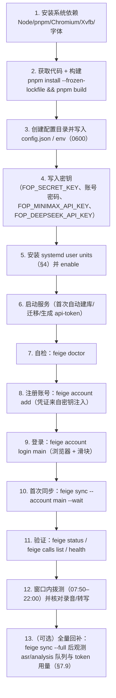
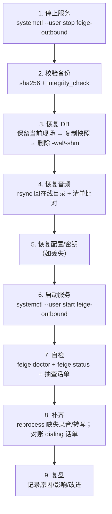

# 10 部署与运维

> 项目：`feige-outbound-platform`（FOP，本地飞鸽外呼平台）
> 版本：v0.2（2026-11-14；按 v1 决策变更修订：转写全部自建 MiniMax ASR、DeepSeek 内置后处理；新增第三方 AI 密钥/出站白名单/全量回补运维）
> 基准：[docs/01-决策与约定.md](./01-决策与约定.md)（术语/配置/接口/错误码以它为准）
> 关联：[docs/03-架构设计.md](./03-架构设计.md)（进程模型/并发/故障恢复）、[docs/09-上游适配层契约.md](./09-上游适配层契约.md)（超时/重试/错误映射/AI 客户端契约）、[docs/13-后处理规格（ASR与LLM）.md](./13-后处理规格（ASR与LLM）.md)（ASR/LLM 接口与配置权威规格）、[docs/11-安全与合规.md](./11-安全与合规.md)（安全基线）
> 读者：平台维护者、部署执行者、值班排障人员
> 说明：本文给出**部署配置与运维步骤**（systemd 单元、命令示例、排障手册），不包含业务实现代码；示例中的路径/用户/版本需按实际环境替换。**禁止**在文档/仓库/命令历史中出现真实密码、JWT、完整手机号；示例号码统一 `138****0000`。

**目录**

1. [运行环境与依赖](#1-运行环境与依赖)
2. [安装与首次启动](#2-安装与首次启动)
3. [目录布局与权限](#3-目录布局与权限)
4. [systemd user service](#4-systemd-user-service)
5. [配置项清单](#5-配置项清单)
6. [日志与审计](#6-日志与审计)
7. [日常运维](#7-日常运维)
8. [备份与恢复](#8-备份与恢复)
9. [监控与告警](#9-监控与告警)
10. [排障手册](#10-排障手册)
11. [安全基线（摘要）](#11-安全基线摘要)
12. [升级、回滚与变更管理](#12-升级回滚与变更管理)
13. [附录](#13-附录)

---

## 1. 运行环境与依赖

### 1.1 目标环境

| 项 | 要求 | 说明 |
| --- | --- | --- |
| 操作系统 | Linux x86_64（**当前环境：NixOS**）；v1 仅支持 Linux | 浏览器/Xvfb/systemd 依赖 Linux；Windows/macOS 见 docs/01 Q6（v1 不做） |
| 部署形态 | 单机、单用户、单进程常驻（systemd **user** service） | 默认只监听 `127.0.0.1:8710`（docs/01 §3） |
| 资源（最小） | 2 vCPU / 2 GB RAM / 20 GB 可用磁盘 | 登录时浏览器峰值 ~0.5–1 GB；媒体/ASR 需求见 §1.4 |
| 资源（推荐） | 4 vCPU / 4–8 GB RAM / 数据盘 ≥ 500 GB（S2 规模） | 容量模型见 docs/03 §10；**不需要 GPU**（ASR/LLM 均为云 API） |
| 时区/时钟 | `Asia/Shanghai`；系统时钟与 NTP 同步 | 时段判断、JWT 到期依赖时钟（误差 >2min 需告警） |
| 网络 | 出站必须可达：上游 HTTPS/WSS、录音存储、**MiniMax ASR（默认 `api.minimax.cn`，需与 key 区域匹配）与 DeepSeek（`api.deepseek.com`）**（HTTPS 443） | 不需要公网入站；默认无入站端口；出站白名单/代理见 §5.5、§13.4 |

### 1.2 依赖清单

| 组件 | 版本/要求 | 用途 | 验证命令 | 备注 |
| --- | --- | --- | --- | --- |
| Node.js | **≥22**（部署建议 **24 LTS**；与 docs/03 §7 一致） | 运行时 | `node --version` | 锁定大版本；Node 22 的 `node:sqlite` 可能需 `--experimental-sqlite` |
| `node:sqlite` | Node 内置 | SQLite 驱动 | `node -e "require('node:sqlite')"` | 若报错见 §10.8；不需要 better-sqlite3 原生编译 |
| pnpm | 与项目 lockfile 匹配 | 构建/依赖安装 | `pnpm --version` | NixOS 可用 `nix profile install nixpkgs#pnpm` |
| Chromium / CloakBrowser | 与项目兼容的 Chromium 版本（记录在 §13.2 矩阵） | 仅登录（Playwright-core 驱动） | `"$BROWSER_BIN" --version` | 路径写入 `browser.executablePath`；Nix store 路径变化需更新配置 |
| Playwright-core | 项目依赖 | 浏览器自动化 | `node -e "require('playwright-core')"` | 不下载浏览器；使用系统/指定构建 |
| Xvfb | 与系统匹配 | 为 headful 登录提供虚拟显示 | `Xvfb -help`、`echo $DISPLAY` | 服务器无物理显示时必需；见 §4.3 |
| 中文字体 | Noto CJK 等 | 登录页/验证码正常渲染 | `fc-list :lang=zh \| head` | 缺字体会导致页面排版/验证码异常 |
| sqlite3 CLI | 3.x（运维工具，可选） | 在线快照/完整性检查/排障 | `sqlite3 --version` | 不在运行依赖内；NixOS `nix shell nixpkgs#sqlite` |
| rsync | 3.x | 音频增量备份 | `rsync --version` | 也可用其他同步工具 |
| systemd | ≥ 250（user manager + timer） | 服务守护/定时备份 | `systemctl --user --version` | 需要 `loginctl enable-linger` 保持登出后运行 |
| 磁盘 | 见 §3/§8 | DB/音频/备份/日志 | `df -h`、`du -sh` | 音频约 115 MB/小时（实测，docs/00 §4） |
| 第三方 AI 出站网络 | HTTPS 443 | MiniMax ASR / DeepSeek | `curl -sS -o /dev/null -w '%{http_code}' https://api.deepseek.com/models` | 需有效 key 才能校验鉴权；只读可达性探测无费用 |
| `ffprobe`（可选） | ffmpeg 包内工具 | 排障时核对录音声道/采样率（**非运行依赖**） | `ffprobe -version` | ASR 切分由自研 WAV 解析完成，不需要 ffmpeg |

### 1.3 NixOS 适配说明

**原则**：优先使用 NixOS 包管理器提供 Node/Chromium/Xvfb/字体，避免原生 npm 模块编译（`node:sqlite` 内置驱动即为此设计，docs/03 ADR-02）。

| 项 | 做法 | 注意 |
| --- | --- | --- |
| Node/pnpm | `nix profile install nixpkgs#nodejs_24 nixpkgs#pnpm`（用户级）或系统 `environment.systemPackages` | 用 `readlink -f "$(command -v node)"` 记录稳定路径到 env；升级后复查 |
| Chromium | `nix profile install nixpkgs#chromium`，或项目指定的 CloakBrowser 构建（放 `~/.local/opt/cloakbrowser/`） | 记录绝对路径；Nix store GC/升级后路径可能变化 → `feige doctor` 应能发现并提示 |
| Xvfb | `nix profile install nixpkgs#xvfb` | 提供 `Xvfb`/`xvfb-run`；单独 unit 见 §4.3 |
| 字体 | `nix profile install nixpkgs#noto-fonts-cjk-sans` | 安装后 `fc-cache -f`；验证 `fc-list :lang=zh` |
| 时区 | `time.timeZone = "Asia/Shanghai"`（需要管理员）或进程 `TZ=Asia/Shanghai` | 进程级 `TZ` 已足够业务；系统时区建议一致 |
| 用户命名空间/沙箱 | 若 Chromium 沙箱不可用（容器/受限 NixOS 配置），在**测试环境验证**后选择 `--no-sandbox`（记录原因与风险） | 默认保持沙箱开启；降级需在 `browser` 配置/部署说明中显式记录 |
| 原生模块 | 避免（不使用 better-sqlite3） | 若未来必须用：需要 `nix-shell` 提供 `nodejs/python3/pkg-config/sqlite/patchelf` 或启用 `nix-ld`（不属于 v1 默认路径） |
| 持久化路径 | 用 XDG 目录（§3），不要放 `/nix/store` | 备份/权限都要覆盖 `~/.config`、`~/.local/share`、`~/.local/state` |

**NixOS 常见坑**

1. **Nix store 路径漂移**：`browser.executablePath` 指向的 Chromium 在升级/GC 后失效 → 登录失败；用 `feige doctor` + 监控登录失败率发现；升级后更新配置。
2. **缺中文字体**：登录页验证码/文字渲染异常 → 滑块定位失败；安装 CJK 字体并 `fc-cache`。
3. **`node:sqlite` 实验标志**：Node 22 某些版本需 `NODE_OPTIONS=--experimental-sqlite`；Node 24+ 通常无需；以 `node -e` 验证为准（§10.8）。
4. **systemd user 服务在登出后停止**：必须 `loginctl enable-linger <user>`（§4.1）。
5. **XDG_RUNTIME_DIR 缺失**：SSH 会话内 `systemctl --user` 可能找不到 user manager；确保通过 `systemd --user` 登录会话运行，或 `loginctl` 检查。

### 1.4 可选依赖（能力相关）

| 能力 | 依赖 | 何时需要 | 关闭后的降级 |
| --- | --- | --- | --- |
| 转写（**必需**） | MiniMax ASR 云 API（`pipeline.asr.baseUrl/model`，密钥 `minimaxApiKey` / `FOP_MINIMAX_API_KEY`） | 每通接通话单（转写 100% 自建） | **没有本地兜底**：转写阶段 `failed(ASR_FAILED)`，可 reprocess；录音仍归档 |
| AI 后处理（**必需**） | DeepSeek 云 API（`pipeline.analysis.baseUrl/model/escalateModel`，密钥 `deepseekApiKey` / `FOP_DEEPSEEK_API_KEY`） | 摘要/意向/关键词/质量项与角色复核 | 分析阶段 `failed(ANALYSIS_FAILED)`；录音/转写不受影响，可重跑 |
| 备份到远端 | `rsync`/`age`/对象存储 CLI | 需要异地容灾 | 仅本地备份（RPO 降低） |
| 第三方 AI | 出站 HTTPS 443（无需本地模型/GPU/ffmpeg） | 始终（v1 核心能力） | 不可"关闭"；关闭等价于 transcript/analysis 持续 `failed`（docs/13 §8） |
| 事件 webhook | 出站 HTTPS 客户端（v1.1） | 需要外部系统联动 | v1 用 SSE/轮询 |

---

## 2. 安装与首次启动

> 以下为**概念性步骤 + 命令示例**，不是要执行的脚本；具体命令以发布包/实际路径为准。

### 2.1 首次部署流程



### 2.2 构建与安装（示例）

```bash
# 示例：使用 NixOS 用户级工具链（路径按实际替换）
node --version            # 期望 >= 22
pnpm --version

# 安装依赖并编译（在项目目录）
pnpm install --frozen-lockfile
pnpm build                # 产出 dist/（TypeScript 编译，非业务实现脚本）

# 可选：把 CLI 暴露到 PATH（薄封装，最终调用 dist/ 入口）
mkdir -p ~/.local/bin
ln -sf "$PWD/dist/main.js" ~/.local/bin/feige   # 具体入口名以 docs/06 为准
```

### 2.3 初始化配置

```bash
# 创建目录并收紧权限（umask 077）
install -d -m 0700 ~/.config/feige-outbound
install -d -m 0700 ~/.local/share/feige-outbound
install -d -m 0700 ~/.local/state/feige-outbound
install -d -m 0700 ~/.cache/feige-outbound

# 写入配置（0600）与 env（0600）；内容见 §5
chmod 0600 ~/.config/feige-outbound/config.json
chmod 0600 ~/.config/feige-outbound/env
chmod 0600 ~/.config/feige-outbound/secrets.json   # 若使用文件方式（含 minimaxApiKey/deepseekApiKey）
```

- `api-token` 由服务首次启动自动生成到 `~/.config/feige-outbound/api-token`（0600）；**不要手工创建弱 token**（docs/01 §5.2）。
- 密码建议通过 env/密钥环注入（§5.3），`secrets.json` 仅存引用/加密值，不存明文（docs/11）。
- 第三方 AI 密钥：`minimaxApiKey` / `deepseekApiKey`（或 env `FOP_MINIMAX_API_KEY` / `FOP_DEEPSEEK_API_KEY`）；只存 secrets/env，**禁止**写入 `config.json`/仓库/日志/事件（§5.3、docs/11）。

### 2.4 首次启动与冒烟检查

```bash
# 启动（或通过 systemd，见 §4）
node dist/main.js serve    # 前台启动用于首次验证；确认监听 127.0.0.1:8710

# 另一个终端：冒烟（示例，token 从文件读取，避免出现在命令行历史）
TOKEN="$(cat ~/.config/feige-outbound/api-token)"
curl -fsS http://127.0.0.1:8710/api/v1/health
curl -fsS -H "Authorization: Bearer $TOKEN" http://127.0.0.1:8710/api/v1/status | head -c 2000

# 自检（配置/目录/权限/DB/浏览器/Xvfb/上游可达/账号态）
feige doctor

# 第三方 AI 只读自检（配置/密钥存在性/出站白名单/连通性/最近成功作业；不产生费用）
feige doctor --probe-providers

# 注册账号（凭证来自 env 或交互式密钥输入，禁止明文回显）
feige account add main
feige account login main
feige account health main
```

首次启动后的验收清单：

| # | 检查 | 期望 |
| --- | --- | --- |
| 1 | `GET /health` | 200，进程存活 |
| 2 | `GET /status` | DB ok、storage free、dial window 正确、upstream reachable（登录后） |
| 3 | DB 文件 | `fop.db` 存在，`-wal` 正常；权限 0600 |
| 4 | 目录权限 | `~/.config/feige-outbound` 0700；音频/DB 0600 |
| 5 | 浏览器 | `feige doctor` 浏览器检查通过；Xvfb 运行 |
| 6 | 登录 | `feige account login` 成功；`jwtExpiresAt`≈7 天后；事件 `account.login.succeeded` |
| 7 | 同步 | `feige sync --account <id> --wait` 完成；`feige calls list --size 5` 有数据 |
| 8 | 录音 | 已接通话单可下载；`fop.db` 有 AudioAsset；文件 0600 |
| 9 | 事件 | `feige events --size 5` 可见 created/sync 事件 |
| 10 | 备份 | 手动执行一次 DB 快照并 `integrity_check` 通过（§8） |
| 11 | 第三方 AI 配置 | `feige doctor --probe-providers` 通过（MiniMax/DeepSeek 密钥已配置、域名命中白名单、443 可达） |
| 12 | 首条转写/分析 | 一条已接通话单的 `pipeline.transcript=ready`（`source=asr`、`provider=minimax:asr-1.0`）且 `analysis=ready`；日志有 `promptTokens/completionTokens` |

### 2.5 首次真实拨测（窗口内，M3）

- 只能在 **07:50–22:00（Asia/Shanghai）** 进行；准备一个**可接听的坐席手机**与测试被叫。
- 拨测前：`feige status` 确认账号健康、`dialWindow.open=true`；确认冷却与账号无进行中通话。
- 拨测后核对：`POST /calls` → `dialing` → `connected` → `ended`；录音归档与转写/分析；WS 消息/时延记录到 docs/00/09 待验证项。
- **禁止**在时段外反复尝试（会被上游拒绝，且产生无意义错误计数）；**禁止**为"验证成功"绕过任何上游规则。

---

## 3. 目录布局与权限

### 3.1 部署拓扑

```mermaid
flowchart TB
  subgraph Host["NixOS 单机"]
    subgraph UserSession["systemd --user（linger）"]
      XVFB["feige-xvfb.service<br/>Xvfb :99"]
      SVC["feige-outbound.service<br/>node dist/main.js serve<br/>127.0.0.1:8710"]
      CLI["feige CLI（薄封装）"]
      MCP["MCP stdio（由 Agent 拉起）"]
    end
    subgraph FS["XDG 目录（0700）"]
      CFG["~/.config/feige-outbound"]
      DATA["~/.local/share/feige-outbound"]
      STATE["~/.local/state/feige-outbound"]
      CACHE["~/.cache/feige-outbound"]
    end
  end
  subgraph Net["网络出口（出站，白名单）"]
    UP["飞鸽上游 HTTPS/WSS"]
    REC["录音存储 HTTP(S)"]
    EXT["MiniMax ASR / DeepSeek（必需，HTTPS 443）"]
  end
  AGENT["Agent / 浏览器客户端 / 二次开发系统"] --> CLI
  AGENT --> MCP
  CLI -->|Bearer token| SVC
  MCP -->|内核/REST| SVC
  SVC --> CFG
  SVC --> DATA
  SVC --> STATE
  SVC --> CACHE
  SVC --> XVFB
  SVC -->|HTTPS/WSS| UP
  SVC -->|HTTP(S)| REC
  SVC -->|分块 WAV / 转写+元数据| EXT
  EXT -->|verbose_json / 结构化 JSON| SVC
```

### 3.2 目录树

```text
~/.config/feige-outbound/                 0700
├── config.json                           0600   生效配置（docs/01 §9）
├── secrets.json                          0600   密钥（可选；或走 env/密钥环）
├── api-token                             0600   本地 API token（首次启动生成）
└── env                                   0600   systemd EnvironmentFile（含密钥时 0600）

~/.local/share/feige-outbound/            0700   storage.dataDir
├── fop.db                                0600   SQLite 主库（+ -wal/-shm 运行时）
├── audio/
│   ├── {yyyy}/{mm}/{dd}/{callId}.wav      0600   原始 WAV（不可变归档；日期取 call.started_at，Asia/Shanghai；docs/04 §11）
│   ├── .tmp/                             0700   下载临时文件（{callId}-{rand8}.part；启动 GC 清理 >24h）
│   └── .quarantine/                      0700   哈希不匹配/取证的隔离文件（人工清理）
├── asr/
│   └── {callId}/chunk-{index}.json        0600   分块 ASR 结果（规范化后，非原始响应体；断点续跑/审计/避免重复计费；docs/13 §2.3、docs/04 §11）
│       └── *.tmp                         0600   原子写临时文件（完成后 rename；启动 GC 清理）
├── profiles/
│   └── {accountId}/                      0700   每账号独立浏览器 profile（登录态，高敏）
├── diagnostics/
│   └── login/{accountId}/{ts}.png        0600   登录失败诊断（含 PII，短留存）
├── exports/                              0700   人工导出（脱敏/水印，按需）
└── backups/                              0700   DB 快照/清单（或独立磁盘）

~/.local/state/feige-outbound/            0700
└── logs/                                 0700   可选文件日志（默认走 journald）

~/.cache/feige-outbound/                  0700   下载缓存/工具临时文件
```

### 3.3 文件与权限矩阵

| 路径/对象 | 权限 | 内容敏感度 | 备份 | 说明 |
| --- | --- | --- | --- | --- |
| `config.json` | 0600 | 中（可能含内部参数，不含密码） | 是 | 变更走 `PATCH /config` 或编辑后重启（§5） |
| `secrets.json` / `env` | 0600 | **高**（密钥） | 加密后单独备份 | 不进 git；见 docs/11 |
| `api-token` | 0600 | 高（本地 API 凭证） | 不建议（可再生成） | 泄露后删除并重启生成 |
| `fop.db`（+wal/shm） | 0600 | **高**（JWT 密文、PII） | 是（一致性快照） | WAL 运行时存在；不可手工删除 |
| `audio/**/*.wav` | 0600 / 目录 0700 | **高**（通话录音 PII） | 是（增量） | 不可变；归档后不原地改写 |
| `asr/**/chunk-*.json` | 0600 / 目录 0700 | **高**（转写原文 PII） | 建议（体积小；可再生但重跑计费） | 缓存/审计用；命中校验失败可安全重算 |
| `profiles/**` | 0700 | **高**（登录态/设备指纹） | 不建议（可重登恢复） | 禁止跨账号复制/共用 |
| `diagnostics/**` | 0600 | **高**（截图含 PII） | 否 | 7 天自动清理 |
| `backups/**` | 0700/0600 | 高（数据副本） | 建议异地加密 | 与在线数据分开磁盘 |
| 日志 | 0600（journald 由系统策略控制） | 中（已脱敏） | 可选 | 默认 journald；见 §6 |

### 3.4 磁盘规划建议

- 数据盘与备份盘分离（至少不同目录/挂载点）；备份盘容量 ≥ 在线音频 1.5 倍（视保留策略）。
- 水位阈值：85% 告警、92% 暂停媒体写入、97% 停止新增写作业（docs/03 §6.3）。
- 单机 S2 规模（10 账号）年度音频约 144 GB、DB 约 0.8 GB（docs/03 §10.1）；请按实际业务量 ×1.5 规划。
- ASR 块结果 JSON 约 1–3 KB/分钟音频（4,000 通 × 2 分钟 ≈ 8–25 MB），体积小但含转写原文（PII），按数据目录权限保护并纳入备份策略（§8.1）。

---

## 4. systemd user service

### 4.1 前置准备

```bash
# 允许用户服务在登出后继续运行（关键；否则 SSH 断开服务停止）
loginctl enable-linger "$USER"
loginctl show-user "$USER" -p Linger        # 期望 Linger=yes

# 确认 user manager 可用
systemctl --user status >/dev/null && echo ok
echo "$XDG_RUNTIME_DIR"                     # 应为 /run/user/<uid>

# 单元目录
install -d -m 0700 ~/.config/systemd/user
```

### 4.2 主服务单元示例

```ini
# ~/.config/systemd/user/feige-outbound.service    （0600）
[Unit]
Description=Feige Outbound Platform (FOP) local service
Documentation=file:///home/<user>/feige-outbound-platform/docs/10-部署与运维.md
Wants=network-online.target feige-xvfb.service
After=network-online.target feige-xvfb.service

[Service]
Type=simple
WorkingDirectory=/home/<user>/feige-outbound-platform
EnvironmentFile=%h/.config/feige-outbound/env
Environment=NODE_ENV=production
Environment=TZ=Asia/Shanghai
# CLI 入口名以 docs/06 为准；服务只跑常驻进程
ExecStart=/home/<user>/.nix-profile/bin/node dist/main.js serve
Restart=on-failure
RestartSec=5
StartLimitIntervalSec=300
StartLimitBurst=5
TimeoutStopSec=30
KillSignal=SIGTERM
SyslogIdentifier=feige-outbound
StandardOutput=journal
StandardError=journal

# ── 安全加固（按实际路径/需求调整）──
NoNewPrivileges=true
PrivateTmp=true
ProtectSystem=strict
ProtectHome=read-only
ReadWritePaths=%h/.config/feige-outbound
ReadWritePaths=%h/.local/share/feige-outbound
ReadWritePaths=%h/.local/state/feige-outbound
ReadWritePaths=%h/.cache/feige-outbound
ProtectKernelTunables=true
ProtectKernelModules=true
ProtectControlGroups=true
RestrictAddressFamilies=AF_UNIX AF_INET AF_INET6 AF_NETLINK
LockPersonality=true
LimitNOFILE=65536
# 可选：MemoryMax=4G（按机器调整，避免 OOM 拖垮系统）
# 可选：CPUQuota=200%（多账号登录并发时限制）

[Install]
WantedBy=default.target
```

要点：

- **`ReadWritePaths` 必须覆盖**：config、data、state、cache 目录；否则 WAL/音频/日志写入失败（启动时 `doctor` 会报）。
- `ProtectHome=read-only` 与 `ReadWritePaths` 搭配：home 默认只读，仅放行上述目录（含浏览器 profile/音频）。
- `PrivateTmp=true`：Chromium 使用私有 `/tmp`，不影响 profile/数据。
- `TimeoutStopSec=30`：给优雅停机（HTTP 排空、WAL checkpoint、浏览器关闭）留时间（docs/03 §6.4）。
- `KillSignal=SIGTERM`：Node 进程捕获信号后优雅退出；不要用 SIGKILL 作为首选。
- 若主机启用防火墙/nftables：只放行到白名单域名/IP 的 443 出站（上游 + `api.minimax.io`/`api.minimax.cn` + `api.deepseek.com`），不要为排障放开任意出站（§5.5、§13.4）。
- 若 Chromium 在加固环境无法启动（沙箱/命名空间限制），先按 §10.9 定位，再考虑单独的 unit 配置（不通过全局关闭加固解决）。

### 4.3 虚拟显示 Xvfb 单元示例

**方案 A（推荐）：独立 Xvfb 服务**

```ini
# ~/.config/systemd/user/feige-xvfb.service    （0600）
[Unit]
Description=Virtual X display for FOP browser login
After=default.target

[Service]
Type=simple
ExecStart=/home/<user>/.nix-profile/bin/Xvfb :99 -screen 0 1280x800x24 -nolisten tcp
Restart=on-failure
RestartSec=2

[Install]
WantedBy=default.target
```

主服务 env 中设置 `DISPLAY=:99`（§4.4）。

**方案 B：`xvfb-run` 包装主服务**

```ini
ExecStart=/home/<user>/.nix-profile/bin/xvfb-run -a -s "-screen 0 1280x800x24" \
          /home/<user>/.nix-profile/bin/node dist/main.js serve
```

| 方案 | 优点 | 缺点 | 建议 |
| --- | --- | --- | --- |
| A 独立 Xvfb | 可单独重启/诊断；多进程共享同一显示 | 多一个 unit | **推荐**（登录问题可单独排查） |
| B xvfb-run 包装 | 单元少 | 显示随主进程生命周期；调试不便 | 简单场景可用 |

验证：`systemctl --user status feige-xvfb`、`DISPLAY=:99 xdpyinfo >/dev/null && echo ok`（`xdpyinfo` 可能未安装，可用 `xset q` 或直接看登录是否成功）。

### 4.4 环境变量文件示例（systemd EnvironmentFile）

```bash
# ~/.config/feige-outbound/env     （0600，不进 git）
NODE_ENV=production
TZ=Asia/Shanghai
DISPLAY=:99

# 安全关键项：建议从密钥管理器注入，至少保证本文件 0600
FOP_SECRET_KEY=<base64-encoded-32-byte-key>
FOP_BROWSER_EXECUTABLE_PATH=/home/<user>/.nix-profile/bin/chromium

# 第三方 AI 密钥（不可为空；只在本文件/密钥环出现，禁止写入 config.json/日志）
# FOP_MINIMAX_API_KEY=<minimax-asr-api-key>
# FOP_DEEPSEEK_API_KEY=<deepseek-api-key>
# 可选：模型/区域覆盖（默认值见 docs/13 §9）
# FOP_ASR_MODEL=asr-1.0
# FOP_ANALYSIS_MODEL=deepseek-chat

# 账号密码优先用密钥环/systemd-creds；如用环境变量，仅本文件出现
# FOP_ACCOUNT_MAIN_PASSWORD=<secret>
# 可选：Node 22 需要实验标志时启用（先验证）
# NODE_OPTIONS=--experimental-sqlite

# 可选：覆盖配置（优先级见 §5.1）
# FOP_SERVER_PORT=8710
# FOP_STORAGE_DATA_DIR=/home/<user>/.local/share/feige-outbound
```

> **不要**把含密钥的 env 文件提交到 git；`chmod 0600`，并确认备份策略覆盖（加密后备份）。生产环境优先使用系统密钥环或 `systemd-creds`，env 仅作兼容手段（docs/11）。

### 4.5 启用、检查与日常操作

```bash
# 重新加载并启用/启动
systemctl --user daemon-reload
systemctl --user enable --now feige-xvfb.service
systemctl --user enable --now feige-outbound.service

# 状态与日志
systemctl --user status feige-outbound
journalctl --user -u feige-outbound -f
journalctl --user -u feige-outbound --since "1 hour ago" -g 'error|fail|UPSTREAM_'

# 重启（会触发优雅停机 + 启动恢复流程）
systemctl --user restart feige-outbound

# 停止（升级/恢复前）
systemctl --user stop feige-outbound
```

**重启语义**（对齐 docs/03 §8.2）：重启不会丢任务——`running` 作业租约回收后重新入队；`pending` 呼出重新排期；`dialing` 进入对账；媒体阶段按需重排。**重启后必须检查** `feige status` 与 `feige jobs list`，确认没有异常积压/人工项。

### 4.6 CLI / MCP 的部署形态

- **CLI**：`feige` 是 REST 薄封装（docs/01 §4），不需要独立服务；从 `dist/` 暴露到 `~/.local/bin`，读取 `~/.config/feige-outbound/api-token` 访问 `127.0.0.1:8710`。
- **MCP**：stdio server，由 Agent 按需拉起（`feige mcp` 或等价入口，见 docs/07）；不常驻、不监听端口。
- **浏览器**：不是独立服务；主进程按需启动 Chromium 子进程，依赖 Xvfb；登录结束即关闭。

### 4.7 开机自启检查清单

| # | 检查 | 命令 | 期望 |
| --- | --- | --- | --- |
| 1 | linger | `loginctl show-user "$USER" -p Linger` | `Linger=yes` |
| 2 | 单元启用 | `systemctl --user is-enabled feige-outbound feige-xvfb` | `enabled` |
| 3 | 重启后自动恢复 | 重启机器/`systemctl --user restart` 后 `feige status` | 服务 ready、作业队列恢复 |
| 4 | 日志落 journald | `journalctl --user -u feige-outbound -n 20` | 结构化日志可见 |
| 5 | 开机后上游可达 | `feige doctor` | 上游/账号检查通过（或明确标注需要登录） |

---

## 5. 配置项清单

### 5.1 配置来源与优先级

| 优先级 | 来源 | 说明 |
| --- | --- | --- |
| 最高 | 环境变量 `FOP_*` | systemd `EnvironmentFile`/`Environment`；适合密钥与机器相关路径 |
| 中 | `~/.config/feige-outbound/config.json`（0600） | 主配置；`PATCH /config` 会持久化到这里（docs/05） |
| 最低 | 内置默认值 | docs/01 §9 的默认值 |

规则：

1. 环境变量覆盖文件；**被 env 覆盖的键**不能通过 `PATCH /config` 在运行时改变（重启并改 env 才生效）。
2. 标注"重启生效"的键修改后需 `systemctl --user restart`；其余为热生效（调度器/限流器读取最新值）。
3. 修改前先 `GET /config`（脱敏）确认当前值，并备份 `config.json`（`cp -a`）。
4. 非法配置启动时快速失败并打印字段错误（`CONFIG_INVALID`，docs/01 §5.4），不会带病运行。

### 5.2 主配置项（对照 docs/01 §9）

| 键 | 类型 | 默认 | 取值/说明 | 生效方式 |
| --- | --- | --- | --- | --- |
| `server.host` | string | `127.0.0.1` | 监听地址；默认仅本机 | 重启 |
| `server.port` | number | `8710` | 本地 API 端口 | 重启 |
| `server.allowRemote` | boolean | `false` | 允许远程访问；true 必须启用认证 + 建议 TLS 反代（docs/01 §5.2） | 重启 |
| `storage.dataDir` | string | `~/.local/share/feige-outbound` | 数据根目录（DB/音频/profile） | 重启 |
| `storage.dbFile` | string | `fop.db` | SQLite 文件名（相对 dataDir） | 重启 |
| `storage.audioDir` | string | `audio` | 音频目录（相对 dataDir） | 重启 |
| `browser.executablePath` | string \| null | `null`（自动探测） | Chromium/CloakBrowser 绝对路径；NixOS 建议显式配置 | 重启 |
| `browser.headless` | boolean | `false` | 登录是否无头；默认 headful + Xvfb | 重启 |
| `browser.profileRoot` | string | `~/.local/share/feige-outbound/profiles` | 每账号 profile 根目录 | 重启 |
| `dial.windowStart` | string | `07:50` | 可呼出开始（Asia/Shanghai） | 热 |
| `dial.windowEnd` | string | `22:00` | 可呼出结束 | 热 |
| `dial.timezone` | string | `Asia/Shanghai` | 时段/日期计算时区 | 热 |
| `dial.scheduleOutsideWindow` | boolean | `true` | true=时段外受理为 pending 并排到窗口；false=直接 422 | 热 |
| `limits.perAccountConcurrency` | number | `1` | 单账号呼出并发（回拨必须 1） | 热 |
| `limits.globalConcurrency` | number | `8` | 全局呼出并发（≤账号数） | 热 |
| `limits.upstreamReadQps` | number | `5` | 每账号上游读 QPS（同步/详情/轮询共享） | 热 |
| `limits.dialCooldownMs` | number | `60000` | 同账号同号码呼出冷却 | 热 |
| `limits.apiQps` | number | `100` | 本地 API 限流 | 热 |
| `sync.intervalMs` | number | `60000` | 增量同步周期 | 热 |
| `sync.pageSize` | number | `100` | 同步分页大小（≤100，上游上限） | 热 |
| `sync.lookbackDays` | number | `7` | 首次/回看同步窗口 | 热 |
| `pipeline.asr.provider` | string | `minimax` | ASR 供应商（v1 固定 minimax） | 重启 |
| `pipeline.asr.baseUrl` | string | `https://api.minimax.cn` | MiniMax API base；**必须与 API key 区域匹配**（CN key=`api.minimax.cn`，global key=`api.minimax.io`，错配会 401 invalid api key）；必须命中出站白名单（§5.5） | 重启 |
| `pipeline.asr.model` | string | `asr-1.0` | ASR 模型 | 重启 |
| `pipeline.asr.language` | string | `zh` | 语言提示（BCP-47；空=自动检测） | 热 |
| `pipeline.asr.chunkSeconds` | number | `420` | 长音频切分窗口（秒）；单块硬上限 480s/50MB | 热（新作业生效） |
| `pipeline.asr.concurrency` | number | `1` | 全局 ASR 并发（**实测 MiniMax 账号并发连接上限=1**，2 并发即 429 `conn limit`；跨通话分块共享） | 热 |
| `pipeline.asr.responseFormat` † | string | `verbose_json` | 响应格式（需 segments/speaker） | 重启 |
| `pipeline.asr.timestampLevel` † | string | `sentence` | 时间戳粒度 `sentence`/`word` | 重启 |
| `pipeline.asr.chunkOverlapSeconds` † | number | `0` | 分块重叠（v1 静音点切分不重叠） | 热 |
| `pipeline.asr.timeoutMs` † | number | `600000` | 单块 ASR 请求总超时 | 热 |
| `pipeline.asr.maxRetries` † | number | `3` | 单块重试上限（仅可重试错误） | 热 |
| `pipeline.analysis.provider` | string | `deepseek` | LLM 供应商（v1 固定 deepseek） | 重启 |
| `pipeline.analysis.baseUrl` | string | `https://api.deepseek.com` | DeepSeek API base；必须命中出站白名单（§5.5） | 重启 |
| `pipeline.analysis.model` | string | `deepseek-chat` | 默认模型（flash） | 热 |
| `pipeline.analysis.escalateModel` | string | `deepseek-v4-pro` | JSON 校验失败升级模型（升级时 `maxTokens≥4096`） | 热 |
| `pipeline.analysis.promptVersion` | string | `analysis-v1` | prompt 版本（与金标集回归绑定） | 热 |
| `pipeline.analysis.temperature` | number | `0.2` | 采样温度 | 热 |
| `pipeline.analysis.maxTokens` | number | `2000` | 输出上限；升级模型时 ≥4096 | 热 |
| `pipeline.analysis.concurrency` | number | `8` | 全局 LLM 并发 | 热 |
| `pipeline.analysis.maxRetries` † | number | `3` | 单次调用重试上限（HTTP 层） | 热 |
| `pipeline.analysis.redactPhones` † | boolean | `true` | 发送前手机号脱敏 | 热 |
| `pipeline.analysis.redactNames` † | boolean | `false` | 发送前客户姓名脱敏 | 热 |
| `pipeline.analysis.maxInputChars` † | number | `120000` | 超长输入分块摘要阈值（v1 保护分支） | 热 |
| `pipeline.roleMapping.method` | string | `auto` | 角色映射：`auto`/`channel`/`asr_diarization`/`llm_reconciled`/`heuristic` | 热 |
| `pipeline.roleMapping.llmVerify` | boolean | `true` | 规则结果交 DeepSeek 复核 | 热 |
| `pipeline.roleMapping.lowConfidenceReview` † | boolean | `true` | 低置信标记 `needsReview` 并写事件 | 热 |
| `events.sseHeartbeatMs` | number | `15000` | SSE 心跳间隔 | 热 |
| `events.webhooks` | array | `[]` | v1 仅配置占位；投递 v1.1 | 重启 |

> 键名/默认值/语义以 docs/01 §9 为主契约；本表补充"生效方式"与 docs/13 的实现默认值。**† 标记的键在 docs/01 §9 与 docs/05 §2.13 的对外 Config DTO 中未列**：docs/13 §9 已明确它们属于**实现内部常量**并在 docs/10 运维配置清单集中定义，故此处作为内部基线列出（可通过 `FOP_*` 环境变量覆盖，但不承诺进入对外 `/config` 契约）。

### 5.3 密钥清单与注入

来源优先级（与 docs/11 一致）：**系统密钥环 > systemd-creds > EnvironmentFile（0600）> `secrets.json`（0600，兼容方式）**；任何情况下都不得落明文到仓库/日志/命令行。

| 密钥 | 用途 | 建议来源 | 存放 | 轮换 |
| --- | --- | --- | --- | --- |
| `FOP_SECRET_KEY` | JWT 加密（AES-256-GCM） | 系统密钥环/systemd-creds/env | env 0600 或密钥环 | 支持版本前缀；更换后后台重加密（docs/09 §6.6） |
| `apiToken` | 本地 REST 认证 | 首次启动自动生成 | `api-token` 0600 | 删除文件 + 重启生成；旧客户端需更新 |
| 账号 `username` | 上游登录手机号 | `secrets.json`（脱敏展示）/env | 0600 | 账号变更时更新 |
| 账号 `password` | 上游登录密码 | **优先密钥环/systemd-creds**；否则 env | 0600，不进 git | 上游改密后同步更新 |
| `minimaxApiKey` | MiniMax ASR 鉴权 | **优先密钥环/systemd-creds**；否则 env `FOP_MINIMAX_API_KEY` 或 `secrets.json` | 0600，不进 git | 供应商控制台轮换后更新；无效时熔断 asr 队列 + 告警（§10.14） |
| `deepseekApiKey` | DeepSeek LLM 鉴权 | 同上（env `FOP_DEEPSEEK_API_KEY`） | 0600，不进 git | 同上；轮换后 reprocess 失败作业 |

**注入方式（按推荐度）**

1. **systemd-creds / 系统密钥环**：不落磁盘明文；user service 可用 `LoadCredential=`（需 systemd 支持与配置）。
2. **EnvironmentFile（0600）**：简单直接；确保文件权限、备份加密、进程环境不被其他用户读取（单用户机器）。
3. **`secrets.json`（0600）**：兼容方式；密码字段建议存引用/加密值而非明文（docs/11）。
4. **禁止**：命令行参数传密码/token（会进 shell 历史/进程列表）、写入 git、写入日志/事件/诊断文件。
5. **第三方 AI 密钥**同样适用以上规则；`GET /config` 不返回密钥（只返回 provider/baseUrl/model 等非密钥项），`PATCH /config` 拒绝修改密钥（docs/05 §2.13）。

**环境变量命名规则**：`FOP_` + 配置路径的 `SCREAMING_SNAKE_CASE`（`.`→`_`，camelCase→`_` 大写），例：

| 配置键 | 环境变量 |
| --- | --- |
| `server.port` | `FOP_SERVER_PORT` |
| `storage.dataDir` | `FOP_STORAGE_DATA_DIR` |
| `browser.executablePath` | `FOP_BROWSER_EXECUTABLE_PATH` |
| `limits.upstreamReadQps` | `FOP_LIMITS_UPSTREAM_READ_QPS` |
| `dial.windowStart` | `FOP_DIAL_WINDOW_START` |
| 账号密码（`main`） | `FOP_ACCOUNT_MAIN_PASSWORD` |
| `minimaxApiKey` | `FOP_MINIMAX_API_KEY` |
| `deepseekApiKey` | `FOP_DEEPSEEK_API_KEY` |
| `pipeline.asr.model` | `FOP_ASR_MODEL`（文档别名，见 docs/13 §9） |
| `pipeline.analysis.model` | `FOP_ANALYSIS_MODEL`（文档别名） |

### 5.4 候选补充配置项（需回写 docs/01 §9 后生效）

以下为 docs/03、docs/09 设计中提到的部署相关参数；在 docs/01 §9 增补前，**以内部常量或环境变量实现**，不写入正式配置契约：

| 候选键 | 建议默认 | 用途 | 状态 |
| --- | --- | --- | --- |
| `session.renewBeforeMs` | `86400000`（24h） | JWT 主动续期阈值 | 待评审 |
| `sync.overlapLookbackMs` | `172800000`（48h） | 增量重叠回看窗口 | 待评审 |
| `sync.maxPagesPerRun` | `100` | 单轮同步分页上限 | 待评审 |
| `pipeline.analysis.timeoutMs` | `120000` | 单次 LLM 请求总超时（v4-pro 可放宽；见 docs/09 §3.4） | 待评审 |
| `limits.upstreamGlobalReadQps` | `50` | 全局上游读 QPS 安全上限 | 待评审 |
| `storage.recordingUrlOrder` | `["https-proxy","direct"]` | 录音下载路径顺序 | 待评审 |
| `storage.diskWarnPercent` / `diskPausePercent` / `diskStopPercent` | `85/92/97` | 磁盘水位阈值 | 待评审 |
| `logging.level` / `logging.file` | `info` / `null` | 日志级别与可选文件输出 | 待评审 |
| `backup.enabled` / `backup.dir` / `backup.retentionDays` | `true` / `backups` / `14` | 备份策略 | 待评审 |
| `browser.chromiumSandbox` | `true` | Chromium 沙箱开关（NixOS 受限环境） | 待评审 |
| `events.maxReplay` | `1000` | SSE 重放上限 | 待评审 |

> 这些键在评审通过并回写 docs/01 前，不应出现在 `/config` 的正式响应中（docs/05）。另：`pipeline.asr.responseFormat/timestampLevel/chunkOverlapSeconds/timeoutMs/maxRetries`、`pipeline.analysis.maxRetries/redactPhones/redactNames/maxInputChars`、`pipeline.roleMapping.lowConfidenceReview` 已在 docs/13 §9 给出实现默认值（本表 §5.2 以 † 标记），是否进入 docs/01 §9 由 Lead 决定。

### 5.5 出站白名单与代理

转写与分析依赖第三方云，出站必须**显式白名单**（与 docs/13 §9、docs/11 一致）：

| 目标 | 端口 | 用途 | 说明 |
| --- | --- | --- | --- |
| `feige.duofangtongxin.com` | 443 | 上游管理端 API / 登录 / 录音 HTTPS 代理 | 必须 |
| `112.192.20.62` | 9876 | 录音直连（兜底） | 必须（或由 HTTPS 代理覆盖） |
| `api.minimax.io` | 443 | MiniMax ASR（global） | 与 `api.minimax.cn` 二选一 |
| `api.minimax.cn` | 443 | MiniMax ASR（国内区域） | 与 `api.minimax.io` 二选一 |
| `api.deepseek.com` | 443 | DeepSeek Chat Completions | 必须 |

规则：

1. **只允许 HTTPS 443 + 上述域名**；不跟随重定向、不访问其他 AI/无关域名；录音下载白名单见 docs/09 §8.1。
2. 不配置用户可控代理/出口轮换（违反 docs/01 非目标）；如部署环境必须走企业代理：显式设置 `HTTPS_PROXY` 并让 undici 使用 `ProxyAgent`，同时保证上述域名只经该代理；录音直连 IP 是否经代理需单独验证（避免白名单失效）。
3. 代理凭证同样按密钥管理（0600/密钥环），不得写入日志；代理故障按第三方不可用处理（`ASR_FAILED`/`ANALYSIS_FAILED`，可重跑）。
4. 主机防火墙/nftables 如需限制出站，只放行上表目标；改防火墙属于高风险变更，走 §12 变更流程。

---

## 6. 日志与审计

### 6.1 日志形态

- **默认**：输出到 **journald**（`StandardOutput=journal`），单行 JSON（pino），字段规范见 docs/03 §9.1（`ts/level/module/msg/requestId/accountId/callId/jobId/op/durationMs/errorCode` 等）。
- **级别**：默认 `info`；排障临时 `debug`（可通过环境/候选配置调整，注意 debug 会增加日志量与敏感风险）；生产不要长期开 trace。
- **脱敏（强制）**：token/JWT/密码/`captchaVerifyParam`/Cookie/完整手机号/含号码 URL/`FOP_MINIMAX_API_KEY`/`FOP_DEEPSEEK_API_KEY` 一律不得出现（docs/11）；排障输出前先确认。
- **AI 调用字段**：结构化日志新增 `provider/model/chunkIndex/audioSec/promptTokens/completionTokens/providerTraceId`；ASR/LLM 原始请求/响应默认不记录（排障开关 `rawResponsePath` 开启时 0600 短留存并脱敏，docs/13 §10）。

### 6.2 查看与检索

```bash
# 实时
journalctl --user -u feige-outbound -f

# 最近 1 小时错误/关键错误码
journalctl --user -u feige-outbound --since "1 hour ago" \
  -g 'error|UPSTREAM_AUTH_EXPIRED|UPSTREAM_RESPONSE_INVALID|CALL_TRACKING_TIMEOUT|DB_UNAVAILABLE|ACCOUNT_LOGIN_FAILED'

# 某账号/某话单（结构化日志可用 jq 过滤）
journalctl --user -u feige-outbound -o cat --since today | jq -c 'select(.accountId=="main")' | tail -n 50

# 登录过程
journalctl --user -u feige-outbound --since "2 hours ago" -g 'login|captcha|slider|PAGE_CHANGED'

# 上游调用性能（durationMs 高的记录）
journalctl --user -u feige-outbound -o cat --since today | jq -c 'select(.op != null and .durationMs > 3000)' | tail -n 50

# 第三方 AI 调用/用量（provider/model/耗时/token；不含原始转写内容）
journalctl --user -u feige-outbound -o cat --since today \
  | jq -c 'select(.provider != null) | {ts,provider,model,op,chunkIndex,audioSec,promptTokens,completionTokens,durationMs,outcome,errorCode}' \
  | tail -n 50
```

### 6.3 留存与轮转

| 方式 | 配置 | 说明 |
| --- | --- | --- |
| journald（默认） | 系统级配置（需管理员）：`SystemMaxUse=2G`、`SystemMaxFileSize=100M`、`MaxRetentionSec=30day`（`/etc/systemd/journald.conf` 或 drop-in） | 由 systemd 自动轮转；用户级无法单独限制，需与系统管理员确认 |
| 可选文件日志（候选配置 `logging.file`） | 见下方 logrotate 示例 | 仅在需要长期归档/外送日志时启用；默认关闭 |
| 诊断截图 | 应用内 7 天自动清理（`diagnostics/`） | 含 PII，不得长期保留（docs/11） |
| 审计日志 | DB `AuditLog` 表；保留期由 docs/04/docs/11 定义 | 写操作可追溯；导出时脱敏/加密 |

**logrotate 示例**（仅当启用文件日志；路径按实际调整）：

```text
# ~/.config/feige-outbound/logrotate.conf（需系统 logrotate 或 user timer 调用）
/home/<user>/.local/state/feige-outbound/logs/*.log {
    daily
    rotate 14
    compress
    delaycompress
    missingok
    notifempty
    copytruncate
    create 0600 <user> <user>
}
```

> 注意：logrotate 通常由系统 root 定时执行，读取用户目录配置需要管理员配合；若无法配置，建议只用 journald，并把日志外送（可选）交给 journald 集成。

### 6.4 审计

- 写操作（登录/登出/呼出/取消/同步触发/reprocess/词表变更/账号变更/配置变更）写 `AuditLog`（docs/04 定义字段；docs/11 定义保留与访问）。
- 审计查询建议走 DB（`sqlite3` 只读连接）或后续 `/events` 的时间线；**不要**把审计导出到未加密的共享目录。
- 排障后清理：导出的临时文件（`exports/`）按需删除；诊断截图 7 天自动清理。

### 6.5 日志排障关键字速查

| 关键字 | 含义 | 对应排障 |
| --- | --- | --- |
| `account.login.failed` / `needHuman` | 登录失败/需人工 | §10.2 |
| `captcha` / `slider` / `PAGE_CHANGED` | 滑块/页面结构问题 | §10.2 |
| `http-empty` / `UPSTREAM_AUTH_EXPIRED` | JWT 失效 | §10.3 |
| `CALL_OUTSIDE_DIAL_WINDOW` / `10056` | 时段外 | §10.4 |
| `ACCOUNT_BUSY` | 账号忙/重复呼出 | §10.5 |
| `SQLITE_BUSY` / `DB_UNAVAILABLE` | DB 锁/不可用 | §10.6 |
| `ENOSPC` / 磁盘水位（`df -h`） | 磁盘水位 | §10.7 |
| `UPSTREAM_RESPONSE_INVALID` / `upstream_canary_failed` | 疑似上游改版 | §10.8 |
| `CALL_TRACKING_TIMEOUT` | 呼出跟踪超时（需人工核对，防重复） | §10.5 |
| `AUDIO_DOWNLOAD_FAILED` / `TRANSCRIPT_NOT_AVAILABLE` / `ASR_FAILED` / `ANALYSIS_FAILED` | 媒体/分析失败 | §10.10 |
| `provider:minimax` / `provider:deepseek` / `providerCode` | 第三方 AI 调用细节/错误分类 | §10.14 |
| `429` / `RATE_LIMITED` / `Retry-After`（provider 日志） | 第三方限流 | §10.14 |
| `finish_reason=length` / `JSON schema` / `escalateModel` | LLM 截断/校验失败/升级 | §10.14 |
| `BROWSER_LAUNCH_FAILED` / `PROFILE_LOCKED` | 浏览器/Xvfb/profile | §10.9 |

---

## 7. 日常运维

### 7.1 每日巡检清单

| # | 检查项 | 命令/方式 | 期望 | 异常处理 |
| --- | --- | --- | --- | --- |
| 1 | 服务存活 | `systemctl --user status feige-outbound` | `active (running)` | §10.9 |
| 2 | 平台健康 | `feige status` | 账号池无异常、`db.ok=true`、`upstream.reachable=true` | 按对应章节 |
| 3 | 拨打时段 | `/status.dialWindow.open`、`nextOpenAt` | 与当前时间一致 | §10.4 |
| 4 | JWT 剩余 | `feige account health <id>` 的 `jwt.expiresInSec`（或 `/status.accountsDetail[].jwtExpiresAt` 计算） | 全部 > 24h（或正在续期） | §10.2/§10.3 |
| 5 | 同步 lag | `/status.sync.lastSyncAt` / `laggingAccounts` | ≤ 3×`sync.intervalMs`；lagging 为空 | §7.3 |
| 6 | 作业积压 | `feige jobs list --status queued,running`、`/status.queues` | 无 >15min 的最老作业；`jobsFailed24h` 正常 | §7.4 |
| 7 | 磁盘 | `df -h`（`/status` 不含磁盘字段） | 使用率 < 85% | §10.7 |
| 8 | 登录失败计数 | `journalctl` 关键字 + `/status` | 无 `needHuman` | §10.2 |
| 9 | 跟踪超时 | `/status`、事件 | 无新增 `CALL_TRACKING_TIMEOUT` | §10.5（人工核对） |
| 10 | 备份 | 最近一次备份任务/文件时间 | 成功且在 RPO 内 | §8 |
| 11 | 第三方 AI 健康 | `feige doctor --probe-providers`；最近成功 asr/analysis 作业；provider 熔断状态 | 域名可达、密钥有效、无连续 401/429 | §10.14 |
| 12 | AI 用量与失败率 | 日志 `audioSec/promptTokens/completionTokens` 汇总；`jobsFailed24h` 与升级率 | 在预期量级；异常升高排查限流/重试/prompt 变更 | §10.14 |

### 7.2 登录续期运维

- **自动**：JWT 剩余 <24h 时后台单飞续期（docs/09 §6.8）；无需日常手动操作。
- **巡检**：确认无账号停留在 `expired`/`failed_human`；发现时：
  - `feige account health <accountId>` 看失败原因与 `needHuman`；
  - `feige account login <accountId> --yes` 手动重试（若为滑块/网络类）；
  - 凭证错误/206/二次验证/封禁 → 人工在官方渠道处理，**不反复自动尝试**。
- **续期窗口**：账号间错峰；避免在呼出高峰集中登录（浏览器资源与风控）。
- **禁止**：手工复制 JWT、手工改 DB 会话、多人同时触发同一账号登录。

### 7.3 同步巡检与积压处理

| 现象 | 诊断 | 处理 |
| --- | --- | --- |
| 同步 lag 增大 | `feige sync status`、`/status.sync`、日志 | 上游慢/限速 → 降低并发/检查网络；认证失效 → 重登；持续失败 → §10.8 |
| 某账号长期不同步 | `feige account health`、日志 `UPSTREAM_*` | 该账号单独处理（不阻塞其他账号）；必要时暂停该账号 |
| 历史缺口 | `feige calls list --from-date <D> --to-date <D>` 对比上游页面 | 触发 `feige sync --mode backfill --from <D> --to <D> --wait`（低峰；完成后抽查） |
| 同步作业失败堆积 | `feige jobs list --type sync --status failed` | 看错误码：认证→重登；响应无效→改版；网络→退避重试 |
| 积压作业过多 | `feige jobs list --status queued,running`、`/status.queues` | 提高 worker 并发（受上游 QPS 限制）；暂停 backfill；必要时低峰处理 |

> 同步/补录会消耗上游读额度（每账号 5 QPS），**不要**在业务高峰并发 backfill；backfill 与增量同账号互斥（docs/09 §7.5）。

### 7.4 媒体流水线与重跑

| 场景 | 操作 | 说明 |
| --- | --- | --- |
| 录音下载失败 | 重试作业；或 `feige calls reprocess <callId> --stage audio --yes` | 上游 URL 可能失效；尽快重试（录音保留期未知） |
| 转写失败（`ASR_FAILED`） | `feige jobs list --type asr --status failed` 看 `lastError`/providerCode → 修复密钥/限流后 `feige calls reprocess <callId> --stage transcript --yes` | 需 audio=ready；已完成块命中缓存不重复计费（docs/13 §2.3） |
| 分块部分失败/重跑 | 重跑 transcript 阶段即可：只补缺失/损坏块 | 块结果文件被保留；日志 `chunkIndex/attempts` 可定位 |
| 分析失败/规则更新 | 修密钥/prompt/模型后 `feige calls reprocess <callId> --stage analysis --yes`；可 `--analysis-model deepseek-v4-pro`（docs/06） | 不改变 Call.status（docs/01 §7.2）；JSON 非法升级链见 docs/13 §6.3 |
| 批量复盘/回补 | `feige sync --full`（自动入队 asr/analysis）或按时间/状态筛选后逐个 reprocess | v1 无批量重跑接口；用脚本循环 CLI 注意限速与审计；见 §7.9 |
| 录音版本冲突 | 查看告警/`AudioAsset`；旧文件已移入 `audio/.quarantine/` 取证；人工确认后 reprocess | 最终文件不原地改写（docs/04 §11.2、docs/09 §8.4） |

重跑注意：

1. reprocess 是幂等的：已有结果按版本/`isCurrent` 处理（docs/04）；同一 call 同时只允许一个 reprocess 作业（docs/06 §7.7）。
2. 重跑前确认上游录音/转写是否仍可用（URL 可能过期）；不可用时保留已有结果并记录。
3. 批量重跑放在低峰，避免与同步/呼出争抢上游读额度。

### 7.5 账号生命周期

| 操作 | 命令（语义见 docs/01 §4.1、docs/06） | 注意 |
| --- | --- | --- |
| 注册 | `feige account add <accountId>` | 凭证从密钥注入；`accountId` 为 slug（`[a-z0-9][a-z0-9_-]{1,31}`） |
| 更新 | `feige account update <accountId>` | 启停/并发/显示名；改号需走人工确认（防串号） |
| 登录/登出 | `feige account login <accountId> --yes` / `feige account logout <accountId>` | 显式登录用于人工重试（默认等待结果，`--async` 异步）；登出后本地会话标记失效 |
| 停用 | `feige account update <accountId> --disable` | 停用后拒绝新呼出/同步；历史数据保留 |
| 移除 | `feige account remove <accountId>` | 默认保留历史数据（docs/04）；不可恢复本地会话 |
| 凭证轮换 | 更新密钥来源后触发登录 | 旧 JWT 仍有效时不会立即失效；上游改密后旧 JWT 可能仍可用至过期 |

### 7.6 词表与文本归一

- 词表规则通过 `/terms`（CRUD/全量导入）与 `feige term ...` 管理（docs/01 §4.1 #30–#35）；归一引擎与 `/text/normalize` 共用（docs/03 §4.4）。
- 修改规则后：**已有分析结果不会自动重算**；需要时对相关话单 reprocess analysis（注意成本）。
- 上线词表前用 `/text/normalize` 或 `feige text normalize` 抽样验证，避免误替换（如过短词、英文缩写）。
- 词表变更属于写操作 → 走审计；变更前导出当前规则备份。

### 7.7 定期维护日历

| 周期 | 事项 | 说明 |
| --- | --- | --- |
| 每日 | 巡检清单（§7.1）、备份结果核对、错误日志扫描 | 10–15 分钟 |
| 每日 | 数据清理任务巡检 | 按 docs/04 §10.1 保留期矩阵清理过期事件/作业/诊断/音频；清理写审计（docs/11） |
| 每周 | 账号健康/JWT 分布、同步完整性抽查、磁盘趋势、作业失败 TOP | 例会检查 |
| 每月 | 上游契约 canary 结果复盘、依赖/浏览器版本检查、备份恢复抽检（DB）、日志清理策略检查 | 见 §9/§12 |
| 每季度 | **完整恢复演练**（DB + 音频，隔离目录）、安全基线复核（docs/11）、容量评估 | 形成记录 |
| 按需 | 上游改版处置（§10.8）、账号增删、词表批量更新、密钥轮换 | 变更管理 §12 |

### 7.8 运维变更记录

每次变更（升级、配置、密钥、账号、词表批量、恢复）记录：时间、操作人、变更内容、影响范围、验证结果、回滚方式。建议放在本地受控文件或 DB `AuditLog` 配套；不写入公开仓库。

### 7.9 全量回补（BatchBackfill）运维

**目标**：历史话单全量跑"ASR → analysis"（D5 不设预算上限），可并发/限流/暂停恢复，用量（token/音频时长）可复盘。

```bash
# 1) 先确认第三方链路健康（不产生费用）
feige doctor --probe-providers

# 2) 触发全量回补：先同步补全历史话单，再自动为历史话单入队 asr/analysis（docs/06 §8.1）
feige sync --full --yes
# 或指定窗口（低峰执行）
feige sync --mode backfill --from 2026-01-01 --to 2026-06-30 --yes

# 3) 观测进度（回补语义、不设预算上限但记录 token/音频时长）
feige jobs list --type asr,analysis --status queued,running
feige jobs list --type asr,analysis --status failed
feige status      # /status.queues：transcriptPending / analysisPending
journalctl --user -u feige-outbound -o cat --since today \
  | jq -c 'select(.provider != null) | {provider, model, chunkIndex, audioSec, promptTokens, completionTokens, outcome}' \
  | tail -n 20

# 4) 暂停/恢复（不新增北向"暂停"接口，docs/03 §4.7）
#    降速：热调低并发（重启不需要；已入队作业保留）
feige config set pipeline.asr.concurrency=1 pipeline.analysis.concurrency=4 --yes
#    彻底暂停：优雅停机（queued 保留、running 租约回收，重启后从断点继续）
systemctl --user stop feige-outbound
systemctl --user start feige-outbound
#    恢复默认并发
feige config set pipeline.asr.concurrency=1 pipeline.analysis.concurrency=8 --yes

# 5) 单条重跑（失败/质量抽查）
feige calls reprocess <callId> --stage transcript --yes
feige calls reprocess <callId> --stage analysis --analysis-model deepseek-v4-pro --force --yes
```

| 项 | 说明 |
| --- | --- |
| 不重复计费 | ASR 块结果落 `{dataDir}/asr/{callId}/chunk-*.json` 且命中缓存即跳过；重跑只补缺失/损坏块（docs/13 §2.3） |
| 幂等 | 已 `ready` 的 transcript/analysis 默认跳过；`reprocess --force` 才重跑 |
| 用量观测 | 日志字段 `audioSec/promptTokens/completionTokens`；`AnalysisResult.usage` 落库；仅观测不设限额（docs/13 §3.4） |
| 失败处理 | 单通失败不阻塞整体；失败清单可单条 reprocess；provider 连续 401/429 → 熔断 + 告警（§10.14） |
| 低峰建议 | 22:00–07:50（非拨打窗口）或业务低峰；避免与新话单 ASR/analysis 争抢 provider 并发 |

---

## 8. 备份与恢复

### 8.1 备份范围与目标

| 数据 | 备份方式 | 频率 | RPO | RTO | 说明 |
| --- | --- | --- | --- | --- | --- |
| SQLite（accounts/sessions/calls/transcripts/jobs/events/...） | 在线一致性快照（`VACUUM INTO` / `.backup`） | 每小时（轻量）+ 每日 | ≤1h | ≤30min | DB 小（S3 规模 ~2GB/年），快照成本低 |
| 音频目录（WAV，不可变） | `rsync` 增量 + manifest（计数/字节/抽样哈希） | 每日（可加密后异地） | ≤24h（结合上游可重下） | ≤数小时（视体量） | 上游保留期未知，尽快归档；备份与在线数据分离磁盘 |
| ASR 块结果（`asr/{callId}/chunk-*.json`） | 随数据目录 `rsync` 增量（可选） | 每日 | ≤24h | ≤数小时 | 可再生但重跑计费，建议备份；含转写原文（PII），与音频同权限 |
| 配置（`config.json`） | 文件复制 | 每次变更后 + 每日 | 变更级 | ≤10min | 不含密钥（含 `pipeline.*` 非密钥项） |
| 密钥（env/secrets/`FOP_SECRET_KEY`） | **加密**后单独备份（age/gpg/密钥库） | 变更后 + 每月 | 变更级 | ≤1h | 与数据分开存放；丢失将导致 JWT 不可解密（可重登恢复） |
| 审计日志 | 跟随 DB 快照 | 同上 | 同上 | 同上 | 保留期按合规要求 |
| 浏览器 profile | **不备份**（可重登恢复） | — | — | — | 含登录态，备份会扩大泄露面；登录可重建 |

**目标**：单盘故障/误删/DB 损坏时，可在 30 分钟内恢复"DB + 配置 + 音频"到最近快照，并保证：
- 不重复外呼（恢复后 `dialing` 话单只对账）；
- 已归档录音不丢（DB 快照 + 音频文件，SHA 校验）；
- 未完成媒体任务可重跑（ASR 块缓存缺失时重新调用 provider，可接受重跑成本）；
- 第三方 AI 密钥可从密钥备份恢复（或重新配置）；密钥丢失不影响录音与转写数据本身（docs/13 §10）。

### 8.2 DB 在线快照

```bash
# 示例（服务运行中可执行；VACUUM INTO 生成一致性快照）
export DATA="$HOME/.local/share/feige-outbound"
export DB="$DATA/fop.db"
export BAK="$DATA/backups/db"
mkdir -p "$BAK"
TS="$(date +%Y%m%d-%H%M%S)"

# 方式 A（推荐）：checkpoint + VACUUM INTO（单文件、一致、可用 integrity_check 验证）
nix shell nixpkgs#sqlite --command sqlite3 "$DB" \
  "PRAGMA wal_checkpoint(TRUNCATE); VACUUM INTO '$BAK/fop-$TS.db';"

# 方式 B（等价）：sqlite3 .backup 命令
# nix shell nixpkgs#sqlite --command sqlite3 "$DB" ".backup '$BAK/fop-$TS.db'"

# 验证
nix shell nixpkgs#sqlite --command sqlite3 "$BAK/fop-$TS.db" "PRAGMA integrity_check;"
sha256sum "$BAK/fop-$TS.db" > "$BAK/fop-$TS.db.sha256"
chmod 0600 "$BAK/fop-$TS.db" "$BAK/fop-$TS.db.sha256"
```

注意：

1. **不要在服务运行时直接 `cp fop.db`**（WAL 中可能有未合并数据，复制不一致）。
2. 不要手工删除/移动 `-wal`/`-shm`（除恢复流程中在服务停止后清理）。
3. 若 `wal_checkpoint(TRUNCATE)` 返回 busy（有并发写），重试或改用 `PASSIVE`；`VACUUM INTO` 本身会创建一致快照。
4. 快照文件名带时间戳；**保留策略**建议 7 日/4 周/12 月（按磁盘与合规调整）。
5. 快照目录 0700；若复制到远端，先加密（docs/11）。

### 8.3 音频备份

```bash
# 增量备份（排除临时文件）；建议用独立备份盘/远端
export DATA="$HOME/.local/share/feige-outbound"
export DST="/backup/fop/audio"          # 按实际替换；建议独立磁盘
mkdir -p "$DST"

rsync -a --checksum --exclude '.tmp/' --exclude '.quarantine/' \
  "$DATA/audio/" "$DST/"

# 清单（用于恢复后校验）
{
  echo "generatedAt: $(date -Is)"
  echo "fileCount: $(find "$DST" -type f -name '*.wav' | wc -l)"
  echo "totalBytes: $(du -sb "$DST" | cut -f1)"
  echo "sampleSha256:"
  find "$DST" -type f -name '*.wav' | sort | head -n 20 | xargs -r sha256sum
} > "$DATA/backups/audio-manifest-$(date +%Y%m%d).txt"
```

- 音频文件不可变：`rsync --checksum` 可安全重复执行。
- 若备份盘容量有限：按月度归档到冷存储，热备仅保留近 90 天；**具体保留周期待 docs/01 Q4 确认**（合规要求优先）。
- 恢复后需抽查 5–10 个文件 `sha256sum` 与 DB `AudioAsset.sha256` 比对。

### 8.4 配置与密钥备份

```bash
# 配置（不含密钥）：
cp -a ~/.config/feige-outbound/config.json ~/.config/feige-outbound/backups/
# 密钥（env/secrets）必须先加密再异地存放：
age -r <recipient> -o /backup/fop/secrets-$(date +%Y%m%d).age ~/.config/feige-outbound/env
```

- **不要**在不加密的情况下把 env/secrets 放共享目录/对象存储/聊天工具。
- 密钥备份与数据备份分开保管；恢复时最小权限读取并尽快删除临时明文。

### 8.5 备份调度（systemd timer 示例）

```ini
# ~/.config/systemd/user/feige-backup-db.service
[Unit]
Description=FOP SQLite online snapshot

[Service]
Type=oneshot
# 受控运维脚本（0600，放在 ops/ 下；内容即 §8.2 的命令，不是业务实现代码）
# NixOS 用户环境注意 sqlite3 路径：脚本内使用绝对路径（如 %h/.nix-profile/bin/sqlite3）
ExecStart=%h/.local/share/feige-outbound/ops/backup-db.sh
```

> 备份脚本示例内容：`PRAGMA wal_checkpoint(PASSIVE); VACUUM INTO '<BAK>/fop-<TS>.db';` → `PRAGMA integrity_check;` → `sha256sum`（见 §8.2）。脚本 `0600`，不提交到运行代码仓库。

> 音频备份可用同样方式：每日 timer 调用 `rsync` 运维脚本（排除 `.tmp/` 与 `.quarantine/`），见 §8.3。

```ini
# ~/.config/systemd/user/feige-backup-db.timer
[Unit]
Description=Hourly FOP DB snapshot

[Timer]
OnCalendar=hourly
Persistent=true
RandomizedDelaySec=120

[Install]
WantedBy=timers.target
```

```bash
systemctl --user daemon-reload
systemctl --user enable --now feige-backup-db.timer
systemctl --user list-timers
```

> 音频备份可用同样的 timer（每日 `OnCalendar=daily`）调用 `rsync`；若备份到远端，需配置 SSH key/凭据（0600）并确保网络可达。

### 8.6 恢复流程



**详细步骤**

1. **停止服务**：`systemctl --user stop feige-outbound`；确认进程退出（`pgrep -af 'main.js serve'` 无结果）。
2. **校验备份**：`sha256sum -c fop-<ts>.db.sha256`；`sqlite3 fop-<ts>.db "PRAGMA integrity_check;"` 应返回 `ok`。
3. **备份现场**（防止二次破坏）：把现有 `fop.db`、`-wal`、`-shm` 移到 `backups/incident-<ts>/`（不要直接删除）。
4. **恢复 DB**：
   ```bash
   cp -a backups/db/fop-<ts>.db "$DATA/fop.db"
   rm -f "$DATA/fop.db-wal" "$DATA/fop.db-shm"    # 服务已停止，清理旧 WAL
   chmod 0600 "$DATA/fop.db"
   ```
5. **恢复音频**：
   ```bash
   rsync -a /backup/fop/audio/ "$DATA/audio/"
   # 抽查：sha256sum 与 DB 中 AudioAsset.sha256 比对
   ```
6. **恢复配置/密钥**（如丢失）：解密密钥备份 → 写回 0600；确认 `FOP_SECRET_KEY` 与恢复 DB 中 JWT 密文版本匹配（不匹配则需重登，JWT 无法解密）。**JWT 解密失败不阻塞平台**：触发对应账号重登即可。
7. **启动**：`systemctl --user start feige-outbound`；观察启动日志：迁移/租约回收/会话恢复/对账扫描。
8. **自检**：`feige doctor`、`feige status`、`feige calls list --size 10`、抽查 `/calls/{id}/transcript` 与 `/audio`。
9. **补齐**：对 `audio/transcript` 失败或缺失的话单执行 reprocess（先确认上游记录仍可拉取）；`dialing` 话单按对账流程核验（禁止重发 `callV2`）。
10. **复盘**：记录恢复点（RPO 实际值）、丢失范围、原因与改进项。

### 8.7 灾难场景与处置

| 场景 | 影响 | 处置 | 恢复目标 |
| --- | --- | --- | --- |
| 数据盘故障 | DB + 音频丢失 | 换盘 → 从备份恢复 DB/音频/配置 → 重登账号 → 对账 | RTO ≤ 数小时（视音频量） |
| 误删 DB/目录 | 部分数据丢失 | 停止服务 → 用最近快照恢复 → 音频从备份/上游补 | RPO ≤1h（DB） |
| DB 损坏 | 启动失败/读写错误 | 用快照 + `integrity_check`；必要时 `sqlite3 .recover` 抢救后导出 | RPO ≤1h |
| 配置误改 | 启动失败/行为异常 | 恢复 `config.json` 备份 + 重启；核对 §5 | ≤10min |
| 密钥丢失/轮换错误 | JWT 无法解密 | 重新生成密钥 → 所有账号重新登录（JWT 需要重取） | 登录恢复时间 |
| 录音 URL 过期且无备份 | 该通话无录音 | 保留转写/分析结果；记录缺失；从上游再同步一次（若仍在保留期） | 无法恢复则标记 `missing` |
| 上游长时间不可用 | 同步/呼出中断 | 平台保持本地数据可读；只读降级；恢复后补同步 | 视上游 |

### 8.8 恢复演练（季度）

- 在**隔离目录/隔离实例**（不同 `storage.dataDir`/端口）恢复最近备份，验证：DB 可查询、音频哈希一致、`feige doctor` 通过、关键话单可查。
- 演练不触碰生产数据；记录耗时、缺口与改进项。
- 演练同时验证密钥备份可用（解密 + 重登流程）。

---

## 9. 监控与告警

### 9.1 探针

| 探针 | 频率 | 命令 | 说明 |
| --- | --- | --- | --- |
| 进程/服务 | systemd 自带 | `systemctl --user status feige-outbound` | 崩溃自动重启；连续失败告警 |
| 存活 | 30s | `GET /health`（无需业务状态） | 探针失败 3 次 → 告警 |
| 平台状态 | 60s | `GET /status`（Bearer token） | 解析关键字段做阈值判断 |
| 深度自检 | 每日/变更后 | `feige doctor --probe-upstream` | 配置/目录/DB/浏览器/上游/账号 |
| 上游 canary | 每日 | 日志关键字 `upstream_canary_failed`（docs/09 §13.3） | 改版探针 |
| 第三方 AI 自检 | 每日/变更后 | `feige doctor --probe-providers`（配置/密钥存在性/白名单/443 连通/最近成功作业；不产生费用，docs/06 §5.4） | provider 链路健康 |
| 备份结果 | 每日 | timer 退出码/备份文件时间与 sha | 见 §8 |

`/status` 轮询示例（token 从 0600 文件读取，避免出现在命令行）：

```bash
TOKEN="$(cat "$HOME/.config/feige-outbound/api-token")"
curl -fsS -H "Authorization: Bearer $TOKEN" http://127.0.0.1:8710/api/v1/status \
  | jq '{db:.data.db.ok, upstream:.data.upstream.reachable,
         dialOpen:.data.dialWindow.open, nextOpen:.data.dialWindow.nextOpenAt,
         accounts:.data.accounts,
         queues:.data.queues,
         sync:{last:.data.sync.lastSyncAt, lagging:.data.sync.laggingAccounts}}'
```

> 字段级契约以 docs/05 为准；本示例仅说明运维取数方式。

### 9.2 指标与阈值

| # | 指标/信号 | 警告 | 严重 | 处理 |
| --- | --- | --- | --- | --- |
| 1 | `/health` 连续失败 | 1 次 | 3 次 | §10.9 |
| 2 | 服务重启次数 | >2/小时 | >5/小时 | 查崩溃日志/磁盘/内存 |
| 3 | 账号状态异常 | `accounts.expired/error` > 0，或 `accountsDetail[].state != online` | 任一账号异常 >5min | §10.2/§10.3 |
| 4 | JWT 剩余 | <24h（续期失败迹象） | <6h 且续期失败 | §10.2 |
| 5 | 登录 `needHuman` | 出现 | ≥3/24h | 人工 |
| 6 | 同步 lag | >5min | >30min | §10.11 |
| 7 | 最老 queued 作业 | >15min | >1h | §10.11 |
| 8 | 失败作业数/小时 | >5 | >20 | 看错误码分布 |
| 9 | 磁盘使用率 | 85% | 92%（暂停媒体）/97%（停写） | §10.7 |
| 10 | 上游可达性 | 失败 3 次 | 失败 >5min | §10.8 |
| 11 | `UPSTREAM_RESPONSE_INVALID` | >0 | 持续出现 | §10.8（疑似改版） |
| 12 | `CALL_TRACKING_TIMEOUT` | ≥1 | ≥1（直接影响外呼核对） | §10.5，人工核对防重复 |
| 13 | 重复呼出拦截数 | 突增 | 突增且伴随错误 | 检查调用方/幂等键 |
| 14 | 录音下载失败率 | >10%（1h） | >30%（1h） | §10.10 |
| 15 | 转写失败/缺失率 | 上升 | 显著上升 | §10.10 |
| 16 | DB busy 重试 | >100/min | 持续且 API 5xx | §10.6 |
| 17 | 备份失败 | 1 次 | 连续 2 次/RPO 超限 | §8 |
| 18 | 本地 API 5xx 比例 | >1% | >5% | 看错误码 |
| 19 | ASR 失败率/块重试数 | >2%（1h） | >10%（1h）或连续 401/429 | §10.14 |
| 20 | LLM 失败率 / JSON 非法率 | >2% / >0.5% | >10% / >2% | §10.14（升级率同步观察） |
| 21 | provider 熔断状态 | 出现熔断 | 熔断 >15min | §10.14 |
| 22 | AI 用量异常 | token/音频时长较基线 +50% | +200% 或费用异常 | 排查重试/升级率/prompt 变更（不设预算上限，但需可复盘） |

**告警分级与响应**

| 级别 | 定义 | 响应时限 | 通道 |
| --- | --- | --- | --- |
| P1 | 服务不可用/数据风险/重复呼出风险 | 立即（15min 内） | 本地通知 + 负责人电话/IM（按团队约定） |
| P2 | 账号不可用/同步中断/磁盘临界 | 1 小时内 | 本地通知 + IM |
| P3 | 单账号降级/个别失败/容量预警 | 当日 | IM/日报 |

### 9.3 日志关键字告警

```bash
# P1/P2 关键字（示例：由外部监控定时执行，命中即告警）
journalctl --user -u feige-outbound --since "10 min ago" -o cat \
  | jq -r 'select(.level=="error" or .level=="fatal") | .errorCode // .msg' \
  | sort | uniq -c | sort -rn

# 关键字直查
journalctl --user -u feige-outbound --since "1 hour ago" \
  -g 'CALL_TRACKING_TIMEOUT|UPSTREAM_RESPONSE_INVALID|upstream_canary_failed|DB_UNAVAILABLE|ENOSPC|ACCOUNT_LOGIN_FAILED|ASR_FAILED|ANALYSIS_FAILED|providerCode|RATE_LIMITED'
```

### 9.4 事件与外部通知

- 平台事件（`account.*`/`call.*`/`sync.*`/`job.updated`）可通过 SSE 实时消费（docs/01 §4.1 #28）；值班工具可订阅 `call.failed`/`account.login.failed`/`sync.failed`。
- Webhook 投递为 v1.1（docs/01 §4.1 #29 仅测试接口）；v1 建议用外部监控轮询 `/status` + journald 关键字。
- **v1 不新增 `/metrics`**（北向接口清单封闭）；告警指标从 `/status` 与日志聚合。未来若需要 Prometheus，按 docs/01 变更流程新增（不擅自在实现里加）。

---

## 10. 排障手册

> 通用顺序：**先看进程/服务 → 再看 `/status` 与 `feige doctor` → 再看具体错误码/日志 → 最后动数据**。
> 任何恢复动作前：**先备份现场**（DB/日志/配置），避免二次破坏。

### 10.1 通用诊断命令

```bash
# 服务与日志
systemctl --user status feige-outbound feige-xvfb
journalctl --user -u feige-outbound -n 200 --no-pager

# 平台状态与自检
feige status
feige doctor
feige doctor --probe-providers   # 第三方 AI：配置/密钥存在性/白名单/连通/最近成功作业（不产生费用）
feige config get            # 脱敏后的生效配置

# 账号
feige account list
feige account health <accountId>
feige account login <accountId> --yes     # 人工重试（非交互需 --yes）

# 作业与事件
feige jobs list --status failed --size 20
feige jobs get <jobId>
feige events --size 20

# 话单与流水线
feige calls list --size 10
feige calls get <callId>
feige calls detail <callId>
feige calls transcript <callId>
feige calls audio <callId> --out /tmp/check.wav   # 仅验证可下载

# 数据库（只读/轻量检查；生产谨慎执行）
DB="$HOME/.local/share/feige-outbound/fop.db"
nix shell nixpkgs#sqlite --command sqlite3 "file:$DB?mode=ro" "PRAGMA quick_check;"
```

### 10.2 登录失败 / 滑块失败

| 项 | 内容 |
| --- | --- |
| **症状** | `feige account login`（或 `--async`）受理后作业 failed；`/status` 账号 `state` 非 `online`（expired/error）；事件 `account.login.failed`；同步/呼出报 `ACCOUNT_LOGIN_REQUIRED` |
| **快速诊断** | `feige account health <id>`；`feige jobs list --type login --status failed`；`journalctl --user -u feige-outbound -g 'login\|captcha\|slider\|PAGE_CHANGED\|BROWSER'`；`systemctl --user status feige-xvfb`；`ls -lt ~/.local/share/feige-outbound/diagnostics/login/<id>/ \| head` |
| **常见原因** | ① Xvfb/DISPLAY 不可用；② 浏览器路径失效（Nix store 变化）；③ 滑块被风控拒绝（多次失败）；④ 账号/密码错误；⑤ 206 二次验证/改密；⑥ 登录页改版（选择器失效）；⑦ profile 被占用/损坏；⑧ 网络不稳定 |
| **处理** | ① 修复 Xvfb（§10.9）；② 更新 `browser.executablePath`；③ 等待 30min 后人工重试，避免连续尝试；④ 核对凭证（通过密钥渠道更新后重试）；⑤ 人工在官方渠道完成二次验证/改密；⑥ 按 §10.8 处理（适配层选择器/契约更新）；⑦ 确认无残留 Chromium（`pgrep -af chromium`），必要时停服务后把 profile 目录改名保留（重登会重建，注意风控成本）；⑧ 检查网络/上游可达 |
| **预防** | 专用 profile、固定浏览器版本、失败率监控、不要在非窗口期频繁重登、保持 CJK 字体齐全 |
| **禁止** | 反复自动重试刷滑块、伪造设备/指纹、共享账号 profile |

### 10.3 空响应 = token 失效（`UPSTREAM_AUTH_EXPIRED`）

| 项 | 内容 |
| --- | --- |
| **症状** | 业务接口 HTTP 200 但 body 为空；同步/详情/呼出报 `UPSTREAM_AUTH_EXPIRED`；账号会话 `expired`；事件 `account.session.expired` |
| **快速诊断** | `feige account health <id>`（看 `jwt.expiresInSec`/`state`/`lastError`）；`journalctl -g 'http-empty\|UPSTREAM_AUTH_EXPIRED'`；`date -Is` 与 NTP 状态（时钟漂移会导致误判） |
| **常见原因** | JWT 过期（7 天）/被上游提前失效/本地时钟跳到未来/账号被登出/风控 |
| **处理** | 自动重登通常会恢复；否则 `feige account login <id> --yes` 人工重登；多账号同时失效且重登失败 → 检查网络/上游改版/时钟；**不要把空 body 当成功**（适配层已按失效处理） |
| **预防** | 主动续期（24h 阈值）；时钟同步；登录失败告警；监控 `jwt.expiresInSec`（`/status.accountsDetail[].jwtExpiresAt`） |
| **禁止** | 手工伪造/粘贴 JWT、绕过登录直接调上游、把空 body 当"无数据" |

### 10.4 时段外（`CALL_OUTSIDE_DIAL_WINDOW`）

| 项 | 内容 |
| --- | --- |
| **症状** | `POST /calls` 返回 422；`/status.dialWindow.open=false`；`pending` 话单带 `scheduledAt`；日志 `10056`/`拨打时间段` |
| **快速诊断** | `feige status`；`date` + `/status.dialWindow.nextOpenAt`；确认 `dial.timezone=Asia/Shanghai`；`feige calls list --status pending` |
| **常见原因** | 当前不在 07:50–22:00；本地时钟/时区错误；配置窗口被误改 |
| **处理** | 时段外**等待**或依赖 pending 排队（`dial.scheduleOutsideWindow=true`）；时区/时钟错误则修正 NTP/配置后重启；**不要修改上游规则或反复尝试** |
| **预防** | 时钟/NTP 监控；窗口配置变更走审计；对 10056 计数告警 |
| **禁止** | 绕过时段、伪造请求时间、批量重试 |

### 10.5 账号 busy / 呼出跟踪超时（需人工核对）

| 项 | 内容 |
| --- | --- |
| **症状** | `POST /calls` 409 `ACCOUNT_BUSY`（`details.busyCallId`）；或 `call.failed(CALL_TRACKING_TIMEOUT)`、`needManualCheck=true`；`/status` 有 pending 积压 |
| **快速诊断** | `feige calls list --account <id> --status dialing,connected`；`feige calls get <callId>`；`feige account health <id>`；`journalctl -g 'CALL_TRACKING_TIMEOUT\|callV2\|unknownOutcome'`；必要时在上游网页核对话单（人工） |
| **常见原因** | ① 同账号已有进行中通话（回拨串行，正常）；② 同号码冷却内重复请求（防重生效）；③ `callV2` 结果未知/上游话单延迟 → 跟踪超时；④ 上游异常 |
| **处理** | ① 等当前通话结束（或取消仅 `pending` 的单：`POST /calls/{id}/cancel`）；② 等待冷却结束；③ **人工核对上游是否已呼出**：有记录 → 补关联/更新状态；无记录 → 才能决定是否人工重新发起；④ 检查上游/线路健康。**禁止自动重拨** |
| **预防** | 账号 lane 串行、冷却、幂等键、跟踪超时告警、审计 |
| **禁止** | 在未知结果下重复调用 `callV2`；删除/手工改写 `dialing` 话单来"消除告警" |

### 10.6 DB 锁 / DB 不可用

| 项 | 内容 |
| --- | --- |
| **症状** | API 503 `DB_UNAVAILABLE`；写操作变慢/失败；日志 `SQLITE_BUSY`；`fop.db-wal` 异常大；`/status.db` 异常 |
| **快速诊断** | `ls -lh "$DATA"/fop.db*`；`pgrep -af 'main.js serve'`（是否双实例）；`ss -ltnp \| grep 8710`；`journalctl -g 'SQLITE_BUSY\|DB_UNAVAILABLE\|disk I/O'`；检查磁盘满（§10.7）与文件系统（本地盘，**不支持网络文件系统**）；只读检查：`sqlite3 "file:$DB?mode=ro" "PRAGMA busy_timeout; PRAGMA journal_mode;"` |
| **常见原因** | ① 双实例/旧进程未退出；② 磁盘满/IO 卡死；③ 长事务（实现缺陷）；④ WAL 文件损坏；⑤ 文件权限被改；⑥ 网络文件系统/杀毒软件锁文件 |
| **处理** | ① 杀掉重复实例（先优雅 stop，再确认端口/进程）；② 先解决磁盘（§10.7）；③ 重启服务（会执行 WAL 恢复）；④ 用**备份快照**做 `integrity_check`，损坏则按 §8.6 恢复；⑤ 修复权限 0700/0600；⑥ 迁移回本地盘。**不要手工删除 `-wal`/`-shm`（服务运行时）** |
| **预防** | serve.lock 防双实例、短事务、busy_timeout、磁盘水位、备份 |
| **禁止** | `rm fop.db-wal`、`sqlite3` 手工 VACUUM 长时间运行时、在生产直接 `cp fop.db` 备份 |

### 10.7 磁盘满

| 项 | 内容 |
| --- | --- |
| **症状** | 录音下载/日志/DB 写失败；`ENOSPC`；磁盘使用率接近/超过阈值（`df -h`）；API 5xx |
| **快速诊断** | `df -h`；`du -sh "$DATA"/* \| sort -h`；查找临时/诊断/日志：`find "$DATA/audio/.tmp" -name '*.part' -o -name '*.log' \| head`；`journalctl -g 'ENOSPC'` |
| **常见原因** | 音频增长（~115MB/小时）、backup 未清理、诊断截图/日志堆积、`.tmp/.part` 残留、导出文件 |
| **处理** | ① 删除过期诊断（>7 天）、`audio/.tmp/` 下残留 `.part`、旧日志/导出；② 清理旧备份/迁移到备份盘；③ 扩容/挂载新盘；④ 若 DB 写入已失败：停服务 → 腾空间 → 启动（WAL 恢复）→ `integrity_check`；⑤ 临时暂停媒体作业（水位阈值自动暂停） |
| **预防** | 水位告警（85/92/97%）、保留策略（Q4）、备份分离、定期清理 |
| **禁止** | 为了腾空间删除 `fop.db`/音频证据；直接删除 `-wal` |

### 10.8 上游改版 / 响应异常

| 项 | 内容 |
| --- | --- |
| **症状** | 大量 `UPSTREAM_RESPONSE_INVALID`；canary 失败 `upstream_canary_failed`；某接口 404/解析失败；同步/转写/呼出异常；登录页选择器失效 |
| **快速诊断** | `journalctl -g 'UPSTREAM_RESPONSE_INVALID\|upstream_canary_failed\|PAGE_CHANGED'`；`feige doctor`；跑契约测试（`tests/contract`，本地 fixture/脱敏样本）；用只读方式抓取脱敏响应摘要（禁止带 token 的 curl 粘贴到聊天/工单） |
| **常见原因** | 上游接口路径/字段/错误码变化；登录页结构/验证码 SDK 变化；上游维护/灰度 |
| **处理** | ① 暂停受影响账号同步/写操作（保留本地只读数据）；② 采集脱敏新样本；③ 按 docs/09 §13.5 更新 zod/DTO/mapper/fixture；④ 灰度单账号验证；⑤ 恢复全量并复盘；⑥ 登录页改版按 §10.2 处理选择器 |
| **预防** | 每日 canary、契约测试、适配层隔离、告警；不要把上游解析逻辑散落在业务代码 |
| **禁止** | 在生产直接打印/上传原始响应（可能含 token/PII）；未验证就全量重跑写操作 |

### 10.9 服务无法启动 / 浏览器 / Xvfb

| 项 | 内容 |
| --- | --- |
| **症状** | systemd `failed`/重启循环；启动日志报错；`/health` 不通；浏览器启动失败、`PROFILE_LOCKED` |
| **快速诊断** | `systemctl --user status feige-outbound`；`journalctl -u feige-outbound -n 100`；`ss -ltnp \| grep 8710`（端口占用）；`systemctl --user status feige-xvfb`；`pgrep -af 'Xvfb\|chromium'`；`echo "$DISPLAY"`；`"$BROWSER_BIN" --version`；`ls -l ~/.local/share/feige-outbound/profiles/`；`find ... -name SingletonLock` |
| **常见原因** | ① 端口被占（旧实例/别的服务）；② 配置非法（`CONFIG_INVALID`）；③ 目录权限/磁盘；④ DB 迁移失败/损坏；⑤ 缺 `node:sqlite` 标志；⑥ Xvfb 未启动/`DISPLAY` 未设置；⑦ Chromium 路径失效；⑧ profile 锁 |
| **处理** | ① 停旧实例/改端口（重启生效）；② 修正配置（对比备份）；③ 修权限/腾空间；④ 恢复 DB（§8.6）；⑤ 按 §10.8 的 Node 说明加 `NODE_OPTIONS`；⑥ 启动 Xvfb/设置 DISPLAY；⑦ 更新 `browser.executablePath`；⑧ 确认无残留进程后清理锁（不删 profile 数据） |
| **预防** | systemd 重启策略、启动前 `feige doctor`、端口/路径纳入变更检查、CI 构建产物校验 |
| **禁止** | 多实例同时运行；删除 profile 数据作为首选；全局关闭安全加固来"绕过"启动问题 |

### 10.10 录音 / 转写 / 分析异常

| 现象 | 诊断 | 处理 |
| --- | --- | --- |
| `AUDIO_NOT_AVAILABLE` | `feige calls detail` 看 `preRecordUrl`/Call 状态 | 未接通正常；已接通无 URL → 等同步刷新，超时 reprocess audio |
| `AUDIO_DOWNLOAD_FAILED` | 日志 `recording`/`AUDIO`；`df -h`；确认 URL 白名单/上游可达 | 重试作业/reprocess；切换路径（HTTPS/直连）；确认磁盘与上游保留期 |
| `TRANSCRIPT_PENDING`（本地 ASR 排队/执行中） | `feige jobs list --type asr`；`feige calls detail <callId>`；`/status.queues.transcriptPending` | 等待；ASR 并发/provider 正常时通常分钟级（长通话分块）；不要重复提交 |
| `ASR_FAILED` | `feige jobs list --type asr --status failed` 看 `lastError.details.providerCode`；日志 `provider:minimax`/`chunkIndex`/`attempts`；检查密钥、音频格式/时长、429/5xx | 修密钥/降并发/等限流后 `reprocess --stage transcript`；块缓存保留，只补失败块（§10.14） |
| `TRANSCRIPT_NOT_AVAILABLE` | 音频是否可读、是否无有效语音、WAV 是否异常 | 无语音 → 属正常（`transcript=ready` 空分段 + `analysis=skipped`，docs/13 §7）；WAV 异常 → 先修 audio 阶段再 reprocess |
| `ANALYSIS_FAILED` | 日志 `provider:deepseek`/`finish_reason`/`JSON schema`/`escalateModel`；检查密钥/额度/prompt | 修配置后 `reprocess --stage analysis`；可指定 `--analysis-model deepseek-v4-pro`；不阻塞录音/转写 |
| 录音/转写与上游不一致（含与上游转写对账） | 抽样比对；检查同步是否漏（重扫/backfill）；上游 `call-detail-content` 仅用于对账，不进入流水线 | backfill 指定时间段；reprocess；记录差异 |

### 10.11 同步 / 队列积压 / 性能

| 项 | 内容 |
| --- | --- |
| **症状** | 同步 lag 高、queued 作业多、API 变慢、上游 429/5xx 增多 |
| **快速诊断** | `feige sync status`；`feige jobs list --status queued,running`；`/status.queues`（`jobsQueued/jobsRunning/jobsFailed24h`）；`journalctl -g 'RATE_LIMITED\|429\|timeout'`；`/status.upstream.reachable` |
| **处理** | ① 暂停/延后 backfill；② 降低并发/提高间隔（热更新 limits/sync）；③ 处理失败作业的根因（认证/改版/网络）；④ 必要时重启恢复；⑤ 容量不足按 docs/03 §10 扩容/分片（v2） |
| **预防** | 积压告警、低峰 backfill、限速、上游健康监控 |

### 10.12 时钟 / 时区异常

| 项 | 内容 |
| --- | --- |
| **症状** | 时段判断错误；JWT 提前失效/登录后立即失效；时间戳展示偏移；`CALL_OUTSIDE_DIAL_WINDOW` 异常 |
| **诊断** | `timedatectl status`；`date -Is`；`/status.now`；对比 NTP；检查 `TZ`/`dial.timezone` |
| **处理** | 启用/修复 NTP；设置正确 TZ；重启服务；若时钟已大幅跳变导致 JWT 误判 → 重登 |
| **预防** | NTP 监控；部署 checklist 含时区；容器/VM 注意宿主时钟 |

### 10.13 其它常见问题

| 现象 | 诊断 | 处理 |
| --- | --- | --- |
| 本地 API 401 `UNAUTHORIZED` | `ls -l api-token`；请求头是否带 Bearer；token 是否被改/删 | 恢复/重新生成 token（删文件 + 重启），更新客户端 |
| 409 `IDEMPOTENCY_CONFLICT` | 同一 `Idempotency-Key` 是否被不同请求体复用 | 客户端修正键生成；不要复用键 |
| 429 `RATE_LIMITED` | `/status`、`limits.apiQps`；客户端是否突发 | 退避重试；提高限流需评审 |
| SSE 连不上/断开 | 认证方式、网络、慢消费者 | 用 `Last-Event-ID` 重连；检查客户端消费速度 |
| 日志里出现疑似 token/PII | `journalctl \| grep -E 'eyJ\|cloud-token'` | 立即评估泄露面、轮换 token/JWT、修复日志脱敏（docs/11） |
| 备份任务失败 | timer 状态/日志、磁盘、权限 | 修复后重跑；确认 RPO |

---

### 10.14 第三方 AI 服务（MiniMax / DeepSeek）异常

> 通用顺序：`feige doctor --probe-providers` → 失败作业的错误码/`providerCode` → provider 日志 → 供应商状态/额度。**任何重试前先确认不是密钥/额度问题**，避免无效重试放大 401/429。

| 场景 | 症状 | 诊断 | 处理 |
| --- | --- | --- | --- |
| ASR 401/403（密钥无效/无权限） | 所有 `asr` 作业快速失败；`ASR_FAILED` + `providerCode`；日志 `provider:minimax` | `feige doctor --probe-providers` 看"密钥已配置/最近成功"；核对 `FOP_MINIMAX_API_KEY`/`minimaxApiKey` 与区域（`.io` vs `.cn`） | 更正密钥（env/secrets 0600）→ 重启或等待配置生效 → `doctor` 通过后 reprocess 失败话单；**不要连续重试** |
| ASR 413/422（超限/时长/格式） | `ASR_FAILED` 且不可重试；块计划异常 | 日志 `chunkIndex`/块大小/时长；检查切分配置与 WAV 格式 | 属计划缺陷：修正 `chunkSeconds`/切分逻辑（发版）；已归档音频可 reprocess；记录样本 |
| ASR 429（限流） | `ASR_FAILED`（cause=rateLimit），重试后恢复 | 日志 429 计数、并发生效值（`GET /config` 的 `pipeline.asr.concurrency`） | 系统会自适应退避；持续则热调低并发（`feige config set pipeline.asr.concurrency=2 --yes`）；错峰执行回补 |
| ASR 超时/5xx | 块级重试后仍失败，`transcript=failed` | 日志 `durationMs`、provider 状态；网络/代理是否稳定 | 作业层退避重跑（块缓存保留）；持续 → 联系供应商/检查出站；可暂时降并发 |
| ASR 返回空/极短文本 | `transcript=ready` 但 `segments=[]` 或极少 | 检查音频是否静音/极短（vad 阈值） | 属正常边界（docs/13 §7）；分析置 `skipped(no_speech)`；不反复 reprocess |
| LLM 401/403 | 所有 `analysis` 作业快速失败；`ANALYSIS_FAILED` | `doctor --probe-providers` 的 deepseek 项；核对 `FOP_DEEPSEEK_API_KEY`/`deepseekApiKey` | 更正密钥 → reprocess；期间录音/转写不受影响 |
| LLM 429 | `ANALYSIS_FAILED`（cause=rateLimit），重试可恢复 | 日志 429/`Retry-After`、`pipeline.analysis.concurrency` | 自适应退避；持续则降并发（`feige config set pipeline.analysis.concurrency=4 --yes`）；暂停回补 |
| LLM 超时/5xx | 单次重试后仍失败 | 日志 `durationMs`、模型（v4-pro 更慢）、网络 | 作业层重试；必要时提高超时（`pipeline.analysis.timeoutMs` 内部基线，§5.4） |
| JSON 非法 / schema 校验失败 | `ANALYSIS_FAILED`（cause=validation）；日志 `finish_reason`/`escalateModel` | 看 `promptVersion` 是否变更、模型是否升级、输入是否超长/异常 | 无需人工介入时由升级链自动处理（flash→v4-pro）；持续失败 → 回滚 prompt 版本/修 schema → 金标集回归（docs/13 §6.4–6.5）→ reprocess |
| `finish_reason=length` | 输出被截断 | 日志 `completionTokens`、`maxTokens` | 系统提高 `max_tokens` 重试一次；持续 → 调大 `pipeline.analysis.maxTokens`（升级 v4-pro 时 ≥4096） |
| 用量/费用异常 | token/音频时长/升级率突增 | 日志聚合 `audioSec/promptTokens/completionTokens`；`AnalysisResult.usage`；重试与升级计数 | 排查重复 reprocess、429 重试、升级率、prompt 变长；**D5 不限额，但要能解释** |
| 出站被防火墙/代理拦截 | 全部 provider 调用超时/连接失败 | `curl -sS -o /dev/null -w '%{http_code}' https://api.deepseek.com/models`；检查 `HTTPS_PROXY`/nftables | 放行白名单域名 443（§5.5）；代理场景核对 `ProxyAgent` 配置；**不要放开任意出站** |

**禁止**：把密钥贴到工单/聊天；把供应商原始响应整段导出（可能含 PII/转写全文）；在 401/429 下无限重试；为"跑通"关闭 PII 脱敏或绕过白名单。

## 11. 安全基线（摘要）

> 完整威胁模型与合规要求见 [docs/11-安全与合规.md](./11-安全与合规.md)。本节只列**部署/运维必须执行**的基线。

### 11.1 部署安全清单

| # | 项 | 检查/做法 |
| --- | --- | --- |
| 1 | 监听地址 | 默认 `127.0.0.1`；`ss -ltnp \| grep 8710` 不应出现 `0.0.0.0`（除非显式远程访问配置） |
| 2 | 文件权限 | `config/secrets/api-token/env` 0600；data/profiles/audio 目录 0700、文件 0600；`umask 077`；**启动时校验关键文件权限，不满足则拒绝启动（fail-closed，与 docs/11 §6 一致）** |
| 3 | 仓库卫生 | 密钥/DB/音频/日志/`.env` 不提交（`.gitignore` 已覆盖；提交前自查） |
| 4 | 本地 API token | 0600；泄露即删除并重启生成；客户端更新 |
| 5 | JWT 密钥 | `FOP_SECRET_KEY` 0360；轮换支持版本前缀（docs/09 §6.6）；丢失可重登恢复 |
| 6 | 上游账号密码 | 密钥环/systemd-creds 优先；env 0600；禁止命令行/日志/工单明文 |
| 7 | 备份 | 加密后异地；密钥备份与数据备份分开；恢复演练 |
| 8 | 日志 | 脱敏；不长期开 debug；诊断截图 7 天清理 |
| 9 | 浏览器 profile | 视为高敏；禁止拷贝/共享；删除时安全擦除（磁盘层面按 docs/11） |
| 10 | 远程访问 | 默认关闭；如开启必须 Bearer + TLS 反代 + 防火墙白名单（docs/01 §5.2） |
| 11 | 出站 | 仅上游/录音白名单/配置的 ASR/LLM；禁止任意 URL 出站（SSRF，docs/09 §8.1） |
| 12 | 审计 | 写操作留痕（AuditLog）；导出脱敏；保留期按合规 |
| 13 | 磁盘退役 | 含录音/PII 的磁盘退役前安全擦除（docs/11） |
| 14 | 依赖/浏览器更新 | 走变更流程（§12），不直接在线热更 |
| 15 | 第三方 AI 密钥 | `minimaxApiKey`/`deepseekApiKey` 只在 env/secrets（0600）或密钥环；不出现在 `config.json`/日志/事件/命令行；泄露即轮换 |
| 16 | 出站白名单 | 仅放行 §5.5 表内域名/端口；无任意出站与重定向；录音下载白名单见 docs/09 §8.1 |
| 17 | 第三方数据最小化 | 发送前默认手机号脱敏（`pipeline.analysis.redactPhones=true`）；原始 ASR/LLM 响应默认不落盘；`diagnostics/` 与 `asr/` 目录 0700/0600 |

快速自查命令：

```bash
# 权限抽查
stat -c '%a %n' ~/.config/feige-outbound/* ~/.local/share/feige-outbound/fop.db
# 应为 600（目录 700）

# 是否仅本机监听
ss -ltnp | grep 8710

# 日志泄露抽查（期望无输出）
journalctl --user -u feige-outbound --since today -o cat | grep -E 'eyJ[A-Za-z0-9_-]{10,}|cloud-token|captchaVerifyParam' || echo clean
```

### 11.2 数据合规摘要

- 录音/转写/号码/姓名属个人信息：最小化采集、访问控制、脱敏展示、按需导出、加密备份。
- 录音/转写留存周期与删除流程待业务确认（docs/01 Q4）；在确定前按"最小必要 + 可删除"设计，删除需可溯源（docs/11）。
- 外部 ASR/LLM 涉及数据出境/第三方处理：录音分块发送 MiniMax（ASR）、脱敏转写+元数据发送 DeepSeek（LLM）；需按 docs/11 的约束开关与脱敏策略执行（docs/01 Q3）；供应商侧留存/训练使用条款待确认（docs/13 §10-3）。
- 供应商密钥泄露属于安全事件：立即轮换、评估已发送数据范围、按 docs/11 审计与通知流程处理。

### 11.3 合规操作边界

- 遵守上游拨打时段（07:50–22:00）与质检/账号规则；不绕过风控、不伪造身份、不批量骚扰。
- 呼出有真实计费与人工接听成本；批量/自动化呼出必须经业务授权与审计。

### 11.4 远程访问（可选，非 v1 默认）

v1 默认只监听 `127.0.0.1`、不对外暴露。**仅在明确需求 + 安全评审后**开启（docs/01 §5.2）：`server.allowRemote=true` 且必须启用本地 API token；建议 TLS 反代 + 防火墙白名单。以下仅为 Nginx 反代**配置框架**（不是完整安全方案；证书/域名/ACL 按实际替换）：

```nginx
# /etc/nginx/conf.d/fop.conf（示例框架；需管理员部署）
server {
    listen 8443 ssl;
    server_name fop.example.internal;

    ssl_certificate     /etc/ssl/fop/fullchain.pem;
    ssl_certificate_key /etc/ssl/fop/privkey.pem;

    # 仅允许受控网段（示例；按实际调整）
    allow 10.0.0.0/8;
    deny  all;

    # 普通 API
    location /api/v1/ {
        proxy_pass http://127.0.0.1:8710;
        proxy_http_version 1.1;
        proxy_set_header Host $host;
        proxy_set_header X-Forwarded-For $remote_addr;
        proxy_set_header X-Request-Id $request_id;
        add_header X-Content-Type-Options nosniff always;
    }

    # SSE 长连接：关闭缓冲，延长读超时
    location /api/v1/events/stream {
        proxy_pass http://127.0.0.1:8710;
        proxy_http_version 1.1;
        proxy_set_header Connection "";
        proxy_buffering off;
        proxy_read_timeout 3600s;
    }
}
```

注意：反代后仍需 `Authorization: Bearer <localApiToken>`（认证在应用层）；TLS 终止后不得把本机端口直接暴露；远程访问属高风险变更，需审计与回滚预案（docs/11）。
- 发现风控升级/账号异常 → 暂停并人工处理（docs/09 §12）。

---

## 12. 升级、回滚与变更管理

### 12.1 版本策略

| 对象 | 策略 |
| --- | --- |
| 应用版本 | SemVer；发布产物 `dist/` + lockfile；记录 changelog |
| Node | 大版本锁定（部署建议 24 LTS）；升级需验证 `node:sqlite`/Playwright |
| Chromium/CloakBrowser | 固定版本并记录（§13.2 矩阵）；升级先测试账号登录 |
| DB schema | `schema_version` 迁移，**向前滚动**（forward-only）；升级前必须备份 |
| 配置 | 向后兼容新增键；删除/改名需迁移说明（docs/05） |
| 上游 | 无版本；靠适配层 + canary（docs/09 §13） |

### 12.2 升级前检查

1. 阅读发布说明/迁移说明；确认 Node/Chromium 兼容矩阵（§13.2）。
2. **备份**：DB 快照 + 音频 manifest + 配置/密钥（§8）；确认备份可恢复（抽检）。
3. 选择窗口：低峰期（避免呼出进行中）；理想为 22:00–07:50（非拨打窗口）但注意同步补跑。
4. 通知使用方（API 客户端/Agent）维护窗口。
5. 确认无进行中的拨测/人工操作。
6. 第三方 AI 链路自检：`feige doctor --probe-providers`（密钥/白名单/连通/最近成功作业）；必要时先在测试话单上验证一次 ASR+analysis。

### 12.3 升级步骤

```bash
# 1) 停服务（优雅停机：排空请求、WAL checkpoint、释放租约）
systemctl --user stop feige-outbound

# 2) 备份（§8.2/§8.3；确认 integrity_check 通过）

# 3) 部署新版本（示例：release 目录 + 切换符号链接）
#    /opt/feige-outbound/releases/<version>/dist ...
#    ln -sfn /opt/feige-outbound/releases/<version> /opt/feige-outbound/current

# 4) 更新依赖/构建产物（按发布方式；演示环境可 pnpm install --frozen-lockfile && pnpm build）
#    注意：升级不改业务配置，除非发布说明要求

# 5) 启动（首次启动自动执行 DB 迁移；观察日志）
systemctl --user start feige-outbound

# 6) 验证
feige doctor
feige doctor --probe-providers     # 第三方 AI 配置/密钥/出站
feige status
feige jobs list --status failed --size 20
feige calls list --size 5
journalctl --user -u feige-outbound -n 100
```

升级后验证清单：健康/状态正常；账号可同步/可登录；队列恢复无异常；抽 1 条历史话单可查录音/转写；错误码无激增；备份任务正常。

### 12.4 回滚

**触发**：启动失败/迁移失败/关键功能异常/上游契约测试失败 → 决策回滚（时间盒 15–30min）。

```bash
# 1) 停服务
systemctl --user stop feige-outbound

# 2) 切回上一版本产物
#    ln -sfn /opt/feige-outbound/releases/<previous> /opt/feige-outbound/current

# 3) 若新版已执行不兼容迁移：用升级前 DB 快照恢复（§8.6）
#    （迁移是 forward-only；不能靠"降级迁移"回滚）

# 4) 恢复配置（如升级改了配置）
# 5) 启动并验证
systemctl --user start feige-outbound
feige doctor && feige status
```

**原则**：DB 迁移向前不回退；回滚 = 旧二进制 + 升级前备份（或兼容的当前 DB，若迁移兼容）。因此升级前备份是硬要求。

### 12.5 Node / Chromium / 依赖升级

| 升级 | 步骤 | 回滚 |
| --- | --- | --- |
| Node 大版本 | 备份 → 停服务 → 切换 Node → `node -e "require('node:sqlite')"` → 启动 → 全量冒烟（登录/同步/呼出/媒体） | 切回旧 Node + 恢复备份（若 DB 无变化可直接切回） |
| Chromium | 备份 → 停服务 → 更新 `browser.executablePath` → 测试账号登录（窗口内） → 观察失败率 | 切回旧路径（旧版本保留一段时间） |
| 依赖 | 锁文件变更走 Code Review；升级后跑契约测试/E2E stub | 回退 lockfile + 重装 |
| ASR/LLM 模型/接口 | 改 `pipeline.asr.model`/`pipeline.analysis.model`/`promptVersion` → 先金标集回归（docs/13 §6.5）→ 灰度单账号/单批话单 → 全量；观察 JSON 合法率、升级率、失败率、耗时 | 改回旧 model/promptVersion + reprocess 受影响话单（保留旧版本可追溯） |

> 浏览器升级要特别谨慎：阿里云验证码/登录页对浏览器版本敏感；升级前用测试账号验证滑块（docs/09 §6.4）。

### 12.6 变更记录与审计

- 升级/回滚/配置/密钥/账号变更：记录时间、版本、操作人、验证结果、回滚点（§7.8）。
- 变更后 24h 内加强巡检（错误率、登录失败、同步 lag、磁盘）。

---

## 13. 附录

### 13.1 常用命令速查

| 目的 | 命令 |
| --- | --- |
| 服务控制 | `systemctl --user start/stop/restart/status feige-outbound` |
| 日志 | `journalctl --user -u feige-outbound -f` |
| 平台状态 | `feige status` |
| 自检 | `feige doctor`、`feige doctor --probe-providers`（第三方 AI 链路） |
| 账号 | `feige account list/show/health/login/logout` |
| 同步 | `feige sync`、`feige sync status` |
| 作业 | `feige jobs list`、`feige jobs get <jobId>` |
| 话单/流水线 | `feige calls list/get/detail/transcript/audio/reprocess` |
| 事件 | `feige events --size 20` |
| 词表 | `feige term list/add/update/remove/import` |
| 配置 | `feige config get`、`feige config set ...` |
| DB 快照 | §8.2 命令 |
| 磁盘 | `df -h`、`du -sh ~/.local/share/feige-outbound/*` |
| 端口 | `ss -ltnp \| grep 8710` |
| 进程 | `pgrep -af 'main.js serve\|chromium\|Xvfb'` |

### 13.2 版本兼容矩阵（部署时填写/更新）

| 组件 | 当前固定版本 | 验证方式 | 备注 |
| --- | --- | --- | --- |
| Node.js | `<填写，例如 24.x LTS>` | `node --version` | 需支持 `node:sqlite` |
| Chromium/CloakBrowser | `<填写>` | 浏览器 `--version` + 测试账号登录 | 登录页兼容性敏感 |
| Xvfb | `<填写>` | `Xvfb -help` | 无物理显示时必需 |
| SQLite | Node 内置版本 | `node -e "..."` | 不支持时用 CLI 工具 |
| OS | NixOS `<版本>` | `nixos-version` | 升级 OS 可能影响浏览器/字体 |
| 应用 | `<版本>` | `feige status`/`--version` | 与 DB schema 对应 |
| MiniMax ASR API | `asr-1.0`（`pipeline.asr.model`） | `feige doctor --probe-providers`（配置/连通/最近成功） | `/v1/speech_to_text`；区域 `.io`/`.cn` |
| DeepSeek API | `deepseek-chat`（默认）/ `deepseek-v4-pro`（升级） | `feige doctor --probe-providers` | OpenAI 兼容；`response_format=json_object` |
| `analysis-v1` prompt | `<promptVersion>` | 金标集回归记录 | 变更走版本号 + 灰度（docs/13 §6.4） |

### 13.3 systemd 单元/定时器清单

| 文件 | 用途 |
| --- | --- |
| `~/.config/systemd/user/feige-outbound.service` | 主服务（§4.2） |
| `~/.config/systemd/user/feige-xvfb.service` | 虚拟显示（§4.3） |
| `~/.config/systemd/user/feige-backup-db.service` + `.timer` | DB 每小时快照（§8.5） |
| （可选）音频备份 timer | `rsync` 每日备份（§8.3/8.5） |

### 13.4 端口与网络清单

| 方向 | 目标 | 端口 | 用途 | 备注 |
| --- | --- | --- | --- | --- |
| 入站 | `127.0.0.1` | 8710（可配） | 本地 REST/SSE | 默认不对外；远程需显式开启 + 认证 |
| 出站 | `feige.duofangtongxin.com` | 443 | 管理端 API / 登录 / 录音 HTTPS 代理 | 必须可达 |
| 出站 | `112.192.20.62` | 9876 | 录音直连（兜底） | 可达性以实测为准 |
| 出站 | `api.minimax.io` | 443 | MiniMax ASR（global） | **必须**；与 `.cn` 二选一（白名单） |
| 出站 | `api.minimax.cn` | 443 | MiniMax ASR（国内区域） | 与 `.io` 二选一（白名单） |
| 出站 | `api.deepseek.com` | 443 | DeepSeek Chat Completions | **必须**（白名单） |
| 本地 | Xvfb `:99` | Unix socket | 浏览器显示 | 仅本机 |

### 13.5 与 docs/01 的一致性检查

| 检查项 | docs/01 依据 | 本文情况 | 结论 |
| --- | --- | --- | --- |
| 部署形态 | §3（单机常驻、127.0.0.1:8710、SQLite+文件） | §1/§4 落实 | 一致 |
| 配置项 | §9 | §5.2 逐项列出 `pipeline.asr/analysis/roleMapping`；docs/13 §9 补充键以 † 标注为内部基线；候选项单独标注待评审 | 一致（补充键待回写） |
| 密钥命名 | §9（`FOP_` 前缀、secrets.json） | §5.3/§4.4 落实；不出现真实值 | 一致 |
| 错误码 | §5.4 | 排障/监控引用 40 个稳定码（`UPSTREAM_*`/`ACCOUNT_*`/`AUDIO_*`/`TRANSCRIPT_*`/`ASR_FAILED`/`ANALYSIS_FAILED` 等）；不引用已删除的 `UPSTREAM_TRANSCRIPT_PENDING` | 一致 |
| 第三方 AI | docs/13 §2/§3/§9、docs/11 | §1/§4/§5.3/§5.5/§10.14 覆盖密钥、出站白名单、排障、用量；出站域名与 docs/13 §9 一致 | 一致 |
| 接口语义 | §4.1 | 命令示例使用 CLI/状态/同步/作业/事件接口，未新增接口 | 一致 |
| 时段/风控 | §8.5 | §10.4/§11.3 明确不绕过 | 一致 |
| 备份/恢复 | docs/03 §8、docs/04 数据要求 | §8 覆盖 SQLite 快照/音频/配置/密钥/演练 | 一致 |
| 安全 | docs/11 | §11 摘要并引用 | 一致 |

### 13.6 与其它文档的引用关系

| 方向 | 文档 | 内容 |
| --- | --- | --- |
| 输入 | docs/01 | 术语/配置/接口/错误码/状态机 |
| 输入 | docs/00 | 上游实测事实（录音格式/时段/JWT/登录等） |
| 输入 | docs/03 | 进程模型、并发、故障恢复、容量 |
| 输入 | docs/09 | 超时/重试/错误映射/登录规格/download 规范/AI 客户端契约 |
| 输入 | docs/13 | ASR/LLM 接口、切分、prompt/schema、配置与错误分类（第三方密钥/白名单/排障的依据） |
| 输入 | docs/11 | 安全基线、PII、密钥、留存 |
| 输出 | docs/12 | 部署/运维相关验收项（M5） |

---

*本文档结束。上游适配细节见 [docs/09](./09-上游适配层契约.md)；架构与恢复设计见 [docs/03](./03-架构设计.md)；安全合规见 [docs/11](./11-安全与合规.md)。*
