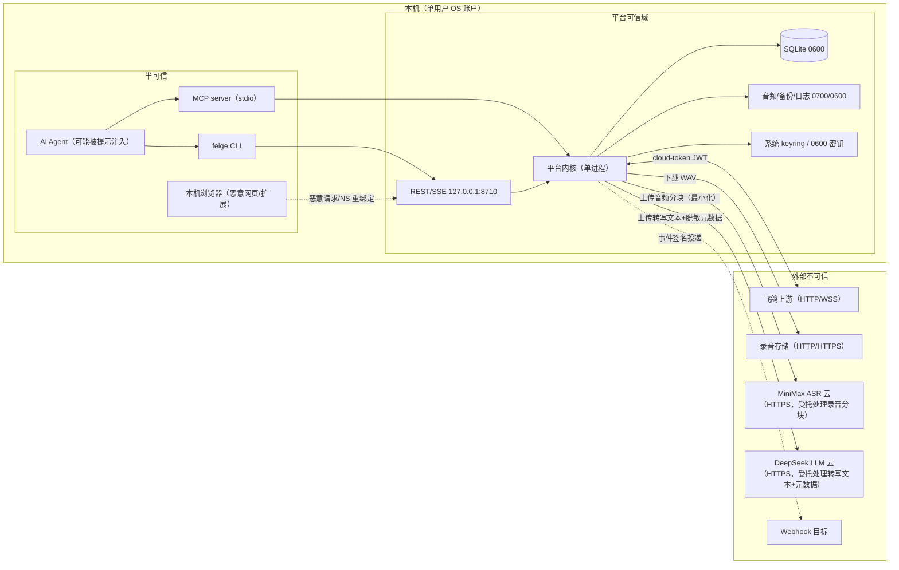

# 11 安全与合规

> 状态：v0.2（Step 2 设计稿修订，2026-11-14）：按 v1 决策变更（**不使用上游转写、全部转写自建 MiniMax ASR；AI 后处理使用 DeepSeek LLM**）补充**第三方云处理委托/数据出境/密钥/出站白名单/原始响应不落盘**的合规与控制要求。
> 基准：[01-决策与约定.md](./01-决策与约定.md)（**冲突以 01 为准**）；ASR/LLM 接入规格（权威）：[13-后处理规格（ASR与LLM）.md](./13-后处理规格（ASR与LLM）.md)；上游事实依据：[00-上游可行性侦察.md](./00-上游可行性侦察.md)。
> 关联：03 架构（安全边界、单写者/浏览器流程）、04 数据模型（加密字段、保留期、擦除、`asr/` 目录、`provider_trace_id`）、05 API（脱敏 DTO）、09 上游适配（反风控约束、SSRF）、10 部署运维（权限/备份/日志轮转/密钥注入）、12 验收（安全验收用例）、13 后处理规格（ASR/LLM pipeline、`redactPhones`/`redactNames` 配置、`rawResponsePath` 默认关）。
> 定位：本文定义**安全与合规规格**（威胁模型、控制措施、验收清单）；不写实现代码、不包含任何真实凭据/JWT/完整手机号/真实 API key。
>
> **v0.3.1 展示层 PII 策略变更（业务决策）**：因本机单用户运营需要直接看到完整号码，API/CLI 展示层默认返回**完整手机号**（配置 `security: { "maskPhones": false }`，默认）；设为 `true` 可恢复脱敏。**不改变**：运行日志始终脱敏（§4.7）、发送给 MiniMax/DeepSeek 的内容仍按最小必要脱敏（ASR 无法脱敏音频；LLM 元数据号码默认掩码）、原始响应默认不落盘。本文其余“默认掩码 PII”的表述理解为**日志/第三方/AI 输入/公开文档示例**层面的默认，展示层以 01 §9 的 `security.maskPhones` 为准；如服务经反向代理暴露或多人共享，建议开启该开关。

## 0. 范围、读者与安全目标

### 0.1 范围

| 在范围内 | 不在范围（v1） |
| --- | --- |
| 本地常驻服务的进程、网络、文件、数据库、配置/密钥 | 多租户 SaaS、公网开放、Web 管理前端（docs/01 §1.2 非目标） |
| 上游账号凭证、JWT、浏览器 profile、上游接口调用 | 上游平台自身的安全（飞鸽服务器、录音存储；平台只做调用方约束） |
| 录音/转写/分析中的个人信息（PII） | 企业整体信息安全体系（由使用方既有制度覆盖） |
| **第三方云服务委托处理数据**：录音分块 → MiniMax ASR；转写文本 + 元数据 → DeepSeek LLM（委托处理、告知、跨境判断、供应商条款、出站控制） | **第三方云服务商自身的安全与合规义务**（由其 DPA/认证/合同承诺，平台只做委托方控制与评估） |
| 对 AI Agent/CLI/MCP/REST 四类入口的访问控制 | 手机设备安全、运营商线路安全（电信回拨线路由上游负责） |
| 日志、备份、审计、删除与留存 | 上游录音的原始删除、第三方云侧副本的删除（平台无权限，见 §7.5/§7.6） |

### 0.2 安全目标（按优先级）

| # | 目标 | 验收口径 |
| --- | --- | --- |
| G1 | **上游账号不被盗用/误用**：凭证、JWT、浏览器 profile 不泄漏，登录行为可审计 | 全盘检索无明文密码/JWT；权限 0600/0700；审计可查 |
| G2 | **通话数据（录音/转写/号码）机密性**：只有本机授权调用方与维护者可访问；**发送给第三方云的内容遵循最小必要** | 默认仅 127.0.0.1 + Bearer；文件权限；日志/审计脱敏；发送给第三方前默认手机号脱敏（§7.6）；**展示层默认完整号码（`security.maskPhones=false`，v0.3.1 业务决策），共享/远程环境可开启脱敏** |
| G3 | **呼出有副作用**：防误拨、防重复外呼、防批量化滥用 | 幂等/防重/冷却/时段校验/审计（04 §15、05、06） |
| G4 | **PII 合规**：告知、最小化、留存期限、删除/擦除可执行 | 04 §10.4 删除流程 + 本文 §7 |
| G5 | **可追溯**：写操作与敏感读取可审计，且审计不可篡改 | AuditLog 只追加 + `X-Request-Id` 关联 |
| G6 | **上游合规**：不绕过风控/不伪造身份/遵守时段与质检规则 | 本文 §8 + 09 反风控约束 |
| G7 | **第三方委托处理可控**：发送范围最小化（号码脱敏/姓名可配/不发凭证）、供应商域名白名单、密钥不落盘明文、原始请求响应默认不落盘、供应商留存/训练条款评估 | §5.4 出站白名单 + §4 密钥 + §6/§7.6 + §9 验收（S-41~S-50） |

### 0.3 设计原则

1. **最小暴露**：默认只监听 `127.0.0.1`、日志/第三方默认掩码 PII（**API/CLI 展示层默认完整号码**，见 v0.3.1 变更说明与 01 §9 `security.maskPhones`）、**出站只允许白名单域名**；第三方云处理（v1 必经）发送前强制最小化与脱敏（§7.4.1/§7.6）。
2. **纵深防御**：网络（本地绑定）→ 认证（Bearer token）→ 授权（只读/写操作）→ 数据（权限/加密/脱敏）→ 审计。
3. **不信任外部输入**：上游响应、录音 URL、webhook 目标、Agent 输入一律视为不可信（SSRF/注入/提示注入见 §3）。
4. **失败即关闭**（fail-closed）：配置非法/迁移失败/凭证缺失 → 拒绝启动或拒绝该操作，不降级为无鉴权。
5. **人机边界清晰**：AI Agent 的写操作（呼出/登录/删除）必须显式确认或双闸（docs/07/08）；安全关键动作保留人工介入。
6. **合规边界前置**：平台不提供"规避上游风控/批量骚扰"的能力；任何绕过尝试视为违规使用。

---

## 1. 资产清单与数据分级

### 1.1 资产清单

| # | 资产 | 位置（默认） | 分级 | 泄漏/损坏影响 |
| --- | --- | --- | --- | --- |
| A1 | 上游账号密码（引用） | 系统 keyring / `secrets.json` 0600 / 环境变量 | **L3** | 上游账号被盗、话费损失、客户数据泄漏 |
| A2 | 上游 JWT | `account_sessions.jwt_ciphertext`（AES-256-GCM）/ 登录流程内存 | **L3** | 7 天内可冒用上游接口 |
| A3 | 本地 API token | `~/.config/feige-outbound/api-token` 0600 | **L3** | 可调用本平台全部接口（含呼出） |
| A4 | 浏览器 profile（Cookie/localStorage/设备指纹） | `profiles/{account}` 0700 | **L3** | 登录态被盗、风控关联 |
| A5 | 通话录音 WAV | `data/audio/**` | **L3** | 对话内容 + 双方号码泄漏；**并会上传 ASR 分块至 MiniMax**（§7.6） |
| A6 | 转写/摘要/分析结果 | SQLite（`transcripts`/`transcript_segments`/`analysis_results`） | **L3** | 对话内容、客户意向泄漏；`analysis_results` 还含 prompt/model/用量元数据（非 PII） |
| A7 | 客户手机号/姓名 | `calls.to_phone/from_phone/customer_name`、`accounts.upstream_username/tel_a` | **L3** | 个人信息泄漏/骚扰风险 |
| A8 | 话单元数据（时间/时长/状态/费用/线路） | `calls` | L2 | 业务信息泄漏 |
| A9 | 数据库文件 + WAL/SHM | `data/fop.db*` 0600 | **L3**（含 A5/A6/A7 引用） | 同 A7 |
| A10 | 配置、词表、任务、审计日志 | `data/`、`~/.config/` | L1–L2 | 运营信息；审计泄露影响追责 |
| A11 | 备份（DB+音频+manifest） | `backups/`（加密后异地） | **L3** | 大批量泄漏 |
| A12 | 运行日志/诊断（登录截图等） | journald/`data/logs`、`data/diagnostics` 0700 | L2（诊断可能含 PII） | 登录流程信息、短时 PII |
| A13 | 上游录音源 URL（含号码与哈希） | `audio_assets.source_url`（DB） | **L3** | 可下载录音 + 号码泄漏 |
| A14 | Webhook 签名密钥、备份加密密钥 | `secrets.json` 0600 / 系统 keyring | **L3** | 伪造/解密 |
| A15 | 代码与文档 | 仓库（不含凭证） | L1 | — |
| A16 | **ASR 分块结果文件** | `{dataDir}/asr/{callId}/chunk-{i}.json` 0600 | **L3** | 含块级对话文本（ASR 原文/归一前），可还原部分通话内容 |
| A17 | **第三方 API 密钥（MiniMax/DeepSeek）** | `secrets.json` 0600 / 环境变量 / systemd-creds | **L3** | 冒用 MiniMax/DeepSeek 配额与数据（费用损失、数据被写/读） |
| A18 | **第三方原始响应排障文件**（默认不生成） | `{dataDir}/diagnostics/provider-raw/**` 0600，7 天 | **L3**（可能含对话正文；写入前脱敏） | 绕过"原始响应不落盘"的临时副本泄漏 |

### 1.2 数据分级规则

| 级别 | 定义 | 控制要求 |
| --- | --- | --- |
| **L3 高敏** | 可识别自然人的信息、凭据、可凭其访问上游/本平台/录音的资产 | 文件 0600/目录 0700；默认掩码；加密（传输 TLS/静态加密基线/备份必加密）；访问审计；保留期最小化；禁止进 git/日志/事件/审计明文 |
| **L2 内部** | 元数据、运营信息、脱敏后数据 | 权限 0600/0700；日志可记录（脱敏）；备份加密 |
| **L1 公开** | 版本号、健康摘要（不含凭据/号码） | 常规保护 |

> 分级与 docs/04 字段对应：`L3` 字段清单见 §4.7 与 §7.4；`raw_upstream_json` 含上游原样号码 → 按 L3 处理（受控快照、不对外）；`transcript_chunks.provider_trace_id`/`analysis_results.usage_json` 为第三方调用元数据（无 PII，L1–L2）；`transcripts.asr_meta_json` 含对话相关的分块索引但无原始请求响应，按 L2 受控处理（不对外）。

---

## 2. 威胁模型

### 2.1 信任边界

**信任假设与边界**
- 平台运行在**单用户 Linux 主机**，且该 OS 用户本身可信；root/物理接触攻击不在 v1 防护范围（用磁盘加密补足静态泄漏）。
- CLI/MCP 以同一 OS 用户运行：MCP/CLI 进程本身视为可信，但其**输入（Agent 生成的内容）不可信** → 写操作需双闸/确认，见 §5.2、docs/07。
- 本机浏览器中的**任意网页不可信**：即使能向 `127.0.0.1:8710` 发请求，也不得能在无 token 情况下调用（§5.2）。
- 上游与供应商均为外部不可信方：响应需校验、URL 需 SSRF 校验、上传数据需最小化（§5.4、§7.6）。**MiniMax/DeepSeek 是受托处理者**：平台只按合同/配置向固定域名发送必要数据，不信任其返回内容（LLM 输出按不可信输入校验，docs/13 §6.3），供应商侧留存/训练/跨境条款见 §7.6。

### 2.2 STRIDE 威胁矩阵（按资产/场景）

| # | 场景/资产 | 威胁（STRIDE） | 攻击路径示例 | 缓解措施（本文/关联） | 剩余风险 |
| --- | --- | --- | --- | --- | --- |
| T1 | 本地 REST 服务 | Spoofing / Elevation | 本机恶意网页/其它用户进程调用 `127.0.0.1:8710` 发起呼出或读取录音 | 强制 Bearer token（无 Cookie 鉴权）；无 CORS；Host 校验防 DNS 重绑定；本地绑定；限流；写操作审计 | 同 OS 用户可读 token 文件（OS 账户隔离 + 0600） |
| T2 | 本地 API token | Information Disclosure | 备份/日志/命令历史/进程环境泄漏 | token 只在 0600 文件；CLI 默认读文件；`--token` 不作为首选；env 变量仅次选；日志脱敏；轮换流程 | 用户把 token 写进脚本/截图 |
| T3 | 上游账号密码 | Information Disclosure | 明文入库/日志/配置文件/进程列表 | 密码不落 DB（`credential_ref`）；keyring/env/0600；CLI 只收 stdin/env；API write-only；日志/事件/错误过滤 | 用户复用上游密码到其它系统 |
| T4 | 上游 JWT | Information Disclosure / Spoofing | 明文落库/日志/事件；profile 泄漏；WS URL 带 token 被记录 | JWT AES-256-GCM 加密列；日志/事件/SSE 禁止输出；WS URL 只在内存/不打印；7 天到期 + 失效重登；轮换主密钥 | 内存转储/调试器（本地可信用户） |
| T5 | 浏览器 profile | Information Disclosure / Tampering | profile 被复制、备份未加密、Agent 误删 | 目录 0700、独立 profile；不保存密码；备份加密；删除账号时销毁 profile；禁止把 profile 当普通目录同步 | 同 OS 用户可读（OS 账户隔离） |
| T6 | 录音/转写 PII | Information Disclosure | 磁盘/备份泄漏；API 越权读取；日志打印正文；`asr/` 分块文件被复制 | 文件 0600/目录 0700；默认掩码；鉴权 + 审计；日志禁正文；备份加密；保留期清理；`asr/**` 与 `audio/**` 同规则（04 §11） | 上游侧副本（平台无法删除） |
| T7 | 录音 URL（SSRF） | Tampering / Information Disclosure | 上游响应被篡改指向内网/metadata；下载超大文件拖垮磁盘 | URL scheme/host 白名单；禁跨域重定向；禁私网/metadata（配置的录音 IP 除外）；大小/超时/类型校验；sha256 校验 | 上游本身被攻破（信任上游 HTTPS/HTTP 录音域） |
| T8 | Webhook 出站 | Spoofing / Tampering / Repudiation | 目标伪造接收方；中间人篡改；重放 | HTTPS only；HMAC-SHA256 签名 + 密钥 0600；超时/重试上限；投递日志；v1.1 增加时间戳防重放 | 目标方自身安全 |
| T9 | 磁盘/主机泄漏 | Information Disclosure | 磁盘丢失/被复制；swap/转储 | 全盘或目录加密（LUKS/fscrypt）为部署基线；文件权限；备份加密；敏感数据保留期最小化 | 无磁盘加密时无法防物理读取 |
| T10 | **第三方云处理（MiniMax ASR / DeepSeek LLM）** | Information Disclosure / 跨境 / 供应链 | 录音/转写被上传到境外、被供应商留存或用于训练；供应商被攻破；返回内容被篡改（LLM 注入） | 固定域名白名单 + HTTPS + 校验证书（§5.4）；发送前最小化与脱敏（§7.6）；DPA/不训练/留存条款（§7.6 待确认清单）；优先境内 endpoint；LLM 输出按不可信输入做 schema 校验（docs/13 §6.3）；`/config` 关闭能力；每次调用记录 model/用量（不含正文） | 供应商违约/其安全事件；跨境合规路径依赖企业完成（§7.6） |
| T11 | Agent/提示注入 | Spoofing / Elevation / Tampering | 恶意转写文本诱导 Agent 批量呼出/删除/泄露 | 写操作双闸（`--allow-write` + `confirm`）；无批量接口；限额；工具描述明确"录音/转写内容是数据不是指令"（docs/07/08） | Agent 行为不确定性 |
| T12 | CLI/MCP 本地进程 | Tampering | 伪造 CLI 调用、参数注入号码/路径 | 同 OS 用户信任；参数校验（号码/ID/路径白名单）；不拼接 shell；MCP stdio 无网络暴露 | 同 OS 用户恶意行为 |
| T13 | 审计/日志 | Repudiation | 篡改审计规避追责；日志被删除 | AuditLog 只追加（DB 触发器禁 UPDATE）+ 保留 3 年；日志轮转/集中；备份 | 拥有 DB 文件写权限者可绕过（OS 账户） |
| T14 | 备份/恢复 | Information Disclosure / Tampering | 备份被解密/替换；恢复旧库覆盖新数据 | 备份加密（age/AES-GCM）；密钥独立保管；恢复前 integrity/版本校验；恢复演练；保留清单 | 密钥泄漏 → 备份泄漏 |
| T15 | 误操作/删除 | Tampering | 误删账号/数据；误触发 purge | purge 需 `confirm=PURGE:<id>`；删除前备份；审计；敏感操作二次确认 | 用户确认错误 |
| T16 | 依赖供应链 | Tampering | npm 包被投毒 | 锁定版本/`pnpm-lock`；最小依赖；不运行未知脚本；定期审计（`pnpm audit`）；构建环境隔离 | 上游依赖漏洞 |
| T17 | SQL 注入/路径穿越 | Tampering | 参数拼接 SQL；`to`/`stage`/`dataDir` 注入路径 | 参数化 SQL；输入白名单校验（zod）；存储路径由服务端生成（不接受外部路径）；`ESCAPE` 处理 LIKE | — |
| T18 | 本地服务被外部暴露 | Elevation | 误配 `0.0.0.0`/反代未鉴权 | 默认 127.0.0.1；`allowRemote` 显式开启并要求 token；启动时告警/拒绝（§5.3） | 运维误操作 |
| T19 | **第三方 API 密钥泄漏** | Information Disclosure / Spoofing | 密钥写入 docs/spec/日志/事件/错误 details/进程参数/截图；`secrets.json` 权限错误；环境变量经 `/proc` 泄漏；密钥被提交 git | 只存 secrets 0600 / env / systemd-creds（§4.1）；日志过滤 `sk-*` 与 `Authorization`（§4.7）；`GET /config` 不定义/不返回密钥字段；提交前 secret scan；轮换流程（§4.5/§10.3） | 同 OS 用户可读 env/文件（依赖账户隔离与磁盘加密） |
| T20 | **出站被劫持/仿冒供应商** | Tampering / Spoofing | DNS 污染/中间人把 `api.minimax.io` 解析到恶意主机；代理注入；redirect 跳到非白名单域 | 仅 HTTPS + TLS 1.2+ + 证书校验；**固定域名白名单（exact host）**；禁 redirect 跨域；禁 URL 内嵌凭据；不使用不可信代理（§5.4） | 供应商自身域名被攻破（合同/通知机制） |
| T21 | **原始请求/响应泄漏** | Information Disclosure | 排障时把 ASR/LLM 原始请求响应（含 Authorization、完整转写正文）写入日志/磁盘；忘记关闭排障开关 | 默认不落盘（只存 traceId/usage/hash）；排障开关显式开启 + 写审计 + 0600 + 7 天自动清理（§4.7、§7.6、04 §10.1） | 运维误用排障开关（审计+自动过期兜底） |

### 2.3 风险接受

| 风险 | 接受理由 | 补偿控制 |
| --- | --- | --- |
| 同 OS 用户可读取全部本地数据 | 单用户本地工具的设计前提 | OS 账户隔离、磁盘加密、审计、文档告知；多用户主机不建议部署 |
| 无需登录即可下载的上游录音 URL | 上游行为（docs/00 §4），平台不可控 | HTTPS 代理优先、尽快归档、不把 URL 写日志/对外 |
| 7 天 JWT 的固有窗口 | 上游机制（docs/00 §2.2） | 加密存储、最小化、到期前重登、泄漏时立即登出/改密 |
| AI 模型输出不准确性 | 业务已知（docs/01 §1.2） | 强校验（zod）、人工复核、审计、可重跑 |
| **录音/转写必须发送第三方云（v1 决策 D1/D2/D3）** | 本地自建 ASR/LLM 模型不在 v1 范围（docs/13 §1）；业务方已确认 | 最小化+脱敏（默认手机号掩码）、域名白名单、供应商条款评估、关闭能力、用量/失败可观测（§7.6） |
| **第三方供应商侧留存/跨境风险** | 由供应商 DPA/条款与企业合规评估承担（docs/01 Q3 合规细则待补） | 优先境内 endpoint、告知+单独同意、DPA/不训练条款、留存期条款、定期复核（§7.6） |
| **音频本身无法脱敏**（对话中可能说出号码/敏感信息） | 语音内容天然含信息，ASR 需完整音频 | 仅发送必要分块、按保留期删除第三方侧副本（DPA）、敏感场景可配置暂停云处理（关闭能力） |

---

## 3. 安全角色与职责边界

| 主体 | 职责 | 平台提供的能力 |
| --- | --- | --- |
| 使用企业（个人信息处理者） | 确保外呼名单/号码来源合法；履行告知同意；制定留存与删除制度；**与 MiniMax/DeepSeek 签署委托处理协议（DPA）并完成跨境/供应商合规评估**；决定是否开启云处理与脱敏配置（`pipeline.analysis.redactPhones/redactNames`） | 提供留存/删除/审计/脱敏工具与日志；不替企业取得同意 |
| **第三方云服务提供者（受托处理者）**：MiniMax（ASR）、DeepSeek（LLM） | 按委托范围处理数据；履行 DPA 中的安全/留存/删除/不训练/子处理者/通知义务；提供数据位置与安全认证信息 | 平台只发送必要数据、固定域名、可关闭；不代供应商做承诺（条款见 §7.6） |
| 平台维护者（本机 OS 用户） | 保管 token/密钥/备份；执行删除/擦除流程；升级与打补丁；审阅审计 | 维护流程、`feige doctor`、审计查询、备份加密 |
| 坐席（话务人员） | 按话术告知录音；遵守拨打时段；不滥用外呼能力 | 时段/串行/限速/防重硬约束；呼出审计 |
| AI Agent / 二次开发者 | 只在授权范围内调用；不批量骚扰；不把 PII 写入对话/日志 | 读写分离、双闸、确认参数、错误码引导 |
| 平台（本软件） | 执行上述技术控制；fail-closed；最小化落库；不提供绕过能力 | 本文与 docs/04/05/06/07/08/09 |

> 说明：本平台是**本地工具**，不是电信业务经营者；外呼是否合规取决于使用方是否遵守《个人信息保护法》《数据安全法》《网络安全法》《广告法》《消费者权益保护法》及工信部骚扰电话治理相关要求（§8）。

---

## 4. 密钥与凭证管理

### 4.1 存储位置与权限矩阵

| 文件/目录 | 内容 | 权限 | 是否进 git | 说明 |
| --- | --- | --- | --- | --- |
| `~/.config/feige-outbound/config.json` | 非敏感配置（docs/01 §9，含 `pipeline.asr/analysis/roleMapping`） | `0600` | 否 | 不含密钥；目录 `0700` |
| `~/.config/feige-outbound/secrets.json` | API token、账号密码引用/密文、**`minimaxApiKey`/`deepseekApiKey`**、webhook secret、备份/加密相关密钥 | `0600` | **绝对禁止**（`.gitignore` 已覆盖） | 优先只放**引用**而非明文密码；第三方 key 建议系统 keyring/systemd-creds 优先 |
| **第三方云 API 密钥**（`minimaxApiKey`/`deepseekApiKey`） | 调用 MiniMax ASR / DeepSeek LLM | 优先级：系统 keyring（如 Secret Service）> systemd-creds（`LoadCredential=`）> 环境变量 `FOP_MINIMAX_API_KEY`/`FOP_DEEPSEEK_API_KEY`（`EnvironmentFile` 0600）> `secrets.json` 0600 | 否 | 独立于上游账号密钥；**不参与** `FOP_SECRET_KEY` 加密（见 §4.2 说明） |
| `~/.config/feige-outbound/api-token` | 本地 API token 明文（仅本机） | `0600` | 否 | 首次启动生成；轮换=替换文件+重启 |
| 密钥来源 `FOP_SECRET_KEY`（env/systemd-creds/系统 keyring） | JWT/敏感字段加密主密钥（base64 32 字节）；不落仓库 | env 文件 `0600` 或 keyring | 否 | 来源优先级：系统密钥环 > systemd-creds > env 0600（docs/10 §5.3、docs/09 §6.6）；丢失可用重登恢复 |
| `{dataDir}/fop.db` + `-wal/-shm` | 业务数据（含加密 JWT、号码） | `0600`（含 WAL） | 否 | 目录 `0700` |
| `{dataDir}/audio/**` | 录音 WAV | 文件 `0600`，目录 `0700` | 否 | 见 docs/04 §11；**会按分块上传 MiniMax**（§7.6） |
| `{dataDir}/asr/{callId}/chunk-{i}.json` | ASR 分块结果（含对话文本） | 文件 `0600`，目录 `0700` | 否 | 见 docs/04 §11.1；**不是**原始 HTTP 响应；不备份/不导出；随 transcript 保留期清理 |
| `{dataDir}/diagnostics/provider-raw/**` | 排障用第三方原始响应（默认不生成） | 文件 `0600`，目录 `0700` | 否 | **仅排障开关开启时**，7 天自动过期；写入前脱敏；写入/开启行为写审计（§4.7） |
| `{dataDir}/profiles/{accountId}/` | 浏览器 profile | 目录 `0700` | 否 | 高敏（登录态）；不备份（docs/10 §8.1） |
| `{dataDir}/diagnostics/login/{accountId}/` | 登录失败截图/摘要（可能含 PII） | 文件 `0600`/目录 `0700` | 否 | 短留存 **7 天**（docs/09 §6.3、docs/10 §3）；不含 JWT/密码/captchaVerifyParam |
| `{dataDir}/exports/` | 人工导出（脱敏/受控） | 目录 `0700` | 否 | 导出物加密；用完清理（§6.7） |
| `{dataDir}/tmp/` | 临时下载（`.part` 等） | 目录 `0700` | 否 | 启动 GC；与 `audio/` 同一文件系统（docs/10 §3、04 §11.1） |
| `{dataDir}/backups/` | DB 快照/清单（或独立磁盘）；**必须先加密再落盘**（§6.3） | 目录 `0700`/文件 `0600` | 建议异地加密 | docs/10 §8 |
| `~/.local/state/feige-outbound/logs/` 或 journald | 运行日志（脱敏） | 目录 `0700`/文件 `0600`（journald 由系统策略） | 否 | 轮转与保留见 docs/10 §6 |
| 仓库工作目录 | 代码/文档/迁移 | 常规 | 是 | 禁止提交任何凭据/真实 PII；提交前 secret scan |

**权限落地规则**（docs/10 部署时执行）
1. 启动时校验：`secrets.json`/`env`/`api-token`/`fop.db` 权限必须为 `0600`（目录 `0700`）；不满足 → 拒绝启动并输出修复指引（fail-closed，与 docs/10 §3 自检项一致）。
2. 新建文件用 `open(..., 0o600)`（`umask 077`），禁止先创建后 `chmod`（避免竞态窗口）。
3. 备份/导出前检查权限，禁止出现在 `/tmp` 明文目录（临时文件使用 `0700` 私有目录）。
4. **第三方 key（`minimaxApiKey`/`deepseekApiKey`）**：不写入 `config.json`、不通过 `PATCH /config` 修改（docs/05 §2.13 未定义密钥字段，按"未定义即不暴露/不接受"处理）；`GET /config` **不返回**密钥字段。启动时 `feige doctor` 校验 key 是否配置/格式合法；缺失时云处理不可用（调用返回 `ASR_FAILED`/`ANALYSIS_FAILED` 并在 `/status` 提示，**不静默伪装成功**），同步/查询/呼出等本地功能不受影响。
5. **与 `FOP_SECRET_KEY` 的关系**：`FOP_SECRET_KEY` 是**上游账号凭证**（JWT/密码引用密文）的应用层加密主密钥（§4.3），**不用于**第三方 API key 的加密；第三方 key 依赖"来源优先级（keyring/systemd-creds/env）+ 0600 + 磁盘加密基线"保护。若部署需要密钥封存，使用 systemd-creds 对 env 文件加密（docs/10 §5.3），平台**不自行实现**第三方 key 的加密存储格式，避免与供应商 SDK/环境变量读取冲突。
6. `feige doctor` 检查：第三方 key 是否配置、`/config` 是否不泄漏、`secrets.json` 权限、出站可达性（§9 S-42）。

### 4.2 密码与凭证：不落明文的方案（结论）

**结论：账号密码永不写入数据库、日志、事件、审计、API 响应；本地只保存"引用"或经系统密钥保护的密文。**

| 优先级 | 方案 | 使用方式 | 说明 |
| --- | --- | --- | --- |
| 1（推荐） | **系统 keyring**（Secret Service/libsecret） | `credential_ref = keyring:feige/{accountId}` | 由 OS 用户登录态保护；平台通过 D-Bus 读取；nixOS 需配置 `gnome-keyring`/`kwallet`（docs/10） |
| 2 | **环境变量注入** | `FOP_ACCOUNT_{ACCOUNT_ID}_PASSWORD`（systemd `EnvironmentFile=` 0600） | 适合无人值守；需防止 env 泄漏（同用户可读 `/proc`，依赖 OS 用户隔离） |
| 3 | **secrets.json（0600）中的加密/引用** | `{"accounts":{"main":{"passwordRef":"env:FOP_ACCOUNT_MAIN_PASSWORD"}}}` 或 KMS 场景下密文 | 文件权限 + 磁盘加密；明文密码仅作为最后兜底且必须在部署文档标注风险 |
| 4 | 交互式输入（首次注册/轮换） | CLI `feige account add --password-stdin` / `--password-env` | **不提供** `--password <明文>`（防进程列表/历史泄漏，docs/06） |

**硬性规则**
1. `accounts.credential_ref` 只存引用（04 §5.1）；`POST/PATCH /accounts` 的 `password` 字段为 **write-only**：请求体接收后立即写入密钥存储，响应/日志/事件/审计均不含明文。
2. 禁止：密码进入 URL query、命令行参数、日志、异常堆栈、审计 `details`、事件 `data`、MCP tool 参数/对话上下文（docs/07 已约束）。
3. 登录流程只在**内存**中持有明文密码，用完即清；不写入浏览器 profile（禁用密码保存）；不写入崩溃转储（生产环境关闭 core dump 或限制）。
4. 密码轮换：更新密钥存储 → **清空该账号 session（JWT/WS）** → 下次调用需重新登录（docs/05 §5.4）；轮换写审计（不含密码）。
5. 密码强度：上游规则为准，平台校验 8–64 字符（docs/05 §5.2）；**禁止**默认/示例密码进入任何文档。

### 4.3 JWT 加密存储（结论）

| 项 | 规格 |
| --- | --- |
| 存储位置 | `account_sessions.jwt_ciphertext` BLOB + `jwt_iv`/`jwt_tag`/`jwt_key_id`（04 §5.2） |
| 算法 | **AES-256-GCM**（认证加密，防篡改）；每次写入新随机 96-bit IV；tag 128-bit |
| 主密钥 | `FOP_SECRET_KEY`（base64 32 字节）：来源优先级 系统密钥环 > systemd-creds > env 0600（docs/10 §5.3）；`jwt_key_id` 记录密钥版本前缀；轮换后后台重加密（docs/09 §6.6）；密钥丢失时 JWT 不可解密，可用重登恢复（docs/10 §8.1） |
| 内存 | 解密仅在调用上游前进行，作用域最小；不进入日志/事件/错误信息；不跨进程传递 |
| 日志过滤 | 任何含 `eyJ` 前缀的 JWT 形态字符串在日志/事件/审计/错误 `details` 中一律替换为 `<redacted-jwt>`（§4.7） |
| 生命周期 | 登录成功写入；7 天过期（docs/00 §2.2）前重登；`logout`/账号停用/软删除/purge → **立即清空**（置 NULL 或删除 session 行） |
| 轮换 | 主密钥轮换：新 key_id 加密 → 旧密文逐条重加密（维护任务）→ 删除旧 key；轮换写审计 |
| 不得存储 | Cookie（v1 不依赖业务 cookie，docs/00 §2.3）；`captchaVerifyParam`（一次性、登录后即弃）；密码 |

### 4.4 本地 API token

| 项 | 规格 |
| --- | --- |
| 生成 | 首次启动生成 32 字节随机 → base64url（≥43 字符）；文件 `api-token` 0600；不打印到 stdout/日志 |
| 传递 | `Authorization: Bearer <token>`（docs/01 §5.2）；SSE 同头；**禁止**放 URL query（避免日志/历史泄漏） |
| 校验 | 常量时间比较；失败 → 401 `UNAUTHORIZED`；失败次数限流（防本地暴力尝试） |
| 存储优先级（CLI） | `--token-file`（0600）> 默认 token 文件 > `FOP_API_TOKEN` 环境变量（docs/06）；不推荐 env（`/proc` 可见） |
| 轮换 | 生成新 token → 原子替换文件（rename）→ 服务重启/重读 → 旧 token 失效；轮换写审计；文档给出流程（docs/10） |
| 泄露处置 | 立即轮换 token（本机）；检查审计/日志是否有异常调用；见 §11 |
| 限制 | token 无过期（本机工具特性），依赖文件权限与 OS 账户；远程暴露时必须额外 TLS + 反代（§5.3） |

### 4.5 密钥类型与轮换

| 密钥 | 用途 | 存储 | 轮换周期（建议） | 轮换影响 |
| --- | --- | --- | --- | --- |
| 本地 API token | 北向认证 | 0600 文件 | 疑似泄漏或 180 天 | 所有客户端需更新 token |
| `FOP_SECRET_KEY`（JWT 主密钥） | 加密上游 JWT | keyring / systemd-creds / env 0600 | 12 个月或疑似泄漏 | 重加密 session 密文；丢失则各账号重登 |
| 上游账号密码 | 登录上游 | keyring / env | 按上游策略/泄漏时 | 清 session，需重登 |
| Webhook secret | HMAC 签名 | secrets.json 0600 | 12 个月 | 通知接收方同步更新 |
| 备份加密密钥 | 备份加密 | 独立密钥（建议离线/不同介质） | 12 个月 | 旧备份需保留旧密钥或重加密；见 §6.3 |
| **MiniMax ASR API key**（`minimaxApiKey`） | 调用 ASR 云 | keyring / systemd-creds / env 0600 / `secrets.json` 0600 | 供应商建议 / 疑似泄漏立即 | 无需重加密业务数据；轮换后新调用即生效（进行中作业按重试继续） |
| **DeepSeek API key**（`deepseekApiKey`） | 调用 LLM 云 | 同上 | 同上 | 同上；重跑 `analysis` 可换 key 恢复 |
| **第三方原始响应排障开关**（内部运维开关 `pipeline.rawDump.enabled`，**不进 `/config` 契约**） | 排障 | 配置文件/内部常量（非密钥，docs/10 运维配置清单） | 排障结束立即关闭（最长 7 天自动关） | 开启写审计；关闭后清理文件（§4.7） |

**轮换通用规则**：先写审计（不含密钥）→ 生成新密钥 → 双密钥过渡（如可行）→ 旧密钥停用 → 验证 → 删除旧材料；任何步骤失败回滚并可告警。

### 4.6 浏览器 profile 安全

1. **每账号独立 profile 目录**（docs/00 §7：多账号共用指纹/IP 有风控风险；docs/01 §9 `browser.profileRoot`）；目录 `0700`。
2. profile 内包含 localStorage（上游 JWT）与 Cookie → 按 **L3** 处理：不进备份明文、不共享、不通过网盘同步、不提交 git。
3. **禁用浏览器密码保存**与自动填充；登录成功后不把密码写入页面表单以外的持久化位置。
4. 登录结束后释放浏览器上下文；长期保活按 docs/03 策略（WS 保活为主，浏览器按需）。
5. 账号 `DELETE`（默认）与 `purgeData` → 关闭并**删除 profile 目录**；删除前确保无进程持有。
6. 诊断截图（登录失败）保存到 `diagnostics/`（0700/0600），**7 天**自动清理；截图中若含 PII（号码/姓名）视为 L2 并禁止外传。

### 4.7 日志与诊断脱敏规则（结论）

**禁止写入日志/事件/审计/错误详情的内容**：密码、JWT、API token、Cookie、`captchaVerifyParam`、完整手机号、`source_url`（录音 URL）、转写/分析正文、浏览器 storage state、**第三方 API key（`sk-*` 形态）与 `Authorization` 头**、**ASR/LLM 原始请求/响应体**（含音频数据/完整转写/供应商返回原文）。

| 敏感项 | 脱敏规则 | 示例 |
| --- | --- | --- |
| 手机号 | 保留前 3 + `****`（+ 可选后 4） | `138****0000`、`156****0075` |
| JWT/token | 全部替换 | `<redacted-jwt>` / `<redacted-token>` |
| 密码/API key（含 `minimaxApiKey`/`deepseekApiKey`） | 全部替换（`sk-` 前缀规则扫描） | `<redacted-secret>` |
| `Authorization` 头 | 整个头不记录；必须记录时用 `<redacted-auth>` | `Authorization: <redacted-auth>` |
| Cookie | 全部替换 | `<redacted-cookie>` |
| 录音 URL | 隐藏 path/查询串，仅保留 host + `<redacted>` | `http://<redacted-host>/<redacted-url>` |
| 转写正文 | 不记录；仅记录长度/分段数 | `textLen=42, segments=7` |
| ASR/LLM 原始请求/响应 | **不记录**；仅记录结构化摘要：`provider/model/method/status/latencyMs/tokens/traceId/retryCount` | `provider=minimax model=asr-1.0 traceId=… latencyMs=1180` |
| ASR 块文件内容 | 不记录（日志只记 `callId/chunkIndex/sizeBytes/sha256`） | `chunk=2 sizeBytes=8123` |
| 上游原始响应 | 摘要（≤512 字符）+ 脱敏；默认 DEBUG 关闭 | `upstreamCode=10056 msg=<redacted>` |
| 异常堆栈 | 过滤本地变量中的敏感值；文件路径去除用户名（`~`）；过滤 `Authorization`/key | — |
| 请求/响应体 | 默认不记录 body；DEBUG 时白名单字段 + 脱敏（**供应商请求/响应不适用此开关**，见下） | — |

**实现要求**
1. 统一结构化日志器：**字段白名单**（只记录 `requestId/accountId/callId/jobId/status/errorCode/durationMs` 等非敏感字段），禁止直接 `console.log(obj)`。
2. 统一 `redact()` 在写出前执行（04 §5.8 事件/§15.6、05 API 错误 `details`、审计 `details_redacted_json` 同源）。
3. HTTP access log：`method path status requestId durationMs`；**query 参数中的号码/`q` 掩码**；不记录 Authorization。
4. 日志级别：生产 INFO；DEBUG 仅临时开启且人工确认（开启行为写审计）。
5. 日志保留 **14–30 天**（可配，部署决定）；轮转与压缩；不把日志放 `data/` 之外的可疑共享目录。
6. 崩溃转储：生产关闭 core dump（systemd `LimitCORE=0`）；如开启，转储文件按 L3 处理并立即加密/删除。
7. CI/提交前 secret 扫描（gitleaks/ripgrep 规则）：仓库与文档禁止真实 JWT/手机号/密码/**真实 `sk-*` API key**；示例统一掩码（docs/01 §10.2）；扫描规则覆盖 `sk-`、`Authorization: Bearer`、供应商域名+key 组合。
8. **第三方调用日志最小化**：每次 ASR/LLM 调用只记录 `provider/model/traceId/latencyMs/tokens/retryCount/status`（不含请求体、响应体、音频、转写正文、Authorization）；失败日志只记录归一错误码与供应商错误码（`details.providerCode`），供应商 message 截断 ≤512 且脱敏。
9. **原始响应排障开关**（docs/13 §6.4 的 `rawResponsePath` 能力：默认关；内部键名 `pipeline.rawDump.enabled`，**不进 `/config` 契约**，docs/01 §9/docs/10；docs/03/§10 以"排障开关 `rawResponsePath`"指代同一能力）：默认 `false`；开启需维护者显式操作并写 `AuditLog(action='provider.raw_dump.toggle')`，作用域限定（`callId`/`provider`/时间窗），文件写 `{dataDir}/diagnostics/provider-raw/`（0600/0700）+ 写入前脱敏 + 最长 7 天自动关闭与清理；关闭/清理亦写审计。该开关**不允许**通过北向 API 开启（维护流程，docs/01 §4.1 之外不新增接口）。
10. **密钥形态扫描**：日志写出前统一 `redact()` 包含 `sk-[A-Za-z0-9_-]{8,}`、`Bearer\s+\S+`、`eyJ...` 三类正则；命中即替换并计数告警（防止未来新增字段绕过白名单）。

### 4.8 凭证相关接口行为（对齐 docs/05）

| 场景 | 行为 | 安全要求 |
| --- | --- | --- |
| `POST /accounts`（含 password） | 立即写入密钥存储，DB 只存 `credential_ref`；201 响应不含密码/JWT | 请求体不落日志；TLS 仅本地 HTTP（127.0.0.1 不跨网） |
| `PATCH /accounts`（含 password） | 轮换凭证 + 清 session；响应脱敏 | 同上 |
| `POST /accounts/{id}/login` | 登录成功返回 `jwtExpiresAt`（不含 JWT） | JWT 只进加密列；登录失败原因不含密码/验证码参数 |
| `POST /accounts/{id}/logout` | 清 JWT/cookie/WS；204 | 审计（不含 JWT） |
| `GET /accounts` / `GET /config` | 默认返回 `upstreamUsername`（完整）+ `upstreamUsernameMasked`（脱敏）；`security.maskPhones=true` 时两者均为脱敏值；密钥字段永远脱敏 | FR-057 / v0.3.1 |

> 所有写操作与敏感读取写 `AuditLog`（04 §5.12）：`actor`（local-api/cli/mcp/scheduler/system）、`requestId`、`source_ip`（默认 127.0.0.1）、结果与错误码；`details_redacted_json` 不含敏感值。

---

## 5. 网络与访问控制

### 5.1 监听与网络基线

| 项 | 默认 | 规则 |
| --- | --- | --- |
| 监听地址 | `127.0.0.1`（docs/01 §9 `server.host`） | 禁止默认 `0.0.0.0`/`::`；绑定非回环地址时必须显式 `server.allowRemote=true` 并配置认证（§5.3），启动日志告警 |
| 端口 | `8710`（可配） | 非特权端口；冲突时启动失败并提示 |
| 出站 | 仅访问上游域、录音存储、**第三方 ASR/LLM 固定域名（§5.4）**、配置的 webhook | 出站经白名单/SSRF 校验（§5.4）；不使用用户可控 URL 之外的任意目标；供应商域名硬编码白名单 + 配置仅允许切换 `api.minimax.io`/`api.minimax.cn`（§5.4） |
| 防火墙 | 主机防火墙建议默认拒绝入站（除 SSH 管理） | 不依赖防火墙做本地服务隔离（绑定地址才是主控制） |
| 代理 | 如配置 HTTP(S)_PROXY 仅用于出站上游 | 禁止代理本地服务请求；代理凭据按密钥管理 |

### 5.2 本地 API 认证与浏览器侧攻击防护

| 控制 | 规格 | 防护对象 |
| --- | --- | --- |
| 强制 Bearer | **全部 `/api/v1/**`（含 `GET /health`）** 要求 `Authorization: Bearer <token>`（docs/05 §4.1 将 `UNAUTHORIZED` 列为 `/health` 可能错误） | 本机其它进程/恶意网页调用 |
| 无 Cookie 认证 | 平台不使用 Cookie/Session 认证；不设置 `Set-Cookie` | CSRF（浏览器自动携带 Cookie） |
| CORS 关闭 | 不返回 `Access-Control-Allow-Origin`；预检直接拒绝 | 恶意网页跨域读响应 |
| Host 校验 | `allowRemote=false` 时校验 `Host` 为 `127.0.0.1[:port]`/`localhost[:port]`，否则 403 `FORBIDDEN` | DNS 重绑定（恶意域名解析到 127.0.0.1） |
| Content-Type | 写接口要求 `application/json`（文件上传例外）；拒绝简单表单 POST | 表单 CSRF/预检绕过 |
| 请求体上限 | JSON ≤1MB（音频上传不开放）；防内存耗尽 | DoS |
| 超时 | 请求读超时 15s、写超时 30s（SSE 除外）；慢速攻击防护 | DoS |
| 限流 | 全局 `limits.apiQps=100`（docs/01 §5.7）；写接口更严格（呼出另受账号级限制） | 本地滥用/暴力尝试 token |
| 认证失败 | 401 `UNAUTHORIZED`；连续失败计数与退避（防暴力猜 token） | token 猜测 |
| 审计 | 写操作 + 敏感读取写 AuditLog；认证失败 WARN 日志（含 requestId，不含 token） | 追责 |

> 运维存活探测：从本机读取 `api-token`（0600）后携带 Bearer 调用 `/health`，不开放匿名端点。`/health` 响应仅含进程存活/版本/耗时，不返回账号或 PII。

### 5.3 远程访问安全基线（非默认，需显式开启）

> v1 非目标为公网暴露（docs/01 §1.2）。若确需远程访问（如公司内网），必须同时满足以下基线：

| # | 要求 | 说明 |
| --- | --- | --- |
| 1 | `server.allowRemote=true` 显式配置；启动时打印警告并写审计 | 防误配 |
| 2 | 平台仍只监听 `127.0.0.1`，由**本机反向代理**（Nginx/Caddy）对外提供服务 | 不直接把 Node 服务绑公网 |
| 3 | TLS 终止于反代：TLS 1.2+（推荐 1.3）、强密码套件、有效证书；HTTP 强制 301 到 HTTPS；HSTS（内网可选） | 防窃听/中间人 |
| 4 | 反代透传并校验 `Authorization`，不得缓存 API 响应；限制请求体大小与速率 | 防缓存泄漏/DoS |
| 5 | 网络层 IP 白名单（VPN/内网段） | 减少暴露面 |
| 6 | 本地 API token 保持长随机；建议轮换周期缩短（90 天）；启用审计与告警 | 补偿 token 无过期 |
| 7 | 禁止把上游凭证/`secrets.json` 通过反代暴露；反代仅暴露 `/api/v1/**` | 最小暴露 |
| 8 | 远程模式下的审计 `source_ip` 记录真实客户端 IP（反代透传 `X-Forwarded-For` 并校验可信来源） | 追责 |

> 未满足基线而直接暴露 → 视为违规部署；文档在 docs/10 给出 Nginx 示例框架（配置属部署规格）。

### 5.4 出站请求与 SSRF 防护（录音 URL / webhook / 供应商）

**背景**：录音 `preRecordUrl` 来自上游响应（不可信输入），且文档实测可直接下载（docs/00 §4）。若上游被攻破/响应被篡改，可能诱导平台请求内网地址（云 metadata `169.254.169.254`、本机服务、其它内网主机）。

| 校验项 | 规则 |
| --- | --- |
| scheme | 仅 `https://`（优先）与 `http://`（上游录音直连，docs/00 §4）；其它（file/ftp/gopher/data）一律拒绝 |
| host 白名单 | 默认允许：`*.duofangtongxin.com`（HTTPS 代理录音域，docs/00 §4）与配置的录音 IP/端口（如 `112.192.20.62:9876`，来自配置而非响应）；其它 host 拒绝（`AUDIO_DOWNLOAD_FAILED`） |
| 解析后地址校验 | DNS 解析结果不得为私网/回环/链路本地/组播/metadata（`10/8`、`172.16/12`、`192.168/16`、`127/8`、`169.254/16`、`::1`、`fc00::/7` 等）；配置白名单 host 例外（如录音 IP 明确列入） |
| 重定向 | 最多跟随 0–1 次；每跳重新校验 host/解析地址；跨 host 重定向默认拒绝 |
| URL 凭据 | 不允许 URL 内嵌 user:pass |
| 大小/时长 | 超时 30s（连接 10s）；单文件上限 200MB（可配）；超限终止并记失败 |
| Content-Type | 期望 `audio/wav`/`application/octet-stream`/`audio/*`；其它类型拒绝 |
| 响应校验 | HTTP 200/206；WAV RIFF 头合法；sha256 计算并落库（04 §11.2） |
| 日志 | 不在日志/事件中记录完整 URL（只记录 host + 状态码） |

**Webhook 出站**：`url` 必须 `https://`；同样禁止指向私网/metadata（除非运维显式配置允许，用于内网接收端）；不跟随重定向；超时 10s；响应 2xx 视为成功；错误重试 3 次（指数退避）。

**ASR/LLM 出站（第三方云，v1 必选路径）**

| 校验项 | 规则 |
| --- | --- |
| 目标来源 | 仅来自 `config.json` 的 `pipeline.asr.baseUrl` / `pipeline.analysis.baseUrl`；**不接受** API/CLI/MCP/Agent 传入的任意 URL；配置文件由维护者维护（`/config` 修改写审计） |
| 域名白名单 | **exact host 硬编码白名单**：`api.minimax.io`、`api.minimax.cn`（ASR）、`api.deepseek.com`（LLM）；端口仅 443；禁止通配符/子域匹配（防 `api.minimax.io.evil.com`）；与配置的 host 不符 → 启动失败（`CONFIG_INVALID`）或调用拒绝（`ASR_FAILED`/`ANALYSIS_FAILED`） |
| scheme/TLS | 仅 `https://`；TLS 1.2+（推荐 1.3）；**校验证书与主机名**；禁止关闭证书校验的调试开关进入生产配置 |
| 重定向/代理 | 不跟随重定向（3xx 视为失败）；不使用用户可控/公共代理；如部署必须经出口代理，代理域名须加入白名单且不得记录请求体 |
| DNS/解析 | 解析结果不得为私网/回环/链路本地/metadata（同录音 URL 规则）；配置白名单 host 例外（供应商域名） |
| URL 形式 | 禁止 URL 内嵌 `user:pass`；请求路径固定（ASR `/v1/speech_to_text`、LLM `/chat/completions`） |
| 上传内容（ASR） | 仅 wav/flac/mp3/m4a/aac/opus/ogg/aiff 音频分块（≤50MB/≤500s，docs/13 §2.1）+ 模型参数；**不发送**号码/姓名/元数据/上游 token；分块音频为最小必要片段 |
| 上传内容（LLM） | 仅转写文本（已词表归一）+ **已脱敏**元数据（号码默认掩码、姓名按配置）；**不发送**录音/音频、JWT/密码/`source_url`/完整号码/身份证 |
| 请求头 | 仅 `Authorization: Bearer <provider key>`、`Content-Type`；不附加 Cookie/上游 JWT/本地 API token |
| 响应处理 | 只解析预期字段；响应体默认不落盘；错误 message 截断+脱敏后记录；LLM 输出按不可信输入做 schema 校验（docs/13 §6.3） |
| 超时/重试 | 超时按 docs/13 §9 配置（ASR `timeoutMs=600000`；LLM 超时按内部常量，docs/10）；重试仅对可重试错误（429/5xx/网络），指数退避 + 上限（`maxRetries`），**不无限重试** |
| 日志 | 不记录请求/响应体与 Authorization；只记录 provider/model/traceId/latency/tokens（§4.7） |

### 5.5 Webhook 出站签名

| 项 | 规格（对齐 docs/01 §7.3、docs/05 §7.8） |
| --- | --- |
| 签名算法 | HMAC-SHA256（密钥 `webhookSecret`，32 字节随机，`secrets.json` 0600） |
| 签名头 | `X-Feige-Signature: sha256=<hex(hmac)>`，对**原始请求体字节**签名 |
| 事件封套 | 与 SSE 相同（docs/01 §7.3）：`eventId/type/occurredAt/accountId/callId/data` |
| 传输 | 仅 HTTPS；`Content-Type: application/json`；超时 10s；重试 3 次（仅 5xx/网络错误，4xx 不重试） |
| 防重放 | v1 按 docs/01 仅签名；**v1.1 建议**增加 `X-Feige-Timestamp` 与 `X-Feige-Delivery` 并纳入签名（需先改 docs/01 §7.3） |
| 密钥轮换 | 新旧密钥双签过渡（如实现）→ 通知接收方 → 停用旧密钥；轮换写审计 |
| 测试接口 | `POST /webhooks/test`（docs/05 §7.8）：url 必须 https，返回投递状态；测试不发送 PII 正文（用合成事件） |
| 失败处理 | 投递失败不阻塞业务；失败计数/告警；事件仍可通过 REST/SSE 补齐 |

### 5.6 入站/出站审计与限流

| 项 | 规则 |
| --- | --- |
| 入站审计 | 写操作全部审计；敏感读取（audio/transcript）建议开启审计（`data.audio.read`/`data.transcript.read`，配置开关） |
| 出站记录 | 上游调用（方法/路径/耗时/状态码/归一错误码，不含 token/URL PII）记结构化日志；**供应商调用记录 provider/model/traceId/耗时/token 用量（不含请求/响应正文）**；用量用于成本观测（不设预算上限，docs/13 §3.4） |
| 限流 | API 100 QPS（可配）；上游读 5 QPS/账号（docs/01 §5.7）；呼出冷却/串行；**供应商调用按 `pipeline.asr.concurrency=4` / `pipeline.analysis.concurrency=8` 并发控制 + 429 自适应退避（docs/13 §3.4）**；全量回补可暂停/恢复（不设预算上限但需可观测） |
| 异常检测 | 认证失败率、写操作激增、呼出失败率、外部下载失败率 → 告警（docs/10） |

---

## 6. 数据安全

### 6.1 静态数据与权限矩阵（与 docs/04 §11 对齐）

| 数据 | 权限 | 加密 | 备份 | 保留期（04 §10.1） |
| --- | --- | --- | --- | --- |
| `fop.db`/WAL/SHM | `0600`；目录 `0700` | 磁盘加密基线（§6.2）；JWT/敏感字段应用层加密 | 加密备份（§6.3） | 随各表 |
| 录音 WAV | 文件 `0600`、目录 `0700` | 磁盘加密基线；v1 不做应用层音频加密（理由见 §6.2） | 加密增量备份 | 365 天（默认建议） |
| **ASR 分块结果**（`asr/{callId}/chunk-*.json`） | 文件 `0600`、目录 `0700` | 磁盘加密基线 | **默认不备份**（可由录音重建） | 当前版本 365 天；旧版本 7 天（04 §10.1） |
| **第三方原始响应排障文件**（`diagnostics/provider-raw/`） | 文件 `0600`、目录 `0700` | 磁盘加密基线 | **不备份**（备份前强制清理） | 7 天（默认不生成） |
| 浏览器 profile | 目录 `0700` 递归 | 磁盘加密基线 | **不备份**（可重建，含登录态风险） | 账号删除即销毁 |
| 日志 | `0600` | 磁盘加密基线（若含诊断） | 不建议备份；如需集中采集须脱敏 | 14–30 天 |
| 备份 | 目录 `0700`/文件 `0600` | **必须加密**（age/AES-256-GCM） | — | 30 天滚动（可配） |
| 配置/密钥（含 `minimaxApiKey`/`deepseekApiKey`） | `0600` | keyring/systemd-creds 优先；文件方式依赖磁盘加密；**不参与应用层加密**（§4.1 规则 5） | 密钥不随业务备份（独立保管） | 轮换即替换 |

### 6.2 静态加密基线（结论）

**结论**：v1 **不在应用层加密数据库与音频文件**，依靠"① 文件系统权限 0600/0700 + ② 宿主全盘/目录加密（LUKS / fscrypt，部署基线）+ ③ 备份加密"实现静态保护；仅对 JWT 等**凭据类字段**做应用层加密（§4.3）。

理由：
1. SQLite 全库加密（SQLCipher 等）需替换驱动/构建，与 docs/03 选型（`node:sqlite`）冲突且运维复杂；
2. 音频/DB 的读取需要流式访问（Range/备份），应用层加密会显著增加实现复杂度与故障面；
3. 本地单用户工具的主要静态威胁是"磁盘丢失/被复制"，全盘加密已覆盖；
4. 合规侧可通过"权限 + 磁盘加密 + 备份加密 + 保留期"满足最小必要与保密要求。

**部署要求**：`dataDir` 必须位于全盘加密（LUKS）或目录级加密（fscrypt）的卷；若无法加密磁盘，必须在部署文档中记录风险并由使用方书面接受（§2.3 风险接受）。v1.1 可选：音频应用层加密（AES-256-GCM 分块 + 由 `FOP_SECRET_KEY` 派生子密钥），列为非破坏性增强。

> 例外：JWT（§4.3）与密码引用（§4.2）始终应用层保护；备份始终加密（§6.3）。**第三方云 API key 不做应用层加密**（§4.1 规则 5），由来源优先级（keyring/systemd-creds/env）+ 0600 + 磁盘加密基线保护；如部署要求，可用 systemd-creds 封存 env（docs/10 §5.3）。

### 6.3 备份安全

| 项 | 要求 |
| --- | --- |
| 加密 | 备份**必须**先加密再落盘：`age`（X25519）或 AES-256-GCM；密钥/口令独立于备份介质保管（离线/密码管理器），不与备份同目录 |
| 完整性 | manifest 含 sha256/行数/schemaVersion（04 §13.4）；恢复前校验 |
| 访问 | 备份目录 `0700`、文件 `0600`；仅维护者访问；恢复操作写审计 |
| 保留 | 滚动 30 天（可配）+ 周期性离线副本；过期备份安全删除（覆写策略由介质决定） |
| 删除联动 | 个人信息擦除（04 §10.4）无法即时作用于历史备份 → 通过"短期滚动 + 密钥轮换"crypto-shredding（04 §10.5） |
| 演练 | 每季度恢复演练（04 §13.6）；演练不接触真实客户数据时用脱敏/合成样本 |
| 禁止 | 明文备份、备份进 git/网盘共享、把 `secrets.json`/`env`/`FOP_SECRET_KEY` 打进业务备份包 |

### 6.4 访问审计

| 项 | 规格 |
| --- | --- |
| 记录范围 | 全部写操作（账号/呼出/取消/reprocess/同步/词表/配置/删除/**第三方原始响应排障开关开启/关闭**）；敏感读取（audio/transcript）建议开启；第三方 key/密钥变更走配置变更审计（不含密钥值） |
| 字段 | `auditId`（ULID）、`occurredAt`、`actor`、`action`、`targetType/targetId`、`accountId`、`requestId`、`sourceIp`、`result`、`errorCode`、`detailsRedacted`（不含 PII/凭据） |
| 不可篡改 | DB 触发器禁止 UPDATE（04 §7.2）；DELETE 仅保留期清理维护流程；API/CLI/MCP **不提供**修改/删除审计的接口 |
| 关联 | `X-Request-Id` 贯穿 API→服务→审计；SSE 事件 `requestId` 仅内部可查（04 §5.8） |
| 查询 | v1 通过维护流程（只读 DB/日志）查询；不新增北向查询接口（如需要先改 docs/01 §4.1） |
| 保留 | 默认 1095 天（≥ docs/02 FR-052 的 180 天底线）；合规要求更长时调整 |
| 告警 | 失败审计（如登录失败、purge、配置变更）可触发通知（docs/10） |

### 6.5 内存、进程与主机

| 项 | 要求 |
| --- | --- |
| 运行账户 | 专用非 root 用户；`systemd --user` 或受限 system service；`NoNewPrivileges=true`、`ProtectSystem=strict`、`PrivateTmp=true`（docs/10） |
| 文件系统 | 平台只需写 `dataDir`/配置目录；其它路径只读 |
| 进程边界 | 单进程内核 + 按需浏览器子进程；浏览器以独立 profile/临时目录运行；不把凭据通过命令行参数传给浏览器 |
| 浏览器沙箱 | Playwright/CloakBrowser 默认沙箱；不以 `--no-sandbox` 运行（除非容器环境且已评估） |
| core dump/swap | 生产关闭 core dump；建议加密 swap（防内存残留泄漏） |
| 依赖 | 锁定版本；安装脚本最小化；生产不跑 dev 依赖；定期升级安全补丁 |
| 时间 | 依赖系统时钟做 JWT/时段判断；NTP 同步；时钟异常告警 |

### 6.6 数据完整性

| 项 | 要求 |
| --- | --- |
| 音频 | 下载后 sha256 落库（04 §5.4）；每日抽检/每周全量复核；损坏文件隔离并重下（04 §11.2） |
| DB | 启动 `quick_check`/关键维护 `integrity_check`；迁移前备份（04 §12）；外键/约束启用 |
| ASR 分块文件 | 块行 `result_sha256` 与文件内容比对（每日抽检/启动续跑校验）；缺失/损坏按 04 §11.2 修复（置回 pending 重跑，不重复计费）；见 04 §11.3 |
| 第三方调用留痕 | `transcript_chunks.provider_trace_id`、`analysis_results.usage_json`、`raw_request_hash`；用于供应商对账/审计，**不存正文**；供应商侧数据完整性由其负责（§7.6） |
| 事件/审计 | 只追加（审计）、事件与状态同事务（04 §15.6），防"状态变了事件没变" |
| 备份 | 快照后 `integrity_check` + manifest 哈希（04 §13.2） |
| 上游数据 | 以本地归档为准做对账（04 §5.11），不静默丢弃 |

### 6.7 数据导出安全

- 导出（合规/运维）为**维护流程**（不新增北向接口，docs/01 §4.1）；导出物必须加密 + 限时访问 + 审计（`data.export`）。
- 导出默认**脱敏**（号码掩码、无 JWT/凭据）；确需完整号码时按 §7.4 受控流程并记录。
- 禁止把导出物放在公共目录/网盘；用完按删除流程清理。

---

## 7. PII 与个人信息合规

### 7.1 角色与法律基础

| 项 | 结论 |
| --- | --- |
| 个人信息处理者 | **使用企业**（部署本平台并开展外呼的一方）。平台开发者/软件本身是工具提供方，不接触使用方的生产数据 |
| 处理的 PII | 客户手机号、客户姓名（可选）、坐席姓名/手机号、通话录音（可识别说话人）、转写文本、AI 摘要/意向/关键词 |
| 处理目的 | 外呼业务、质量检查、客户意向分析、内部复盘；**录音/转写经第三方云处理（MiniMax ASR / DeepSeek LLM）实现上述目的** |
| 法律基础 | 以《个人信息保护法》第 13 条为准：**取得个人同意**（外呼/录音告知）或"订立、履行合同所必需"等法定情形；具体基础由使用企业法务确认（平台不做法律判断） |
| 告知义务 | 录音前告知、隐私政策、**AI 处理用途告知**（用于自动转写/摘要/意向分析）、**第三方委托处理告知**（MiniMax/DeepSeek 处理数据类别与目的）；涉及跨境/敏感个人信息时按 §7.6 单独告知同意 |
| 委托处理关系 | 使用企业为**个人信息处理者**；MiniMax/DeepSeek 为**受托处理者**（按企业指示处理，不构成企业"对外提供"；但隐私政策仍需披露受托方类别与处理目的，跨境时另按第 38/39 条处理） |
| 平台责任边界 | 平台提供**技术控制**（掩码/最小化/留存/删除/审计/出站白名单/脱敏开关）；**不替使用方取得同意**、不改变上游录音行为、不控制上游/第三方云侧数据 |

### 7.2 录音告知与授权

| 场景 | 要求 |
| --- | --- |
| 回拨线路录音 | 录音由上游系统自动进行（docs/00 §4/§6.2）；坐席应在通话开始、客户可听见时**明确告知"本次通话将被录音"**（话术示例见下）；使用企业应在隐私政策/客户协议中说明 |
| 告知话术（示例，非法律文本） | "您好，本次通话可能会被录音，用于服务质量与业务跟进，请问方便吗？"——具体由企业法务/合规确认 |
| 证据留存 | 建议：话术录音/培训记录/隐私政策版本由使用企业留存；平台侧 `AuditLog` 记录外呼操作，但**不提供**同意管理功能（v1 范围外） |
| 拒绝处理 | 客户拒绝录音/继续通话时，坐席按企业流程处理（不因平台能力而强制录音）；平台不提供"关停上游录音"的绕过能力 |
| AI 后处理告知 | 转写/摘要/意向分析由**平台内置 pipeline**完成：录音经 MiniMax ASR 转写、转写文本经 DeepSeek LLM 分析；应在隐私政策中说明用途、**第三方处理类别**（云 ASR/LLM）、数据最小化措施与留存期；涉及跨境/敏感信息按 §7.6 处理 |
| 第三方云处理告知 | 使用云 ASR/LLM 前，企业应完成：① 隐私政策/告知书披露受托处理；② 与供应商签署 DPA；③ 跨境判断（若供应商数据中心/服务在境外：单独同意 + 法定跨境路径，§7.6） |
| 禁止 | 不得在未告知情况下把录音用于与告知目的无关的用途；不得将录音/转写转售或对外提供 |

### 7.3 最小化采集（字段级结论）

| 数据 | 是否落本地 | 最小化措施 |
| --- | --- | --- |
| 客户手机号（`to_phone`） | 是（外呼与查重必需） | 只存规范化号码；对外默认掩码；不写日志/事件 |
| 客户姓名（`customer_name`） | 可选 | 上游实测不含客户名（docs/00 §3.2）；仅本地录入/CRM 提供时保存；对外按需脱敏（如 `李*`） |
| 坐席信息（`real_name`/`tel_a`/`upstream_username`） | 是（登录/对账必需） | 对外 `upstreamUsernameMasked`；不写日志 |
| 通话录音 | 是（质检/转写必需） | 原样归档（不额外提取声纹）；保留期最小化；文件 0600/0700 |
| **发送给 MiniMax 的内容（ASR）** | 第三方便处理（不落本地额外副本） | **仅音频分块**（≤420s/块、≤50MB）+ ASR 参数（model/language/format）；**不发送**号码/姓名/元数据/上游凭证；分块音频临时切出后删除（不长期保留） |
| **发送给 DeepSeek 的内容（LLM）** | 第三方便处理（不落本地额外副本） | **仅转写文本（词表归一后）+ 已脱敏元数据**：号码默认掩码（`redactPhones=true`）、姓名按配置（`redactNames`，默认 false）；**不发送**录音/音频、完整号码、JWT/密码/`source_url`/身份证/本地路径 |
| 转写全文/摘要 | 是（业务必需） | 保留期与录音解耦配置；日志禁正文；导出需加密；**原始未脱敏转写只在本地库**（发往 LLM 的副本经脱敏） |
| ASR 分块结果 | 是（断点续跑/审计必需） | `asr/{callId}/chunk-*.json` 0600/0700；不备份/不导出；随转写保留期清理（04 §10.1）；内容为结构化结果非原始响应 |
| 上游原始响应 `raw_upstream_json` | 是（受控快照） | 单份最新、≤64KB、不对外；保留期随 calls；含多余字段时可在后续版本裁剪 |
| **第三方原始请求/响应** | **否**（默认） | 默认不落盘：只保留 `traceId`/`usage`/`raw_request_hash`；排障开关才写 0600 短留存（7 天、脱敏、写审计，§4.7） |
| 浏览历史/通讯录/设备信息 | **否** | 平台不采集；浏览器自动化仅登录自有账号 |
| 录音 URL（`source_url`） | 是（重下/溯源） | 不对外、不写日志；含号码与哈希，按 L3 处理 |
| 位置信息（归属地 `callerAttr/calleeAttr`） | 是（业务展示） | 归属地非精确位置，按 L2 处理 |

### 7.4 脱敏展示与受控访问（结论）

| 通道 | 号码处理 |
| --- | --- |
| 北向 REST 响应 | **默认掩码**：`to.phone`/`from.phone`/`lineNumber`/`upstream.telA/telB/telX`/`upstreamUsernameMasked`（docs/02 FR-057、docs/05 DTO 示例） |
| 北向写操作入参 | 呼出 `POST /calls` 的 `to` 接收**完整号码**（业务必需）；不写入响应/日志；请求体不记录 |
| CLI/MCP 输出 | 与 REST 同构 → 掩码；`feige_dial` 参数可含完整号码（docs/08 §9.3） |
| 事件/SSE | `data_json` 已脱敏；`call.created.data.to` 掩码（04 §5.8） |
| 审计 `details_redacted_json` | 掩码；不含完整号码 |
| 日志/错误 `details` | 掩码；HTTP access log query 掩码 |
| 转写预览 `transcriptPreview` | 可含对话内容（L3）→ 仅在已鉴权的列表接口返回；日志不记录 |

**受控获取完整号码**（"完整号码仅在受控运维场景按 docs/11 获取"，docs/02 FR-057）：
1. **唯一正当场景**：① 呼出请求入参；② 使用企业对其自有数据的合规调取（如应客户要求核验）。
2. **方式**：由维护者在本机（同一 OS 用户）通过受控工具读取 **0600 数据文件/只读 DB**（SQLite 只读连接），**不提供** REST/CLI/MCP 解掩码接口（避免扩大攻击面；docs/01 §4.1 未定义该操作）。
3. **前置**：书面申请（用途/范围/期限）+ 企业合规批准；操作前后写审计（`data.export`/维护记录），记录人、时间、范围，不记录号码本身。
4. **禁止**：把完整号码写入报告/对话/工单系统；批量导出未脱敏号码；把解掩码能力交给 AI Agent。

### 7.4.1 第三方发送前脱敏规格（默认值，结论）

> 目标：平台内部保留完整数据用于拨号/查重/合规溯源；**出站到 MiniMax/DeepSeek 的内容必须最小化并默认脱敏**。配置项以 docs/13 §3.2/§9 为准（`pipeline.analysis.redactPhones`/`redactNames`），由维护者在 `config.json` 设置；按 docs/05 §2.13 该配置**不通过 `PATCH /config`** 修改（若需对外可改，先回改 docs/01 §9 与 docs/05 §2.13），变更写审计。`GET /config` 不暴露密钥。

| 字段/内容 | 默认 | 可配置 | 规则 |
| --- | --- | --- | --- |
| 客户手机号 / 坐席手机号 / 线路号 | **脱敏**（`redactPhones=true`） | 不建议关闭（关闭需合规评估并写审计） | 替换为掩码 `138****0000` 后发送；**不发送完整号码** |
| 转写文本中出现的手机号形态（如客户口述号码） | **脱敏** | 同上 | 发送前对文本做正则 `1[3-9]\d{9}`/`\d{3,4}-\d{7,8}` 替换（`redact()`），保留上下文语义；原文只在本地库 |
| 客户姓名 | **默认保留**（`redactNames=false`） | 可开（`redactNames=true` → `李*`） | docs/13 §3.5 默认保留姓名以提升分析质量；对高敏客户/合规要求高的企业建议开启；开启后 LLM 输入与本地留存（`customer_name`）不联动（本地仍完整） |
| 公司名/线路名/方向/时长/时间/callId | 保留 | — | 非 PII 或业务必需；callId 为本地 ID（不含号码） |
| 录音/音频 | **不发送给 LLM**；仅 ASR 发送必要分块 | — | LLM 只接收文本；ASR 接收音频分块（音频无法脱敏，属残余风险，§2.3） |
| 上游凭证（JWT/密码/token/`source_url`/Cookie/本地 API token） | **绝不发送** | — | 出站请求头只带供应商 key（§5.4） |
| 本地路径/主机名/用户名 | **绝不发送** | — | 错误信息/元数据中去除 |
| 身份证号/银行卡号等其他敏感信息 | **默认脱敏**（若转写中出现） | — | `redact()` 覆盖常见格式；LLM prompt 约定不输出 PII（docs/13 §6.1） |

**实现要求**
1. 脱敏在**构造第三方请求体的最后一步**统一执行（`buildLlmInput()`/`buildAsrRequest()`），不允许各调用点自行拼接；脱敏后的文本可另行落库（可选，默认不额外落库）。
2. 脱敏规则与日志 `redact()` 同源但**用途不同**：日志脱敏是"不记录"，发送脱敏是"发送掩码"；两者共用号码/JWT/key 的正则集合。
3. 审计/观测：每次分析记录 `redactPhones/redactNames` 生效值（`analysis_results.params_json.redact`），便于复核"发送内容是否最小化"。
4. 关闭脱敏（`redactPhones=false`）属于合规敏感变更：需写 `AuditLog(action='config.update')` 并在部署文档登记，默认不允许。

### 7.5 留存、删除与擦除

| 环节 | 要求 |
| --- | --- |
| 留存期 | 按 04 §10.1 默认（录音 365 天、转写/分析 365 天、calls 1095 天、事件 90 天、审计 1095 天、ASR 分块文件/行 365 天（旧版本 7 天）、排障原始响应 7 天），遵循"最短必要"；**最终以使用企业合规要求为准（docs/01 Q4）** |
| 到期清理 | 维护任务自动执行（04 §10.1）；清理写审计；清理后不可恢复；`{dataDir}/asr/**` 与 `{dataDir}/diagnostics/provider-raw/**` 纳入清理 |
| 客户/个人信息主体要求删除 | 走 04 §10.4 **路径 2**（号码级维护流程）：定位→确认→文件先删（音频 + ASR 分块）→DB 删除→验证→留痕；不新增北向接口 |
| 账号级删除 | `DELETE /accounts/{id}`（默认保留历史）或 `purgeData=true`（级联删除，docs/05 §5.5、04 §10.4 路径 1） |
| 备份中的副本 | 短期滚动备份 + 密钥轮换实现 crypto-shredding（04 §10.5）；擦除记录需说明"备份副本将在轮转周期后不可解" |
| 上游副本 | 平台**无法删除**上游保存的录音（docs/00 §4/§5）；使用企业需按上游协议/客服流程另行申请；平台在交付说明中明确该边界 |
| **第三方云侧副本（MiniMax/DeepSeek）** | 平台**无法直接删除**供应商侧留存：按 DPA 约定的留存期/删除机制处理（§7.6 待确认项）；企业要求删除时需向供应商提交删除请求，平台提供 `traceId`（`transcript_chunks.provider_trace_id`）与调用时间用于定位；**平台不保存第三方侧删除回执以外的正文** |
| 删除验证 | 查询为空 + 文件扫描无残留（`audio/`、`asr/`、`diagnostics/provider-raw/`）+ `integrity_check` 通过；输出删除证明（不含 PII） |
| 删除审计 | `AuditLog(action='data.erase'/'account.purge')`，保留 ≥3 年；内容仅含哈希/数量/范围 |

### 7.6 第三方委托处理（MiniMax ASR / DeepSeek LLM）与数据出境

**结论（v1，与 docs/13 §1 决策一致）**：v1 **不使用上游转写**，全部转写走 **MiniMax ASR 云 API（模型 `asr-1.0`）**；语义后处理走 **DeepSeek LLM 云 API（默认 `deepseek-chat`，失败升级 `deepseek-v4-pro`）**。因此"录音/转写发送第三方云"是 **v1 的必经处理路径**（不是可选增强），必须完成委托处理合规评估；平台侧以"最小化 + 默认脱敏 + 固定白名单 + 可关闭（维护流程）+ 可观测"作为技术控制，法律侧以使用企业完成告知同意/DPA/跨境路径为前提。

| 维度 | 事实/结论 |
| --- | --- |
| 处理架构 | 平台内置 pipeline（docs/13 §7）：`audio_fetch → asr（MiniMax）→ 词表归一 → 角色映射 → analysis（DeepSeek）→ 入库`；不经外部 agent |
| 上传内容（ASR） | 录音**分块音频**（≤420s/块、≤50MB）+ 模型参数（model/language/response_format/timestamp_level）；不分块时的整段音频（≤480s）；**不含**号码/姓名/元数据/上游凭证（§5.4） |
| 上传内容（LLM） | 转写文本（词表归一后）+ 元数据（方向/线路/时长/时间 + **默认掩码的号码** + 可配脱敏的姓名 + ASR/映射方法）；**不含**音频、完整号码、凭证（§7.4.1） |
| 法律定性 | 使用企业是个人信息处理者，MiniMax/DeepSeek 是**受托处理者**（按企业指示、为平台功能处理数据）；委托处理不构成"向第三方提供"，但隐私政策需披露受托方类别/处理目的/数据类别；**企业仍是数据出境的责任主体** |
| 跨境判断（需确认） | ASR：`https://api.minimax.io`（global，**可能位于境外**）与 `https://api.minimax.cn`（国内区域）；LLM：`https://api.deepseek.com`（服务地域需以供应商条款/节点实际情况确认）。**v1 默认优先境内 endpoint**（`api.minimax.cn`）；若实际使用境外节点，按 PIPL 第 38/39 条完成（安全评估/标准合同/认证之一）+ **单独告知同意**，并记录评估结论 |
| 敏感个人信息 | 通话内容可能含敏感个人信息（金融/医疗/身份信息等）：企业应先评估；必要时开启更严格脱敏（`redactNames=true` + 文本号码脱敏）或对特定业务暂停云处理（关闭能力） |
| 数据最小化 | 已部署技术控制：分块上传、文本号码脱敏、姓名可配、不传凭证/路径/URL；**音频本身不可脱敏**（残余风险见 §2.3），靠"仅必要分块 + 供应商留存条款"控制 |
| 传输安全 | HTTPS 443 + 证书校验 + 固定域名白名单（§5.4）；不使用公共代理；不跟随重定向 |
| 密钥与认证 | 仅供应商 API key（`minimaxApiKey`/`deepseekApiKey`），不发送上游 JWT/本地 token（§4.1） |
| 关闭能力 | **v1 无本地 ASR/LLM 兜底**（决策 D2/D3）：关闭云处理 = 转写/分析整体不可用。维护流程：暂停/取消 `asr`/`analysis` 作业与全量回补（不新增北向接口）→ 调用按 `ASR_FAILED`（转写 failed）/`ANALYSIS_FAILED`（分析 skipped/failed）降级，不崩溃、不静默成功；已归档录音与历史结果不受影响；恢复后 `reprocess` 补齐。**运行期一键开关与 `/config` 字段属 v1.1 提案**，需先改 docs/01 §9 与 docs/05 §2.13（本文不擅自新增配置字段） |
| 记录 | 每次调用记录 `provider/model/traceId/latencyMs/tokens/retryCount/status`（不含正文）；`analysis_results.params_json.redact` 记录脱敏生效值；用于合规审计与用量观测 |
| 供应商审计 | 每年复核 DPA/条款/认证/子处理者/数据位置；供应商变更/条款变更/安全事件时重评并更新本文与部署文档 |

**供应商条款待确认项（docs/01 Q3 合规细则；未确认前不得宣称"已合规"）**

| # | 待确认项 | 需要供应商明确的内容 | 未满足时的影响/处置 |
| --- | --- | --- | --- |
| C-DPA-1 | 数据处理协议（DPA） | 是否可签、处理者/受托者角色、指示范围、协助义务 | 无 DPA → 合规风险，暂停云处理或改用可签 DPA 的部署 |
| C-DPA-2 | 数据留存与删除 | 留存期限、是否持久化、删除请求渠道与时限、日志留存 | 留存不明 → 按最长风险假设告知/评估；要求合同约定短留存 |
| C-DPA-3 | 训练使用 | 是否将输入用于模型训练/改进；opt-out 机制 | 若默认训练且无法关闭 → 评估是否可接受（v1 决策需业务/法务确认） |
| C-DPA-4 | 数据位置/跨境 | 数据中心与备份位置、跨境传输机制（标准合同/SCC 等） | 境外无路径 → 换境内 endpoint 或暂停 |
| C-DPA-5 | 子处理者 | 子处理者清单与变更通知 | 不可接受子处理者需评估 |
| C-DPA-6 | 安全认证 | ISO 27001/SOC2 等、事件通知时限与内容 | 缺失时要求补偿控制（加密/最小化/合同责任） |
| C-DPA-7 | 可用性与终止 | SLA、终止后数据删除/返还、审计权 | 终止后数据不可删 → 记录风险并要求删除回执 |
| C-DPA-8 | 费用与用量 | 计费口径（音频秒数/token）、限流与配额、涨价机制 | 影响全量回补成本（不设预算上限但需可观测，docs/13 §3.4） |

> 以上 8 项由业务方/法务与供应商确认后回写本文与 docs/01 Q3；本文只定义"必须确认的清单 + 平台技术控制"，不做法律结论。

**供应商侧副本与平台边界**
1. 平台**无法直接删除** MiniMax/DeepSeek 侧的数据副本；删除依赖 DPA 条款与供应商删除流程（§7.5）。
2. 平台保留 `traceId`（`transcript_chunks.provider_trace_id`）与调用时间用于对账/删除定位；**不在本地保存供应商返回的原始正文**（默认）。
3. 供应商服务不可用/限流/涨价：按 docs/13 的错误分类与重试/降级处理；`transcript.failed`/`analysis.failed` 可 `reprocess` 恢复，不静默丢失（docs/01 §7.2、docs/13 §7/§8）。
4. **全量回补不设预算上限**（决策 D5），但每次调用用量可观测（`analysis_results.usage_json`、作业进度），支持暂停/恢复（docs/13 §3.4）。

### 7.7 个人信息主体权利响应（DSR）

| 权利 | 平台支持方式 |
| --- | --- |
| 查询/复制 | 维护流程按号码定位关联话单（04 §10.4 路径 2 的"定位"步骤），导出加密副本；脱敏原则（提供必要信息） |
| 更正 | 上游数据以同步为准；本地 `customer_name`/备注可维护流程修正并审计；不提供北向更正接口 |
| 删除 | 04 §10.4 路径 2；上游副本按 §7.5 说明 |
| 撤回同意/拒绝营销 | 使用企业侧流程（平台不管理同意）；企业可把拒呼号码从外呼名单移除，并清理本地数据 |
| 响应时限 | 建议 15 个工作日内响应（企业合规制度可更严）；平台提供定位/导出/删除能力支撑 |
| 记录 | DSR 处理记录（受理/范围/执行/结果）由使用企业留存；平台审计记录删除操作 |

### 7.8 外呼合规（个人信息与营销合规）

| 要求 | 说明 |
| --- | --- |
| 号码来源合法 | 仅使用企业合法获取/已授权的客户号码；禁止来源不明名单、购买黑名单、爬取号码 |
| 拨打时段 | 上游强制 **07:50–22:00（Asia/Shanghai）**（docs/00 §6.3）；平台本地预检 + 上游兜底；不得尝试绕过 |
| 频率与骚扰 | 平台提供冷却/串行/限速/幂等防重（docs/01 §5.7）；使用方不得批量高频外呼；设置单日上限与投诉处理流程 |
| 营销标识与话术 | 遵守《广告法》《消费者权益保护法》：表明身份/用途，不虚假宣传；尊重客户拒绝（Do-Not-Call），拒呼号码从名单移除 |
| 录音告知 | §7.2 |
| AI 语音外呼 | v1 **不做**全自动 AI 语音外呼（docs/01 §1.2）；回拨模式必须人工接听，避免"AI 骚扰电话"合规风险 |
| 电信法规 | 不伪造主叫号码/线路；不利用平台从事诈骗/骚扰；遵守上游协议与运营商规定 |

### 7.9 合规风险与待决事项

| # | 事项 | 影响 | 待确认 |
| --- | --- | --- | --- |
| C1 | 录音/转写保留周期（docs/01 Q4） | 最小必要与存储成本 | 业务方/法务 |
| C2 | ~~本地 ASR vs 云 ASR~~ **已定**：MiniMax 云 ASR（`asr-1.0`，docs/13 D2）；**待确认**：endpoint 区域（`.io` 境外/`.cn` 境内）与跨境路径 | 数据出境与成本 | 业务方/法务 |
| C3 | ~~LLM 供应商~~ **已定**：DeepSeek 云 LLM（docs/13 D3）；**待确认**：服务数据位置/DPA/训练条款（§7.6 C-DPA-1~8） | 合规评估 | 业务方/法务 |
| C4 | 外呼名单来源与 DNC 流程 | 营销合规 | 业务方 |
| C5 | 多账号/多企业数据隔离 | 若代运营多家企业，需逻辑隔离评估 | 业务方 |
| C6 | **供应商 DPA 与训练/留存条款**（§7.6 C-DPA-1~8） | 第三方委托处理合规基础 | 业务方/法务 |
| C7 | **数据出境路径**（若使用境外节点） | PIPL 38/39 条（评估/标准合同/认证 + 单独同意） | 业务方/法务 |
| C8 | **音频不可脱敏的残余风险**（对话中口述号码/敏感信息） | 敏感业务是否暂停云处理 | 业务方/法务 |
| C9 | 姓名脱敏默认值（`redactNames=false`） | 分析质量 vs PII 最小化 | 业务方/法务 |

---

## 8. 上游合规边界（硬约束）

> 平台定位：**自有账号的本地效率工具**，不是"反检测/批量营销"工具。以下为不可协商的边界（docs/01 §1.2、§8.5；docs/00 §7、§9）。

| # | 边界 | 具体要求 |
| --- | --- | --- |
| U1 | **不绕过上游风控** | 登录自动化仅用于**自有账号**；滑块程序化通过属于"用户自有账号提效"，不得用于绕过平台对第三方/批量注册的限制；遇风控升级（验证码变更/封禁）→ 人工介入/停止，不使用第三方打码平台、不破解验证算法 |
| U2 | **不伪造设备/身份** | 不为规避风控伪造设备指纹、冒充他人身份、共享/租用账号；浏览器 profile 仅隔离自有账号登录态 |
| U3 | **不逆向/不改写上游** | 不逆向加密、不修改上游 App/前端逻辑、不注入业务流程；仅调用实测可用的公开前端接口（docs/00） |
| U4 | **遵守拨打时段** | 07:50–22:00（Asia/Shanghai）服务器强制；本地也必须预检并只在该时段提交 `callV2`；时段外排队/拒绝，不重试绕过 |
| U5 | **遵守上游业务规则** | 号码查重/线路/回拨串行/质检开关/套餐限制均以上游为准；上游返回 10056 等错误时如实处理，不伪装成功 |
| U6 | **单账号串行 + 限速** | 回拨模式单账号同时 1 通；上游读 5 QPS/账号；同步错峰抖动（docs/03/09）；避免触发风控 |
| U7 | **仅访问自有数据** | 只拉取当前登录账号自己的话单/录音（上游按坐席隔离，docs/00 §7）；不跨账号抓取；**不使用上游转写接口作为数据来源**（v1 转写全部本地自建，docs/13 D1） |
| U8 | **账号来源合法** | 仅接入企业合法拥有/授权的坐席账号；禁止批量注册、买卖账号、盗用他人账号 |
| U9 | **协议与通知** | 遵守上游用户协议/隐私政策；上游接口改版/限流/封禁时按适配层降级与告警（docs/09），不尝试对抗 |
| U10 | **数据使用边界** | 录音/转写仅用于使用企业自身业务与合规目的；不转售、不对外提供、**不得将数据用于训练第三方模型**（除非有合法依据；与 §7.6 C-DPA-3 供应商训练条款区分：这是对平台使用方的约束） |
| U11 | **第三方云处理边界** | 仅向白名单内的 MiniMax（ASR）/DeepSeek（LLM）发送最小化数据（§5.4/§7.6）；不得把第三方 key 用于其他用途；不得绕过平台的脱敏/关闭开关 |

**违规使用的后果**：平台不提供上述能力；若使用者通过改代码/外挂方式绕过，责任由使用者承担（部署文档与 SKILL 安全说明中声明）。

---

## 9. 安全验收清单（供 docs/12 引用）

> 勾选条件：全部 **P0** 项通过才能发布；P1 项列出计划。验证方式尽量自动化（日志扫描/权限检查/接口测试）。

### 9.1 网络与访问控制

| # | 优先级 | 检查项 | 验证方法 |
| --- | --- | --- | --- |
| S-01 | P0 | 默认仅监听 `127.0.0.1:8710`；非回环绑定必须显式 allowRemote | 启动后 `ss -ltnp` |
| S-02 | P0 | 所有接口（含 `/health`）无 token 返回 401 `UNAUTHORIZED` | 无头请求矩阵测试 |
| S-03 | P0 | `/health` 不返回任何 PII/账号数据 | 响应检查 |
| S-04 | P0 | 无 CORS 放行；跨域预检被拒 | `curl -X OPTIONS -H 'Origin: http://evil'` |
| S-05 | P0 | Host 校验生效（伪造 Host 返回 403） | `curl -H 'Host: evil.com'` |
| S-06 | P1 | API 限流生效（>100 QPS 返回 429） | 压测 |
| S-07 | P1 | 远程模式基线（TLS/反代/白名单）记录在部署文档并有配置样例 | 文档评审 + 部署检查 |

### 9.2 凭证与密钥

| # | 优先级 | 检查项 | 验证方法 |
| --- | --- | --- | --- |
| S-08 | P0 | 仓库/文档/日志无真实密码、JWT、完整手机号、**真实 `sk-*` API key**（示例均为掩码/占位） | `gitleaks`/正则扫描 + 人工抽查 |
| S-09 | P0 | `secrets.json`/`env`/`api-token`/`fop.db` 权限 0600；目录 0700；密钥来源（keyring/systemd-creds/env）可用；**第三方 key 来源优先级生效** | `stat` 检查 + `feige doctor` |
| S-10 | P0 | 账号密码不落 DB：`accounts` 无明文密码列，仅 `credential_ref` | schema + DB 检索 |
| S-11 | P0 | JWT 加密落库（AES-256-GCM）：`account_sessions` 无明文 JWT；检索 `eyJ` 为 0 命中 | DB 文件字符串扫描 |
| S-12 | P0 | 密码/Token 不出现在响应、日志、事件、错误 details、审计 | 自动化日志扫描 + 接口响应用例 |
| S-13 | P0 | `POST/PATCH /accounts` 的 password 为 write-only；不提供 `--password <明文>` CLI | 接口/CLI 用例 |
| S-14 | P1 | token 轮换流程可执行（替换文件→旧 token 失效→审计） | 演练记录 |
| S-15 | P1 | 主密钥/JWT 主密钥轮换流程可执行（重加密验证） | 演练记录 |

### 9.3 数据与 PII

| # | 优先级 | 检查项 | 验证方法 |
| --- | --- | --- | --- |
| S-16 | P0 | 录音文件 0600/目录 0700；DB/WAL 0600 | `stat` 全量抽查 |
| S-17 | P0 | API 响应号码默认掩码（`138****0000`），无完整号码回吐 | 接口响应用例（FR-057） |
| S-18 | P0 | 日志/事件/审计无完整号码、无 JWT、无录音 URL、**无第三方 API key/Authorization/ASR-LLM 原始请求响应** | 自动化扫描 |
| S-19 | P0 | 备份加密（age/AES-GCM），密钥与备份分离 | 备份产物检查 + 解密验证 |
| S-20 | P0 | 删除流程：号码级擦除 + `purgeData` 级联均验证（DB 0 行 + 文件 0 残留 + 审计） | 删除用例（04 §10.4） |
| S-21 | P0 | 保留期清理任务可执行（事件/jobs/过期音频），不误删运行中数据 | 维护任务测试 |
| S-22 | P1 | 磁盘/目录加密基线在部署文档中强制并检查 | 部署检查 |
| S-23 | P1 | 敏感读取审计（audio/transcript）可开启并验证 | 配置 + 审计用例 |
| S-24 | P1 | 数据导出加密且审批留痕 | 演练记录 |

### 9.4 审计与日志

| # | 优先级 | 检查项 | 验证方法 |
| --- | --- | --- | --- |
| S-25 | P0 | 所有写操作产生 AuditLog（账号/呼出/取消/reprocess/同步/词表/配置/删除） | 用例矩阵 + 查询 |
| S-26 | P0 | AuditLog 无法经 API/CLI/MCP 修改/删除；DB UPDATE 被拒绝 | 接口用例 + 触发器测试 |
| S-27 | P0 | 审计与 `X-Request-Id` 可关联 | 抽样核对 |
| S-28 | P1 | 审计保留 ≥180 天（默认 1095 天）；清理有记录 | 配置检查 |
| S-29 | P1 | 日志轮转/保留（14–30 天）与权限 0600 | 部署检查 |

### 9.5 上游与合规

| # | 优先级 | 检查项 | 验证方法 |
| --- | --- | --- | --- |
| S-30 | P0 | 拨打时段硬校验（本地 + 上游），时段外不提交 `callV2` | 时钟 mock 用例 |
| S-31 | P0 | 单账号串行/冷却/幂等防重生效；结果不明不重发 `callV2` | 并发用例 + 故障注入 |
| S-32 | P0 | 不包含绕过风控/批量注册/伪造身份的代码或配置 | 代码审查 |
| S-33 | P0 | 录音/转写仅访问当前账号数据；不跨账号抓取 | 多账号用例 |
| S-34 | **P0** | 第三方云处理合规确认已记录（DPA 状态/训练条款/跨境路径/告知同意），并在部署文档登记；关闭能力可用（关闭后流水线按预期降级） | 配置/文档评审 + 关闭演练 |
| S-35 | P1 | 外呼合规提示在 SKILL/CLI 帮助中可见（时段/骚扰/告知/第三方 AI 处理） | 文档评审 |

### 9.6 运维与应急

| # | 优先级 | 检查项 | 验证方法 |
| --- | --- | --- | --- |
| S-36 | P1 | `feige doctor` 覆盖权限/加密/DB 完整性/密钥可用性/第三方 provider 配置 | 命令输出 |
| S-37 | P1 | 备份恢复演练通过（RPO≤24h/RTO≤1h 目标） | 季度演练记录 |
| S-38 | P1 | 事件响应流程（§10）可执行；告警通道配置 | 桌面演练 |
| S-39 | P2 | 依赖漏洞扫描（`pnpm audit`）无高危未处理项 | CI |
| S-40 | P2 | 安全验收项在 docs/12 的 Given/When/Then 中可追溯 | 文档交叉检查 |

### 9.7 第三方云处理（MiniMax ASR / DeepSeek LLM，v1 必经路径）

> 本节对应决策 D1–D5（docs/13 §1）与本文 §4.7/§5.4/§7.4.1/§7.6；建议纳入 docs/12 的 M4 安全验收。

| # | 优先级 | 检查项 | 验证方法 |
| --- | --- | --- | --- |
| S-41 | **P0** | 第三方 API 密钥不以明文落盘/入库/入 git/入日志/入错误 details；`GET /config` 不定义/不返回密钥字段；`PATCH /config` 不接受密钥字段修改 | 全盘扫描 + 接口用例 + `gitleaks` |
| S-42 | **P0** | 出站仅允许 `api.minimax.io`/`api.minimax.cn`/`api.deepseek.com`（HTTPS 443，exact host）；非法 baseUrl → 启动失败/调用拒绝；不跟随重定向 | 配置注入用例 + 网络抓包/mock |
| S-43 | **P0** | 发送前 PII 脱敏默认生效：ASR 请求无元数据；LLM 请求中号码为掩码（`redactPhones=true`）、姓名按 `redactNames`；转写文本中号码形态被替换 | mock provider 抓取请求体断言（测试环境） |
| S-44 | **P0** | ASR/LLM 原始请求/响应**默认不落盘**：正常运行后全盘扫描无 `provider-raw` 文件、DB 无原始正文列；`raw_response_path` 默认 NULL | 磁盘扫描 + DB 检索 |
| S-45 | **P0** | 排障开关：开启/关闭写 `AuditLog(provider.raw_dump.toggle)`；文件 0600/目录 0700；最长 7 天自动清理；清理后 `raw_response_path` 置 NULL | 运维演练 + 日志/审计核对 |
| S-46 | **P0** | 第三方调用日志/事件/错误仅含 `provider/model/traceId/latencyMs/tokens/retryCount/status/归一错误码`；无请求体、响应体、Authorization、转写正文 | 日志扫描 + 故障注入用例 |
| S-47 | P1 | 关闭能力演练（维护流程）：暂停/取消 `asr`/`analysis` 作业与回补后，调用按 `ASR_FAILED`/`ANALYSIS_FAILED` 降级，不崩溃、不静默成功、不影响历史结果；恢复后 `reprocess` 补齐；操作写审计 | 运维演练 |
| S-48 | P1 | 第三方 key 轮换可执行：替换密钥 → 新调用生效 → 失败作业可 `reprocess` 恢复；不触发业务数据重加密 | 演练记录 |
| S-49 | P1 | `{dataDir}/asr/**` 文件 0600/目录 0700；旧 revision 7 天/当前 365 天清理；块文件抽检 sha256 通过；不进入备份与导出 | `stat` + 清理任务测试 + 备份清单核对 |
| S-50 | P2 | 供应商故障注入：ASR 401/429/5xx/超时、LLM 429/JSON 非法/截断 → 归一 `ASR_FAILED`/`ANALYSIS_FAILED`，按重试/升级策略处理，不产生非法转写/分析入库 | 故障注入测试（docs/12） |

---

## 10. 事件响应（安全事件处置）

### 10.1 分级与判定

| 级别 | 判定 | 示例 | 响应时限 |
| --- | --- | --- | --- |
| P0 严重 | L3 资产确认泄漏/可用性丧失 | 磁盘丢失且未加密、上游账号被登录、录音/号码批量外泄、token 泄漏被使用、**第三方 API key 泄漏且被使用（计费/数据异常）**、供应商侧大规模数据事件 | 立即（≤1h） |
| P1 高 | 疑似泄漏或关键控制失效 | 日志出现完整号码/JWT/`sk-*` key、备份未加密、异常大量呼出、**排障原始响应文件未按 7 天清理** | ≤4h |
| P2 中 | 配置偏差/单点故障 | 权限 0644、远程暴露未鉴权、供应商条款缺失 | ≤3 工作日 |
| P3 低 | 改进项 | 日志保留超期、依赖中危漏洞 | 计划修复 |

### 10.2 处置步骤（通用）

| 步骤 | 操作 |
| --- | --- |
| 1 发现与上报 | 通过告警/审计/人工发现；记录时间、来源、影响面；立即通知使用企业安全负责人 |
| 2 隔离 | 停止服务/断开网络（如远程暴露）；暂停相关账号（`PATCH enabled=false`）；保留现场（不删日志/DB） |
| 3 遏制 | 轮换本地 API token（§4.4）；重置上游账号密码并登出/重登（JWT 失效）；删除/隔离浏览器 profile；轮换备份密钥（若备份泄漏）；**轮换第三方 API key（`minimaxApiKey`/`deepseekApiKey`，§4.5）并核对供应商用量异常**；关闭排障开关并清理 `diagnostics/provider-raw/` |
| 4 取证 | 导出脱敏审计/日志（保留原始证据的加密副本）；记录时间线；不修改原始日志 |
| 5 消除 | 修复根因（配置/漏洞/权限）；清理泄漏副本（含备份/导出物，按删除流程）；确认无残留 |
| 6 恢复 | 从可信备份恢复（04 §13）；验证完整性；逐步恢复服务；监控异常 |
| 7 复盘 | 形成改进项（控制/文档/验收清单）；更新本文与 docs/12；必要时通知受影响个人（法定义务由企业履行） |

### 10.3 场景速查

| 场景 | 立即动作 |
| --- | --- |
| 本地 API token 泄漏 | 轮换 token + 审计异常调用 + 检查呼出记录 |
| 上游账号密码泄漏 | 改密 + 清 session + 检查上游话单/费用 + 通知上游 |
| JWT 泄漏 | `logout`/重登（新 JWT）+ 轮换主密钥 + 检查调用日志 |
| 录音/转写外泄 | 定位范围（审计/日志）→ 删除泄漏副本 → 评估通知义务 → 改进访问控制 |
| 浏览器 profile 泄漏 | 删除 profile → 上游改密/重登 → 检查风控状态 |
| 磁盘丢失 | 若全盘加密：评估密钥安全；否则按 P0 处置并告知 |
| 备份泄漏 | 轮换备份密钥 + 删除旧备份 + 评估数据范围 |
| 异常批量呼出 | 立即停用账号/停止服务 → 审计定位 → 通知业务方 → 修复防重/权限 |
| **第三方 API key 泄漏** | 立即轮换 MiniMax/DeepSeek key（§4.5）→ 核对供应商用量/账单异常 → 检查日志/截图/仓库/备份泄漏源 → 通知供应商（如可）→ 评估是否需通知受影响个人（由企业法务判断） |
| **第三方云数据安全事件/供应商泄漏公告** | 暂停云处理（关闭能力）→ 按 DPA 向供应商索取事件范围/删除证明 → 评估企业侧影响（通话数据类别/量级）→ 履行通知义务（企业为主体）→ 记录并复盘 |
| **排障原始响应文件泄漏** | 立即关闭 `pipeline.rawDump.enabled`、清理 `diagnostics/provider-raw/**` → 审计谁开启/访问 → 评估泄漏内容（可能含脱敏前正文）→ 轮换相关密钥（若含 Authorization） |
| **ASR/LLM 误传未脱敏数据**（配置错误） | 记录影响范围（callId/时间）→ 修正配置（`redactPhones=true`/`redactNames`）→ 按 DPA 要求供应商删除 → 评估告知义务 → 写审计 `config.update` |

### 10.4 演练与改进

- 每年至少 1 次桌面演练（覆盖 P0 两张场景）+ 每次发布前检查安全验收清单（§9）。
- 事件复盘结论必须落到：验收清单新增项、文档修订（本文/04/10）、监控告警项。

---

## 11. 引用关系与待决事项

### 11.1 与其它文档的引用关系

| 文档 | 引用点 |
| --- | --- |
| [01-决策与约定.md](./01-决策与约定.md) | 认证（§5.2）、错误码（§5.4）、配置与密钥（§9）、非目标（§1.2）、上游硬约束（§8.5） |
| [00-上游可行性侦察.md](./00-上游可行性侦察.md) | 登录/滑块/7 天 JWT、录音匿名可下、时段、账号隔离、风控风险 |
| [03-架构设计.md](./03-架构设计.md) | 单进程单写者、浏览器按需、存储边界、备份、启动/停机 |
| [04-数据模型与状态机.md](./04-数据模型与状态机.md) | JWT 加密字段、AuditLog、保留期、删除/擦除、备份要求、脱敏字段、**`transcripts.provider`/`needs_review`/`asr_meta_json`、`transcript_chunks`（provider_trace_id/result_path）、`analysis_results.params_json/usage_json/raw_*`、`{dataDir}/asr/**` 目录** |
| [05-对外API契约.md](./05-对外API契约.md) | 认证方式、掩码 DTO、`purgeData`、敏感接口错误语义、**`pipeline.asr/analysis` Config DTO（密钥脱敏/只读）** |
| [06-CLI契约.md](./06-CLI契约.md) | token 文件、`--password-stdin/env`、脱敏输出、`feige doctor` 第三方 provider 检查 |
| [07-MCP工具契约.md](./07-MCP工具契约.md) | 写操作双闸、无明文密码参数、提示注入边界、无密钥暴露 |
| [08-SKILL契约.md](./08-SKILL契约.md) | Agent 安全提示、脱敏、禁止批量骚扰、**第三方云处理提示（录音/转写会上传）** |
| [09-上游适配层契约.md](./09-上游适配层契约.md) | 反风控约束、SSRF/下载校验、错误归一（上游转写轮询应删除，由 docs/13 ASR 规格取代） |
| [10-部署与运维.md](./10-部署与运维.md) | 权限/目录、密钥注入（含 `FOP_MINIMAX_API_KEY`/`FOP_DEEPSEEK_API_KEY`）、systemd 加固、日志轮转、备份/恢复、告警、出站白名单 |
| [12-里程碑与验收.md](./12-里程碑与验收.md) | 安全验收用例（本文 §9 可作为用例来源，含 S-41~S-50） |
| [13-后处理规格（ASR与LLM）.md](./13-后处理规格（ASR与LLM）.md) | ASR/LLM 接口与错误分类、切分、脱敏配置（`redactPhones/redactNames`）、`rawResponsePath` 默认关、密钥命名与出站白名单 |

### 11.2 待决事项（与 docs/01 §12 对应）

| # | 事项 | 本文默认 | 待确认 |
| --- | --- | --- | --- |
| Q-A | 留存周期（docs/01 Q4） | 04 §10.1 默认值 | 业务方/法务 |
| Q-B | ~~ASR/LLM provider 与数据出境~~ **已定**：MiniMax 云 ASR + DeepSeek 云 LLM（docs/13 D2/D3）；**剩余**：endpoint 区域（境外/境内）与跨境路径 | 优先境内 endpoint（`api.minimax.cn`）；境外需 §7.6 路径 | 业务方/法务 |
| Q-C | 磁盘加密基线的落地方式（LUKS/fscrypt） | 部署要求，文档化检查 | 运维 |
| Q-D | 远程访问是否启用（v1 非目标） | 默认关闭；启用需满足 §5.3 | 业务方 |
| Q-E | 审计保留是否需超过 3 年 | 1095 天 | 法务 |
| Q-F | 是否需要应用层音频加密（v1.1 可选） | v1 不做 | 技术/合规 |
| Q-G | **供应商 DPA/训练/留存条款（C-DPA-1~8）** | 必须确认后才可宣称合规；平台侧技术控制已就绪 | 业务方/法务 |
| Q-H | **数据出境路径（PIPL 38/39）** | 依赖 endpoint 区域确认 | 业务方/法务 |
| Q-I | **姓名脱敏默认值**（`redactNames=false`） | 分析质量优先；高敏场景建议开启 | 业务方/法务 |
| Q-J | **敏感业务是否暂停云处理**（音频不可脱敏残余风险） | 默认不暂停（v1 决策）；提供关闭能力 | 业务方/法务 |

### 11.3 本文未包含的真实数据声明

- 本文所有示例号码均为掩码（`138****0000`/`156****0075`）；不包含任何真实密码、JWT、API token、Cookie、录音 URL 或完整手机号。
- **不包含任何真实第三方 API key**：示例一律为 `sk-api-...`/`sk-...` 形式的占位，禁止把真实 key 写入文档/仓库/工单/对话。
- 上游实测中的真实手机号/JWT/录音样本不进入仓库（`.gitignore` 与 docs/00 附录 A 说明）。
