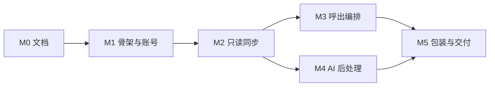

# 12 里程碑与验收

> 项目：`feige-outbound-platform`（FOP，本地飞鸽外呼平台）
> 状态：v0.2（2026-11-14 决策修订：转写 100% 本地自建 MiniMax ASR + DeepSeek 内置后处理）｜阶段：M0 文档评审
> 基准：[01-决策与约定.md](./01-决策与约定.md) §11（里程碑唯一基准）、§5.4（错误码 40 个）、§7（状态机/事件）、[05-对外API契约.md](./05-对外API契约.md)（接口行为）、[13-后处理规格（ASR与LLM）.md](./13-后处理规格（ASR与LLM）.md)（ASR/LLM 实现规格）、[02-需求文档.md](./02-需求文档.md)（FR/NFR 来源）。
> 本文用途：M0–M5 的分解、退出标准（Gate）、Given/When/Then 验收用例、测试矩阵、Definition of Done、评审清单。

## 文档信息

| 项 | 内容 |
| --- | --- |
| 文件 | `docs/12-里程碑与验收.md` |
| 版本 | v0.2（与 docs/01 v0.2、docs/02 v0.2、docs/05 v0.2、docs/13 v0.1 同批；v0.1 → v0.2 按 D1–D8 决策修订转写/后处理验收） |
| 状态 | 待评审（M0 退出标准之一） |
| 里程碑基准 | docs/01 §11（M0–M5 的名称/目标/产出不得改写） |
| 需求来源 | docs/02 §5（FR-001~FR-061）、§6（NFR-48 条）、§1.7（成功度量 M-01~M-12） |
| 契约来源 | docs/05 §3（35 个 REST 操作）、§8（错误矩阵）、§9（幂等/并发） |
| 后处理规格来源 | docs/13（切分/说话人/词表/DeepSeek prompt、schema、升级、全量回补、实测数据、错误码） |
| 安全来源 | docs/11（安全验收清单；第三方云委托处理见 §7.6） |
| 读者 | 项目 Lead、实现者、测试执行人、评审人、业务验收方 |

### 写作与编号约定

| # | 约定 |
| --- | --- |
| 1 | 里程碑 `M0`–`M5` 与 docs/01 §11 完全一致；本文只做**展开**，不新增/改名/合并里程碑。 |
| 2 | 退出标准编号 `G-M<里程碑>-<序号>`；验收用例 `AC-001`~`AC-079`（本次修订新增 AC-070~AC-079）；测试项 `TM-xx`；故障注入 `FI-xx`；交付物 `D-M<里程碑>-<序号>`；DoD 条目 `DoD-xx`；评审项 `RV-xx`。 |
| 3 | 验收用例统一采用 Given / When / Then 三段式；每条必须可判定，并标注关联 FR/NFR 与所属里程碑。 |
| 4 | 每个 P0 FR（docs/02 共 36 条）至少映射 1 条 AC；每条 AC 必须映射至少 1 条 FR/NFR 或文档契约条款（追溯见 §4.12）。 |
| 5 | 验收证据不得包含真实密码/JWT/完整手机号/真实密钥；号码一律脱敏（`138****0000`），凭证仅以"secrets/环境变量已注入"描述。 |
| 6 | 测试环境/数据/工具只描述类别与约束，不规定具体实现代码；实现期可增补细则但不得降低 Gate 标准。 |

### 目录

1. 总则（§1）
2. 里程碑总览与依赖（§2）
3. 里程碑详细分解（§3）
4. 验收用例（Given/When/Then，§4）
5. 测试矩阵与故障注入（§5）
6. Definition of Done（§6）
7. 评审清单（§7）
8. 验收执行、缺陷与门禁（§8）
9. 与其他文档的引用关系（§9）

---

## 1. 总则

### 1.1 目的与适用范围

本文定义从"文档定稿（M0）"到"可交付（M5）"的实施阶段划分与验收标准，用于：① 评审确认每个里程碑的范围与退出条件；② 实现与测试据 §4/§5 执行验收；③ 发布前按 §6/§7 判定是否达到交付质量。本文不替代 docs/02 的需求定义，也不替代 docs/05 的接口契约。

### 1.2 基准与冲突裁决

| 优先级 | 文档 | 裁决范围 |
| --- | --- | --- |
| 1 | [01-决策与约定.md](./01-决策与约定.md) | 术语、枚举、错误码、状态机、接口清单、里程碑基准、配置默认值 |
| 2 | [05-对外API契约.md](./05-对外API契约.md) | REST 字段、请求/响应结构、HTTP 状态映射、幂等/并发语义 |
| 3 | [13-后处理规格（ASR与LLM）.md](./13-后处理规格（ASR与LLM）.md) | ASR 切分参数、说话人角色映射、词表归一、DeepSeek prompt/schema/升级、全量回补、评测指标、`ASR_FAILED`/`ANALYSIS_FAILED` 语义 |
| 4 | [02-需求文档.md](./02-需求文档.md) | FR/NFR 目标值、场景、约束投影、成功度量 |
| 5 | 本文 | 里程碑展开、AC、测试矩阵、DoD、评审清单（若与 1–4 冲突，以 1–4 为准并回改本文） |
| 6 | 00/03/04/06–11 | 事实、架构、数据、接入层、部署、安全细则 |

### 1.3 里程碑与门禁规则

| 规则 | 内容 |
| --- | --- |
| R-01 | 里程碑按 M0→M1→M2→M3→M5 关键路径推进；M4 可在 M2 完成后与 M3 并行（见 §2.3）。 |
| R-02 | 每个里程碑的退出标准（Gate）必须**全部通过**才可宣布完成；Gate 项不允许"部分通过"或"后续补齐"（除标注可延期的 P1 项，需评审记录）。 |
| R-03 | Gate 未通过时里程碑延期，不得跳级进入下一里程碑；确需并行时必须在评审中显式记录风险与依赖。 |
| R-04 | 每个 Gate 必须有可收集的证据（测试报告/日志片段/事件 ID/脱敏截图/DB 查询结果/上游调用计数），证据归档见 §8.1。 |
| R-05 | M0 的 Gate 对象是文档与契约；M1–M5 的 Gate 对象是"实现 + 测试 + 文档同步更新"。 |
| R-06 | 任何 Gate 通过后发现的回归缺陷，按 §8.3 缺陷分级处理；Blocker/Major 缺陷会重新打开对应里程碑。 |

### 1.4 验收角色与职责

| 角色 | 职责 | 对应 docs/02 角色 |
| --- | --- | --- |
| 项目 Lead | 里程碑裁决、Gate 签字、冲突裁决（01/05 为准） | — |
| 实现者（按模块） | 交付实现、自测、提供 Gate 证据 | — |
| 测试执行人 | 执行 AC/TM/FI、维护测试数据与 fixture、出具报告 | — |
| 需求/文档负责人 | FR/NFR 变更、追溯表维护、文档一致性 | R-03（维护者视角） |
| 运维/安全评审 | M5 部署、备份恢复、安全合规收口 | R-03 |
| 业务验收方 | 真实拨测资源、分析结果可用性、合规确认（Q4/Q16） | R-02/R-04 |

### 1.5 验收环境与前置数据

| 编号 | 项 | 要求 |
| --- | --- | --- |
| ENV-01 | 运行环境 | Linux（当前 NixOS）、Node.js ≥22、SQLite、浏览器可 headful（Xvfb 可选），端口 8710 可用 |
| ENV-02 | 上游连通 | 可访问上游登录页/业务 API/WS/录音 HTTPS 代理（docs/00 实测路径） |
| ENV-03 | 测试账号 | ≥2 个可登录坐席账号（凭证经 secrets/环境变量注入，**不写入文档/仓库**）；用于多账号与隔离验收 |
| ENV-04 | 真实拨测资源 | 测试被叫号码（脱敏示例 `138****0000`）+ 坐席绑定手机可接听 + 拨测时间在 07:50–22:00 内；M3 真实拨测专用 |
| ENV-05 | 上游 fixture | 录制脱敏的上游响应（登录/列表/详情/错误/空响应等；**不含上游转写**——v1 不使用），供无网络/非窗口时段自动化测试 |
| ENV-06 | 故障注入工具 | 可模拟：网络超时/断网、上游 5xx、HTTP200 空 body、JSON 截断、磁盘满/水位、`kill -9`、时钟偏移、SSE 断线；**第三方 provider 401/429/5xx/超时/非 JSON 响应/空正文** |
| ENV-07 | 测试数据 | 固定数据集（≥10 万话单、≥200 段转写、≥20 通真实通话录音样本、**≥3 档时长（10s/62s/>8min）分块样本**）用于性能、分块与覆盖率验收 |
| ENV-08 | 观测能力 | 可读取结构化日志、事件（`/events`）、作业（`/jobs`）、审计导出、`/status`、**ASR/LLM 的 usage/traceId/失败分布**；日志脱敏已生效 |
| ENV-09 | 第三方云 fixture | 录制脱敏的 MiniMax ASR `verbose_json`（含 `n_speakers/segments/speaker`）与 DeepSeek 成功/非 JSON/截断/限流响应样本，供离线契约测试（TM-15） |
| ENV-10 | ASR 金标集 | **20–50 通真实通话**（覆盖高/中/低/无意向、长短通话、单/双声道），人工标注 `intent`、关键事实与角色；用于质量评测与回归（AC-079/TM-16），数据脱敏且不进 git |

### 1.6 验收证据要求

| 证据类型 | 要求 | 示例 |
| --- | --- | --- |
| 测试报告 | 按 AC/TM 编号逐条记录通过/失败与耗时 | AC-051 真实拨测记录表 |
| 事件与作业证据 | 记录 `eventId`/`jobId` 与关键字段（不含凭证） | `call.ended` → `call.audio.ready` 时间差 |
| 数据证据 | DB 查询结果或接口响应（号码脱敏） | `pipeline.transcript=ready, source=asr, provider=minimax:asr-1.0` |
| 计数证据 | 上游调用次数/`callV2` 次数/ASR 调用次数（含分块）/LLM 调用次数与 token | 幂等重放场景中 `callV2` 计数=1；分块重试仅失败块计数+1 |
| 日志证据 | 脱敏后的日志片段，含 `requestId` | 401/409/422 错误码与 `retryAfter`；provider 错误码 |
| 人工抽检 | 抽检方案、样本量、判定标准、结论 | 说话人 diarization 50 段抽检 ≥95%；金标集 intent 准确率 ≥85% |
| 排除项 | 明确未执行/不适用项及理由（需评审确认） | 上游 SIP 能力不在 v1 范围 |

---

## 2. 里程碑总览与依赖

### 2.1 与 docs/01 §11 的对照（基准一致性）

| docs/01 §11 里程碑 | 目标（原文） | 产出（原文） | 本文详细章节 | 本文扩展（不改变基准） | 关联 FR |
| --- | --- | --- | --- | --- | --- |
| M0 文档 | 本套文档定稿 | docs/ + spec/ | §3.1 | 增加 M0 Gate（一致性/追溯/无凭证）与评审清单 | FR 全集（需求闭环） |
| M1 骨架与账号 | 服务骨架、配置、DB、账号注册、浏览器自动登录、JWT 管理、REST 基础、`feige doctor` | 可登录、可查 `status` | §3.2 | 增加作业队列/事件/审计/认证/配置的 M1 最小闭环 Gate | FR-001~009、FR-045、FR-049~053、FR-056 |
| M2 只读同步 | 话单同步、录音下载、本地 ASR 转写、事件、查询接口 | 全量/增量同步与查询可用 | §3.3 | 增加同步完整率/归档成功率/**本地 ASR 接入与长音频切分（分块断点续跑）**/事件续传/性能 Gate | FR-010~FR-022、FR-024~FR-026、FR-046、FR-048 |
| M3 呼出编排 | `POST /calls` + 调度（时段/串行/幂等）+ 状态机 + 防重 + 补齐真实拨测 | 端到端呼出 | §3.4 | 增加真实拨测 ≥10 次、防双呼对账、错误归一 Gate | FR-034~044、FR-047 |
| M4 AI 后处理 | 本地 ASR（MiniMax）+ 角色映射 + 词表归一 + DeepSeek 分析 + 全量回补 + reprocess | 转写与分析可用 | §3.5 | 增加**角色映射准确率/跨块一致性/词表变体 0 残留/LLM JSON 合法率 ≥99.5%/校验失败升级/全量回补可暂停恢复/金标集评测** Gate | FR-023、FR-027~FR-033、FR-059~FR-061 |
| M5 包装与交付 | CLI/MCP/SKILL、部署文档、systemd、验收 | 可交付 | §3.6 | 增加契约一致率 100%、备份恢复演练、浸泡测试、最终验收 Gate | FR-053~058 |

> 结论：里程碑的名称、目标、产出与本套文档其余部分均未改写 docs/01 §11；本文仅补 Gate 与验收方法。

### 2.2 里程碑 × 能力域覆盖矩阵

| 能力域（docs/02 §5） | M0 | M1 | M2 | M3 | M4 | M5 |
| --- | --- | --- | --- | --- | --- | --- |
| A 账号与会话 | 需求/契约 | **实现** | 稳定/回归 | 多账号呼出隔离 | — | 安全收口 |
| B 话单同步与查询 | 需求/契约 | 表结构/游标设计 | **实现** | 呼出话单对账 | 检索归一 | 回归 |
| C 录音归档 | 需求/契约 | 存储布局设计 | **实现** | 流水线触发 | — | 备份/恢复 |
| D 转写（本地 ASR） | 需求/契约 | — | **本地 ASR 接入/切分/分块断点** | — | **角色映射/跨块一致性/质量评测** | 回归 |
| E 词表与后处理（DeepSeek） | 需求/契约 | — | 词表 CRUD 骨架 | — | **词表归一/DeepSeek 分析/全量回补/金标集** | 回归 |
| F 呼出编排 | 需求/契约 | — | — | **实现 + 真实拨测** | — | 回归 |
| G 作业与事件 | 需求/契约 | 队列/事件基础 | **事件流/SSE** | 时间线 | 重跑 | 契约一致 |
| H 平台/配置/审计/接入 | 需求/契约 | **健康/配置/审计/认证/CLI 基础** | 查询接口 | — | — | **MCP/SKILL/CLI 完整/systemd/验收** |

### 2.3 里程碑依赖关系

- **关键路径**：M0 → M1 → M2 → M3 → M5（真实拨测窗口与测试号码是 M3 的外部依赖，需提前排期）。
- **并行建议**：M4 在 M2 完成后即可启动（不依赖 M3），但 M4 的验收样本可复用 M3 产生的真实话单；M5 的 CLI/MCP 骨架可在 M1 起逐步搭建，但**完整同构验收**在 M5 执行。
- **外部依赖**：ENV-03/ENV-04（账号与拨测资源）必须在 M1/M3 开始前就绪；不满足时对应 Gate 延期而非降级。

### 2.4 Gate 编号与统计

| 里程碑 | Gate 编号区间 | Gate 数 | AC 覆盖区间 | 关联 FR 数 | 关联 P0 FR |
| --- | --- | --- | --- | --- | --- |
| M0 | G-M0-01~06 | 6 | —（文档评审，不产生运行时 AC） | 61（追溯校验） | 36（追溯覆盖校验） |
| M1 | G-M1-01~10 | 10 | AC-001~AC-017 | 16 | 11 |
| M2 | G-M2-01~12 | 12 | AC-018~AC-036、AC-058~AC-060、AC-070/071/078 | 18 | 10 |
| M3 | G-M3-01~13 | 13 | AC-045~AC-057、AC-061 | 12 | 8 |
| M4 | G-M4-01~12 | 12 | AC-037~AC-044、AC-072~AC-079 | 11 | 5 |
| M5 | G-M5-01~09 | 9 | AC-062~AC-069 | 4（+FR-053 完整同构收口） | 4 |

> 说明：AC 按主验收里程碑归属统计，跨里程碑 AC（如 AC-034 ASR 失败语义、AC-071 分块断点续跑、AC-078 provider 故障降级、AC-060 作业恢复）在对应 Gate 中重复引用，不重复计数；关联 FR 数与 docs/02 §5.13 一致。

---

## 3. 里程碑详细分解

> 每个里程碑包含：目标、范围、交付物（D-xx）、依赖、退出标准（G-xx）、关联需求、风险与备注。Gate 项默认阻塞，标注"可延期(P1)"者需评审记录。

### 3.1 M0 文档

**目标**：本套文档定稿（docs/00–13 + spec/），达到 docs/01 §11.1 的 5 条完成标准。

**范围**：上游侦察结论归档、全局约定、PRD、架构、数据模型、API/CLI/MCP/SKILL 契约、上游适配层、部署运维、安全合规、里程碑验收、机器可读契约与索引。

**交付物**

| ID | 交付物 | 形式 | 证据 | 关联文档 |
| --- | --- | --- | --- | --- |
| D-M0-01 | 00–13 文档全集 | Markdown | 文件清单 + 章节结构检查 | docs/00–13 |
| D-M0-02 | REST 机器契约 | `spec/openapi.yaml`（OpenAPI 3.1，35 操作） | YAML 校验 + paths 计数=35 | docs/05 |
| D-M0-03 | spec 说明 | `spec/README.md` | 与 05 的差异说明（应为 0） | docs/05 |
| D-M0-04 | 文档索引 | `docs/README.md` | 阅读顺序与状态表 | 全部 |
| D-M0-05 | 一致性评审记录 | 本文 §7 评审清单填写 | 评审结论 | 本文 |
| D-M0-06 | 开放问题清单 | docs/01 §12 + docs/02 §10 | 15 条未决（Q1、Q4–Q17）含默认假设 + 2 条已关闭（Q2/Q3，保留追溯） | docs/01/02 |
| D-M0-07 | 需求追溯表 | docs/02 §5.11/§5.12 + 本文 §4.12 | FR↔AC↔TM 闭环 | docs/02/12 |

**依赖**：上游侦察（docs/00）完成；用户确认的关键约束（平台状态语义、六层契约）已记录。

**退出标准（Gate）**

| Gate ID | 检查项 | 验证方法 | 通过标准 | 证据 | 关联需求 |
| --- | --- | --- | --- | --- | --- |
| G-M0-01 | 文档完整性 | 文件清单核对 + 空文件/占位检查 | docs/00–13、spec/、README 全部存在且无占位符（除明确标注的待确认项） | 文件清单 | docs/01 §11.1-1 |
| G-M0-02 | 里程碑一致性 | docs/01 §11 与本文 §2.1 逐行对照 | M0–M5 名称/目标/产出一致，无改写 | 对照表 | docs/01 §11 |
| G-M0-03 | 契约覆盖 | 检查 docs/05 §3 的 35 操作在 spec 与 docs/02 §5.12 均出现；检查 `Skill/MCP/CLI/REST`、`Dial/Dial Status/List/Detail/Status` 均有文档落点 | 35/35 + 全部节点有落点 | 覆盖矩阵 | docs/01 §11.1-2 |
| G-M0-04 | 上游事实与第三方实测映射 | 核对 F-01~F-14、T-01~T-09、C-01~C-15 的 FR/NFR 投影 | 每条≥1 个投影（无遗漏） | 映射表（docs/02 §1.2/§1.2.1/§2.2/§9） | docs/01 §11.1-3 |
| G-M0-05 | 需求可验收 | 检查 61 FR 字段齐全；36 条 P0 FR 均有 AC；48 条 NFR 均有验证方式 | 100% 覆盖 | 追溯表 | docs/02 §5/§6 |
| G-M0-06 | 合规与质量 | 敏感信息扫描（无凭证/完整号码）；Mermaid 渲染；链接有效；无实现代码 | 0 违规 | 扫描报告 | docs/01 §11.1-4 |

**关联需求**：全部 FR/NFR 的需求基线（不产生运行时行为）。

**风险与备注**：文档评审意见可能触发 FR/NFR 变更，按 docs/02 §11.3 流程处理；M0 Gate 通过后文档进入受控变更状态。

---

### 3.2 M1 骨架与账号

**目标**：服务骨架、配置、DB、账号注册、浏览器自动登录、JWT 管理、REST 基础、`feige doctor` 可用——达到"可登录、可查 `status`"。

**范围**：进程骨架与配置；SQLite schema/迁移；账号实体与凭证引用；浏览器自动登录（阿里云滑块）；JWT 生命周期；REST 基础（认证/封套/错误码/分页）；作业队列与事件/审计基础；CLI 基础命令；单账号健康；启动自检。

**交付物**

| ID | 交付物 | 形式 | 证据 | 关联 FR |
| --- | --- | --- | --- | --- |
| D-M1-01 | 服务骨架 + 配置加载/校验 + `/health` `/status` | 可运行服务 | 启动日志 + 接口响应 | FR-049/050 |
| D-M1-02 | SQLite schema v1 + 迁移框架 + WAL | DDL/迁移记录 | schema 版本、备份可用 | FR-045、FR-052 |
| D-M1-03 | 账号注册/列表/详情/更新/删除 + 凭证引用 | REST + 存储 | 接口用例 | FR-001/002/007 |
| D-M1-04 | 浏览器自动登录（滑块）+ 独立 profile | 登录作业 | 登录事件链 + 脱敏截图 | FR-003 |
| D-M1-05 | JWT 管理（持久化/预重登/失效检测） | 会话模块 | 失效注入用例 | FR-004/009 |
| D-M1-06 | REST 基础（Bearer/封套/错误码/分页/请求 ID/版本头） | 中间件 | 契约测试 | FR-056 |
| D-M1-07 | 作业队列 + 重试退避 + 重启恢复 | worker | 故障注入证据 | FR-045 |
| D-M1-08 | 事件持久化 + 账号类事件（`account.*`） | 事件总线 | 事件查询证据 | FR-046 |
| D-M1-09 | 写操作审计 | AuditLog | 审计导出证据 | FR-052 |
| D-M1-10 | CLI 基础：`health/status/account login/doctor` | 命令 | 命令输出/退出码 | FR-053 |
| D-M1-11 | 测试：单元 + 契约（平台/账号）+ 故障注入（重启/空响应） | 测试报告 | 用例通过清单 | 全域 |
| D-M1-12 | 文档同步：03/04/09/10/11 的 M1 落地部分与本文无冲突 | 文档 | 一致性检查 | — |

**依赖**：M0 Gate 通过；ENV-01/02/03 就绪（≥1 个测试账号）；Q5 账号来源确认（或按默认假设 2–8 个账号先行）。

**退出标准（Gate）**

| Gate ID | 检查项 | 验证方法 | 通过标准 | 证据 | 关联需求 |
| --- | --- | --- | --- | --- | --- |
| G-M1-01 | 启动与存活 | 冷启动计时；`GET /health`；`GET /status` | ≤5s 可用；`/health` 200；`/status` 字段符合 docs/05 §2.11 | 响应 + 计时记录 | FR-049、NFR-PERF-05 |
| G-M1-02 | 账号注册与凭证 | 注册→列表→详情；重复 slug；响应扫描 | 201/409 正确；无凭证/完整号码；`upstreamUsernameMasked` 正确 | 接口用例 + 扫描报告 | FR-001/002 |
| G-M1-03 | 自动登录（真实账号） | 真实账号 `login`（凭证注入），重复 2 次 | 成功且 `state=online`、`jwtExpiresAt` 合理；事件链 `started→succeeded`；浏览器无残留 | 登录事件 + 进程检查 | FR-003、M-05 |
| G-M1-04 | JWT 生命周期 | 注入剩余 <24h 会话；注入 HTTP200 空响应；统计恢复时长 | 24h 内预重登；空响应→`UPSTREAM_AUTH_EXPIRED`→重登成功；恢复 ≤15 分钟 | 事件时间差 + 日志 | FR-004、NFR-REL-05 |
| G-M1-05 | 账号启停/删除/隔离 | 停用后呼出模拟校验；删除默认/purge；两账号其一故障 | 403 `ACCOUNT_DISABLED`；历史保留；`purgeData` 需 confirm；另一账号不受影响 | 接口用例 + 数据核对 | FR-007/009、NFR-REL-06 |
| G-M1-06 | 账号健康 | 正常/上游探测失败/缓存 | 字段完整；失败仍 200 且 `upstream.reachable=false`；30s 缓存生效 | 响应 + 上游调用计数 | FR-008 |
| G-M1-07 | 配置读写 | GET；合法 PATCH；非法 PATCH；只读字段；重启项 | 脱敏；热生效；400 `CONFIG_INVALID`；`restartRequired` 正确 | 接口用例 + 行为观测 | FR-050/051 |
| G-M1-08 | 认证与网络边界 | 无/错 token；外部地址连接；请求头检查 | 401 `UNAUTHORIZED`；外部不可连；`X-Request-Id`/`X-Api-Version` 正确 | 接口用例 + 端口检查 | FR-056、NFR-SEC-01 |
| G-M1-09 | 作业与重启恢复 | 运行中 `kill -9` 后重启；失败注入观察退避 | 未完成作业 100% 恢复；重试次数/间隔符合 NFR-REL-04 | 作业记录 + 时间戳 | FR-045、NFR-REL-01/04 |
| G-M1-10 | 事件/审计/脱敏 | 触发账号类事件与写操作；日志/事件/审计扫描 | `account.*` 事件齐全；审计矩阵覆盖；无凭证/完整号码 | 事件列表 + 审计导出 + 扫描 | FR-046/052/057 |

**关联需求**：FR-001~FR-009、FR-045、FR-049~FR-053（基础）、FR-056、FR-057（基线）；NFR-REL-01/04/05/06、NFR-PERF-05、NFR-SEC-01/02、NFR-OPS-05、NFR-COMPAT-01。

**风险与备注**：滑块风控（R-01）可能导致登录不稳定，M1 登录验收需连续 2 次成功并记录失败重试路径；若上游当日不可达，可用 fixture 完成 G-M1-04/06 的非真实链路部分，但 G-M1-03 必须真实账号。

---

### 3.3 M2 只读同步

**目标**：话单同步、录音下载、**本地 ASR 转写**、事件、查询接口——达到"全量/增量同步与查询可用"（转写 100% 自建，基础链路在 M2 交付，规格见 docs/13 §2/§7）。

**范围**：账号级增量同步与全量/回补；话单查询/详情/对账；录音归档与读取；**本地 ASR 接入（MiniMax `asr-1.0`，multipart/`verbose_json`）、长音频切分（≤480s 整段；>480s 按 420s 静音点切块、尾部最多 480s 强制切分）、时间戳拼接、分块结果落盘与断点续跑、ASR 失败语义**；事件流（SSE）与作业查询；只读 CLI；上游/第三方 fixture 契约测试与性能基准。

**交付物**

| ID | 交付物 | 形式 | 证据 | 关联 FR |
| --- | --- | --- | --- | --- |
| D-M2-01 | 同步 worker（增量/full/backfill）+ 游标 + 对账 | worker + API | 同步作业结果 | FR-010/011/015 |
| D-M2-02 | 话单列表/摘要/详情（含上游原样字段） | REST | 契约测试 | FR-012/013/014 |
| D-M2-03 | 录音归档（代理优先/直连兜底/sha256）+ audio 接口（Range/ETag） | 流水线 + REST | 抽样校验 | FR-016/017/018/019 |
| D-M2-04 | **本地 ASR 接入**（MiniMax `asr-1.0`、multipart、`verbose_json`、`speaker S1/S2`）+ **长音频切分/时间戳合并/分块落盘与断点** + ASR 失败语义 | 流水线 + REST | 切分计划核对 + 断点/失败注入报告 | FR-020/021/022/024/025 |
| D-M2-05 | 事件持久化 + SSE + 历史查询 + 作业查询 | REST/SSE | 续传测试 | FR-046/048 |
| D-M2-06 | CLI 只读命令（calls/sync/jobs/events） | 命令 | `--json` 用例 | FR-053（只读部分） |
| D-M2-07 | 上游 fixture + **MiniMax ASR fixture/契约测试** + 性能基准数据集 | 测试资产 | 报告 | NFR-COMPAT-02/04、NFR-PERF |
| D-M2-08 | 文档同步（03/04/09/10 的 M2 落地部分） | 文档 | 一致性检查 | — |

**依赖**：M1 Gate 通过；ENV-05/07/09 就绪（fixture、固定数据集、ASR fixture）；上游账号在线且至少 1 个测试账号有历史话单；**MiniMax ASR 密钥已按 secrets/环境变量注入（`MINIMAX_API_KEY`/`FOP_MINIMAX_API_KEY`）**。

**退出标准（Gate）**

| Gate ID | 检查项 | 验证方法 | 通过标准 | 证据 | 关联需求 |
| --- | --- | --- | --- | --- | --- |
| G-M2-01 | 增量同步与新鲜度 | 造数（fixture 或真实新话单）后计时查询 | ≤2×sync.intervalMs（≤120s）本地可查；重复同步无重复 | 时间戳 + 条数 | FR-010、NFR-PERF-10 |
| G-M2-02 | 同步失败与恢复 | 注入单页失败 3 次；恢复后继续 | 作业 `failed`、游标不前进；恢复后补拉无缺口 | 作业记录 + 对账 | FR-010、NFR-REL-08 |
| G-M2-03 | 全量/回补与对账 | 7 天回补；中途 `kill -9`；对账 | 完整率 ≥99.5%；断点续跑；`callId` 不变；差异告警可用 | 对账报告 | FR-011/015、M-01 |
| G-M2-04 | 多账号聚合去重 | 两账号各同步 100 条；重复拉取 | 本地 200 条；唯一键生效；账号过滤正确 | 数据核对 | FR-012 |
| G-M2-05 | 查询与详情契约 | 分页/过滤/排序/非法参数/404/includeRaw/脱敏 | 字段与 docs/05 §2.5/2.9 一致；错误码正确；号码掩码 | 契约测试报告 | FR-013/014 |
| G-M2-06 | 录音归档 | 抽样 ≥10 通下载与 sha256 比对；24h 成功率统计 | sha256 100% 一致；成功率 ≥99%；代理失败可回退直连 | 校验记录 | FR-016、M-02 |
| G-M2-07 | 录音错误语义与读取 | 未接通/下载中/失败重试/reprocess；Range 请求 | 422/409/404 语义正确；206+ETag 正确；reprocess 可恢复 | 接口用例 | FR-017/019 |
| G-M2-08 | 本地 ASR 接入与产出 | ≥5 通真实录音跑完整 `asr` 作业；核对 DTO | `transcript=ready` 且 `source=asr`、`provider=minimax:asr-1.0`；`segments` 含 `beginMs/endMs/speakerLabel/chunkIndex`；上游 `call-detail-content` 调用计数=0 | 接口响应 + 调用计数 | FR-020/024 |
| G-M2-09 | 长音频切分与分块断点 | 10s/62s/>8min 三档样本；注入单块失败；中途 `kill -9` | ≤480s 仅 1 块；>480s 按 420s 静音点切块（含 `forcedCut` 标记）；拼接时间戳单调；单块重试只重跑失败块；重启从块结果续跑 | 切分计划 + 调用计数 + 作业记录 | FR-021/022、AC-070/071 |
| G-M2-10 | 事件流 | SSE 订阅/断线重连/Last-Event-ID/stream.reset；事件类型清单 | 续传不丢事件；类型覆盖 docs/01 §7.3；时延 ≤1s | 事件 ID 序列 | FR-046、NFR-PERF-09、M-07 |
| G-M2-11 | 性能基准 | 固定数据集压测：同步/列表/详情/转写/事件 | 达到 NFR-PERF-01/03/07/09 目标值 | 基准报告 | NFR-PERF-01/03/07/09 |
| G-M2-12 | 重启恢复、provider 降级与数据一致性 | 下载/ASR 作业中 `kill -9`；注入 MiniMax 401/5xx/超时；孤儿文件巡检；日志扫描 | 作业恢复、无重复归档/重复 ASR 请求；`ASR_FAILED` 可重试/可重跑；文件/DB 一致；无敏感信息 | 巡检报告 + 故障注入记录 | NFR-REL-01/03/09、FR-022、AC-078 |

**关联需求**：FR-010~FR-022、FR-024~FR-026、FR-046、FR-048；NFR-PERF-01/02/03/06/07/09/10/11、NFR-REL-01/03/07/08/09、NFR-COMPAT-02/04、NFR-OBS-02。

**风险与备注**：MiniMax 并发/限流上限未明示（V-05），ASR 真实电话音质需金标集评估（V-09/Q17）；上游录音真实声道布局影响后续角色映射路径（V-10/R-17），M2 拨测后 `ffprobe` 确认；录音保留期未知（V-04），M2 起持续观察 URL 有效期并记录到 docs/09。若真实账号话单不足，可用 fixture 覆盖契约部分，但同步完整率、归档成功率与 ASR 接入必须用真实数据抽样。

### 3.4 M3 呼出编排

**目标**：`POST /calls` + 调度（时段/串行/幂等）+ 状态机 + 防重 + **补齐真实拨测**——达到"端到端呼出"。

**范围**：呼出受理与校验链；窗口调度；账号串行与全局并发；`callV2` 提交与状态跟踪；幂等/冷却/防重；取消；Dial Status；上游错误归一；对账修正；通话结束触发流水线；真实拨测。

**交付物**

| ID | 交付物 | 形式 | 证据 | 关联 FR |
| --- | --- | --- | --- | --- |
| D-M3-01 | `POST /calls` 受理 + 七步校验链 + dryRun | REST | 契约/校验用例 | FR-034/035/036/037/039 |
| D-M3-02 | 调度器（窗口排队、账号串行、全局并发） | worker | 调度日志/事件 | FR-035/037 |
| D-M3-03 | 状态机与状态跟踪（含 120s 超时） | 状态机 + 作业 | 事件链 + 转移表测试 | FR-038 |
| D-M3-04 | 幂等键/冷却/防双呼（含 `callV2` 超时不重发） | 中间件 + 调度 | 调用计数证据 | FR-039 |
| D-M3-05 | 上游错误归一端到端 | 适配层 | 错误码用例 | FR-042 |
| D-M3-06 | 取消 + Dial Status + 对账修正 | REST/作业 | 接口用例 + 事件 | FR-040/041/044 |
| D-M3-07 | 通话结束触发流水线（audio→transcript） | 事件驱动 | 事件链 | FR-043 |
| D-M3-08 | 真实拨测记录（≥10 次） | 验收报告 | 拨测表（脱敏） | FR-038、M-06 |
| D-M3-09 | CLI 呼出相关命令（dial/calls/detail/cancel 等） | 命令 | `--json` 用例 | FR-053（写部分） |
| D-M3-10 | 测试：契约/集成/E2E/故障注入（超时/重复/账号忙/上游异常） | 测试报告 | 用例清单 | 全域 |

**依赖**：M2 Gate 通过；ENV-03/04 就绪（第二个账号可选但建议）；测试被叫号码与坐席手机可接听；**拨测必须安排在 07:50–22:00 窗口内**（C-01）。

**退出标准（Gate）**

| Gate ID | 检查项 | 验证方法 | 通过标准 | 证据 | 关联需求 |
| --- | --- | --- | --- | --- | --- |
| G-M3-01 | 受理契约 | 合法请求/非法号码/多账号缺 accountId | 201 + `callId` + `pending`；400 `VALIDATION_FAILED`（`account_required`）；受理 p95 ≤300ms | 契约测试报告 | FR-034、NFR-PERF-04 |
| G-M3-02 | dryRun 与预检 | dryRun=true；预检查重命中 | 200 计划；不产生 Call、`callV2` 计数=0；命中仅 warning 不阻断 | 响应 + 调用计数 | FR-034/036、AC-046 |
| G-M3-03 | 拨打时段 | 窗口外（时钟注入）默认/拒绝两种配置 | 默认为 `pending` + 次日 07:50 `scheduledAt`；关闭排队时 422 `CALL_OUTSIDE_DIAL_WINDOW` + `retryAfter` | 响应 + 状态核对 | FR-035、C-01 |
| G-M3-04 | 账号调度与并发 | 同账号连续两单；多账号并行 | 第二单 409 `ACCOUNT_BUSY`（`busyCallId`）；多账号并行 ≤`globalConcurrency` | 接口用例 + 事件 | FR-037、C-03 |
| G-M3-05 | 幂等重放 | 同键同体重放；同键异体 | 24h 内返回首次结果（`meta.idempotencyReplayed=true`）；异体 409 `IDEMPOTENCY_CONFLICT`；`callV2` 计数=1 | 调用计数 + 响应 | FR-039、NFR-REL-02 |
| G-M3-06 | 防重与未知状态 | 冷却窗口内重复；注入 `callV2` 超时 | 冷却内拒绝；超时**不重发** `callV2`（计数=1），进入人工核对清单 | 调用计数 + 清单 | FR-039、C-07 |
| G-M3-07 | 真实拨测状态流转 | 窗口内真实呼出 ≥10 次（坐席手机接听，含接通/未接通样本） | 状态时序 `pending→dialing→connected→ended`（或 `no_answer`）正确率 100%；事件链完整；`durationSec` 与上游一致 | 拨测表 + 事件 ID | FR-038、M-06 |
| G-M3-08 | 未接通分支 | 未接通样本；外部调用计数 | `no_answer` 终态；`audio=missing`、`transcript=missing`、`analysis=skipped`（与 docs/04 §15.1 一致）；ASR/LLM 调用=0 | 数据 + 计数 | FR-038/043 |
| G-M3-09 | 跟踪超时与对账 | 模拟无话单；构造本地/上游不一致 | 120s → `failed(CALL_TRACKING_TIMEOUT)` 且不自动重拨；对账修正 `reconciled=true`、不重复流水线 | 事件 + 数据 | FR-038/044、C-07 |
| G-M3-10 | 取消语义 | pending 取消；dialing 取消；终态取消 | 200 `canceled` 且不再提交（`callV2`=0）；409 `CALL_NOT_CANCELABLE`；409 `CALL_ALREADY_TERMINAL` | 接口用例 | FR-040 |
| G-M3-11 | 上游错误归一 | 空响应/10056 时段/10056 其他/网络超时 | 映射为 `UPSTREAM_AUTH_EXPIRED`/`CALL_OUTSIDE_DIAL_WINDOW`/`CALL_REJECTED_BY_UPSTREAM`/`UPSTREAM_UNREACHABLE`；`details.upstreamCode` 保留 | 错误码用例 | FR-042、C-01 |
| G-M3-12 | 呼出审计与 Dial Status | 每次受理/取消/失败；轮询摘要 | 审计覆盖 100%；状态摘要 p95 ≤100ms 且终态稳定 | 审计导出 + 计时 | FR-041/052、NFR-PERF-03 |
| G-M3-13 | 流水线触发与事件时间线 | 接通样本结束后 | `call.ended→audio.ready→transcript.*` 事件按序；`GET /calls/{id}/events` 完整 | 事件 ID 序列 | FR-043/047 |

**关联需求**：FR-034~FR-044、FR-047；NFR-PERF-04、NFR-REL-02/07、NFR-SEC-03/05、M-06。

**风险与备注**：G-M3-07 是唯一依赖真实人/号码/时段的 Gate，必须提前排期（R-03）；若当日窗口内无法完成，M3 不得宣布完成，只能记录"部分通过"并在评审中升级。真实拨测记录须脱敏（号码掩码、不记录凭证），但保留上游 `upstreamCallId` 与事件 ID 作为证据。

---

### 3.5 M4 AI 后处理

**目标**：本地 ASR（MiniMax）+ 角色映射 + 词表归一 + DeepSeek 分析 + 全量回补 + reprocess——达到"转写与分析可用"。

**范围**：说话人分离与角色映射（双声道 A/B 优先、否则 ASR diarization + 规则/LLM 复核、跨块重映射、低置信 `needsReview`）；词表规则管理与确定性归一（ASR 后、LLM 前 + LLM 输出再归一）；DeepSeek 内置后处理（prompt `analysis-v1`、严格 JSON schema、校验重试、升级 `deepseek-v4-pro`、PII 脱敏、usage）；分析版本与 reprocess（`asrModel`/`analysisModel`）；**全量历史回补（不设预算上限、可暂停恢复、幂等跳过、用量可观测）**；金标集评测与回归；归一化检索。

**交付物**

| ID | 交付物 | 形式 | 证据 | 关联 FR |
| --- | --- | --- | --- | --- |
| D-M4-01 | 说话人分离与角色映射（双声道 A/B / diarization / LLM 复核 / 跨块 `llm_reconciled` / `needsReview`） | 流水线 | 抽检报告 + 事件 | FR-023 |
| D-M4-02 | 词表 CRUD/全量导入/确定性归一引擎/LLM 输出再归一 | REST + 引擎 | 用例 + 变体残留扫描 | FR-027/028/029 |
| D-M4-03 | DeepSeek 内置后处理（prompt `analysis-v1`、schema 校验、重试/升级、PII 脱敏、usage） | 流水线 | schema 校验 + 可用率评审 + 升级链记录 | FR-030/031/033 |
| D-M4-04 | reprocess 全阶段（audio/transcript/analysis；`asrModel`/`analysisModel`） | REST + 作业 | 幂等/版本证据 | FR-032 |
| D-M4-05 | 全量历史回补编排（全量入队、并发/限流、暂停/恢复、幂等跳过、进度） | 作业 + API | 回补进度/恢复证据 | FR-059 |
| D-M4-06 | 用量与成本可观测（ASR 音频秒数、LLM tokens、耗时、失败分布） | 指标/记录 | 汇总报表 | FR-060 |
| D-M4-07 | 金标集构建与评测回归（20–50 通，JSON/准确率/事实一致性/变体残留/时延） | 测试资产 | 评测报告 | FR-061 |
| D-M4-08 | 归一化检索（全文检索跟随 current 版本） | 检索 | 命中用例 | FR-026/028 |
| D-M4-09 | 测试：角色抽检/词表/JSON/升级/回补/金标集 | 测试报告 | 用例清单 | 全域 |

**依赖**：M2 Gate 通过（转写/音频可用）；ENV-07/09/10 就绪（分块样本、第三方 fixture、金标集）；**Q10（意向业务字段）与 Q17（真实录音质量目标）在 M4 标定前确认或按默认假设执行**；MiniMax/DeepSeek 密钥可用；Q2/Q3 已关闭（ASR/LLM 供应商已定，见 docs/13 §1）。

**退出标准（Gate）**

| Gate ID | 检查项 | 验证方法 | 通过标准 | 证据 | 关联需求 |
| --- | --- | --- | --- | --- | --- |
| G-M4-01 | ASR 接入与分块正确性 | 10s/62s/>8min 样本；核对切分计划/时间戳/`forcedCut`/块落盘 | ≤480s 整段；>480s 按 420s 静音点切块；拼接时间戳单调；块结果文件齐全 | 切分计划 + 数据核对 | FR-020/021、AC-070/071 |
| G-M4-02 | ASR 失败语义与断点恢复 | 注入分块失败/进程中断/provider 5xx | 只重跑失败块；重启续跑；超限 `transcript=failed` + `ASR_FAILED`；`reprocess` 可恢复 | 故障注入报告 | FR-022、NFR-REL-09、AC-034/078 |
| G-M4-03 | 说话人角色映射 | 双声道样本 ≥5 通；单声道抽检 50 段；长通话跨块 | 双声道 100%（`channel`）；单声道 ≥95%；不一致 100% `needsReview`；跨块一致率 ≥95% | 抽检报告 + 事件 | FR-023、AC-041/042/072 |
| G-M4-04 | 词表管理 | CRUD/全量导入原子性/循环冲突/删除 404/审计 | 全部通过；非法规则整体失败并定位 | 接口用例 | FR-027 |
| G-M4-05 | 归一引擎与变体 0 残留 | 词表样例（9 个同音变体）/幂等/原文保留/LLM 输出再归一 | 命中 100%；幂等；raw/normalized 均保留；最终产物变体残留 **0** | 用例报告 + 扫描 | FR-028、AC-039/073 |
| G-M4-06 | 归一化工具接口 | `POST /text/normalize` 正常/空/超长 | 契约一致；无副作用；校验正确 | 契约测试 | FR-029 |
| G-M4-07 | DeepSeek 分析结构与合法率 | ≥20 通样本；严格 schema；人工评审 | schema 字段齐全；**JSON 合法率 ≥99.5%**；摘要/意向可用率 ≥80%；`promptVersion`/`usage` 可查 | 评审记录 + 统计 | FR-030/031、AC-043/074 |
| G-M4-08 | 校验失败升级与失败语义 | 注入非 JSON/截断/字段非法 | 重试→修复提示→升级 `deepseek-v4-pro`（`max_tokens≥4096`）；仍失败 `analysis=failed` + `ANALYSIS_FAILED`（`validationErrors`） | 故障注入 + 调用记录 | FR-031、AC-044/075 |
| G-M4-09 | reprocess | 各阶段单独/组合重跑；`asrModel`/`analysisModel`；并发/幂等；终态 call | 202 jobId；不改变 `Call.status`；同键返回已有作业；同阶段并发 429；版本切换正确 | 接口 + 事件 | FR-032、AC-037 |
| G-M4-10 | 全量回补可暂停恢复与用量观测 | 全量历史话单（≥1,000 通 fixture/真实）；暂停→恢复；`kill -9`；用量汇总 | 覆盖率 ≥99%；暂停后不再新入队；恢复/重启从断点继续；已 ready 默认跳过；token/音频秒数可汇总 | 回补报告 + 调用计数 | FR-059/060、AC-076 |
| G-M4-11 | 金标集评测与回归 | 20–50 通标注样本；指标统计；变更前后 diff | JSON ≥99.5%、intent ≥85%、事实一致性 ≥90%、变体残留 0、P95 时延达标；回归失败不切换 `isCurrent` | 评测报告 | FR-061、AC-079、M-11/M-12 |
| G-M4-12 | 覆盖率与时延与检索 | 统计 M-03/M-04；归一化检索命中 | 转写覆盖率 ≥99%；单通 ≤480s p95 ≤180s、分块 ≤600s；归一化检索命中 | 指标报告 | FR-026、M-03/M-04、NFR-PERF-07 |

**关联需求**：FR-023、FR-026/027~FR-033、FR-059~FR-061；NFR-PERF-07/08/13、NFR-REL-01/04/09、NFR-SEC-06/07、NFR-OBS-02/06、NFR-COMPAT-04、NFR-COST-01、M-03/M-04/M-11/M-12。

**风险与备注**：ASR 真实录音质量与上限并发仍待标定（Q17/V-05/V-09）；长通话跨块角色一致性与录音声道布局是主要质量风险（R-16/R-17）；`deepseek-v4-pro` 默认 reasoning 会占满 `max_tokens`（必须 ≥4096，见 docs/13 §3.1）；全量回补规模约 4,000 通、数小时至一天（R-18/NFR-PERF-13），不设预算上限但必须支持暂停/恢复与用量观测；LLM JSON 合法率与 intent 准确率阈值来自 docs/13 §6.5，金标集标定后回写 docs/02。

---

### 3.6 M5 包装与交付

**目标**：CLI/MCP/SKILL、部署文档、systemd、验收——达到"可交付"。

**范围**：CLI 完整同构；MCP server/tools/resources；SKILL 包；部署与运维文档；systemd 守护；监控告警；备份恢复；最终验收与发布评审。

**交付物**

| ID | 交付物 | 形式 | 证据 | 关联 FR |
| --- | --- | --- | --- | --- |
| D-M5-01 | CLI 完整命令树与 `--json` 同构 | 命令 | 契约/同构测试 | FR-053 |
| D-M5-02 | MCP server（tools/resources/错误语义/注解） | MCP | 工具清单 + 契约测试 | FR-054 |
| D-M5-03 | SKILL 包（场景映射/安全边界/错误处理） | SKILL | 评审记录 | FR-055 |
| D-M5-04 | 部署文档 + systemd user service 示例 | 文档/配置 | 安装演练 | NFR-OPS-01 |
| D-M5-05 | 监控与告警说明（6 类告警阈值/通道） | 文档 | 告警演练 | NFR-OBS-05 |
| D-M5-06 | 备份恢复手册 + 演练记录 | 文档/记录 | 恢复演练 | NFR-OPS-02/03 |
| D-M5-07 | 最终验收执行记录（AC 全量） | 报告 | 本文 §8.1 模板 | 全部 P0 |
| D-M5-08 | 发布说明 + 升级/回滚手册 | 文档 | 升级演练 | NFR-OPS-03、NFR-PORT-03 |

**依赖**：M3/M4 Gate 通过；ENV-06（故障注入）可用；备份介质可用；安全评审（docs/11）完成。

**退出标准（Gate）**

| Gate ID | 检查项 | 验证方法 | 通过标准 | 证据 | 关联需求 |
| --- | --- | --- | --- | --- | --- |
| G-M5-01 | CLI 同构 | 全命令 `--json` 与 REST 对比；错误码→退出码 | 命令/字段/错误码一致率 100%；退出码映射完整 | 契约测试报告 | FR-053、NFR-COMPAT-03、AC-062/063 |
| G-M5-02 | MCP | 工具清单核对；错误语义；写工具注解 | 与 docs/01 §4.1 MCP 列 100% 对应；错误码一致 | MCP 测试记录 | FR-054、AC-064 |
| G-M5-03 | SKILL | 场景映射/确认约束/错误处理走查 | 覆盖 §5.11 场景；无凭证；与 06/07 一致 | 评审记录 | FR-055、AC-065 |
| G-M5-04 | 安装与守护 | 干净环境安装；systemd 启停/自启/重启 | 安装成功；服务稳定；重启自恢复 | 演练记录 | NFR-OPS-01、AC-066 |
| G-M5-05 | 备份恢复 | 备份→破坏→恢复→一致性校验 | 恢复 ≤30 分钟；RPO ≤1 分钟；数据一致 | 演练报告 | NFR-OPS-02、AC-067 |
| G-M5-06 | 契约一致率 | 35 操作 × CLI/MCP 对照；枚举/错误码 | 一致率 100% | 对照矩阵 | NFR-COMPAT-03、AC-068 |
| G-M5-07 | 最终验收 | 执行全部 P0 AC；汇总缺陷 | 全部 P0 AC 通过；Blocker/Major 缺陷 0 未关闭 | 验收报告 | 全部 P0 FR |
| G-M5-08 | 浸泡与资源 | 连续运行 ≥72h（含定时同步与真实/模拟呼出） | 无致命故障；内存/磁盘稳定；无任务泄漏 | 监控记录 | NFR-REL-01/06、NFR-PERF-12、AC-069 |
| G-M5-09 | 文档与合规收口 | docs/10/11 终态核对；安全清单；留存策略；第三方供应商条款 | 文档同步；安全清单全通过；合规项确认（Q4/Q16） | 评审记录 | NFR-SEC-06、NFR-OPS |

**关联需求**：FR-053~FR-058；NFR-OPS-01~05、NFR-COMPAT-03、NFR-SEC-04/06、NFR-PORT-02/03。

**风险与备注**：M5 的"可交付"不等同于"已上线"；若合规项（Q4 留存/删除、Q16 供应商数据留存与训练条款）未确认，可交付但需在发布说明中列为"使用前提"。

### 3.7 里程碑间交接物

| 交接 | 上游里程碑交付给下游的关键物 | 下游必须验证 |
| --- | --- | --- |
| M1→M2 | 在线账号会话、同步游标框架、作业/事件/审计基础 | 会话可用、作业可恢复、事件可查 |
| M2→M3 | 话单查询、录音归档、本地 ASR 转写状态、事件流 | 呼出后可查到话单与流水线状态 |
| M2→M4 | 音频 ready、本地 ASR 转写 payload（`source=asr`、分块/时间戳/`speakerLabel`）、切分计划与块结果文件 | 角色映射/词表/分析输入完整、版本正确、可基于块重跑 |
| M3→M5 | 端到端呼出链路、状态机、事件链、拨测记录 | CLI/MCP 覆盖呼出全流程 |
| M4→M5 | 分析结果 schema、`promptVersion`/`usage`、reprocess、归一化检索、金标集评测报告、全量回补进度 | 四入口输出一致、错误语义一致、用量可核对 |

---

## 4. 验收用例（Given/When/Then）

### 4.1 使用说明

1. 每条用例按 `Given（前置条件）→ When（操作）→ Then（期望结果）` 执行；Then 必须可观察（接口响应/事件/数据/日志/调用计数）。
2. "关联"列指向 docs/02 的 FR/NFR；每条 AC 同时在 §5 映射测试类型（TM）与 §3 的 Gate。
3. 真实上游相关的用例使用 ENV-03/04；非窗口时段或无法真实调用时用 ENV-05 fixture 覆盖契约分支，但标注"真实链路待窗口补测"，不得据此通过阻塞型 Gate（G-M3-07 除外，其必须真实）。
4. 真实 ASR/LLM 相关用例使用真实 provider 密钥（ENV-06/09）；无网络/无密钥时用 ENV-09 fixture 覆盖契约分支，但**质量类指标（AC-073/AC-074/AC-079）必须使用真实金标集（ENV-10）**。
5. 所有用例执行结果按 §8.1 模板记录；证据脱敏要求见 §1.6。

### 4.2 平台、认证与安全（AC-001 ~ AC-008，M1/M5）

| AC | 关联 | 标题 | Given（前置） | When（操作） | Then（期望） | M |
| --- | --- | --- | --- | --- | --- | --- |
| AC-001 | FR-049、NFR-PERF-05 | DB 故障时存活探针仍可用 | 服务已启动，注入 DB 不可用（锁/文件权限） | 调用 `GET /health` | 返回 200 且 `data.ok=true`；不依赖 DB/上游；p95 ≤20ms | M1 |
| AC-002 | FR-049 | `/status` 结构与时段 | 服务运行、≥1 账号；注入时钟为 23:00（Asia/Shanghai） | 调用 `GET /status` | 200；`db/accounts/upstream/dialWindow/queues/sync/events/limits` 字段齐全；`dialWindow.open=false` 且 `nextOpenAt`=次日 07:50 | M1 |
| AC-003 | FR-056、NFR-SEC-01 | 认证、网络边界与版本头 | 默认配置（仅 127.0.0.1）；持有/不持有 token | 分别以无 token、错 token、正确 token 请求；从非回环地址连接 | 无/错 token → 401 `UNAUTHORIZED`；非回环不可连接；正确请求 200 且响应带 `X-Request-Id`、`X-Api-Version: 1` | M1 |
| AC-004 | FR-050、FR-057 | 配置读取脱敏 | secrets/环境变量已注入 | 调用 `GET /config` | 返回生效配置；密钥/密码/token 字段掩码或缺省；响应无任何明文凭证 | M1 |
| AC-005 | FR-050、FR-051 | 配置更新校验与热生效 | 服务运行 | 依次 PATCH：合法值（如 `dial.scheduleOutsideWindow=false`、`pipeline.analysis.temperature=0.3`）、非法窗口、只读密钥字段、`server.port` | 合法值 200 且下一次行为生效、写审计；非法 400 `CONFIG_INVALID`/`VALIDATION_FAILED` 带字段路径；只读字段 400 且 `details.readonlyFields`（`minimaxApiKey`/`deepseekApiKey` 不可经 PATCH 修改）；端口变更 `restartRequired=true` | M1 |
| AC-006 | FR-052 | 写操作审计矩阵 | 审计表为空 | 依次执行账号注册/更新/登录、呼出受理/取消、`POST /sync`、`reprocess`、`PUT /terms`、`PATCH /config`、账号 `purgeData` | 每类写操作 ≥1 条审计；字段含 `auditId/occurredAt/actor/action/targetType/targetId/accountId/requestId/result`（对齐 docs/04 §5.12）；`actor` 取值合法；`detailsRedacted` 无敏感值；与 `X-Request-Id` 可关联；不可 UPDATE/DELETE | M1 |
| AC-007 | FR-056、FR-049 | 请求追踪与统一封套 | 服务运行 | 客户端传自定义 `X-Request-Id`，分别发起成功与失败请求 | 响应原样回传该 ID；成功为 `ok/data/meta`，失败为 `ok=false/error(code/message/retryable)/meta`；时间为 ISO 8601 `+08:00` | M1 |
| AC-008 | FR-057 | PII 脱敏与日志安全 | 已产生读接口调用、事件与日志 | 扫描响应体、事件、日志、审计、作业日志 | 无完整手机号/JWT/密码模式；号码形如 `138****0000`；异常摘要已脱敏；扫描 0 命中 | M1/M5 |

### 4.3 账号与会话（AC-009 ~ AC-017，M1）

| AC | 关联 | 标题 | Given（前置） | When（操作） | Then（期望） | M |
| --- | --- | --- | --- | --- | --- | --- |
| AC-009 | FR-001、FR-002 | 账号注册与凭证保护 | 无 `main` 账号；凭证经环境变量注入 | `POST /accounts` 注册 `main`；再次重复注册；`GET /accounts` | 首次 201 + `accountId`；重复注册 409（`details.reason=duplicate`）；响应无 password/JWT、仅 `upstreamUsernameMasked`；secrets 文件权限 0600 | M1 |
| AC-010 | FR-001 | 账号列表与详情 | 已注册 2 个账号 | `GET /accounts`、`GET /accounts/main`、分页/过滤参数 | 列表含分页与健康状态；详情含 `config/session/sync/recentJobs`；字段与 docs/05 §2.2/2.3 一致 | M1 |
| AC-011 | FR-003 | 真实账号自动登录（含滑块） | `main` 账号已注册，凭证可用，上游可达 | `POST /accounts/main/login`（默认 wait=true），连续 2 次 | 200 且 `state=online`、`jwtExpiresAt` 合理；事件 `account.login.started/succeeded` 完整；浏览器进程无残留 | M1 |
| AC-012 | FR-003、FR-009 | 登录进行中与登录失败 | 已有登录作业运行；准备错误密码场景 | 并发再次 `login`；用错误密码登录 | 并发 → 409 `ACCOUNT_LOGIN_IN_PROGRESS`（带 `loginJobId`）；错误密码 → 422 `ACCOUNT_LOGIN_FAILED`（`details.reason=bad_credentials`）；失败计入连续失败并告警 | M1 |
| AC-013 | FR-004、NFR-REL-05 | JWT 失效检测与自动重登 | 会话剩余 <24h；或注入上游 HTTP 200 空 body | 等待预重登；或触发任意上游读调用 | ≤24h 内预重登成功；空响应归一 `UPSTREAM_AUTH_EXPIRED` 并重登成功；`expired`→`online` 恢复 ≤15 分钟 | M1 |
| AC-014 | FR-008 | 单账号健康与缓存 | 账号 online；上游探测可模拟失败 | `GET /accounts/main/health` 连续两次；注入探测失败后再请求 | 字段含 `jwt/ws/upstream/line/dialWindow/busy/lastError`；探测失败仍 200 且 `upstream.reachable=false`；30s 内第二次命中缓存（上游调用计数=1） | M1 |
| AC-015 | FR-007 | 账号停用、删除与历史保留 | 账号 `main` 有历史话单 | PATCH `enabled=false` 后 `POST /calls` 指定该账号；DELETE 默认；再以 `purgeData=true` 且错误 confirm / 正确 confirm 删除 | 呼出 403 `ACCOUNT_DISABLED`；默认删除后 `GET /accounts` 不含但历史话单可查；错误 confirm → `VALIDATION_FAILED`；正确 purge → 204 且数据与文件删除、写审计 | M1 |
| AC-016 | FR-002、FR-007 | 密码轮换清会话 | 账号 online | PATCH 修改密码（write-only） | 200；旧会话被清除（下次调用需登录或 `?relogin=true` 立即触发）；审计记录不含密码值 | M1 |
| AC-017 | FR-006、FR-012 | 多账号隔离与登录错峰（P1） | 2 个可用账号 | 两账号依次登录；分别同步；其一注入故障 | 同账号登录不并发；全局浏览器上下文 ≤2；两账号话单互不混入；故障账号不影响另一账号同步 | M1 |

### 4.4 同步与查询（AC-018 ~ AC-026，M2）

| AC | 关联 | 标题 | Given（前置） | When（操作） | Then（期望） | M |
| --- | --- | --- | --- | --- | --- | --- |
| AC-018 | FR-010、NFR-PERF-10 | 增量同步新鲜度 | 账号 online；注入 1 条新话单（fixture 或真实） | 等待同步周期；`GET /calls?to=` 查询 | ≤120s 本地可查；事件 `sync.started/progress/completed` 完整；重复同步不产生重复 | M2 |
| AC-019 | FR-010、NFR-REL-08 | 同步失败游标不前进 | 注入第 2 页连续失败 3 次 | 触发同步；恢复后再次同步 | 作业 `failed` 且 `lastError` 可查；游标停在成功位置；恢复后补拉无缺口（对账 100%） | M2 |
| AC-020 | FR-011、FR-015、M-01 | 全量回补与断点续跑 | 准备 7 天时间窗数据 | `POST /sync {mode:backfill, from, to}`；中途 `kill -9` 后重启继续；对账 | 完整率 ≥99.5%；重启从断点继续（不重头）；已存在话单 `callId` 不变；差异报告可用 | M2 |
| AC-021 | FR-012 | 多账号聚合去重 | 2 个账号各有 100 条上游话单 | 分别同步后 `GET /calls`；重复同步一次；按账号过滤 | 本地 200 条且 `accountId` 正确；重复同步后仍 200 条；`GET /calls?accountId=main` 仅返回该账号 | M2 |
| AC-022 | FR-013 | 列表分页、过滤与排序 | 固定数据集（≥1,000 条） | 请求分页、`status` 多值、日期区间、排序、`size=101` | `meta.pagination` 正确；过滤/排序生效；`size>100` → `VALIDATION_FAILED`；日期按 Asia/Shanghai 含端点 | M2 |
| AC-023 | FR-014 | 详情字段与上游原样值 | 有已结束话单 | `GET /calls/{id}/detail`；再 `?includeRaw=true`；查询不存在 ID | 三阶段 `pipelineDetail`、`timeline`、`upstream` 字段齐全；`includeRaw=false` 无 `upstream.raw`；不存在 404 `CALL_NOT_FOUND`；号码脱敏 | M2 |
| AC-024 | FR-026、FR-028 | 归一化全文检索 | 存在转写原文为"复萌/福梦"的话单 | `GET /calls?q=孚盟`；再查无结果关键词 | 命中对应话单且 `transcriptPreview` 为归一化文本；无结果 200 + 空数组；`q` 超 64 字符 → `VALIDATION_FAILED` | M2 |
| AC-025 | NFR-PERF-01 | 同步吞吐 | 固定数据集 ≥5,000 条 | 单账号增量同步计时 | ≥5,000 条/分钟；每账号上游请求速率 ≤5 QPS（突发 ≤10） | M2 |
| AC-026 | NFR-PERF-03 | 读接口时延 | 10 万话单固定数据集 | 压测列表/摘要/详情/转写/事件接口 | p95 分别 ≤150/100/150/200/150ms | M2 |

### 4.5 录音归档与读取（AC-027 ~ AC-031，M2）

| AC | 关联 | 标题 | Given（前置） | When（操作） | Then（期望） | M |
| --- | --- | --- | --- | --- | --- | --- |
| AC-027 | FR-016、M-02 | 录音归档与完整性 | 有已结束且 `preRecordUrl` 存在的话单（≥10 通样本） | 等待流水线；下载文件并计算 sha256；`GET /calls/{id}/audio` | `audio=ready` 事件含 `audioId/sizeBytes/durationMs`；sha256 与归档一致率 100%；返回 `audio/wav` 与正确 `Content-Length`；24h 成功率 ≥99% | M2 |
| AC-028 | FR-017 | 无录音语义 | 未接通话单（`preRecordUrl=null`） | `GET /calls/{id}/audio`；查看详情 | 422 `AUDIO_NOT_AVAILABLE`；`pipeline.audio=missing`；不进入重试队列、不产生 `call.audio.failed` | M2 |
| AC-029 | FR-017 | 下载中语义 | 注入慢下载（限速） | 在 `in_progress` 期间请求音频 | 409 `AUDIO_NOT_READY` 且带 `Retry-After: 10`；稍后重试成功 | M2 |
| AC-030 | FR-017、FR-032 | 下载失败重试与重跑 | 注入下载失败（URL 404/网络错） | 等待双路径重试耗尽；`POST /calls/{id}/reprocess {stages:["audio"]}` | `audio=failed` + `AUDIO_DOWNLOAD_FAILED` 事件（重试策略见 docs/09）；修复后 reprocess 202 且最终 ready；`Call.status` 不变 | M2 |
| AC-031 | FR-019 | Range、ETag 与下载 | 已有归档音频 | 发送 `Range: bytes=0-1023`；检查 ETag；`download=true`；非法 Range | 206 + `Content-Range` + `Accept-Ranges: bytes`；ETag=sha256；`download=true` 有 `Content-Disposition`；非法 Range 416；读取过程内存稳定 | M2 |

### 4.6 转写（AC-032 ~ AC-037，M2/M4）

| AC | 关联 | 标题 | Given（前置） | When（操作） | Then（期望） | M |
| --- | --- | --- | --- | --- | --- | --- |
| AC-032 | FR-020、NFR-SEC-07 | 本地 ASR 转写产出 | 已接通且 `audio=ready` 的真实录音 ≥5 通（ENV-07） | 等待 `asr` 作业完成；`GET /calls/{id}/transcript` | 200；`source=asr`、`provider=minimax:asr-1.0`；`segments` 含 `beginMs/endMs/speakerLabel/chunkIndex`；`fullText` 为归一化文本；上游 `call-detail-content` 调用计数=0 | M2 |
| AC-033 | FR-022 | 转写状态与错误语义 | 构造未接通话单、ASR 处理中话单、无有效语音话单 | 分别 `GET transcript`；查看 `pipeline` 与详情 | 未接通 → 422 `TRANSCRIPT_NOT_AVAILABLE`；处理中 → 409 `TRANSCRIPT_PENDING`（`details.stage∈{asr_queued,asr_running,role_mapping,analysis}`）；无有效语音 → `transcript=ready` 且 `segments=[]` + `analysis=skipped`（`reason=no_speech`） | M2 |
| AC-034 | FR-022、NFR-REL-09 | ASR 失败语义与分块重试 | 注入第 2 块 ASR 5xx（其余块成功）；再注入持续失败 | 等待作业结束；查看 transcript/事件/调用计数；修复后 reprocess | 仅失败块重试（已完成块调用计数不增）；5 次超限 → `transcript=failed` + `ASR_FAILED`（`details.providerCode`）；reprocess 后 ready 且幂等 | M2/M4 |
| AC-035 | FR-020、FR-022 | 不使用上游转写 + provider 契约 | 已接通且有录音的话单 | 跑完整流水线后统计上游转写与 MiniMax 调用 | `call-detail-content` 调用=0；`asr` 调用 ≥1；`provider=minimax:asr-1.0`；契约测试拒绝 `source≠asr` | M2 |
| AC-036 | FR-024 | 转写元数据与时间戳 | 有 >480s 分块样本与 ≤480s 样本 | 检查 `segments`、`chunkCount`、`durationMs` | `beginMs/endMs` 单调不越界；`chunkIndex` 与切分计划一致；`durationMs` 与音频偏差 ≤5%；预留字段（emotion/speechRate/silence）为 null | M2 |
| AC-037 | FR-025、FR-032 | 转写版本与重跑切换（含 asrModel） | 已有 `source=asr` 转写版本 | `reprocess {stages:["transcript"], options:{asrModel:"asr-1.0"}, force:true}` | 生成新版本且 `isCurrent` 唯一；旧版本可按 `version` 查；事件含 `source=asr/segmentCount`（`chunkCount` 见 `pipelineDetail.transcript`）；`source` 恒为 asr | M4 |

### 4.7 词表与 AI 后处理（AC-038 ~ AC-044，M4）

| AC | 关联 | 标题 | Given（前置） | When（操作） | Then（期望） | M |
| --- | --- | --- | --- | --- | --- | --- |
| AC-038 | FR-027 | 词表管理与原子导入 | 空词表 | 依次新增/修改/删除规则；`PUT /terms` 全量导入（含非法规则）；删除不存在 ID | CRUD 正确；非法导入整体失败并定位第几条/哪项；循环/跨规则重复变体被拒绝；删除不存在 404 `TERM_NOT_FOUND`；变更写审计 | M4 |
| AC-039 | FR-028 | 归一引擎命中、幂等与 LLM 输出再归一 | 词表含 9 个同音变体（复萌/复盟/福萌/福盟/富盟/福梦/弗盟/孚蒙/福蒙 → 孚盟） | 对含变体文本归一两次；对分析结果摘要再归一；检查 `rawText/normalizedText` | 变体 100% 归一为 `孚盟`；两次结果一致；原文保留；分析摘要中变体同样归零 | M4 |
| AC-040 | FR-029 | 归一化工具接口 | 服务运行、词表已导入 | `POST /text/normalize` 正常文本；空文本；超长文本 | 200 返回 `original/normalized/applied/rulesVersion`；空/超长 → `VALIDATION_FAILED`；无副作用（无新事件/无落库） | M4 |
| AC-041 | FR-023、FR-020 | 双声道→角色映射 | 双声道 A/B 的真实录音样本 ≥5 通（ENV-07/ENV-10） | 检查 `segments.channel/role` 与 `speakerMapping` | 拆分后 channel 0→`agent`、1→`customer` 准确率 100%；`speakerMapping.method=channel`；规则与 LLM 复核一致 | M4 |
| AC-042 | FR-023 | 单声道 diarization + 规则/LLM 复核 | 单声道真实录音样本 ≥5 通 | 人工抽检 50 段角色；检查低置信样本 | 角色准确率 ≥95%；规则/LLM 不一致 → `needsReview=true` + 事件；无法判定 `unknown` 不报错、不阻塞分析 | M4 |
| AC-043 | FR-030、FR-031 | DeepSeek 分析结构与合法率 | ≥20 通 `transcript=ready` 样本（金标集 ENV-10） | 等待分析完成；严格 JSON schema 校验；人工评审摘要/意向 | `analysis=ready`；`summary/intent/keywords/termsApplied/speakerMapping/promptVersion(analysis-v1)/usage` 齐全；**JSON 合法率 ≥99.5%**；摘要/意向可用率 ≥80% | M4 |
| AC-044 | FR-031、FR-032 | 分析失败与升级链 | 注入非 JSON/字段非法/截断响应；准备可恢复样本 | 观察重试链；修复后 `reprocess {stages:["analysis"], options:{analysisModel}}` | 第 1 次原样重试、第 2 次修复提示、第 3 次升级 `deepseek-v4-pro` 且 `max_tokens≥4096`；仍失败 `analysis=failed` + `ANALYSIS_FAILED`（`validationErrors`）；reprocess 成功且 `Call.status` 不变 | M4 |

### 4.8 呼出编排与状态机（AC-045 ~ AC-057，M3）

| AC | 关联 | 标题 | Given（前置） | When（操作） | Then（期望） | M |
| --- | --- | --- | --- | --- | --- | --- |
| AC-045 | FR-034、FR-052 | 呼出受理 | 账号 online、单账号、窗口内 | `POST /calls {to, accountId}`（号码为测试号码，脱敏记录） | 201 + `callId`（`call_` ULID）+ `pending`；`pipeline` 全 pending；`call.created` 事件；审计 1 条；p95 ≤300ms | M3 |
| AC-046 | FR-034、FR-036 | dryRun 与号码预检 | 账号 online、窗口内 | `POST /calls {dryRun:true}`；预检命中"已存在客户记录" | 200 计划（`willDial/dialWindow/warnings`）；不产生 Call、`callV2` 调用=0；命中仅 warning 不阻断 | M3 |
| AC-047 | FR-035、C-01 | 时段外排队 | 时钟注入 23:00；`dial.scheduleOutsideWindow=true` | `POST /calls` | 201 + `pending` + `scheduledAt`=次日 07:50；不立即调用 `callV2`（计数=0）；窗口到达后提交（可用时钟/调度注入验证） | M3 |
| AC-048 | FR-035 | 时段外拒绝 | 时钟注入 23:00；`dial.scheduleOutsideWindow=false` | `POST /calls` | 422 `CALL_OUTSIDE_DIAL_WINDOW` + `retryAfter`=次日 07:50；不产生 Call | M3 |
| AC-049 | FR-039、NFR-REL-02 | 幂等重放 | 窗口内、账号 online | 同 `Idempotency-Key` 同体连续两次 `POST /calls`；再用同键异体 | 第二次返回首次结果且 `meta.idempotencyReplayed=true`；`callV2` 计数=1；异体 409 `IDEMPOTENCY_CONFLICT` | M3 |
| AC-050 | FR-039、FR-037 | 冷却与账号忙 | 窗口内；首单未终态 | 60s 内对同 `accountId+to` 再下一单；对同账号不同号码再下一单 | 同号重复 → 409 `ACCOUNT_BUSY`/`IDEMPOTENCY_CONFLICT`；不同号码同账号 → 409 `ACCOUNT_BUSY`（`busyCallId`）；上游无重复提交 | M3 |
| AC-051 | FR-038、FR-041、M-06 | 真实拨测状态流转 | 窗口内、真实测试号码、坐席手机可接听 | 真实呼出 ≥10 次（含接通与未接通），轮询 `GET /calls/{id}` 并记录事件 | `pending→dialing→connected→ended`（或 `no_answer`）正确率 100%；`dialedAt/answeredAt/endedAt/durationSec` 与上游一致；摘要接口终态稳定 | M3 |
| AC-052 | FR-038、FR-043 | 未接通分支与流水线 | 未接通真实样本 | 等待终态；查看详情与外部调用计数 | `no_answer`；`audio=missing`、`transcript=missing`、`analysis=skipped`；ASR/LLM 外部调用=0；`call.no_answer` 事件 | M3 |
| AC-053 | FR-038、FR-039 | 跟踪超时与不重拨 | 窗口内；注入"提交成功但上游查不到话单" | 等待 120s；检查上游 `callV2` 调用计数与人工核对清单 | `failed(CALL_TRACKING_TIMEOUT)`；`callV2` 计数=1（未重发）；话单进入人工核对清单 | M3 |
| AC-054 | FR-040 | 取消语义 | 构造 pending（窗口外排队）、dialing、ended 三种话单 | 分别 `POST /calls/{id}/cancel` | pending → 200 `canceled` 且窗口后不再提交；dialing → 409 `CALL_NOT_CANCELABLE`；ended → 409 `CALL_ALREADY_TERMINAL`；取消写审计 | M3 |
| AC-055 | FR-042 | 上游错误归一 | 注入 4 类上游响应（空 body、10056 时段、10056 其他、网络超时） | 分别触发呼出 | 归一为 `UPSTREAM_AUTH_EXPIRED`、`CALL_OUTSIDE_DIAL_WINDOW`、`CALL_REJECTED_BY_UPSTREAM`、`UPSTREAM_UNREACHABLE`；`details.upstreamCode/Message` 保留；封套正确 | M3 |
| AC-056 | FR-044 | 对账修正与人工清单 | 构造本地 `dialing`、上游已 `ended` | 触发同步/跟踪；查询事件与话单 | 本地修正为 `ended`；事件 `reconciled=true` + `reconciledAt`；不重复触发流水线；`failed` 人工清单可按时间窗查询 | M3 |
| AC-057 | FR-037 | 多账号并行呼出 | ≥2 账号 online；窗口内 | 同时向两个账号各发起 1 单（测试号码） | 两单均进入调度并行；互不阻塞；全局并发不超过 8；每单账号归属正确 | M3 |

### 4.9 事件与作业（AC-058 ~ AC-061，M2/M3）

| AC | 关联 | 标题 | Given（前置） | When（操作） | Then（期望） | M |
| --- | --- | --- | --- | --- | --- | --- |
| AC-058 | FR-046、M-07 | SSE 断线续传 | 已订阅 `/events/stream` 并收到若干事件 | 断开连接 10s；用 `Last-Event-ID` 重连；再请求不可得的历史场景 | 续传从该事件之后推送、无丢失；不可得时收到 `event: stream.reset`；每 15s 收到 `: ping`；推送时延 ≤1s | M2 |
| AC-059 | FR-046 | 事件类型覆盖 | docs/01 §7.3 事件清单 | 逐类型触发（真实+注入），核对 `GET /events` | 清单中每个事件类型至少 1 条可触发记录；封套字段完整；`GET /events` 过滤/分页正确 | M2 |
| AC-060 | FR-045、FR-048、NFR-REL-01 | 作业重启恢复与重试 | 存在 queued/running 作业 | `kill -9` 后重启；观察作业与失败重试 | 未完成作业 100% 恢复且不重复执行；重试次数/退避符合 NFR-REL-04；`GET /jobs` 过滤/详情/进度可用；超限 `failed` + 事件 | M1/M2 |
| AC-061 | FR-047 | 话单事件时间线 | 有完整生命周期的话单 | `GET /calls/{id}/events`（含分页/类型过滤） | 事件按 `occurredAt asc` 返回；覆盖 created→dialing→connected/ended→pipeline；与全局事件 ID 一致；不存在 404 | M3 |

### 4.10 接入与交付（AC-062 ~ AC-069，M5）

| AC | 关联 | 标题 | Given（前置） | When（操作） | Then（期望） | M |
| --- | --- | --- | --- | --- | --- | --- |
| AC-062 | FR-053、NFR-COMPAT-03 | CLI 与 REST 同构 | 平台运行、token 可用 | 对同一资源分别用 CLI `--json` 与 REST 查询；对比字段/枚举 | 字段、枚举、分页、错误码一致率 100%；`--json` 可被 `jq` 解析 | M5 |
| AC-063 | FR-053 | CLI 退出码映射 | 构造成功、参数错误、404、业务拒绝、上游错误、认证失败场景 | 执行对应 CLI 命令 | 退出码与 docs/06 映射一致（0/2/3/4/5/6 等）；`--json` 错误体与 REST 一致 | M5 |
| AC-064 | FR-054 | MCP 工具契约 | MCP server 已启动 | 核对工具清单；调用只读/写工具；注入错误 | 工具命名 `feige_*`、清单与 docs/01 §4.1 MCP 列 100% 对应；入参 schema 校验；错误 `isError=true` 且 `error.code` 与 REST 一致；只读/破坏性注解正确 | M5 |
| AC-065 | FR-055 | SKILL 集成 | SKILL 包已安装到 agent | 按 SKILL 执行两个剧本（查单分析、拨号跟踪）；人为制造错误 | 场景→工具映射可用；写操作确认约束生效；错误→下一步动作建议正确；包内无真实凭证 | M5 |
| AC-066 | NFR-OPS-01 | 安装与 systemd 守护 | 干净环境 | 按 docs/10 安装；`systemctl --user start/stop/restart`；重启机器（或模拟） | 安装成功；服务启停正常；自启生效；重启后服务恢复；日志轮转生效 | M5 |
| AC-067 | NFR-OPS-02、M-09 | 备份与恢复演练 | 有数据（话单/录音/转写/事件/审计） | 备份→删除/破坏数据→按手册恢复→一致性校验 | 恢复 ≤30 分钟；RPO ≤1 分钟；话单/文件/审计一致；音频 sha256 抽查 100% 一致 | M5 |
| AC-068 | NFR-COMPAT-03、M-10 | 契约一致率与 35 操作覆盖 | 全部接口可用 | 对 35 个 REST 操作执行契约测试，并对照 CLI/MCP/文档 | 35/35 操作可调且行为符合 docs/05；CLI/MCP/文档一致率 100%；错误码矩阵（docs/05 §8）逐项通过 | M5 |
| AC-069 | M5 Gate、NFR-REL-01、NFR-PERF-12 | 72h 浸泡与最终验收 | 全量功能可用、定时同步与呼出模拟开启 | 连续运行 ≥72h 并执行全量 P0 AC；汇总缺陷 | 无致命故障；内存/磁盘稳定；无作业/事件泄漏；P0 AC 全通过；Blocker/Major 缺陷 0 未关闭 | M5 |

### 4.11 本地 ASR / DeepSeek / 全量回补专项（AC-070 ~ AC-079，M2/M4）

> 本次修订新增（D1–D8）。覆盖 docs/13 的关键规格：切分正确性、跨块角色、词表 0 残留、JSON 合法率、升级链、全量回补恢复、第三方最小化、provider 降级、金标集评测。

| AC | 关联 | 标题 | Given（前置） | When（操作） | Then（期望） | M |
| --- | --- | --- | --- | --- | --- | --- |
| AC-070 | FR-020、FR-021 | ASR 切分正确性（整段 vs 分块） | 三档音频样本：10.36s、62.1s、>8min（ENV-07） | 生成切分计划并跑 ASR；核对 `Transcript.meta.chunks[]` 与合并后 segments | ≤480s 样本仅 1 块、整段一次请求；>480s 样本按 420s 窗口切块且切点落在 ≥300ms 静音区间；无静音点时 `forcedCut=true` 且块长 ≤480s；`globalMs=chunkOffset+local` 拼接正确（与整段直转偏差 ≤1 段） | M2 |
| AC-071 | FR-021、FR-022、NFR-REL-01 | 分块重试与断点续跑 | >8min 样本（≥2 块）；运行中注入第 2 块失败 / `kill -9` | 等待作业；重启后继续；检查块结果文件与外部调用计数 | 块结果文件 `asr/{callId}/chunk-*.json`（0600）齐全；单块失败只重跑该块（已完成块调用计数不增）；重启从已完成块续跑、不重复请求；最终 `transcript=ready` | M2 |
| AC-072 | FR-023、NFR-REL-09 | 长通话跨块角色一致性 | >8min 单声道长通话样本（≥3 块，ENV-10） | 检查各块 `speakerMapping`、`needsReview`、`segment.role` | 跨块角色以 `llm_reconciled` 重映射；人工抽检跨块角色一致率 ≥95%；低置信块 100% `needsReview=true` + 事件；不阻塞入库与后续分析 | M4 |
| AC-073 | FR-028、M-11 | 词表变体 0 残留 | 金标集/抽样话单（含已知同音变体） | 跑完整流水线后扫描 `normalizedText/fullText/分析摘要/关键词` | 非标准变体（福盟/富盟/复萌/福梦/复盟/福萌/弗盟/孚蒙/福蒙）出现次数 **0**；标准词 `孚盟` 正确；`rawText` 原文保留可追溯 | M4 |
| AC-074 | FR-030、FR-031、M-12 | LLM JSON 合法率 ≥99.5% | ≥100 次分析调用（金标集+批量样本），可用 fixture 回放 | 严格 schema 校验每次输出；统计合法率 | JSON 合法率 **≥99.5%**；非法输出不落 `ready`；字段/枚举/长度约束全部生效；`promptVersion=analysis-v1` 可查 | M4 |
| AC-075 | FR-031、NFR-PERF-08 | 校验失败升级 deepseek-v4-pro | 注入非法 JSON/截断/`finish_reason=length` 样本 | 观察重试与升级链；检查请求参数记录 | flash 重试 2 次后升级 `deepseek-v4-pro`；升级请求 `max_tokens≥4096`；升级路径可成功；全程耗时/usage 可查（docs/02 §6.3 B-08） | M4 |
| AC-076 | FR-059、FR-060 | 全量回补可暂停恢复与用量观测 | ≥1,000 通历史话单（fixture/真实）；已 ready 话单存在 | `POST /sync {mode:full}`；中途暂停→恢复；`kill -9`；查询进度与用量 | 历史话单全量入队（不设预算上限）；暂停后不再新入队、恢复/重启从断点继续；已 ready 且版本未变默认跳过（调用计数不增）；`force=true` 才重跑；ASR 音频秒数与 LLM tokens 可汇总 | M4 |
| AC-077 | FR-057、NFR-SEC-06/07 | PII 脱敏与第三方最小化 | 有含手机号/人名的录音与转写 | 抓包/审计 ASR 与 LLM 请求；扫描响应/日志/产物 | ASR/LLM 请求中无完整手机号/凭证/JWT；号码按 `redactPhones` 掩码；原始未脱敏转写仅存本地；响应/日志/事件 0 命中完整号码；出站仅白名单域名 | M4 |
| AC-078 | FR-022、FR-031、NFR-REL-09 | provider 故障降级 | 注入 MiniMax 不可达/5xx/限流与 DeepSeek 429/超时 | 观察作业、事件与数据可读性；恢复后重跑 | ASR 失败 → `transcript=failed` + `ASR_FAILED`（可重试/可重跑），已 ready 转写与录音仍可读；分析失败 → `analysis=failed` + `ANALYSIS_FAILED`，转写仍可读；退避不放大故障；恢复后积压自动继续 | M2/M4 |
| AC-079 | FR-061、M-12 | 金标集评测与回归 | 20–50 通真实通话金标集（ENV-10，人工标注） | 跑评测；变更 prompt/模型/词表后再回归 | JSON ≥99.5%、intent 准确率 ≥85%、摘要事实一致性 ≥90%、变体残留 0、P50/P95 时延达标；回归 diff 报告可查；回归失败不切换 `isCurrent` | M4 |

### 4.12 追溯与统计

| 统计项 | 数值 | 说明 |
| --- | --- | --- |
| 验收用例总数 | **79 条**（AC-001~AC-079） | 覆盖 M1~M5；本次修订新增 AC-070~AC-079 并重写 AC-032~AC-044 |
| 覆盖 P0 FR | 36/36 | 每条 P0 FR 至少 1 条 AC（映射见下表） |
| 覆盖 P1 FR | 23/23（直接或间接） | 其中 21 条有直接 AC；FR-018（容量/水位）由 AC-027/AC-069 间接验证，FR-051（配置审计）由 AC-005/AC-006 间接验证 |
| 覆盖 P2 FR | 按 v1.x 处理 | FR-033 由 AC-037/AC-044 间接覆盖；FR-058（留存策略）仅 AC-015 的 `purgeData` 场景部分覆盖，完整验收在 Q4 确认后补 |
| 覆盖 NFR | 48/48 均映射测试类型 | 其中 34 条有直接 AC；其余由 §5 测试矩阵 + 人工评审（OBS 指标/PORT 迁移/OPS 演练/COST 用量核对）覆盖 |
| 覆盖 REST 操作 | 35/35（AC-068 汇总校验） | 每个操作至少 1 条 AC 或契约测试 |
| 真实第三方依赖用例 | 12 条（AC-032、AC-034、AC-035、AC-043、AC-044、AC-070~AC-079 中真实 ASR/LLM 部分） | 无网络/无密钥时用 ENV-09 fixture 覆盖契约分支，但质量类指标（AC-073/074/079）必须真实金标集 |
| 真实上游依赖用例 | 13 条（AC-011、AC-013、AC-018、AC-027、AC-045~AC-057 中真实部分等） | 非窗口/无网络时用 fixture 覆盖契约分支 |

**P0 FR → AC 映射**

| FR | AC | FR | AC | FR | AC | FR | AC |
| --- | --- | --- | --- | --- | --- | --- | --- |
| FR-001 | AC-009/010 | FR-002 | AC-009/016 | FR-003 | AC-011/012 | FR-004 | AC-013 |
| FR-008 | AC-014 | FR-010 | AC-018/019 | FR-012 | AC-021 | FR-013 | AC-022 |
| FR-014 | AC-023 | FR-016 | AC-027 | FR-017 | AC-028/029/030 | FR-020 | AC-032/035/070 |
| FR-021 | AC-070/071 | FR-022 | AC-034/078 | FR-023 | AC-041/042/072 | FR-028 | AC-039/073 |
| FR-030 | AC-043/074 | FR-032 | AC-030/037/044 | FR-034 | AC-045/046 | FR-035 | AC-047/048 |
| FR-037 | AC-050/057 | FR-038 | AC-051/052/053 | FR-039 | AC-049/050/053 | FR-041 | AC-051 |
| FR-042 | AC-055 | FR-043 | AC-052 | FR-045 | AC-060 | FR-046 | AC-058/059 |
| FR-049 | AC-001/002 | FR-050 | AC-004/005 | FR-052 | AC-006 | FR-053 | AC-062/063 |
| FR-054 | AC-064 | FR-056 | AC-003 | FR-057 | AC-008/077 | FR-059 | AC-076 |

---

## 5. 测试矩阵与故障注入

### 5.1 测试分层与原则

| 层 | 范围 | 目标 | 执行时机 |
| --- | --- | --- | --- |
| 单元测试 | 状态机转移、错误映射、归一引擎（含同音变体）、切分计划/时间戳合并、JSON schema 校验与升级链、幂等键、分页/校验 | 核心逻辑分支覆盖 ≥80%，整体行覆盖 ≥70% | 每次提交 |
| 契约测试 | docs/05 的 35 操作、DTO 字段/枚举、错误矩阵、封套/分页/幂等 | 100% 通过；字段/枚举/错误码与契约逐字一致 | 每次提交 + 发布 |
| 集成测试 | 模块协作：登录→同步→归档→**本地 ASR（分块/合并/说话人标签）→角色映射→词表归一→DeepSeek 分析**→呼出 | 关键链路全部通过 | 每次发布 |
| 端到端（E2E） | 真实账号 + 真实拨测 + 真实 ASR/LLM 调用 + 查询/事件 | P0 主链路通过 | M2 起（ASR）/M3 起窗口内 |
| 上游契约测试 | 录制脱敏 fixture 回放上游响应（登录/列表/详情/错误/空响应/WS；**不含上游转写**） | 100% 通过；差异告警 | 每次发布 + 日检 |
| 第三方云 API 契约测试 | MiniMax ASR（`verbose_json` 结构/错误码）与 DeepSeek（JSON 输出/429/截断/模型别名）fixture 回放 | 100% 通过；结构变化即告警 | 每次发布 |
| 金标集回归 | 20–50 通真实通话标注集：JSON 合法率/intent 准确率/事实一致性/变体残留/时延 | 达到 docs/13 §6.5 目标；变更前后 diff 可查 | prompt/模型/词表变更 + 发布 |
| 故障注入 | 崩溃/网络/上游异常/第三方 provider 异常/磁盘/时钟/断线 | 系统按设计降级、可恢复、不丢数据 | 每里程碑 |
| 性能基准 | 固定数据集（≥10 万话单、≥20 通录音样本、10s/62s/>8min 分块样本） | 达到 NFR-PERF 目标 | M2/M3/M5 |
| 安全测试 | 认证/越权/端口/日志脱敏/凭证扫描/依赖漏洞/第三方请求最小化 | 0 高危；PII 0 命中 | M1/M5 |
| 人工验收 | 摘要/意向可用率、说话人抽检、跨块角色、SKILL 剧本 | 达到 docs/02 目标值 | M4/M5 |

原则：① 自动化优先，人工只做质量判断类验收；② 契约测试、上游 fixture 测试、**第三方云契约测试与金标集回归**是**发布必跑**项；③ 测试数据必须脱敏，fixture 与证据不得含凭证、ASR/LLM 正文；④ 测试失败必须关联 AC/FR，不允许"无编号失败"。

### 5.2 测试矩阵（TM）

| TM | 测试类型 | 覆盖对象/关键用例 | 环境与数据 | 通过标准 | 里程碑 | 频率 |
| --- | --- | --- | --- | --- | --- | --- |
| TM-01 | 单元测试 | 状态机、错误映射、幂等、归一引擎、校验、schema | 无外部依赖；fixture | 核心分支覆盖 ≥80%，整体行覆盖 ≥70% | M1~M5 | 每次提交 |
| TM-02 | 北向契约测试 | docs/05 35 操作、DTO、错误矩阵、封套/分页/幂等 | 本地服务 + 测试 DB | 100% 通过；与契约逐字一致 | M1~M5 | 每次提交/发布 |
| TM-03 | 集成测试 | 登录→同步→归档→**本地 ASR（分块/合并/说话人标签）→角色映射→词表归一→DeepSeek 分析**；呼出→状态→流水线 | fixture + 模拟上游 + ASR/LLM fixture | 关键链路 100% | M2/M3/M4 | 每次发布 |
| TM-04 | 端到端 E2E | AC-011/013/018/027/032/051/052/070/076 等真实链路（含真实 ASR/LLM） | 真实账号 + 真实拨测（窗口内）+ 测试号码 + 真实 provider 密钥 | 主链路通过；证据齐全 | M2~M5 | 里程碑窗口期 |
| TM-05 | 上游契约测试 | 登录响应、列表/详情、错误/空响应、WS 帧（**不含上游转写**） | 录制脱敏 fixture（ENV-05） | 100% 通过；差异即告警 | M1~M5 | 发布 + 日检 |
| TM-06 | 故障注入 | §5.3 FI-01~FI-17 | ENV-06 故障工具 | 全部按预期降级/恢复 | M1~M5 | 每里程碑 |
| TM-07 | 性能基准 | NFR-PERF-01/03/04/05/07/08/13 | 固定数据集（ENV-07） | 达到目标值 | M2/M3/M5 | 里程碑 + 发布 |
| TM-08 | 浸泡测试 | 72h 连续运行、资源/队列/日志 | 完整环境 | 无致命故障、资源稳定、无泄漏 | M5 | 发布前 1 次 |
| TM-09 | 安全测试 | 认证/边界/脱敏/凭证/依赖扫描/第三方请求最小化 | 安全扫描工具 + 手工检查 | 0 高危；PII 0 命中 | M1/M5 | 里程碑 + 发布 |
| TM-10 | 兼容与迁移 | DB schema 迁移、配置迁移、API 版本 | 旧版本数据/配置快照 | 迁移成功；向前兼容 | M5 | 发布前 |
| TM-11 | CLI/MCP 契约 | 命令清单、`--json` 同构、退出码、MCP tools/schema | 本地服务 | 一致率 100% | M5 | 发布 |
| TM-12 | 数据完整性与恢复 | sha256、孤儿文件巡检、备份恢复 | 固定数据 + 备份介质 | 一致率 100%；恢复 ≤30min | M2/M5 | 里程碑 + 发布 |
| TM-13 | 人工验收 | 分析可用率、说话人/跨块角色抽检、金标集评测、SKILL 剧本、CLI 可用性 | 真实样本 + 业务评审 | 达到 docs/02/docs/13 目标值 | M4/M5 | 里程碑 |
| TM-14 | 回归测试 | 全部 P0 AC + 已修复缺陷用例 | 全环境 | 100% 通过 | 每次修复/发布 | 持续 |
| TM-15 | 第三方云 API 契约测试 | MiniMax ASR `verbose_json`/错误码；DeepSeek `json_object`/429/截断/模型别名 | ENV-09 fixture（脱敏） | 100% 通过；结构/模型变化即告警 | M2/M4/M5 | 发布 + 周检 |
| TM-16 | 金标集回归 | 20–50 通标注集：JSON 合法率/intent/事实一致性/变体残留/P95 时延 | ENV-10 金标集 | 达到 docs/13 §6.5 目标；变更前后 diff 报告 | M4/M5 | prompt/模型/词表变更 + 发布 |

### 5.3 故障注入清单（FI）

| FI | 故障场景 | 注入方式（类别） | 预期系统行为 | 关联 AC/需求 | 阶段 |
| --- | --- | --- | --- | --- | --- |
| FI-01 | 服务崩溃（作业运行中） | `kill -9` 主进程 | 重启后作业 100% 恢复、不重复执行；游标不丢 | AC-060、NFR-REL-01 | M1/M2 |
| FI-02 | 网络中断/超时 | 阻断出站/延迟注入 | `UPSTREAM_UNREACHABLE`；退避重试；读接口可读本地；不丢数据 | NFR-REL-07、FI-05 | M2 |
| FI-03 | 上游 HTTP200 空 body | 响应改写为空 | 归一 `UPSTREAM_AUTH_EXPIRED` 并触发重登；恢复后继续 | AC-013、FR-004 | M1 |
| FI-04 | 上游 JSON 截断/字段缺失 | 响应改写 | `UPSTREAM_RESPONSE_INVALID`；不写脏数据；告警 | FR-042、NFR-COMPAT-02 | M2 |
| FI-05 | 上游 5xx | 响应改写为 502/500 | 退避重试；作业 `failed` 可重试；事件可查 | NFR-REL-04/07 | M2 |
| FI-06 | 上游 10056 两种语义 | 响应改写 message | 时段类 → `CALL_OUTSIDE_DIAL_WINDOW`；其他 → `CALL_REJECTED_BY_UPSTREAM` | AC-055、FR-042 | M3 |
| FI-07 | `callV2` 超时（结果未知） | 延迟/连接中断 | **不重发** `callV2`（计数=1）；`failed(CALL_TRACKING_TIMEOUT)` + 人工核对 | AC-053、FR-039 | M3 |
| FI-08 | 并发/重复呼出 | 并发请求 + 重放幂等键 | 同账号串行、幂等重放、`ACCOUNT_BUSY`；`callV2` 计数=1 | AC-049/050、FR-039 | M3 |
| FI-09 | 录音 URL 失效/断流 | 返回 404/提前断开 | 重试 ≤5 次 → `failed`；`reprocess` 可恢复 | AC-030、FR-017 | M2 |
| FI-10 | 磁盘水位到 90% | 填充磁盘/水位阈值触发 | 告警；暂停新 `audio_fetch` 入队；不写爆盘；恢复后继续 | FR-018、NFR-PERF-11 | M2 |
| FI-11 | DB 锁/不可用 | 占用 DB/改权限 | `/health` 仍 200；业务接口 503 `DB_UNAVAILABLE`；恢复后继续 | AC-001、FR-049 | M1/M2 |
| FI-12 | SSE 断线 | 断开客户端连接 | 客户端重连带 `Last-Event-ID` 续传；不可得时 `stream.reset`；事件不丢 | AC-058、FR-046 | M2 |
| FI-13 | 时钟偏移 | 修改系统/注入时钟 | 时段判断以服务端时钟为准；`nextOpenAt` 正确；偏移告警 | AC-002/047、FR-035 | M1/M3 |
| FI-14 | ASR/LLM 失败 | provider 返回错误/非 JSON/截断 | `ASR_FAILED`（分块级重试、已完成块复用）/`ANALYSIS_FAILED`（重试→修复提示→升级 v4-pro）；`reprocess` 可恢复 | AC-034/044/075、FR-022/031 | M2/M4 |
| FI-15 | 浏览器启动失败/无显示 | 移除显示/错误路径 | 500 `INTERNAL_ERROR`（`details.needDisplay`）；提示人工/Xvfb | FR-003、docs/10 | M1 |
| FI-16 | 第三方 provider 不可达/限流 | MiniMax 5xx/超时/429（若有）、DeepSeek 429/超时；断网 | `ASR_FAILED`/`ANALYSIS_FAILED`；指数退避 + 自适应并发，不放大故障；已 ready 数据可读；恢复后积压自动继续、作业可重跑 | AC-078、NFR-REL-09 | M2/M4 |
| FI-17 | ASR 分块中断/断点续跑 | 运行中 `kill -9`；单块失败；块结果文件缺失/损坏 | 已完成块复用落盘结果；缺失/损坏块重跑；整单不重复请求；最终 ready | AC-070/071、FR-021、NFR-REL-01 | M2 |

### 5.4 测试数据与 fixture 管理

| 项 | 要求 |
| --- | --- |
| 脱敏 | 所有 fixture/证据中的号码替换为 `138****0000` 等掩码；不记录 JWT/密码/cookie/真实密钥；上游 `upstreamCallId` 可保留但不得与真实号码组合关联到个人；**ASR/LLM fixture 不得含转写正文原文（只保留结构与脱敏文本）** |
| 版本化 | fixture 与数据集带版本号；上游/第三方 provider 改版后新增版本而非覆盖，便于对比 |
| 不可含凭证 | fixture 目录纳入 `.gitignore` 排除规则（参考项目 `.gitignore`）；评审前扫描；金标集（ENV-10）单独受控存放 |
| 回放 | 上游契约测试与第三方云契约测试默认离线回放；仅在 E2E/真实拨测使用真实网络 |
| 数据集 | 性能数据集固定（10 万话单/20+ 录音/句级转写/10s·62s·>8min 分块样本），避免不同轮次不可比 |
| 金标集 | 20–50 通真实通话人工标注（intent/关键事实/角色），版本化且变更需评审；回归报告记录指标 diff |
| 更新流程 | 上游/第三方 provider 改版 → 重录 fixture → 契约测试对比 → 更新适配层/client → 回归（含金标集） |

### 5.5 退出与回归规则

1. 每个里程碑 Gate 前，必须执行该阶段对应 TM 与 FI，并把报告作为 Gate 证据。
2. 发布前必须通过：TM-02（契约）、TM-05（上游契约）、TM-06（关键 FI）、TM-07（性能）、TM-09（安全）、TM-11（CLI/MCP）、TM-14（回归）、**TM-15（第三方云契约）、TM-16（金标集回归）**。
3. 缺陷修复后必须回归关联 AC + 相邻功能 AC；Blocker/Major 修复必须补充自动化用例（除非评审确认不可自动化）。
4. 覆盖率不得因变更下降超过 2 个百分点；下降需评审说明。
5. 任何 Gate 通过后发现的新缺陷按 §8.3 处理，必要时重新打开里程碑。

---

## 6. Definition of Done（DoD）

> DoD 分五层：文档层（M0）、变更层（每次改动）、功能/接口层、里程碑层、发布层。任一层未满足即视为"未完成"。

| DoD | 层级 | 要求 | 验证方式 | 证据 |
| --- | --- | --- | --- | --- |
| DoD-01 | 文档 | 文档存在、章节完整、无占位符（明确标注的待确认项除外） | 文件清单 + 结构检查 | 文件清单 |
| DoD-02 | 文档 | 与 docs/01 零冲突：术语/枚举/错误码/状态机/接口清单/里程碑/配置默认值 | 逐项对照 | 一致性检查表 |
| DoD-03 | 文档 | 与 docs/05 零冲突：35 操作、DTO 字段、错误矩阵、幂等/并发语义 | 对照 + 契约测试 | 对照记录 |
| DoD-04 | 文档 | 需求可追溯：P0 FR 100% 有 AC；AC 100% 关联 FR/NFR/契约；NFR 有验证方式 | 追溯表核对 | docs/02 §11、本文 §4.12 |
| DoD-05 | 文档 | 无真实密码/JWT/完整手机号/凭证；无实现代码 | 敏感信息扫描 + 人工检查 | 扫描报告 |
| DoD-06 | 文档 | Mermaid 可渲染；表格编号连续；链接有效；索引更新 | 渲染 + 链接检查 | 检查记录 |
| DoD-07 | 文档 | 开放问题清单完整（Q1、Q4–Q17；Q2/Q3 已关闭并保留追溯）且每条有默认假设与责任人 | 逐条核对 | docs/02 §10 |
| DoD-08 | 文档 | 文档索引（README）与实际文件一致 | 清单核对 | docs/README |
| DoD-09 | 变更 | 先更新文档（01→05→02→12）再改实现；变更单记录影响面 | 变更单 + diff 审查 | 变更记录 |
| DoD-10 | 变更 | 不擅自新增 REST 操作/错误码/枚举；确需新增先改 01/05 并评审 | 契约 diff | 契约变更记录 |
| DoD-11 | 功能/接口 | 接口字段、错误码、枚举与 docs/05 一致（契约测试通过） | TM-02 | 契约测试报告 |
| DoD-12 | 功能/接口 | 写操作具备幂等语义、审计、脱敏；副作用有显式提示（呼出计费） | 用例 + 审计导出 | AC-006/049 |
| DoD-13 | 功能/接口 | 失败路径有测试：错误码映射、重试/退避、降级、恢复 | 故障注入报告 | TM-06 |
| DoD-14 | 功能/接口 | 可观测：结构化日志、事件、指标、作业状态可查且关联 `requestId` | 抽样核对 | 日志/事件证据 |
| DoD-15 | 功能/接口 | 性能达到对应 NFR 目标值；回归无显著劣化 | TM-07 基准报告 | 性能报告 |
| DoD-16 | 功能/接口 | 安全：认证/网络边界/脱敏/凭证/依赖扫描通过 | TM-09 | 安全报告 |
| DoD-17 | 里程碑 | 该里程碑 Gate 全部通过并归档证据 | §3 Gate 表 | Gate 记录 |
| DoD-18 | 里程碑 | 实现与文档同步更新（03/04/05/09/10/11 中受影响章节） | 文档 diff 审查 | 文档变更记录 |
| DoD-19 | 里程碑 | 关联 P0 AC 回归 100% 通过 | TM-14 | 回归报告 |
| DoD-20 | 里程碑 | 缺陷门禁：Blocker/Major 缺陷 0 未关闭 | 缺陷列表 | 缺陷报告 |
| DoD-21 | 里程碑 | 运维可用：部署/配置/排障/备份文档与命令可用 | 演练 | 演练记录 |
| DoD-22 | 发布 | 备份恢复演练完成（≤30 分钟、RPO ≤1 分钟、一致性校验） | 演练 | 演练报告 |
| DoD-23 | 发布 | 72h 浸泡测试通过（无致命故障、资源稳定、无泄漏） | TM-08 | 监控记录 |
| DoD-24 | 发布 | 发布说明 + 升级/回滚手册完成并演练 | 文档评审 + 演练 | 发布包 |
| DoD-25 | 发布 | 安全合规评审通过（docs/11 安全清单 + Q4 留存删除 + Q16 供应商条款 + 第三方委托处理） | 评审 | 评审记录 |
| DoD-26 | 发布 | 已知限制与使用前提记录（ASR=MiniMax `asr-1.0`、LLM=DeepSeek（默认 flash/升级 v4-pro）、`analysis-v1` prompt 版本、外部依赖、合规限制） | 发布说明 | 发布包 |

---

## 7. 评审清单

### 7.1 docs/01 §11.1 本阶段完成标准对照（M0 核心）

| RV | 完成标准（docs/01 §11.1 原文） | 检查方法 | 通过标准 | 责任 | 结论 |
| --- | --- | --- | --- | --- | --- |
| RV-01 | §10.1 全部文档落盘且相互引用正确 | 文件清单 + 链接检查 | docs/00–13、spec/、README 全部存在；相互引用路径有效 | Lead | 待评审 |
| RV-02 | 契约覆盖图中所有节点：Skill/MCP/CLI/REST、Dial/Dial Status/List/Detail/Status | 节点-文档对照（docs/05 附录 A） | 每个节点有明确落点；35 操作无遗漏 | Lead | 待评审 |
| RV-03 | 上游实测结论全部映射到设计决策（时段、回拨、7 天 JWT、录音归档）+ 第三方云实测（ASR/LLM）映射 | F-01~F-14、T-01~T-09、C-01~C-15 投影核对 | 每条至少映射 1 条 FR/NFR；关键结论（D1–D8）均有对应设计/FR | Lead | 待评审 |
| RV-04 | 无实现代码；无真实凭证 | 扫描 + 人工检查 | 0 实现代码；0 凭证/完整号码 | 测试执行人 | 待评审 |
| RV-05 | 字段/错误码/状态机在 02–12 文档间零冲突 | 交叉对照 | 零冲突（差异项均有唯一裁决依据） | Lead | 待评审 |

### 7.2 需求评审（M0）

| RV | 评审项 | 检查方法 | 通过标准 | 责任 |
| --- | --- | --- | --- | --- |
| RV-06 | FR 完整性：61 条编号连续、字段齐全（ID/标题/描述/优先级/验收要点/接口） | 表格检查 | 61/61 齐全 | 需求负责人 |
| RV-07 | FR 覆盖：任务要求能力全覆盖（docs/02 §5.11） | 覆盖矩阵核对 | 100% 覆盖、无重复归属 | 需求负责人 |
| RV-08 | FR 可测：每条验收要点可判定、可自动化或有抽检口径 | 逐条检查 | 100% 可判定 | 测试执行人 |
| RV-09 | 优先级合理：P0 与 M1–M5 退出标准一致，P1/P2 裁剪有理由 | 评审 | 无 P0 漏标/多标 | Lead |
| RV-10 | NFR 可度量：48 条均有目标值/验证方式/里程碑 | 逐条检查 | 100% | 架构/测试 |
| RV-11 | 场景完整：Agent 调用、销售拨号、运维排障、二次开发接入 + ASR 失败恢复/重跑/全量回补 | 场景表核对 | UJ-01~UJ-07 完整 | 需求负责人 |
| RV-12 | 非目标与边界清晰，与 docs/01 §1.2 一致 | 对照 | 零冲突 | Lead |
| RV-13 | 开放问题 Q1、Q4–Q17 有默认假设与责任人；Q2/Q3 已关闭（保留追溯） | 逐条核对 | 100% | Lead |

### 7.3 契约与里程碑评审（M0）

| RV | 评审项 | 检查方法 | 通过标准 | 责任 |
| --- | --- | --- | --- | --- |
| RV-14 | 35 个 REST 操作在 docs/05、spec/openapi.yaml、docs/02 §5.12 一致 | 三方对照 | 35/35 一致 | Lead/spec |
| RV-15 | 错误码全集与 HTTP 映射一致（docs/01 §5.4 / docs/05 §8） | 矩阵对照 | 零缺失、零未定义 | 架构 |
| RV-16 | 状态机（Call/流水线）与 docs/01 §7.1/§7.2 一致，含异常分支 | 转移表对照 | 100% 一致；补充分支有标注 | 数据/架构 |
| RV-17 | 幂等/并发/限流语义与 docs/01 §5.6/§5.7、docs/05 §9 一致 | 对照 | 零冲突 | Lead |
| RV-18 | 分页/时间/ID/排序/SSE 约定一致 | 抽查 | 零冲突 | 架构 |
| RV-19 | M0–M5 里程碑名称/目标/产出与 docs/01 §11 逐字一致 | 对照表 | 零改写 | Lead |
| RV-20 | 每个里程碑 Gate 可执行、有证据要求、无"口头通过" | Gate 表检查 | 100% 可验证 | 测试执行人 |
| RV-21 | AC 采用 Given/When/Then、≥25 条、覆盖全部 P0 FR 与契约关键项 | 统计 + 追溯 | 79 条；P0 36/36 覆盖 | 测试执行人 |
| RV-22 | 测试矩阵覆盖单元/契约/集成/E2E/上游契约/**第三方云契约/金标集回归**/故障注入 + 性能/安全/浸泡 | 矩阵检查 | 6 类必需 + 扩展全覆盖 | 测试执行人 |
| RV-23 | DoD 五层完整、可验证 | 逐条检查 | 26 条齐全 | Lead |
| RV-24 | 缺陷分级与门禁规则清晰（Blocker/Major/Minor） | 规则审查 | 门禁可执行 | Lead |

### 7.4 安全合规与质量评审（M0）

| RV | 评审项 | 检查方法 | 通过标准 | 责任 |
| --- | --- | --- | --- | --- |
| RV-25 | 文档/示例无凭证、无完整号码、无 JWT | 扫描 + 抽查 | 0 命中 | 安全评审 |
| RV-26 | 数据分类/留存/删除/脱敏要求与 docs/11 一致 | 对照 | 零冲突 | 安全评审 |
| RV-27 | 网络边界/认证/审计要求可实现且与 NFR-SEC 一致 | 评审 | 可验证 | 安全评审 |
| RV-28 | 上游合规边界（不绕过风控、时段、质检）明确 | 评审 | 明确且无歧义 | 安全评审 |
| RV-29 | 文档质量：Mermaid 渲染、表格编号连续、术语统一、引用有效 | 工具 + 人工 | 0 渲染错误、0 失效链接 | 需求负责人 |
| RV-30 | 关键数字一致（0.4s/100 条、115MB/小时、7 天、8/12 转写覆盖仅作侦察记录、07:50–22:00；ASR RTF 0.075–0.16、500s/50MB、10s→1.6s/62s→4.7s、DeepSeek 2.3s/265 tokens、`max_tokens≥4096`） | 全文检索对照 | 与 docs/00/docs/13 一致 | Lead |
| RV-31 | 第三方云契约与合规：MiniMax/DeepSeek 请求响应契约测试通过；发送前脱敏与出站白名单；供应商 DPA/留存/训练条款确认项（Q16）登记 | 测试报告 + docs/11 §7.6 清单核对 | 0 缺失；条款确认项有责任人/期限 | 安全评审/测试执行人 |

---

## 8. 验收执行、缺陷与门禁

### 8.1 验收执行记录模板

| 字段 | 说明 |
| --- | --- |
| AC ID | 如 AC-051 |
| 执行人 / 日期 | 姓名/角色 + 执行时间 |
| 环境 | 版本号、commit/构建标识、配置摘要（脱敏）、数据集版本 |
| 前置条件 | Given 的实际准备方式（含 fixture 版本/真实账号标识——账号仅用 `accountId`，不写凭证） |
| 执行结果 | Pass / Fail / Blocked / Not Run（含原因） |
| 证据 | 事件 ID / jobId / requestId / 脱敏截图路径 / 数据查询结果 |
| 备注 | 偏差、已知问题、后续动作 |

### 8.2 验收报告模板

| 章节 | 内容 |
| --- | --- |
| 1 范围 | 本次验收覆盖的 AC/Gate/里程碑 |
| 2 环境与数据 | 版本、环境、数据集、fixture 版本 |
| 3 结果统计 | 通过/失败/阻塞/未执行数量与比例；P0 通过率 |
| 4 Gate 结论 | 逐 Gate 通过/不通过/有条件通过 |
| 5 缺陷汇总 | 按等级统计 + 链接 |
| 6 未执行项与理由 | 依赖窗口/资源等 |
| 7 风险与建议 | 上线风险、已知限制 |
| 8 结论与签字 | 是否达到里程碑/发布标准 |

### 8.3 缺陷分级与门禁

| 等级 | 定义 | 示例 | 门禁 |
| --- | --- | --- | --- |
| Blocker | 核心链路不可用/数据丢失/安全漏洞/重复外呼 | 无法登录、同步丢失、JWT 泄漏、重复 `callV2` | 任何里程碑与发布：0 未关闭 |
| Major | 主要功能不可用或严重降级、契约不一致 | 转写解析错误、状态机错误、错误码不一致 | 里程碑：0 未关闭；发布：0 未关闭 |
| Minor | 次要功能/体验/文档问题，有规避方式 | 排序细节、CLI 文案、非关键字段缺失 | 里程碑：需登记并排期；发布：≤5 且有关闭计划 |
| Info | 建议/优化 | 性能优化建议 | 不阻塞 |

升级规则：Minor 若影响 P0 AC 通过则自动升级为 Major；Gate 期间发现的 Blocker/Major 必须立即修复并回归，不允许"带病过 Gate"。

### 8.4 Gate 判定与例外

| 判定 | 条件 | 处理 |
| --- | --- | --- |
| 通过 | Gate 表全部项通过，证据齐全，缺陷门禁满足 | 里程碑完成，进入下一阶段 |
| 有条件通过 | 仅"可延期(P1)"项未完成，且不影响后续里程碑 | 记录例外项、责任人、截止时间；下一里程碑开始前必须关闭 |
| 不通过 | 任一 P0 Gate 项未通过或证据缺失 | 里程碑延期；不得进入下一里程碑（除评审批准的并行） |

### 8.5 里程碑签字记录（模板）

| 里程碑 | Gate 通过数/总数 | Blocker | Major | Minor | 结论 | 签字/日期 |
| --- | --- | --- | --- | --- | --- | --- |
| M0 文档 | /6 | | | | | |
| M1 骨架与账号 | /10 | | | | | |
| M2 只读同步 | /12 | | | | | |
| M3 呼出编排 | /13 | | | | | |
| M4 AI 后处理 | /12 | | | | | |
| M5 包装与交付 | /9 | | | | | |

---

## 9. 与其他文档的引用关系

| 文档 | 本文引用它的内容 | 它引用本文的内容 | 一致性约束 | 冲突处理 |
| --- | --- | --- | --- | --- |
| [00-上游可行性侦察.md](./00-上游可行性侦察.md) | 实测事实（时段 07:50–22:00、回拨模式、7 天 JWT、上游转写仅侦察记录 8/12、录音 16k WAV/115MB/小时、多账号按坐席隔离）作为 ENV/AC 的前置依据 | — | 关键数字与 docs/00 完全一致（RV-30）；上游转写不进入验收链路（D1） | 以 00 实测为准 |
| [01-决策与约定.md](./01-决策与约定.md) | §11 里程碑基准、§5.4 错误码（40 个）、§7 状态机/事件、§6 枚举（`source=asr`/Job type）、§4.1 操作清单、§9 配置默认值（pipeline.asr/analysis） | docs/01 §10.1 将本文列为 M0–M5 与验收产出；§11.1 的 5 条完成标准在本文 §7.1 逐条对照 | M0–M5 名称/目标/产出逐字一致；枚举/错误码/状态机零冲突 | 一律以 01 为准，回改本文并记录 |
| [02-需求文档.md](./02-需求文档.md) | 61 FR、48 NFR、M-01~M-12、UJ-01~UJ-07、F/T/C 编号、M0–M5 主交付映射 | docs/02 §5.11 覆盖矩阵与 §11 追溯链引用本文 AC/TM/Gate | 每条 P0 FR ≥1 AC；AC 关联 FR/NFR；§5.11 的 AC 编号与本文一致（AC-001~AC-079） | 以 02 需求为输入；AC 发现需求缺失回改 02 |
| [03-架构设计.md](./03-架构设计.md) | — | 本文 M1–M4 的模块/时序验收作为架构落地依据（媒体流水线以 docs/13 §7 为准） | 架构模块覆盖 M1–M5 交付物 | 以 01/05/13 为准 |
| [04-数据模型与状态机.md](./04-数据模型与状态机.md) | — | 本文 AC-020/AC-060/AC-067 的数据一致性、索引、迁移、留存验收；AC-071 的分块元数据落库 | 状态机/字段以 04 落地但与 01 一致 | 以 01 为准 |
| [05-对外API契约.md](./05-对外API契约.md) | 35 操作、DTO（`TranscriptPayload.source=asr`、`speakerLabel/chunkIndex`、`speakerMapping`、`promptVersion/usage`）、错误矩阵、幂等/并发语义、SSE 行为 | 本文 AC-003/005/022/023/031/058/062/068 作为契约验收用例 | 路径/字段/错误码/幂等与 05 一致 | 以 05 + 01 为准 |
| [06-CLI契约.md](./06-CLI契约.md) | — | AC-062/063（同构/退出码）以 06 为验收依据 | 命令/退出码与 06 一致（错误码 40 个） | 以 06 为准 |
| [07-MCP工具契约.md](./07-MCP工具契约.md) | — | AC-064（工具清单/错误语义/注解）以 07 为验收依据 | tools 命名/错误语义与 07 一致 | 以 07 为准 |
| [08-SKILL契约.md](./08-SKILL契约.md) | — | AC-065（SKILL 剧本/确认/错误处理）以 08 为验收依据 | 场景映射与 08 一致 | 以 08 为准 |
| [09-上游适配层契约.md](./09-上游适配层契约.md) | — | FI-01~FI-17、TM-05（上游契约测试）以 09 的错误归一/重试/限速为验收依据；**第三方 ASR/LLM client 契约以 docs/13/09 为准** | 上游行为与 09 一致；错误码映射到 01 §5.4 | 以 01 + 05 + 13 为准 |
| [10-部署与运维.md](./10-部署与运维.md) | — | AC-066/067、G-M5-04/05、TM-08/10 以 10 的安装/备份/排障/告警为验收依据；provider 密钥与出站白名单配置 | 部署/运维步骤可执行 | 以 10 为准 |
| [11-安全与合规.md](./11-安全与合规.md) | — | AC-003/008/077、TM-09、RV-25~28/31、DoD-16/25 以 11 的威胁模型与安全清单为验收依据；第三方委托处理见 §7.6 | 安全要求不降级 | 以 11 为准 |
| [13-后处理规格（ASR与LLM）.md](./13-后处理规格（ASR与LLM）.md) | 切分参数（≤480s/420s/480s forcedCut/500s/50MB）、说话人两路径、词表规则、DeepSeek prompt/schema/升级（`max_tokens≥4096`）、全量回补、实测 RTF/时延、错误码、评测指标 | 本文 AC-070~AC-079、G-M2-08/09、G-M4-01~G-M4-11 的验收阈值以 13 为来源 | **零冲突**：`source=asr`、`ASR_FAILED`/`ANALYSIS_FAILED`、`analysis-v1`、RTF 0.075–0.16、JSON ≥99.5% | 以 13 为 ASR/LLM 实现权威（基准为 01/05） |
| [README.md](./README.md) | 文档索引与状态 | — | 本文状态更新到索引 | 以 README 为索引 |
| [../spec/openapi.yaml](../spec/openapi.yaml) | — | AC-068 契约一致率要求 35 操作与机器契约一致 | 与 docs/05 完全一致 | 以 docs/05 人类契约为准 |

### 文档变更记录

| 版本 | 日期 | 变更内容 | 作者 |
| --- | --- | --- | --- |
| v0.1 | 2026-11-14 | 初稿：M0–M5 分解与 Gate、69 条 Given/When/Then、测试矩阵 + 15 项故障注入、26 条 DoD、30 项评审清单、验收/缺陷/门禁规则 | prd-writer |
| v0.2 | 2026-11-14 | 按 D1–D8 决策修订：M2 含本地 ASR（接入/切分/分块断点）、M4 含角色映射/词表/DeepSeek 分析/全量回补/金标集；Gate M2 11→12、M4 10→12；AC 69→79（重写 AC-032~AC-044，新增 AC-070~AC-079：切分正确性/跨块角色/词表 0 残留/JSON 合法率≥99.5%/升级链/回补恢复/PII 脱敏/provider 降级/金标集）；测试矩阵新增 TM-15 第三方云契约、TM-16 金标集回归与 FI-16/FI-17；NFR 覆盖 42→48；评审新增 RV-31 | prd-writer2 |

