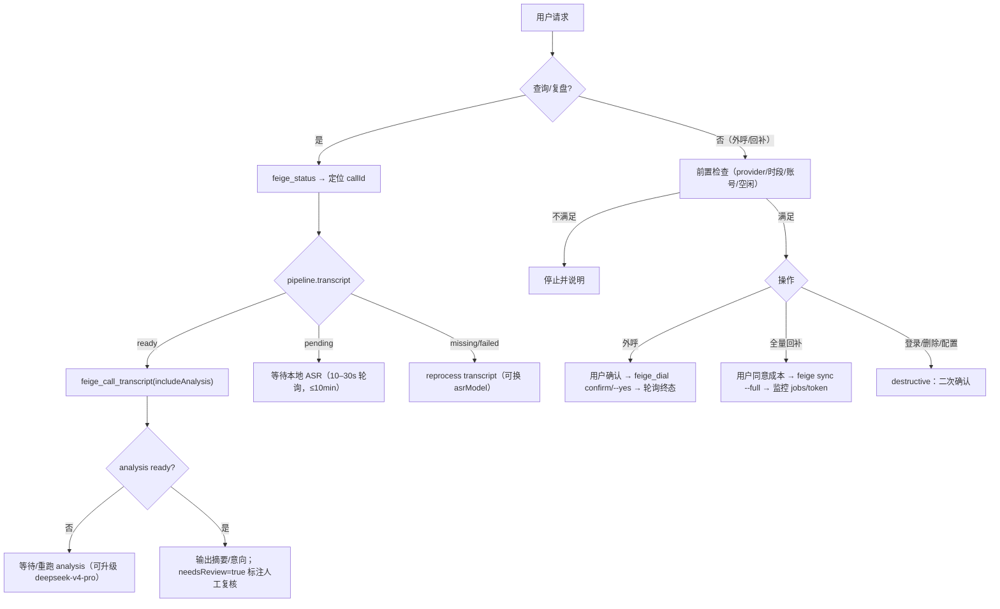

# 飞鸽外呼（feige）

> 安装：`npm run install:cli`（`feige` 命令）；完整命令见 `feige --help-all` 与 [docs/16-CLI参考手册.md](../../docs/16-CLI参考手册.md)。服务端 REST 文档：`http://127.0.0.1:8710/api/v1/docs`。

本地平台把飞鸽外呼封装为可编程能力：**CLI `feige ...`** 与 **MCP server `feige-outbound`** 都是本地 REST 的薄封装。
v1 关键事实：**转写全部由平台自建 ASR（MiniMax `asr-1.0`）生成，不使用上游转写**；AI 后处理是**平台内置 DeepSeek**（默认 `deepseek-chat`，失败升级 `deepseek-v4-pro`）。呼出是真实外呼（回拨模式，先振铃坐席手机，需人工接听）。

## 何时使用

- ✅ 「查今天/某客户的话单」「这通电话聊了啥」「转写/摘要/意向」「外呼结果如何」
- ✅ 「给 138****0000 打个电话」「继续跟进李总」「平台/账号能不能拨」
- ✅ 「把历史通话全量转写/分析一遍」
- ❌ 仅浏览上游网页/CRM 数据（本平台只读上游话单+本地写入）
- ❌ 要求 AI 直接对客户讲话、批量呼出、绕过拨打时段（v1 明确不做）

## 前置检查（写操作前必做）

| # | 检查 | 通过标准 | 不通过 |
| --- | --- | --- | --- |
| 1 | 平台进程 | `feige health` 退出码 0 | 告知未运行；不要自行启动 |
| 2 | 平台健康 | `feige status --json`：`db.ok==true` 且 `accounts.online>0` | 报告失败项；建议 `feige doctor` |
| 3 | 后处理 provider | `feige doctor --probe-providers --json`：`provider:minimax`/`provider:deepseek` 不为 fail | 读操作照常；ASR/分析相关写操作暂停并提示人工检查密钥/白名单 |
| 4 | 拨打时段 | `dialWindow.open==true`（07:50–22:00 Asia/Shanghai） | 写操作暂停/排队；告知 `nextOpenAt` |
| 5 | 目标账号 | `feige account health <id> --json`：`state==online` | `ACCOUNT_LOGIN_REQUIRED` → 触发登录 1 次或转人工 |
| 6 | 账号空闲 | `busy.inCall==false` | 等待当前通话结束或换账号 |
| 7 | 幂等与用户确认 | 已生成 `idempotencyKey`；用户明确要求 | 不执行 |

```bash
feige health --json
feige status --json | jq '.data.dialWindow.open'
feige doctor --probe-providers --json | jq '.data.summary'
feige account health main --json
```

## 工具选择

- agent 支持 MCP 且已注册 `feige-outbound` → **MCP 优先**（结构化 schema/注解）
- 需要 shell 管道、`--wait` 阻塞、provider 自检 → **CLI**
- 写操作（外呼/登录/重跑/删除）优先 CLI（有交互确认与 `--dry-run`，人类在环）

### MCP 与 CLI 对照

| 任务 | MCP | CLI |
| --- | --- | --- |
| 平台健康 | `feige_health` / `feige_status` | `feige health --json` / `feige status --json` |
| 今日话单 | `feige_call_list {dateFrom,dateTo,status,size}` | `feige calls list --date 2026-11-14 --status ended --json` |
| 转写+分析 | `feige_call_transcript {callId,includeAnalysis:true}` | `feige calls transcript <callId> --include-analysis --json` |
| 单通详情 | `feige_call_detail {callId}` | `feige calls detail <callId> --json` |
| 录音 | `feige_call_audio {callId}`（下载 URL） | `feige calls audio <callId> --out ./recordings/` |
| 发起呼出 | `feige_dial {to,accountId,customerName,idempotencyKey,confirm:true}` | `feige dial '138****0000' --account main --yes` |
| 跟踪结果 | `feige_call_get` / 订阅 `feige://calls/{callId}` | `feige events --types 'call.*' --follow --duration 120s` |
| 重跑 ASR/分析 | `feige_call_reprocess {callId,stages,options:{asrModel,analysisModel},confirm:true}` | `feige calls reprocess <callId> --stage transcript --asr-model asr-1.0 --yes` |
| 全量回补 | `feige_sync_start {mode:"full",confirm:true}` + `feige_job_list` | `feige sync --full --wait`，`feige jobs list --type asr,analysis` |
| 词表 | `feige_terms_list` / `feige_term_add` | `feige term list` / `feige term add --from 复萌 --from 福梦 --to 孚盟` |

> MCP 写工具需服务端以 `feige mcp --allow-write` 启动，且每次调用传 `confirm: true`；MCP 不接受明文密码（用 `passwordEnv`/`secretRef`）。

## 决策流程（精简）



## 能力与边界

**能做**：查话单/详情/流水线；读本地 ASR 转写（`source=asr`、`provider=minimax:asr-1.0`、`speakerLabel/chunkIndex`）；读 DeepSeek 分析（摘要/意向/`promptVersion`/`usage`/`speakerMapping.needsReview`）；发起呼出并跟踪；重跑 ASR/分析（可指定模型/prompt）；全量回补（不设预算上限，token/耗时可见）；词表归一；平台/账号健康与 provider 自检。

**不能做**：无人值守 AI 语音外呼（回拨需坐席接听）；绕过拨打时段/风控；批量呼出/删除/登录；使用上游转写；直接调用 MiniMax/DeepSeek 或索取其 Key；保证转写/分析 100% 正确（低置信标 `needsReview` 需人工复核）；实时音频流。

## 错误码 → 下一步动作（40 个稳定码）

> 完整语义以 docs/01 §5.4 为准；「重试」均为有上限自动重试，超过上限转人工；写操作重试必须复用幂等键。

| code（retryable） | agent 动作 |
| --- | --- |
| `INVALID_REQUEST`(否) `VALIDATION_FAILED`(否) `CONFIG_INVALID`(否) | 修正参数/配置后重试；不自动重试 |
| `UNAUTHORIZED`(否) | 检查本地 API token（`--token-file`/`FOP_API_TOKEN`）；提示 `feige doctor --fix-token` |
| `FORBIDDEN`(否) `ACCOUNT_DISABLED`(否) `ACCOUNT_UPSTREAM_MISMATCH`(否) | 停止；提示人工处理（启用账号/核对配置） |
| `NOT_FOUND` `CALL_NOT_FOUND` `ACCOUNT_NOT_FOUND` `JOB_NOT_FOUND` `TERM_NOT_FOUND`(均否) | list 重新定位 ID；不反复重试 |
| `ACCOUNT_LOGIN_REQUIRED`(是) | 触发 `feige_account_login`（≤1 次），成功后重试原操作 |
| `ACCOUNT_LOGIN_IN_PROGRESS`(是) | 等 `details.loginJobId` 作业（≤120s）；不重复提交 |
| `ACCOUNT_LOGIN_FAILED`(是) | 最多再试 1 次；仍失败转人工（滑块/风控） |
| `ACCOUNT_BUSY`(是) | 等当前通话（`details.busyCallId`）或换账号 |
| `CALL_OUTSIDE_DIAL_WINDOW`(是) | 不重试；告知窗口与 `retryAfter`；用户同意下可排队 |
| `CALL_REJECTED_BY_UPSTREAM`(否) `CALL_NOT_DIALABLE`(否) | 透传原因；不自动重试 |
| `CALL_ALREADY_TERMINAL`(否) `CALL_NOT_CANCELABLE`(否) | 改为查询/结束；不重试 |
| `CALL_TRACKING_TIMEOUT`(是) | **停止自动重试**；人工核对话单防重复呼出 |
| `IDEMPOTENCY_CONFLICT`(否) | 换新幂等键或先查首次结果 |
| `RATE_LIMITED`(是) | 按 `retryAfterMs` 指数退避（≤3 次） |
| `UPSTREAM_UNREACHABLE`/`UPSTREAM_AUTH_EXPIRED`/`UPSTREAM_RATE_LIMITED`/`UPSTREAM_RESPONSE_INVALID`(均是) | 退避重试 ≤3 次；`AUTH_EXPIRED` 先重登；持续失败报障 |
| `UPSTREAM_BUSINESS_ERROR`(否) | 透传上游原因；不自动重试 |
| `AUDIO_NOT_AVAILABLE`(否) | 未接通/无录音；不能转写，如实告知 |
| `AUDIO_NOT_READY`(是) | 等待重试（10/30/60s，≤3 次） |
| `AUDIO_DOWNLOAD_FAILED`(是) | 重试 1 次；可 `reprocess --stage audio` |
| `TRANSCRIPT_NOT_AVAILABLE`(否) | 无有效语音/ASR 无法产出；可 `reprocess --stage transcript` 1 次，仍无则说明 |
| `TRANSCRIPT_PENDING`(是) | **等待本地 ASR**（`details.stage=asr_queued/asr_running/role_mapping/analysis`）；10–30s 轮询，≤10min |
| `ASR_FAILED`(是) | `reprocess --stage transcript`（可换 `asrModel`）1 次；仍失败报 `details.providerCode`，提示检查 MiniMax 密钥/配额 |
| `ANALYSIS_FAILED`(是) | `reprocess --stage analysis`（可升级 `deepseek-v4-pro`/`promptVersion`）1 次；仍失败报 model/usage |
| `DB_UNAVAILABLE`(是) `SERVICE_UNAVAILABLE`(是) `INTERNAL_ERROR`(是) | 退避重试 ≤3 次；持续失败附 `requestId` 报障 |
| `NOT_IMPLEMENTED`(否) | 停止；说明 v1 未上线 |

## 安全与合规

1. **副作用/计费**：`feige_dial` 是真实外呼（先振铃坐席手机、可能产生话费）；`reprocess`/`sync --full` 消耗 ASR/LLM token（不设预算上限但记录 `usage`）；操作前告知用户并获明确确认。
2. **禁止批量骚扰**：无批量工具；禁止循环 `dial`；同号 60s 冷却；单账号回拨串行；遵守 07:50–22:00；拒绝/投诉号码停止外呼。
3. **第三方云数据**：录音发送 MiniMax ASR、转写发送 DeepSeek（平台内置 pipeline，个人信息委托处理）；发送前默认手机号脱敏；agent 不得在平台外二次外发，不得索取/输出第三方 Key（仅 `sk-...` 占位）。
4. **脱敏**：汇报/日志中号码掩码（`138****0000`）；JWT/密码/API Key 禁止出现在对话与输出。
5. **人工介入**：`ACCOUNT_LOGIN_FAILED`、`CALL_TRACKING_TIMEOUT`、`ASR_FAILED`/`ANALYSIS_FAILED` 重试后仍失败、`needsReview=true`、全量回补用量异常 → 停止并转人工。
6. **审计**：汇报附 `requestId`/`callId`/`jobId`；不隐藏失败（`no_answer` 不得说成已接通）。

## 典型剧本

### 剧本 1：复盘今日已接通通话（含转写/分析质量）
1. `feige_status`；`feige_call_list {dateFrom:今天,dateTo:今天,status:ended,size:100}`。
2. 对 `pipeline.transcript=ready` 的通话 `feige_call_transcript {callId,includeAnalysis:true}`。
3. 输出脱敏表格：callId、号码掩码、时长、意向、摘要、`needsReview`；标注 `promptVersion`。
4. `needsReview=true` 的内容不当作确定结论，列出人工复核清单。

### 剧本 2：给指定客户外呼并跟踪
1. 前置检查（provider/时段/账号/空闲）；告知副作用并获用户确认。
2. 生成幂等键 → `feige_dial {to,accountId,customerName,idempotencyKey,confirm:true}`（或 CLI `--yes`）。
3. 轮询 `feige_call_get`（15–30s，≤5min）或订阅 `feige://calls/{callId}` 到终态。
4. `ended` 后等 `pipeline.transcript/analysis` ready，读摘要；`no_answer` 建议回访但**不自动重拨**。

### 剧本 3：ASR/分析失败或低置信的重跑与复核
1. `feige_call_detail` 看 `pipeline.audio/transcript/analysis`、`transcript.needsReview`、`chunkCount`。
2. `TRANSCRIPT_PENDING` → 按 stage 等待；`failed` → `reprocess --stage transcript --asr-model asr-1.0`。
3. `ANALYSIS_FAILED` → `reprocess --stage analysis --analysis-model deepseek-v4-pro --prompt-version analysis-v1`。
4. `needsReview=true` → 人工听录音/核对 speakerMapping 后再使用。
5. 同一 call+stage 5 分钟内不重复提交；仍失败转人工。

### 剧本 4：全量回补历史话单的 ASR 与分析
1. `feige doctor --probe-providers` 确认 MiniMax/DeepSeek 可用。
2. 向用户说明：不设预算上限、可能数小时、记录 token/耗时、可暂停/恢复；获明确同意。
3. `feige sync --full --wait`（或 MCP `feige_sync_start {mode:"full",confirm:true}`）。
4. 监控：`feige jobs list --type asr,analysis --status queued,running`；失败分布 `--status failed`。
5. 用量：`AnalysisPayload.usage`（prompt/completion/total tokens、latencyMs）；异常（用量激增/失败率>5%）暂停并报告。
6. 抽检 `needsReview` 清单并汇总完成数/失败原因/token 用量/耗时。

## 参考

- CLI 契约：`docs/06-CLI契约.md`；MCP 契约：`docs/07-MCP工具契约.md`；本技能对应的完整规格：`docs/08-SKILL契约.md`
- REST 契约：`docs/05-对外API契约.md`；后处理规格：`docs/13-后处理规格（ASR与LLM）.md`；错误码：`docs/01-决策与约定.md §5.4`
